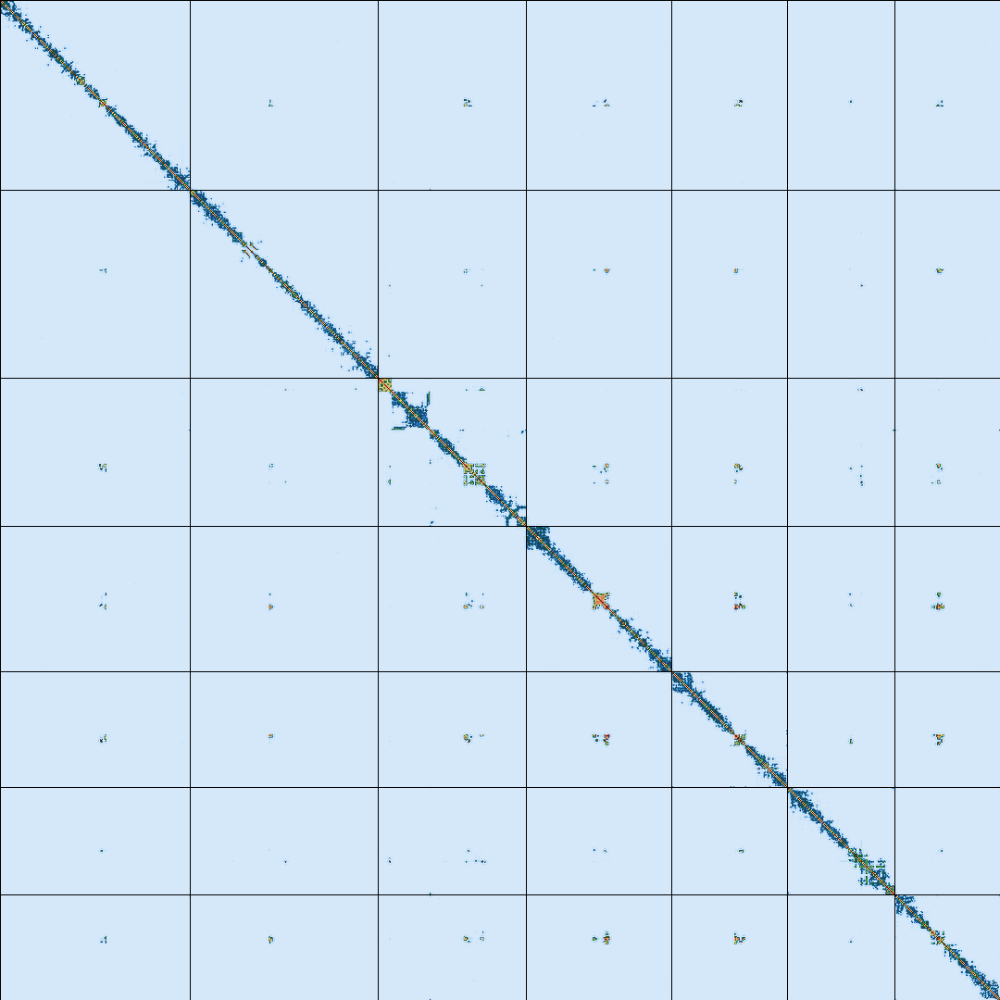

# Scaffolding com Hi-C

!!! abstract "Resumo"
    Tutorial prático de scaffolding de genomas a partir de dados de Hi-C. Nele você verá o pipeline completo: alinhamento, scaffolding, construção do mapa de contato, edição do mapa, exportação e avaliação.

**Autor:** Dr. Leonardo C. J. Corvalan

**Instituição:** Laboratório de Genética & Biodiversidade (LGBio), ICB/UFG

**Contato:** [lcjocorvalan@gmail.com](mailto:lcjocorvalan@gmail.com)

**Última atualização:** novembro de 2026

---

## :material-target: Objetivos de aprendizagem

Ao final deste curso, você será capaz de:

- [ ] Realizar o scaffolding de um genoma
- [ ] Avaliar a qualidade do scaffolding
- [ ] Criar mapas de contato e editá-los
- [ ] Exportar o resultado em formato FASTA

## :material-book-open-variant: Glossário rápido

| Termo | O que significa |
| --- | --- |
| **Hi-C** | Técnica que captura quais regiões do DNA estão próximas dentro do núcleo celular. Regiões próximas no espaço tendem a estar próximas no genoma. |
| **Contig** | Trecho contínuo de DNA montado a partir das reads, sem lacunas (N) entre eles. |
| **Scaffold** | Conjunto de contigs ordenados e orientados, separados por lacunas (N). |
| **Mapa de contato** | Matriz que mostra quantas vezes cada par de regiões do genoma aparece junto nos dados Hi-C. |


## :material-clock-outline: Carga horária estimada

**Cerca de 3 horas**

## :material-tools: Pré-requisitos

| Item | Detalhes |
| --- | --- |
| Curso anterior | [Bash / Linux para bioinformática](../bash/index.md) |
| Biologia molecular | Conceitos de sequenciamento, genoma, contig e scaffold |
| Softwares | SRA Toolkit, bwa-mem2, samtools, PicardCommandLine, QUAST, YaHS, Pretext |
| Recursos | Servidor Linux com ≥ 32 GB de RAM, ≥ 16 threads e ≥ 50 GB de armazenamento |

!!! warning "Programas no computador pessoal"
    A etapa de visualização exige a instalação local do programa PretextView. Veja as instruções na Etapa 6.

!!! warning "Compatibilidade com outros servidores"
    Este pipeline foi desenvolvido e testado no servidor de Bioinformática do LGBio (ICB/UFG). Em outro ambiente, podem ser necessários ajustes em caminhos de instalação, gerenciadores de ambiente (conda, `module load`), versões de software e parâmetros de memória e threads.

!!! tip "Dica para iniciantes"
    As variáveis declaradas na Etapa 0 existem apenas no terminal em que foram criadas. Se você fechar o terminal ou trocar de sessão, declare-as novamente antes de continuar.

## :material-database: Dados do exercício

Os dados utilizados nesse tutorial foram obtidos do genomas *Athalia rosae* (Turnip Sawfly; Arhropoda; Insecta; Hymenoptera; Athaliidae), no qual os dados HiC foram produzido utilizado o kit Dovetail Hi-C kit (enzimas de restrição ^GATC,G^ANTC,C^TNAG,T^TAA)  . Projeto de origem: [PRJEB45200](https://www.ncbi.nlm.nih.gov/bioproject/731793).

!!! quote "Referência"
    Liam M. Crowley & Gavin R. Broad.The genome sequence of the Turnip Sawfly, Athalia rosae(Linnaeus, 1758). *Wellcome Open Research* 2023 Feb 7; 8:87 . doi: 10.12688/wellcomeopenres.18993.1

---

## :material-numeric-0-circle: Etapa 0 — Obtenção dos dados e declaração de variáveis

Os dados estão disponíveis no ENA e no SRA. Aqui usamos o `fastq-dump` do SRA Toolkit, baixando apenas as primeiras 50 milhões de reads.

```bash
# Criando as pastas do projeto
mkdir Cafe_hic
cd Cafe_hic
mkdir 0.DadosBrutos

# Baixando apenas 50 milhões de reads
fastq-dump ERR6054981 \
    --split-files \
    --gzip \
    -N 1 \
    -X 50000000 \
    --outdir 0.DadosBrutos
```

!!! note "Servidor do LGBio"
    No servidor do laboratório, não é necessário baixar os dados. Crie apenas links simbólicos para os arquivos já existentes:

```bash
ln -s /media/lgbio-nas1/leonardocorvalan/Cafe_hic/0.DadosBrutos/ERR6054981_1_50M.fastq.gz 0.DadosBrutos/
ln -s /media/lgbio-nas1/leonardocorvalan/Cafe_hic/0.DadosBrutos/ERR6054981_2_50M.fastq.gz 0.DadosBrutos/

# Copiando os genomas
cp /media/lgbio-nas1/leonardocorvalan/Cafe_hic/0.DadosBrutos/Athrosa_ref.fasta 0.DadosBrutos/
cp /media/lgbio-nas1/leonardocorvalan/Cafe_hic/0.DadosBrutos/Athrosa_draft.fasta 0.DadosBrutos/
```

Agora declare as variáveis que serão usadas no restante do tutorial:

```bash
GENOME="0.DadosBrutos/Athrosa_draft.fasta"
REFERENCE="0.DadosBrutos/Athrosa_ref.fasta"
HIC_R1="0.DadosBrutos/ERR6054981_1_50M.fastq.gz"
HIC_R2="0.DadosBrutos/ERR6054981_2_50M.fastq.gz"
PREFIX="Athrosa_draft"
```

---

## :material-numeric-1-circle: Etapa 1 — Filtro de qualidade das reads

### 1.1 Remoção dos 5 primeiros nucleotídeos

```bash
mkdir -p 1.Dadosfiltrados

HIC_R1_FILT="1.Dadosfiltrados/${PREFIX}.R1.filt.fastq.gz"
HIC_R2_FILT="1.Dadosfiltrados/${PREFIX}.R2.filt.fastq.gz"

fastp \
    -i "$HIC_R1" \
    -I "$HIC_R2" \
    -o "$HIC_R1_FILT" \
    -O "$HIC_R2_FILT" \
    --trim_front1 5 \
    --trim_front2 5 \
    --html "1.Dadosfiltrados/${PREFIX}.fastp.html" \
    --json "1.Dadosfiltrados/${PREFIX}.fastp.json" \
    --thread 12
```

??? note "Ver saída do comando"

    ```text
    Read1 before filtering:
    total reads: 50000000
    total bases: 7550000000
    Q20 bases: 7521196750(99.6185%)
    Q30 bases: 7521196750(99.6185%)
    Q40 bases: 0(0%)

    Read2 before filtering:
    total reads: 50000000
    total bases: 7550000000
    Q20 bases: 7456704650(98.7643%)
    Q30 bases: 7456704650(98.7643%)
    Q40 bases: 0(0%)

    Read1 after filtering:
    total reads: 49193230
    total bases: 7163642091
    Q20 bases: 7163642091(100%)
    Q30 bases: 7163642091(100%)
    Q40 bases: 0(0%)

    Read2 after filtering:
    total reads: 49193230
    total bases: 7163642091
    Q20 bases: 7163642091(100%)
    Q30 bases: 7163642091(100%)
    Q40 bases: 0(0%)

    Filtering result:
    reads passed filter: 98386460
    reads failed due to low quality: 1567602
    reads failed due to too many N: 45938
    reads failed due to too short: 0
    reads with adapter trimmed: 1033964
    bases trimmed due to adapters: 38305740

    Duplication rate: 13.6184%

    Insert size peak (evaluated by paired-end reads): 271

    JSON report: 1.Dadosfiltrados/Athrosa_draft.fastp.json
    HTML report: 1.Dadosfiltrados/Athrosa_draft.fastp.html

    fastp v1.0.1, time used: 138 seconds
    ```

### Checklist da Etapa 1

- [ ] Tenho `1.Dadosfiltrados/Athrosa_draft.R1.filt.fastq.gz`
- [ ] Tenho `1.Dadosfiltrados/Athrosa_draft.R2.filt.fastq.gz`
- [ ] Tenho `1.Dadosfiltrados/Athrosa_draft.fastp.html`

!!! tip "Resultados pré-computados"
    [:material-file-document: Relatório fastp](Precomput/Athrosa_draft.fastp.html)

!!! note "Alternativas"
    Outros programas, como FastQC e Trimmomatic, também podem ser usados para filtrar as reads.

---

## :material-numeric-2-circle: Etapa 2 — Alinhamento

### 2.0 Preparando o ambiente

```bash
mkdir -p 2.Alinhamento/

# Ativando o ambiente conda
conda init
source ~/.bashrc
conda activate bwa-mem2

OUTPUT_ALI="2.Alinhamento/$PREFIX"
```

### 2.1 Alinhamento das reads

```bash
# Indexando o genoma de referência
bwa-mem2 index "$GENOME"

# Alinhando as reads Hi-C e gerando o BAM ordenado
bwa-mem2 mem -5SP -t 12 \
    "$GENOME" \
    "$HIC_R1_FILT" \
    "$HIC_R2_FILT" |
    samtools view -@ 8 -b - |
    samtools sort -@ 8 -o "${OUTPUT_ALI}.sorted.bam" -
```

??? note "Ver saída do comando"

    ```text
    Looking to launch executable "/usr/local/bin/miniconda/miniconda3/envs/bwa-mem2/bin/bwa-mem2.avx512bw", simd = .avx512bw
    Launching executable "/usr/local/bin/miniconda/miniconda3/envs/bwa-mem2/bin/bwa-mem2.avx512bw"
    [bwa_index] Pack FASTA... 0.68 sec
    * Entering FMI_search
    init ticks = 12299086986
    ref seq len = 343590058
    binary seq ticks = 24322317392
    build suffix-array ticks = 271284447962
    ref_seq_len = 343590058
    count = 0, 100801266, 171795029, 242788792, 343590058
    BWT[68179083] = 4
    CP_SHIFT = 6, CP_MASK = 63
    sizeof CP_OCC = 64
    pos: 42948758, ref_seq_len__: 42948757
    max_occ_ind = 5368594
    build fm-index ticks = 47972530754
    Total time taken: 116.7363

    [...]

    Runtime profile:

            Time taken for main_mem function: 1314.63 sec

            IO times (sec) :
            Reading IO time (reads) avg: 181.62, (181.62, 181.62)
            Writing IO time (SAM) avg: 156.57, (156.57, 156.57)
            Reading IO time (Reference Genome) avg: 0.24, (0.24, 0.24)
            Index read time avg: 0.46, (0.46, 0.46)

            Overall time (sec) (Excluding Index reading time):
            PROCESS() (Total compute time + (read + SAM) IO time) : 1313.11
            MEM_PROCESS_SEQ() (Total compute time (Kernel + SAM)), avg: 1267.86, (1267.86, 1267.86)

            SAM Processing time (sec):
            --WORKER_SAM avg: 284.38, (284.38, 284.38)

            Kernels' compute time (sec):
            Total kernel (smem+sal+bsw) time avg: 969.59, (969.59, 969.59)
                    SMEM compute avg: 438.68, (439.81, 437.80)
                    SAL compute avg: 96.90, (97.30, 96.52)
                    MEM_SA avg: 57.19, (57.39, 57.00)
                    BSW time, avg: 359.18, (359.51, 358.75)

    Important parameter settings:
            BATCH_SIZE: 512
            MAX_SEQ_LEN_REF: 256
            MAX_SEQ_LEN_QER: 128
            MAX_SEQ_LEN8: 128
            SEEDS_PER_READ: 500
            SIMD_WIDTH8 X: 64
            SIMD_WIDTH16 X: 32
            AVG_SEEDS_PER_READ: 64
    [bam_sort_core] merging from 5 files and 8 in-memory blocks...
    ```

#### Parâmetros e programas usados

**bwa-mem2 mem**

| Parâmetro | Função |
| --- | --- |
| `mem` | Executa o algoritmo MEM (Maximal Exact Matches). |
| `-5` | Para alinhamentos divididos (split), escolhe como primário o alinhamento mais próximo da extremidade 5'. |
| `-S` | Desativa o *mate rescue*. |
| `-P` | Desativa a etapa de pareamento. |
| `-t 12` | Usa 12 threads. |

**samtools**

| Comando/parâmetro | Função |
| --- | --- |
| `view -b` | Converte SAM para BAM (binário e comprimido). |
| `-@ 8` | Usa 8 threads adicionais. |
| `-` | Lê a entrada da STDIN, neste caso o pipe do bwa-mem2. |
| `sort -o` | Ordena os alinhamentos e define o arquivo de saída. |
| `index` | Cria o arquivo de índice (`.bai`) do BAM. |


### 2.2 Adicionando read groups e removendo duplicatas

```bash
# 2.2.1 Adicionando read groups
PicardCommandLine AddOrReplaceReadGroups \
    INPUT="$OUTPUT_ALI.sorted.bam" \
    OUTPUT="$OUTPUT_ALI.RG.bam" \
    RGID="${PREFIX}_HiC" \
    RGLB="${PREFIX}_HiC_library" \
    RGSM="$PREFIX" \
    RGPL=ILLUMINA \
    RGPU="${PREFIX}_HiC" \
    SORT_ORDER=coordinate \
    CREATE_INDEX=true

# 2.2.2 Criando diretório temporário
mkdir -p temp

# 2.2.3 Identificando e removendo duplicatas
PicardCommandLine MarkDuplicates \
    INPUT="$OUTPUT_ALI.RG.bam" \
    OUTPUT="$OUTPUT_ALI.hic.bam" \
    METRICS_FILE="${OUTPUT_ALI}.hic_metrics.txt" \
    TMP_DIR=temp \
    ASSUME_SORT_ORDER=coordinate \
    VALIDATION_STRINGENCY=LENIENT \
    REMOVE_DUPLICATES=TRUE
```

**AddOrReplaceReadGroups**

| Parâmetro | Função |
| --- | --- |
| `INPUT` | BAM de entrada, ordenado por coordenadas. |
| `OUTPUT` | BAM de saída, já com read groups. |
| `RGID` | Identificador do read group (uma corrida de sequenciamento). |
| `RGLB` | Identificador da biblioteca. |
| `RGSM` | Identificador da amostra biológica. |
| `RGPL` | Plataforma de sequenciamento (ILLUMINA). |
| `RGPU` | Unidade de sequenciamento (flowcell, lane ou corrida). |
| `SORT_ORDER` | Ordenação do BAM de saída (coordinate). |
| `CREATE_INDEX` | Gera o índice `.bai` junto com o BAM. |

**MarkDuplicates** (identifica duplicatas de PCR e de leitura óptica)

| Parâmetro | Função |
| --- | --- |
| `INPUT` | BAM de entrada, com read groups. |
| `OUTPUT` | BAM de saída, sem duplicatas. |
| `METRICS_FILE` | Relatório estatístico sobre as duplicatas. |
| `TMP_DIR` | Diretório dos arquivos temporários. |
| `ASSUME_SORT_ORDER` | Informa que o BAM já está ordenado por coordenadas. |
| `VALIDATION_STRINGENCY` | Tolerância a registros malformados (`LENIENT` avisa e continua). |
| `REMOVE_DUPLICATES` | Remove as duplicatas em vez de apenas marcá-las. |

??? note "Ver saída do comando"

    ```text
    [...]

    INFO    2026-11-21 15:01:32     MarkDuplicates  Written    20.000.000 records.  Elapsed time: 00:02:51s.  Time for last 10.000.000:   84s.  Last read position: Chr5.2:10.865.106
    INFO    2026-11-21 15:02:58     MarkDuplicates  Written    30.000.000 records.  Elapsed time: 00:04:17s.  Time for last 10.000.000:   85s.  Last read position: Chr4:17.188.734
    INFO    2026-11-21 15:04:33     MarkDuplicates  Written    40.000.000 records.  Elapsed time: 00:05:52s.  Time for last 10.000.000:   95s.  Last read position: Chr3.1:11.124.327
    INFO    2026-11-21 15:06:32     MarkDuplicates  Written    50.000.000 records.  Elapsed time: 00:07:51s.  Time for last 10.000.000:  118s.  Last read position: Chr2.1:11.149.538
    INFO    2026-11-21 15:08:36     MarkDuplicates  Written    60.000.000 records.  Elapsed time: 00:09:55s.  Time for last 10.000.000:  123s.  Last read position: Chr1.2:2.721.899
    INFO    2026-11-21 15:10:16     MarkDuplicates  Before output close freeMemory: 1377762240; totalMemory: 1409286144; maxMemory: 32178700288
    INFO    2026-11-21 15:10:16     MarkDuplicates  After output close freeMemory: 540920152; totalMemory: 570425344; maxMemory: 32178700288
    [Sat Nov 21 15:10:16 BRT 2026] picard.sam.markduplicates.MarkDuplicates done. Elapsed time: 22,04 minutes.
    Runtime.totalMemory()=5704253

    [...]

    INFO    2026-11-21 18:27:04     MarkDuplicates  After generateDuplicateIndexes freeMemory: 20218906456; totalMemory: 28303163392; maxMemory: 32178700288
    INFO    2026-11-21 18:27:04     MarkDuplicates  Marking 21005357 records as duplicates.
    INFO    2026-11-21 18:27:04     MarkDuplicates  Found 0 optical duplicate clusters.
    INFO    2026-11-21 18:27:04     MarkDuplicates  Reads are assumed to be ordered by: coordinate
    INFO    2026-11-21 18:28:27     MarkDuplicates  Written    10.000.000 records.  Elapsed time: 00:01:21s.  Time for last 10.000.000:   81s.  Last read position: Chr7:9.635.368
    INFO    2026-11-21 18:29:49     MarkDuplicates  Written    20.000.000 records.  Elapsed time: 00:02:44s.  Time for last 10.000.000:   82s.  Last read position: Chr6.2:2.001.336
    INFO    2026-11-21 18:31:14     MarkDuplicates  Written    30.000.000 records.  Elapsed time: 00:04:08s.  Time for last 10.000.000:   84s.  Last read position: Chr5.2:10.374.358
    INFO    2026-11-21 18:32:34     MarkDuplicates  Written    40.000.000 records.  Elapsed time: 00:05:28s.  Time for last 10.000.000:   79s.  Last read position: Chr4:9.225.438
    INFO    2026-11-21 18:33:57     MarkDuplicates  Written    50.000.000 records.  Elapsed time: 00:06:51s.  Time for last 10.000.000:   83s.  Last read position: Chr3.2:6.715.116
    INFO    2026-11-21 18:35:17     MarkDuplicates  Written    60.000.000 records.  Elapsed time: 00:08:12s.  Time for last 10.000.000:   80s.  Last read position: Chr3.1:14.237.385
    INFO    2026-11-21 18:36:38     MarkDuplicates  Written    70.000.000 records.  Elapsed time: 00:09:33s.  Time for last 10.000.000:   80s.  Last read position: Chr2.1:6.289.121
    INFO    2026-11-21 18:37:58     MarkDuplicates  Written    80.000.000 records.  Elapsed time: 00:10:52s.  Time for last 10.000.000:   79s.  Last read position: Chr1.3:2.419.226
    INFO    2026-11-21 18:39:18     MarkDuplicates  Written    90.000.000 records.  Elapsed time: 00:12:13s.  Time for last 10.000.000:   80s.  Last read position: Chr1.2:8.870.971
    INFO    2026-11-21 18:40:21     MarkDuplicates  Before output close freeMemory: 1646198072; totalMemory: 1677721600; maxMemory: 32178700288
    INFO    2026-11-21 18:40:21     MarkDuplicates  After output close freeMemory: 640236792; totalMemory: 671088640; maxMemory: 32178700288
    [Sat Nov 21 18:40:21 BRT 2026] picard.sam.markduplicates.MarkDuplicates done. Elapsed time: 26,09 minutes.
    ```

### 2.3 Indexação e estatísticas do BAM

```bash
# 2.3.1 Indexando o BAM final
samtools index -@ 8 "$OUTPUT_ALI.hic.bam"

# 2.3.2 Avaliando a qualidade do alinhamento
perl /media/lgbio-nas1/lcorvalan/Hic-data/Mfa/get_stats.pl "$OUTPUT_ALI.hic.bam" > "$OUTPUT_ALI.hic.bam.stats"

# 2.3.3 Removendo arquivos intermediários e temporários
conda deactivate
rm -f "$OUTPUT_ALI.sorted.bam" "$OUTPUT_ALI.RG.bam"
rm -rf temp/
```

### Checklist da Etapa 2

- [ ] Examinei `2.Alinhamento/Athrosa_draft.hic.bam`
- [ ] Examinei `2.Alinhamento/Athrosa_draft.hic.bam.stats`

!!! tip "Resultados pré-computados"
    [:material-file-document: Athrosa_draft.hic.bam.stats](Precomput/Athrosa_draft.hic.bam.stats)

---

## :material-numeric-3-circle: Etapa 3 — Scaffolding automatizado

### 3.0 Preparando os dados

```bash
mkdir -p 3.Scaffolding
OUTPUT_SCF="3.Scaffolding/$PREFIX"

# Indexando o genoma de entrada
samtools faidx "$GENOME"
```

!!! note "Se você não rodou as etapas anteriores"
    Copie o BAM já pronto do servidor para a pasta de alinhamento:

```bash
mkdir -p 2.Alinhamento
cp /media/lgbio-nas1/leonardocorvalan/2.Alinhamento/Athrosa_draft.hic.bam 2.Alinhamento/
```

### 3.1 Executando o YaHS

```bash
yahs "$GENOME" "${OUTPUT_ALI}.hic.bam" \
    -e GATC,GANTC,CTNAG,TTAA \
    -o "$OUTPUT_SCF" \
    --no-contig-ec
```

??? note "Ver saída do comando"

    ```text
    [...]
    [I::run_yahs] scaffolding round 6 resolution = 500000
    [I::run_scaffolding] starting norm estimation...
    [I::run_scaffolding] starting link estimation...
    [I::inter_link_norms] using noise level 217.299
    [I::inter_link_norms] using new radius 4 (47) as noise ratio exceeds threshold 0.100
    [I::inter_link_norms] average link count: 9.267 126.000 0.074
    [I::run_scaffolding] starting scaffolding graph contruction...
    [I::run_yahs] scaffolding round 6 done
    [I::print_asm_stats] assembly stats:
    [I::print_asm_stats]  N50: 25437943 (n = 3)
    [I::print_asm_stats]  N90: 18094263 (n = 7)
    [I::run_yahs] scaffolding round 7 resolution = 1000000
    [I::run_scaffolding] starting norm estimation...
    [I::run_scaffolding] starting link estimation...
    [I::inter_link_norms] using noise level 831.925
    [I::inter_link_norms] using new radius 2 (22) as noise ratio exceeds threshold 0.100
    [I::inter_link_norms] average link count: 3.399 21.000 0.162
    [I::run_scaffolding] starting scaffolding graph contruction...
    [I::run_yahs] scaffolding round 7 done
    [I::print_asm_stats] assembly stats:
    [I::print_asm_stats]  N50: 25437943 (n = 3)
    [I::print_asm_stats]  N90: 18094263 (n = 7)
    [I::run_yahs] scaffolding round 8 resolution = 2000000
    [I::run_scaffolding] starting norm estimation...
    [E::calc_norms] no enough bands (8) for norm calculation, try a higher resolution
    [W::run_scaffolding] No enough bands for norm calculation... End of scaffolding round.
    [I::run_yahs] scaffolding round 8 done
    [I::print_asm_stats] assembly stats:
    [I::print_asm_stats]  N50: 25437943 (n = 3)
    [I::print_asm_stats]  N90: 18094263 (n = 7)
    [I::main] writing FASTA file for scaffolds
    [I::write_fasta_file_from_agp] Number sequences: 7
    [I::write_fasta_file_from_agp] Number bases: 171795929
    [I::print_asm_stats] assembly stats:
    [I::print_asm_stats]  N50: 25437943 (n = 3)
    [I::print_asm_stats]  N90: 18094263 (n = 7)
    [I::print_asm_stats]  N100: 18094263 (n = 7)
    [I::main] Version: 1.2.2
    [I::main] CMD: yahs -e GATC,GANTC,CTNAG,TTAA -o 3.Scaffolding/Athrosa_draft --no-contig-ec 0.DadosBrutos/Athrosa_draft.fasta 2.Alinhamento/Athrosa_draft.hic.bam
    [I::main] Real time: 151.754 sec; CPU: 140.729 sec; Peak RSS: 1.211 G
    ```

### Arquivos de saída

| Arquivo | Descrição |
| --- | --- |
| `3.Scaffolding/Athrosa_draft_scaffolds_final.fa` | Sequências finais dos scaffolds. |
| `3.Scaffolding/Athrosa_draft_scaffolds_final.agp` | Arquivo AGP com a organização dos contigs nos scaffolds. |
| `3.Scaffolding/Athrosa_draft.bin` | Informações binárias usadas pelo YaHS. |
| `3.Scaffolding/Athrosa_draft_scaffolds_track.bed` | Posição dos contigs e scaffolds. |
| `3.Scaffolding/Athrosa_draft_scaffolds_final_break.agp` | Quebras feitas durante o scaffolding. |

### Checklist da Etapa 3

- [ ] Tenho `3.Scaffolding/Athrosa_draft_scaffolds_final.fa`
- [ ] Tenho `3.Scaffolding/Athrosa_draft_scaffolds_final.agp`

---

## :material-numeric-4-circle: Etapa 4 — Avaliação da qualidade

```bash
GENOME_SCF="${OUTPUT_SCF}_scaffolds_final.fa"

mkdir -p 4.Qualidade/

quast.py -r "$REFERENCE" \
    "$GENOME" \
    "$GENOME_SCF" \
    -o 4.Qualidade/YaHS -t 24 \
    --labels "Draft,YaHS"
```

??? note "Ver saída do comando"

    ```text
    Running NA-NGA calculation...
      1  Draft, Largest alignment = 22018860, NA50 = 12997401, NGA50 = 12997401, LA50 = 5, LGA50 = 5
      2  YaHS, Largest alignment = 32626017, NA50 = 25056680, NGA50 = 25056680, LA50 = 3, LGA50 = 3
    Done.

    2026-11-21 19:10:01
    Running Genome analyzer...
      NOTICE: No file with genomic features were provided. Use the --features option if you want to specify it.

      NOTICE: No file with operons were provided. Use the -O option if you want to specify it.
      1  Draft
      2  YaHS
      2  Analysis is finished.
      1  Analysis is finished.
    Done.

    NOTICE: Genes are not predicted by default. Use --gene-finding or --glimmer option to enable it.

    2026-11-21 19:10:40
    Creating large visual summaries...
    This may take a while: press Ctrl-C to skip this step..
      1 of 1: Creating Icarus viewers...
    Done

    2026-11-21 19:10:43
    RESULTS:
      Text versions of total report are saved to .../4.Qualidade/YaHS/report.txt, report.tsv, and report.tex
      Text versions of transposed total report are saved to .../4.Qualidade/YaHS/transposed_report.txt, transposed_report.tsv, and transposed_report.tex

      HTML version (interactive tables and plots) is saved to .../4.Qualidade/YaHS/report.html
      Icarus (contig browser) is saved to .../4.Qualidade/YaHS/icarus.html
      Log is saved to .../4.Qualidade/YaHS/quast.log

    Finished: 2026-11-21 19:10:43
    Elapsed time: 0:02:30.201762
    NOTICEs: 4; WARNINGs: 2; non-fatal ERRORs: 0

    Thank you for using QUAST!
    ```

!!! note "Como interpretar"
    Compare o **Draft** com o **YaHS**: o maior alinhamento (*Largest alignment*) e o NA50/NGA50 devem aumentar após o scaffolding. Use o `report.html` para ver as tabelas e gráficos interativos.

### Checklist da Etapa 4

- [ ] Comparei as estatísticas geradas pelo QUAST

!!! tip "Resultados pré-computados"
    [:material-file-document: Relatório QUAST](Precomput/report1.html)

---

## :material-numeric-5-circle: Etapa 5 — Gerando o mapa de contato

### 5.1 Criando os arquivos de visualização

```bash
GENOME_SCF_BIN="${OUTPUT_SCF}.bin"
GENOME_SCF_AGP="${OUTPUT_SCF}_scaffolds_final.agp"

samtools faidx "$GENOME_SCF"

mkdir -p logs

# Pares ordenados (entrada do juicer_tools e do PretextMap)
(/media/lgbio-nas1/lcorvalan/programas/YaHS/yahs/juicer pre "$GENOME_SCF_BIN" "$GENOME_SCF_AGP" "$GENOME.fai" 2> logs/tmp_juicer_pre.log \
    | LC_ALL=C sort -k2,2d -k6,6d -T . --parallel=8 -S32G \
    | awk 'NF' > "$GENOME_SCF".alignments_sorted.txt.part) \
    && mv "$GENOME_SCF".alignments_sorted.txt.part "$GENOME_SCF".alignments_sorted.txt

cut -f1-2 "$GENOME_SCF".fai > "$GENOME_SCF".chrom.sizes
```

!!! note "Atenção ao arquivo `.fai`"
    Na primeira parte do script, informe o arquivo de índice `.fai` do genoma original (`$GENOME.fai`), gerado pelo `samtools faidx`.

### 5.2 Gerando o mapa com PretextMap

```bash
conda activate pretext

(awk 'BEGIN{print "## pairs format v1.0"} {print "#chromsize:\t"$1"\t"$2} END {print "#columns:\treadID\tchr1\tpos1\tchr2\tpos2\tstrand1\tstrand2"}' "$GENOME_SCF".chrom.sizes; \
 awk '{print ".\t"$2"\t"$3"\t"$6"\t"$7"\t.\t."}' "$GENOME_SCF".alignments_sorted.txt) \
 | PretextMap -o "$GENOME_SCF".pretext

```

### 5.3 Gerando a imagem do mapa atual

```bash
PretextSnapshot -m "$GENOME_SCF".pretext --sequences "=full" -o "$GENOME_SCF".pretext.snapshot
```

??? note "Ver saída do comando"

    ```text
    [PretextMap status] :: Skipping format/columns line
    [PretextMap status] :: Finishing header processing
    [PretextMap status] :: Processing 7 contigs
    [PretextMap status] :: Building node array and calculating genome length
    [PretextMap status] :: Added contig 0: length=32626517, total=32626517
    [PretextMap status] :: Added contig 1: length=32361258, total=64987775
    [PretextMap status] :: Added contig 2: length=25438043, total=90425818
    [PretextMap status] :: Added contig 3: length=25061522, total=115487340
    [PretextMap status] :: Added contig 4: length=19729607, total=135216947
    [PretextMap status] :: Added contig 5: length=18484419, total=153701366
    [PretextMap status] :: Added contig 6: length=18094563, total=171795929
    [PretextMap status] :: Allocating hash table
    [PretextMap status] :: Sorting contigs by length in descending order
    [PretextMap status] :: Creating final contig array
    [PretextMap status] :: Finalized contig 0: 0-32626517
    [PretextMap status] :: Finalized contig 1: 32626517-64987775
    [PretextMap status] :: Finalized contig 2: 64987775-90425818
    [PretextMap status] :: Finalized contig 3: 90425818-115487340
    [PretextMap status] :: Finalized contig 4: 115487340-135216947
    [PretextMap status] :: Finalized contig 5: 135216947-153701366
    [PretextMap status] :: Finalized contig 6: 153701366-171795929
    [PretextMap status] :: Creating hash table
    [PretextMap status] :: Mapping to 7 sequences, sorted by length, descending
    [PretextMap status] :: 38.1 M read-pairs mapped
    [PretextMap status] :: Creating MipMaps...
    [PretextMap status] :: Equalising contrast...
    [PretextMap status] :: Compressing textures...
    [PretextMap status] :: 528/528 (100.00%) texture blocks written to disk

    [PretextSnapshot status] :: Running with AVX2 CPU extensions
    [PretextSnapshot status] :: Input map: '3.Scaffolding/Athrosa_draft_scaffolds_final.fa.pretext'
    [PretextSnapshot status] :: Output format: png
    [PretextSnapshot status] :: Output resolution: 1080 pixels
    [PretextSnapshot status] :: Colour map: Three Wave Blue-Green-Yellow
    [PretextSnapshot status] :: Minimum texels per image: 64
    [PretextSnapshot status] :: Grid size: 1 pixel
    [PretextSnapshot status] :: Grid colour: 000000ff
    [PretextSnapshot status] :: Output path: '3.Scaffolding/Athrosa_draft_scaffolds_final.fa.pretext.snapshot/Athrosa_draft_scaffolds_final.fa_'
    [PretextSnapshot status] :: Indexing file segment at offset 0...
    [PretextSnapshot status] :: File indexed
    [PretextSnapshot status] :: LOD buffer extent: 2048 pixels (map axis 32768 texels)
    [PretextSnapshot status] :: Texture load queue: 698880 bytes per texture, 6291456 byte arena
    [PretextSnapshot status] :: Generating image(s)...
    [PretextSnapshot status] :: FillImage: sequence grid done
    [PretextSnapshot status] :: FillImage: complete
    [PretextSnapshot status] :: '3.Scaffolding/Athrosa_draft_scaffolds_final.fa.pretext.snapshot/Athrosa_draft_scaffolds_final.fa_FullMap.png' written to disk
    ```

#### Mapa de contato original



!!! tip "Resultados pré-computados"
    O PretextView roda no seu computador. Baixe o arquivo `.pretext` para a sua máquina antes de começar:

    [:material-download: Baixar o arquivo .pretext](https://drive.google.com/file/d/1jEdXSN1lhQzajWB-UUX97MIOxWOK6-bJ/view?usp=sharing)


### Checklist da Etapa 5

- [ ] Tenho `3.Scaffolding/Athrosa_draft_scaffolds_final.fa.pretext`

---

## :material-numeric-6-circle: Etapa 6 — Editando o mapa de contato

!!! warning "Transfira os arquivos para o computador local"
    O PretextView roda no seu computador. Copie o arquivo `.pretext` do servidor para a sua máquina antes de começar.

### 6.1 Instalando o PretextView

1. Acesse [as releases do PretextView](https://github.com/sanger-tol/PretextView/releases).
2. Escolha o seu sistema operacional:
    - `PretextViewAI-1.0.7-Windows-x86_64.exe`, para Windows
    - `PretextViewAI-1.0.7-Linux-x86_64.deb`, para Linux
3. Após baixar o arquivo, execute a instalação.

!!! warning "Erro de Java"
    O programa exige que o Java esteja instalado no seu computador.

### 6.2 Carregando os dados

1. Abra o programa.
2. Selecione a pasta onde está o arquivo.
3. Carregue o arquivo `.pretext`.

### 6.3 Comandos de navegação

| Ação | Comando |
| --- | --- |
| Mover o mapa | Botão esquerdo do mouse (arrastar) |
| Selecionar | Botão direito do mouse |
| Selecionar contig inteiro | Botão de rolagem (clique) |
| Mudar a cor | Setas para cima e para baixo |

### 6.4 Modos de edição

| Tecla | Modo |
| --- | --- |
| `E` | Modo de edição (*Edit mode*) |
| `S` | Modo de scaffolds (*Scaffold mode*) |
| `M` | Modo de metadados |

**Modo edição**

| Ação | Comando |
| --- | --- |
| Mover | Botão esquerdo do mouse |
| Selecionar | Botão direito do mouse |
| Sair do modo | `E` |
| Editar no modo scaffold | `S` |
| Quebrar um contig | `V` |
| Desfazer (Ctrl+Z) | `Q` |
| Refazer (Ctrl+Y) | `W` |

**Modo scaffold**

| Ação | Comando |
| --- | --- |
| Selecionar scaffolds | Clique e arraste |
| Apagar a seleção | `Espaço` |

**Modo metadados**

| Ação | Comando |
| --- | --- |
| Escolher a informação | Setas para a esquerda e para a direita |
| Apagar | `Espaço` |

### 6.5 Salvando e exportando

1. Pressione `Esc`.
2. Clique em **Generate AGP**.
3. Salve o arquivo.

!!! tip "Resultados pré-computados"
    [:material-file-document: Arquivo AGP editado](Precomput/Athrosa_draft_scaffolds_final.fa.pretext.agp_1)

---

## :material-numeric-7-circle: Etapa 7 — Convertendo o AGP para FASTA

Transfira o arquivo `.agp` editado de volta para o servidor e colocar na pasta *3.Scaffolding*

```bash

# carregando programa
export PATH=$PATH:/media/lgbio-nas1/lcorvalan/.local/bin


pretext-to-asm -a "$GENOME_SCF" -p "$GENOME_SCF".pretext.agp_1 -o "$GENOME_SCF".pretext.fa


```


??? note "Ver saída do comando"
    ```text

	WARNING: Overwriting FAI index file '/media/lgbio-nas1/leonardocorvalan/Cafe_hic/3.Scaffolding/Athrosa_draft_scaffolds_final.fa.fai'
	    Created: '3.Scaffolding/Athrosa_draft_scaffolds_final.fa.pretext.1.info.yaml'
	    Created: '3.Scaffolding/Athrosa_draft_scaffolds_final.fa.pretext.hap1.1.primary.fa'
	    Created: '3.Scaffolding/Athrosa_draft_scaffolds_final.fa.pretext.hap1.1.primary.agp'
	    Created: '3.Scaffolding/Athrosa_draft_scaffolds_final.fa.pretext.hap1.1.primary.fa'
	    Created: '3.Scaffolding/Athrosa_draft_scaffolds_final.fa.pretext.1.haplotigs.agp'
	    Created: '3.Scaffolding/Athrosa_draft_scaffolds_final.fa.pretext.hap1.1.primary.chromosome.list.csv'
	    Created: '3.Scaffolding/Athrosa_draft_scaffolds_final.fa.pretext.1.chr_report.csv'
	  Log saved: '3.Scaffolding/Athrosa_draft_scaffolds_final.fa.pretext.log'
    ```


!!! note "Qual é o arquivo final?"
    O nome exato do arquivo gerado depende da versão da ferramenta. No exemplo do curso, o resultado aparece como:

    `3.Scaffolding/Athrosa_draft_scaffolds_final.fa.pretext.hap1.1.primary.fa`

    Confira com `ls 3.Scaffolding/` e use o nome que aparecer.
    

### Parabéns! Você concluiu o tutorial!

Que a Força esteja com você! 🚀

---

## :material-license: Licença

Este tutorial é distribuído sob a licença [CC BY 4.0](https://creativecommons.org/licenses/by/4.0/). Reutilize com atribuição.

## :material-bug: Reportar problemas

Encontrou algum erro, comando desatualizado ou tem alguma sugestão? Abra uma [issue no GitHub](https://github.com/LGBIO-UFG/PRO-BIOINFO/issues).
