# Montagem de genomas com dados Nanopore

!!! abstract "Resumo"
    Tutorial prático de montagem *de novo* de genomas a partir de dados de sequenciamento Oxford Nanopore Technology (ONT). Cobrimos o pipeline completo: download dos dados públicos, controle de qualidade, filtragem, exploração de contaminantes (Kraken2), estimativa do genoma por k-mers (GenomeScope2), três estratégias de montagem (Flye, Hifiasm, NextDenovo), avaliação comparativa (QUAST, Merqury, BUSCO), polimento (Medaka), scaffolding com e sem referência (RagTag, LongStitch), escolha da montagem final e checagem de contaminação na montagem com BlobTools.

**Autora:** Profa. Renata de Oliveira Dias
**Instituição:** Laboratório de Genética & Biodiversidade (LGBio) — Instituto de Ciências Biológicas (ICB) / Universidade Federal de Goiás (UFG)
**Contato:** [renata_dias@ufg.br](mailto:renata_dias@ufg.br)
**Última atualização:** Novembro de 2026

## :material-target: Objetivos de aprendizagem

Ao final deste curso, você será capaz de:

- [ ] Baixar dados públicos de sequenciamento ONT de bancos como ENA/SRA
- [ ] Avaliar qualidade de leituras longas com NanoPlot
- [ ] Remover adaptadores residuais (Porechop_ABI) e filtrar por qualidade/tamanho (Chopper)
- [ ] Explorar contaminantes com Kraken2 e interpretar suas limitações
- [ ] Estimar parâmetros do genoma a partir de k-mers (Meryl + GenomeScope2)
- [ ] Executar e comparar montagens *de novo* com Flye, Hifiasm e NextDenovo
- [ ] Avaliar montagens com QUAST, Merqury e BUSCO e entender por que essas métricas podem discordar
- [ ] Polir montagens com Medaka e avaliar quando o polimento realmente ajuda
- [ ] Realizar scaffolding com referência (RagTag) e sem referência (LongStitch)
- [ ] Checar contaminação diretamente na montagem com BlobToolKit
- [ ] Escolher a montagem final com base em múltiplas evidências, não em uma métrica isolada
- [ ] Descrever a montagem final cromossomo a cromossomo

## :material-clock-outline: Carga horária estimada

**~16 horas** 

## :material-tools: Pré-requisitos

| Item                | Detalhes                                                                          |
| ------------------- | ---------------------------------------------------------------------------------- |
| Curso anterior      | [Bash / Linux para bioinformática](../bash/index.md)                              |
| Biologia molecular  | Conceitos de sequenciamento, genoma, contig, scaffold                             |
| Softwares           | SRA Toolkit, NanoPlot, Porechop_ABI, Chopper, Kraken2, Meryl, GenomeScope2, Flye, Hifiasm, NextDenovo, QUAST, Merqury, BUSCO, purge_dups, Medaka, BWA, Polypolish, pypolca, RagTag, LongStitch, minimap2, samtools, tidk, BLAST+, BlobToolKit |
| Recurso             | Servidor Linux com boa quantidade de RAM/threads e várias dezenas de GB de storage livre |

## :material-database: Dados do exercício

Utilizamos duas amostras de *Saccharomyces cerevisiae* sequenciadas com PromethION, depositadas no projeto [PRJEB77686](https://www.ebi.ac.uk/ena/browser/view/PRJEB77686) (ScRAP — *S. cerevisiae* Reference Assembly Panel), parte do estudo de Loegler et al. (2025).

| Amostra | Accession | Linhagem | Bases | Read N50 |
|---------|-----------|----------|-------|----------|
| **Scer1** | [ERR13367646](https://www.ebi.ac.uk/ena/browser/view/ERR13367646) | CBS7963 | ~1 Gb | 5.592 bp |
| **Scer2** | [ERR13375657](https://www.ebi.ac.uk/ena/browser/view/ERR13375657) | SM.9.1.AL1 | ~108 Mb | 1.865 bp |

!!! warning "Atenção à cobertura"
    Scer2 tem cobertura muito baixa para montagem de qualidade — usada aqui apenas para fins didáticos e comparação entre montadores. Ao longo do tutorial ela serve de contraste: mesma metodologia, dados insuficientes.

!!! quote "Referência"
    Loegler V. et al. *From genotype to phenotype with 1,086 near telomere-to-telomere yeast genomes*. **Nature** (2025). DOI: [10.1038/s41586-025-08616-z](https://doi.org/10.1038/s41586-025-08616-z)

## :material-download: Acesso aos resultados pré-computados

Não conseguiu rodar localmente, ou quer conferir se seus resultados batem com os esperados? Os principais outputs deste tutorial estão disponíveis para download/visualização direta na página, próximos de cada etapa. Resumo dos principais:

<div class="grid cards" markdown>

-   :material-file-chart: **Relatórios de QC**

    NanoPlot (bruto e filtrado), estatísticas Kraken2, GenomeScope2

    [:octicons-arrow-right-24: Ir para a Etapa 2](#etapa-2-controle-de-qualidade-dos-dados-brutos-nanoplot)

-   :material-chart-box: **Avaliação das montagens**

    QUAST, Merqury e BUSCO — antes e depois do polimento

    [:octicons-arrow-right-24: Ir para a Etapa 9](#etapa-9-avaliacao-da-qualidade-das-montagens)

-   :material-dna: **Montagens (FASTA)**

    Flye, Hifiasm, NextDenovo, versões polidas e scaffolded

    [:octicons-arrow-right-24: Ver data/exemplos/nanopore/assemblies/](https://github.com/LGBIO-UFG/PRO-BIOINFO/tree/main/data/exemplos/nanopore/assemblies)

-   :material-image-multiple: **Blob plots (BlobToolKit)**

    Checagem de contaminação nas montagens finais

    [:octicons-arrow-right-24: Ir para a Etapa 13](#etapa-13-checagem-e-remocao-de-contaminantes-blobtoolkit)
</div>

---

## :material-numeric-1-circle: Etapa 1 — Obtenção dos dados públicos

Os dados estão disponíveis no ENA. O download pode ser feito via SRA Toolkit (`prefetch` + `fasterq-dump`) ou diretamente via FTP do ENA, que costuma ser mais rápido.

**Opção 1 — SRA Toolkit (recomendado para arquivos grandes):**

```bash
mkdir -p 0.DadosBrutos
prefetch ERR13367646 -O 0.DadosBrutos
fasterq-dump 0.DadosBrutos/ERR13367646/ERR13367646.sra --outdir 0.DadosBrutos --outfile Scer1.fastq --progress && gzip 0.DadosBrutos/Scer1.fastq

prefetch ERR13375657 -O 0.DadosBrutos
fasterq-dump 0.DadosBrutos/ERR13375657/ERR13375657.sra --outdir 0.DadosBrutos --outfile Scer2.fastq --progress && gzip 0.DadosBrutos/Scer2.fastq
```

??? info "O que faz cada comando"
    | Comando | O que faz |
    |---|---|
    | `mkdir -p 0.DadosBrutos` | Cria a pasta dos dados brutos. O `-p` evita erro se a pasta já existir. |
    | `prefetch ERR... -O 0.DadosBrutos` | Baixa do SRA o arquivo `.sra` da corrida indicada (`ERR...`) para a pasta dada em `-O`. |
    | `fasterq-dump ... --outdir --outfile --progress` | Converte o `.sra` em FASTQ, com o nome definido em `--outfile`. O `--progress` mostra o andamento. |
    | `&& gzip ...` | O `&&` só roda o `gzip` se o comando anterior terminou sem erro. O `gzip` comprime o FASTQ (`.fastq.gz`). |

??? note "Ver saída do comando"

    ```bash
    $ prefetch ERR13367646 -O 0.DadosBrutos

    2026-06-04T14:11:41 prefetch.3.0.0: Current preference is set to retrieve SRA Normalized Format files with full base quality scores.
    2026-06-04T14:11:42 prefetch.3.0.0: 1) Downloading 'ERR13367646'...
    2026-06-04T14:11:42 prefetch.3.0.0: SRA Normalized Format file is being retrieved, if this is different from your preference, it may be due to current file availability.
    2026-06-04T14:11:42 prefetch.3.0.0:  Downloading via HTTPS...
    2026-06-04T14:12:36 prefetch.3.0.0:  HTTPS download succeed
    2026-06-04T14:12:37 prefetch.3.0.0:  'ERR13367646' is valid
    2026-06-04T14:12:37 prefetch.3.0.0: 1) 'ERR13367646' was downloaded successfully
    2026-06-04T14:12:37 prefetch.3.0.0: 'ERR13367646' has 0 unresolved dependencies

    $ fasterq-dump 0.DadosBrutos/ERR13367646/ERR13367646.sra --outdir 0.DadosBrutos --outfile Scer1.fastq --progress && gzip 0.DadosBrutos/Scer1.fastq
    join   :|-------------------------------------------------- 100%   
    concat :|-------------------------------------------------- 100%   
    spots read      : 349,324
    reads read      : 349,324
    reads written   : 349,324

    $ prefetch ERR13375657 -O 0.DadosBrutos

    2026-06-04T14:12:12 prefetch.3.0.0: Current preference is set to retrieve SRA Normalized Format files with full base quality scores.
    2026-06-04T14:12:12 prefetch.3.0.0: 1) Downloading 'ERR13375657'...
    2026-06-04T14:12:12 prefetch.3.0.0: SRA Normalized Format file is being retrieved, if this is different from your preference, it may be due to current file availability.
    2026-06-04T14:12:12 prefetch.3.0.0:  Downloading via HTTPS...
    2026-06-04T14:12:27 prefetch.3.0.0:  HTTPS download succeed
    2026-06-04T14:12:27 prefetch.3.0.0:  'ERR13375657' is valid
    2026-06-04T14:12:27 prefetch.3.0.0: 1) 'ERR13375657' was downloaded successfully
    2026-06-04T14:12:27 prefetch.3.0.0: 'ERR13375657' has 0 unresolved dependencies

    $ fasterq-dump 0.DadosBrutos/ERR13375657/ERR13375657.sra --outdir 0.DadosBrutos --outfile Scer2.fastq --progress && gzip 0.DadosBrutos/Scer2.fastq
    join   :|-------------------------------------------------- 100%   
    concat :|-------------------------------------------------- 100%   
    spots read      : 57,918
    reads read      : 57,918
    reads written   : 57,918
    ```


**Opção 2 — wget direto do ENA (mais simples):**

```bash
mkdir -p 0.DadosBrutos
wget -P 0.DadosBrutos ftp://ftp.sra.ebi.ac.uk/vol1/fastq/ERR133/046/ERR13367646/ERR13367646.fastq.gz
wget -P 0.DadosBrutos ftp://ftp.sra.ebi.ac.uk/vol1/fastq/ERR133/057/ERR13375657/ERR13375657.fastq.gz

# Renomear para padronizar
mv 0.DadosBrutos/ERR13367646.fastq.gz 0.DadosBrutos/Scer1.fastq.gz
mv 0.DadosBrutos/ERR13375657.fastq.gz 0.DadosBrutos/Scer2.fastq.gz
```

??? info "O que faz cada comando"
    | Comando | O que faz |
    |---|---|
    | `mkdir -p 0.DadosBrutos` | Cria a pasta dos dados brutos. O `-p` evita erro se a pasta já existir. |
    | `wget -P 0.DadosBrutos <endereço>` | Baixa o arquivo do FTP do ENA e salva na pasta dada em `-P`. |
    | `mv <antigo> <novo>` | Renomeia o arquivo (`ERR...fastq.gz` → `Scer1.fastq.gz`), para os nomes ficarem padronizados no resto do tutorial. |

??? note "Ver saída do comando"

    ```bash
    $ wget -P 0.DadosBrutos ftp://ftp.sra.ebi.ac.uk/vol1/fastq/ERR133/046/ERR13367646/ERR13367646.fastq.gz
    --2026-07-07 23:37:28--  ftp://ftp.sra.ebi.ac.uk/vol1/fastq/ERR133/046/ERR13367646/ERR13367646.fastq.gz
           => '0.DadosBrutos/ERR13367646.fastq.gz'
    Resolving ftp.sra.ebi.ac.uk (ftp.sra.ebi.ac.uk)... 193.62.193.165
    Connecting to ftp.sra.ebi.ac.uk (ftp.sra.ebi.ac.uk)|193.62.193.165|:21... connected.

    Logging in as anonymous ... Logged in!
    ==> SYST ... done.    ==> PWD ... done.
    ==> TYPE I ... done.  ==> CWD (1) /vol1/fastq/ERR133/046/ERR13367646 ... done.
    ==> SIZE ERR13367646.fastq.gz ... 952022096
    ==> PASV ... done.    ==> RETR ERR13367646.fastq.gz ... done.
    Length: 952022096 (908M) (unauthoritative)
    
    ERR13367646.fastq.gz             100%[=========================================================>] 907.92M   597KB/s    in 31m 15s 

    2026-07-08 00:08:45 (496 KB/s) - '0.DadosBrutos/ERR13367646.fastq.gz' saved [952022096]

    $ wget -P 0.DadosBrutos ftp://ftp.sra.ebi.ac.uk/vol1/fastq/ERR133/057/ERR13375657/ERR13375657.fastq.gz
    --2026-07-08 00:08:45--  ftp://ftp.sra.ebi.ac.uk/vol1/fastq/ERR133/057/ERR13375657/ERR13375657.fastq.gz
           => '0.DadosBrutos/ERR13375657.fastq.gz'
    Resolving ftp.sra.ebi.ac.uk (ftp.sra.ebi.ac.uk)... 193.62.193.165
    Connecting to ftp.sra.ebi.ac.uk (ftp.sra.ebi.ac.uk)|193.62.193.165|:21... connected.
    Logging in as anonymous ... Logged in!
    ==> SYST ... done.    ==> PWD ... done.
    ==> TYPE I ... done.  ==> CWD (1) /vol1/fastq/ERR133/057/ERR13375657 ... done.
    ==> SIZE ERR13375657.fastq.gz ... 101703198
    ==> PASV ... done.    ==> RETR ERR13375657.fastq.gz ... done.
    Length: 101703198 (97M) (unauthoritative)

    ERR13375657.fastq.gz             100%[=========================================================>]  96.99M   605KB/s    in 4m 2s   

    2026-07-08 00:12:49 (410 KB/s) - '0.DadosBrutos/ERR13375657.fastq.gz' saved [101703198]
    ```

**Verificar integridade após o download:**
```bash
gzip -t 0.DadosBrutos/Scer1.fastq.gz && echo "OK" || echo "CORROMPIDO"
gzip -t 0.DadosBrutos/Scer2.fastq.gz && echo "OK" || echo "CORROMPIDO"
```

??? info "O que faz cada comando"
    | Comando | O que faz |
    |---|---|
    | `gzip -t <arquivo>` | Testa se o arquivo comprimido está íntegro, sem descomprimir. |
    | `&& echo "OK" || echo "CORROMPIDO"` | Se o teste passou (`&&`), escreve OK; se falhou (`||`), escreve CORROMPIDO. |

??? note "Ver saída do comando"

    ```bash
    $ gzip -t 0.DadosBrutos/Scer1.fastq.gz && echo "OK" || echo "CORROMPIDO"
    OK
    $ gzip -t 0.DadosBrutos/Scer2.fastq.gz && echo "OK" || echo "CORROMPIDO"
    OK
    ```

## :material-numeric-2-circle: Etapa 2 — Controle de qualidade dos dados brutos (NanoPlot)

O NanoPlot gera estatísticas e gráficos interativos para avaliar a qualidade das reads antes de qualquer processamento.


```bash
mkdir 1.QC_dadosbrutos/
NanoPlot --fastq 0.DadosBrutos/Scer1.fastq.gz -o 1.QC_dadosbrutos/ --prefix Scer1_ --threads 20 --loglength
NanoPlot --fastq 0.DadosBrutos/Scer2.fastq.gz -o 1.QC_dadosbrutos/ --prefix Scer2_ --threads 20 --loglength
```

??? info "O que faz cada comando"
    | Comando | O que faz |
    |---|---|
    | `mkdir 1.QC_dadosbrutos/` | Cria a pasta dos relatórios de qualidade. |
    | `NanoPlot --fastq <reads>` | Calcula estatísticas e gera gráficos de qualidade e comprimento das reads. |
    | `-o` / `--prefix` | Pasta de saída e prefixo dos arquivos (para não misturar Scer1 e Scer2 na mesma pasta). |
    | `--threads 20` | Número de processadores usados. |
    | `--loglength` | Usa escala logarítmica no eixo do comprimento, o que facilita ver reads curtas e longas no mesmo gráfico. |

**Visualizar estatísticas**

```bash
more 1.QC_dadosbrutos/Scer1_NanoStats.txt
more 1.QC_dadosbrutos/Scer2_NanoStats.txt 
```

??? info "O que faz cada comando"
    | Comando | O que faz |
    |---|---|
    | `more <arquivo>` | Mostra o arquivo na tela, uma página por vez (espaço avança, `q` sai). O `NanoStats.txt` é o resumo numérico do NanoPlot. |

??? note "Ver saída do comando"

    ```bash
    $ more 1.QC_dadosbrutos/Scer1_NanoStats.txt 
    General summary:         
    Mean read length:                 2,909.1
    Mean read quality:                   11.6
    Median read length:               1,599.0
    Median read quality:                 12.8
    Number of reads:                349,324.0
    Read length N50:                  5,592.0
    STDEV read length:                3,578.7
    Total bases:              1,016,222,921.0
    Number, percentage and megabases of reads above quality cutoffs
    >Q10:	274368 (78.5%) 840.0Mb
    >Q15:	84994 (24.3%) 262.8Mb
    >Q20:	2246 (0.6%) 2.5Mb
    >Q25:	34 (0.0%) 0.0Mb
    >Q30:	4 (0.0%) 0.0Mb
    Top 5 highest mean basecall quality scores and their read lengths
    1:	31.2 (217)
    2:	30.9 (265)
    3:	30.4 (102)
    4:	30.1 (264)
    5:	29.4 (213)
    Top 5 longest reads and their mean basecall quality score
    1:	88753 (7.6)
    2:	82457 (11.0)
    3:	79554 (4.3)
    4:	71052 (12.0)
    5:	49948 (13.8)
    
    $ more 1.QC_dadosbrutos/Scer2_NanoStats.txt 
    General summary:         
    Mean read length:                1,865.7
    Mean read quality:                  10.9
    Median read length:              1,127.0
    Median read quality:                12.2
    Number of reads:                57,918.0
    Read length N50:                 3,145.0
    STDEV read length:               2,252.9
    Total bases:               108,057,273.0
    Number, percentage and megabases of reads above quality cutoffs
    >Q10:	41441 (71.6%) 82.1Mb
    >Q15:	12940 (22.3%) 26.6Mb
    >Q20:	561 (1.0%) 0.8Mb
    >Q25:	16 (0.0%) 0.0Mb
    >Q30:	0 (0.0%) 0.0Mb
    Top 5 highest mean basecall quality scores and their read lengths
    1:	28.5 (139)
    2:	28.0 (142)
    3:	27.9 (552)
    4:	26.9 (310)
    5:	26.7 (387)
    Top 5 longest reads and their mean basecall quality score
    1:	88333 (7.8)
    2:	71372 (13.3)
    3:	70398 (13.3)
    4:	63207 (10.1)
    5:	46792 (5.1)
    ```


**O que observar:**
- **N50:** tamanho da read mediana ponderada (quanto maior, melhor para montagem)
- **Mean quality:** qualidade média das bases (Q≥10 é aceitável para Nanopore R9.4)
- **Total bases:** cobertura estimada (divida pelo tamanho do genoma ~12Mb)
- Compare Scer1 (~1Gb, ~83x) e Scer2 (~108Mb, ~9x). Como veremos ao longo desse tutorial, a diferença de cobertura vai impactar diretamente a qualidade das montagens.

!!! tip "Resultados pré-computados"
    [:material-file-document: Scer1_NanoStats.txt](outputs/qc/Scer1_NanoStats.txt) ·
    [:material-file-document: Scer2_NanoStats.txt](outputs/qc/Scer2_NanoStats.txt) ·
    [:material-file-chart: Relatório NanoPlot Scer1 (HTML)](outputs/qc/Scer1_NanoPlot-report.html){ target=_blank } ·
    [:material-file-chart: Relatório NanoPlot Scer2 (HTML)](outputs/qc/Scer2_NanoPlot-report.html){ target=_blank }

!!! danger "Atenção: verifique se a biblioteca foi preparada com DCS (controle lambda)"
    O **DCS** (*DNA Control Strand*) é uma fita controle de DNA: um amplicon padrão de **3,6 kb** que mapeia na extremidade 3' do genoma do fago lambda e é usado como controle positivo de qualidade. Ele vem incluído nos kits de ligação da Oxford Nanopore e é adicionado na etapa de *end-prep*, quando o protocolo indica.

    Se o DCS foi usado, as reads de lambda estão misturadas às reads da sua amostra e **devem ser removidas**. A remoção é feita na **Etapa 3.2**, junto com o filtro de qualidade e tamanho (Chopper).

    **Não sabe se o DCS foi usado?** Abra o gráfico *Read lengths vs Average read quality* do relatório NanoPlot. Um **pico estreito e muito alto por volta de 3,6 kb** no histograma de comprimento, com uma "coluna" vertical de pontos nessa mesma posição no gráfico de dispersão, indica a presença do DCS:

    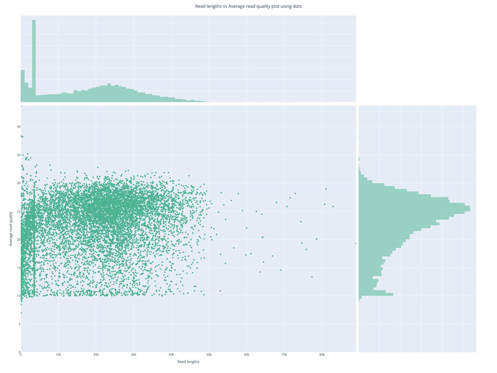

    Nesse caso, siga as instruções do quadro **"Se a biblioteca tiver DCS (lambda)"** na Etapa 3.2.

## :material-numeric-3-circle: Etapa 3 — Filtragem dos dados brutos de sequenciamento

Esta etapa é dividida em duas partes: remoção de adaptadores residuais e filtro por qualidade/tamanho.

### 3.1 Remoção de adaptadores (Porechop_ABI)

O Porechop_ABI usa uma abordagem *ab initio*. Ele descobre os adaptadores diretamente nas reads sem precisar de um banco de dados externo, o que é útil quando o kit de sequenciamento não é conhecido.

!!! warning "Atenção aos avisos"
    Mensagens como *"this file is already trimmed"* indicam que o basecaller já removeu parte dos adaptadores. O Porechop_ABI ainda consegue remover resíduos remanescentes. Veja no resultado que adaptadores SQK-NSK007 foram encontrados e removidos em ambas as amostras.

```bash
conda init
source ~/.bashrc
mkdir -p 2.Filtragem-dadosbrutos
conda activate porechop_abi_env
porechop_abi -abi -i 0.DadosBrutos/Scer1.fastq.gz -o 2.Filtragem-dadosbrutos/Scer1_trim.fastq.gz --format fastq.gz -t 20 
porechop_abi -abi -i 0.DadosBrutos/Scer2.fastq.gz -o 2.Filtragem-dadosbrutos/Scer2_trim.fastq.gz --format fastq.gz -t 20 
conda deactivate
```

??? info "O que faz cada comando"
    | Comando | O que faz |
    |---|---|
    | `conda init` + `source ~/.bashrc` | Configuram o terminal para usar o `conda activate` (só é preciso na primeira vez). |
    | `mkdir -p 2.Filtragem-dadosbrutos` | Cria a pasta das reads filtradas. |
    | `conda activate porechop_abi_env` | Entra no ambiente onde o Porechop_ABI está instalado. |
    | `porechop_abi -abi` | Remove adaptadores. O `-abi` (*ab initio*) descobre os adaptadores a partir das próprias reads, sem depender de uma lista fixa. |
    | `-i` / `-o` / `--format fastq.gz` | Arquivo de entrada, arquivo de saída e formato da saída (FASTQ comprimido). |
    | `-t 20` | Número de processadores usados. |
    | `conda deactivate` | Sai do ambiente. |

??? note "Ver saída do comando"

    ```bash
    $ porechop_abi -abi -i 0.DadosBrutos/Scer1.fastq.gz -o 2.Filtragem-dadosbrutos/Scer1_trim.fastq.gz --format fastq.gz -t 20 

    Ab Initio Phase
    Starting with a 10 run batch.
    Using config file:/home/lgbio/programas/porechop_abi/Porechop_ABI/porechop_abi/ab_initio.config
    Command line:
     /home/lgbio/programas/porechop_abi/Porechop_ABI/porechop_abi/approx_counter 0.DadosBrutos/Scer1.fastq.gz -v 1 --config /home/lgbio/programas/porechop_abi/Porechop_ABI/porechop_abi/ab_initio.config -o ./tmp/temp_approx_kmer_count -nt 20 -mr 10
    Kmer size:             16
    Sampled sequences:     40000
    Sampling length        100
    LC filter threshold:   1
    Adjusted LC threshold: 1
    Nb thread:             20
    Number of kept kmer:   500
    Number of runs:        10
    Verbosity level:       1

    A total of 10 runs will be performed.
    [334.902 ms]    Parsing FASTA file
    [15850.1 ms]    Number of sequences found: 349324.
    Starting run number 1
    [15850.1 ms]    Working on sequence start.
    [24126.9 ms]    Working on sequence end.
    Starting run number 2
    [31561 ms]      Working on sequence start.
    [38662.3 ms]    Working on sequence end.
    Starting run number 3
    [46021.6 ms]    Working on sequence start.
    [52991.7 ms]    Working on sequence end.
    Starting run number 4
    [60436.5 ms]    Working on sequence start.
    [67517.8 ms]    Working on sequence end.
    Starting run number 5
    [74812.3 ms]    Working on sequence start.
    [81866.6 ms]    Working on sequence end.
    Starting run number 6
    [89248.9 ms]    Working on sequence start.
    [96560.6 ms]    Working on sequence end.
    Starting run number 7
    [103856 ms]     Working on sequence start.
    [110917 ms]     Working on sequence end.
    Starting run number 8
    [118201 ms]     Working on sequence start.
    [125110 ms]     Working on sequence end.
    Starting run number 9
    [132367 ms]     Working on sequence start.
    [139400 ms]     Working on sequence end.
    Starting run number 10
    [146739 ms]     Working on sequence start.
    [153769 ms]     Working on sequence end.
    Assembling run 1
    /!\      The most frequent kmer has been found in less than 10% of the reads starts after approximate count (2.44%)
    /!\      It could mean this file is already trimmed or the sample do not contains detectable adapters.
    /!\      The most frequent kmer has been found in less than 10% of the reads ends after approximate count (4.97%)
    /!\      It could mean this file is already trimmed or the sample do not contains detectable adapters.
    Assembling run 2
    /!\      The most frequent kmer has been found in less than 10% of the reads starts after approximate count (2.34%)
    /!\      It could mean this file is already trimmed or the sample do not contains detectable adapters.
    /!\      The most frequent kmer has been found in less than 10% of the reads ends after approximate count (4.92%)
    /!\      It could mean this file is already trimmed or the sample do not contains detectable adapters.
    Assembling run 3
    /!\      The most frequent kmer has been found in less than 10% of the reads starts after approximate count (2.4375%)
    /!\      It could mean this file is already trimmed or the sample do not contains detectable adapters.
    /!\      The most frequent kmer has been found in less than 10% of the reads ends after approximate count (4.8925%)
    /!\      It could mean this file is already trimmed or the sample do not contains detectable adapters.
    Assembling run 4
    /!\      The most frequent kmer has been found in less than 10% of the reads starts after approximate count (2.255%)
    /!\      It could mean this file is already trimmed or the sample do not contains detectable adapters.
    /!\      The most frequent kmer has been found in less than 10% of the reads ends after approximate count (5.22%)
    /!\      It could mean this file is already trimmed or the sample do not contains detectable adapters.
    Assembling run 5
    /!\      The most frequent kmer has been found in less than 10% of the reads starts after approximate count (2.4175%)
    /!\      It could mean this file is already trimmed or the sample do not contains detectable adapters.
    /!\      The most frequent kmer has been found in less than 10% of the reads ends after approximate count (4.905%)
    /!\      It could mean this file is already trimmed or the sample do not contains detectable adapters.
    Assembling run 6
    /!\      The most frequent kmer has been found in less than 10% of the reads starts after approximate count (2.3675%)
    /!\      It could mean this file is already trimmed or the sample do not contains detectable adapters.
    /!\      The most frequent kmer has been found in less than 10% of the reads ends after approximate count (5.195%)
    /!\      It could mean this file is already trimmed or the sample do not contains detectable adapters.
    Assembling run 7
    /!\      The most frequent kmer has been found in less than 10% of the reads starts after approximate count (2.16%)
    /!\      It could mean this file is already trimmed or the sample do not contains detectable adapters.
    /!\      The most frequent kmer has been found in less than 10% of the reads ends after approximate count (5.1475%)
    /!\      It could mean this file is already trimmed or the sample do not contains detectable adapters.
    Assembling run 8
    /!\      The most frequent kmer has been found in less than 10% of the reads starts after approximate count (2.2675%)
    /!\      It could mean this file is already trimmed or the sample do not contains detectable adapters.
    /!\      The most frequent kmer has been found in less than 10% of the reads ends after approximate count (5.1375%)
    /!\      It could mean this file is already trimmed or the sample do not contains detectable adapters.
    Assembling run 9
    /!\      The most frequent kmer has been found in less than 10% of the reads starts after approximate count (2.38%)
    /!\      It could mean this file is already trimmed or the sample do not contains detectable adapters.
    /!\      The most frequent kmer has been found in less than 10% of the reads ends after approximate count (5.2975%)
    /!\      It could mean this file is already trimmed or the sample do not contains detectable adapters.
    Assembling run 10
    /!\      The most frequent kmer has been found in less than 10% of the reads starts after approximate count (2.2325%)
    /!\      It could mean this file is already trimmed or the sample do not contains detectable adapters.
    /!\      The most frequent kmer has been found in less than 10% of the reads ends after approximate count (4.98%)
    /!\      It could mean this file is already trimmed or the sample do not contains detectable adapters.
    /!\      The adapters currently found are not all identical.
    /!\      A consensus will be made.
    /!\      Launching 20 additional runs to build a consensus.
    Following with a 20 run batch.
    Using config file:/home/lgbio/programas/porechop_abi/Porechop_ABI/porechop_abi/ab_initio.config
    Command line:
     /home/lgbio/programas/porechop_abi/Porechop_ABI/porechop_abi/approx_counter 0.DadosBrutos/Scer1.fastq.gz -v 1 --config /home/lgbio/programas/porechop_abi/Porechop_ABI/porechop_abi/ab_initio.config -o ./tmp/temp_approx_kmer_count_sup -nt 20 -mr 20
    Kmer size:             16
    Sampled sequences:     40000
    Sampling length        100
    LC filter threshold:   1
    Adjusted LC threshold: 1
    Nb thread:             20
    Number of kept kmer:   500
    Number of runs:        20
    Verbosity level:       1

    A total of 20 runs will be performed.
    [7.52815 ms]    Parsing FASTA file
    [14972.6 ms]    Number of sequences found: 349324.
    Starting run number 1
    [14972.6 ms]    Working on sequence start.
    [22484.7 ms]    Working on sequence end.
    Starting run number 2
    [29753.4 ms]    Working on sequence start.
    [36811.2 ms]    Working on sequence end.
    Starting run number 3
    [44282.5 ms]    Working on sequence start.
    [51378.9 ms]    Working on sequence end.
    Starting run number 4
    [58830.3 ms]    Working on sequence start.
    [65962.1 ms]    Working on sequence end.
    Starting run number 5
    [73336.6 ms]    Working on sequence start.
    [80394.9 ms]    Working on sequence end.
    Starting run number 6
    [87717.1 ms]    Working on sequence start.
    [94794.8 ms]    Working on sequence end.
    Starting run number 7
    [102105 ms]     Working on sequence start.
    [109157 ms]     Working on sequence end.
    Starting run number 8
    [116478 ms]     Working on sequence start.
    [123489 ms]     Working on sequence end.
    Starting run number 9
    [130826 ms]     Working on sequence start.
    [137876 ms]     Working on sequence end.
    Starting run number 10
    [145500 ms]     Working on sequence start.
    [152690 ms]     Working on sequence end.
    Starting run number 11
    [160067 ms]     Working on sequence start.
    [167122 ms]     Working on sequence end.
    Starting run number 12
    [174407 ms]     Working on sequence start.
    [181454 ms]     Working on sequence end.
    Starting run number 13
    [188798 ms]     Working on sequence start.
    [195850 ms]     Working on sequence end.
    Starting run number 14
    [203221 ms]     Working on sequence start.
    [210342 ms]     Working on sequence end.
    Starting run number 15
    [217665 ms]     Working on sequence start.
    [226463 ms]     Working on sequence end.
    Starting run number 16
    [233622 ms]     Working on sequence start.
    [240599 ms]     Working on sequence end.
    Starting run number 17
    [247919 ms]     Working on sequence start.
    [255075 ms]     Working on sequence end.
    Starting run number 18
    [262392 ms]     Working on sequence start.
    [269454 ms]     Working on sequence end.
    Starting run number 19
    [276830 ms]     Working on sequence start.
    [283960 ms]     Working on sequence end.
    Starting run number 20
    [291297 ms]     Working on sequence start.
    [298321 ms]     Working on sequence end.
    Assembling run 1
    /!\      The most frequent kmer has been found in less than 10% of the reads starts after approximate count (2.32%)
    /!\      It could mean this file is already trimmed or the sample do not contains detectable adapters.
    /!\      The most frequent kmer has been found in less than 10% of the reads ends after approximate count (5.345%)
    /!\      It could mean this file is already trimmed or the sample do not contains detectable adapters.
    Assembling run 2
    /!\      The most frequent kmer has been found in less than 10% of the reads starts after approximate count (2.375%)
    /!\      It could mean this file is already trimmed or the sample do not contains detectable adapters.
    /!\      The most frequent kmer has been found in less than 10% of the reads ends after approximate count (5.275%)
    /!\      It could mean this file is already trimmed or the sample do not contains detectable adapters.
    Assembling run 3
    /!\      The most frequent kmer has been found in less than 10% of the reads starts after approximate count (2.3025%)
    /!\      It could mean this file is already trimmed or the sample do not contains detectable adapters.
    /!\      The most frequent kmer has been found in less than 10% of the reads ends after approximate count (5.0825%)
    /!\      It could mean this file is already trimmed or the sample do not contains detectable adapters.
    Assembling run 4
    /!\      The most frequent kmer has been found in less than 10% of the reads starts after approximate count (2.2525%)
    /!\      It could mean this file is already trimmed or the sample do not contains detectable adapters.
    /!\      The most frequent kmer has been found in less than 10% of the reads ends after approximate count (5.0175%)
    /!\      It could mean this file is already trimmed or the sample do not contains detectable adapters.
    Assembling run 5
    /!\      The most frequent kmer has been found in less than 10% of the reads starts after approximate count (2.465%)
    /!\      It could mean this file is already trimmed or the sample do not contains detectable adapters.
    /!\      The most frequent kmer has been found in less than 10% of the reads ends after approximate count (5.1925%)
    /!\      It could mean this file is already trimmed or the sample do not contains detectable adapters.
    Assembling run 6
    /!\      The most frequent kmer has been found in less than 10% of the reads starts after approximate count (2.315%)
    /!\      It could mean this file is already trimmed or the sample do not contains detectable adapters.
    /!\      The most frequent kmer has been found in less than 10% of the reads ends after approximate count (4.8625%)
    /!\      It could mean this file is already trimmed or the sample do not contains detectable adapters.
    Assembling run 7
    /!\      The most frequent kmer has been found in less than 10% of the reads starts after approximate count (2.1875%)
    /!\      It could mean this file is already trimmed or the sample do not contains detectable adapters.
    /!\      The most frequent kmer has been found in less than 10% of the reads ends after approximate count (5.065%)
    /!\      It could mean this file is already trimmed or the sample do not contains detectable adapters.
    Assembling run 8
    /!\      The most frequent kmer has been found in less than 10% of the reads starts after approximate count (2.3275%)
    /!\      It could mean this file is already trimmed or the sample do not contains detectable adapters.
    /!\      The most frequent kmer has been found in less than 10% of the reads ends after approximate count (5.34%)
    /!\      It could mean this file is already trimmed or the sample do not contains detectable adapters.
    Assembling run 9
    /!\      The most frequent kmer has been found in less than 10% of the reads starts after approximate count (2.445%)
    /!\      It could mean this file is already trimmed or the sample do not contains detectable adapters.
    /!\      The most frequent kmer has been found in less than 10% of the reads ends after approximate count (5.1175%)
    /!\      It could mean this file is already trimmed or the sample do not contains detectable adapters.
    Assembling run 10
    /!\      The most frequent kmer has been found in less than 10% of the reads starts after approximate count (2.2625%)
    /!\      It could mean this file is already trimmed or the sample do not contains detectable adapters.
    /!\      The most frequent kmer has been found in less than 10% of the reads ends after approximate count (5.2575%)
    /!\      It could mean this file is already trimmed or the sample do not contains detectable adapters.
    Assembling run 11
    /!\      The most frequent kmer has been found in less than 10% of the reads starts after approximate count (2.3425%)
    /!\      It could mean this file is already trimmed or the sample do not contains detectable adapters.
    /!\      The most frequent kmer has been found in less than 10% of the reads ends after approximate count (5.2375%)
    /!\      It could mean this file is already trimmed or the sample do not contains detectable adapters.
    Assembling run 12
    /!\      The most frequent kmer has been found in less than 10% of the reads starts after approximate count (2.1975%)
    /!\      It could mean this file is already trimmed or the sample do not contains detectable adapters.
    /!\      The most frequent kmer has been found in less than 10% of the reads ends after approximate count (5.1375%)
    /!\      It could mean this file is already trimmed or the sample do not contains detectable adapters.
    Assembling run 13
    /!\      The most frequent kmer has been found in less than 10% of the reads starts after approximate count (2.48%)
    /!\      It could mean this file is already trimmed or the sample do not contains detectable adapters.
    /!\      The most frequent kmer has been found in less than 10% of the reads ends after approximate count (5.16%)
    /!\      It could mean this file is already trimmed or the sample do not contains detectable adapters.
    Assembling run 14
    /!\      The most frequent kmer has been found in less than 10% of the reads starts after approximate count (2.17%)
    /!\      It could mean this file is already trimmed or the sample do not contains detectable adapters.
    /!\      The most frequent kmer has been found in less than 10% of the reads ends after approximate count (4.9675%)
    /!\      It could mean this file is already trimmed or the sample do not contains detectable adapters.
    Assembling run 15
    /!\      The most frequent kmer has been found in less than 10% of the reads starts after approximate count (2.1775%)
    /!\      It could mean this file is already trimmed or the sample do not contains detectable adapters.
    /!\      The most frequent kmer has been found in less than 10% of the reads ends after approximate count (5.3525%)
    /!\      It could mean this file is already trimmed or the sample do not contains detectable adapters.
    Assembling run 16
    /!\      The most frequent kmer has been found in less than 10% of the reads starts after approximate count (2.495%)
    /!\      It could mean this file is already trimmed or the sample do not contains detectable adapters.
    /!\      The most frequent kmer has been found in less than 10% of the reads ends after approximate count (5.11%)
    /!\      It could mean this file is already trimmed or the sample do not contains detectable adapters.
    Assembling run 17
    /!\      The most frequent kmer has been found in less than 10% of the reads starts after approximate count (2.4325%)
    /!\      It could mean this file is already trimmed or the sample do not contains detectable adapters.
    /!\      The most frequent kmer has been found in less than 10% of the reads ends after approximate count (5.1325%)
    /!\      It could mean this file is already trimmed or the sample do not contains detectable adapters.
    Assembling run 18
    /!\      The most frequent kmer has been found in less than 10% of the reads starts after approximate count (2.295%)
    /!\      It could mean this file is already trimmed or the sample do not contains detectable adapters.
    /!\      The most frequent kmer has been found in less than 10% of the reads ends after approximate count (5.2025%)
    /!\      It could mean this file is already trimmed or the sample do not contains detectable adapters.
    Assembling run 19
    /!\      The most frequent kmer has been found in less than 10% of the reads starts after approximate count (2.295%)
    /!\      It could mean this file is already trimmed or the sample do not contains detectable adapters.
    /!\      The most frequent kmer has been found in less than 10% of the reads ends after approximate count (5.0975%)
    /!\      It could mean this file is already trimmed or the sample do not contains detectable adapters.
    Assembling run 20
    /!\      The most frequent kmer has been found in less than 10% of the reads starts after approximate count (2.43%)
    /!\      It could mean this file is already trimmed or the sample do not contains detectable adapters.
    /!\      The most frequent kmer has been found in less than 10% of the reads ends after approximate count (5.275%)
    /!\      It could mean this file is already trimmed or the sample do not contains detectable adapters.
    Consensus step done
    /!\      Frequency warning triggered by 30/30 runs for start adapters
    /!\      Frequency warning triggered by 30/30 runs for end adapters

    Rebuild adapters:

    Start
    Consensus_1_start_(100.0%)
    GTACTTCGTTCAGTTACGTATTGCTAAGGTTAACCTGGGAGCATCAGGTAGTAACAGCAGCACC

    End
    Consensus_1_end_(100.0%)
    AGGTGCTGCTGTTACTACCTGATGCTCCCAGGTTAACCTTAGCAATACGTAACTTAA

    Building consensus adapter objects
    The inference of adapters sequence is done.

    Loading reads
    0.DadosBrutos/Scer1.fastq.gz
    349,324 reads loaded


    Looking for known adapter sets
    10,000 / 10,000 (100.0%)
                                            Best
                                            read       Best
                                            start      read end
      Set                                   %ID        %ID
      SQK-NSK007                                96.6       81.8
      Rapid                                     68.5        0.0
      RBK004_upstream                           76.9        0.0
      SQK-MAP006                                78.6       82.6
      SQK-MAP006 short                          74.1       75.9
      PCR adapters 1                            78.3       83.3
      PCR adapters 2                            81.8       82.6
      PCR adapters 3                            79.2       78.3
      1D^2 part 1                               75.0       73.3
      1D^2 part 2                               85.3       80.6
      cDNA SSP                                  73.7       70.5
      Barcode 1 (reverse)                       84.0       80.0
      Barcode 2 (reverse)                       79.2       83.3
      Barcode 3 (reverse)                       76.9       75.0
      Barcode 4 (reverse)                       77.8       76.9
      Barcode 5 (reverse)                       80.0       77.8
      Barcode 6 (reverse)                       76.9       76.9
      Barcode 7 (reverse)                       80.0       76.9
      Barcode 8 (reverse)                       80.0       76.9
      Barcode 9 (reverse)                       79.2       76.9
      Barcode 10 (reverse)                      80.0       81.5
      Barcode 11 (reverse)                      76.9       80.0
      Barcode 12 (reverse)                      80.0       79.2
      Barcode 1 (forward)                       77.8       80.0
      Barcode 2 (forward)                       79.2       80.0
      Barcode 3 (forward)                       76.0       77.8
      Barcode 4 (forward)                       79.2       76.0
      Barcode 5 (forward)                       80.8       79.2
      Barcode 6 (forward)                       76.0       80.0
      Barcode 7 (forward)                       80.8       79.2
      Barcode 8 (forward)                       79.2       80.0
      Barcode 9 (forward)                       77.8       77.8
      Barcode 10 (forward)                      80.0       76.9
      Barcode 11 (forward)                      77.8       80.8
      Barcode 12 (forward)                      79.2       80.8
      Barcode 13 (forward)                      79.2       76.9
      Barcode 14 (forward)                      77.8       80.0
      Barcode 15 (forward)                      76.0       84.6
      Barcode 16 (forward)                      79.2       79.2
      Barcode 17 (forward)                      80.0       79.2
      Barcode 18 (forward)                      77.8       80.0
      Barcode 19 (forward)                      79.2       80.0
      Barcode 20 (forward)                      76.0       80.8
      Barcode 21 (forward)                      80.0       76.9
      Barcode 22 (forward)                      76.9       80.0
      Barcode 23 (forward)                      77.8       77.8
      Barcode 24 (forward)                      76.0       92.3
      Barcode 25 (forward)                      77.8       79.2
      Barcode 26 (forward)                      80.0       80.0
      Barcode 27 (forward)                      76.0       83.3
      Barcode 28 (forward)                      76.0       79.2
      Barcode 29 (forward)                      76.9       76.0
      Barcode 30 (forward)                      76.9       76.9
      Barcode 31 (forward)                      79.2       76.9
      Barcode 32 (forward)                      76.9       80.0
      Barcode 33 (forward)                      76.0       79.2
      Barcode 34 (forward)                      80.0       79.2
      Barcode 35 (forward)                      80.8       76.0
      Barcode 36 (forward)                      80.0       79.2
      Barcode 37 (forward)                      79.2       79.2
      Barcode 38 (forward)                      81.5       79.2
      Barcode 39 (forward)                      76.9       76.9
      Barcode 40 (forward)                      79.2       76.0
      Barcode 41 (forward)                      76.0       79.2
      Barcode 42 (forward)                      76.9       76.9
      Barcode 43 (forward)                      77.8       76.9
      Barcode 44 (forward)                      76.0       75.0
      Barcode 45 (forward)                      77.8       76.9
      Barcode 46 (forward)                      80.0       76.0
      Barcode 47 (forward)                      76.0       79.2
      Barcode 48 (forward)                      79.2       83.3
      Barcode 49 (forward)                      80.8       76.9
      Barcode 50 (forward)                      77.8       76.9
      Barcode 51 (forward)                      76.9       79.2
      Barcode 52 (forward)                      84.0       80.0
      Barcode 53 (forward)                      76.9       76.0
      Barcode 54 (forward)                      78.6       80.0
      Barcode 55 (forward)                      76.0       79.2
      Barcode 56 (forward)                      76.9       80.0
      Barcode 57 (forward)                      76.0       77.8
      Barcode 58 (forward)                      80.0       76.9
      Barcode 59 (forward)                      79.2       88.0
      Barcode 60 (forward)                      79.2       79.2
      Barcode 61 (forward)                      76.9       76.9
      Barcode 62 (forward)                      75.0       76.0
      Barcode 63 (forward)                      76.0       83.3
      Barcode 64 (forward)                      80.0       76.0
      Barcode 65 (forward)                      80.0       79.2
      Barcode 66 (forward)                      76.9       76.0
      Barcode 67 (forward)                      76.0       76.0
      Barcode 68 (forward)                      77.8       76.0
      Barcode 69 (forward)                      80.0       79.2
      Barcode 70 (forward)                      76.0       76.0
      Barcode 71 (forward)                     100.0      100.0
      Barcode 72 (forward)                      79.2       79.2
      Barcode 73 (forward)                      76.9       80.0
      Barcode 74 (forward)                      80.0       80.0
      Barcode 75 (forward)                      76.9       78.6
      Barcode 76 (forward)                      76.9       77.8
      Barcode 77 (forward)                      75.0       80.0
      Barcode 78 (forward)                      80.0       77.8
      Barcode 79 (forward)                      76.9       79.2
      Barcode 80 (forward)                      80.8       76.9
      Barcode 81 (forward)                      78.6       79.2
      Barcode 82 (forward)                      77.8       79.2
      Barcode 83 (forward)                      76.0       76.9
      Barcode 84 (forward)                      79.2       76.9
      Barcode 85 (forward)                      76.0       79.2
      Barcode 86 (forward)                      76.9       76.0
      Barcode 87 (forward)                      75.0       77.8
      Barcode 88 (forward)                      80.0       80.8
      Barcode 89 (forward)                      80.8       77.8
      Barcode 90 (forward)                      76.0       75.0
      Barcode 91 (forward)                      75.0       76.9
      Barcode 92 (forward)                      80.0       79.2
      Barcode 93 (forward)                      80.0       80.0
      Barcode 94 (forward)                      76.9       75.0
      Barcode 95 (forward)                      80.0       79.2
      Barcode 96 (forward)                      76.9       79.2
      Consensus_1_start_(100.0%)_adapter        87.7        0.0
      Consensus_1_end_(100.0%)_adapter           0.0       84.5


    Trimming adapters from read ends
         SQK-NSK007_Y_Top: AATGTACTTCGTTCAGTTACGTATTGCT
      SQK-NSK007_Y_Bottom: GCAATACGTAACTGAACGAAGT
                     BC24: GCATAGTTCTGCATGATGGGTTAG
                 BC24_rev: CTAACCCATCATGCAGAACTATGC
                     BC71: CCTGGGAGCATCAGGTAGTAACAG
                 BC71_rev: CTGTTACTACCTGATGCTCCCAGG

    349,324 / 349,324 (100.0%)

     39,752 / 349,324 reads had adapters trimmed from their start (496,208 bp removed)
     55,520 / 349,324 reads had adapters trimmed from their end (860,293 bp removed)


    Splitting reads containing middle adapters
    349,324 / 349,324 (100.0%)

    738 / 349,324 reads were split based on middle adapters


    Saving trimmed reads to file

    Saved result to /media/hd16-databases/usuarios/renatadias/curso-nanopore-nov26/2.Filtragem-dadosbrutos/Scer1_trim.fastq.gz
    
    ### Scer2
    $ porechop_abi -abi -i 0.DadosBrutos/Scer2.fastq.gz -o 2.Filtragem-dadosbrutos/Scer2_trim.fastq.gz --format fastq.gz -t 20 

    Ab Initio Phase
    Starting with a 10 run batch.
    Using config file:/home/lgbio/programas/porechop_abi/Porechop_ABI/porechop_abi/ab_initio.config
    Command line:
     /home/lgbio/programas/porechop_abi/Porechop_ABI/porechop_abi/approx_counter 0.DadosBrutos/Scer2.fastq.gz -v 1 --config /home/lgbio/programas/porechop_abi/Porechop_ABI/porechop_abi/ab_initio.config -o ./tmp/temp_approx_kmer_count -nt 20 -mr 10
    Kmer size:             16
    Sampled sequences:     40000
    Sampling length        100
    LC filter threshold:   1
    Adjusted LC threshold: 1
    Nb thread:             20
    Number of kept kmer:   500
    Number of runs:        10
    Verbosity level:       1

    A total of 10 runs will be performed.
    [7.71936 ms]    Parsing FASTA file
    [1520.96 ms]    Number of sequences found: 57918.
    Starting run number 1
    [1520.99 ms]    Working on sequence start.
    [9232.48 ms]    Working on sequence end.
    Starting run number 2
    [17182.3 ms]    Working on sequence start.
    [24738.5 ms]    Working on sequence end.
    Starting run number 3
    [32535.2 ms]    Working on sequence start.
    [40042 ms]      Working on sequence end.
    Starting run number 4
    [48701.5 ms]    Working on sequence start.
    [56081 ms]      Working on sequence end.
    Starting run number 5
    [63797.5 ms]    Working on sequence start.
    [71214.8 ms]    Working on sequence end.
    Starting run number 6
    [78974.7 ms]    Working on sequence start.
    [86438 ms]      Working on sequence end.
    Starting run number 7
    [94219 ms]      Working on sequence start.
    [101574 ms]     Working on sequence end.
    Starting run number 8
    [109250 ms]     Working on sequence start.
    [116702 ms]     Working on sequence end.
    Starting run number 9
    [124452 ms]     Working on sequence start.
    [131900 ms]     Working on sequence end.
    Starting run number 10
    [139661 ms]     Working on sequence start.
    [147132 ms]     Working on sequence end.
    Assembling run 1
    /!\      The most frequent kmer has been found in less than 10% of the reads starts after approximate count (2.245%)
    /!\      It could mean this file is already trimmed or the sample do not contains detectable adapters.
    /!\      The most frequent kmer has been found in less than 10% of the reads ends after approximate count (4.95%)
    /!\      It could mean this file is already trimmed or the sample do not contains detectable adapters.
    Assembling run 2
    /!\      The most frequent kmer has been found in less than 10% of the reads starts after approximate count (2.12%)
    /!\      It could mean this file is already trimmed or the sample do not contains detectable adapters.
    /!\      The most frequent kmer has been found in less than 10% of the reads ends after approximate count (4.765%)
    /!\      It could mean this file is already trimmed or the sample do not contains detectable adapters.
    Assembling run 3
    /!\      The most frequent kmer has been found in less than 10% of the reads starts after approximate count (2.295%)
    /!\      It could mean this file is already trimmed or the sample do not contains detectable adapters.
    /!\      The most frequent kmer has been found in less than 10% of the reads ends after approximate count (4.6875%)
    /!\      It could mean this file is already trimmed or the sample do not contains detectable adapters.
    Assembling run 4
    /!\      The most frequent kmer has been found in less than 10% of the reads starts after approximate count (2.175%)
    /!\      It could mean this file is already trimmed or the sample do not contains detectable adapters.
    /!\      The most frequent kmer has been found in less than 10% of the reads ends after approximate count (4.66%)
    /!\      It could mean this file is already trimmed or the sample do not contains detectable adapters.
    Assembling run 5
    /!\      The most frequent kmer has been found in less than 10% of the reads starts after approximate count (2.2%)
    /!\      It could mean this file is already trimmed or the sample do not contains detectable adapters.
    /!\      The most frequent kmer has been found in less than 10% of the reads ends after approximate count (4.695%)
    /!\      It could mean this file is already trimmed or the sample do not contains detectable adapters.
    Assembling run 6
    /!\      The most frequent kmer has been found in less than 10% of the reads starts after approximate count (2.2925%)
    /!\      It could mean this file is already trimmed or the sample do not contains detectable adapters.
    /!\      The most frequent kmer has been found in less than 10% of the reads ends after approximate count (4.6425%)
    /!\      It could mean this file is already trimmed or the sample do not contains detectable adapters.
    Assembling run 7
    /!\      The most frequent kmer has been found in less than 10% of the reads starts after approximate count (2.2%)
    /!\      It could mean this file is already trimmed or the sample do not contains detectable adapters.
    /!\      The most frequent kmer has been found in less than 10% of the reads ends after approximate count (4.715%)
    /!\      It could mean this file is already trimmed or the sample do not contains detectable adapters.
    Assembling run 8
    /!\      The most frequent kmer has been found in less than 10% of the reads starts after approximate count (2.24%)
    /!\      It could mean this file is already trimmed or the sample do not contains detectable adapters.
    /!\      The most frequent kmer has been found in less than 10% of the reads ends after approximate count (4.7%)
    /!\      It could mean this file is already trimmed or the sample do not contains detectable adapters.
    Assembling run 9
    /!\      The most frequent kmer has been found in less than 10% of the reads starts after approximate count (2.17%)
    /!\      It could mean this file is already trimmed or the sample do not contains detectable adapters.
    /!\      The most frequent kmer has been found in less than 10% of the reads ends after approximate count (4.96%)
    /!\      It could mean this file is already trimmed or the sample do not contains detectable adapters.
    Assembling run 10
    /!\      The most frequent kmer has been found in less than 10% of the reads starts after approximate count (2.2125%)
    /!\      It could mean this file is already trimmed or the sample do not contains detectable adapters.
    /!\      The most frequent kmer has been found in less than 10% of the reads ends after approximate count (4.69%)
    /!\      It could mean this file is already trimmed or the sample do not contains detectable adapters.
    /!\      The adapters currently found are not all identical.
    /!\      A consensus will be made.
    /!\      Launching 20 additional runs to build a consensus.
    Following with a 20 run batch.
    Using config file:/home/lgbio/programas/porechop_abi/Porechop_ABI/porechop_abi/ab_initio.config
    Command line:
     /home/lgbio/programas/porechop_abi/Porechop_ABI/porechop_abi/approx_counter 0.DadosBrutos/Scer2.fastq.gz -v 1 --config /home/lgbio/programas/porechop_abi/Porechop_ABI/porechop_abi/ab_initio.config -o ./tmp/temp_approx_kmer_count_sup -nt 20 -mr 20
    Kmer size:             16
    Sampled sequences:     40000
    Sampling length        100
    LC filter threshold:   1
    Adjusted LC threshold: 1
    Nb thread:             20
    Number of kept kmer:   500
    Number of runs:        20
    Verbosity level:       1

    A total of 20 runs will be performed.
    [7.66331 ms]    Parsing FASTA file
    [1519.48 ms]    Number of sequences found: 57918.
    Starting run number 1
    [1519.51 ms]    Working on sequence start.
    [8777.44 ms]    Working on sequence end.
    Starting run number 2
    [16421 ms]      Working on sequence start.
    [23651.6 ms]    Working on sequence end.
    Starting run number 3
    [31685.6 ms]    Working on sequence start.
    [38871.8 ms]    Working on sequence end.
    Starting run number 4
    [46463.4 ms]    Working on sequence start.
    [53639.9 ms]    Working on sequence end.
    Starting run number 5
    [61086.2 ms]    Working on sequence start.
    [68404 ms]      Working on sequence end.
    Starting run number 6
    [76268.9 ms]    Working on sequence start.
    [83443.6 ms]    Working on sequence end.
    Starting run number 7
    [90929.5 ms]    Working on sequence start.
    [98148.5 ms]    Working on sequence end.
    Starting run number 8
    [105599 ms]     Working on sequence start.
    [112795 ms]     Working on sequence end.
    Starting run number 9
    [120292 ms]     Working on sequence start.
    [127487 ms]     Working on sequence end.
    Starting run number 10
    [134950 ms]     Working on sequence start.
    [142160 ms]     Working on sequence end.
    Starting run number 11
    [149656 ms]     Working on sequence start.
    [156898 ms]     Working on sequence end.
    Starting run number 12
    [164422 ms]     Working on sequence start.
    [171627 ms]     Working on sequence end.
    Starting run number 13
    [179178 ms]     Working on sequence start.
    [186370 ms]     Working on sequence end.
    Starting run number 14
    [193881 ms]     Working on sequence start.
    [201082 ms]     Working on sequence end.
    Starting run number 15
    [208542 ms]     Working on sequence start.
    [215711 ms]     Working on sequence end.
    Starting run number 16
    [223182 ms]     Working on sequence start.
    [230440 ms]     Working on sequence end.
    Starting run number 17
    [237992 ms]     Working on sequence start.
    [245220 ms]     Working on sequence end.
    Starting run number 18
    [252706 ms]     Working on sequence start.
    [259924 ms]     Working on sequence end.
    Starting run number 19
    [267485 ms]     Working on sequence start.
    [274748 ms]     Working on sequence end.
    Starting run number 20
    [282293 ms]     Working on sequence start.
    [289483 ms]     Working on sequence end.
    Assembling run 1
    /!\      The most frequent kmer has been found in less than 10% of the reads starts after approximate count (2.3375%)
    /!\      It could mean this file is already trimmed or the sample do not contains detectable adapters.
    /!\      The most frequent kmer has been found in less than 10% of the reads ends after approximate count (4.73%)
    /!\      It could mean this file is already trimmed or the sample do not contains detectable adapters.
    Assembling run 2
    /!\      The most frequent kmer has been found in less than 10% of the reads starts after approximate count (2.39%)
    /!\      It could mean this file is already trimmed or the sample do not contains detectable adapters.
    /!\      The most frequent kmer has been found in less than 10% of the reads ends after approximate count (4.7975%)
    /!\      It could mean this file is already trimmed or the sample do not contains detectable adapters.
    Assembling run 3
    /!\      The most frequent kmer has been found in less than 10% of the reads starts after approximate count (2.295%)
    /!\      It could mean this file is already trimmed or the sample do not contains detectable adapters.
    /!\      The most frequent kmer has been found in less than 10% of the reads ends after approximate count (4.8425%)
    /!\      It could mean this file is already trimmed or the sample do not contains detectable adapters.
    Assembling run 4
    /!\      The most frequent kmer has been found in less than 10% of the reads starts after approximate count (2.2075%)
    /!\      It could mean this file is already trimmed or the sample do not contains detectable adapters.
    /!\      The most frequent kmer has been found in less than 10% of the reads ends after approximate count (4.7425%)
    /!\      It could mean this file is already trimmed or the sample do not contains detectable adapters.
    Assembling run 5
    /!\      The most frequent kmer has been found in less than 10% of the reads starts after approximate count (2.205%)
    /!\      It could mean this file is already trimmed or the sample do not contains detectable adapters.
    /!\      The most frequent kmer has been found in less than 10% of the reads ends after approximate count (4.5625%)
    /!\      It could mean this file is already trimmed or the sample do not contains detectable adapters.
    Assembling run 6
    /!\      The most frequent kmer has been found in less than 10% of the reads starts after approximate count (2.2975%)
    /!\      It could mean this file is already trimmed or the sample do not contains detectable adapters.
    /!\      The most frequent kmer has been found in less than 10% of the reads ends after approximate count (4.735%)
    /!\      It could mean this file is already trimmed or the sample do not contains detectable adapters.
    Assembling run 7
    /!\      The most frequent kmer has been found in less than 10% of the reads starts after approximate count (2.16%)
    /!\      It could mean this file is already trimmed or the sample do not contains detectable adapters.
    /!\      The most frequent kmer has been found in less than 10% of the reads ends after approximate count (4.6975%)
    /!\      It could mean this file is already trimmed or the sample do not contains detectable adapters.
    Assembling run 8
    /!\      The most frequent kmer has been found in less than 10% of the reads starts after approximate count (2.2925%)
    /!\      It could mean this file is already trimmed or the sample do not contains detectable adapters.
    /!\      The most frequent kmer has been found in less than 10% of the reads ends after approximate count (4.88%)
    /!\      It could mean this file is already trimmed or the sample do not contains detectable adapters.
    Assembling run 9
    /!\      The most frequent kmer has been found in less than 10% of the reads starts after approximate count (2.0775%)
    /!\      It could mean this file is already trimmed or the sample do not contains detectable adapters.
    /!\      The most frequent kmer has been found in less than 10% of the reads ends after approximate count (4.76%)
    /!\      It could mean this file is already trimmed or the sample do not contains detectable adapters.
    Assembling run 10
    /!\      The most frequent kmer has been found in less than 10% of the reads starts after approximate count (2.235%)
    /!\      It could mean this file is already trimmed or the sample do not contains detectable adapters.
    /!\      The most frequent kmer has been found in less than 10% of the reads ends after approximate count (4.735%)
    /!\      It could mean this file is already trimmed or the sample do not contains detectable adapters.
    Assembling run 11
    /!\      The most frequent kmer has been found in less than 10% of the reads starts after approximate count (2.2675%)
    /!\      It could mean this file is already trimmed or the sample do not contains detectable adapters.
    /!\      The most frequent kmer has been found in less than 10% of the reads ends after approximate count (4.7025%)
    /!\      It could mean this file is already trimmed or the sample do not contains detectable adapters.
    Assembling run 12
    /!\      The most frequent kmer has been found in less than 10% of the reads starts after approximate count (2.0825%)
    /!\      It could mean this file is already trimmed or the sample do not contains detectable adapters.
    /!\      The most frequent kmer has been found in less than 10% of the reads ends after approximate count (4.8%)
    /!\      It could mean this file is already trimmed or the sample do not contains detectable adapters.
    Assembling run 13
    /!\      The most frequent kmer has been found in less than 10% of the reads starts after approximate count (2.2625%)
    /!\      It could mean this file is already trimmed or the sample do not contains detectable adapters.
    /!\      The most frequent kmer has been found in less than 10% of the reads ends after approximate count (5.015%)
    /!\      It could mean this file is already trimmed or the sample do not contains detectable adapters.
    Assembling run 14
    /!\      The most frequent kmer has been found in less than 10% of the reads starts after approximate count (2.2775%)
    /!\      It could mean this file is already trimmed or the sample do not contains detectable adapters.
    /!\      The most frequent kmer has been found in less than 10% of the reads ends after approximate count (4.825%)
    /!\      It could mean this file is already trimmed or the sample do not contains detectable adapters.
    Assembling run 15
    /!\      The most frequent kmer has been found in less than 10% of the reads starts after approximate count (2.2%)
    /!\      It could mean this file is already trimmed or the sample do not contains detectable adapters.
    /!\      The most frequent kmer has been found in less than 10% of the reads ends after approximate count (4.7875%)
    /!\      It could mean this file is already trimmed or the sample do not contains detectable adapters.
    Assembling run 16
    /!\      The most frequent kmer has been found in less than 10% of the reads starts after approximate count (2.245%)
    /!\      It could mean this file is already trimmed or the sample do not contains detectable adapters.
    /!\      The most frequent kmer has been found in less than 10% of the reads ends after approximate count (4.7%)
    /!\      It could mean this file is already trimmed or the sample do not contains detectable adapters.
    Assembling run 17
    /!\      The most frequent kmer has been found in less than 10% of the reads starts after approximate count (2.2375%)
    /!\      It could mean this file is already trimmed or the sample do not contains detectable adapters.
    /!\      The most frequent kmer has been found in less than 10% of the reads ends after approximate count (4.99%)
    /!\      It could mean this file is already trimmed or the sample do not contains detectable adapters.
    Assembling run 18
    /!\      The most frequent kmer has been found in less than 10% of the reads starts after approximate count (2.2775%)
    /!\      It could mean this file is already trimmed or the sample do not contains detectable adapters.
    /!\      The most frequent kmer has been found in less than 10% of the reads ends after approximate count (4.89%)
    /!\      It could mean this file is already trimmed or the sample do not contains detectable adapters.
    Assembling run 19
    /!\      The most frequent kmer has been found in less than 10% of the reads starts after approximate count (2.2125%)
    /!\      It could mean this file is already trimmed or the sample do not contains detectable adapters.
    /!\      The most frequent kmer has been found in less than 10% of the reads ends after approximate count (4.655%)
    /!\      It could mean this file is already trimmed or the sample do not contains detectable adapters.
    Assembling run 20
    /!\      The most frequent kmer has been found in less than 10% of the reads starts after approximate count (2.295%)
    /!\      It could mean this file is already trimmed or the sample do not contains detectable adapters.
    /!\      The most frequent kmer has been found in less than 10% of the reads ends after approximate count (4.8%)
    /!\      It could mean this file is already trimmed or the sample do not contains detectable adapters.
    Consensus step done
    /!\      Frequency warning triggered by 30/30 runs for start adapters
    /!\      Frequency warning triggered by 30/30 runs for end adapters

    Rebuild adapters:

    Start
    Consensus_1_start_(100.0%)
    GTACTTCGTTCAGTTACGTATTGCTAAGGTTAATACAGTCCGAGCCT

    End
    Consensus_1_end_(100.0%)
    AGGTGCTGAATCACATGAACTCGGACTGTATTAACCTTAGCAATACGTAACTTA

    Building consensus adapter objects
    The inference of adapters sequence is done.

    Loading reads
    0.DadosBrutos/Scer2.fastq.gz
    57,918 reads loaded


    Looking for known adapter sets
    10,000 / 10,000 (100.0%)
                                            Best
                                            read       Best
                                            start      read end
      Set                                   %ID        %ID
      SQK-NSK007                                96.4       81.8
      Rapid                                     67.3        0.0
      RBK004_upstream                           75.0        0.0
      SQK-MAP006                                78.6       82.6
      SQK-MAP006 short                          76.9       75.0
      PCR adapters 1                            78.3       83.3
      PCR adapters 2                            90.9       82.6
      PCR adapters 3                            78.3       80.0
      1D^2 part 1                               75.9       74.1
      1D^2 part 2                               88.6       78.1
      cDNA SSP                                  69.8       69.0
      Barcode 1 (reverse)                       84.0       76.9
      Barcode 2 (reverse)                       77.8       80.0
      Barcode 3 (reverse)                       78.6       76.0
      Barcode 4 (reverse)                       79.2       78.6
      Barcode 5 (reverse)                       76.9       80.0
      Barcode 6 (reverse)                       77.8       79.2
      Barcode 7 (reverse)                       79.2       76.0
      Barcode 8 (reverse)                       76.0       79.2
      Barcode 9 (reverse)                       79.2       79.2
      Barcode 10 (reverse)                      76.9       79.2
      Barcode 11 (reverse)                      76.9       76.9
      Barcode 12 (reverse)                      83.3       95.8
      Barcode 1 (forward)                       80.0       80.0
      Barcode 2 (forward)                       80.0       80.8
      Barcode 3 (forward)                       80.0       76.9
      Barcode 4 (forward)                       80.8       76.9
      Barcode 5 (forward)                       80.0       77.8
      Barcode 6 (forward)                       79.2       80.8
      Barcode 7 (forward)                       76.9       80.8
      Barcode 8 (forward)                       76.0       79.2
      Barcode 9 (forward)                       80.0       76.0
      Barcode 10 (forward)                      80.0       76.9
      Barcode 11 (forward)                      80.0       80.8
      Barcode 12 (forward)                      76.9       83.3
      Barcode 13 (forward)                      80.0       87.5
      Barcode 14 (forward)                      76.9       76.9
      Barcode 15 (forward)                      79.2       76.0
      Barcode 16 (forward)                      80.0       76.9
      Barcode 17 (forward)                      80.8       76.0
      Barcode 18 (forward)                      76.0       79.2
      Barcode 19 (forward)                      80.0       77.8
      Barcode 20 (forward)                      76.9       77.8
      Barcode 21 (forward)                      80.0       76.0
      Barcode 22 (forward)                      76.9       80.0
      Barcode 23 (forward)                      79.2       80.0
      Barcode 24 (forward)                      80.0       80.0
      Barcode 25 (forward)                      76.9       77.8
      Barcode 26 (forward)                      79.2       80.8
      Barcode 27 (forward)                      83.3       79.2
      Barcode 28 (forward)                      79.2       79.2
      Barcode 29 (forward)                      76.0       76.9
      Barcode 30 (forward)                      92.0       79.2
      Barcode 31 (forward)                      80.0       80.0
      Barcode 32 (forward)                      80.8       76.9
      Barcode 33 (forward)                      77.8       77.8
      Barcode 34 (forward)                      77.8       76.9
      Barcode 35 (forward)                      80.8       81.5
      Barcode 36 (forward)                      80.8       76.9
      Barcode 37 (forward)                      79.2       80.0
      Barcode 38 (forward)                      84.6       80.0
      Barcode 39 (forward)                      79.2       76.0
      Barcode 40 (forward)                      78.6       80.0
      Barcode 41 (forward)                      79.2       79.2
      Barcode 42 (forward)                      76.0       76.9
      Barcode 43 (forward)                      77.8       79.2
      Barcode 44 (forward)                      79.2       79.2
      Barcode 45 (forward)                      80.0       76.9
      Barcode 46 (forward)                      80.0       76.0
      Barcode 47 (forward)                      79.2       79.2
      Barcode 48 (forward)                      92.0       81.5
      Barcode 49 (forward)                      80.0       80.0
      Barcode 50 (forward)                      80.8       77.8
      Barcode 51 (forward)                      80.8       77.8
      Barcode 52 (forward)                      80.8       80.0
      Barcode 53 (forward)                      80.0       77.8
      Barcode 54 (forward)                      79.2       80.8
      Barcode 55 (forward)                      78.6       76.9
      Barcode 56 (forward)                      79.2       80.0
      Barcode 57 (forward)                      76.9       76.9
      Barcode 58 (forward)                      87.5       76.9
      Barcode 59 (forward)                      83.3       80.0
      Barcode 60 (forward)                      76.9       77.8
      Barcode 61 (forward)                      91.7       80.8
      Barcode 62 (forward)                      80.0       76.0
      Barcode 63 (forward)                      80.0       79.2
      Barcode 64 (forward)                      80.8       78.6
      Barcode 65 (forward)                      76.9       76.0
      Barcode 66 (forward)                      76.9       76.9
      Barcode 67 (forward)                      79.2       80.0
      Barcode 68 (forward)                      79.2       76.9
      Barcode 69 (forward)                     100.0      100.0
      Barcode 70 (forward)                      76.0       79.2
      Barcode 71 (forward)                      79.2       79.2
      Barcode 72 (forward)                      79.2       76.9
      Barcode 73 (forward)                      77.8       76.9
      Barcode 74 (forward)                      79.2       80.0
      Barcode 75 (forward)                      76.9       78.6
      Barcode 76 (forward)                      76.0       76.9
      Barcode 77 (forward)                      80.0       79.2
      Barcode 78 (forward)                      79.2       79.2
      Barcode 79 (forward)                      76.9       77.8
      Barcode 80 (forward)                      80.8       80.8
      Barcode 81 (forward)                      80.0       76.0
      Barcode 82 (forward)                      79.2       80.8
      Barcode 83 (forward)                      80.8       76.9
      Barcode 84 (forward)                      80.0       79.2
      Barcode 85 (forward)                      79.2       77.8
      Barcode 86 (forward)                      77.8       79.2
      Barcode 87 (forward)                      80.0       80.0
      Barcode 88 (forward)                      80.0       80.0
      Barcode 89 (forward)                      80.0       79.2
      Barcode 90 (forward)                      76.0       75.0
      Barcode 91 (forward)                      76.0       76.0
      Barcode 92 (forward)                      77.8       76.9
      Barcode 93 (forward)                      79.2       76.9
      Barcode 94 (forward)                      76.0       76.0
      Barcode 95 (forward)                      80.8       76.9
      Barcode 96 (forward)                      76.9       80.0
      Consensus_1_start_(100.0%)_adapter        91.7        0.0
      Consensus_1_end_(100.0%)_adapter           0.0       90.9


    Trimming adapters from read ends
                SQK-NSK007_Y_Top: AATGTACTTCGTTCAGTTACGTATTGCT
             SQK-NSK007_Y_Bottom: GCAATACGTAACTGAACGAAGT
                     PCR_2_start: TTTCTGTTGGTGCTGATATTGC
                       PCR_2_end: GCAATATCAGCACCAACAGAAA
                        BC12_rev: TCCGATTCTGCTTCTTTCTACCTG
                            BC12: CAGGTAGAAAGAAGCAGAATCGGA
                            BC30: TCAGTGAGGATCTACTTCGACCCA
                        BC30_rev: TGGGTCGAAGTAGATCCTCACTGA
                            BC48: CATCTGGAACGTGGTACACCTGTA
                        BC48_rev: TACAGGTGTACCACGTTCCAGATG
                            BC61: AGAGGGTACTATGTGCCTCAGCAC
                        BC61_rev: GTGCTGAGGCACATAGTACCCTCT
                            BC69: TACAGTCCGAGCCTCATGTGATCT
                        BC69_rev: AGATCACATGAGGCTCGGACTGTA
      Consensus_1_start_(100.0%): GTACTTCGTTCAGTTACGTATTGCTAAGGTTAATACAGTCCGAGCCT

        Consensus_1_end_(100.0%): AGGTGCTGAATCACATGAACTCGGACTGTATTAACCTTAGCAATACGTAACTTA

                      NB12_start: AATGTACTTCGTTCAGTTACGTATTGCTAAGGTTAATCCGATTCTGCTTCTTTCTACCTGCAGCACCT
                        NB12_end: AGGTGCTGCAGGTAGAAAGAAGCAGAATCGGATTAACCTTAGCAATACGTAACTGAACGAAGT

    57,918 / 57,918 (100.0%)

    12,715 / 57,918 reads had adapters trimmed from their start (174,084 bp removed)
    13,566 / 57,918 reads had adapters trimmed from their end (220,542 bp removed)


    Splitting reads containing middle adapters
    57,918 / 57,918 (100.0%)

    43 / 57,918 reads were split based on middle adapters


    Saving trimmed reads to file

    Saved result to /media/hd16-databases/usuarios/renatadias/curso-nanopore-nov26/2.Filtragem-dadosbrutos/Scer2_trim.fastq.gz

    ```


??? note "Como ler a saída do Porechop_ABI"

    A saída tem três partes. Só algumas delas são evidência real de adaptador.

    **1. Adaptadores inferidos (`Rebuild adapters`).** O programa procura, sem consultar nenhum banco, sequências repetidas no início e no fim dos reads. No exemplo, o consenso do início tem três blocos: o adaptador de sequenciamento da ONT (`GTACTTCGTTCAGTTACGTATTGCT`), o trecho de ligação `AAGGTTAA` e um barcode. O consenso do fim é o reverso complementar da mesma estrutura. Como essa informação vem dos próprios reads, é a evidência mais confiável do que está de fato nos seus dados.

    **2. Tabela de conjuntos conhecidos (`Looking for known adapter sets`).** Os valores são a **melhor identidade entre os 10.000 reads analisados**, não a fração de reads que tem o adaptador. Para sequências curtas de 24 a 28 bases, o acaso já produz identidades de 75 a 85%. Por isso, a maioria das linhas é ruído. Só importam as que se destacam, como o `SQK-NSK007` (96,6% no início), o `Barcode 71` (100% nas duas pontas) e os próprios consensos inferidos.

    **3. Lista de adaptadores aparados (`Trimming adapters from read ends`).** É o que o programa de fato removeu. Aqui entram os conjuntos que passaram do limiar de identidade (90% por padrão). No exemplo, entraram o adaptador Y da ONT e o barcode BC71. Os consensos inferidos ficaram de fora porque não atingiram 90% (87,7% no início e 84,5% no fim). Mesmo assim, as partes que eles contêm (o adaptador Y e o BC71) foram removidas pelos conjuntos conhecidos. O BC24 também entrou, mas é um provável falso positivo: só apareceu no final dos reads (92,3%), e barcodes reais aparecem nas duas pontas.

    **O nome do kit na tabela não identifica o kit usado.** O `SQK-NSK007` foi a primeira versão de kit que continha essa sequência, e o mesmo adaptador aparece em kits de ligação posteriores. Para saber o kit, consulte os metadados da corrida (por exemplo, o campo `library_construction_protocol` no ENA).

    **Números finais.** No exemplo do Scer1, 11,4% dos reads tinham adaptador no início e 15,9% no fim, e 738 reads (0,2%) foram divididos por adaptadores no meio, que são quimeras. Os trechos removidos tinham em média 12 a 15 bases, bem menos que as 64 bases do consenso inferido. Isso indica que o basecaller já tinha aparado a maior parte dos adaptadores e restavam apenas fragmentos. No total, foram removidas cerca de 1,36 Mb de 1,02 Gb (0,13%), então o impacto na cobertura é desprezível.

    **O resultado do `-abi` pode variar um pouco entre rodadas.** A fase *ab initio* sorteia 40.000 reads (`Sampled sequences: 40000`), então o consenso inferido muda de uma rodada para outra. Em outra rodada com o Scer1, o consenso do início saiu mais curto (49 bases) e com identidade de 94,0%, acima do limiar de 90%, e por isso entrou na lista de trimming. O resultado mudou pouco: 40.770 reads aparados no início (em vez de 39.752), 739 divididos no meio (em vez de 738) e ~1,43 Mb removidas no total (em vez de ~1,36 Mb). Se os seus números forem um pouco diferentes dos mostrados aqui, é isso que está acontecendo.

    **O que conferir depois de rodar:**

    - O consenso e o barcode inferidos para o Scer2 são os mesmos do Scer1? Cada arquivo é tratado separadamente. Neste tutorial, não são: o Scer1 tem o barcode BC71 (`Barcode 71` com 100% nas duas pontas) e o Scer2 tem o BC69 (`Barcode 69` com 100%). O consenso do início do Scer2 termina em `...TACAGTCCGAGCCT`, que é o começo do BC69, enquanto o do Scer1 contém o BC71 (`CCTGGGAGCATCAGGT...`).
    - Se nenhum consenso com identidade alta aparecer, é provável que os adaptadores já tenham sido removidos no basecalling, e o resultado do trimming será próximo de zero.
    - Rode o NanoPlot depois da remoção e confirme que o N50 e o número de reads praticamente não mudaram.

??? tip "Extra: usar adaptadores já conhecidos (sem barcodes)"

    Se você **já sabe quais adaptadores foram usados** e a biblioteca **não tem barcodes**, pode pular a inferência *ab initio* e passar o adaptador diretamente com `--custom_adapters` (`-cap`), em um arquivo de texto com o nome e as sequências do adaptador. Combinado com `--discard_database` (`-ddb`), que ignora o banco padrão do Porechop, o processo fica mais rápido e evita falsos positivos.

    Com barcodes, como nos dados deste tutorial (BC71), prefira o `-abi`: o arquivo abaixo contém só o adaptador de sequenciamento, e o barcode ficaria nos reads.

    ```bash
    # arquivo de adaptador conhecido (formato: nome / seq inicial / seq final)
    cat > sqk_nsk007.txt << EOF
    SQK-NSK007
    AATGTACTTCGTTCAGTTACGTATTGCT
    GCAATACGTAACTGAACGAAGT
    EOF

    porechop_abi -cap sqk_nsk007.txt -ddb -i 0.DadosBrutos/Scer1.fastq.gz -o 2.Filtragem-dadosbrutos/Scer1_trim_cap.fastq.gz --format fastq.gz -t 20
    ```

    **Comparação com os dados do exemplo (Scer1):**

    | | `-abi` (com barcode) | `-cap` + `-ddb` (só adaptador) |
    |---|---|---|
    | Reads aparados no início | 39.752 (11,4%) | 15.546 (4,5%) |
    | Reads aparados no fim | 55.520 (15,9%) | 26.715 (7,6%) |
    | Bases removidas no total | ~1,36 Mb | ~0,60 Mb |
    | Reads divididos no meio | 738 | 378 |

    A diferença vem, em grande parte, do barcode (BC71), que o `-abi` infere dos reads e o arquivo com só o adaptador não conhece. Nos dois casos a fração de dados removida é muito pequena (~0,13% das bases com `-abi` e ~0,06% com `-cap`), então o efeito na montagem tende a ser pequeno. Mas o resultado mostra por que, quando a biblioteca tem barcode, o `-abi` é a opção mais completa.

    **Conferindo se o barcode foi removido:** Para confirmar que o `-abi` remove o barcode, contamos os reads que ainda têm um trecho exato do BC71 nas pontas (primeiras e últimas 100 bases). No arquivo bruto, foram 216 no início e 1.248 no fim. Depois do `-abi`, caíram para 7 e 34. Depois do `-cap`, ficaram em 217 e 1.220, praticamente iguais ao bruto. Como o padrão é exato e os reads têm erros, esses números são apenas um limite inferior do que existe de fato.

    ```bash
    for f in 0.DadosBrutos/Scer1.fastq.gz \
             2.Filtragem-dadosbrutos/Scer1_trim.fastq.gz \
             2.Filtragem-dadosbrutos/Scer1_trim_cap.fastq.gz; do
      echo "== $f"
      echo -n "início: "
      seqkit subseq -r 1:100 "$f" | seqkit grep -s -P -p CCTGGGAGCATCAGGT | seqkit stats -T | tail -n 1 | cut -f4
      echo -n "fim:    "
      seqkit subseq -r -100:-1 "$f" | seqkit grep -s -P -p ACCTGATGCTCCCAGG | seqkit stats -T | tail -n 1 | cut -f4
    done
    ```


### 3.2 Filtro por qualidade e tamanho (Chopper)

| Parâmetro | Valor | Justificativa |
|-----------|-------|---------------|
| `-q 10` | Phred ≥ 10 | Remove reads com >10% de erro, o mínimo aceitável para Nanopore R9.4 |
| `-l 500` | ≥ 500bp | Remove reads curtas que prejudicam a montagem |

??? tip "Extra: como funciona a escala Phred"

    A escala é logarítmica: P(erro) = 10^(-Q/10)

    | Phred Score (Q) | Probabilidade de erro | Acurácia |
    |---|---|---|
    | Q10 | 10% (1 em 10) | 90% |
    | Q20 | 1% (1 em 100) | 99% |
    | Q30 | 0,1% (1 em 1.000) | 99,9% |
    | Q40 | 0,01% (1 em 10.000) | 99,99% |


```bash
gunzip -c 2.Filtragem-dadosbrutos/Scer1_trim.fastq.gz | chopper -q 10 -l 500 -t 32 | gzip > 2.Filtragem-dadosbrutos/Scer1_q10_l500.fastq.gz
gunzip -c 2.Filtragem-dadosbrutos/Scer2_trim.fastq.gz | chopper -q 10 -l 500 -t 32 | gzip > 2.Filtragem-dadosbrutos/Scer2_q10_l500.fastq.gz
```

??? info "O que faz cada comando"
    | Comando | O que faz |
    |---|---|
    | `gunzip -c <arquivo.gz>` | Descomprime o arquivo e manda o conteúdo para o próximo comando, sem criar um arquivo descomprimido no disco. |
    | `| chopper` | O `|` (*pipe*) passa as reads para o Chopper, que filtra cada uma. |
    | `-q 10` | Descarta reads com qualidade média abaixo de Q10. |
    | `-l 500` | Descarta reads com menos de 500 pb. |
    | `-t 32` | Número de processadores usados. |
    | `| gzip > <saída>` | Comprime as reads que passaram no filtro e salva no arquivo de saída. |

??? note "Ver saída do comando"

    ```bash
    $ gunzip -c 2.Filtragem-dadosbrutos/Scer1_trim.fastq.gz | chopper -q 10 -l 500 -t 32 | gzip > 2.Filtragem-dadosbrutos/Scer1_q10_l500.fastq.gz

    Kept 230437 reads out of 349286 reads
   
    $ gunzip -c 2.Filtragem-dadosbrutos/Scer2_trim.fastq.gz | chopper -q 10 -l 500 -t 32 | gzip > 2.Filtragem-dadosbrutos/Scer2_q10_l500.fastq.gz
    Kept 33006 reads out of 57784 reads


    ```


!!! example "Resultado"
    Scer1 manteve 230.437 de 349.286 reads (66%) e Scer2 manteve 33.006 de 57.784 (57%). A maior taxa de descarte em Scer2 é esperada dado o N50 mais baixo dessa amostra.

!!! danger "Se a biblioteca tiver DCS (lambda)"
    Se na Etapa 2 você identificou o pico do DCS em ~3,6 kb (ou sabe que o DCS foi usado no preparo da biblioteca), remova as reads de lambda **nesta etapa**, no lugar do comando do Chopper acima. Primeiro, baixe a referência do fago lambda (NC_001416.1):

    ```bash
    mkdir -p 0.DadosBrutos/reference
    curl -o 0.DadosBrutos/reference/lambda_NC_001416.1.fasta \
      "https://eutils.ncbi.nlm.nih.gov/entrez/eutils/efetch.fcgi?db=nuccore&id=NC_001416.1&rettype=fasta&retmode=text"
    ```

    **Opção 1 (recomendada): Chopper com `--contam`.** O próprio Chopper alinha cada read contra a referência de lambda e descarta as que alinham, no mesmo passo do filtro de qualidade e tamanho:

    ```bash
    gunzip -c 2.Filtragem-dadosbrutos/Scer1_trim.fastq.gz \
      | chopper -q 10 -l 500 -t 32 --contam 0.DadosBrutos/reference/lambda_NC_001416.1.fasta \
      2> 2.Filtragem-dadosbrutos/Scer1_chopper.log \
      | gzip > 2.Filtragem-dadosbrutos/Scer1_q10_l500.fastq.gz

    cat 2.Filtragem-dadosbrutos/Scer1_chopper.log
    ```

    A opção `--contam` existe nas versões mais recentes do Chopper; confira com `chopper --help | grep contam`. Como a saída tem o mesmo nome (`Scer1_q10_l500.fastq.gz`), as etapas seguintes não mudam.

    ??? tip "Opção 2: NanoLyse antes do Chopper"
        Se a sua versão do Chopper não tiver `--contam`, remova o lambda com o NanoLyse e depois rode o Chopper normalmente sobre o arquivo sem lambda:

        ```bash
        gunzip -c 2.Filtragem-dadosbrutos/Scer1_trim.fastq.gz \
          | NanoLyse --reference 0.DadosBrutos/reference/lambda_NC_001416.1.fasta \
            2> 2.Filtragem-dadosbrutos/Scer1_nanolyse.log \
          | gzip > 2.Filtragem-dadosbrutos/Scer1_trim_no_lambda.fastq.gz

        cat 2.Filtragem-dadosbrutos/Scer1_nanolyse.log

        gunzip -c 2.Filtragem-dadosbrutos/Scer1_trim_no_lambda.fastq.gz | chopper -q 10 -l 500 -t 32 | gzip > 2.Filtragem-dadosbrutos/Scer1_q10_l500.fastq.gz
        ```

    Repita para cada amostra que tiver o pico (troque `Scer1` pelo nome da amostra).

    !!! note "Quando a remoção do lambda não é necessária"
        Se o seu pipeline remove as **reads menores que 4 kb** (por exemplo, `chopper -l 4000`), não é preciso remover o lambda separadamente: como o DCS tem ~3,6 kb, as reads de lambda são eliminadas junto com as reads curtas. Neste tutorial usamos `-l 500`, então, se houver DCS, a remoção é necessária.

## :material-numeric-4-circle: Etapa 4 — Classificação taxonômica dos reads com Kraken2 :material-flask-outline: *(opcional)*

!!! info "Por que esta etapa é opcional"
    Em pipelines Illumina, é comum classificar os reads com o Kraken2 e descartar os que parecem contaminantes antes da montagem. Na montagem de genomas de organismos isolados com Nanopore, a verificação de contaminação costuma ser feita **depois da montagem**, com o **BlobToolKit** (Etapa 13): os contigs são longos e trazem cobertura, conteúdo GC e classificação taxonômica juntos, o que torna a avaliação muito mais confiável do que olhar read por read. Outra ferramenta cada vez mais usada para isso é o [**FCS-GX**](https://github.com/ncbi/fcs) (*Foreign Contamination Screen*, do NCBI), que é a mesma triagem que o NCBI aplica aos genomas submetidos ao GenBank.

    Mostramos o Kraken2 aqui para quem está acostumado com o fluxo Illumina e para ilustrar um cuidado importante: **o resultado depende inteiramente do banco de dados usado**. Os arquivos `*_clean.fastq.gz` gerados nesta etapa **não são usados** no restante do tutorial; as montagens usam `Scer*_q10_l500.fastq.gz`.

??? example "Rodar o Kraken2 e explorar a classificação (opcional)"

    O Kraken2 classifica cada read comparando seus k-mers com um banco de referência. Os reads **não classificados** seriam mantidos como dados "limpos".

    !!! warning "Limitação do banco minikraken2"
        O minikraken2 inclui apenas bactérias, arqueias, vírus e humano, **sem fungos**. Para classificar reads de levedura de forma confiável, seria necessário um banco que inclua fungos (ex.: `PlusPF`).

    ```bash
    mkdir 3.Descontaminacao
    kraken2 --db /home/lgbio/lgbio_database/minikraken2_v2_8GB_201904_UPDATE --threads 20 --gzip-compressed --output 3.Descontaminacao/Scer1_kraken.out --report 3.Descontaminacao/Scer1_kraken_report.txt --unclassified-out /dev/stdout 2.Filtragem-dadosbrutos/Scer1_q10_l500.fastq.gz | gzip > 3.Descontaminacao/Scer1_clean.fastq.gz

    kraken2 --db /home/lgbio/lgbio_database/minikraken2_v2_8GB_201904_UPDATE --threads 20 --gzip-compressed --output 3.Descontaminacao/Scer2_kraken.out --report 3.Descontaminacao/Scer2_kraken_report.txt --unclassified-out /dev/stdout 2.Filtragem-dadosbrutos/Scer2_q10_l500.fastq.gz | gzip > 3.Descontaminacao/Scer2_clean.fastq.gz
    ```

    ??? note "Ver saída do comando"

        ```bash
        $ kraken2 --db /home/lgbio/lgbio_database/minikraken2_v2_8GB_201904_UPDATE --threads 20 --gzip-compressed --output 3.Descontaminacao/Scer1_kraken.out --report 3.Descontaminacao/Scer1_kraken_report.txt --unclassified-out /dev/stdout 2.Filtragem-dadosbrutos/Scer1_q10_l500.fastq.gz | gzip > 3.Descontaminacao/Scer1_clean.fastq.gz
        Loading database information... done.
        230437 sequences (824.96 Mbp) processed in 73.962s (186.9 Kseq/m, 669.23 Mbp/m).
          78405 sequences classified (34.02%)
          152032 sequences unclassified (65.98%)

        $ kraken2 --db /home/lgbio/lgbio_database/minikraken2_v2_8GB_201904_UPDATE --threads 20 --gzip-compressed --output 3.Descontaminacao/Scer2_kraken.out --report 3.Descontaminacao/Scer2_kraken_report.txt --unclassified-out /dev/stdout 2.Filtragem-dadosbrutos/Scer2_q10_l500.fastq.gz | gzip > 3.Descontaminacao/Scer2_clean.fastq.gz
        Loading database information... done.
        33006 sequences (79.21 Mbp) processed in 7.200s (275.0 Kseq/m, 660.05 Mbp/m).
          10718 sequences classified (32.47%)
          22288 sequences unclassified (67.53%)

        ```


    **Explorar o que o Kraken2 classificou** (não remove dados). Visualizar os organismos mais abundantes:

    ```bash
    # Top 20 organismos mais abundantes (excluindo não classificados)
    sort -k2 -rn 3.Descontaminacao/Scer1_kraken_report.txt | grep -v "unclassified" | head -20
    sort -k2 -rn 3.Descontaminacao/Scer2_kraken_report.txt | grep -v "unclassified" | head -20

    ```

    **Entendendo o relatório:**
    O arquivo `kraken_report.txt` tem 6 colunas:

    1. % de reads
    2. reads nesse táxon + descendentes
    3. reads apenas nesse táxon
    4. rank taxonômico (S=espécie, G=gênero, F=família...)
    5. taxID
    6. nome

    ??? note "Ver saída do comando"

        ```bash
        $ sort -k2 -rn 3.Descontaminacao/Scer1_kraken_report.txt | grep -v "unclassified" | head -20
        34.02	78405	95	R	1	root
        32.89	75788	644	R1	131567	  cellular organisms
        23.54	54235	54235	S	9606	                                                              Homo sapiens
        23.54	54235	0	P9	32524	                                  Amniota
        23.54	54235	0	P8	32523	                                Tetrapoda
        23.54	54235	0	P	7711	                Chordata
        23.54	54235	0	P7	1338369	                              Dipnotetrapodomorpha
        23.54	54235	0	P6	8287	                            Sarcopterygii
        23.54	54235	0	P5	117571	                          Euteleostomi
        23.54	54235	0	P4	117570	                        Teleostomi
        23.54	54235	0	P3	7776	                      Gnathostomata
        23.54	54235	0	P2	7742	                    Vertebrata
        23.54	54235	0	P1	89593	                  Craniata
        23.54	54235	0	O	9443	                                              Primates
        23.54	54235	0	O4	314295	                                                      Hominoidea
        23.54	54235	0	O3	9526	                                                    Catarrhini
        23.54	54235	0	O2	314293	                                                  Simiiformes
        23.54	54235	0	O1	376913	                                                Haplorrhini
        23.54	54235	0	K3	33511	              Deuterostomia
        23.54	54235	0	K	33208	        Metazoa

        $ sort -k2 -rn 3.Descontaminacao/Scer2_kraken_report.txt | grep -v "unclassified" | head -20
        32.47	10718	6	R	1	root
        31.85	10512	48	R1	131567	  cellular organisms
        24.63	8130	8130	S	9606	                                                              Homo sapiens
        24.63	8130	0	P9	32524	                                  Amniota
        24.63	8130	0	P8	32523	                                Tetrapoda
        24.63	8130	0	P	7711	                Chordata
        24.63	8130	0	P7	1338369	                              Dipnotetrapodomorpha
        24.63	8130	0	P6	8287	                            Sarcopterygii
        24.63	8130	0	P5	117571	                          Euteleostomi
        24.63	8130	0	P4	117570	                        Teleostomi
        24.63	8130	0	P3	7776	                      Gnathostomata
        24.63	8130	0	P2	7742	                    Vertebrata
        24.63	8130	0	P1	89593	                  Craniata
        24.63	8130	0	O	9443	                                              Primates
        24.63	8130	0	O4	314295	                                                      Hominoidea
        24.63	8130	0	O3	9526	                                                    Catarrhini
        24.63	8130	0	O2	314293	                                                  Simiiformes
        24.63	8130	0	O1	376913	                                                Haplorrhini
        24.63	8130	0	K3	33511	              Deuterostomia
        24.63	8130	0	K	33208	        Metazoa
        ```


    **Extrair apenas espécies classificadas:**

    ```bash
    awk '$4=="S"' 3.Descontaminacao/Scer1_kraken_report.txt | sort -k2 -rn | head -20
    awk '$4=="S"' 3.Descontaminacao/Scer2_kraken_report.txt | sort -k2 -rn | head -20
    ```

    ??? note "Ver saída do comando"

        ```bash
        $ awk '$4=="S"' 3.Descontaminacao/Scer1_kraken_report.txt | sort -k2 -rn | head -20
         23.54	54235	54235	S	9606	                                                              Homo sapiens
          7.65	17633	321	S	1396	                    Bacillus cereus
          0.17	394	394	S	1405	                    Bacillus mycoides
          0.06	140	140	S	856	                Fusobacterium varium
          0.06	130	130	S	1980001	                  Cellulosimicrobium sp. TH-20
          0.03	68	68	S	471223	                  Geobacillus sp. WCH70
          0.03	68	0	S	336988	                  Oenococcus kitaharae
          0.03	65	65	S	47885	                  Pseudomonas oryzihabitans
          0.02	55	55	S	2014542	                Alcanivorax sp. N3-2A
          0.02	39	39	S	28037	                  Streptococcus mitis
          0.02	37	37	S	1540872	                Candidatus Gracilibacteria bacterium HOT-871
          0.02	35	35	S	29575	                Taylorella equigenitalis
          0.01	33	2	S	1296	                  Staphylococcus sciuri
          0.01	32	32	S	777	                Coxiella burnetii
          0.01	27	0	S	851	                Fusobacterium nucleatum
          0.01	26	26	S	545612	                Bartonella sp. OE 1-1
          0.01	26	26	S	237610	                Pseudomonas psychrotolerans
          0.01	25	0	S	938406	                  Calothrix brevissima
          0.01	24	24	S	164393	                  Lactobacillus fuchuensis
          0.01	24	0	S	1219	                  Prochlorococcus marinus

        $ awk '$4=="S"' 3.Descontaminacao/Scer2_kraken_report.txt | sort -k2 -rn | head -20
          24.63	8130	8130	S	9606	                                                              Homo sapiens
          5.21	1721	71	S	1396	                    Bacillus cereus
          0.76	252	252	S	1980001	                  Cellulosimicrobium sp. TH-20
          0.12	41	41	S	1405	                    Bacillus mycoides
          0.08	25	25	S	944	                  Ehrlichia canis
          0.03	11	11	S	2014542	                Alcanivorax sp. N3-2A
          0.03	10	10	S	856	                Fusobacterium varium
          0.02	7	7	S	1244531	                  Campylobacter iguaniorum
          0.02	6	6	S	562	                Escherichia coli
          0.01	4	4	S	87541	                  Aerococcus christensenii
          0.01	4	4	S	1288	                  Staphylococcus xylosus
          0.01	4	0	S	668	                Aliivibrio fischeri
          0.01	4	0	S	165096	                  Weissella koreensis
          0.01	3	3	S	74700	                  Entomoplasma freundtii
          0.01	3	3	S	46867	                  Clostridium chauvoei
          0.01	3	3	S	28037	                  Streptococcus mitis
          0.01	3	3	S	2027857	                    Mariniflexile sp. TRM1-10
          0.01	3	3	S	1540872	                Candidatus Gracilibacteria bacterium HOT-871
          0.01	3	3	S	1283	                  Staphylococcus haemolyticus
          0.01	3	0	S	1296	                  Staphylococcus sciuri

        ```

    **Como interpretar o resultado**

    O Kraken2 classificou cerca de um terço dos reads (34% no Scer1 e 32% no Scer2), a maior parte como *Homo sapiens* (~24%) e *Bacillus cereus* (~5 a 8%):

    | Amostra | Reads totais | Classificadas | *Homo sapiens* | *B. cereus* |
    |---------|-------------|---------------|------------|-------------|
    | Scer1 | 230,437 | 34.02% | 23.54% | 7.65% |
    | Scer2 | 33,006 | 32.47% | 24.63% | 5.21% |

    !!! danger "Isso não deve ser lido como contaminação"
        É muito improvável que um quarto dos reads de uma amostra de levedura seja DNA humano. O mais provável é que boa parte dessas classificações sejam **falsos positivos**:

        - **O banco não tem fungos.** Os reads de *S. cerevisiae* não têm onde se encaixar, e qualquer semelhança com o que existe no banco basta para atribuí-los a outro organismo.
        - **Reads longos acumulam acertos ao acaso.** Com o padrão `--confidence 0`, um read é classificado se alguns poucos k-mers coincidirem com o banco. Um read Nanopore de vários kb tem milhares de k-mers; regiões repetitivas, de baixa complexidade ou com erros de sequenciamento produzem coincidências suficientes. O genoma humano, grande e cheio de repetições, atrai muitas dessas coincidências.
        - **As proporções são quase idênticas nas duas bibliotecas** (23,5% e 24,6% de "humano"). Contaminação real costuma variar entre bibliotecas; um valor constante combina mais com um viés do banco.

        Se usássemos os arquivos `*_clean.fastq.gz`, descartaríamos cerca de um terço dos reads de levedura. Para uma classificação confiável, use um banco que inclua fungos (ex.: `PlusPF`) e um limiar de confiança maior (ex.: `--confidence 0.1`).

        As demais espécies classificadas representam <1% cada e também são provavelmente artefatos. O *B. cereus* pode ser artefato ou uma contaminação real em pequena quantidade; a Etapa 13 ajuda a decidir.

    !!! tip "Resultados pré-computados"
        [:material-file-document: Scer1 Kraken report](outputs/kraken/Scer1_kraken_report.txt) ·
        [:material-file-document: Scer2 Kraken report](outputs/kraken/Scer2_kraken_report.txt)

    !!! note "Compare com a Etapa 13"
        Seguimos o tutorial **sem** aplicar essa filtragem. Na Etapa 13, o BlobToolKit avalia a contaminação diretamente nos contigs da montagem, e lá comparamos os dois resultados.


## :material-numeric-5-circle: Etapa 5 — Controle de qualidade dos dados filtrados

### 5.1 - Comparar as estatísticas antes e após a filtragem para avaliar o impacto do processamento

```bash
mkdir 4.QC_dadosfiltrados/
NanoPlot --fastq  2.Filtragem-dadosbrutos/Scer1_q10_l500.fastq.gz -o 4.QC_dadosfiltrados/ --prefix Scer1_q10_l500_ --threads 20 --loglength
NanoPlot --fastq  2.Filtragem-dadosbrutos/Scer2_q10_l500.fastq.gz -o 4.QC_dadosfiltrados/ --prefix Scer2_q10_l500_ --threads 20 --loglength
```

??? info "O que faz cada comando"
    | Comando | O que faz |
    |---|---|
    | `mkdir 4.QC_dadosfiltrados/` | Cria a pasta dos relatórios das reads filtradas. |
    | `NanoPlot --fastq <reads filtradas> ...` | Mesmo comando da Etapa 2, agora nas reads filtradas, para comparar antes e depois. |

**Visualizar estatísticas**

!!! tip "O que observar"
    Observe o N50, a qualidade média (mean quality) e a distribuição de tamanhos das reads.

```bash
cat 1.QC_dadosbrutos/Scer1_NanoStats.txt
cat 4.QC_dadosfiltrados/Scer1_q10_l500_NanoStats.txt
cat 1.QC_dadosbrutos/Scer2_NanoStats.txt
cat 4.QC_dadosfiltrados/Scer2_q10_l500_NanoStats.txt
```

??? info "O que faz cada comando"
    | Comando | O que faz |
    |---|---|
    | `cat <arquivo>` | Mostra o arquivo inteiro na tela. Aqui, os resumos do NanoPlot antes (`1.QC_dadosbrutos`) e depois (`4.QC_dadosfiltrados`) da filtragem. |

??? note "Ver saída do comando"

    ```bash
    ### Scer1 - Bruto
    $ cat 1.QC_dadosbrutos/Scer1_NanoStats.txt
    General summary:         
    Mean read length:                 2,909.1
    Mean read quality:                   11.6
    Median read length:               1,599.0
    Median read quality:                 12.8
    Number of reads:                349,324.0
    Read length N50:                  5,592.0
    STDEV read length:                3,578.7
    Total bases:              1,016,222,921.0
    Number, percentage and megabases of reads above quality cutoffs
    >Q10:	274368 (78.5%) 840.0Mb
    >Q15:	84994 (24.3%) 262.8Mb
    >Q20:	2246 (0.6%) 2.5Mb
    >Q25:	34 (0.0%) 0.0Mb
    >Q30:	4 (0.0%) 0.0Mb
    Top 5 highest mean basecall quality scores and their read lengths
    1:	31.2 (217)
    2:	30.9 (265)
    3:	30.4 (102)
    4:	30.1 (264)
    5:	29.4 (213)
    Top 5 longest reads and their mean basecall quality score
    1:	88753 (7.6)
    2:	82457 (11.0)
    3:	79554 (4.3)
    4:	71052 (12.0)
    5:	49948 (13.8)

    ### Scer1 - Filtrado
    $ cat 4.QC_dadosfiltrados/Scer1_q10_l500_NanoStats.txt
    General summary:         
    Mean read length:                3,580.0
    Mean read quality:                  13.3
    Median read length:              2,280.0
    Median read quality:                13.8
    Number of reads:               230,437.0
    Read length N50:                 5,790.0
    STDEV read length:               3,739.4
    Total bases:               824,955,177.0
    Number, percentage and megabases of reads above quality cutoffs
    >Q10:	230437 (100.0%) 825.0Mb
    >Q15:	72837 (31.6%) 259.6Mb
    >Q20:	1329 (0.6%) 2.3Mb
    >Q25:	5 (0.0%) 0.0Mb
    >Q30:	0 (0.0%) 0.0Mb
    Top 5 highest mean basecall quality scores and their read lengths
    1:	26.5 (567)
    2:	26.1 (657)
    3:	25.6 (7242)
    4:	25.4 (926)
    5:	25.0 (660)
    Top 5 longest reads and their mean basecall quality score
    1:	82457 (11.0)
    2:	71052 (12.0)
    3:	49939 (13.8)
    4:	49916 (14.5)
    5:	48511 (12.0)

    ### Scer2 - Bruto
    $ cat 1.QC_dadosbrutos/Scer2_NanoStats.txt
    General summary:         
    Mean read length:                1,865.7
    Mean read quality:                  10.9
    Median read length:              1,127.0
    Median read quality:                12.2
    Number of reads:                57,918.0
    Read length N50:                 3,145.0
    STDEV read length:               2,252.9
    Total bases:               108,057,273.0
    Number, percentage and megabases of reads above quality cutoffs
    >Q10:	41441 (71.6%) 82.1Mb
    >Q15:	12940 (22.3%) 26.6Mb
    >Q20:	561 (1.0%) 0.8Mb
    >Q25:	16 (0.0%) 0.0Mb
    >Q30:	0 (0.0%) 0.0Mb
    Top 5 highest mean basecall quality scores and their read lengths
    1:	28.5 (139)
    2:	28.0 (142)
    3:	27.9 (552)
    4:	26.9 (310)
    5:	26.7 (387)
    Top 5 longest reads and their mean basecall quality score
    1:	88333 (7.8)
    2:	71372 (13.3)
    3:	70398 (13.3)
    4:	63207 (10.1)
    5:	46792 (5.1)

    ### Scer2 - Filtrado
    $ cat 4.QC_dadosfiltrados/Scer2_q10_l500_NanoStats.txt
    General summary:         
    Mean read length:               2,399.8
    Mean read quality:                 13.3
    Median read length:             1,585.0
    Median read quality:               13.7
    Number of reads:               33,006.0
    Read length N50:                3,484.0
    STDEV read length:              2,413.2
    Total bases:               79,206,228.0
    Number, percentage and megabases of reads above quality cutoffs
    >Q10:	33006 (100.0%) 79.2Mb
    >Q15:	10503 (31.8%) 25.9Mb
    >Q20:	392 (1.2%) 0.7Mb
    >Q25:	1 (0.0%) 0.0Mb
    >Q30:	0 (0.0%) 0.0Mb
    Top 5 highest mean basecall quality scores and their read lengths
    1:	27.9 (552)
    2:	25.0 (580)
    3:	24.7 (749)
    4:	24.0 (656)
    5:	24.0 (1233)
    Top 5 longest reads and their mean basecall quality score
    1:	71372 (13.3)
    2:	70392 (13.3)
    3:	63200 (10.1)
    4:	31363 (16.0)
    5:	30179 (12.8)

    ```


**Comparação antes vs. após filtragem:**

| Métrica | Scer1 bruto | Scer1 filtrado | Scer2 bruto | Scer2 filtrado |
|---------|-------------|----------------|-------------|----------------|
| Número de reads | 349,324 | 230,437 | 57,918 | 33,006 |
| Total de bases | ~1Gb | 825.0Mb | ~108Mb | 79.2Mb |
| Mean quality | 11.6 | 13.3 | 10.9 | 13.3 |
| Read N50 | 5,592bp | 5,790bp | 3,145bp | 3,484bp |
| Reads mantidas | — | 66.0% | — | 57.0% |

!!! tip "Resultados pré-computados"
    [:material-file-document: Scer1_q10_l500_NanoStats.txt](outputs/qc/Scer1_q10_l500_NanoStats.txt) ·
    [:material-file-document: Scer2_q10_l500_NanoStats.txt](outputs/qc/Scer2_q10_l500_NanoStats.txt) ·
    [:material-file-chart: Relatório NanoPlot Scer1 filtrado (HTML)](outputs/qc/Scer1_q10_l500_NanoPlot-report.html){ target=_blank } ·
    [:material-file-chart: Relatório NanoPlot Scer2 filtrado (HTML)](outputs/qc/Scer2_q10_l500_NanoPlot-report.html){ target=_blank }

### 5.2 Contagem de k-mers (k=21) com Meryl
```bash
meryl k=21 memory=24 threads=20 count 2.Filtragem-dadosbrutos/Scer1_q10_l500.fastq.gz output 4.QC_dadosfiltrados/Scer1_q10_l500.meryl
meryl k=21 memory=24 threads=20 count 2.Filtragem-dadosbrutos/Scer2_q10_l500.fastq.gz output 4.QC_dadosfiltrados/Scer2_q10_l500.meryl
```

??? info "O que faz cada comando"
    | Comando | O que faz |
    |---|---|
    | `meryl count` | Conta todos os k-mers das reads. |
    | `k=21` | Tamanho do k-mer (21 bases). |
    | `memory=24 threads=20` | Memória máxima (em GB) e número de processadores. |
    | `output <pasta>.meryl` | Pasta onde o Meryl guarda a contagem (um banco de k-mers, usado de novo no Merqury). |

??? note "Ver saída do comando"

    ```bash 
    $ meryl k=21 memory=24 threads=20 count 2.Filtragem-dadosbrutos/Scer1_q10_l500.fastq.gz output 4.QC_dadosfiltrados/Scer1_q10_l500.meryl

    Found 1 command tree.

    Counting 2230 (estimated) million canonical 21-mers from 1 input file:
        sequence-file: 2.Filtragem-dadosbrutos/Scer1_q10_l500.fastq.gz


    SIMPLE MODE
    -----------

      21-mers
        -> 4398046511104 entries for counts up to 65535.
        -> 64 Tbits memory used

      2339132415 input bases
        -> expected max count of 9356529, needing 9 extra bits.
        -> 36 Tbits memory used

      12 TB memory needed


    COMPLEX MODE
    ------------

    prefix     # of   struct   kmers/    segs/      min     data    total
      bits   prefix   memory   prefix   prefix   memory   memory   memory
    ------  -------  -------  -------  -------  -------  -------  -------
         1     2  P    11 MB   557 MM   714 kS  8192  B  5717 MB  5729 MB
         2     4  P    10 MB   278 MM   348 kS    16 kB  5578 MB  5589 MB
         3     8  P    10 MB   139 MM   169 kS    32 kB  5438 MB  5449 MB
         4    16  P    10 MB    69 MM    82 kS    64 kB  5300 MB  5310 MB
         5    32  P    10 MB    34 MM    40 kS   128 kB  5162 MB  5172 MB
         6    64  P    10 MB    17 MM    19 kS   256 kB  5020 MB  5030 MB
         7   128  P     9 MB  8923 kM  9763  S   512 kB  4881 MB  4891 MB
         8   256  P    10 MB  4461 kM  4745  S  1024 kB  4745 MB  4755 MB
         9   512  P    10 MB  2230 kM  2303  S  2048 kB  4606 MB  4616 MB
        10  1024  P    11 MB  1115 kM  1116  S  4096 kB  4464 MB  4475 MB
        11  2048  P    14 MB   557 kM   541  S  8192 kB  4328 MB  4342 MB
        12  4096  P    20 MB   278 kM   262  S    16 MB  4192 MB  4212 MB
        13  8192  P    33 MB   139 kM   127  S    32 MB  4064 MB  4097 MB
        14    16 kP    58 MB    69 kM    62  S    64 MB  3968 MB  4026 MB
        15    32 kP   108 MB    34 kM    30  S   128 MB  3840 MB  3948 MB  Best Value!
        16    64 kP   209 MB    17 kM    15  S   256 MB  3840 MB  4049 MB
        17   128 kP   411 MB  8924  M     7  S   512 MB  3584 MB  3995 MB
        18   256 kP   816 MB  4462  M     4  S  1024 MB  4096 MB  4912 MB
        19   512 kP  1624 MB  2231  M     2  S  2048 MB  4096 MB  5720 MB
        20  1024 kP  3240 MB  1116  M     1  S  4096 MB  4096 MB  7336 MB
        21  2048 kP  6480 MB   558  M     1  S  8192 MB  8192 MB    14 GB
        22  4096 kP    12 GB   279  M     1  S    16 GB    16 GB    28 GB
        23  8192 kP    25 GB   140  M     1  S    32 GB    32 GB    57 GB
        24    16 MP    50 GB    70  M     1  S    64 GB    64 GB   114 GB
        25    32 MP   101 GB    35  M     1  S   128 GB   128 GB   229 GB


    FINAL CONFIGURATION
    -------------------

    Estimated to require 7667 MB memory out of 24 GB allowed.
    Estimated to require 2 batches.

    Configured complex mode for 7.488 GB memory per batch, and up to 2 batches.

    Start counting with THREADED method.
    Used 0.585 GB / 23.844 GB to store      2079826 kmers; need 0.032 GB to sort       107783 kmers
    Used 0.699 GB / 23.844 GB to store     50002774 kmers; need 0.048 GB to sort       160637 kmers
    Used 0.807 GB / 23.844 GB to store     85447237 kmers; need 0.072 GB to sort       241761 kmers
    Used 0.912 GB / 23.844 GB to store    118809251 kmers; need 0.098 GB to sort       330174 kmers
    Used 1.017 GB / 23.844 GB to store    152169925 kmers; need 0.123 GB to sort       413898 kmers
    Used 1.123 GB / 23.844 GB to store    185525747 kmers; need 0.148 GB to sort       495923 kmers
    Used 1.229 GB / 23.844 GB to store    218887656 kmers; need 0.171 GB to sort       572849 kmers
    Used 1.335 GB / 23.844 GB to store    252250389 kmers; need 0.195 GB to sort       655612 kmers
    Used 1.441 GB / 23.844 GB to store    285611941 kmers; need 0.223 GB to sort       747184 kmers
    Used 1.548 GB / 23.844 GB to store    318962563 kmers; need 0.245 GB to sort       821244 kmers
    Used 1.654 GB / 23.844 GB to store    352309262 kmers; need 0.273 GB to sort       917681 kmers
    Used 1.767 GB / 23.844 GB to store    387753450 kmers; need 0.291 GB to sort       976578 kmers
    Used 1.867 GB / 23.844 GB to store    419032341 kmers; need 0.319 GB to sort      1070500 kmers
    Used 1.974 GB / 23.844 GB to store    452393201 kmers; need 0.343 GB to sort      1149531 kmers
    Used 2.079 GB / 23.844 GB to store    485747179 kmers; need 0.368 GB to sort      1236351 kmers
    Used 2.186 GB / 23.844 GB to store    519097939 kmers; need 0.391 GB to sort      1313438 kmers
    Used 2.292 GB / 23.844 GB to store    552459034 kmers; need 0.414 GB to sort      1390341 kmers
    Used 2.399 GB / 23.844 GB to store    585817835 kmers; need 0.435 GB to sort      1460054 kmers
    Used 2.499 GB / 23.844 GB to store    617090772 kmers; need 0.462 GB to sort      1549692 kmers
    Used 2.611 GB / 23.844 GB to store    652537551 kmers; need 0.485 GB to sort      1626862 kmers
    Used 2.719 GB / 23.844 GB to store    685900447 kmers; need 0.507 GB to sort      1701769 kmers
    Used 2.825 GB / 23.844 GB to store    719258965 kmers; need 0.528 GB to sort      1772109 kmers
    Used 2.925 GB / 23.844 GB to store    750532392 kmers; need 0.555 GB to sort      1863928 kmers
    Used 3.032 GB / 23.844 GB to store    783888643 kmers; need 0.577 GB to sort      1936530 kmers
    Used 3.145 GB / 23.844 GB to store    819327431 kmers; need 0.590 GB to sort      1978681 kmers

    Input complete.  Writing results to '4.QC_dadosfiltrados/Scer1_q10_l500.meryl', using 20 threads.
    finishIteration()--

    Finished counting.

    Cleaning up.

    Bye.

    $ meryl k=21 memory=24 threads=20 count 2.Filtragem-dadosbrutos/Scer2_q10_l500.fastq.gz output 4.QC_dadosfiltrados/Scer2_q10_l500.meryl

    Found 1 command tree.

    Counting 215 (estimated) million canonical 21-mers from 1 input file:
        sequence-file: 2.Filtragem-dadosbrutos/Scer2_q10_l500.fastq.gz


    SIMPLE MODE
    -----------

      21-mers
        -> 4398046511104 entries for counts up to 65535.
        -> 64 Tbits memory used

      226163685 input bases
        -> expected max count of 904654, needing 5 extra bits.
        -> 20 Tbits memory used

      10 TB memory needed


    COMPLEX MODE
    ------------

    prefix     # of   struct   kmers/    segs/      min     data    total
      bits   prefix   memory   prefix   prefix   memory   memory   memory
    ------  -------  -------  -------  -------  -------  -------  -------
         1     2  P  1112 kB    53 MM    69 kS  8192  B   552 MB   553 MB
         2     4  P  1091 kB    26 MM    33 kS    16 kB   539 MB   540 MB
         3     8  P  1077 kB    13 MM    16 kS    32 kB   525 MB   526 MB
         4    16  P  1075 kB  6901 kM  8200  S    64 kB   512 MB   513 MB
         5    32  P  1099 kB  3450 kM  3994  S   128 kB   499 MB   500 MB
         6    64  P  1173 kB  1725 kM  1942  S   256 kB   485 MB   486 MB
         7   128  P  1348 kB   862 kM   944  S   512 kB   472 MB   473 MB
         8   256  P  1726 kB   431 kM   459  S  1024 kB   459 MB   460 MB
         9   512  P  2508 kB   215 kM   223  S  2048 kB   446 MB   448 MB
        10  1024  P  4096 kB   107 kM   108  S  4096 kB   432 MB   436 MB  Best Value!
        11  2048  P  7312 kB    53 kM    53  S  8192 kB   424 MB   431 MB
        12  4096  P    13 MB    26 kM    26  S    16 MB   416 MB   429 MB
        13  8192  P    26 MB    13 kM    13  S    32 MB   416 MB   442 MB
        14    16 kP    51 MB  6902  M     6  S    64 MB   384 MB   435 MB
        15    32 kP   101 MB  3451  M     3  S   128 MB   384 MB   485 MB
        16    64 kP   203 MB  1726  M     2  S   256 MB   512 MB   715 MB
        17   128 kP   405 MB   863  M     1  S   512 MB   512 MB   917 MB
        18   256 kP   810 MB   432  M     1  S  1024 MB  1024 MB  1834 MB
        19   512 kP  1620 MB   216  M     1  S  2048 MB  2048 MB  3668 MB
        20  1024 kP  3240 MB   108  M     1  S  4096 MB  4096 MB  7336 MB
        21  2048 kP  6480 MB    54  M     1  S  8192 MB  8192 MB    14 GB


    FINAL CONFIGURATION
    -------------------

    Estimated to require 868 MB memory out of 24 GB allowed.
    Estimated to require 2 batches.

    Configured complex mode for 0.848 GB memory per batch, and up to 2 batches.

    Start counting with THREADED method.
    Used 0.270 GB / 23.844 GB to store      2074041 kmers; need 0.123 GB to sort       413833 kmers
    Used 0.332 GB / 23.844 GB to store     18701309 kmers; need 0.200 GB to sort       671083 kmers
    Used 0.411 GB / 23.844 GB to store     39491103 kmers; need 0.326 GB to sort      1093307 kmers
    Used 0.474 GB / 23.844 GB to store     56121601 kmers; need 0.393 GB to sort      1318021 kmers

    Input complete.  Writing results to '4.QC_dadosfiltrados/Scer2_q10_l500.meryl', using 20 threads.
    finishIteration()--

    Finished counting.

    Cleaning up.

    Bye.


    ```


**Gerar histograma (para uso posterior no GenomeScope):**

```bash
meryl histogram 4.QC_dadosfiltrados/Scer1_q10_l500.meryl | sed 's/\t/ /g' > 4.QC_dadosfiltrados/Scer1_q10_l500.hist
meryl histogram 4.QC_dadosfiltrados/Scer2_q10_l500.meryl | sed 's/\t/ /g' > 4.QC_dadosfiltrados/Scer2_q10_l500.hist
```

??? info "O que faz cada comando"
    | Comando | O que faz |
    |---|---|
    | `meryl histogram <banco>.meryl` | Gera o histograma: quantos k-mers distintos aparecem 1 vez, 2 vezes, 3 vezes... |
    | `| sed 's/\t/ /g'` | Troca as tabulações por espaços, formato aceito pelo GenomeScope2. |
    | `> <arquivo>.hist` | Salva o histograma em arquivo. |

??? note "Ver saída do comando"

    ```bash
    $ meryl histogram 4.QC_dadosfiltrados/Scer1_q10_l500.meryl | sed 's/\t/ /g' > 4.QC_dadosfiltrados/Scer1_q10_l500.hist

    Found 1 command tree.
    ####
    $ meryl histogram 4.QC_dadosfiltrados/Scer2_q10_l500.meryl | sed 's/\t/ /g' > 4.QC_dadosfiltrados/Scer2_q10_l500.hist

    Found 1 command tree.

    ```


### 5.3 Estimativa do tamanho do genoma com GenomeScope2

A partir do histograma de k-mers, o GenomeScope2 estima o **tamanho do genoma**, a heterozigosidade, a taxa de erro dos reads e a cobertura de k-mers. O GenomeScope2 não descobre a ploidia sozinho: ela é informada com `-p`, e o programa ajusta o modelo correspondente. Antes de rodar, vale procurar o que já se sabe sobre a linhagem.

!!! info "Qual é a ploidia da Scer1?"
    As duas linhagens fazem parte do projeto *1002 Yeast Genomes* ([Peter et al., 2018, *Nature*](https://doi.org/10.1038/s41586-018-0030-5){ target=_blank }), cuja tabela suplementar traz a ploidia (medida por citometria de fluxo) e a heterozigosidade de cada isolado:

    | | Scer1 | Scer2 |
    |---|---|---|
    | Linhagem (código no projeto) | CBS7963 (AHC) | SM.9.1.AL1 (BVD) |
    | Origem | Industrial, São Paulo, Brasil | Bioetanol, Brasil |
    | Clado | *Brazilian bioethanol* | *Brazilian bioethanol* |
    | Ploidia | **1 (haploide)** | **2 (diploide)** |
    | SNPs heterozigotos | 37 (3,95 × 10⁻⁶) | 108 (1,15 × 10⁻⁵) |
    | Zigosidade / aneuploidia | homozigota, euploide | homozigota, euploide |

    - A Scer1 é **haploide**: cada região do genoma existe em uma única cópia. Usamos `-p 1`.
    - A Scer2 é **diploide homozigota**: tem duas cópias de cada cromossomo, mas elas são praticamente idênticas. Usamos `-p 2`, esperando heterozigosidade perto de zero.

    Nos dois casos, não há haplótipos diferentes para separar: para a montagem, as duas se comportam como um genoma de cópia única. Vale notar que linhagens do mesmo clado podem ser bem diferentes: várias linhagens brasileiras de bioetanol na mesma tabela são diploides **heterozigotas**, com mais de 17 mil SNPs heterozigotos.

```bash
conda activate genomescope2_env
genomescope2 -i 4.QC_dadosfiltrados/Scer1_q10_l500.hist -o 4.QC_dadosfiltrados/Scer1_q10_l500_genomescope -k 21 -p 1 --name_prefix "Scer1_Oxford_Nanopore"
genomescope2 -i 4.QC_dadosfiltrados/Scer2_q10_l500.hist -o 4.QC_dadosfiltrados/Scer2_q10_l500_genomescope -k 21 -p 2 --name_prefix "Scer2_Oxford_Nanopore"
conda deactivate
```

??? info "O que faz cada comando"
    | Comando | O que faz |
    |---|---|
    | `conda activate genomescope2_env` | Entra no ambiente do GenomeScope2. |
    | `genomescope2 -i <hist> -o <pasta>` | Ajusta um modelo ao histograma de k-mers e estima tamanho do genoma, heterozigosidade e repetições. |
    | `-k 21` | Tamanho do k-mer usado na contagem (tem que ser o mesmo do Meryl). |
    | `-p 1` / `-p 2` | Ploidia: 1 para a Scer1 (haploide), 2 para a Scer2 (diploide). |
    | `--name_prefix` | Título que aparece nos gráficos. |
    | `conda deactivate` | Sai do ambiente. |

??? note "Ver saída do comando"

    ```bash
    $ genomescope2 -i 4.QC_dadosfiltrados/Scer1_q10_l500.hist -o 4.QC_dadosfiltrados/Scer1_q10_l500_genomescope -k 21 -p 1 --name_prefix "Scer1_Oxford_Nanopore"
    GenomeScope analyzing 4.QC_dadosfiltrados/Scer1_q10_l500.hist p=1 k=21 outdir=4.QC_dadosfiltrados/Scer1_q10_l500_genomescope
    a:100%
    Model converged het:0 kcov:31 err:0.0223 model fit:0.687 len:16514664

    ####
    $ genomescope2 -i 4.QC_dadosfiltrados/Scer2_q10_l500.hist -o 4.QC_dadosfiltrados/Scer2_q10_l500_genomescope -k 21 -p 2 --name_prefix "Scer2_Oxford_Nanopore"
    GenomeScope analyzing 4.QC_dadosfiltrados/Scer2_q10_l500.hist p=2 k=21 outdir=4.QC_dadosfiltrados/Scer2_q10_l500_genomescope
    Fontconfig warning: using without calling FcInit()
    aa:99.5% ab:0.501%
    Model converged het:0.00501 kcov:93.1 err:0.0677 model fit:9.33 len:96874
    
    ```


=== "Scer1"

    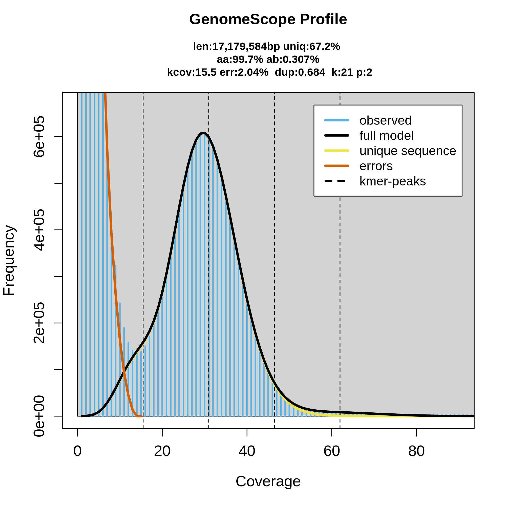

    [:material-download: Baixar imagem em alta resolução](outputs/genomescope/Scer1_Oxford_Nanopore_linear_plot.png){ target=_blank }

=== "Scer2"

    

    [:material-download: Baixar imagem em alta resolução](outputs/genomescope/Scer2_Oxford_Nanopore_linear_plot.png){ target=_blank }


**Interpretando os resultados:**

- *Scer1:* genoma estimado em ~16,5 Mb, cobertura de k-mers (`kcov`) ~31x e erro estimado de ~2,2%. Com `-p 1` não há heterozigosidade a estimar (`a:100%`: todos os k-mers são de cópia única). O tamanho está acima do esperado para *S. cerevisiae* (~12 Mb). Isso é comum com reads Nanopore: a taxa de erro gera muitos k-mers com erro que o modelo não separa completamente dos k-mers reais, o que infla a estimativa de tamanho. Conteúdo repetitivo também contribui. No gráfico, há um pico único em ~31x (linha tracejada) e um pequeno "ombro" em ~15x. Esse ombro não é um segundo pico do genoma: ele cai sob a curva de erros (laranja), formada por k-mers com erros de leitura que aparecem várias vezes.
- *Scer2:* resultado sem confiança (genoma estimado de apenas ~97 kb, `kcov` ~93x, model fit 9,33%). Com cobertura de ~6x e erro de ~7%, os k-mers do genoma nuclear quase não se separam dos k-mers com erro, e o modelo se ajusta a outra coisa: o pico em ~175x no gráfico corresponde a ~97 kb de sequência presente em muitas cópias, o que é compatível com o **DNA mitocondrial** da levedura (~86 kb, dezenas de cópias por célula), possivelmente somado a outras sequências multicópia, como o plasmídeo 2-micron e o rDNA. Esse resultado não deve ser usado para estimar o genoma.

!!! note "Por que a `kcov` do Scer1 é tão menor que a cobertura de reads?"
    A cobertura de reads do Scer1 filtrado é de ~69x (825 Mb / 12 Mb), mas a `kcov` é de ~31x. O motivo é a taxa de erro: com ~2 a 4% de erro por base, só uma fração dos 21-mers de cada read sai sem erro (por exemplo, (1 − 0,04)^21 ≈ 42%, e 0,42 × 69 ≈ 29x). Isso é esperado em dados Nanopore e não indica problema nos dados.

??? question "E se tivéssemos usado `-p 2` na Scer1?"
    Numa primeira versão deste tutorial, rodamos a Scer1 com `-p 2`. O modelo convergiu mesmo assim:

    ```
    aa:99.7% ab:0.307%
    Model converged het:0.00307 kcov:15.5 err:0.0204 model fit:0.684 len:17179584
    ```

    O GenomeScope "encontrou" 0,31% de heterozigosidade numa linhagem haploide. O pico real, em ~31x, foi interpretado como o pico homozigoto (2 × `kcov`), e parte dos k-mers com erro de leitura foi lida como um pico heterozigoto em ~15x. A qualidade do ajuste (*model fit* 0,684 contra 0,687) praticamente não muda entre os dois modelos.

    A lição: **o GenomeScope não testa a ploidia, ele ajusta a que você informa**. Um modelo que converge não prova que a hipótese está certa, sobretudo com dados de erro alto. A ploidia deve vir de outra fonte (literatura, citometria de fluxo, Smudgeplot com reads de alta precisão).

## :material-numeric-6-circle: Etapa 6 — Montagem com Flye

O Flye é um montador baseado em grafos de repeat, robusto para dados de longa leitura com cobertura variável. É especialmente recomendado quando a cobertura é baixa (como Scer2).

### Comando
```bash
mkdir 5.Montagem-Flye
mkdir 5.Montagem-Flye/Scer1_q10_l500
mkdir 5.Montagem-Flye/Scer2_q10_l500
conda activate flye_env
flye --genome-size 12M --scaffold --nano-hq 2.Filtragem-dadosbrutos/Scer1_q10_l500.fastq.gz  -o 5.Montagem-Flye/Scer1_q10_l500 -t 24

flye --genome-size 12M --scaffold --nano-hq 2.Filtragem-dadosbrutos/Scer2_q10_l500.fastq.gz  -o 5.Montagem-Flye/Scer2_q10_l500 -t 24

conda deactivate
```

??? info "O que faz cada comando"
    | Comando | O que faz |
    |---|---|
    | `mkdir ...` | Cria a pasta do Flye e uma subpasta para cada amostra. |
    | `conda activate flye_env` | Entra no ambiente do Flye. |
    | `flye --genome-size 12M` | Monta o genoma. O `--genome-size` é o tamanho estimado (12 Mb, como no GenomeScope2). |
    | `--scaffold` | Permite unir contigs em scaffolds, com trechos de `N` no lugar das regiões não resolvidas. |
    | `--nano-hq <reads>` | Modo para reads Nanopore de alta qualidade (veja o aviso abaixo). |
    | `-o` / `-t 24` | Pasta de saída e número de processadores. |
    | `conda deactivate` | Sai do ambiente. |

!!! warning "Atenção: `--nano-hq` ou `--nano-raw`? Escolha pelos seus dados"
    O Flye tem dois modos para reads Nanopore. Segundo a [documentação](https://github.com/mikolmogorov/Flye/blob/flye/docs/USAGE.md){ target=_blank }:

    | Modo | Para quais reads |
    |---|---|
    | `--nano-hq` | basecalling Guppy5+/Dorado no modo SUP, ou reads da química "Q20+" da ONT; a documentação fala em menos de 5% de erro |
    | `--nano-raw` | reads mais antigas ou de menor qualidade (até ~20% de erro) |

    Nossos dados ficam **no limite**: depois da filtragem, a qualidade média é Q13,3 nas duas amostras (Etapa 5.1). Pela escala Phred, isso dá 10^(-13,3/10) ≈ 4,7% de erro: logo abaixo do limite de 5% da documentação, mas longe de Q20 no sentido Phred, que seria 1% de erro. (O "Q20+" da documentação é o nome da química de sequenciamento da ONT, não um valor exato de Phred.) Usamos `--nano-hq` e a montagem do Scer1 saiu muito boa, mas `--nano-raw` também seria uma escolha defensável.

    **Numa montagem nova, não copie a opção sem olhar os dados.** Se o sequenciamento é seu, confira o basecaller e o modo usados (SUP, HAC ou FAST). Em dados baixados do SRA, como os nossos, essa informação muitas vezes não está disponível, e a qualidade média no NanoPlot passa a ser o principal guia. Reads SUP recentes ou da química Q20+ ficam com `--nano-hq`. Reads com mais de ~5% de erro (qualidade média abaixo de ~Q13), ou de basecallers antigos, vão com `--nano-raw`. Na dúvida, monte com os dois modos e compare com QUAST e BUSCO (Etapa 9).

??? note "Ver saída do comando"

    ```bash
    $ flye --genome-size 12M --scaffold --nano-hq 2.Filtragem-dadosbrutos/Scer1_q10_l500.fastq.gz  -o 5.Montagem-Flye/Scer1_q10_l500 -t 24
    [2026-11-16 20:45:21] INFO: Starting Flye 2.9.6-b1802
    [2026-11-16 20:45:21] INFO: >>>STAGE: configure
    [2026-11-16 20:45:21] INFO: Configuring run
    [2026-11-16 20:45:37] INFO: Total read length: 824955177
    [2026-11-16 20:45:37] INFO: Input genome size: 12000000
    [2026-11-16 20:45:37] INFO: Estimated coverage: 68
    [2026-11-16 20:45:37] INFO: Reads N50/N90: 5790 / 1593
    [2026-11-16 20:45:37] INFO: Minimum overlap set to 2000
    [2026-11-16 20:45:37] INFO: >>>STAGE: assembly
    [2026-11-16 20:45:37] INFO: Assembling disjointigs
    [2026-11-16 20:45:37] INFO: Reading sequences
    [2026-11-16 20:45:48] INFO: Building minimizer index
    [2026-11-16 20:45:48] INFO: Pre-calculating index storage
    0% 10% 20% 30% 40% 50% 60% 70% 80% 90% 100%
    [2026-11-16 20:45:55] INFO: Filling index
    0% 10% 20% 30% 40% 50% 60% 70% 80% 90% 100%
    [2026-11-16 20:46:05] INFO: Extending reads
    [2026-11-16 20:47:12] INFO: Overlap-based coverage: 38
    [2026-11-16 20:47:12] INFO: Median overlap divergence: 0.0778406
    0% 10% 20% 30% 40% 50% 60% 70% 80% 90% 100%
    [2026-11-16 20:48:34] INFO: Assembled 75 disjointigs
    [2026-11-16 20:48:35] INFO: Generating sequence
    0% 10% 20% 30% 40% 50% 60% 70% 80% 90% 100%
    [2026-11-16 20:48:38] INFO: Filtering contained disjointigs
    0% 10% 20% 30% 40% 50% 60% 70% 80% 90% 100%
    [2026-11-16 20:48:39] INFO: Contained seqs: 28
    [2026-11-16 20:48:41] INFO: >>>STAGE: consensus
    [2026-11-16 20:48:41] INFO: Running Minimap2
    [2026-11-16 20:50:40] INFO: Computing consensus
    [2026-11-16 20:51:28] INFO: Alignment error rate: 0.093479
    [2026-11-16 20:51:28] INFO: >>>STAGE: repeat
    [2026-11-16 20:51:28] INFO: Building and resolving repeat graph
    [2026-11-16 20:51:28] INFO: Parsing disjointigs
    [2026-11-16 20:51:28] INFO: Building repeat graph
    0% 10% 20% 30% 40% 50% 60% 70% 80% 90% 100%
    [2026-11-16 20:51:34] INFO: Median overlap divergence: 0.0601956
    [2026-11-16 20:51:34] INFO: Parsing reads
    [2026-11-16 20:51:45] INFO: Aligning reads to the graph
    0% 10% 20% 30% 40% 50% 60% 70% 80% 90% 100%
    [2026-11-16 20:52:23] INFO: Aligned read sequence: 657881709 / 707879832 (0.929369)
    [2026-11-16 20:52:23] INFO: Median overlap divergence: 0.0394759
    [2026-11-16 20:52:23] INFO: Mean edge coverage: 54
    [2026-11-16 20:52:23] INFO: Simplifying the graph
    [2026-11-16 20:52:25] INFO: >>>STAGE: contigger
    [2026-11-16 20:52:25] INFO: Generating contigs
    [2026-11-16 20:52:25] INFO: Reading sequences
    [2026-11-16 20:52:37] INFO: Generated 98 contigs
    [2026-11-16 20:52:37] INFO: Added 2 scaffold connections
    [2026-11-16 20:52:38] INFO: >>>STAGE: polishing
    [2026-11-16 20:52:38] INFO: Polishing genome (1/1)
    [2026-11-16 20:52:38] INFO: Running minimap2
    [2026-11-16 20:53:49] INFO: Separating alignment into bubbles
    [2026-11-16 20:54:50] INFO: Alignment error rate: 0.072587
    [2026-11-16 20:54:50] INFO: Correcting bubbles
    0% 10% 20% 30% 40% 50% 60% 70% 80% 90% 100%
    [2026-11-16 20:57:40] INFO: >>>STAGE: finalize
    [2026-11-16 20:57:40] INFO: Assembly statistics:

            Total length:   12301315
            Fragments:      79
            Fragments N50:  751043
            Largest frg:    1526486
            Scaffolds:      2
            Mean coverage:  58

    [2026-11-16 20:57:40] INFO: Final assembly: /media/hd16-databases/usuarios/renatadias/curso-nanopore-nov26/5.Montagem-Flye/Scer1_q10_l500/assembly.fasta

    $ flye --genome-size 12M --scaffold --nano-hq 2.Filtragem-dadosbrutos/Scer2_q10_l500.fastq.gz  -o 5.Montagem-Flye/Scer2_q10_l500 -t 24
    [2026-11-16 20:57:40] INFO: Starting Flye 2.9.6-b1802
    [2026-11-16 20:57:40] INFO: >>>STAGE: configure
    [2026-11-16 20:57:40] INFO: Configuring run
    [2026-11-16 20:57:41] INFO: Total read length: 79206228
    [2026-11-16 20:57:41] INFO: Input genome size: 12000000
    [2026-11-16 20:57:41] INFO: Estimated coverage: 6
    [2026-11-16 20:57:41] INFO: Reads N50/N90: 3484 / 1062
    [2026-11-16 20:57:41] INFO: Minimum overlap set to 1000
    [2026-11-16 20:57:41] INFO: >>>STAGE: assembly
    [2026-11-16 20:57:41] INFO: Assembling disjointigs
    [2026-11-16 20:57:41] INFO: Reading sequences
    [2026-11-16 20:57:42] INFO: Building minimizer index
    [2026-11-16 20:57:42] INFO: Pre-calculating index storage
    0% 10% 20% 30% 40% 50% 60% 70% 80% 90% 100%
    [2026-11-16 20:57:43] INFO: Filling index
    0% 10% 20% 30% 40% 50% 60% 70% 80% 90% 100%
    [2026-11-16 20:57:45] INFO: Extending reads
    [2026-11-16 20:57:57] INFO: Overlap-based coverage: 4
    [2026-11-16 20:57:57] INFO: Median overlap divergence: 0.0729167
    0% 10% 20% 30% 40% 50% 60% 70% 80% 90% 100%
    [2026-11-16 20:58:01] INFO: Assembled 1070 disjointigs
    [2026-11-16 20:58:01] INFO: Generating sequence
    0% 10% 20% 30% 40% 50% 60% 70% 80% 90% 100%
    [2026-11-16 20:58:02] INFO: Filtering contained disjointigs
    0% 10% 20% 30% 40% 50% 60% 70% 80% 90% 100%
    [2026-11-16 20:58:02] INFO: Contained seqs: 57
    [2026-11-16 20:58:02] INFO: >>>STAGE: consensus
    [2026-11-16 20:58:02] INFO: Running Minimap2
    [2026-11-16 20:58:10] INFO: Computing consensus
    [2026-11-16 20:58:19] INFO: Alignment error rate: 0.086339
    [2026-11-16 20:58:19] INFO: >>>STAGE: repeat
    [2026-11-16 20:58:19] INFO: Building and resolving repeat graph
    [2026-11-16 20:58:19] INFO: Parsing disjointigs
    [2026-11-16 20:58:19] INFO: Building repeat graph
    0% 10% 20% 30% 40% 50% 60% 70% 80% 90% 100%
    [2026-11-16 20:58:21] INFO: Median overlap divergence: 0.0702313
    [2026-11-16 20:58:21] INFO: Parsing reads
    [2026-11-16 20:58:22] INFO: Aligning reads to the graph
    0% 10% 20% 30% 40% 50% 60% 70% 80% 90% 100%
    [2026-11-16 20:58:24] INFO: Aligned read sequence: 60590940 / 72330336 (0.837698)
    [2026-11-16 20:58:24] INFO: Median overlap divergence: 0.0379287
    [2026-11-16 20:58:24] INFO: Mean edge coverage: 5
    [2026-11-16 20:58:24] INFO: Simplifying the graph
    [2026-11-16 20:58:25] INFO: >>>STAGE: contigger
    [2026-11-16 20:58:25] INFO: Generating contigs
    [2026-11-16 20:58:25] INFO: Reading sequences
    [2026-11-16 20:58:26] INFO: Generated 747 contigs
    [2026-11-16 20:58:26] INFO: Added 0 scaffold connections
    [2026-11-16 20:58:26] INFO: >>>STAGE: polishing
    [2026-11-16 20:58:26] INFO: Polishing genome (1/1)
    [2026-11-16 20:58:26] INFO: Running minimap2
    [2026-11-16 20:58:31] INFO: Separating alignment into bubbles
    [2026-11-16 20:58:45] INFO: Alignment error rate: 0.062868
    [2026-11-16 20:58:45] INFO: Correcting bubbles
    0% 10% 20% 30% 40% 50% 60% 70% 80% 90% 100%
    [2026-11-16 20:59:04] INFO: >>>STAGE: finalize
    [2026-11-16 20:59:04] INFO: Assembly statistics:

            Total length:   8359888
            Fragments:      715
            Fragments N50:  16118
            Largest frg:    78752
            Scaffolds:      0
            Mean coverage:  8

    [2026-11-16 20:59:04] INFO: Final assembly: /media/hd16-databases/usuarios/renatadias/curso-nanopore-nov26/5.Montagem-Flye/Scer2_q10_l500/assembly.fasta


    ```

!!! tip "FASTAs disponíveis no repositório"
    [:material-dna: Scer1_Flye_assembly.fasta](https://github.com/LGBIO-UFG/PRO-BIOINFO/blob/main/data/exemplos/nanopore/assemblies/Scer1_Flye_assembly.fasta) ·
    [:material-dna: Scer2_Flye_assembly.fasta](https://github.com/LGBIO-UFG/PRO-BIOINFO/blob/main/data/exemplos/nanopore/assemblies/Scer2_Flye_assembly.fasta)

??? tip "Opcional: visualizar o grafo da montagem (Bandage)"
    O Flye não produz só o FASTA final: ele também salva o **grafo de montagem** (`assembly_graph.gfa`), que mostra como as sequências se conectam. Onde o grafo é uma linha simples, a montagem foi resolvida sem ambiguidade; onde ele forma "nós" com vários caminhos possíveis, há repetições que o montador não conseguiu resolver, e é justamente nesses pontos que os contigs terminam.

    O [Bandage](https://rrwick.github.io/Bandage/){ target=_blank } é um programa gráfico para visualizar esses grafos. Ele roda no seu computador (Windows, macOS ou Linux); em Macs com chip Apple, prefira o [BandageNG](https://github.com/asl/BandageNG/releases){ target=_blank }, a versão mantida do programa. Primeiro, copie o grafo do servidor:

    ```bash
    # no terminal do SEU computador (ajuste usuário, servidor e caminho)
    scp usuario@servidor:caminho/do/projeto/5.Montagem-Flye/Scer1_q10_l500/assembly_graph.gfa Scer1_Flye_assembly_graph.gfa
    scp usuario@servidor:caminho/do/projeto/5.Montagem-Flye/Scer2_q10_l500/assembly_graph.gfa Scer2_Flye_assembly_graph.gfa
    ```

    No Bandage: **File → Load graph**, escolha o arquivo e clique em **Draw graph**. O que procurar:

    - **Componentes lineares longos**: são os cromossomos bem montados. Compare a Scer1 (~68×) com a Scer2 (~6×): na Scer2, o grafo se desfaz em centenas de pedaços soltos.
    - **Nós muito conectados**, com várias arestas entrando e saindo: são repetições (retrotransposons Ty, rDNA, subtelômeros). Em **Graph display**, marque **Node lengths** e **Depth** para ver o tamanho e a cobertura de cada nó; repetições costumam ter cobertura múltipla da média.
    - **Um pequeno círculo com cobertura muito alta**: candidato ao **DNA mitocondrial**, que tem muitas cópias por célula. Vamos separá-lo da montagem nuclear na Etapa 9.4.

    **Os grafos desta rodada:**

    === "Scer1 Flye (~68×)"

        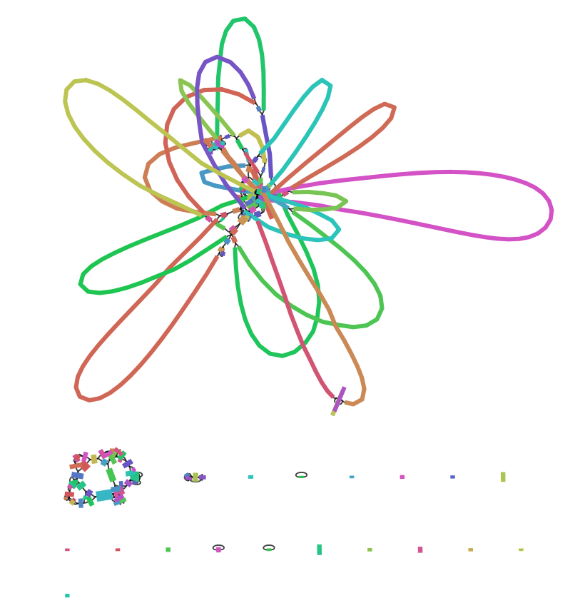{ width="600" }

        Quase todo o genoma forma **um único componente**: os contigs longos (as "pétalas") saem e voltam a um emaranhado central. Esse centro são as **repetições** compartilhadas entre cromossomos (retrotransposons Ty, rDNA, subtelômeros): como a mesma sequência aparece em vários lugares, o grafo passa por ela várias vezes, e o Flye encerra os contigs nas bordas dessas regiões. Abaixo, ficam alguns componentes pequenos e isolados.

    === "Scer2 Flye (~6×)"

        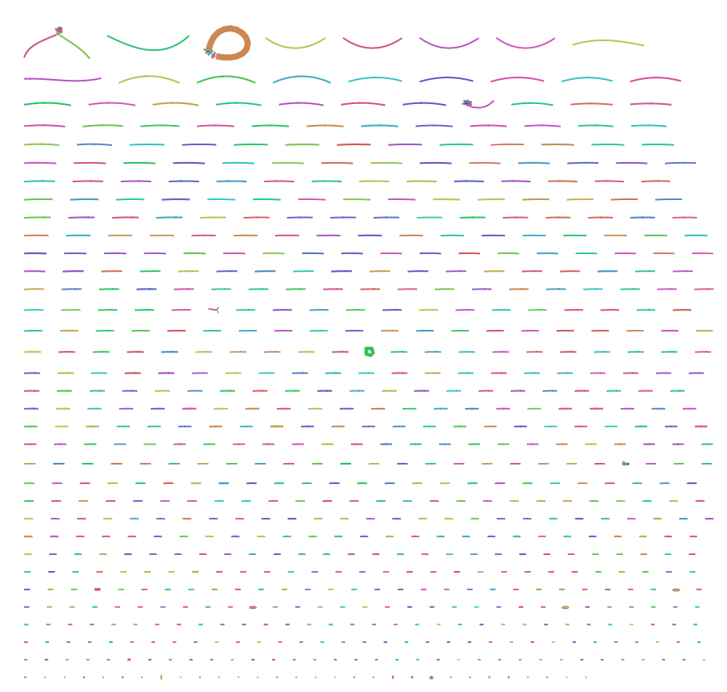{ width="600" }

        Com pouca cobertura, o grafo se desfaz em **centenas de pedaços soltos**, sem ligações entre si (756 segmentos e só 57 ligações, contra 153 segmentos e 292 ligações na Scer1). Não há reads suficientes para atravessar as regiões difíceis e conectar os pedaços: cada segmento vira um contig curto.

    O Hifiasm também gera grafos (`6.Montagem-hifiasm/*.p_ctg.gfa`), que podem ser abertos da mesma forma.

    !!! tip "Grafos pré-computados"
        Se não tiver acesso ao servidor, baixe os grafos desta rodada e abra no Bandage:
        [:material-graph: Scer1 Flye](outputs/bandage/Scer1_Flye_assembly_graph.gfa) ·
        [:material-graph: Scer2 Flye](outputs/bandage/Scer2_Flye_assembly_graph.gfa) ·
        [:material-graph: Scer1 Hifiasm](outputs/bandage/Scer1_Hifiasm_p_ctg.gfa) ·
        [:material-graph: Scer2 Hifiasm](outputs/bandage/Scer2_Hifiasm_p_ctg.gfa)

### Checklist da Etapa 6

- [ ] Tenho `assembly.fasta` para Scer1 e Scer2 em `5.Montagem-Flye/`

---

## :material-numeric-7-circle: Etapa 7 — Montagem com Hifiasm

O Hifiasm foi desenvolvido para dados HiFi (PacBio), mas tem suporte para Nanopore via `--ont`. Usa correção de erros baseada em overlap, geralmente gerando menos contigs que o Flye.

**Comando**

```bash
mkdir 6.Montagem-hifiasm
hifiasm -o 6.Montagem-hifiasm/Scer1_q10_l500_hifiasm -t 12 --primary --write-ec --ont 2.Filtragem-dadosbrutos/Scer1_q10_l500.fastq.gz 2> 6.Montagem-hifiasm/Scer1_q10_l500_hifiasm.log

hifiasm -o 6.Montagem-hifiasm/Scer2_q10_l500_hifiasm -t 12 --primary --write-ec --ont 2.Filtragem-dadosbrutos/Scer2_q10_l500.fastq.gz 2> 6.Montagem-hifiasm/Scer2_q10_l500_hifiasm.log
```

??? info "O que faz cada comando"
    | Comando | O que faz |
    |---|---|
    | `mkdir 6.Montagem-hifiasm` | Cria a pasta do Hifiasm. |
    | `hifiasm -o <prefixo>` | Monta o genoma. O `-o` define o prefixo de todos os arquivos de saída. |
    | `-t 12` | Número de processadores usados. |
    | `--primary` | Gera uma montagem primária e uma alternativa (`p_ctg` e `a_ctg`), em vez de separar os dois haplótipos. |
    | `--write-ec` | Salva também as reads corrigidas pelo Hifiasm. |
    | `--ont <reads>` | Indica que as reads são Nanopore. |
    | `2> <arquivo>.log` | Guarda as mensagens do programa (que saem pelo canal de erro, `2>`) num arquivo de log. |

??? note "Ver saída do comando"

    ```bash
    ### Scer1
    $ hifiasm -o 6.Montagem-hifiasm/Scer1_q10_l500_hifiasm -t 12 --primary --write-ec --ont 2.Filtragem-dadosbrutos/Scer1_q10_l500.fastq.gz 2> 6.Montagem-hifiasm/Scer1_q10_l500_hifiasm.log
    ### Scer2
    $ hifiasm -o 6.Montagem-hifiasm/Scer2_q10_l500_hifiasm -t 12 --primary --write-ec --ont 2.Filtragem-dadosbrutos/Scer2_q10_l500.fastq.gz 2> 6.Montagem-hifiasm/Scer2_q10_l500_hifiasm.log
    ```


### Converter o GFA para FASTA

```bash
awk '/^S/{print ">"$2"\n"$3}' 6.Montagem-hifiasm/Scer1_q10_l500_hifiasm.p_ctg.gfa > 6.Montagem-hifiasm/Scer1_q10_l500_hifiasm.p_ctg.fa
awk '/^S/{print ">"$2"\n"$3}' 6.Montagem-hifiasm/Scer2_q10_l500_hifiasm.p_ctg.gfa > 6.Montagem-hifiasm/Scer2_q10_l500_hifiasm.p_ctg.fa

```

??? info "O que faz cada comando"
    | Comando | O que faz |
    |---|---|
    | `awk '/^S/{print ">"$2"\n"$3}'` | No GFA, as linhas que começam com `S` são as sequências: a coluna 2 é o nome e a 3 é a sequência. O `awk` escreve cada uma no formato FASTA (`>nome` e, na linha seguinte, a sequência). |
    | `> <arquivo>.fa` | Salva o resultado em FASTA. |

!!! tip "FASTAs disponíveis no repositório"
    [:material-dna: Scer1_Hifiasm_assembly.fa](https://github.com/LGBIO-UFG/PRO-BIOINFO/blob/main/data/exemplos/nanopore/assemblies/Scer1_Hifiasm_assembly.fa) ·
    [:material-dna: Scer2_Hifiasm_assembly.fa](https://github.com/LGBIO-UFG/PRO-BIOINFO/blob/main/data/exemplos/nanopore/assemblies/Scer2_Hifiasm_assembly.fa)

### Checklist da Etapa 7

- [ ] Tenho `Scer1_q10_l500_hifiasm.p_ctg.fa` e `Scer2_q10_l500_hifiasm.p_ctg.fa`

---

## :material-numeric-8-circle: Etapa 8 — Montagem com NextDenovo

O NextDenovo faz uma etapa de correção de erros nas reads (baseada em sobreposições entre elas) antes da montagem propriamente dita, o que ajuda a compensar reads mais ruidosas ou com cobertura mais baixa. Para rodar o NextDenovo, primeiro precisamos preparar um arquivo de configuração (`run.cfg`).

**Criar o arquivo de configuração**

```bash
mkdir 7.Montagem-NextDenovo/
mkdir 7.Montagem-NextDenovo/Scer1_q10_l500
realpath 2.Filtragem-dadosbrutos/Scer1_q10_l500.fastq.gz > 7.Montagem-NextDenovo/Scer1_q10_l500/input.fofn
cp /home/lgbio/programas/NextDenovo/doc/run.cfg 7.Montagem-NextDenovo/Scer1_q10_l500/.
nano 7.Montagem-NextDenovo/Scer1_q10_l500/run.cfg 
```

??? info "O que faz cada comando"
    | Comando | O que faz |
    |---|---|
    | `mkdir ...` | Cria a pasta do NextDenovo e a subpasta da Scer1. |
    | `realpath <reads> > input.fofn` | Escreve o caminho completo das reads no `input.fofn` (*file of file names*), a lista de arquivos de entrada que o NextDenovo lê. |
    | `cp .../run.cfg <pasta>/.` | Copia o arquivo de configuração modelo que vem com o NextDenovo. |
    | `nano <pasta>/run.cfg` | Abre o arquivo de configuração no editor de texto, para ajustar os parâmetros listados abaixo. |

Edite o arquivo `run.cfg` alterando os seguintes parâmetros

```
read_type = ont
genome_size = 12m
```

**Comando para rodar:**
```bash
nextDenovo 7.Montagem-NextDenovo/Scer1_q10_l500/run.cfg
```

??? info "O que faz cada comando"
    | Comando | O que faz |
    |---|---|
    | `nextDenovo <pasta>/run.cfg` | Roda a montagem com os parâmetros do arquivo de configuração. |

??? note "Ver saída do comando"

    ```bash
    $ nextDenovo 7.Montagem-NextDenovo/Scer1_q10_l500/run.cfg
    [2423043 INFO] 2026-11-16 20:46:53 NextDenovo start...
    [2423043 INFO] 2026-11-16 20:46:53 version:2.5.2 logfile:pid2423043.log.info
    [2423043 WARNING] 2026-11-16 20:46:53 Re-write workdir
    [2423043 INFO] 2026-11-16 20:46:53 mkdir: /media/hd16-databases/usuarios/renatadias/curso-nanopore-nov26/7.Montagem-NextDenovo/Scer1_q10_l500/01_rundir
    [2423043 INFO] 2026-11-16 20:46:53 mkdir: /media/hd16-databases/usuarios/renatadias/curso-nanopore-nov26/7.Montagem-NextDenovo/Scer1_q10_l500/01_rundir/01.raw_align
    [2423043 INFO] 2026-11-16 20:46:53 mkdir: /media/hd16-databases/usuarios/renatadias/curso-nanopore-nov26/7.Montagem-NextDenovo/Scer1_q10_l500/01_rundir/02.cns_align
    [2423043 INFO] 2026-11-16 20:46:53 mkdir: /media/hd16-databases/usuarios/renatadias/curso-nanopore-nov26/7.Montagem-NextDenovo/Scer1_q10_l500/01_rundir/03.ctg_graph
    [2423043 INFO] 2026-11-16 20:46:58 Total jobs: 1
    [2423043 INFO] 2026-11-16 20:46:58 Submitted jobID:[2423049] jobCmd:[/media/hd16-databases/usuarios/renatadias/curso-nanopore-nov26/7.Montagem-NextDenovo/Scer1_q10_l500/01_rundir/01.raw_align/01.db_stat.sh.work/db_stat1/nextDenovo.sh] in the local_cycle.
    [2423043 INFO] 2026-11-16 20:47:07 db_stat done
    [2423043 INFO] 2026-11-16 20:47:07 updated options:
    rerun:                        3
    task:                         all
    deltmp:                       1
    rewrite:                      1
    read_type:                    ont
    job_type:                     local
    input_type:                   raw
    read_cutoff:                  1k
    seed_depth:                   25.0
    pa_correction:                3
    seed_cutfiles:                3
    genome_size:                  12m
    parallel_jobs:                20
    seed_cutoff:                  7803
    blocksize:                    28263802
    job_prefix:                   nextDenovo
    ctg_cns_options:              -p 15
    nextgraph_options:            -a 1
    sort_options:                 -m 20g -t 15 -k 40
    minimap2_options_map:         -x map-ont
    minimap2_options_raw:         -t 8 -x ava-ont
    correction_options:           -p 15 -max_lq_length 10000 -r ont -min_len_seed 3901
    minimap2_options_cns:         -t 8 -x ava-ont -k 17 -w 17 --minlen 780 --maxhan1 3901
    workdir:                      /media/hd16-databases/usuarios/renatadias/curso-nanopore-nov26/7.Montagem-NextDenovo/Scer1_q10_l500/01_rundir
    input_fofn:                   /media/hd16-databases/usuarios/renatadias/curso-nanopore-nov26/7.Montagem-NextDenovo/Scer1_q10_l500/input.fofn
    raw_aligndir:                 /media/hd16-databases/usuarios/renatadias/curso-nanopore-nov26/7.Montagem-NextDenovo/Scer1_q10_l500/01_rundir/01.raw_align
    cns_aligndir:                 /media/hd16-databases/usuarios/renatadias/curso-nanopore-nov26/7.Montagem-NextDenovo/Scer1_q10_l500/01_rundir/02.cns_align
    ctg_graphdir:                 /media/hd16-databases/usuarios/renatadias/curso-nanopore-nov26/7.Montagem-NextDenovo/Scer1_q10_l500/01_rundir/03.ctg_graph
    [2423043 INFO] 2026-11-16 20:47:07 summary of input data:
    file: /media/hd16-databases/usuarios/renatadias/curso-nanopore-nov26/7.Montagem-NextDenovo/Scer1_q10_l500/01_rundir/01.raw_align/input.reads.stat
    [Read length stat]
    Types            Count (#) Length (bp)
    N10                   3858   15868
    N20                   9732   11734
    N30                  17362    9253
    N40                  26905    7470
    N50                  38677    6060
    N60                  53234    4879
    N70                  71506    3834
    N80                  95244    2877
    N90                 128373    1956

    Types               Count (#)           Bases (bp)  Depth (X)
    Raw                    230437            824955177      68.75
    Filtered                46851             34206736       2.85
    Clean                  183586            790748441      65.90

    *Suggested seed_cutoff (genome size: 12.00Mb, expected seed depth: 45, real seed depth: 25.00): 7803 bp
    *NOTE: The read/seed length is too short, and the assembly result is unexpected and please check the assembly quality carefully. Of course, it's better to sequencing more longer reads and try again.
    [2423043 INFO] 2026-11-16 20:47:12 Total jobs: 1
    [2423043 INFO] 2026-11-16 20:47:12 Submitted jobID:[2423165] jobCmd:[/media/hd16-databases/usuarios/renatadias/curso-nanopore-nov26/7.Montagem-NextDenovo/Scer1_q10_l500/01_rundir/01.raw_align/02.db_split.sh.work/db_split1/nextDenovo.sh] in the local_cycle.
    [2423043 INFO] 2026-11-16 20:47:22 db_split done
    [2423043 INFO] 2026-11-16 20:47:22 Total jobs: 60
    [2423043 INFO] 2026-11-16 20:47:22 Submitted jobID:[2423205] jobCmd:[/media/hd16-databases/usuarios/renatadias/curso-nanopore-nov26/7.Montagem-NextDenovo/Scer1_q10_l500/01_rundir/01.raw_align/03.raw_align.sh.work/raw_align01/nextDenovo.sh] in the local_cycle.
    [2423043 INFO] 2026-11-16 20:47:23 Submitted jobID:[2423211] jobCmd:[/media/hd16-databases/usuarios/renatadias/curso-nanopore-nov26/7.Montagem-NextDenovo/Scer1_q10_l500/01_rundir/01.raw_align/03.raw_align.sh.work/raw_align02/nextDenovo.sh] in the local_cycle.
    [2423043 INFO] 2026-11-16 20:47:23 Submitted jobID:[2423220] jobCmd:[/media/hd16-databases/usuarios/renatadias/curso-nanopore-nov26/7.Montagem-NextDenovo/Scer1_q10_l500/01_rundir/01.raw_align/03.raw_align.sh.work/raw_align03/nextDenovo.sh] in the local_cycle.
    [2423043 INFO] 2026-11-16 20:47:24 Submitted jobID:[2423229] jobCmd:[/media/hd16-databases/usuarios/renatadias/curso-nanopore-nov26/7.Montagem-NextDenovo/Scer1_q10_l500/01_rundir/01.raw_align/03.raw_align.sh.work/raw_align04/nextDenovo.sh] in the local_cycle.
    [2423043 INFO] 2026-11-16 20:47:24 Submitted jobID:[2423243] jobCmd:[/media/hd16-databases/usuarios/renatadias/curso-nanopore-nov26/7.Montagem-NextDenovo/Scer1_q10_l500/01_rundir/01.raw_align/03.raw_align.sh.work/raw_align05/nextDenovo.sh] in the local_cycle.
    [2423043 INFO] 2026-11-16 20:47:25 Submitted jobID:[2423261] jobCmd:[/media/hd16-databases/usuarios/renatadias/curso-nanopore-nov26/7.Montagem-NextDenovo/Scer1_q10_l500/01_rundir/01.raw_align/03.raw_align.sh.work/raw_align06/nextDenovo.sh] in the local_cycle.
    [2423043 INFO] 2026-11-16 20:47:25 Submitted jobID:[2423270] jobCmd:[/media/hd16-databases/usuarios/renatadias/curso-nanopore-nov26/7.Montagem-NextDenovo/Scer1_q10_l500/01_rundir/01.raw_align/03.raw_align.sh.work/raw_align07/nextDenovo.sh] in the local_cycle.
    [2423043 INFO] 2026-11-16 20:47:26 Submitted jobID:[2423280] jobCmd:[/media/hd16-databases/usuarios/renatadias/curso-nanopore-nov26/7.Montagem-NextDenovo/Scer1_q10_l500/01_rundir/01.raw_align/03.raw_align.sh.work/raw_align08/nextDenovo.sh] in the local_cycle.
    [2423043 INFO] 2026-11-16 20:47:26 Submitted jobID:[2423302] jobCmd:[/media/hd16-databases/usuarios/renatadias/curso-nanopore-nov26/7.Montagem-NextDenovo/Scer1_q10_l500/01_rundir/01.raw_align/03.raw_align.sh.work/raw_align09/nextDenovo.sh] in the local_cycle.
    [2423043 INFO] 2026-11-16 20:47:27 Submitted jobID:[2423314] jobCmd:[/media/hd16-databases/usuarios/renatadias/curso-nanopore-nov26/7.Montagem-NextDenovo/Scer1_q10_l500/01_rundir/01.raw_align/03.raw_align.sh.work/raw_align10/nextDenovo.sh] in the local_cycle.
    [2423043 INFO] 2026-11-16 20:47:27 Submitted jobID:[2423348] jobCmd:[/media/hd16-databases/usuarios/renatadias/curso-nanopore-nov26/7.Montagem-NextDenovo/Scer1_q10_l500/01_rundir/01.raw_align/03.raw_align.sh.work/raw_align11/nextDenovo.sh] in the local_cycle.
    [2423043 INFO] 2026-11-16 20:47:28 Submitted jobID:[2423360] jobCmd:[/media/hd16-databases/usuarios/renatadias/curso-nanopore-nov26/7.Montagem-NextDenovo/Scer1_q10_l500/01_rundir/01.raw_align/03.raw_align.sh.work/raw_align12/nextDenovo.sh] in the local_cycle.
    [2423043 INFO] 2026-11-16 20:47:28 Submitted jobID:[2423376] jobCmd:[/media/hd16-databases/usuarios/renatadias/curso-nanopore-nov26/7.Montagem-NextDenovo/Scer1_q10_l500/01_rundir/01.raw_align/03.raw_align.sh.work/raw_align13/nextDenovo.sh] in the local_cycle.
    [2423043 INFO] 2026-11-16 20:47:29 Submitted jobID:[2423385] jobCmd:[/media/hd16-databases/usuarios/renatadias/curso-nanopore-nov26/7.Montagem-NextDenovo/Scer1_q10_l500/01_rundir/01.raw_align/03.raw_align.sh.work/raw_align14/nextDenovo.sh] in the local_cycle.
    [2423043 INFO] 2026-11-16 20:47:29 Submitted jobID:[2423402] jobCmd:[/media/hd16-databases/usuarios/renatadias/curso-nanopore-nov26/7.Montagem-NextDenovo/Scer1_q10_l500/01_rundir/01.raw_align/03.raw_align.sh.work/raw_align15/nextDenovo.sh] in the local_cycle.
    [2423043 INFO] 2026-11-16 20:47:30 Submitted jobID:[2423428] jobCmd:[/media/hd16-databases/usuarios/renatadias/curso-nanopore-nov26/7.Montagem-NextDenovo/Scer1_q10_l500/01_rundir/01.raw_align/03.raw_align.sh.work/raw_align16/nextDenovo.sh] in the local_cycle.
    [2423043 INFO] 2026-11-16 20:47:30 Submitted jobID:[2423467] jobCmd:[/media/hd16-databases/usuarios/renatadias/curso-nanopore-nov26/7.Montagem-NextDenovo/Scer1_q10_l500/01_rundir/01.raw_align/03.raw_align.sh.work/raw_align17/nextDenovo.sh] in the local_cycle.
    [2423043 INFO] 2026-11-16 20:47:31 Submitted jobID:[2423497] jobCmd:[/media/hd16-databases/usuarios/renatadias/curso-nanopore-nov26/7.Montagem-NextDenovo/Scer1_q10_l500/01_rundir/01.raw_align/03.raw_align.sh.work/raw_align18/nextDenovo.sh] in the local_cycle.
    [2423043 INFO] 2026-11-16 20:47:31 Submitted jobID:[2423534] jobCmd:[/media/hd16-databases/usuarios/renatadias/curso-nanopore-nov26/7.Montagem-NextDenovo/Scer1_q10_l500/01_rundir/01.raw_align/03.raw_align.sh.work/raw_align19/nextDenovo.sh] in the local_cycle.
    [2423043 INFO] 2026-11-16 20:47:32 Submitted jobID:[2423570] jobCmd:[/media/hd16-databases/usuarios/renatadias/curso-nanopore-nov26/7.Montagem-NextDenovo/Scer1_q10_l500/01_rundir/01.raw_align/03.raw_align.sh.work/raw_align20/nextDenovo.sh] in the local_cycle.
    [2423043 INFO] 2026-11-16 20:47:51 Submitted jobID:[2423836] jobCmd:[/media/hd16-databases/usuarios/renatadias/curso-nanopore-nov26/7.Montagem-NextDenovo/Scer1_q10_l500/01_rundir/01.raw_align/03.raw_align.sh.work/raw_align21/nextDenovo.sh] in the local_cycle.
    [2423043 INFO] 2026-11-16 20:47:51 Submitted jobID:[2423844] jobCmd:[/media/hd16-databases/usuarios/renatadias/curso-nanopore-nov26/7.Montagem-NextDenovo/Scer1_q10_l500/01_rundir/01.raw_align/03.raw_align.sh.work/raw_align22/nextDenovo.sh] in the local_cycle.
    [2423043 INFO] 2026-11-16 20:47:52 Submitted jobID:[2423850] jobCmd:[/media/hd16-databases/usuarios/renatadias/curso-nanopore-nov26/7.Montagem-NextDenovo/Scer1_q10_l500/01_rundir/01.raw_align/03.raw_align.sh.work/raw_align23/nextDenovo.sh] in the local_cycle.
    [2423043 INFO] 2026-11-16 20:47:53 Submitted jobID:[2423861] jobCmd:[/media/hd16-databases/usuarios/renatadias/curso-nanopore-nov26/7.Montagem-NextDenovo/Scer1_q10_l500/01_rundir/01.raw_align/03.raw_align.sh.work/raw_align24/nextDenovo.sh] in the local_cycle.
    [2423043 INFO] 2026-11-16 20:47:56 Submitted jobID:[2423881] jobCmd:[/media/hd16-databases/usuarios/renatadias/curso-nanopore-nov26/7.Montagem-NextDenovo/Scer1_q10_l500/01_rundir/01.raw_align/03.raw_align.sh.work/raw_align25/nextDenovo.sh] in the local_cycle.
    [2423043 INFO] 2026-11-16 20:47:59 Submitted jobID:[2424048] jobCmd:[/media/hd16-databases/usuarios/renatadias/curso-nanopore-nov26/7.Montagem-NextDenovo/Scer1_q10_l500/01_rundir/01.raw_align/03.raw_align.sh.work/raw_align26/nextDenovo.sh] in the local_cycle.
    [2423043 INFO] 2026-11-16 20:47:59 Submitted jobID:[2424075] jobCmd:[/media/hd16-databases/usuarios/renatadias/curso-nanopore-nov26/7.Montagem-NextDenovo/Scer1_q10_l500/01_rundir/01.raw_align/03.raw_align.sh.work/raw_align27/nextDenovo.sh] in the local_cycle.
    [2423043 INFO] 2026-11-16 20:48:00 Submitted jobID:[2424112] jobCmd:[/media/hd16-databases/usuarios/renatadias/curso-nanopore-nov26/7.Montagem-NextDenovo/Scer1_q10_l500/01_rundir/01.raw_align/03.raw_align.sh.work/raw_align28/nextDenovo.sh] in the local_cycle.
    [2423043 INFO] 2026-11-16 20:48:00 Submitted jobID:[2424147] jobCmd:[/media/hd16-databases/usuarios/renatadias/curso-nanopore-nov26/7.Montagem-NextDenovo/Scer1_q10_l500/01_rundir/01.raw_align/03.raw_align.sh.work/raw_align29/nextDenovo.sh] in the local_cycle.
    [2423043 INFO] 2026-11-16 20:48:01 Submitted jobID:[2424174] jobCmd:[/media/hd16-databases/usuarios/renatadias/curso-nanopore-nov26/7.Montagem-NextDenovo/Scer1_q10_l500/01_rundir/01.raw_align/03.raw_align.sh.work/raw_align30/nextDenovo.sh] in the local_cycle.
    [2423043 INFO] 2026-11-16 20:48:02 Submitted jobID:[2424236] jobCmd:[/media/hd16-databases/usuarios/renatadias/curso-nanopore-nov26/7.Montagem-NextDenovo/Scer1_q10_l500/01_rundir/01.raw_align/03.raw_align.sh.work/raw_align31/nextDenovo.sh] in the local_cycle.
    [2423043 INFO] 2026-11-16 20:48:02 Submitted jobID:[2424381] jobCmd:[/media/hd16-databases/usuarios/renatadias/curso-nanopore-nov26/7.Montagem-NextDenovo/Scer1_q10_l500/01_rundir/01.raw_align/03.raw_align.sh.work/raw_align32/nextDenovo.sh] in the local_cycle.
    [2423043 INFO] 2026-11-16 20:48:03 Submitted jobID:[2424485] jobCmd:[/media/hd16-databases/usuarios/renatadias/curso-nanopore-nov26/7.Montagem-NextDenovo/Scer1_q10_l500/01_rundir/01.raw_align/03.raw_align.sh.work/raw_align33/nextDenovo.sh] in the local_cycle.
    [2423043 INFO] 2026-11-16 20:48:04 Submitted jobID:[2424600] jobCmd:[/media/hd16-databases/usuarios/renatadias/curso-nanopore-nov26/7.Montagem-NextDenovo/Scer1_q10_l500/01_rundir/01.raw_align/03.raw_align.sh.work/raw_align34/nextDenovo.sh] in the local_cycle.
    [2423043 INFO] 2026-11-16 20:48:06 Submitted jobID:[2425138] jobCmd:[/media/hd16-databases/usuarios/renatadias/curso-nanopore-nov26/7.Montagem-NextDenovo/Scer1_q10_l500/01_rundir/01.raw_align/03.raw_align.sh.work/raw_align35/nextDenovo.sh] in the local_cycle.
    [2423043 INFO] 2026-11-16 20:48:07 Submitted jobID:[2425359] jobCmd:[/media/hd16-databases/usuarios/renatadias/curso-nanopore-nov26/7.Montagem-NextDenovo/Scer1_q10_l500/01_rundir/01.raw_align/03.raw_align.sh.work/raw_align36/nextDenovo.sh] in the local_cycle.
    [2423043 INFO] 2026-11-16 20:48:08 Submitted jobID:[2425455] jobCmd:[/media/hd16-databases/usuarios/renatadias/curso-nanopore-nov26/7.Montagem-NextDenovo/Scer1_q10_l500/01_rundir/01.raw_align/03.raw_align.sh.work/raw_align37/nextDenovo.sh] in the local_cycle.
    [2423043 INFO] 2026-11-16 20:48:09 Submitted jobID:[2425660] jobCmd:[/media/hd16-databases/usuarios/renatadias/curso-nanopore-nov26/7.Montagem-NextDenovo/Scer1_q10_l500/01_rundir/01.raw_align/03.raw_align.sh.work/raw_align38/nextDenovo.sh] in the local_cycle.
    [2423043 INFO] 2026-11-16 20:48:25 Submitted jobID:[2426537] jobCmd:[/media/hd16-databases/usuarios/renatadias/curso-nanopore-nov26/7.Montagem-NextDenovo/Scer1_q10_l500/01_rundir/01.raw_align/03.raw_align.sh.work/raw_align39/nextDenovo.sh] in the local_cycle.
    [2423043 INFO] 2026-11-16 20:48:28 Submitted jobID:[2426548] jobCmd:[/media/hd16-databases/usuarios/renatadias/curso-nanopore-nov26/7.Montagem-NextDenovo/Scer1_q10_l500/01_rundir/01.raw_align/03.raw_align.sh.work/raw_align40/nextDenovo.sh] in the local_cycle.
    [2423043 INFO] 2026-11-16 20:48:30 Submitted jobID:[2426556] jobCmd:[/media/hd16-databases/usuarios/renatadias/curso-nanopore-nov26/7.Montagem-NextDenovo/Scer1_q10_l500/01_rundir/01.raw_align/03.raw_align.sh.work/raw_align41/nextDenovo.sh] in the local_cycle.
    [2423043 INFO] 2026-11-16 20:48:30 Submitted jobID:[2426565] jobCmd:[/media/hd16-databases/usuarios/renatadias/curso-nanopore-nov26/7.Montagem-NextDenovo/Scer1_q10_l500/01_rundir/01.raw_align/03.raw_align.sh.work/raw_align42/nextDenovo.sh] in the local_cycle.
    [2423043 INFO] 2026-11-16 20:48:32 Submitted jobID:[2426588] jobCmd:[/media/hd16-databases/usuarios/renatadias/curso-nanopore-nov26/7.Montagem-NextDenovo/Scer1_q10_l500/01_rundir/01.raw_align/03.raw_align.sh.work/raw_align43/nextDenovo.sh] in the local_cycle.
    [2423043 INFO] 2026-11-16 20:48:36 Submitted jobID:[2426929] jobCmd:[/media/hd16-databases/usuarios/renatadias/curso-nanopore-nov26/7.Montagem-NextDenovo/Scer1_q10_l500/01_rundir/01.raw_align/03.raw_align.sh.work/raw_align44/nextDenovo.sh] in the local_cycle.
    [2423043 INFO] 2026-11-16 20:48:36 Submitted jobID:[2426935] jobCmd:[/media/hd16-databases/usuarios/renatadias/curso-nanopore-nov26/7.Montagem-NextDenovo/Scer1_q10_l500/01_rundir/01.raw_align/03.raw_align.sh.work/raw_align45/nextDenovo.sh] in the local_cycle.
    [2423043 INFO] 2026-11-16 20:48:37 Submitted jobID:[2427283] jobCmd:[/media/hd16-databases/usuarios/renatadias/curso-nanopore-nov26/7.Montagem-NextDenovo/Scer1_q10_l500/01_rundir/01.raw_align/03.raw_align.sh.work/raw_align46/nextDenovo.sh] in the local_cycle.
    [2423043 INFO] 2026-11-16 20:48:38 Submitted jobID:[2427463] jobCmd:[/media/hd16-databases/usuarios/renatadias/curso-nanopore-nov26/7.Montagem-NextDenovo/Scer1_q10_l500/01_rundir/01.raw_align/03.raw_align.sh.work/raw_align47/nextDenovo.sh] in the local_cycle.
    [2423043 INFO] 2026-11-16 20:48:38 Submitted jobID:[2427513] jobCmd:[/media/hd16-databases/usuarios/renatadias/curso-nanopore-nov26/7.Montagem-NextDenovo/Scer1_q10_l500/01_rundir/01.raw_align/03.raw_align.sh.work/raw_align48/nextDenovo.sh] in the local_cycle.
    [2423043 INFO] 2026-11-16 20:48:39 Submitted jobID:[2427520] jobCmd:[/media/hd16-databases/usuarios/renatadias/curso-nanopore-nov26/7.Montagem-NextDenovo/Scer1_q10_l500/01_rundir/01.raw_align/03.raw_align.sh.work/raw_align49/nextDenovo.sh] in the local_cycle.
    [2423043 INFO] 2026-11-16 20:48:39 Submitted jobID:[2427537] jobCmd:[/media/hd16-databases/usuarios/renatadias/curso-nanopore-nov26/7.Montagem-NextDenovo/Scer1_q10_l500/01_rundir/01.raw_align/03.raw_align.sh.work/raw_align50/nextDenovo.sh] in the local_cycle.
    [2423043 INFO] 2026-11-16 20:48:40 Submitted jobID:[2427862] jobCmd:[/media/hd16-databases/usuarios/renatadias/curso-nanopore-nov26/7.Montagem-NextDenovo/Scer1_q10_l500/01_rundir/01.raw_align/03.raw_align.sh.work/raw_align51/nextDenovo.sh] in the local_cycle.
    [2423043 INFO] 2026-11-16 20:48:41 Submitted jobID:[2427886] jobCmd:[/media/hd16-databases/usuarios/renatadias/curso-nanopore-nov26/7.Montagem-NextDenovo/Scer1_q10_l500/01_rundir/01.raw_align/03.raw_align.sh.work/raw_align52/nextDenovo.sh] in the local_cycle.
    [2423043 INFO] 2026-11-16 20:48:41 Submitted jobID:[2427900] jobCmd:[/media/hd16-databases/usuarios/renatadias/curso-nanopore-nov26/7.Montagem-NextDenovo/Scer1_q10_l500/01_rundir/01.raw_align/03.raw_align.sh.work/raw_align53/nextDenovo.sh] in the local_cycle.
    [2423043 INFO] 2026-11-16 20:48:42 Submitted jobID:[2427943] jobCmd:[/media/hd16-databases/usuarios/renatadias/curso-nanopore-nov26/7.Montagem-NextDenovo/Scer1_q10_l500/01_rundir/01.raw_align/03.raw_align.sh.work/raw_align54/nextDenovo.sh] in the local_cycle.
    [2423043 INFO] 2026-11-16 20:48:43 Submitted jobID:[2427985] jobCmd:[/media/hd16-databases/usuarios/renatadias/curso-nanopore-nov26/7.Montagem-NextDenovo/Scer1_q10_l500/01_rundir/01.raw_align/03.raw_align.sh.work/raw_align55/nextDenovo.sh] in the local_cycle.
    [2423043 INFO] 2026-11-16 20:48:46 Submitted jobID:[2428093] jobCmd:[/media/hd16-databases/usuarios/renatadias/curso-nanopore-nov26/7.Montagem-NextDenovo/Scer1_q10_l500/01_rundir/01.raw_align/03.raw_align.sh.work/raw_align56/nextDenovo.sh] in the local_cycle.
    [2423043 INFO] 2026-11-16 20:48:59 Submitted jobID:[2428246] jobCmd:[/media/hd16-databases/usuarios/renatadias/curso-nanopore-nov26/7.Montagem-NextDenovo/Scer1_q10_l500/01_rundir/01.raw_align/03.raw_align.sh.work/raw_align57/nextDenovo.sh] in the local_cycle.
    [2423043 INFO] 2026-11-16 20:49:05 Submitted jobID:[2428261] jobCmd:[/media/hd16-databases/usuarios/renatadias/curso-nanopore-nov26/7.Montagem-NextDenovo/Scer1_q10_l500/01_rundir/01.raw_align/03.raw_align.sh.work/raw_align58/nextDenovo.sh] in the local_cycle.
    [2423043 INFO] 2026-11-16 20:49:05 Submitted jobID:[2428267] jobCmd:[/media/hd16-databases/usuarios/renatadias/curso-nanopore-nov26/7.Montagem-NextDenovo/Scer1_q10_l500/01_rundir/01.raw_align/03.raw_align.sh.work/raw_align59/nextDenovo.sh] in the local_cycle.
    [2423043 INFO] 2026-11-16 20:49:08 Submitted jobID:[2428290] jobCmd:[/media/hd16-databases/usuarios/renatadias/curso-nanopore-nov26/7.Montagem-NextDenovo/Scer1_q10_l500/01_rundir/01.raw_align/03.raw_align.sh.work/raw_align60/nextDenovo.sh] in the local_cycle.
    [2423043 INFO] 2026-11-16 20:49:57 raw_align done
    [2423043 INFO] 2026-11-16 20:50:02 Total jobs: 3
    [2423043 INFO] 2026-11-16 20:50:02 Submitted jobID:[2428443] jobCmd:[/media/hd16-databases/usuarios/renatadias/curso-nanopore-nov26/7.Montagem-NextDenovo/Scer1_q10_l500/01_rundir/01.raw_align/04.sort_align.sh.work/sort_align1/nextDenovo.sh] in the local_cycle.
    [2423043 INFO] 2026-11-16 20:50:03 Submitted jobID:[2428455] jobCmd:[/media/hd16-databases/usuarios/renatadias/curso-nanopore-nov26/7.Montagem-NextDenovo/Scer1_q10_l500/01_rundir/01.raw_align/04.sort_align.sh.work/sort_align2/nextDenovo.sh] in the local_cycle.
    [2423043 INFO] 2026-11-16 20:50:03 Submitted jobID:[2428462] jobCmd:[/media/hd16-databases/usuarios/renatadias/curso-nanopore-nov26/7.Montagem-NextDenovo/Scer1_q10_l500/01_rundir/01.raw_align/04.sort_align.sh.work/sort_align3/nextDenovo.sh] in the local_cycle.
    [2423043 INFO] 2026-11-16 20:50:16 sort_align done
    [2423043 INFO] 2026-11-16 20:50:16 remove temporary result: /media/hd16-databases/usuarios/renatadias/curso-nanopore-nov26/7.Montagem-NextDenovo/Scer1_q10_l500/01_rundir/01.raw_align/03.raw_align.sh.work/raw_align01/input.seed.001.2bit.0.ovl
    [2423043 INFO] 2026-11-16 20:50:16 remove temporary result: /media/hd16-databases/usuarios/renatadias/curso-nanopore-nov26/7.Montagem-NextDenovo/Scer1_q10_l500/01_rundir/01.raw_align/03.raw_align.sh.work/raw_align02/input.seed.001.2bit.1.ovl
    [2423043 INFO] 2026-11-16 20:50:16 remove temporary result: /media/hd16-databases/usuarios/renatadias/curso-nanopore-nov26/7.Montagem-NextDenovo/Scer1_q10_l500/01_rundir/01.raw_align/03.raw_align.sh.work/raw_align03/input.seed.001.2bit.2.ovl
    [2423043 INFO] 2026-11-16 20:50:16 remove temporary result: /media/hd16-databases/usuarios/renatadias/curso-nanopore-nov26/7.Montagem-NextDenovo/Scer1_q10_l500/01_rundir/01.raw_align/03.raw_align.sh.work/raw_align04/input.seed.001.2bit.3.ovl
    [2423043 INFO] 2026-11-16 20:50:16 remove temporary result: /media/hd16-databases/usuarios/renatadias/curso-nanopore-nov26/7.Montagem-NextDenovo/Scer1_q10_l500/01_rundir/01.raw_align/03.raw_align.sh.work/raw_align05/input.seed.001.2bit.4.ovl
    [2423043 INFO] 2026-11-16 20:50:16 remove temporary result: /media/hd16-databases/usuarios/renatadias/curso-nanopore-nov26/7.Montagem-NextDenovo/Scer1_q10_l500/01_rundir/01.raw_align/03.raw_align.sh.work/raw_align06/input.seed.001.2bit.5.ovl
    [2423043 INFO] 2026-11-16 20:50:16 remove temporary result: /media/hd16-databases/usuarios/renatadias/curso-nanopore-nov26/7.Montagem-NextDenovo/Scer1_q10_l500/01_rundir/01.raw_align/03.raw_align.sh.work/raw_align07/input.seed.001.2bit.6.ovl
    [2423043 INFO] 2026-11-16 20:50:16 remove temporary result: /media/hd16-databases/usuarios/renatadias/curso-nanopore-nov26/7.Montagem-NextDenovo/Scer1_q10_l500/01_rundir/01.raw_align/03.raw_align.sh.work/raw_align08/input.seed.001.2bit.7.ovl
    [2423043 INFO] 2026-11-16 20:50:16 remove temporary result: /media/hd16-databases/usuarios/renatadias/curso-nanopore-nov26/7.Montagem-NextDenovo/Scer1_q10_l500/01_rundir/01.raw_align/03.raw_align.sh.work/raw_align09/input.seed.001.2bit.8.ovl
    [2423043 INFO] 2026-11-16 20:50:16 remove temporary result: /media/hd16-databases/usuarios/renatadias/curso-nanopore-nov26/7.Montagem-NextDenovo/Scer1_q10_l500/01_rundir/01.raw_align/03.raw_align.sh.work/raw_align10/input.seed.001.2bit.9.ovl
    [2423043 INFO] 2026-11-16 20:50:16 remove temporary result: /media/hd16-databases/usuarios/renatadias/curso-nanopore-nov26/7.Montagem-NextDenovo/Scer1_q10_l500/01_rundir/01.raw_align/03.raw_align.sh.work/raw_align11/input.seed.001.2bit.10.ovl
    [2423043 INFO] 2026-11-16 20:50:16 remove temporary result: /media/hd16-databases/usuarios/renatadias/curso-nanopore-nov26/7.Montagem-NextDenovo/Scer1_q10_l500/01_rundir/01.raw_align/03.raw_align.sh.work/raw_align12/input.seed.001.2bit.11.ovl
    [2423043 INFO] 2026-11-16 20:50:16 remove temporary result: /media/hd16-databases/usuarios/renatadias/curso-nanopore-nov26/7.Montagem-NextDenovo/Scer1_q10_l500/01_rundir/01.raw_align/03.raw_align.sh.work/raw_align13/input.seed.001.2bit.12.ovl
    [2423043 INFO] 2026-11-16 20:50:16 remove temporary result: /media/hd16-databases/usuarios/renatadias/curso-nanopore-nov26/7.Montagem-NextDenovo/Scer1_q10_l500/01_rundir/01.raw_align/03.raw_align.sh.work/raw_align14/input.seed.001.2bit.13.ovl
    [2423043 INFO] 2026-11-16 20:50:16 remove temporary result: /media/hd16-databases/usuarios/renatadias/curso-nanopore-nov26/7.Montagem-NextDenovo/Scer1_q10_l500/01_rundir/01.raw_align/03.raw_align.sh.work/raw_align15/input.seed.001.2bit.14.ovl
    [2423043 INFO] 2026-11-16 20:50:16 remove temporary result: /media/hd16-databases/usuarios/renatadias/curso-nanopore-nov26/7.Montagem-NextDenovo/Scer1_q10_l500/01_rundir/01.raw_align/03.raw_align.sh.work/raw_align16/input.seed.001.2bit.15.ovl
    [2423043 INFO] 2026-11-16 20:50:16 remove temporary result: /media/hd16-databases/usuarios/renatadias/curso-nanopore-nov26/7.Montagem-NextDenovo/Scer1_q10_l500/01_rundir/01.raw_align/03.raw_align.sh.work/raw_align17/input.seed.001.2bit.16.ovl
    [2423043 INFO] 2026-11-16 20:50:16 remove temporary result: /media/hd16-databases/usuarios/renatadias/curso-nanopore-nov26/7.Montagem-NextDenovo/Scer1_q10_l500/01_rundir/01.raw_align/03.raw_align.sh.work/raw_align18/input.seed.001.2bit.17.ovl
    [2423043 INFO] 2026-11-16 20:50:16 remove temporary result: /media/hd16-databases/usuarios/renatadias/curso-nanopore-nov26/7.Montagem-NextDenovo/Scer1_q10_l500/01_rundir/01.raw_align/03.raw_align.sh.work/raw_align19/input.seed.001.2bit.18.ovl
    [2423043 INFO] 2026-11-16 20:50:16 remove temporary result: /media/hd16-databases/usuarios/renatadias/curso-nanopore-nov26/7.Montagem-NextDenovo/Scer1_q10_l500/01_rundir/01.raw_align/03.raw_align.sh.work/raw_align20/input.seed.001.2bit.19.ovl
    [2423043 INFO] 2026-11-16 20:50:16 remove temporary result: /media/hd16-databases/usuarios/renatadias/curso-nanopore-nov26/7.Montagem-NextDenovo/Scer1_q10_l500/01_rundir/01.raw_align/03.raw_align.sh.work/raw_align21/input.seed.001.2bit.20.ovl
    [2423043 INFO] 2026-11-16 20:50:16 remove temporary result: /media/hd16-databases/usuarios/renatadias/curso-nanopore-nov26/7.Montagem-NextDenovo/Scer1_q10_l500/01_rundir/01.raw_align/03.raw_align.sh.work/raw_align20/input.seed.003.2bit.19.ovl
    [2423043 INFO] 2026-11-16 20:50:16 remove temporary result: /media/hd16-databases/usuarios/renatadias/curso-nanopore-nov26/7.Montagem-NextDenovo/Scer1_q10_l500/01_rundir/01.raw_align/03.raw_align.sh.work/raw_align22/input.seed.003.2bit.21.ovl
    [2423043 INFO] 2026-11-16 20:50:16 remove temporary result: /media/hd16-databases/usuarios/renatadias/curso-nanopore-nov26/7.Montagem-NextDenovo/Scer1_q10_l500/01_rundir/01.raw_align/03.raw_align.sh.work/raw_align23/input.seed.003.2bit.22.ovl
    [2423043 INFO] 2026-11-16 20:50:16 remove temporary result: /media/hd16-databases/usuarios/renatadias/curso-nanopore-nov26/7.Montagem-NextDenovo/Scer1_q10_l500/01_rundir/01.raw_align/03.raw_align.sh.work/raw_align24/input.seed.003.2bit.23.ovl
    [2423043 INFO] 2026-11-16 20:50:16 remove temporary result: /media/hd16-databases/usuarios/renatadias/curso-nanopore-nov26/7.Montagem-NextDenovo/Scer1_q10_l500/01_rundir/01.raw_align/03.raw_align.sh.work/raw_align25/input.seed.003.2bit.24.ovl
    [2423043 INFO] 2026-11-16 20:50:16 remove temporary result: /media/hd16-databases/usuarios/renatadias/curso-nanopore-nov26/7.Montagem-NextDenovo/Scer1_q10_l500/01_rundir/01.raw_align/03.raw_align.sh.work/raw_align26/input.seed.003.2bit.25.ovl
    [2423043 INFO] 2026-11-16 20:50:16 remove temporary result: /media/hd16-databases/usuarios/renatadias/curso-nanopore-nov26/7.Montagem-NextDenovo/Scer1_q10_l500/01_rundir/01.raw_align/03.raw_align.sh.work/raw_align27/input.seed.003.2bit.26.ovl
    [2423043 INFO] 2026-11-16 20:50:16 remove temporary result: /media/hd16-databases/usuarios/renatadias/curso-nanopore-nov26/7.Montagem-NextDenovo/Scer1_q10_l500/01_rundir/01.raw_align/03.raw_align.sh.work/raw_align28/input.seed.003.2bit.27.ovl
    [2423043 INFO] 2026-11-16 20:50:16 remove temporary result: /media/hd16-databases/usuarios/renatadias/curso-nanopore-nov26/7.Montagem-NextDenovo/Scer1_q10_l500/01_rundir/01.raw_align/03.raw_align.sh.work/raw_align29/input.seed.003.2bit.28.ovl
    [2423043 INFO] 2026-11-16 20:50:16 remove temporary result: /media/hd16-databases/usuarios/renatadias/curso-nanopore-nov26/7.Montagem-NextDenovo/Scer1_q10_l500/01_rundir/01.raw_align/03.raw_align.sh.work/raw_align30/input.seed.003.2bit.29.ovl
    [2423043 INFO] 2026-11-16 20:50:16 remove temporary result: /media/hd16-databases/usuarios/renatadias/curso-nanopore-nov26/7.Montagem-NextDenovo/Scer1_q10_l500/01_rundir/01.raw_align/03.raw_align.sh.work/raw_align31/input.seed.003.2bit.30.ovl
    [2423043 INFO] 2026-11-16 20:50:16 remove temporary result: /media/hd16-databases/usuarios/renatadias/curso-nanopore-nov26/7.Montagem-NextDenovo/Scer1_q10_l500/01_rundir/01.raw_align/03.raw_align.sh.work/raw_align32/input.seed.003.2bit.31.ovl
    [2423043 INFO] 2026-11-16 20:50:16 remove temporary result: /media/hd16-databases/usuarios/renatadias/curso-nanopore-nov26/7.Montagem-NextDenovo/Scer1_q10_l500/01_rundir/01.raw_align/03.raw_align.sh.work/raw_align33/input.seed.003.2bit.32.ovl
    [2423043 INFO] 2026-11-16 20:50:16 remove temporary result: /media/hd16-databases/usuarios/renatadias/curso-nanopore-nov26/7.Montagem-NextDenovo/Scer1_q10_l500/01_rundir/01.raw_align/03.raw_align.sh.work/raw_align34/input.seed.003.2bit.33.ovl
    [2423043 INFO] 2026-11-16 20:50:16 remove temporary result: /media/hd16-databases/usuarios/renatadias/curso-nanopore-nov26/7.Montagem-NextDenovo/Scer1_q10_l500/01_rundir/01.raw_align/03.raw_align.sh.work/raw_align35/input.seed.003.2bit.34.ovl
    [2423043 INFO] 2026-11-16 20:50:16 remove temporary result: /media/hd16-databases/usuarios/renatadias/curso-nanopore-nov26/7.Montagem-NextDenovo/Scer1_q10_l500/01_rundir/01.raw_align/03.raw_align.sh.work/raw_align36/input.seed.003.2bit.35.ovl
    [2423043 INFO] 2026-11-16 20:50:16 remove temporary result: /media/hd16-databases/usuarios/renatadias/curso-nanopore-nov26/7.Montagem-NextDenovo/Scer1_q10_l500/01_rundir/01.raw_align/03.raw_align.sh.work/raw_align37/input.seed.003.2bit.36.ovl
    [2423043 INFO] 2026-11-16 20:50:16 remove temporary result: /media/hd16-databases/usuarios/renatadias/curso-nanopore-nov26/7.Montagem-NextDenovo/Scer1_q10_l500/01_rundir/01.raw_align/03.raw_align.sh.work/raw_align38/input.seed.003.2bit.37.ovl
    [2423043 INFO] 2026-11-16 20:50:16 remove temporary result: /media/hd16-databases/usuarios/renatadias/curso-nanopore-nov26/7.Montagem-NextDenovo/Scer1_q10_l500/01_rundir/01.raw_align/03.raw_align.sh.work/raw_align39/input.seed.003.2bit.38.ovl
    [2423043 INFO] 2026-11-16 20:50:16 remove temporary result: /media/hd16-databases/usuarios/renatadias/curso-nanopore-nov26/7.Montagem-NextDenovo/Scer1_q10_l500/01_rundir/01.raw_align/03.raw_align.sh.work/raw_align40/input.seed.003.2bit.39.ovl
    [2423043 INFO] 2026-11-16 20:50:16 remove temporary result: /media/hd16-databases/usuarios/renatadias/curso-nanopore-nov26/7.Montagem-NextDenovo/Scer1_q10_l500/01_rundir/01.raw_align/03.raw_align.sh.work/raw_align41/input.seed.003.2bit.40.ovl
    [2423043 INFO] 2026-11-16 20:50:16 remove temporary result: /media/hd16-databases/usuarios/renatadias/curso-nanopore-nov26/7.Montagem-NextDenovo/Scer1_q10_l500/01_rundir/01.raw_align/03.raw_align.sh.work/raw_align21/input.seed.002.2bit.20.ovl
    [2423043 INFO] 2026-11-16 20:50:16 remove temporary result: /media/hd16-databases/usuarios/renatadias/curso-nanopore-nov26/7.Montagem-NextDenovo/Scer1_q10_l500/01_rundir/01.raw_align/03.raw_align.sh.work/raw_align41/input.seed.002.2bit.40.ovl
    [2423043 INFO] 2026-11-16 20:50:16 remove temporary result: /media/hd16-databases/usuarios/renatadias/curso-nanopore-nov26/7.Montagem-NextDenovo/Scer1_q10_l500/01_rundir/01.raw_align/03.raw_align.sh.work/raw_align42/input.seed.002.2bit.41.ovl
    [2423043 INFO] 2026-11-16 20:50:16 remove temporary result: /media/hd16-databases/usuarios/renatadias/curso-nanopore-nov26/7.Montagem-NextDenovo/Scer1_q10_l500/01_rundir/01.raw_align/03.raw_align.sh.work/raw_align43/input.seed.002.2bit.42.ovl
    [2423043 INFO] 2026-11-16 20:50:16 remove temporary result: /media/hd16-databases/usuarios/renatadias/curso-nanopore-nov26/7.Montagem-NextDenovo/Scer1_q10_l500/01_rundir/01.raw_align/03.raw_align.sh.work/raw_align44/input.seed.002.2bit.43.ovl
    [2423043 INFO] 2026-11-16 20:50:16 remove temporary result: /media/hd16-databases/usuarios/renatadias/curso-nanopore-nov26/7.Montagem-NextDenovo/Scer1_q10_l500/01_rundir/01.raw_align/03.raw_align.sh.work/raw_align45/input.seed.002.2bit.44.ovl
    [2423043 INFO] 2026-11-16 20:50:16 remove temporary result: /media/hd16-databases/usuarios/renatadias/curso-nanopore-nov26/7.Montagem-NextDenovo/Scer1_q10_l500/01_rundir/01.raw_align/03.raw_align.sh.work/raw_align46/input.seed.002.2bit.45.ovl
    [2423043 INFO] 2026-11-16 20:50:16 remove temporary result: /media/hd16-databases/usuarios/renatadias/curso-nanopore-nov26/7.Montagem-NextDenovo/Scer1_q10_l500/01_rundir/01.raw_align/03.raw_align.sh.work/raw_align47/input.seed.002.2bit.46.ovl
    [2423043 INFO] 2026-11-16 20:50:16 remove temporary result: /media/hd16-databases/usuarios/renatadias/curso-nanopore-nov26/7.Montagem-NextDenovo/Scer1_q10_l500/01_rundir/01.raw_align/03.raw_align.sh.work/raw_align48/input.seed.002.2bit.47.ovl
    [2423043 INFO] 2026-11-16 20:50:16 remove temporary result: /media/hd16-databases/usuarios/renatadias/curso-nanopore-nov26/7.Montagem-NextDenovo/Scer1_q10_l500/01_rundir/01.raw_align/03.raw_align.sh.work/raw_align49/input.seed.002.2bit.48.ovl
    [2423043 INFO] 2026-11-16 20:50:16 remove temporary result: /media/hd16-databases/usuarios/renatadias/curso-nanopore-nov26/7.Montagem-NextDenovo/Scer1_q10_l500/01_rundir/01.raw_align/03.raw_align.sh.work/raw_align50/input.seed.002.2bit.49.ovl
    [2423043 INFO] 2026-11-16 20:50:16 remove temporary result: /media/hd16-databases/usuarios/renatadias/curso-nanopore-nov26/7.Montagem-NextDenovo/Scer1_q10_l500/01_rundir/01.raw_align/03.raw_align.sh.work/raw_align51/input.seed.002.2bit.50.ovl
    [2423043 INFO] 2026-11-16 20:50:16 remove temporary result: /media/hd16-databases/usuarios/renatadias/curso-nanopore-nov26/7.Montagem-NextDenovo/Scer1_q10_l500/01_rundir/01.raw_align/03.raw_align.sh.work/raw_align52/input.seed.002.2bit.51.ovl
    [2423043 INFO] 2026-11-16 20:50:16 remove temporary result: /media/hd16-databases/usuarios/renatadias/curso-nanopore-nov26/7.Montagem-NextDenovo/Scer1_q10_l500/01_rundir/01.raw_align/03.raw_align.sh.work/raw_align53/input.seed.002.2bit.52.ovl
    [2423043 INFO] 2026-11-16 20:50:16 remove temporary result: /media/hd16-databases/usuarios/renatadias/curso-nanopore-nov26/7.Montagem-NextDenovo/Scer1_q10_l500/01_rundir/01.raw_align/03.raw_align.sh.work/raw_align54/input.seed.002.2bit.53.ovl
    [2423043 INFO] 2026-11-16 20:50:16 remove temporary result: /media/hd16-databases/usuarios/renatadias/curso-nanopore-nov26/7.Montagem-NextDenovo/Scer1_q10_l500/01_rundir/01.raw_align/03.raw_align.sh.work/raw_align55/input.seed.002.2bit.54.ovl
    [2423043 INFO] 2026-11-16 20:50:16 remove temporary result: /media/hd16-databases/usuarios/renatadias/curso-nanopore-nov26/7.Montagem-NextDenovo/Scer1_q10_l500/01_rundir/01.raw_align/03.raw_align.sh.work/raw_align56/input.seed.002.2bit.55.ovl
    [2423043 INFO] 2026-11-16 20:50:16 remove temporary result: /media/hd16-databases/usuarios/renatadias/curso-nanopore-nov26/7.Montagem-NextDenovo/Scer1_q10_l500/01_rundir/01.raw_align/03.raw_align.sh.work/raw_align57/input.seed.002.2bit.56.ovl
    [2423043 INFO] 2026-11-16 20:50:16 remove temporary result: /media/hd16-databases/usuarios/renatadias/curso-nanopore-nov26/7.Montagem-NextDenovo/Scer1_q10_l500/01_rundir/01.raw_align/03.raw_align.sh.work/raw_align58/input.seed.002.2bit.57.ovl
    [2423043 INFO] 2026-11-16 20:50:16 remove temporary result: /media/hd16-databases/usuarios/renatadias/curso-nanopore-nov26/7.Montagem-NextDenovo/Scer1_q10_l500/01_rundir/01.raw_align/03.raw_align.sh.work/raw_align59/input.seed.002.2bit.58.ovl
    [2423043 INFO] 2026-11-16 20:50:16 remove temporary result: /media/hd16-databases/usuarios/renatadias/curso-nanopore-nov26/7.Montagem-NextDenovo/Scer1_q10_l500/01_rundir/01.raw_align/03.raw_align.sh.work/raw_align60/input.seed.002.2bit.59.ovl
    [2423043 INFO] 2026-11-16 20:50:21 Total jobs: 3
    [2423043 INFO] 2026-11-16 20:50:21 Submitted jobID:[2428608] jobCmd:[/media/hd16-databases/usuarios/renatadias/curso-nanopore-nov26/7.Montagem-NextDenovo/Scer1_q10_l500/01_rundir/02.cns_align/01.seed_cns.sh.work/seed_cns1/nextDenovo.sh] in the local_cycle.
    [2423043 INFO] 2026-11-16 20:50:21 Submitted jobID:[2428614] jobCmd:[/media/hd16-databases/usuarios/renatadias/curso-nanopore-nov26/7.Montagem-NextDenovo/Scer1_q10_l500/01_rundir/02.cns_align/01.seed_cns.sh.work/seed_cns2/nextDenovo.sh] in the local_cycle.
    [2423043 INFO] 2026-11-16 20:50:22 Submitted jobID:[2428632] jobCmd:[/media/hd16-databases/usuarios/renatadias/curso-nanopore-nov26/7.Montagem-NextDenovo/Scer1_q10_l500/01_rundir/02.cns_align/01.seed_cns.sh.work/seed_cns3/nextDenovo.sh] in the local_cycle.
    [2423043 INFO] 2026-11-16 20:50:44 seed_cns done
    [2423043 INFO] 2026-11-16 20:50:44 seed_cns finished, and final corrected reads file:
    [2423043 INFO] 2026-11-16 20:50:44  /media/hd16-databases/usuarios/renatadias/curso-nanopore-nov26/7.Montagem-NextDenovo/Scer1_q10_l500/01_rundir/02.cns_align/01.seed_cns.sh.work/seed_cns*/cns.fasta
    [2423043 INFO] 2026-11-16 20:50:44 Total jobs: 6
    [2423043 INFO] 2026-11-16 20:50:44 Submitted jobID:[2429603] jobCmd:[/media/hd16-databases/usuarios/renatadias/curso-nanopore-nov26/7.Montagem-NextDenovo/Scer1_q10_l500/01_rundir/02.cns_align/02.cns_align.sh.work/cns_align1/nextDenovo.sh] in the local_cycle.
    [2423043 INFO] 2026-11-16 20:50:45 Submitted jobID:[2429756] jobCmd:[/media/hd16-databases/usuarios/renatadias/curso-nanopore-nov26/7.Montagem-NextDenovo/Scer1_q10_l500/01_rundir/02.cns_align/02.cns_align.sh.work/cns_align2/nextDenovo.sh] in the local_cycle.
    [2423043 INFO] 2026-11-16 20:50:45 Submitted jobID:[2429886] jobCmd:[/media/hd16-databases/usuarios/renatadias/curso-nanopore-nov26/7.Montagem-NextDenovo/Scer1_q10_l500/01_rundir/02.cns_align/02.cns_align.sh.work/cns_align3/nextDenovo.sh] in the local_cycle.
    [2423043 INFO] 2026-11-16 20:50:46 Submitted jobID:[2430056] jobCmd:[/media/hd16-databases/usuarios/renatadias/curso-nanopore-nov26/7.Montagem-NextDenovo/Scer1_q10_l500/01_rundir/02.cns_align/02.cns_align.sh.work/cns_align4/nextDenovo.sh] in the local_cycle.
    [2423043 INFO] 2026-11-16 20:50:46 Submitted jobID:[2430199] jobCmd:[/media/hd16-databases/usuarios/renatadias/curso-nanopore-nov26/7.Montagem-NextDenovo/Scer1_q10_l500/01_rundir/02.cns_align/02.cns_align.sh.work/cns_align5/nextDenovo.sh] in the local_cycle.
    [2423043 INFO] 2026-11-16 20:50:47 Submitted jobID:[2430317] jobCmd:[/media/hd16-databases/usuarios/renatadias/curso-nanopore-nov26/7.Montagem-NextDenovo/Scer1_q10_l500/01_rundir/02.cns_align/02.cns_align.sh.work/cns_align6/nextDenovo.sh] in the local_cycle.
    [2423043 INFO] 2026-11-16 20:50:55 cns_align done
    [2423043 INFO] 2026-11-16 20:51:00 Total jobs: 1
    [2423043 INFO] 2026-11-16 20:51:00 Submitted jobID:[2431305] jobCmd:[/media/hd16-databases/usuarios/renatadias/curso-nanopore-nov26/7.Montagem-NextDenovo/Scer1_q10_l500/01_rundir/03.ctg_graph/01.ctg_graph.sh.work/ctg_graph1/nextDenovo.sh] in the local_cycle.
    [2423043 INFO] 2026-11-16 20:51:01 ctg_graph done
    [2423043 INFO] 2026-11-16 20:51:01 Total jobs: 21
    [2423043 INFO] 2026-11-16 20:51:01 Submitted jobID:[2431320] jobCmd:[/media/hd16-databases/usuarios/renatadias/curso-nanopore-nov26/7.Montagem-NextDenovo/Scer1_q10_l500/01_rundir/03.ctg_graph/02.ctg_align.sh.work/ctg_align01/nextDenovo.sh] in the local_cycle.
    [2423043 INFO] 2026-11-16 20:51:01 Submitted jobID:[2431347] jobCmd:[/media/hd16-databases/usuarios/renatadias/curso-nanopore-nov26/7.Montagem-NextDenovo/Scer1_q10_l500/01_rundir/03.ctg_graph/02.ctg_align.sh.work/ctg_align02/nextDenovo.sh] in the local_cycle.
    [2423043 INFO] 2026-11-16 20:51:02 Submitted jobID:[2431388] jobCmd:[/media/hd16-databases/usuarios/renatadias/curso-nanopore-nov26/7.Montagem-NextDenovo/Scer1_q10_l500/01_rundir/03.ctg_graph/02.ctg_align.sh.work/ctg_align03/nextDenovo.sh] in the local_cycle.
    [2423043 INFO] 2026-11-16 20:51:07 Submitted jobID:[2431571] jobCmd:[/media/hd16-databases/usuarios/renatadias/curso-nanopore-nov26/7.Montagem-NextDenovo/Scer1_q10_l500/01_rundir/03.ctg_graph/02.ctg_align.sh.work/ctg_align04/nextDenovo.sh] in the local_cycle.
    [2423043 INFO] 2026-11-16 20:51:08 Submitted jobID:[2431682] jobCmd:[/media/hd16-databases/usuarios/renatadias/curso-nanopore-nov26/7.Montagem-NextDenovo/Scer1_q10_l500/01_rundir/03.ctg_graph/02.ctg_align.sh.work/ctg_align05/nextDenovo.sh] in the local_cycle.
    [2423043 INFO] 2026-11-16 20:51:08 Submitted jobID:[2431724] jobCmd:[/media/hd16-databases/usuarios/renatadias/curso-nanopore-nov26/7.Montagem-NextDenovo/Scer1_q10_l500/01_rundir/03.ctg_graph/02.ctg_align.sh.work/ctg_align06/nextDenovo.sh] in the local_cycle.
    [2423043 INFO] 2026-11-16 20:51:09 Submitted jobID:[2431867] jobCmd:[/media/hd16-databases/usuarios/renatadias/curso-nanopore-nov26/7.Montagem-NextDenovo/Scer1_q10_l500/01_rundir/03.ctg_graph/02.ctg_align.sh.work/ctg_align07/nextDenovo.sh] in the local_cycle.
    [2423043 INFO] 2026-11-16 20:51:10 Submitted jobID:[2431928] jobCmd:[/media/hd16-databases/usuarios/renatadias/curso-nanopore-nov26/7.Montagem-NextDenovo/Scer1_q10_l500/01_rundir/03.ctg_graph/02.ctg_align.sh.work/ctg_align08/nextDenovo.sh] in the local_cycle.
    [2423043 INFO] 2026-11-16 20:51:10 Submitted jobID:[2432001] jobCmd:[/media/hd16-databases/usuarios/renatadias/curso-nanopore-nov26/7.Montagem-NextDenovo/Scer1_q10_l500/01_rundir/03.ctg_graph/02.ctg_align.sh.work/ctg_align09/nextDenovo.sh] in the local_cycle.
    [2423043 INFO] 2026-11-16 20:51:12 Submitted jobID:[2432143] jobCmd:[/media/hd16-databases/usuarios/renatadias/curso-nanopore-nov26/7.Montagem-NextDenovo/Scer1_q10_l500/01_rundir/03.ctg_graph/02.ctg_align.sh.work/ctg_align10/nextDenovo.sh] in the local_cycle.
    [2423043 INFO] 2026-11-16 20:51:12 Submitted jobID:[2432195] jobCmd:[/media/hd16-databases/usuarios/renatadias/curso-nanopore-nov26/7.Montagem-NextDenovo/Scer1_q10_l500/01_rundir/03.ctg_graph/02.ctg_align.sh.work/ctg_align11/nextDenovo.sh] in the local_cycle.
    [2423043 INFO] 2026-11-16 20:51:13 Submitted jobID:[2432261] jobCmd:[/media/hd16-databases/usuarios/renatadias/curso-nanopore-nov26/7.Montagem-NextDenovo/Scer1_q10_l500/01_rundir/03.ctg_graph/02.ctg_align.sh.work/ctg_align12/nextDenovo.sh] in the local_cycle.
    [2423043 INFO] 2026-11-16 20:51:14 Submitted jobID:[2432433] jobCmd:[/media/hd16-databases/usuarios/renatadias/curso-nanopore-nov26/7.Montagem-NextDenovo/Scer1_q10_l500/01_rundir/03.ctg_graph/02.ctg_align.sh.work/ctg_align13/nextDenovo.sh] in the local_cycle.
    [2423043 INFO] 2026-11-16 20:51:14 Submitted jobID:[2432475] jobCmd:[/media/hd16-databases/usuarios/renatadias/curso-nanopore-nov26/7.Montagem-NextDenovo/Scer1_q10_l500/01_rundir/03.ctg_graph/02.ctg_align.sh.work/ctg_align14/nextDenovo.sh] in the local_cycle.
    [2423043 INFO] 2026-11-16 20:51:15 Submitted jobID:[2432548] jobCmd:[/media/hd16-databases/usuarios/renatadias/curso-nanopore-nov26/7.Montagem-NextDenovo/Scer1_q10_l500/01_rundir/03.ctg_graph/02.ctg_align.sh.work/ctg_align15/nextDenovo.sh] in the local_cycle.
    [2423043 INFO] 2026-11-16 20:51:16 Submitted jobID:[2432703] jobCmd:[/media/hd16-databases/usuarios/renatadias/curso-nanopore-nov26/7.Montagem-NextDenovo/Scer1_q10_l500/01_rundir/03.ctg_graph/02.ctg_align.sh.work/ctg_align16/nextDenovo.sh] in the local_cycle.
    [2423043 INFO] 2026-11-16 20:51:17 Submitted jobID:[2432745] jobCmd:[/media/hd16-databases/usuarios/renatadias/curso-nanopore-nov26/7.Montagem-NextDenovo/Scer1_q10_l500/01_rundir/03.ctg_graph/02.ctg_align.sh.work/ctg_align17/nextDenovo.sh] in the local_cycle.
    [2423043 INFO] 2026-11-16 20:51:17 Submitted jobID:[2432820] jobCmd:[/media/hd16-databases/usuarios/renatadias/curso-nanopore-nov26/7.Montagem-NextDenovo/Scer1_q10_l500/01_rundir/03.ctg_graph/02.ctg_align.sh.work/ctg_align18/nextDenovo.sh] in the local_cycle.
    [2423043 INFO] 2026-11-16 20:51:18 Submitted jobID:[2432925] jobCmd:[/media/hd16-databases/usuarios/renatadias/curso-nanopore-nov26/7.Montagem-NextDenovo/Scer1_q10_l500/01_rundir/03.ctg_graph/02.ctg_align.sh.work/ctg_align19/nextDenovo.sh] in the local_cycle.
    [2423043 INFO] 2026-11-16 20:51:18 Submitted jobID:[2432986] jobCmd:[/media/hd16-databases/usuarios/renatadias/curso-nanopore-nov26/7.Montagem-NextDenovo/Scer1_q10_l500/01_rundir/03.ctg_graph/02.ctg_align.sh.work/ctg_align20/nextDenovo.sh] in the local_cycle.
    [2423043 INFO] 2026-11-16 20:51:19 Submitted jobID:[2433074] jobCmd:[/media/hd16-databases/usuarios/renatadias/curso-nanopore-nov26/7.Montagem-NextDenovo/Scer1_q10_l500/01_rundir/03.ctg_graph/02.ctg_align.sh.work/ctg_align21/nextDenovo.sh] in the local_cycle.
    [2423043 INFO] 2026-11-16 20:51:21 ctg_align done
    [2423043 INFO] 2026-11-16 20:51:26 Total jobs: 3
    [2423043 INFO] 2026-11-16 20:51:26 Submitted jobID:[2433246] jobCmd:[/media/hd16-databases/usuarios/renatadias/curso-nanopore-nov26/7.Montagem-NextDenovo/Scer1_q10_l500/01_rundir/03.ctg_graph/03.ctg_cns.sh.work/ctg_cns1/nextDenovo.sh] in the local_cycle.
    [2423043 INFO] 2026-11-16 20:51:27 Submitted jobID:[2433270] jobCmd:[/media/hd16-databases/usuarios/renatadias/curso-nanopore-nov26/7.Montagem-NextDenovo/Scer1_q10_l500/01_rundir/03.ctg_graph/03.ctg_cns.sh.work/ctg_cns2/nextDenovo.sh] in the local_cycle.
    [2423043 INFO] 2026-11-16 20:51:27 Submitted jobID:[2433295] jobCmd:[/media/hd16-databases/usuarios/renatadias/curso-nanopore-nov26/7.Montagem-NextDenovo/Scer1_q10_l500/01_rundir/03.ctg_graph/03.ctg_cns.sh.work/ctg_cns3/nextDenovo.sh] in the local_cycle.
    [2423043 INFO] 2026-11-16 20:51:33 ctg_cns done
    [2423043 INFO] 2026-11-16 20:51:33 remove temporary result: /media/hd16-databases/usuarios/renatadias/curso-nanopore-nov26/7.Montagem-NextDenovo/Scer1_q10_l500/01_rundir/03.ctg_graph/02.ctg_align.sh.work/ctg_align01/input.seed.001.2bit.sort.bam
    [2423043 INFO] 2026-11-16 20:51:33 remove temporary result: /media/hd16-databases/usuarios/renatadias/curso-nanopore-nov26/7.Montagem-NextDenovo/Scer1_q10_l500/01_rundir/03.ctg_graph/02.ctg_align.sh.work/ctg_align02/input.seed.003.2bit.sort.bam
    [2423043 INFO] 2026-11-16 20:51:33 remove temporary result: /media/hd16-databases/usuarios/renatadias/curso-nanopore-nov26/7.Montagem-NextDenovo/Scer1_q10_l500/01_rundir/03.ctg_graph/02.ctg_align.sh.work/ctg_align03/input.seed.002.2bit.sort.bam
    [2423043 INFO] 2026-11-16 20:51:33 remove temporary result: /media/hd16-databases/usuarios/renatadias/curso-nanopore-nov26/7.Montagem-NextDenovo/Scer1_q10_l500/01_rundir/03.ctg_graph/02.ctg_align.sh.work/ctg_align04/input.part.006.2bit.sort.bam
    [2423043 INFO] 2026-11-16 20:51:33 remove temporary result: /media/hd16-databases/usuarios/renatadias/curso-nanopore-nov26/7.Montagem-NextDenovo/Scer1_q10_l500/01_rundir/03.ctg_graph/02.ctg_align.sh.work/ctg_align05/input.part.015.2bit.sort.bam
    [2423043 INFO] 2026-11-16 20:51:33 remove temporary result: /media/hd16-databases/usuarios/renatadias/curso-nanopore-nov26/7.Montagem-NextDenovo/Scer1_q10_l500/01_rundir/03.ctg_graph/02.ctg_align.sh.work/ctg_align06/input.part.010.2bit.sort.bam
    [2423043 INFO] 2026-11-16 20:51:33 remove temporary result: /media/hd16-databases/usuarios/renatadias/curso-nanopore-nov26/7.Montagem-NextDenovo/Scer1_q10_l500/01_rundir/03.ctg_graph/02.ctg_align.sh.work/ctg_align07/input.part.009.2bit.sort.bam
    [2423043 INFO] 2026-11-16 20:51:33 remove temporary result: /media/hd16-databases/usuarios/renatadias/curso-nanopore-nov26/7.Montagem-NextDenovo/Scer1_q10_l500/01_rundir/03.ctg_graph/02.ctg_align.sh.work/ctg_align08/input.part.014.2bit.sort.bam
    [2423043 INFO] 2026-11-16 20:51:33 remove temporary result: /media/hd16-databases/usuarios/renatadias/curso-nanopore-nov26/7.Montagem-NextDenovo/Scer1_q10_l500/01_rundir/03.ctg_graph/02.ctg_align.sh.work/ctg_align09/input.part.005.2bit.sort.bam
    [2423043 INFO] 2026-11-16 20:51:33 remove temporary result: /media/hd16-databases/usuarios/renatadias/curso-nanopore-nov26/7.Montagem-NextDenovo/Scer1_q10_l500/01_rundir/03.ctg_graph/02.ctg_align.sh.work/ctg_align10/input.part.008.2bit.sort.bam
    [2423043 INFO] 2026-11-16 20:51:33 remove temporary result: /media/hd16-databases/usuarios/renatadias/curso-nanopore-nov26/7.Montagem-NextDenovo/Scer1_q10_l500/01_rundir/03.ctg_graph/02.ctg_align.sh.work/ctg_align11/input.part.002.2bit.sort.bam
    [2423043 INFO] 2026-11-16 20:51:33 remove temporary result: /media/hd16-databases/usuarios/renatadias/curso-nanopore-nov26/7.Montagem-NextDenovo/Scer1_q10_l500/01_rundir/03.ctg_graph/02.ctg_align.sh.work/ctg_align12/input.part.004.2bit.sort.bam
    [2423043 INFO] 2026-11-16 20:51:33 remove temporary result: /media/hd16-databases/usuarios/renatadias/curso-nanopore-nov26/7.Montagem-NextDenovo/Scer1_q10_l500/01_rundir/03.ctg_graph/02.ctg_align.sh.work/ctg_align13/input.part.012.2bit.sort.bam
    [2423043 INFO] 2026-11-16 20:51:33 remove temporary result: /media/hd16-databases/usuarios/renatadias/curso-nanopore-nov26/7.Montagem-NextDenovo/Scer1_q10_l500/01_rundir/03.ctg_graph/02.ctg_align.sh.work/ctg_align14/input.part.016.2bit.sort.bam
    [2423043 INFO] 2026-11-16 20:51:33 remove temporary result: /media/hd16-databases/usuarios/renatadias/curso-nanopore-nov26/7.Montagem-NextDenovo/Scer1_q10_l500/01_rundir/03.ctg_graph/02.ctg_align.sh.work/ctg_align15/input.part.011.2bit.sort.bam
    [2423043 INFO] 2026-11-16 20:51:33 remove temporary result: /media/hd16-databases/usuarios/renatadias/curso-nanopore-nov26/7.Montagem-NextDenovo/Scer1_q10_l500/01_rundir/03.ctg_graph/02.ctg_align.sh.work/ctg_align16/input.part.013.2bit.sort.bam
    [2423043 INFO] 2026-11-16 20:51:33 remove temporary result: /media/hd16-databases/usuarios/renatadias/curso-nanopore-nov26/7.Montagem-NextDenovo/Scer1_q10_l500/01_rundir/03.ctg_graph/02.ctg_align.sh.work/ctg_align17/input.part.001.2bit.sort.bam
    [2423043 INFO] 2026-11-16 20:51:33 remove temporary result: /media/hd16-databases/usuarios/renatadias/curso-nanopore-nov26/7.Montagem-NextDenovo/Scer1_q10_l500/01_rundir/03.ctg_graph/02.ctg_align.sh.work/ctg_align18/input.part.018.2bit.sort.bam
    [2423043 INFO] 2026-11-16 20:51:33 remove temporary result: /media/hd16-databases/usuarios/renatadias/curso-nanopore-nov26/7.Montagem-NextDenovo/Scer1_q10_l500/01_rundir/03.ctg_graph/02.ctg_align.sh.work/ctg_align19/input.part.017.2bit.sort.bam
    [2423043 INFO] 2026-11-16 20:51:33 remove temporary result: /media/hd16-databases/usuarios/renatadias/curso-nanopore-nov26/7.Montagem-NextDenovo/Scer1_q10_l500/01_rundir/03.ctg_graph/02.ctg_align.sh.work/ctg_align20/input.part.007.2bit.sort.bam
    [2423043 INFO] 2026-11-16 20:51:33 remove temporary result: /media/hd16-databases/usuarios/renatadias/curso-nanopore-nov26/7.Montagem-NextDenovo/Scer1_q10_l500/01_rundir/03.ctg_graph/02.ctg_align.sh.work/ctg_align21/input.part.003.2bit.sort.bam
    [2423043 INFO] 2026-11-16 20:51:33 nextDenovo finished
    [2423043 INFO] 2026-11-16 20:51:33 final assembly file:
    [2423043 INFO] 2026-11-16 20:51:33  /media/hd16-databases/usuarios/renatadias/curso-nanopore-nov26/7.Montagem-NextDenovo/Scer1_q10_l500/01_rundir/03.ctg_graph/nd.asm.fasta 
    [2423043 INFO] 2026-11-16 20:51:33 final stat file:
    [2423043 INFO] 2026-11-16 20:51:33  /media/hd16-databases/usuarios/renatadias/curso-nanopore-nov26/7.Montagem-NextDenovo/Scer1_q10_l500/01_rundir/03.ctg_graph/nd.asm.fasta.stat 
    [2423043 INFO] 2026-11-16 20:51:33 asm stat:
    [2423043 INFO] 2026-11-16 20:51:33 
    Type           Length (bp)            Count (#)
    N10              1417670                   1
    N20              1034621                   2
    N30               914158                   4
    N40               892283                   5
    N50               766859                   7
    N60               728438                   8
    N70               547530                  10
    N80               395080                  13
    N90               257183                  17

    Min.               12342                   -
    Max.             1417670                   -
    Ave.              418058                   -
    Total           12123689                  29


    ```


**Configuração:**
```bash
mkdir 7.Montagem-NextDenovo/Scer2_q10_l500
realpath 2.Filtragem-dadosbrutos/Scer2_q10_l500.fastq.gz > 7.Montagem-NextDenovo/Scer2_q10_l500/input.fofn
cp /home/lgbio/programas/NextDenovo/doc/run.cfg 7.Montagem-NextDenovo/Scer2_q10_l500/.
nano 7.Montagem-NextDenovo/Scer2_q10_l500/run.cfg 
```

??? info "O que faz cada comando"
    | Comando | O que faz |
    |---|---|
    | `mkdir` / `realpath` / `cp` / `nano` | Os mesmos passos da Scer1: cria a pasta, escreve o `input.fofn` com o caminho das reads, copia o `run.cfg` modelo e abre para edição. |

Edite o arquivo `run.cfg` alterando os seguintes parâmetros:

```
read_type = ont
genome_size = 12m
```

**Comando para rodar:**
```bash
nextDenovo 7.Montagem-NextDenovo/Scer2_q10_l500/run.cfg
```

??? info "O que faz cada comando"
    | Comando | O que faz |
    |---|---|
    | `nextDenovo <pasta>/run.cfg` | Roda a montagem da Scer2 com os parâmetros do arquivo de configuração. |


??? note "Ver saída do comando"

    ```bash
    $ nextDenovo 7.Montagem-NextDenovo/Scer2_q10_l500/run.cfg
    [2447828 INFO] 2026-11-16 21:01:24 NextDenovo start...
    [2447828 INFO] 2026-11-16 21:01:24 version:2.5.2 logfile:pid2447828.log.info
    [2447828 WARNING] 2026-11-16 21:01:24 Re-write workdir
    [2447828 INFO] 2026-11-16 21:01:24 mkdir: /media/hd16-databases/usuarios/renatadias/curso-nanopore-nov26/7.Montagem-NextDenovo/Scer2_q10_l500/01_rundir
    [2447828 INFO] 2026-11-16 21:01:24 mkdir: /media/hd16-databases/usuarios/renatadias/curso-nanopore-nov26/7.Montagem-NextDenovo/Scer2_q10_l500/01_rundir/01.raw_align
    [2447828 INFO] 2026-11-16 21:01:24 mkdir: /media/hd16-databases/usuarios/renatadias/curso-nanopore-nov26/7.Montagem-NextDenovo/Scer2_q10_l500/01_rundir/02.cns_align
    [2447828 INFO] 2026-11-16 21:01:24 mkdir: /media/hd16-databases/usuarios/renatadias/curso-nanopore-nov26/7.Montagem-NextDenovo/Scer2_q10_l500/01_rundir/03.ctg_graph
    [2447828 INFO] 2026-11-16 21:01:29 Total jobs: 1
    [2447828 INFO] 2026-11-16 21:01:29 Submitted jobID:[2447834] jobCmd:[/media/hd16-databases/usuarios/renatadias/curso-nanopore-nov26/7.Montagem-NextDenovo/Scer2_q10_l500/01_rundir/01.raw_align/01.db_stat.sh.work/db_stat1/nextDenovo.sh] in the local_cycle.
    [2447828 INFO] 2026-11-16 21:01:30 db_stat done
    [2447828 INFO] 2026-11-16 21:01:30 updated options:
    rerun:                        3
    task:                         all
    deltmp:                       1
    rewrite:                      1
    read_type:                    ont
    job_type:                     local
    input_type:                   raw
    read_cutoff:                  1k
    seed_depth:                   6.03
    pa_correction:                3
    seed_cutfiles:                3
    genome_size:                  12m
    parallel_jobs:                20
    seed_cutoff:                  1001
    blocksize:                    10000000
    job_prefix:                   nextDenovo
    ctg_cns_options:              -p 15
    nextgraph_options:            -a 1
    sort_options:                 -m 20g -t 15 -k 4
    minimap2_options_map:         -x map-ont
    minimap2_options_raw:         -t 8 -x ava-ont
    correction_options:           -p 15 -max_lq_length 10000 -r ont -min_len_seed 500
    minimap2_options_cns:         -t 8 -x ava-ont -k 17 -w 17 --minlen 100 --maxhan1 500
    workdir:                      /media/hd16-databases/usuarios/renatadias/curso-nanopore-nov26/7.Montagem-NextDenovo/Scer2_q10_l500/01_rundir
    input_fofn:                   /media/hd16-databases/usuarios/renatadias/curso-nanopore-nov26/7.Montagem-NextDenovo/Scer2_q10_l500/input.fofn
    raw_aligndir:                 /media/hd16-databases/usuarios/renatadias/curso-nanopore-nov26/7.Montagem-NextDenovo/Scer2_q10_l500/01_rundir/01.raw_align
    cns_aligndir:                 /media/hd16-databases/usuarios/renatadias/curso-nanopore-nov26/7.Montagem-NextDenovo/Scer2_q10_l500/01_rundir/02.cns_align
    ctg_graphdir:                 /media/hd16-databases/usuarios/renatadias/curso-nanopore-nov26/7.Montagem-NextDenovo/Scer2_q10_l500/01_rundir/03.ctg_graph
    [2447828 INFO] 2026-11-16 21:01:30 summary of input data:
    file: /media/hd16-databases/usuarios/renatadias/curso-nanopore-nov26/7.Montagem-NextDenovo/Scer2_q10_l500/01_rundir/01.raw_align/input.reads.stat 
    [Read length stat]
    Types            Count (#) Length (bp)
    N10                    531   10337
    N20                   1367    7520
    N30                   2455    5961
    N40                   3811    4773
    N50                   5496    3864
    N60                   7586    3110
    N70                  10184    2494
    N80                  13455    1960
    N90                  17729    1463

    Types               Count (#)           Bases (bp)  Depth (X)
    Raw                     33006             79206228       6.60
    Filtered                 9315              6860892       0.57
    Clean                   23691             72345336       6.03

    *Suggested seed_cutoff (genome size: 12.00Mb, expected seed depth: 45, real seed depth: 6.03): 1001 bp
    *NOTE: The read/seed length is too short, and the assembly result is unexpected and please check the assembly quality carefully. Of course, it's better to sequencing more longer reads and try again.
    [2447828 ERROR] 2026-11-16 21:01:30 the input data is insufficient for an assembly.
    ERROR conda.cli.main_run:execute(142): `conda run /home/lgbio/programas/NextDenovo/nextDenovo 7.Montagem-NextDenovo/Scer2_q10_l500/run.cfg` failed. (See above for error)

    ```


!!! danger "NextDenovo na Scer2"
    O NextDenovo **não conseguiu rodar** para a amostra Scer2. O próprio log revela o motivo: a profundidade real de seeds foi de apenas 6,03x, bem abaixo dos 45x esperados para um genoma de ~12 Mb (`real seed depth: 6.03`), levando ao erro `the input data is insufficient for an assembly`. Isso confirma que o Scer2 tem cobertura de sequenciamento insuficiente para essa amostra, não é um bug do NextDenovo.

!!! tip "FASTA disponível no repositório"
    [:material-dna: Scer1_NextDenovo_assembly.fasta](https://github.com/LGBIO-UFG/PRO-BIOINFO/blob/main/data/exemplos/nanopore/assemblies/Scer1_NextDenovo_assembly.fasta)

### Checklist da Etapa 8

- [ ] Tenho `nd.asm.fasta` para Scer1 em `7.Montagem-NextDenovo/Scer1_q10_l500/01_rundir/03.ctg_graph/`
- [ ] Entendi por que Scer2 não gerou montagem

---

## :material-numeric-9-circle: Etapa 9 — Avaliação da qualidade das montagens

Utilizamos três ferramentas complementares:

| Ferramenta | O que avalia |
|------------|-------------|
| QUAST | Contiguidade, tamanho, erros em relação à referência |
| Merqury | Qualidade de bases (QV) e completude por k-mers |
| BUSCO | Completude de genes conservados |


**Baixar o genoma de referência (S288C, R64), usado pelo QUAST:**

```bash
datasets download genome accession GCF_000146045.2 --include genome --filename Scer_reference.zip
unzip Scer_reference.zip
```

??? info "O que faz cada comando"
    | Comando | O que faz |
    |---|---|
    | `datasets download genome accession GCF_000146045.2` | Baixa do NCBI o genoma de referência de *S. cerevisiae* S288C (R64). |
    | `--include genome` | Baixa só a sequência do genoma (sem anotação, proteínas etc.). |
    | `--filename <arquivo>.zip` | Nome do arquivo baixado. |
    | `unzip <arquivo>.zip` | Descompacta. A sequência fica em `ncbi_dataset/data/GCF_000146045.2/`. |

### 9.1 Estatísticas básicas (QUAST)

!!! warning "Ao rodar o QUAST de novo"
    Se o diretório de saída já existir, o QUAST **reaproveita os alinhamentos antigos** (`Using existing alignments...`). Se as montagens mudaram, apague o diretório antes de rodar de novo: `rm -rf 8.QC_montagens/quast_q10_l500`.

```bash
quast.py -r ncbi_dataset/data/GCF_000146045.2/GCF_000146045.2_R64_genomic.fna -s 5.Montagem-Flye/Scer1_q10_l500/assembly.fasta 6.Montagem-hifiasm/Scer1_q10_l500_hifiasm.p_ctg.fa 7.Montagem-NextDenovo/Scer1_q10_l500/01_rundir/03.ctg_graph/nd.asm.fasta 5.Montagem-Flye/Scer2_q10_l500/assembly.fasta 6.Montagem-hifiasm/Scer2_q10_l500_hifiasm.p_ctg.fa -o 8.QC_montagens/quast_q10_l500 -t 24 --labels "Scer1_Flye,Scer1_Hifiasm,Scer1_NextDenovo,Scer2_Flye,Scer2_Hifiasm"
```

??? info "O que faz cada comando"
    | Comando | O que faz |
    |---|---|
    | `quast.py -r <referência>` | Calcula as estatísticas das montagens e compara cada uma com a referência. |
    | `-s` | Avalia também os scaffolds quebrados nos trechos de `N`, mostrando os contigs separadamente. |
    | `<montagem1> <montagem2> ...` | As montagens a avaliar, todas no mesmo relatório. |
    | `-o` / `-t 24` | Pasta de saída e número de processadores. |
    | `--labels "..."` | Nomes curtos das montagens nas tabelas, na mesma ordem dos arquivos. |

??? note "Ver saída do comando"

    ```bash
    $ quast.py -r ncbi_dataset/data/GCF_000146045.2/GCF_000146045.2_R64_genomic.fna -s 5.Montagem-Flye/Scer1_q10_l500/assembly.fasta 6.Montagem-hifiasm/Scer1_q10_l500_hifiasm.p_ctg.fa 7.Montagem-NextDenovo/Scer1_q10_l500/01_rundir/03.ctg_graph/nd.asm.fasta 5.Montagem-Flye/Scer2_q10_l500/assembly.fasta 6.Montagem-hifiasm/Scer2_q10_l500_hifiasm.p_ctg.fa -o 8.QC_montagens/quast_q10_l500 -t 24 --labels "Scer1_Flye,Scer1_Hifiasm,Scer1_NextDenovo,Scer2_Flye,Scer2_Hifiasm"
    /usr/local/bin/quast.py -r ncbi_dataset/data/GCF_000146045.2/GCF_000146045.2_R64_genomic.fna -s 5.Montagem-Flye/Scer1_q10_l500/assembly.fasta 6.Montagem-hifiasm/Scer1_q10_l500_hifiasm.p_ctg.fa 7.Montagem-NextDenovo/Scer1_q10_l500/01_rundir/03.ctg_graph/nd.asm.fasta 5.Montagem-Flye/Scer2_q10_l500/assembly.fasta 6.Montagem-hifiasm/Scer2_q10_l500_hifiasm.p_ctg.fa -o 8.QC_montagens/quast_q10_l500 -t 24 --labels Scer1_Flye,Scer1_Hifiasm,Scer1_NextDenovo,Scer2_Flye,Scer2_Hifiasm

    Version: 5.3.0, fb88221c

    System information:
      OS: Linux-5.15.0-139-generic-x86_64-with-Ubuntu-20.04-focal (linux_64)
      Python version: 2.7.18
      CPUs number: 144

    Started: 2026-11-16 21:06:37

    Logging to /media/hd16-databases/usuarios/renatadias/curso-nanopore-nov26/8.QC_montagens/quast_q10_l500/quast.log

    CWD: /media/hd16-databases/usuarios/renatadias/curso-nanopore-nov26
    Main parameters:
      MODE: default, threads: 24, split scaffolds: true, min contig length: 500, min alignment length: 65, \
      min alignment IDY: 95.0, ambiguity: one, min local misassembly length: 200, min extensive misassembly length: 1000

    WARNING: Can't draw plots: python-matplotlib is missing or corrupted.

    Reference:
      /media/hd16-databases/usuarios/renatadias/curso-nanopore-nov26/ncbi_dataset/data/GCF_000146045.2/GCF_000146045.2_R64_genomic.fna ==> GCF_000146045.2_R64_genomic

    Contigs:
      Pre-processing...
      1  5.Montagem-Flye/Scer1_q10_l500/assembly.fasta ==> Scer1_Flye
      1    breaking scaffolds into contigs:
      1      79 scaffolds (Scer1_Flye) were broken into 81 contigs (Scer1_Flye_broken)
      2  6.Montagem-hifiasm/Scer1_q10_l500_hifiasm.p_ctg.fa ==> Scer1_Hifiasm
      2    breaking scaffolds into contigs:
      2      WARNING: nothing was broken, skipping 'Scer1_Hifiasm broken' from further analysis
      3  7.Montagem-NextDenovo/Scer1_q10_l500/01_rundir/03.ctg_graph/nd.asm.fasta ==> Scer1_NextDenovo
      3    breaking scaffolds into contigs:
      3      WARNING: nothing was broken, skipping 'Scer1_NextDenovo broken' from further analysis
      4  5.Montagem-Flye/Scer2_q10_l500/assembly.fasta ==> Scer2_Flye
      4    breaking scaffolds into contigs:
      4      WARNING: nothing was broken, skipping 'Scer2_Flye broken' from further analysis
      5  6.Montagem-hifiasm/Scer2_q10_l500_hifiasm.p_ctg.fa ==> Scer2_Hifiasm
      5    breaking scaffolds into contigs:
      5      WARNING: nothing was broken, skipping 'Scer2_Hifiasm broken' from further analysis

    2026-11-16 21:06:38
    Running Basic statistics processor...
      Reference genome:
    GCF_000146045.2_R64_genomic.fna, length = 12157105, num fragments = 17, GC % = 38.15
      Contig files:
    1  Scer1_Flye
    2  Scer1_Flye_broken
    3  Scer1_Hifiasm
    4  Scer1_NextDenovo
    5  Scer2_Flye
    6  Scer2_Hifiasm
      Calculating N50 and L50...
    1  Scer1_Flye, N50 = 751043, L50 = 7, auN = 760329.1, Total length = 12301315, GC % = 37.98, # N's per 100 kbp =  1.63
    2  Scer1_Flye_broken, N50 = 681036, L50 = 7, auN = 715300.6, Total length = 12301115, GC % = 37.98, # N's per 100 kbp =  0.00
    3  Scer1_Hifiasm, N50 = 709754, L50 = 8, auN = 663675.9, Total length = 12980404, GC % = 37.68, # N's per 100 kbp =  0.00
    4  Scer1_NextDenovo, N50 = 766859, L50 = 7, auN = 750855.2, Total length = 12123689, GC % = 38.39, # N's per 100 kbp =  0.00
    5  Scer2_Flye, N50 = 16118, L50 = 163, auN = 19945.6, Total length = 8359493, GC % = 38.10, # N's per 100 kbp =  0.00
    6  Scer2_Hifiasm, N50 = 102299, L50 = 1, auN = 59051.2, Total length = 189042, GC % = 26.39, # N's per 100 kbp =  0.00
    Done.

    2026-11-16 21:06:41
    Running Contig analyzer...
    WARNING: Version of installed minimap2 differs from its version in the QUAST package (2.28). Please make sure that you use an actual version of software.
      1  Scer1_Flye
      2  Scer1_Flye_broken
      1  Logging to files /media/hd16-databases/usuarios/renatadias/curso-nanopore-nov26/8.QC_montagens/quast_q10_l500/contigs_reports/contigs_report_Scer1_Flye.stdout and contigs_report_Scer1_Flye.stderr...
      3  Scer1_Hifiasm
      2  Logging to files /media/hd16-databases/usuarios/renatadias/curso-nanopore-nov26/8.QC_montagens/quast_q10_l500/contigs_reports/contigs_report_Scer1_Flye_broken.stdout and contigs_report_Scer1_Flye_broken.stderr...
      1  Aligning contigs to the reference
      4  Scer1_NextDenovo
      3  Logging to files /media/hd16-databases/usuarios/renatadias/curso-nanopore-nov26/8.QC_montagens/quast_q10_l500/contigs_reports/contigs_report_Scer1_Hifiasm.stdout and contigs_report_Scer1_Hifiasm.stderr...
      2  Aligning contigs to the reference
      5  Scer2_Flye
      6  Scer2_Hifiasm
      3  Aligning contigs to the reference
      4  Logging to files /media/hd16-databases/usuarios/renatadias/curso-nanopore-nov26/8.QC_montagens/quast_q10_l500/contigs_reports/contigs_report_Scer1_NextDenovo.stdout and contigs_report_Scer1_NextDenovo.stderr...
      5  Logging to files /media/hd16-databases/usuarios/renatadias/curso-nanopore-nov26/8.QC_montagens/quast_q10_l500/contigs_reports/contigs_report_Scer2_Flye.stdout and contigs_report_Scer2_Flye.stderr...
      4  Aligning contigs to the reference
      6  Logging to files /media/hd16-databases/usuarios/renatadias/curso-nanopore-nov26/8.QC_montagens/quast_q10_l500/contigs_reports/contigs_report_Scer2_Hifiasm.stdout and contigs_report_Scer2_Hifiasm.stderr...
      5  Aligning contigs to the reference
      6  Aligning contigs to the reference
    WARNING: Version of installed minimap2 differs from its version in the QUAST package (2.28). Please make sure that you use an actual version of software.
    WARNING: Version of installed minimap2 differs from its version in the QUAST package (2.28). Please make sure that you use an actual version of software.
    WARNING: Version of installed minimap2 differs from its version in the QUAST package (2.28). Please make sure that you use an actual version of software.
    WARNING: Version of installed minimap2 differs from its version in the QUAST package (2.28). Please make sure that you use an actual version of software.
    WARNING: Version of installed minimap2 differs from its version in the QUAST package (2.28). Please make sure that you use an actual version of software.
    WARNING: Version of installed minimap2 differs from its version in the QUAST package (2.28). Please make sure that you use an actual version of software.
      6  Analysis is finished.
      5  Analysis is finished.
      2  Analysis is finished.
      1  Analysis is finished.
      4  Analysis is finished.
      3  Analysis is finished.
      Creating total report...
    saved to /media/hd16-databases/usuarios/renatadias/curso-nanopore-nov26/8.QC_montagens/quast_q10_l500/contigs_reports/misassemblies_report.txt, misassemblies_report.tsv, and misassemblies_report.tex
      Transposed version of total report...
    saved to /media/hd16-databases/usuarios/renatadias/curso-nanopore-nov26/8.QC_montagens/quast_q10_l500/contigs_reports/transposed_report_misassemblies.txt, transposed_report_misassemblies.tsv, and transposed_report_misassemblies.tex
      Creating total report...
    saved to /media/hd16-databases/usuarios/renatadias/curso-nanopore-nov26/8.QC_montagens/quast_q10_l500/contigs_reports/unaligned_report.txt, unaligned_report.tsv, and unaligned_report.tex
    Done.

    2026-11-16 21:06:47
    Running NA-NGA calculation...
      1  Scer1_Flye, Largest alignment = 663281, NA50 = 221923, NGA50 = 221923, LA50 = 18, LGA50 = 18
      2  Scer1_Flye_broken, Largest alignment = 663281, NA50 = 221923, NGA50 = 221923, LA50 = 18, LGA50 = 18
      3  Scer1_Hifiasm, Largest alignment = 522170, NA50 = 184740, NGA50 = 186270, LA50 = 22, LGA50 = 20
      4  Scer1_NextDenovo, Largest alignment = 522275, NA50 = 195195, NGA50 = 195195, LA50 = 21, LGA50 = 21
      5  Scer2_Flye, Largest alignment = 69649, NA50 = 15391, NGA50 = 9628, LA50 = 177, LGA50 = 332
      6  Scer2_Hifiasm, Largest alignment = 52811, NA50 = 7331, LA50 = 5
    Done.

    2026-11-16 21:06:48
    Running Genome analyzer...
      NOTICE: No file with genomic features were provided. Use the --features option if you want to specify it.

      NOTICE: No file with operons were provided. Use the -O option if you want to specify it.
      1  Scer1_Flye
      2  Scer1_Flye_broken
      3  Scer1_Hifiasm
      4  Scer1_NextDenovo
      5  Scer2_Flye
      6  Scer2_Hifiasm
      6  Analysis is finished.
      5  Analysis is finished.
      3  Analysis is finished.
      1  Analysis is finished.
      4  Analysis is finished.
      2  Analysis is finished.
    Done.

    NOTICE: Genes are not predicted by default. Use --gene-finding or --glimmer option to enable it.

    2026-11-16 21:06:51
    Creating large visual summaries...
    This may take a while: press Ctrl-C to skip this step..
      1 of 1: Creating Icarus viewers...
    Done

    2026-11-16 21:06:51
    RESULTS:
      Text versions of total report are saved to /media/hd16-databases/usuarios/renatadias/curso-nanopore-nov26/8.QC_montagens/quast_q10_l500/report.txt, report.tsv, and report.tex
      Text versions of transposed total report are saved to /media/hd16-databases/usuarios/renatadias/curso-nanopore-nov26/8.QC_montagens/quast_q10_l500/transposed_report.txt, transposed_report.tsv, and transposed_report.tex
      HTML version (interactive tables and plots) is saved to /media/hd16-databases/usuarios/renatadias/curso-nanopore-nov26/8.QC_montagens/quast_q10_l500/report.html
      Icarus (contig browser) is saved to /media/hd16-databases/usuarios/renatadias/curso-nanopore-nov26/8.QC_montagens/quast_q10_l500/icarus.html
      Log is saved to /media/hd16-databases/usuarios/renatadias/curso-nanopore-nov26/8.QC_montagens/quast_q10_l500/quast.log

    Finished: 2026-11-16 21:06:51
    Elapsed time: 0:00:14.613269
    NOTICEs: 3; WARNINGs: 2; non-fatal ERRORs: 0

    Thank you for using QUAST!


    ```

### Imprimir os resultados de estatística do quast na tela
```bash
cat 8.QC_montagens/quast_q10_l500/report.tsv 
```

??? info "O que faz cada comando"
    | Comando | O que faz |
    |---|---|
    | `cat <pasta>/report.tsv` | Mostra a tabela-resumo do QUAST na tela. |

??? note "Ver saída do comando"

    ```bash
    $ cat 8.QC_montagens/quast_q10_l500/report.tsv 
    Assembly	Scer1_Flye	Scer1_Flye_broken	Scer1_Hifiasm	Scer1_NextDenovo	Scer2_Flye	Scer2_Hifiasm
    # contigs (>= 0 bp)	79	81	87	29	715	14
    # contigs (>= 1000 bp)	70	72	87	29	705	14
    # contigs (>= 5000 bp)	51	53	43	29	524	8
    # contigs (>= 10000 bp)	41	43	38	29	327	4
    # contigs (>= 25000 bp)	26	27	31	25	64	1
    # contigs (>= 50000 bp)	23	24	25	22	7	1
    Total length (>= 0 bp)	12301315	12301115	12980404	12123689	8359888	189042
    Total length (>= 1000 bp)	12294955	12294755	12980404	12123689	8353022	189042
    Total length (>= 5000 bp)	12252549	12252349	12864037	12123689	7745098	165487
    Total length (>= 10000 bp)	12180974	12180774	12825604	12123689	6306489	136504
    Total length (>= 25000 bp)	11953482	11939740	12704491	12057480	2237848	102299
    Total length (>= 50000 bp)	11866354	11852612	12491884	11949322	418598	102299
    # contigs	79	81	87	29	714	14
    Largest contig	1526486	1526486	1078125	1417670	78752	102299
    Total length	12301315	12301115	12980404	12123689	8359493	189042
    Reference length	12157105	12157105	12157105	12157105	12157105	12157105
    GC (%)	37.98	37.98	37.68	38.39	38.10	26.39
    Reference GC (%)	38.15	38.15	38.15	38.15	38.15	38.15
    N50	751043	681036	709754	766859	16118	102299
    NG50	754184	681036	722953	766859	10683	-
    N90	257647	257647	228503	257183	6041	4737
    NG90	314926	314926	315275	257183	-	-
    auN	760329.1	715300.6	663675.9	750855.2	19945.6	59051.2
    auNG	769348.3	723773.9	708621.1	748791.4	13715.0	918.2
    L50	7	7	8	7	163	1
    LG50	6	7	7	7	305	-
    L90	17	18	19	17	484	9
    LG90	16	17	17	17	-	-
    # misassemblies	155	153	197	167	69	7
    # misassembled contigs	37	38	31	28	57	2
    Misassembled contigs length	12051755	12038013	12663919	12111347	1008974	112971
    # local misassemblies	113	113	164	100	53	12
    # scaffold gap ext. mis.	0	0	0	0	0	0
    # scaffold gap loc. mis.	0	0	0	0	0	0
    # unaligned mis. contigs	0	1	6	0	1	0
    # unaligned contigs	5 + 38 part	5 + 39 part	1 + 40 part	0 + 21 part	7 + 56 part	1 + 2 part
    Unaligned length	249141	248778	294366	158032	146129	33588
    Genome fraction (%)	95.690	95.688	96.009	95.472	65.928	1.178
    Duplication ratio	1.033	1.033	1.084	1.028	1.022	1.083
    # N's per 100 kbp	1.63	0.00	0.00	0.00	0.00	0.00
    # mismatches per 100 kbp	503.38	503.38	496.83	490.14	746.31	705.74
    # indels per 100 kbp	83.49	83.47	94.61	83.61	550.26	439.31
    Largest alignment	663281	663281	522170	522275	69649	52811
    Total aligned length	12021604	12021492	12651190	11937235	8188554	155015
    NA50	221923	221923	184740	195195	15391	7331
    NGA50	221923	221923	186270	195195	9628	-
    NA90	32628	32588	17418	37670	4777	-
    NGA90	39422	39422	39995	36235	-	-
    auNA	245597.7	244945.6	204126.5	211321.9	18028.1	19375.4
    auNGA	248511.0	247847.2	217950.3	210741.0	12396.5	301.3
    LA50	18	18	22	21	177	5
    LGA50	18	18	20	21	332	-
    LA90	64	65	97	68	538	-
    LGA90	61	61	67	69	-	-

    ```


Abra os arquivos report.html e icarus.html no seu navegador de internet.

!!! tip "Relatório pré-computado"
    [:material-file-chart: QUAST report.html](outputs/quast/report.html){ target=_blank } ·
    [:material-file-chart: QUAST icarus.html (navegador de contigs)](outputs/quast/icarus.html){ target=_blank }

### 9.2 Qualidade das bases e completude por k-mers (Merqury)

```bash
mkdir -p 8.QC_montagens/merqury
# Scer1_Flye
mkdir -p 8.QC_montagens/merqury/Scer1_q10_l500_Flye
cd 8.QC_montagens/merqury/Scer1_q10_l500_Flye
merqury.sh ../../../4.QC_dadosfiltrados/Scer1_q10_l500.meryl ../../../5.Montagem-Flye/Scer1_q10_l500/assembly.fasta Scer1_q10_l500_Flye
cd ../../..

# Scer2_Flye
mkdir -p 8.QC_montagens/merqury/Scer2_q10_l500_Flye
cd 8.QC_montagens/merqury/Scer2_q10_l500_Flye
merqury.sh ../../../4.QC_dadosfiltrados/Scer2_q10_l500.meryl ../../../5.Montagem-Flye/Scer2_q10_l500/assembly.fasta Scer2_q10_l500_Flye
cd ../../..

# Scer1_hifiasm
mkdir -p 8.QC_montagens/merqury/Scer1_q10_l500_hifiasm
cd 8.QC_montagens/merqury/Scer1_q10_l500_hifiasm
merqury.sh ../../../4.QC_dadosfiltrados/Scer1_q10_l500.meryl ../../../6.Montagem-hifiasm/Scer1_q10_l500_hifiasm.p_ctg.fa Scer1_q10_l500_hifiasm
cd ../../..

# Scer2_hifiasm
mkdir -p 8.QC_montagens/merqury/Scer2_q10_l500_hifiasm
cd 8.QC_montagens/merqury/Scer2_q10_l500_hifiasm
merqury.sh ../../../4.QC_dadosfiltrados/Scer2_q10_l500.meryl ../../../6.Montagem-hifiasm/Scer2_q10_l500_hifiasm.p_ctg.fa Scer2_q10_l500_hifiasm
cd ../../..

# Scer1_nextdenovo
mkdir -p 8.QC_montagens/merqury/Scer1_q10_l500_nextdenovo
cd 8.QC_montagens/merqury/Scer1_q10_l500_nextdenovo
merqury.sh ../../../4.QC_dadosfiltrados/Scer1_q10_l500.meryl ../../../7.Montagem-NextDenovo/Scer1_q10_l500/01_rundir/03.ctg_graph/nd.asm.fasta Scer1_q10_l500_nextdenovo
cd ../../..
```

??? info "O que faz cada comando"
    | Comando | O que faz |
    |---|---|
    | `mkdir -p` + `cd` | Cria uma pasta para cada montagem e entra nela (o Merqury escreve os arquivos na pasta atual). |
    | `merqury.sh <banco>.meryl <montagem> <prefixo>` | Compara os k-mers das reads (Etapa 5.2) com os da montagem e calcula QV e completude. O terceiro argumento é o prefixo dos arquivos de saída. |
    | `../../../` | Como entramos três pastas abaixo do projeto, os caminhos sobem três níveis. |
    | `cd ../../..` | Volta para a pasta do projeto, antes da próxima montagem. |

??? note "Ver saída do comando"

    ```bash
    ### Scer1 - Flye
    $ merqury.sh ../../../4.QC_dadosfiltrados/Scer1_q10_l500.meryl ../../../5.Montagem-Flye/Scer1_q10_l500/assembly.fasta Scer1_q10_l500_Flye
    read: Scer1_q10_l500.meryl

    No haplotype dbs provided.
    Running Merqury in non-trio mode...

    asm1: assembly.fasta
    out : Scer1_q10_l500_Flye


    Get spectra-cn plots and QV stats

    #### Scer2 - Flye
    $ merqury.sh ../../../4.QC_dadosfiltrados/Scer2_q10_l500.meryl ../../../5.Montagem-Flye/Scer2_q10_l500/assembly.fasta Scer2_q10_l500_Flye
    read: Scer2_q10_l500.meryl

    No haplotype dbs provided.
    Running Merqury in non-trio mode...

    asm1: assembly.fasta
    out : Scer2_q10_l500_Flye


    Get spectra-cn plots and QV stats

    ### Scer1 - Hifiasm
    $ merqury.sh ../../../4.QC_dadosfiltrados/Scer1_q10_l500.meryl ../../../6.Montagem-hifiasm/Scer1_q10_l500_hifiasm.p_ctg.fa Scer1_q10_l500_hifiasm
    read: Scer1_q10_l500.meryl

    No haplotype dbs provided.
    Running Merqury in non-trio mode...

    asm1: Scer1_q10_l500_hifiasm.p_ctg.fa
    out : Scer1_q10_l500_hifiasm


    Get spectra-cn plots and QV stats

    ### Scer2 - Hifiasm
    $ merqury.sh ../../../4.QC_dadosfiltrados/Scer2_q10_l500.meryl ../../../6.Montagem-hifiasm/Scer2_q10_l500_hifiasm.p_ctg.fa Scer2_q10_l500_hifiasm
    read: Scer2_q10_l500.meryl

    No haplotype dbs provided.
    Running Merqury in non-trio mode...

    asm1: Scer2_q10_l500_hifiasm.p_ctg.fa
    out : Scer2_q10_l500_hifiasm


    Get spectra-cn plots and QV stats

    ### Scer1 - NextDenovo
    $ merqury.sh ../../../4.QC_dadosfiltrados/Scer1_q10_l500.meryl ../../../7.Montagem-NextDenovo/Scer1_q10_l500/01_rundir/03.ctg_graph/nd.asm.fasta Scer1_q10_l500_nextdenovo
    read: Scer1_q10_l500.meryl

    No haplotype dbs provided.
    Running Merqury in non-trio mode...

    asm1: nd.asm.fasta
    out : Scer1_q10_l500_nextdenovo


    Get spectra-cn plots and QV stats
    ```


**O que o Merqury gera**

Cada pasta (por exemplo, `8.QC_montagens/merqury/Scer1_q10_l500_Flye/`) recebe vários arquivos. Os dois que usamos na tabela são:

- **`<prefixo>.qv`**: a **qualidade das bases** (*consensus quality value*). O Merqury conta os k-mers da montagem que **não aparecem nas reads**. Cada um deles indica um provável erro na montagem, já que uma base errada cria k-mers que não existem no genoma real. Uma linha por montagem, com 5 colunas:

    | Coluna | Conteúdo |
    |---|---|
    | 1 | nome da montagem (o nome do FASTA) |
    | 2 | k-mers presentes só na montagem (prováveis erros) |
    | 3 | total de k-mers da montagem |
    | 4 | **QV** |
    | 5 | taxa de erro por base |

    O QV está em escala Phred: QV = −10 × log₁₀(taxa de erro). **QV 30 = 1 erro a cada 1.000 bases; QV 40 = 1 a cada 10.000; QV 50 = 1 a cada 100.000.** Há também um `<prefixo>.<montagem>.qv`, com as mesmas colunas **por contig**, útil para achar contigs com qualidade muito abaixo dos outros.

- **`<prefixo>.completeness.stats`**: a **completude por k-mers**. Dos k-mers "sólidos" das reads (os que aparecem vezes suficientes para não serem erro de leitura), qual porcentagem está na montagem? Uma linha com 5 colunas: nome da montagem, o conjunto avaliado (`all`), k-mers sólidos encontrados na montagem, total de k-mers sólidos nas reads e a **completude (%)**.

O loop abaixo pega a 4ª e a 5ª colunas do `.qv` e a 5ª do `.completeness.stats`.

O Merqury também gera os **gráficos de espectro de k-mers** (`*.spectra-cn.*.png` e `*.spectra-asm.*.png`). Eles mostram, para cada nível de cobertura nas reads, quantos k-mers aparecem 0, 1, 2 ou mais vezes na montagem. Veja como lê-los logo depois da tabela.

!!! warning "Os k-mers vêm das reads Nanopore"
    Aqui o banco do Meryl foi feito com as **mesmas reads Nanopore** usadas na montagem, que têm ~5% de erro. Erros sistemáticos das reads (comuns em homopolímeros) entram no banco como se fossem k-mers reais, então o QV tende a sair **otimista**. Por isso, na Etapa 11 também usamos k-mers de reads Illumina da Scer1, uma régua independente.

**Juntar os resultados do Merqury em um arquivo:**

```bash
cd 8.QC_montagens/merqury

echo -e "Sample\tQV\tError_rate\tCompleteness" > merqury_summary.tsv

for prefix in Scer1_q10_l500_Flye Scer2_q10_l500_Flye Scer1_q10_l500_hifiasm Scer2_q10_l500_hifiasm Scer1_q10_l500_nextdenovo; do
  qv=$(awk 'END{print $4}' ${prefix}/${prefix}.qv 2>/dev/null)
  err=$(awk 'END{print $5}' ${prefix}/${prefix}.qv 2>/dev/null)
  comp=$(awk 'END{print $5}' ${prefix}/${prefix}.completeness.stats 2>/dev/null)
  echo -e "$prefix\t$qv\t$err\t$comp"
done >> merqury_summary.tsv

cat merqury_summary.tsv

cd ../..
```

??? info "O que faz cada comando"
    | Comando | O que faz |
    |---|---|
    | `cd 8.QC_montagens/merqury` | Entra na pasta dos resultados do Merqury. |
    | `echo -e "..." > <tabela>` | Cria a tabela com a linha de cabeçalho. O `-e` faz o `\t` virar tabulação. |
    | `for prefix in ...; do ... done` | Repete os comandos de dentro para cada montagem. |
    | `awk 'END{print $4}' <arquivo>.qv` | Pega a coluna 4 (QV) da última linha do `.qv`. O `$5` pega a taxa de erro; no `.completeness.stats`, a coluna 5 é a completude. |
    | `2>/dev/null` | Esconde a mensagem de erro se o arquivo não existir. |
    | `>> <tabela>` | Acrescenta as linhas ao fim da tabela, sem apagar o cabeçalho. |
    | `cat` + `cd ../..` | Mostra a tabela e volta para a pasta do projeto. |

??? note "Ver saída do comando"

    ```bash
    $ cat merqury_summary.tsv
    Sample	QV	Error_rate	Completeness
    Scer1_q10_l500_Flye	43.3392	4.63532e-05	93.9846
    Scer2_q10_l500_Flye	25.1942	0.00302399	89.9916
    Scer1_q10_l500_hifiasm	49.3833	1.15257e-05	94.0388
    Scer2_q10_l500_hifiasm	38.7082	0.000134641	71.8306
    Scer1_q10_l500_nextdenovo	42.3283	5.85018e-05	92.4538
    ```

!!! tip "Resultado pré-computado"
    [:material-file-document: merqury_summary.tsv](outputs/merqury/merqury_summary.tsv)

**Gráficos de espectro de k-mers (`spectra-cn`)**

Para cada montagem, o Merqury gera `<prefixo>.<montagem>.spectra-cn.fl.png`. Como ler:

- **Eixo x** (*kmer_multiplicity*): quantas vezes o k-mer aparece **nas reads**. Os k-mers do genoma formam um pico na cobertura de k-mers (~30× na Scer1, a mesma `kcov` do GenomeScope2 na Etapa 5.3).
- **Eixo y**: quantos k-mers distintos têm aquela multiplicidade.
- **As cores** dizem quantas vezes o k-mer aparece **na montagem**:
    - **cinza (*read-only*)**: está nas reads, mas não na montagem. O grande pico à esquerda são erros de leitura, como esperado. Já o cinza **embaixo do pico do genoma** são k-mers reais que ficaram de fora: é isso que baixa a completude.
    - **vermelho (1)**: o k-mer está uma vez na montagem. Num genoma haploide, o ideal é que o pico principal seja todo vermelho.
    - **azul (2), verde (3) e acima**: o k-mer está 2, 3 ou mais vezes na montagem. Um pico azul na mesma posição do vermelho indica **falsas duplicações** (a mesma região montada duas vezes). Em k-mers de alta multiplicidade (repetições reais, como o rDNA), é normal haver várias cópias.
- **Barra em x = 0**: k-mers que estão **só na montagem** e não aparecem nas reads. São os prováveis erros que entram no cálculo do QV.

=== "Scer1 Flye"

    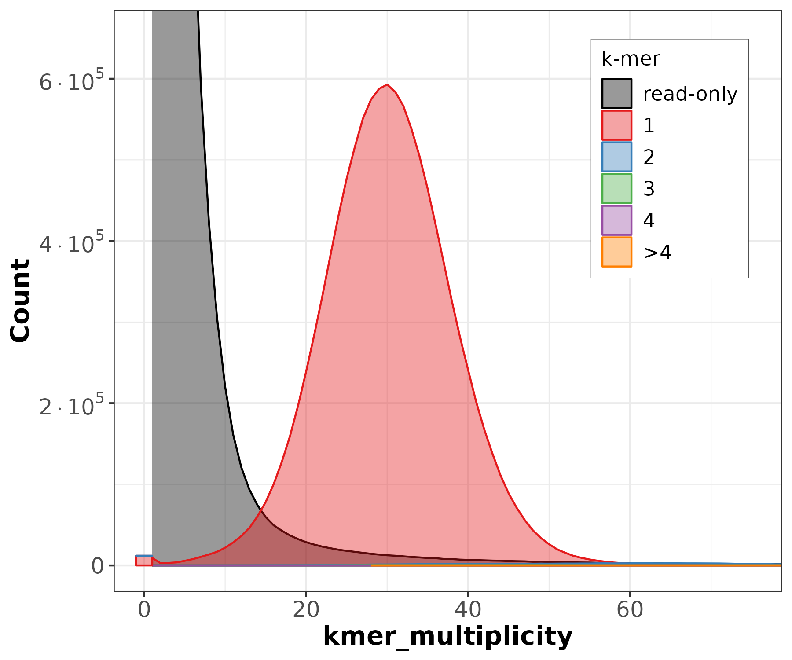

    [:material-download: Baixar imagem em alta resolução](outputs/merqury/spectra-cn/Scer1_Flye.spectra-cn.png){ target=_blank }

=== "Scer1 Hifiasm"

    

    [:material-download: Baixar imagem em alta resolução](outputs/merqury/spectra-cn/Scer1_hifiasm.spectra-cn.png){ target=_blank }

=== "Scer1 NextDenovo"

    

    [:material-download: Baixar imagem em alta resolução](outputs/merqury/spectra-cn/Scer1_nextdenovo.spectra-cn.png){ target=_blank }

=== "Scer2 Flye"

    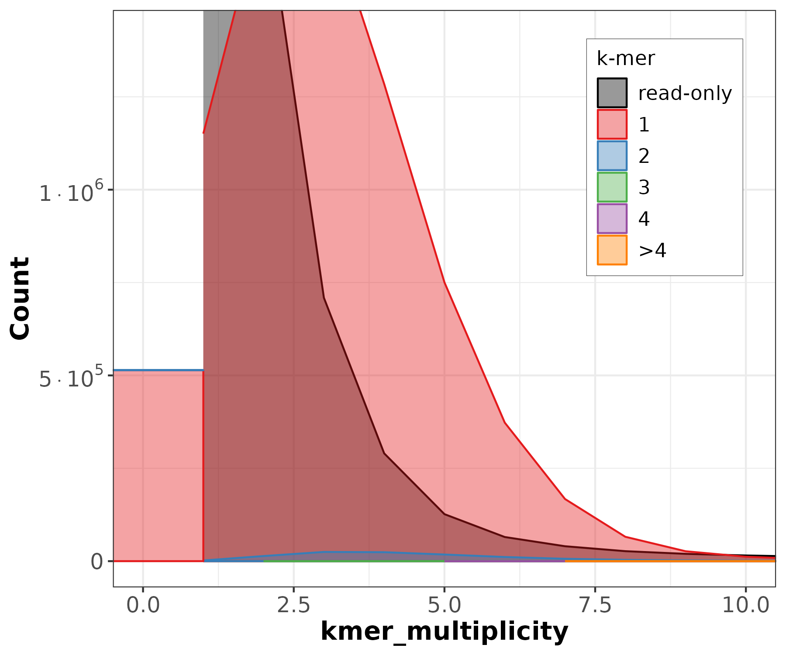

    [:material-download: Baixar imagem em alta resolução](outputs/merqury/spectra-cn/Scer2_Flye.spectra-cn.png){ target=_blank }

=== "Scer2 Hifiasm"

    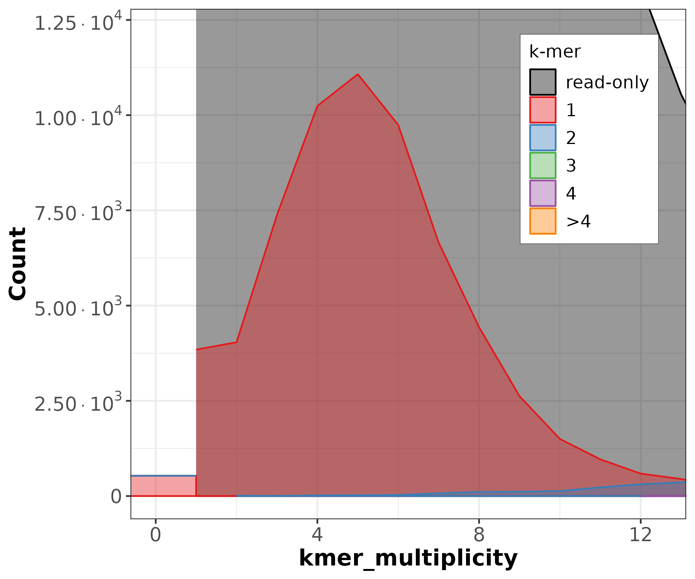

    [:material-download: Baixar imagem em alta resolução](outputs/merqury/spectra-cn/Scer2_hifiasm.spectra-cn.png){ target=_blank }

**O que os gráficos mostram:**

- *Scer1, as três montagens:* um único pico vermelho em ~30×, bem separado dos erros de leitura, como se espera de um genoma haploide bem montado. As diferenças estão nos detalhes, perto da base do gráfico:
    - O **Hifiasm** tem uma pequena "corcova" **azul** sob o pico, entre ~25× e 45×: k-mers de cópia única nas reads que aparecem **duas vezes** na montagem. São falsas duplicações, coerentes com os 12,98 Mb do Hifiasm (contra ~12,1 Mb da referência). Voltamos a elas no purge_dups.
    - A **barra em x = 0** é visível no Flye e no NextDenovo e bem menor no Hifiasm. É a mesma diferença do QV na tabela (43 e 42 contra 49).
- *Scer2:* com ~6× de cobertura, **não há pico do genoma separado dos erros**. Os k-mers reais ficam em 2 a 5×, misturados com os erros de leitura, e a barra em x = 0 é grande (QV 25 no Flye). O gráfico do Hifiasm tem uma escala cem vezes menor, porque a montagem tem só 189 kb, a maior parte mitocôndria: quase todos os k-mers das reads ficam de fora (cinza). Aqui o gráfico confirma o que a tabela já sugeria: com essa cobertura, o espectro de k-mers não serve para avaliar a montagem.

### 9.3 Completude de genes conservados (BUSCO)

O BUSCO (*Benchmarking Universal Single-Copy Orthologs*) avalia a completude do assembly a partir de um conjunto curado de genes esperados como cópia única em quase todas as espécies de uma linhagem específica. Nesse tutorial, utilizaremos o banco `saccharomycetaceae_odb12`, adequado para leveduras. Diferente do Merqury (que usa só os reads, sem referência) e do QUAST (que depende de um genoma de referência), o BUSCO não precisa de nenhum dos dois: ele busca os genes conservados diretamente na montagem, via alinhamento de proteínas e modelos HMM.

O resultado classifica cada gene esperado em quatro categorias:

- **Complete (C):** gene encontrado por completo. Pode ser *single-copy (S)*, uma cópia, o esperado para um genoma haploide, ou *duplicated (D)*, mais de uma cópia, sinal de possível haplótipo não colapsado ou expansão gênica real
- **Fragmented (F):** gene encontrado só parcialmente
- **Missing (M):** gene não encontrado


```bash
# Escolha o dataset mais adequado
busco --list-datasets
# Nesse caso, podemos usar o saccharomycetaceae_odb12.2
busco -i ncbi_dataset/data/GCF_000146045.2/GCF_000146045.2_R64_genomic.fna -l saccharomycetaceae_odb12 -m genome -o 8.QC_montagens/BUSCO/Scer_referencia
busco -i 5.Montagem-Flye/Scer1_q10_l500/assembly.fasta -l saccharomycetaceae_odb12 -m genome -o 8.QC_montagens/BUSCO/Scer1_q10_l500_Flye
busco -i 5.Montagem-Flye/Scer2_q10_l500/assembly.fasta -l saccharomycetaceae_odb12 -m genome -o 8.QC_montagens/BUSCO/Scer2_q10_l500_Flye
busco -i 6.Montagem-hifiasm/Scer1_q10_l500_hifiasm.p_ctg.fa -l saccharomycetaceae_odb12 -m genome -o 8.QC_montagens/BUSCO/Scer1_q10_l500_hifiasm
busco -i 6.Montagem-hifiasm/Scer2_q10_l500_hifiasm.p_ctg.fa -l saccharomycetaceae_odb12 -m genome -o 8.QC_montagens/BUSCO/Scer2_q10_l500_hifiasm
busco -i 7.Montagem-NextDenovo/Scer1_q10_l500/01_rundir/03.ctg_graph/nd.asm.fasta -l saccharomycetaceae_odb12 -m genome -o 8.QC_montagens/BUSCO/Scer1_q10_l500_nextdenovo
```

??? info "O que faz cada comando"
    | Comando | O que faz |
    |---|---|
    | `busco --list-datasets` | Lista os conjuntos de genes conservados (linhagens) disponíveis. |
    | `busco -i <montagem>` | Procura, na montagem, os genes de cópia única esperados para a linhagem. |
    | `-l saccharomycetaceae_odb12` | Linhagem usada (família Saccharomycetaceae). |
    | `-m genome` | Modo para sequências genômicas (não transcritos nem proteínas). |
    | `-o <pasta>` | Pasta de saída. A primeira linha avalia a referência, como comparação. |

!!! warning "Atenção: o download do banco do BUSCO pode demorar"
    Na primeira execução, o BUSCO baixa o banco escolhido (`-l`) para uma pasta `busco_downloads/` **no diretório onde o comando é rodado**. Isso pode levar vários minutos e depende da internet do servidor. Se cada aluno rodar numa pasta diferente, cada um baixa uma cópia.

    Se o banco já estiver baixado no servidor (pergunte ao responsável onde ele fica), aponte para ele em vez de baixar de novo:

    ```bash
    # opção 1: indicar a pasta que contém o busco_downloads/
    busco -i montagem.fasta -l saccharomycetaceae_odb12 -m genome -o saida \
          --download_path /caminho/para/busco_downloads --offline

    # opção 2: passar o caminho do próprio banco no -l
    busco -i montagem.fasta -l /caminho/para/busco_downloads/lineages/saccharomycetaceae_odb12 -m genome -o saida --offline
    ```

    O `--offline` impede o BUSCO de tentar checar ou baixar atualizações. Para deixar o banco pronto antes da aula: `busco --download saccharomycetaceae_odb12`.

??? note "Ver exemplo de saída do comando"

    ```bash
    $ busco -i ncbi_dataset/data/GCF_000146045.2/GCF_000146045.2_R64_genomic.fna -l saccharomycetaceae_odb12 -m genome -o 8.QC_montagens/BUSCO/Scer_referencia

    2026-11-17 14:20:17 INFO:       ***** Start a BUSCO v6.0.0 analysis, current time: 11/17/2026 14:20:17 *****
    2026-11-17 14:20:17 INFO:       Configuring BUSCO with /home/lgbio/busco/config/config.ini
    2026-11-17 14:20:17 INFO:       Running genome mode
    2026-11-17 14:20:17 INFO:       Downloading information on latest versions of BUSCO data...
    2026-11-17 14:20:21 INFO:       Input file is /media/hd16-databases/usuarios/renatadias/curso-nanopore-nov26/ncbi_dataset/data/GCF_000146045.2/GCF_000146045.2_R64_genomic.fna
    2026-11-17 14:20:21 INFO:       Downloading file 'https://busco-data.ezlab.org/v5/data/lineages/saccharomycetaceae_odb12.2026-05-22.tar.gz'
    2026-11-17 14:20:39 INFO:       Decompressing file '/media/hd16-databases/usuarios/renatadias/curso-nanopore-nov26/busco_downloads/lineages/saccharomycetaceae_odb12.tar.gz'
    2026-11-17 14:20:48 INFO:       Running BUSCO using lineage dataset saccharomycetaceae_odb12 (eukaryota, 2026-05-22)
    2026-11-17 14:20:48 INFO:       Running 1 job(s) on bbtools, starting at 11/17/2026 14:20:48
    2026-11-17 14:20:50 INFO:       [bbtools]       1 of 1 task(s) completed
    2026-11-17 14:20:50 INFO:       Running 1 job(s) on miniprot_index, starting at 11/17/2026 14:20:50
    2026-11-17 14:20:51 INFO:       [miniprot_index]        1 of 1 task(s) completed
    2026-11-17 14:20:52 INFO:       Running 1 job(s) on miniprot_align, starting at 11/17/2026 14:20:52
    2026-11-17 14:32:11 INFO:       [miniprot_align]        1 of 1 task(s) completed
    2026-11-17 14:32:13 INFO:       ***** Run HMMER on gene sequences *****
    2026-11-17 14:32:17 INFO:       Running 3282 job(s) on hmmsearch, starting at 11/17/2026 14:32:17
    2026-11-17 14:32:31 INFO:       [hmmsearch]     329 of 3282 task(s) completed
    2026-11-17 14:32:42 INFO:       [hmmsearch]     657 of 3282 task(s) completed
    2026-11-17 14:32:54 INFO:       [hmmsearch]     985 of 3282 task(s) completed
    2026-11-17 14:33:07 INFO:       [hmmsearch]     1313 of 3282 task(s) completed
    2026-11-17 14:33:19 INFO:       [hmmsearch]     1641 of 3282 task(s) completed
    2026-11-17 14:33:30 INFO:       [hmmsearch]     1970 of 3282 task(s) completed
    2026-11-17 14:33:43 INFO:       [hmmsearch]     2298 of 3282 task(s) completed
    2026-11-17 14:33:57 INFO:       [hmmsearch]     2626 of 3282 task(s) completed
    2026-11-17 14:34:12 INFO:       [hmmsearch]     2954 of 3282 task(s) completed
    2026-11-17 14:34:23 INFO:       [hmmsearch]     3282 of 3282 task(s) completed
    2026-11-17 14:34:24 INFO:       10 candidate overlapping regions found
    2026-11-17 14:34:24 INFO:       3465 exons in total
    2026-11-17 14:34:24 WARNING:    49 of 3278 Complete matches (1.5%) contain internal stop codons in Miniprot gene predictions
    2026-11-17 14:34:25 INFO:

        -------------------------------------------------------------------------------------------
        |Results from dataset saccharomycetaceae_odb12                                             |
        -------------------------------------------------------------------------------------------
        |C:99.9%[S:99.8%,D:0.0%],F:0.0%,M:0.1%,n:3282,E:1.5%                                       |
        |3278    Complete BUSCOs (C)    (of which 49 contain internal stop codons)                 |
        |3277    Complete and single-copy BUSCOs (S)                                               |
        |1    Complete and duplicated BUSCOs (D)                                                   |
        |0    Fragmented BUSCOs (F)                                                                |
        |4    Missing BUSCOs (M)                                                                   |
        |3282    Total BUSCO groups searched                                                       |
        -------------------------------------------------------------------------------------------
    2026-11-17 14:34:25 INFO:       BUSCO analysis done with WARNING(s). Total running time: 843 seconds

    ***** Summary of warnings: *****
    2026-11-17 14:34:24 WARNING:busco.busco_tools.hmmer     49 of 3278 Complete matches (1.5%) contain internal stop codons in Miniprot gene predictions

    2026-11-17 14:34:25 INFO:       Results written in 8.QC_montagens/BUSCO/Scer_referencia
    2026-11-17 14:34:25 INFO:       For assistance with interpreting the results, please consult the userguide: https://busco.ezlab.org/busco_userguide.html

    2026-11-17 14:34:25 INFO:       Visit this page https://gitlab.com/ezlab/busco#how-to-cite-busco to see how to cite BUSCO
    2026-11-17 14:34:25 INFO:       Thank you for using BUSCO! Anonymous usage data is gathered to improve the tool. You may opt out with --opt-out-run-stats.

    $ busco -i 5.Montagem-Flye/Scer1_q10_l500/assembly.fasta -l saccharomycetaceae_odb12 -m genome -o 8.QC_montagens/BUSCO/Scer1_q10_l500_Flye
    2026-11-17 14:34:27 INFO:       ***** Start a BUSCO v6.0.0 analysis, current time: 11/17/2026 14:34:27 *****
    2026-11-17 14:34:27 INFO:       Configuring BUSCO with /home/lgbio/busco/config/config.ini
    2026-11-17 14:34:27 INFO:       Running genome mode
    2026-11-17 14:34:27 INFO:       Downloading information on latest versions of BUSCO data...
    2026-11-17 14:34:31 INFO:       Input file is /media/hd16-databases/usuarios/renatadias/curso-nanopore-nov26/5.Montagem-Flye/Scer1_q10_l500/assembly.fasta
    2026-11-17 14:34:31 INFO:       The local file or folder /media/hd16-databases/usuarios/renatadias/curso-nanopore-nov26/busco_downloads/lineages/saccharomycetaceae_odb12 is the last available version.
    2026-11-17 14:34:31 INFO:       Running BUSCO using lineage dataset saccharomycetaceae_odb12 (eukaryota, 2026-05-22)
    2026-11-17 14:34:31 INFO:       Running 1 job(s) on bbtools, starting at 11/17/2026 14:34:31
    2026-11-17 14:34:32 INFO:       [bbtools]       1 of 1 task(s) completed
    2026-11-17 14:34:32 INFO:       Running 1 job(s) on miniprot_index, starting at 11/17/2026 14:34:32
    2026-11-17 14:34:34 INFO:       [miniprot_index]        1 of 1 task(s) completed
    2026-11-17 14:34:35 INFO:       Running 1 job(s) on miniprot_align, starting at 11/17/2026 14:34:35
    2026-11-17 14:46:11 INFO:       [miniprot_align]        1 of 1 task(s) completed
    2026-11-17 14:46:13 INFO:       ***** Run HMMER on gene sequences *****
    2026-11-17 14:46:17 INFO:       Running 3282 job(s) on hmmsearch, starting at 11/17/2026 14:46:17
    2026-11-17 14:46:32 INFO:       [hmmsearch]     329 of 3282 task(s) completed
    2026-11-17 14:46:44 INFO:       [hmmsearch]     657 of 3282 task(s) completed
    2026-11-17 14:46:59 INFO:       [hmmsearch]     985 of 3282 task(s) completed
    2026-11-17 14:47:11 INFO:       [hmmsearch]     1313 of 3282 task(s) completed
    2026-11-17 14:47:24 INFO:       [hmmsearch]     1641 of 3282 task(s) completed
    2026-11-17 14:47:38 INFO:       [hmmsearch]     1970 of 3282 task(s) completed
    2026-11-17 14:47:51 INFO:       [hmmsearch]     2298 of 3282 task(s) completed
    2026-11-17 14:48:09 INFO:       [hmmsearch]     2626 of 3282 task(s) completed
    2026-11-17 14:48:24 INFO:       [hmmsearch]     2954 of 3282 task(s) completed
    2026-11-17 14:48:41 INFO:       [hmmsearch]     3282 of 3282 task(s) completed
    2026-11-17 14:48:42 INFO:       18 candidate overlapping regions found
    2026-11-17 14:48:42 INFO:       3481 exons in total
    2026-11-17 14:48:43 WARNING:    54 of 3271 Complete matches (1.7%) contain internal stop codons in Miniprot gene predictions
    2026-11-17 14:48:43 INFO:

        -------------------------------------------------------------------------------------------
        |Results from dataset saccharomycetaceae_odb12                                             |
        -------------------------------------------------------------------------------------------
        |C:99.7%[S:99.6%,D:0.1%],F:0.0%,M:0.3%,n:3282,E:1.7%                                       |
        |3271    Complete BUSCOs (C)    (of which 54 contain internal stop codons)                 |
        |3268    Complete and single-copy BUSCOs (S)                                               |
        |3    Complete and duplicated BUSCOs (D)                                                   |
        |1    Fragmented BUSCOs (F)                                                                |
        |10    Missing BUSCOs (M)                                                                  |
        |3282    Total BUSCO groups searched                                                       |
        -------------------------------------------------------------------------------------------
    2026-11-17 14:48:43 INFO:       BUSCO analysis done with WARNING(s). Total running time: 852 seconds

    ***** Summary of warnings: *****
    2026-11-17 14:48:43 WARNING:busco.busco_tools.hmmer     54 of 3271 Complete matches (1.7%) contain internal stop codons in Miniprot gene predictions

    2026-11-17 14:48:43 INFO:       Results written in 8.QC_montagens/BUSCO/Scer1_q10_l500_Flye
    2026-11-17 14:48:43 INFO:       For assistance with interpreting the results, please consult the userguide: https://busco.ezlab.org/busco_userguide.html

    2026-11-17 14:48:43 INFO:       Visit this page https://gitlab.com/ezlab/busco#how-to-cite-busco to see how to cite BUSCO
    2026-11-17 14:48:43 INFO:       Thank you for using BUSCO! Anonymous usage data is gathered to improve the tool. You may opt out with --opt-out-run-stats.

    $ busco -i 5.Montagem-Flye/Scer2_q10_l500/assembly.fasta -l saccharomycetaceae_odb12 -m genome -o 8.QC_montagens/BUSCO/Scer2_q10_l500_Flye
    2026-11-17 14:48:46 INFO:       ***** Start a BUSCO v6.0.0 analysis, current time: 11/17/2026 14:48:46 *****
    2026-11-17 14:48:46 INFO:       Configuring BUSCO with /home/lgbio/busco/config/config.ini
    2026-11-17 14:48:46 INFO:       Running genome mode
    2026-11-17 14:48:46 INFO:       Downloading information on latest versions of BUSCO data...
    2026-11-17 14:48:51 INFO:       Input file is /media/hd16-databases/usuarios/renatadias/curso-nanopore-nov26/5.Montagem-Flye/Scer2_q10_l500/assembly.fasta
    2026-11-17 14:48:51 INFO:       The local file or folder /media/hd16-databases/usuarios/renatadias/curso-nanopore-nov26/busco_downloads/lineages/saccharomycetaceae_odb12 is the last available version.
    2026-11-17 14:48:51 INFO:       Running BUSCO using lineage dataset saccharomycetaceae_odb12 (eukaryota, 2026-05-22)
    2026-11-17 14:48:51 INFO:       Running 1 job(s) on bbtools, starting at 11/17/2026 14:48:51
    2026-11-17 14:48:53 INFO:       [bbtools]       1 of 1 task(s) completed
    2026-11-17 14:48:53 INFO:       Running 1 job(s) on miniprot_index, starting at 11/17/2026 14:48:53
    2026-11-17 14:48:54 INFO:       [miniprot_index]        1 of 1 task(s) completed
    2026-11-17 14:48:56 INFO:       Running 1 job(s) on miniprot_align, starting at 11/17/2026 14:48:56
    2026-11-17 15:00:31 INFO:       [miniprot_align]        1 of 1 task(s) completed
    2026-11-17 15:00:34 INFO:       ***** Run HMMER on gene sequences *****
    2026-11-17 15:00:37 INFO:       Running 2790 job(s) on hmmsearch, starting at 11/17/2026 15:00:37
    2026-11-17 15:00:47 INFO:       [hmmsearch]     279 of 2790 task(s) completed
    2026-11-17 15:00:55 INFO:       [hmmsearch]     558 of 2790 task(s) completed
    2026-11-17 15:01:03 INFO:       [hmmsearch]     837 of 2790 task(s) completed
    2026-11-17 15:01:11 INFO:       [hmmsearch]     1116 of 2790 task(s) completed
    2026-11-17 15:01:20 INFO:       [hmmsearch]     1395 of 2790 task(s) completed
    2026-11-17 15:01:27 INFO:       [hmmsearch]     1674 of 2790 task(s) completed
    2026-11-17 15:01:35 INFO:       [hmmsearch]     1953 of 2790 task(s) completed
    2026-11-17 15:01:46 INFO:       [hmmsearch]     2232 of 2790 task(s) completed
    2026-11-17 15:01:57 INFO:       [hmmsearch]     2511 of 2790 task(s) completed
    2026-11-17 15:02:05 INFO:       [hmmsearch]     2790 of 2790 task(s) completed
    2026-11-17 15:02:06 INFO:       10 candidate overlapping regions found
    2026-11-17 15:02:06 INFO:       2431 exons in total
    2026-11-17 15:02:07 WARNING:    30 of 2190 Complete matches (1.4%) contain internal stop codons in Miniprot gene predictions
    2026-11-17 15:02:07 INFO:

        -------------------------------------------------------------------------------------------
        |Results from dataset saccharomycetaceae_odb12                                             |
        -------------------------------------------------------------------------------------------
        |C:66.7%[S:66.6%,D:0.1%],F:3.0%,M:30.2%,n:3282,E:1.4%                                      |
        |2190    Complete BUSCOs (C)    (of which 30 contain internal stop codons)                 |
        |2186    Complete and single-copy BUSCOs (S)                                               |
        |4    Complete and duplicated BUSCOs (D)                                                   |
        |100    Fragmented BUSCOs (F)                                                              |
        |992    Missing BUSCOs (M)                                                                 |
        |3282    Total BUSCO groups searched                                                       |
        -------------------------------------------------------------------------------------------
    2026-11-17 15:02:07 INFO:       BUSCO analysis done with WARNING(s). Total running time: 796 seconds

    ***** Summary of warnings: *****
    2026-11-17 15:02:07 WARNING:busco.busco_tools.hmmer     30 of 2190 Complete matches (1.4%) contain internal stop codons in Miniprot gene predictions

    2026-11-17 15:02:07 INFO:       Results written in 8.QC_montagens/BUSCO/Scer2_q10_l500_Flye
    2026-11-17 15:02:07 INFO:       For assistance with interpreting the results, please consult the userguide: https://busco.ezlab.org/busco_userguide.html

    2026-11-17 15:02:07 INFO:       Visit this page https://gitlab.com/ezlab/busco#how-to-cite-busco to see how to cite BUSCO
    2026-11-17 15:02:07 INFO:       Thank you for using BUSCO! Anonymous usage data is gathered to improve the tool. You may opt out with --opt-out-run-stats.

    $ busco -i 6.Montagem-hifiasm/Scer1_q10_l500_hifiasm.p_ctg.fa -l saccharomycetaceae_odb12 -m genome -o 8.QC_montagens/BUSCO/Scer1_q10_l500_hifiasm
    2026-11-17 15:02:10 INFO:       ***** Start a BUSCO v6.0.0 analysis, current time: 11/17/2026 15:02:10 *****
    2026-11-17 15:02:10 INFO:       Configuring BUSCO with /home/lgbio/busco/config/config.ini
    2026-11-17 15:02:10 INFO:       Running genome mode
    2026-11-17 15:02:10 INFO:       Downloading information on latest versions of BUSCO data...
    2026-11-17 15:02:13 INFO:       Input file is /media/hd16-databases/usuarios/renatadias/curso-nanopore-nov26/6.Montagem-hifiasm/Scer1_q10_l500_hifiasm.p_ctg.fa
    2026-11-17 15:02:13 INFO:       The local file or folder /media/hd16-databases/usuarios/renatadias/curso-nanopore-nov26/busco_downloads/lineages/saccharomycetaceae_odb12 is the last available version.
    2026-11-17 15:02:14 INFO:       Running BUSCO using lineage dataset saccharomycetaceae_odb12 (eukaryota, 2026-05-22)
    2026-11-17 15:02:14 INFO:       Running 1 job(s) on bbtools, starting at 11/17/2026 15:02:14
    2026-11-17 15:02:14 INFO:       [bbtools]       1 of 1 task(s) completed
    2026-11-17 15:02:14 INFO:       Running 1 job(s) on miniprot_index, starting at 11/17/2026 15:02:14
    2026-11-17 15:02:16 INFO:       [miniprot_index]        1 of 1 task(s) completed
    2026-11-17 15:02:17 INFO:       Running 1 job(s) on miniprot_align, starting at 11/17/2026 15:02:17
    2026-11-17 15:16:54 INFO:       [miniprot_align]        1 of 1 task(s) completed
    2026-11-17 15:16:56 INFO:       ***** Run HMMER on gene sequences *****
    2026-11-17 15:17:00 INFO:       Running 3282 job(s) on hmmsearch, starting at 11/17/2026 15:17:00
    2026-11-17 15:18:14 INFO:       [hmmsearch]     329 of 3282 task(s) completed
    2026-11-17 15:19:38 INFO:       [hmmsearch]     657 of 3282 task(s) completed
    2026-11-17 15:21:11 INFO:       [hmmsearch]     985 of 3282 task(s) completed
    2026-11-17 15:22:04 INFO:       [hmmsearch]     1313 of 3282 task(s) completed
    2026-11-17 15:22:22 INFO:       [hmmsearch]     1641 of 3282 task(s) completed
    2026-11-17 15:23:15 INFO:       [hmmsearch]     1970 of 3282 task(s) completed
    2026-11-17 15:24:10 INFO:       [hmmsearch]     2298 of 3282 task(s) completed
    2026-11-17 15:25:06 INFO:       [hmmsearch]     2626 of 3282 task(s) completed
    2026-11-17 15:26:07 INFO:       [hmmsearch]     2954 of 3282 task(s) completed
    2026-11-17 15:26:56 INFO:       [hmmsearch]     3282 of 3282 task(s) completed
    2026-11-17 15:26:57 INFO:       17 candidate overlapping regions found
    2026-11-17 15:26:57 INFO:       3538 exons in total
    2026-11-17 15:26:58 WARNING:    51 of 3271 Complete matches (1.6%) contain internal stop codons in Miniprot gene predictions
    2026-11-17 15:26:59 INFO:

        -------------------------------------------------------------------------------------------
        |Results from dataset saccharomycetaceae_odb12                                             |
        -------------------------------------------------------------------------------------------
        |C:99.7%[S:98.0%,D:1.7%],F:0.0%,M:0.3%,n:3282,E:1.6%                                       |
        |3271    Complete BUSCOs (C)    (of which 51 contain internal stop codons)                 |
        |3216    Complete and single-copy BUSCOs (S)                                               |
        |55    Complete and duplicated BUSCOs (D)                                                  |
        |1    Fragmented BUSCOs (F)                                                                |
        |10    Missing BUSCOs (M)                                                                  |
        |3282    Total BUSCO groups searched                                                       |
        -------------------------------------------------------------------------------------------
    2026-11-17 15:26:59 INFO:       BUSCO analysis done with WARNING(s). Total running time: 1485 seconds

    ***** Summary of warnings: *****
    2026-11-17 15:26:58 WARNING:busco.busco_tools.hmmer     51 of 3271 Complete matches (1.6%) contain internal stop codons in Miniprot gene predictions

    2026-11-17 15:26:59 INFO:       Results written in 8.QC_montagens/BUSCO/Scer1_q10_l500_hifiasm
    2026-11-17 15:26:59 INFO:       For assistance with interpreting the results, please consult the userguide: https://busco.ezlab.org/busco_userguide.html

    2026-11-17 15:26:59 INFO:       Visit this page https://gitlab.com/ezlab/busco#how-to-cite-busco to see how to cite BUSCO
    2026-11-17 15:26:59 INFO:       Thank you for using BUSCO! Anonymous usage data is gathered to improve the tool. You may opt out with --opt-out-run-stats.

    $ busco -i 6.Montagem-hifiasm/Scer2_q10_l500_hifiasm.p_ctg.fa -l saccharomycetaceae_odb12 -m genome -o 8.QC_montagens/BUSCO/Scer2_q10_l500_hifiasm
    2026-11-17 15:27:01 INFO:       ***** Start a BUSCO v6.0.0 analysis, current time: 11/17/2026 15:27:01 *****
    2026-11-17 15:27:01 INFO:       Configuring BUSCO with /home/lgbio/busco/config/config.ini
    2026-11-17 15:27:01 INFO:       Running genome mode
    2026-11-17 15:27:01 INFO:       Downloading information on latest versions of BUSCO data...
    2026-11-17 15:27:07 INFO:       Input file is /media/hd16-databases/usuarios/renatadias/curso-nanopore-nov26/6.Montagem-hifiasm/Scer2_q10_l500_hifiasm.p_ctg.fa
    2026-11-17 15:27:07 INFO:       The local file or folder /media/hd16-databases/usuarios/renatadias/curso-nanopore-nov26/busco_downloads/lineages/saccharomycetaceae_odb12 is the last available version.
    2026-11-17 15:27:07 INFO:       Running BUSCO using lineage dataset saccharomycetaceae_odb12 (eukaryota, 2026-05-22)
    2026-11-17 15:27:07 INFO:       Running 1 job(s) on bbtools, starting at 11/17/2026 15:27:07
    2026-11-17 15:27:08 INFO:       [bbtools]       1 of 1 task(s) completed
    2026-11-17 15:27:08 INFO:       Running 1 job(s) on miniprot_index, starting at 11/17/2026 15:27:08
    2026-11-17 15:27:08 INFO:       [miniprot_index]        1 of 1 task(s) completed
    2026-11-17 15:27:13 INFO:       Running 1 job(s) on miniprot_align, starting at 11/17/2026 15:27:13
    2026-11-17 15:27:38 INFO:       [miniprot_align]        1 of 1 task(s) completed
    2026-11-17 15:27:38 INFO:       ***** Run HMMER on gene sequences *****
    2026-11-17 15:27:38 INFO:       Running 116 job(s) on hmmsearch, starting at 11/17/2026 15:27:38
    2026-11-17 15:27:41 INFO:       [hmmsearch]     12 of 116 task(s) completed
    2026-11-17 15:27:42 INFO:       [hmmsearch]     24 of 116 task(s) completed
    2026-11-17 15:27:42 INFO:       [hmmsearch]     35 of 116 task(s) completed
    2026-11-17 15:27:43 INFO:       [hmmsearch]     47 of 116 task(s) completed
    2026-11-17 15:27:46 INFO:       [hmmsearch]     58 of 116 task(s) completed
    2026-11-17 15:27:46 INFO:       [hmmsearch]     70 of 116 task(s) completed
    2026-11-17 15:27:47 INFO:       [hmmsearch]     82 of 116 task(s) completed
    2026-11-17 15:27:47 INFO:       [hmmsearch]     93 of 116 task(s) completed
    2026-11-17 15:27:47 INFO:       [hmmsearch]     105 of 116 task(s) completed
    2026-11-17 15:27:48 INFO:       [hmmsearch]     116 of 116 task(s) completed
    2026-11-17 15:27:48 INFO:       17 exons in total
    2026-11-17 15:27:48 INFO:

        ---------------------------------------------------
        |Results from dataset saccharomycetaceae_odb12     |
        ---------------------------------------------------
        |C:0.5%[S:0.5%,D:0.0%],F:0.1%,M:99.5%,n:3282       |
        |15    Complete BUSCOs (C)                         |
        |15    Complete and single-copy BUSCOs (S)         |
        |0    Complete and duplicated BUSCOs (D)           |
        |2    Fragmented BUSCOs (F)                        |
        |3265    Missing BUSCOs (M)                        |
        |3282    Total BUSCO groups searched               |
        ---------------------------------------------------
    2026-11-17 15:27:48 INFO:       BUSCO analysis done. Total running time: 41 seconds
    2026-11-17 15:27:48 INFO:       Results written in 8.QC_montagens/BUSCO/Scer2_q10_l500_hifiasm
    2026-11-17 15:27:48 INFO:       For assistance with interpreting the results, please consult the userguide: https://busco.ezlab.org/busco_userguide.html

    2026-11-17 15:27:48 INFO:       Visit this page https://gitlab.com/ezlab/busco#how-to-cite-busco to see how to cite BUSCO
    2026-11-17 15:27:48 INFO:       Thank you for using BUSCO! Anonymous usage data is gathered to improve the tool. You may opt out with --opt-out-run-stats.

    $ busco -i 7.Montagem-NextDenovo/Scer1_q10_l500/01_rundir/03.ctg_graph/nd.asm.fasta -l saccharomycetaceae_odb12 -m genome -o 8.QC_montagens/BUSCO/Scer1_q10_l500_nextdenovo

    2026-11-17 15:27:50 INFO:       ***** Start a BUSCO v6.0.0 analysis, current time: 11/17/2026 15:27:50 *****
    2026-11-17 15:27:50 INFO:       Configuring BUSCO with /home/lgbio/busco/config/config.ini
    2026-11-17 15:27:50 INFO:       Running genome mode
    2026-11-17 15:27:50 INFO:       Downloading information on latest versions of BUSCO data...
    2026-11-17 15:27:53 INFO:       Input file is /media/hd16-databases/usuarios/renatadias/curso-nanopore-nov26/7.Montagem-NextDenovo/Scer1_q10_l500/01_rundir/03.ctg_graph/nd.asm.fasta
    2026-11-17 15:27:53 INFO:       The local file or folder /media/hd16-databases/usuarios/renatadias/curso-nanopore-nov26/busco_downloads/lineages/saccharomycetaceae_odb12 is the last available version.
    2026-11-17 15:27:56 INFO:       Running BUSCO using lineage dataset saccharomycetaceae_odb12 (eukaryota, 2026-05-22)
    2026-11-17 15:27:56 INFO:       Running 1 job(s) on bbtools, starting at 11/17/2026 15:27:56
    2026-11-17 15:27:57 INFO:       [bbtools]       1 of 1 task(s) completed
    2026-11-17 15:27:57 INFO:       Running 1 job(s) on miniprot_index, starting at 11/17/2026 15:27:57
    2026-11-17 15:27:59 INFO:       [miniprot_index]        1 of 1 task(s) completed
    2026-11-17 15:28:00 INFO:       Running 1 job(s) on miniprot_align, starting at 11/17/2026 15:28:00
    2026-11-17 15:39:22 INFO:       [miniprot_align]        1 of 1 task(s) completed
    2026-11-17 15:39:24 INFO:       ***** Run HMMER on gene sequences *****
    2026-11-17 15:39:28 INFO:       Running 3282 job(s) on hmmsearch, starting at 11/17/2026 15:39:28
    2026-11-17 15:39:40 INFO:       [hmmsearch]     329 of 3282 task(s) completed
    2026-11-17 15:39:52 INFO:       [hmmsearch]     657 of 3282 task(s) completed
    2026-11-17 15:40:04 INFO:       [hmmsearch]     985 of 3282 task(s) completed
    2026-11-17 15:40:16 INFO:       [hmmsearch]     1313 of 3282 task(s) completed
    2026-11-17 15:40:29 INFO:       [hmmsearch]     1641 of 3282 task(s) completed
    2026-11-17 15:40:42 INFO:       [hmmsearch]     1970 of 3282 task(s) completed
    2026-11-17 15:40:54 INFO:       [hmmsearch]     2298 of 3282 task(s) completed
    2026-11-17 15:41:09 INFO:       [hmmsearch]     2626 of 3282 task(s) completed
    2026-11-17 15:41:23 INFO:       [hmmsearch]     2954 of 3282 task(s) completed
    2026-11-17 15:41:34 INFO:       [hmmsearch]     3282 of 3282 task(s) completed
    2026-11-17 15:41:34 INFO:       18 candidate overlapping regions found
    2026-11-17 15:41:34 INFO:       3481 exons in total
    2026-11-17 15:41:35 WARNING:    52 of 3270 Complete matches (1.6%) contain internal stop codons in Miniprot gene predictions
    2026-11-17 15:41:36 INFO:

        -------------------------------------------------------------------------------------------
        |Results from dataset saccharomycetaceae_odb12                                             |
        -------------------------------------------------------------------------------------------
        |C:99.6%[S:99.5%,D:0.2%],F:0.0%,M:0.3%,n:3282,E:1.6%                                       |
        |3270    Complete BUSCOs (C)    (of which 52 contain internal stop codons)                 |
        |3265    Complete and single-copy BUSCOs (S)                                               |
        |5    Complete and duplicated BUSCOs (D)                                                   |
        |1    Fragmented BUSCOs (F)                                                                |
        |11    Missing BUSCOs (M)                                                                  |
        |3282    Total BUSCO groups searched                                                       |
        -------------------------------------------------------------------------------------------
    2026-11-17 15:41:36 INFO:       BUSCO analysis done with WARNING(s). Total running time: 822 seconds

    ***** Summary of warnings: *****
    2026-11-17 15:41:35 WARNING:busco.busco_tools.hmmer     52 of 3270 Complete matches (1.6%) contain internal stop codons in Miniprot gene predictions

    2026-11-17 15:41:36 INFO:       Results written in 8.QC_montagens/BUSCO/Scer1_q10_l500_nextdenovo
    2026-11-17 15:41:36 INFO:       For assistance with interpreting the results, please consult the userguide: https://busco.ezlab.org/busco_userguide.html

    2026-11-17 15:41:36 INFO:       Visit this page https://gitlab.com/ezlab/busco#how-to-cite-busco to see how to cite BUSCO
    2026-11-17 15:41:36 INFO:       Thank you for using BUSCO! Anonymous usage data is gathered to improve the tool. You may opt out with --opt-out-run-stats.

    ```
  
**Gerar gráficos comparativos com os resultados do BUSCO**

```bash
# Copiar os short_summary de cada run para uma pasta
mkdir 8.QC_montagens/BUSCO/summaries

cp 8.QC_montagens/BUSCO/Scer_referencia/short_summary*.txt 8.QC_montagens/BUSCO/summaries/
cp 8.QC_montagens/BUSCO/Scer1_q10_l500_Flye/short_summary*.txt 8.QC_montagens/BUSCO/summaries/
cp 8.QC_montagens/BUSCO/Scer2_q10_l500_Flye/short_summary*.txt 8.QC_montagens/BUSCO/summaries/
cp 8.QC_montagens/BUSCO/Scer1_q10_l500_hifiasm/short_summary*.txt 8.QC_montagens/BUSCO/summaries/
cp 8.QC_montagens/BUSCO/Scer2_q10_l500_hifiasm/short_summary*.txt 8.QC_montagens/BUSCO/summaries/
cp 8.QC_montagens/BUSCO/Scer1_q10_l500_nextdenovo/short_summary*.txt 8.QC_montagens/BUSCO/summaries/

# Gerar tabelas comparativas
grep -H "C:" 8.QC_montagens/BUSCO/summaries/short_summary*.txt \
| sed -E 's/^(.*):[[:space:]]*C:([0-9.]+)%\[S:([0-9.]+)%,D:([0-9.]+)%\],F:([0-9.]+)%,M:([0-9.]+)%,n:([0-9]+)(,E:([0-9.]+)%)?[[:space:]]*$/\1\t\2\t\3\t\4\t\5\t\6\t\7\t\9/' \
| sed -E 's#^.*/##; s/^short_summary\.[a-z]+\.[^.]+_odb[0-9]+\.//; s/\.txt\t/\t/' \
| { echo -e "Sample\tComplete\tSingle\tDuplicated\tFragmented\tMissing\tn\tE"; cat; } \
| column -t -s $'\t'

# Gerar o gráfico comparativo
conda activate busco
python /home/lgbio/busco/scripts/generate_plot.py -wd 8.QC_montagens/BUSCO/summaries/
conda deactivate
```

??? info "O que faz cada comando"
    | Comando | O que faz |
    |---|---|
    | `mkdir` + `cp .../short_summary*.txt` | Junta numa pasta só o resumo (`short_summary`) de cada BUSCO. |
    | `grep -H "C:" ...` | Pega a linha de resultado (`C:...%[S:...,D:...],F:...,M:...`) de cada resumo, com o nome do arquivo na frente (`-H`). |
    | `sed -E 's/.../'` (primeiro) | Separa os números (C, S, D, F, M, n, E) em colunas. |
    | `sed -E 's#^.*/##; ...'` (segundo) | Limpa o nome do arquivo, deixando só o nome da montagem. |
    | `{ echo -e "Sample..."; cat; }` | Põe uma linha de cabeçalho antes dos dados. |
    | `column -t -s $'\t'` | Alinha as colunas para facilitar a leitura. |
    | `conda activate busco` + `generate_plot.py -wd <pasta>` | Gera o gráfico de barras comparando todos os resumos da pasta. |
    | `conda deactivate` | Sai do ambiente. |

??? note "Ver saída do comando"

    ```bash
    Sample                     Complete  Single  Duplicated  Fragmented  Missing  n     E
    Scer1_q10_l500_Flye        99.7      99.6    0.1         0.0         0.3      3282  1.7
    Scer1_q10_l500_hifiasm     99.7      98.0    1.7         0.0         0.3      3282  1.6
    Scer1_q10_l500_nextdenovo  99.6      99.5    0.2         0.0         0.3      3282  1.6
    Scer2_q10_l500_Flye        66.7      66.6    0.1         3.0         30.2     3282  1.4
    Scer2_q10_l500_hifiasm     0.5       0.5     0.0         0.1         99.5     3282
    Scer_referencia            99.9      99.8    0.0         0.0         0.1      3282  1.5

    $ python /home/lgbio/busco/scripts/generate_plot.py -wd 8.QC_montagens/BUSCO/summaries/
    2026-11-17 15:44:51 INFO:       ****************** Start plot generation at 11/17/2026 15:44:51 ******************
    2026-11-17 15:44:51 INFO:       Load data ...
    2026-11-17 15:44:51 INFO:       Loaded 8.QC_montagens/BUSCO/summaries/short_summary.specific.saccharomycetaceae_odb12.Scer1_q10_l500_nextdenovo.txt successfully
    2026-11-17 15:44:51 INFO:       Loaded 8.QC_montagens/BUSCO/summaries/short_summary.specific.saccharomycetaceae_odb12.Scer2_q10_l500_hifiasm.txt successfully
    2026-11-17 15:44:51 INFO:       Loaded 8.QC_montagens/BUSCO/summaries/short_summary.specific.saccharomycetaceae_odb12.Scer2_q10_l500_Flye.txt successfully
    2026-11-17 15:44:51 INFO:       Loaded 8.QC_montagens/BUSCO/summaries/short_summary.specific.saccharomycetaceae_odb12.Scer1_q10_l500_Flye.txt successfully
    2026-11-17 15:44:51 INFO:       Loaded 8.QC_montagens/BUSCO/summaries/short_summary.specific.saccharomycetaceae_odb12.Scer1_q10_l500_hifiasm.txt successfully
    2026-11-17 15:44:51 INFO:       Loaded 8.QC_montagens/BUSCO/summaries/short_summary.specific.saccharomycetaceae_odb12.Scer_referencia.txt successfully
    2026-11-17 15:44:51 INFO:       Generate the R code ...
    2026-11-17 15:44:51 INFO:       Run the R code ...
    2026-11-17 15:44:54 INFO:
    [1] "Plotting the figure ..."
    [1] "Done"

    2026-11-17 15:44:54 ERROR:
    Mensagen de aviso:
    The `size` argument of `element_line()` is deprecated as of ggplot2 3.4.0.
    ℹ Please use the `linewidth` argument instead.

    2026-11-17 15:44:54 INFO:       Plot generation done. Total running time: 2.7333452701568604 seconds
    2026-11-17 15:44:54 INFO:       Results written in 8.QC_montagens/BUSCO/summaries/
    ```

!!! note "O ERROR do generate_plot.py não é um erro"
    A mensagem marcada como `ERROR` é só um aviso do ggplot2 sobre um argumento obsoleto (`size` → `linewidth`). O gráfico é gerado normalmente: confira as linhas `"Done"` e `Plot generation done`.

| Sample | Complete (%) | Single (%) | Duplicated (%) | Fragmented (%) | Missing (%) | n | E (%) |
|---|---|---|---|---|---|---|---|
| Scer1_q10_l500_Flye | 99.7 | 99.6 | 0.1 | 0.0 | 0.3 | 3282 | 1.7 |
| Scer1_q10_l500_hifiasm | 99.7 | 98.0 | 1.7 | 0.0 | 0.3 | 3282 | 1.6 |
| Scer1_q10_l500_nextdenovo | 99.6 | 99.5 | 0.2 | 0.0 | 0.3 | 3282 | 1.6 |
| Scer2_q10_l500_Flye | 66.7 | 66.6 | 0.1 | 3.0 | 30.2 | 3282 | 1.4 |
| Scer2_q10_l500_hifiasm | 0.5 | 0.5 | 0.0 | 0.1 | 99.5 | 3282 | — |
| Scer_referencia | 99.9 | 99.8 | 0.0 | 0.0 | 0.1 | 3282 | 1.5 |


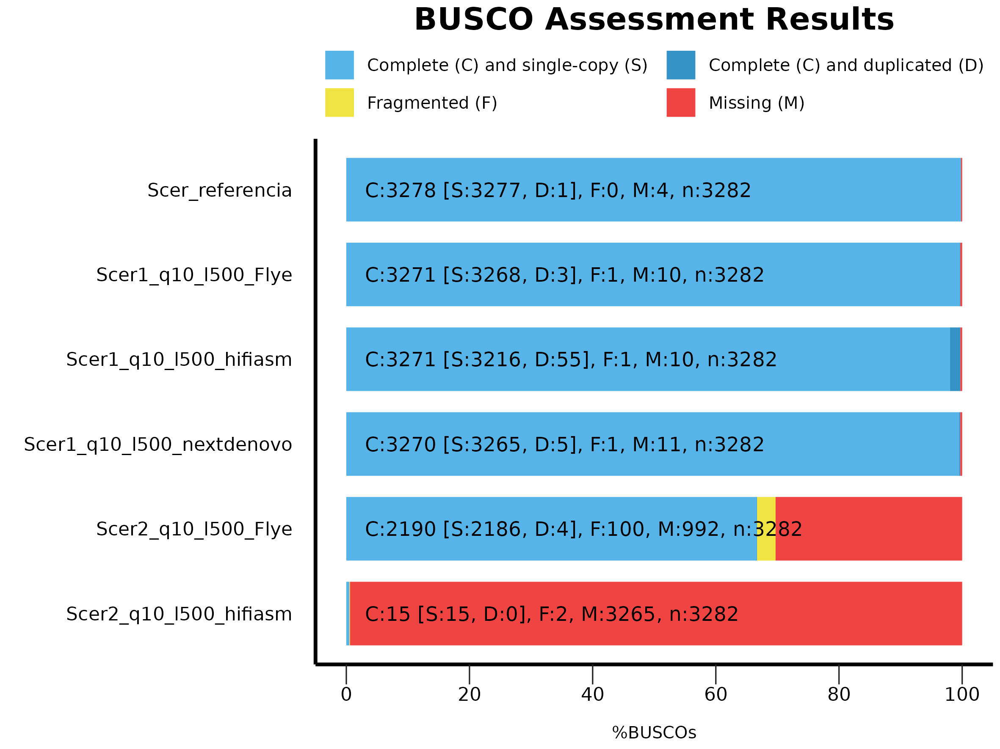

!!! tip "Resumos BUSCO pré-computados"
    [:material-image: Gráfico comparativo (PNG)](outputs/busco/busco_figure.png){ target=_blank } ·
    [:material-file-document: Scer1_Flye](outputs/busco/short_summary.specific.saccharomycetaceae_odb12.Scer1_q10_l500_Flye.txt) ·
    [:material-file-document: Scer1_Hifiasm](outputs/busco/short_summary.specific.saccharomycetaceae_odb12.Scer1_q10_l500_hifiasm.txt) ·
    [:material-file-document: Scer1_NextDenovo](outputs/busco/short_summary.specific.saccharomycetaceae_odb12.Scer1_q10_l500_nextdenovo.txt) ·
    [:material-file-document: Scer2_Flye](outputs/busco/short_summary.specific.saccharomycetaceae_odb12.Scer2_q10_l500_Flye.txt) ·
    [:material-file-document: Scer2_Hifiasm](outputs/busco/short_summary.specific.saccharomycetaceae_odb12.Scer2_q10_l500_hifiasm.txt)

!!! tip "Dica"
    Um Complete alto sozinho não garante uma boa montagem. Vale sempre olhar também o Duplicated. Duplicated alto (como encontramos no Hifiasm, 1,7% vs 0,1% do Flye e 0,2% do NextDenovo) indica que parte do genoma foi montada duas vezes. Em linhagens diploides heterozigotas, a causa costuma ser haplótipos não colapsados. A Scer1, porém, é **haploide** (Etapa 5): aqui as cópias extras são **falsas duplicações**, criadas pelo próprio montador. O Hifiasm foi desenvolvido para reads HiFi, quase sem erro; com reads Nanopore R9.4.1, cópias de uma mesma região que diferem só por erros de leitura podem ser tratadas como se fossem haplótipos diferentes.

### 9.4 Separação do genoma mitocondrial

As montagens contêm, além dos 16 cromossomos nucleares, contigs do **DNA mitocondrial** (~86 kb em *S. cerevisiae*). Eles são fáceis de reconhecer: GC muito baixo (~17%, contra ~38% do genoma nuclear) e cobertura muito acima da média, porque cada célula tem dezenas de cópias do genoma mitocondrial.

Separamos esses contigs **antes** de qualquer outra limpeza. A mitocôndria é um genoma à parte e não deve ser tratada pelas ferramentas pensadas para o genoma nuclear. Um exemplo concreto: o purge_dups (Etapa 9.5) remove sequências com cobertura muito alta, e numa primeira versão deste tutorial, em que ele rodava antes desta etapa, descartou todos os contigs mitocondriais do Flye e do Hifiasm sem nenhum aviso.

A separação não descarta nada: o genoma mitocondrial fica num arquivo próprio, e as próximas etapas usam só a parte nuclear. Para identificar os contigs mitocondriais, alinhamos cada montagem contra o genoma mitocondrial da referência (`NC_001224.1`) e consideramos mitocondrial todo contig com pelo menos metade do comprimento alinhada a ele.

```bash
mkdir -p 9.Mitocondria 9.Montagens-nucleares
conda activate polimento   # para o samtools

samtools faidx ncbi_dataset/data/GCF_000146045.2/GCF_000146045.2_R64_genomic.fna NC_001224.1 > 9.Mitocondria/mito_referencia.fasta

# montagem a processar: troque as duas linhas e rode o bloco de novo para cada montagem
prefix=Scer1_q10_l500_Flye
bruta=5.Montagem-Flye/Scer1_q10_l500/assembly.fasta
#   Scer1_q10_l500_hifiasm      6.Montagem-hifiasm/Scer1_q10_l500_hifiasm.p_ctg.fa
#   Scer1_q10_l500_nextdenovo   7.Montagem-NextDenovo/Scer1_q10_l500/01_rundir/03.ctg_graph/nd.asm.fasta
#   Scer2_q10_l500_Flye         5.Montagem-Flye/Scer2_q10_l500/assembly.fasta
#   Scer2_q10_l500_hifiasm      6.Montagem-hifiasm/Scer2_q10_l500_hifiasm.p_ctg.fa

f=9.Mitocondria/${prefix}_completa.fasta
cp $bruta $f

# contigs com >= 50% do comprimento alinhado ao mitocondrial da referência
# -x asm10: modo do minimap2 para comparar montagens com até cerca de 10% de divergência
minimap2 -x asm10 -t 8 9.Mitocondria/mito_referencia.fasta $f 2>/dev/null \
  | awk '{cob[$1]+=$4-$3; tam[$1]=$2} END{for(c in cob) if(cob[c]/tam[c]>=0.5) print c}' \
  | sort > 9.Mitocondria/${prefix}.mito.ids

# separar: mitocondrial para um arquivo, nuclear para outro
samtools faidx $f
cut -f1 $f.fai | grep -vxF -f 9.Mitocondria/${prefix}.mito.ids > 9.Mitocondria/${prefix}.nuclear.ids
samtools faidx $f -r 9.Mitocondria/${prefix}.nuclear.ids > 9.Montagens-nucleares/${prefix}.fasta
if [ -s 9.Mitocondria/${prefix}.mito.ids ]; then
  samtools faidx $f -r 9.Mitocondria/${prefix}.mito.ids > 9.Mitocondria/${prefix}_mito.fasta
fi
echo "$prefix: $(wc -l < 9.Mitocondria/${prefix}.mito.ids) contigs mitocondriais"

conda deactivate

# depois de processar todas: tamanho e GC de cada contig classificado como mitocondrial
for f in 9.Mitocondria/*_mito.fasta; do
  echo "== $f"
  awk '/^>/{if(n)printf "%s\t%d pb\tGC %.1f%%\n",n,l,100*g/l; n=substr($1,2); l=0; g=0; next}
       {l+=length($0); g+=gsub(/[GCgc]/,"")}
       END{if(n)printf "%s\t%d pb\tGC %.1f%%\n",n,l,100*g/l}' $f
done
```

??? info "O que faz cada comando"
    | Comando | O que faz |
    |---|---|
    | `mkdir -p ...` + `conda activate polimento` | Cria as pastas e entra no ambiente que tem o `samtools` e o `minimap2`. |
    | `samtools faidx <referência> NC_001224.1` | Extrai da referência só o cromossomo mitocondrial (NC_001224.1). |
    | `prefix=` / `bruta=` | Nome e arquivo da montagem a processar. Troque e rode de novo para as outras (lista no comentário). |
    | `f=...` + `cp $bruta $f` | Faz uma cópia da montagem bruta, para não mexer no original. |
    | `minimap2 -x asm10 <mito> $f` | Alinha os contigs da montagem contra o mitocondrial da referência. |
    | `awk '{cob[$1]+=$4-$3; tam[$1]=$2} ...'` | Soma, para cada contig, o comprimento alinhado (colunas 3 e 4 do PAF) e divide pelo tamanho do contig (coluna 2). Imprime os contigs com 50% ou mais alinhados. |
    | `sort > ...mito.ids` | Salva a lista dos contigs mitocondriais. |
    | `samtools faidx $f` | Indexa a montagem. O índice (`.fai`) tem o nome de cada contig na coluna 1. |
    | `cut -f1 ... | grep -vxF -f <mito.ids>` | Lista todos os contigs e tira os mitocondriais: `-v` inverte, `-x` exige a linha inteira igual e `-F` trata o nome como texto, não como padrão. |
    | `samtools faidx $f -r <lista>` | Extrai os contigs da lista: os nucleares vão para `9.Montagens-nucleares/`, os mitocondriais para `9.Mitocondria/`. |
    | `if [ -s ... ]; then ... fi` | Só cria o arquivo mitocondrial se a lista não estiver vazia (o NextDenovo não montou a mitocôndria). |
    | `echo "...$(wc -l < ...)"` | Escreve quantos contigs foram classificados como mitocondriais. |
    | `for f in ...; do awk ...; done` | Depois de processar todas: mostra o tamanho e o GC de cada contig mitocondrial. |

!!! tip "Uma montagem por vez: troque a variável e rode de novo"
    A partir daqui, quando um programa precisa rodar em várias montagens, ele roda **uma montagem por vez**. Assim dá para rodar todas ou, se faltar tempo, **só a montagem que você vai seguir** (por exemplo, a Scer1 Hifiasm). Os resultados das outras estão nas tabelas do tutorial.

    - **Comandos de uma linha** (BUSCO, Medaka, RagTag, Merqury) aparecem **uma vez por montagem**. Rode as linhas que quiser.
    - **Comandos com vários passos**, como este, começam com uma **variável** que guarda o nome da montagem. Os comandos seguintes usam essa variável (`$prefix`, `$s` ou `$p`). Para a próxima montagem, **troque o valor da variável e rode o bloco de novo**. Os nomes das outras montagens estão no comentário ao lado.

    ```bash
    prefix=Scer1_q10_l500_Flye     # 1ª vez
    prefix=Scer1_q10_l500_hifiasm  # 2ª vez, e assim por diante
    ```

    Os loops que sobraram (`for ... do ... done`) só leem e resumem resultados, e levam segundos.

??? note "Ver saída do comando (resumida)"
    ```
    Scer1_q10_l500_Flye: 33 contigs mitocondriais
    Scer1_q10_l500_hifiasm: 49 contigs mitocondriais
    Scer1_q10_l500_nextdenovo: 0 contigs mitocondriais
    Scer2_q10_l500_Flye: 9 contigs mitocondriais
    Scer2_q10_l500_hifiasm: 1 contigs mitocondriais

    == 9.Mitocondria/Scer1_q10_l500_Flye_mito.fasta
    contig_117      15062 pb        GC 17.0%
    contig_119      4058 pb GC 17.8%
    contig_120      9322 pb GC 16.8%
    ...
    contig_46       701 pb  GC 8.3%
    contig_47       15640 pb        GC 16.9%
    ...
    contig_55       21582 pb        GC 16.4%
    contig_56       10696 pb        GC 14.2%
    ...
    contig_68       23578 pb        GC 15.2%
    ...
    contig_73       14979 pb        GC 19.3%
    == 9.Mitocondria/Scer1_q10_l500_hifiasm_mito.fasta
    ptg000016l      2515 pb GC 17.5%
    ptg000019l      115403 pb       GC 16.4%
    ptg000026l      2437 pb GC 13.5%
    ptg000027l      2077 pb GC 17.3%
    ptg000028c      89648 pb        GC 17.9%
    ...
    ptg000038l      31260 pb        GC 16.8%
    ptg000039l      96126 pb        GC 15.6%
    ...
    ptg000054l      17477 pb        GC 16.0%
    ...
    ptg000087l      4173 pb GC 21.9%
    == 9.Mitocondria/Scer2_q10_l500_Flye_mito.fasta
    contig_128      1382 pb GC 7.8%
    contig_409      4435 pb GC 8.4%
    contig_410      959 pb  GC 21.2%
    contig_412      787 pb  GC 11.7%
    contig_413      564 pb  GC 9.9%
    contig_414      1489 pb GC 10.8%
    contig_447      1046 pb GC 8.1%
    contig_448      877 pb  GC 6.6%
    contig_746      78752 pb        GC 16.9%
    == 9.Mitocondria/Scer2_q10_l500_hifiasm_mito.fasta
    ptg000005l      102299 pb       GC 16.8%
    ```

| Montagem | Contigs mitocondriais | Soma | Maior contig |
|---|---|---|---|
| Scer1 Flye | 33 | 224.759 pb | 23.578 pb |
| Scer1 Hifiasm | 49 | 480.246 pb | 115.403 pb |
| Scer1 NextDenovo | 0 | — | — |
| Scer2 Flye | 9 | 90.291 pb | 78.752 pb |
| Scer2 Hifiasm | 1 | 102.299 pb | 102.299 pb |

Todos os contigs selecionados têm GC entre 7% e 26%, bem abaixo dos ~38% do genoma nuclear: a classificação é consistente. Mas cada montador lidou com a mitocôndria de um jeito:

- **Scer1 Flye:** a mitocôndria saiu em 33 pedaços, que somam ~225 kb, mais de duas vezes o tamanho esperado (~86 kb). Com uma cobertura altíssima, pequenas variações entre reads geram caminhos alternativos no grafo, e o mesmo trecho aparece em mais de um contig.
- **Scer1 Hifiasm:** o caso extremo: 49 contigs e ~480 kb, com **três cópias quase completas** (115, 96 e 90 kb) e dezenas de pedaços de ~2 kb. Isso explica boa parte do tamanho inflado do Hifiasm (13,0 Mb): sem a mitocôndria, ele cai para ~12,5 Mb.
- **Scer1 NextDenovo:** nenhum contig mitocondrial. O NextDenovo não montou a mitocôndria. Uma explicação provável: ele usa só as reads mais longas como "sementes" da montagem e trata regiões de cobertura muito alta como repetições, e o mtDNA, com reads curtas e cobertura altíssima, se encaixa nos dois casos.
- **Scer2 Flye:** um contig de 79 kb, quase a mitocôndria inteira, mais 8 fragmentos pequenos e muito ricos em AT (GC < 12%).
- **Scer2 Hifiasm:** um único contig de 102 kb, mais da metade de toda a montagem (189 kb). É o mesmo sinal que apareceu no GenomeScope da Scer2 (um pico de ~97 kb de sequência multicópia, Etapa 5) e explica o GC anômalo dessa montagem.

!!! note "Por que guardar a mitocôndria em vez de descartar?"
    O genoma mitocondrial é um produto da montagem como qualquer outro: ele carrega genes próprios e é muito usado em estudos de população e evolução. Aqui, nenhuma das montagens o recuperou de forma limpa (fragmentado ou em cópias redundantes), e montá-lo bem pede uma estratégia própria, a partir só das reads mitocondriais. Por isso ele fica separado em `9.Mitocondria/` e não segue no pipeline do genoma nuclear.

A partir daqui, as montagens seguem pela pasta `9.Montagens-nucleares/`. Os genomas mitocondriais ficam em `9.Mitocondria/`.

### 9.5 Remoção de duplicatas (purge_dups)

Em genomas com heterozigose, o montador às vezes monta as duas versões (haplótipos) de uma mesma região como contigs separados. A montagem fica maior que o genoma e com genes duplicados. A Scer1 é haploide e não tem haplótipos, mas o mesmo sintoma aparece por outro motivo: o montador pode gerar **cópias redundantes** de uma região a partir das reads com erro. Vimos isso no Hifiasm da Scer1: 13,0 Mb para um genoma de ~12,1 Mb e 1,7% de BUSCOs duplicados, contra 0,1–0,2% no Flye e no NextDenovo. Para o purge_dups, os dois casos têm a mesma assinatura e são tratados igual.

O [purge_dups](https://github.com/dfguan/purge_dups){ target=_blank } identifica essas cópias extras combinando duas informações:

- **Cobertura de reads:** numa região duplicada na montagem, as reads se dividem entre as duas cópias, e cada uma fica com cerca de **metade** da cobertura esperada.
- **Similaridade entre contigs:** a cópia extra tem que ser muito parecida com outro trecho da montagem.

Uma duplicata é removida quando as duas condições se combinam. (O purge_dups também descarta contigs só pela cobertura, quando ela é baixa ou alta demais; veremos isso adiante.) Fazemos isso **antes do polimento**: com uma cópia só de cada região, todas as reads alinham no mesmo lugar e o polimento dessas regiões fica melhor.

!!! note "Por que só a Scer1?"
    O purge_dups decide o que é duplicata a partir do histograma de cobertura. Com ~6× de cobertura, a Scer2 não tem resolução para separar "cobertura normal" (~6×) de "metade da cobertura" (~3×), e o próprio limite inferior padrão (5×) já cairia em cima do pico: boa parte do genoma seria descartada como "lixo". Além disso, a Scer2 é diploide **homozigota** (Etapa 5), então não esperamos haplótipos separados. As montagens da Scer2 seguem sem purge_dups, só sem a mitocôndria.

??? tip "Instalação: ambiente `purge_dups_env`"
    ```bash
    conda create -n purge_dups_env -c conda-forge -c bioconda purge_dups minimap2 matplotlib
    ```

    O `matplotlib` só é necessário para a figura opcional do histograma de cobertura (`hist_plot.py`). Num ambiente que já existe, ele pode ser acrescentado com `conda install -n purge_dups_env -c conda-forge matplotlib`.

```bash
conda activate purge_dups_env
R=2.Filtragem-dadosbrutos/Scer1_q10_l500.fastq.gz
mkdir -p 9.Purge_dups

s=Scer1_q10_l500_Flye   # troque e rode o bloco de novo para: Scer1_q10_l500_hifiasm, Scer1_q10_l500_nextdenovo
echo "===== $s ====="
O=9.Purge_dups/$s
mkdir -p $O
cp 9.Montagens-nucleares/$s.fasta $O/$s.fasta   # montagem bruta, já sem a mitocôndria

# 1) cobertura: alinhar as reads na montagem e calcular os limites de corte
minimap2 -x map-ont -t 24 $O/$s.fasta $R > $O/reads.paf
pbcstat -O $O $O/reads.paf
calcuts $O/PB.stat > $O/cutoffs 2> $O/calcuts.log

# 2) similaridade: alinhar a montagem contra ela mesma
split_fa $O/$s.fasta > $O/$s.split.fasta
minimap2 -x asm5 -DP -t 24 $O/$s.split.fasta $O/$s.split.fasta > $O/$s.split.self.paf

# 3) decidir o que é duplicata e separar as sequências
purge_dups -2 -T $O/cutoffs -c $O/PB.base.cov $O/$s.split.self.paf > $O/dups.bed 2> $O/purge_dups.log
get_seqs -e $O/dups.bed $O/$s.fasta -p $O/$s

conda deactivate
```

??? info "O que faz cada comando"
    | Comando | O que faz |
    |---|---|
    | `R=...` | Guarda o caminho das reads filtradas da Scer1, usadas para medir a cobertura. |
    | `s=...` | Nome da montagem que será processada. Troque e rode o bloco de novo para as outras. |
    | `echo "===== $s ====="` | Escreve o nome da montagem na tela, para separar a saída de cada rodada. |
    | `O=9.Purge_dups/$s` + `mkdir -p $O` | Cria uma pasta só para essa montagem. |
    | `cp ...` | Copia a montagem nuclear (sem a mitocôndria, Etapa 9.4) para essa pasta. |
    | `minimap2 -x map-ont` | Alinha as reads Nanopore contra a montagem. O arquivo `reads.paf` diz onde cada read alinhou. |
    | `pbcstat` | Calcula, a partir do `reads.paf`, a cobertura de cada posição (`PB.base.cov`) e o histograma de cobertura (`PB.stat`: quantas bases têm cada valor de cobertura). |
    | `calcuts` | Lê o histograma e escolhe os limites de cobertura (`cutoffs`): o que é baixo demais, o que é "metade" (provável duplicata) e o que é alto demais. Os detalhes vão para o `calcuts.log`. |
    | `split_fa` | Quebra os contigs nos trechos de `N` (gaps), para que o alinhamento seguinte não atravesse um gap. |
    | `minimap2 -x asm5 -DP` | Alinha a montagem **contra ela mesma** para achar trechos repetidos. `asm5` é o modo para sequências quase idênticas (até cerca de 5% de divergência); `-D` ignora o alinhamento de cada sequência com ela própria; `-P` guarda todos os alinhamentos, não só o melhor. |
    | `purge_dups -2 -T ... -c ...` | Junta as duas informações (cobertura e similaridade) e decide o que é duplicata. `-T` recebe os limites, `-c` a cobertura por posição e `-2` faz o encadeamento dos alinhamentos em duas rodadas. A saída, `dups.bed`, lista os trechos a remover e o motivo (`HAPLOTIG`, `JUNK`, `HIGHCOV`...). |
    | `get_seqs -e ... -p $O/$s` | Remove da montagem os trechos do `dups.bed`. `-e` só remove duplicatas nas pontas dos contigs (ou contigs inteiros); `-p` define o prefixo dos arquivos de saída (`.purged.fa` e `.hap.fa`). |
    | `conda deactivate` | Sai do ambiente `purge_dups_env`. |

Para cada montagem, o purge_dups gera dois arquivos:

- **`<montagem>.purged.fa`**: a montagem sem as duplicatas, que segue no pipeline;
- **`<montagem>.hap.fa`**: as sequências removidas, guardadas à parte.

A opção `-e` do `get_seqs` só remove duplicatas nas **pontas** dos contigs (ou contigs inteiros), sem quebrar um contig no meio. É a escolha mais conservadora para a montagem primária.

??? note "Ver saída do comando (resumida)"
    ```
    ===== Scer1_q10_l500_Flye =====
    [M::main::0.395*3.17] loaded/built the index for 46 target sequence(s)
    [M::mm_idx_stat::0.477*2.79] distinct minimizers: 2083051 (95.48% are singletons); average occurrences: 1.086; average spacing: 5.337; total length: 12076556
    [M::worker_pipeline::11.807*11.01] mapped 140416 sequences
    [M::worker_pipeline::15.078*13.61] mapped 90021 sequences
    [M::main] CMD: minimap2 -x map-ont -t 24 9.Purge_dups/Scer1_q10_l500_Flye/Scer1_q10_l500_Flye.fasta 2.Filtragem-dadosbrutos/Scer1_q10_l500.fastq.gz
    [M::main] Real time: 15.110 sec; CPU: 205.226 sec; Peak RSS: 1.010 GB
    Program starts
    [M::aa_pb] collecting positions from paf file
    [M::aa_pb] calculating coverage for each base on genome
    [M::aa_pb] print coverage histogram for the contigs
    ...
    Program finished successfully
    [M::main::0.274*2.90] loaded/built the index for 48 target sequence(s)
    [M::worker_pipeline::0.572*4.09] mapped 48 sequences
    [M::main] CMD: minimap2 -x asm5 -DP -t 24 9.Purge_dups/Scer1_q10_l500_Flye/Scer1_q10_l500_Flye.split.fasta 9.Purge_dups/Scer1_q10_l500_Flye/Scer1_q10_l500_Flye.split.fasta
    [M::main] Real time: 0.591 sec; CPU: 2.358 sec; Peak RSS: 0.171 GB
    ===== Scer1_q10_l500_hifiasm =====
    [M::main::0.386*3.12] loaded/built the index for 38 target sequence(s)
    [M::mm_idx_stat::0.456*2.79] distinct minimizers: 2080893 (94.28% are singletons); average occurrences: 1.126; average spacing: 5.336; total length: 12500158
    ...
    [M::main] Real time: 24.997 sec; CPU: 440.662 sec; Peak RSS: 1.134 GB
    ...
    [M::main::0.271*2.94] loaded/built the index for 38 target sequence(s)
    [M::main] Real time: 1.467 sec; CPU: 4.136 sec; Peak RSS: 0.243 GB
    ===== Scer1_q10_l500_nextdenovo =====
    [M::main::0.384*3.41] loaded/built the index for 29 target sequence(s)
    [M::mm_idx_stat::0.456*3.03] distinct minimizers: 2072410 (95.65% are singletons); average occurrences: 1.096; average spacing: 5.336; total length: 12123689
    ...
    [M::main] Real time: 14.678 sec; CPU: 194.130 sec; Peak RSS: 1.025 GB
    ...
    [M::main::0.266*2.89] loaded/built the index for 29 target sequence(s)
    [M::main] Real time: 0.559 sec; CPU: 2.806 sec; Peak RSS: 0.202 GB
    ```

A saída mostra, para cada montagem, as duas etapas de alinhamento: as **reads** contra a montagem (`map-ont`, 230.437 reads), seguidas do `pbcstat` ("Program finished successfully"), e a montagem **contra ela mesma** (`asm5`). As montagens já entram sem a mitocôndria (Etapa 9.4): o Flye tem 46 sequências (12,08 Mb), o Hifiasm 38 (12,50 Mb) e o NextDenovo, que não tinha mitocôndria, continua com 29 (12,12 Mb). No Flye, o alinhamento contra si mesma mostra **48** sequências, e não 46: o `split_fa` quebra os contigs nos trechos de `N` (os 2 *gaps* que o Flye deixou), como o QUAST já havia indicado. O `purge_dups` e o `get_seqs` não escrevem nada na tela: as mensagens deles ficam em `9.Purge_dups/<montagem>/purge_dups.log`, e o resultado aparece nos comandos a seguir.

**Quanto foi removido?**

```bash
for s in Scer1_q10_l500_Flye Scer1_q10_l500_hifiasm Scer1_q10_l500_nextdenovo; do
  O=9.Purge_dups/$s
  echo "===== $s"
  echo "limites de corte (calcuts): $(cat $O/cutoffs)"
  awk '/^>/{n++; next}{b+=length($0)} END{printf "antes:    %d sequências, %d pb\n", n, b}' $O/$s.fasta
  awk '/^>/{n++; next}{b+=length($0)} END{printf "depois:   %d sequências, %d pb\n", n, b}' $O/$s.purged.fa
  awk '/^>/{n++; next}{b+=length($0)} END{printf "removido: %d sequências, %d pb\n", n, b}' $O/$s.hap.fa
done
```

??? info "O que faz cada comando"
    | Comando | O que faz |
    |---|---|
    | `for s in ...; do ... done` | Repete o resumo para cada montagem da Scer1. |
    | `cat $O/cutoffs` | Mostra os limites de cobertura escolhidos pelo `calcuts`. |
    | `awk '/^>/{n++; next}{b+=length($0)} ...'` | Conta as sequências (linhas que começam com `>`) e soma as bases. Roda na montagem antes, na purgada (`.purged.fa`) e no que foi removido (`.hap.fa`). |

??? note "Ver saída do comando (primeira rodada, limites automáticos)"
    ```
    ===== Scer1_q10_l500_Flye
    limites de corte (calcuts): 5   37      61      73      122    219
    antes:    46 sequências, 12076556 pb
    depois:   36 sequências, 11914226 pb
    removido: 13 sequências, 162330 pb
    ===== Scer1_q10_l500_hifiasm
    limites de corte (calcuts): 5   37      61      73      122    219
    antes:    38 sequências, 12500158 pb
    depois:   24 sequências, 12110625 pb
    removido: 18 sequências, 389533 pb
    ===== Scer1_q10_l500_nextdenovo
    limites de corte (calcuts): 5   37      61      73      122    219
    antes:    29 sequências, 12123689 pb
    depois:   25 sequências, 11984517 pb
    removido: 9 sequências, 139172 pb
    ```

| Montagem | Antes | Depois | Removido | % removida |
|---|---|---|---|---|
| Scer1 Flye | 46 seq · 12.076.556 pb | 36 seq · 11.914.226 pb | 13 seq · 162.330 pb | 1,3% |
| Scer1 Hifiasm | 38 seq · 12.500.158 pb | 24 seq · 12.110.625 pb | 18 seq · 389.533 pb | 3,1% |
| Scer1 NextDenovo | 29 seq · 12.123.689 pb | 25 seq · 11.984.517 pb | 9 seq · 139.172 pb | 1,1% |

Três coisas para observar (e uma suspeita, que o histograma a seguir vai confirmar):

- **Os limites de corte são os mesmos nas três montagens.** Faz sentido: eles saem da cobertura das reads, e as reads são as mesmas. O que muda é quanto de cada montagem cai abaixo desses limites e se sobrepõe a outra parte dela mesma.
- **As bases fecham, mas as sequências não.** Depois + removido dá exatamente o tamanho original, mas a soma de sequências passa do total (Flye: 36 + 13 = 49, contra 46). É o efeito do `-e`: alguns contigs tiveram só uma **ponta** removida, e assim aparecem nos dois arquivos, a parte principal no `.purged.fa` e a ponta no `.hap.fa`.
- **O Hifiasm foi o que mais perdeu** (18 sequências, 390 kb), o que bate com os contigs pequenos e redundantes vistos no QUAST e com os BUSCOs duplicados. Mas a **suspeita**: Flye e NextDenovo ficaram com 11,91 e 11,98 Mb, **abaixo** dos ~12,07 Mb do genoma nuclear da referência. Será que o purge_dups removeu mais do que devia?

**Como o purge_dups decidiu: o histograma de cobertura**

O `calcuts` escolhe os limites a partir do histograma de cobertura das reads (`PB.stat`). Numa montagem sem duplicatas, há um único pico, na cobertura média (~58× na Scer1). Se houver duplicatas, aparece um segundo pico (ou um "ombro") na **metade** da cobertura: são as regiões em que as reads se dividiram entre duas cópias. O comando abaixo desenha o histograma no terminal, com os limites do `calcuts` marcados:

```bash
for s in Scer1_q10_l500_Flye Scer1_q10_l500_hifiasm Scer1_q10_l500_nextdenovo; do
  O=9.Purge_dups/$s
  echo "===== $s   limites (calcuts): $(cat $O/cutoffs)"
  awk -v cortes="$(cat $O/cutoffs)" '
    BEGIN{n=split(cortes,k," "); for(i=1;i<=n;i++) corte[k[i]]=1}
    $1<=150 {b=int($1/3); c[b]+=$2; if(c[b]>m) m=c[b]}
    END{for(b=0;b<=50;b++){bar=""; for(j=0;j<int(50*c[b]/m);j++) bar=bar"#"; mark="";
        for(x=b*3;x<b*3+3;x++) if(x in corte) mark=mark"  <- corte "x;
        printf "%3d-%3dx | %s%s\n", b*3, b*3+2, bar, mark}}' $O/PB.stat
  echo
  cat $O/calcuts.log
  echo
done
```

??? info "O que faz cada comando"
    | Comando | O que faz |
    |---|---|
    | `for s in ...; do ... done` | Repete para cada montagem da Scer1. |
    | `awk -v cortes="$(cat $O/cutoffs)" '...' $O/PB.stat` | Lê o histograma de cobertura (`PB.stat`), agrupa as coberturas de 3 em 3 até 150×, desenha uma barra de `#` proporcional ao número de bases e marca onde caem os limites do `calcuts`. |
    | `cat $O/calcuts.log` | Mostra como o `calcuts` encontrou os picos e calculou os limites. |

Cada linha agrupa 3 valores de cobertura, e o comprimento da barra é proporcional ao número de bases com aquela cobertura. O `calcuts.log` mostra quantos picos o `calcuts` encontrou e como calculou os limites.

??? note "Ver saída do comando (resumida)"
    === "Flye"

        ```
        ===== Scer1_q10_l500_Flye   limites (calcuts): 5        37     61       73      122     219
          0-  2x | 
          3-  5x |   <- corte 5
          6-  8x | 
          9- 11x | 
         12- 14x | 
         15- 17x | 
         18- 20x | 
         21- 23x | 
         24- 26x | 
         27- 29x | 
         30- 32x | #
         33- 35x | ####
         36- 38x | ###########  <- corte 37
         39- 41x | #####################
         42- 44x | #################################
         45- 47x | #############################################
         48- 50x | ##################################################
         51- 53x | ##############################################
         54- 56x | #####################################
         57- 59x | ##########################
         60- 62x | ##################  <- corte 61
         63- 65x | ###########
         66- 68x | ######
         69- 71x | ###
         72- 74x | ##  <- corte 73
         75- 77x | #
         78- 80x | 
            ...
        120-122x |   <- corte 122
            ...
        150-152x | 

        [M::calcuts] Find 1 peaks
        [M::calcuts] mean: 51, peak: 49, mean larger than peak, treat as diploid assembly
        [W::calcuts] mean is not significantly different with peak, please recheck the cutoffs
        ```

    === "Hifiasm"

        ```
        ===== Scer1_q10_l500_hifiasm   limites (calcuts): 5     37     61       73      122     219
          0-  2x | 
          3-  5x |   <- corte 5
          6-  8x | 
          9- 11x | #
         12- 14x | 
         15- 17x | 
         18- 20x | #
         21- 23x | 
         24- 26x | 
         27- 29x | 
         30- 32x | ##
         33- 35x | #####
         36- 38x | ###########  <- corte 37
         39- 41x | #####################
            ... (daqui em diante, igual ao Flye)

        [M::calcuts] Find 1 peaks
        [M::calcuts] mean: 53, peak: 49, mean larger than peak, treat as diploid assembly
        [W::calcuts] mean is not significantly different with peak, please recheck the cutoffs
        ```

    === "NextDenovo"

        ```
        ===== Scer1_q10_l500_nextdenovo   limites (calcuts): 5  37     61       73      122     219
        (histograma praticamente idêntico ao do Flye)

        [M::calcuts] Find 1 peaks
        [M::calcuts] mean: 51, peak: 49, mean larger than peak, treat as diploid assembly
        [W::calcuts] mean is not significantly different with peak, please recheck the cutoffs
        ```

**Lendo o histograma:**

- Há **um único pico, em ~49×**, e nenhum pico em ~25× (metade da cobertura). É o esperado para uma linhagem **haploide**, como a Scer1: quase todo o genoma foi montado uma vez só.
- A diferença está na cauda da esquerda. Só o **Hifiasm** tem algumas bases com cobertura entre 9× e 20×: são trechos que ele montou duas vezes, e as reads se dividiram entre as cópias. São os verdadeiros candidatos a duplicata. Antes de separarmos a mitocôndria, essa cauda era bem maior: as várias cópias redundantes do mtDNA no Hifiasm dividiam as reads mitocondriais entre si e também caíam nessa faixa.
- O `calcuts` não sabe a ploidia. Encontrou um pico só e **supôs que ele fosse o pico haploide de uma montagem diploide** ("treat as diploid assembly"). Por isso colocou a fronteira haploide/diploide (o 4º valor) em **73×**, 1,5 vez o pico. Ele mesmo avisa que o resultado é duvidoso: "please recheck the cutoffs".

Com a fronteira em 73×, **quase todo o genoma fica abaixo dela** e é tratado como "cópia haploide". O purge_dups passa então a decidir só pela semelhança da montagem com ela mesma, e pode remover repetições verdadeiras (retrotransposons Ty, rDNA, subtelômeros). Um sinal disso está nas contagens acima: Flye e NextDenovo ficaram com 11,91 e 11,98 Mb, abaixo dos ~12,07 Mb do genoma nuclear da referência.

!!! warning "Nunca aceite os limites automáticos sem olhar o histograma"
    O `calcuts` funciona bem quando há dois picos (haplótipos separados e regiões colapsadas). Com um pico só, ele precisa adivinhar, e aqui adivinhou errado. O histograma e o `calcuts.log` são a forma de conferir.

**Corrigindo os limites.** Definimos os valores à mão a partir do pico de 49×:

- `-l 5`: abaixo disso, cobertura de lixo (mantemos o valor automático);
- `-m 37`: a fronteira haploide/diploide fica entre a metade do pico (~25×) e o pico (49×), em ~0,75 × 49. Só regiões com cobertura bem abaixo da média passam a ser candidatas a duplicata;
- `-u 147`: 3 × 49; acima disso, repetições colapsadas.

Não é preciso refazer os alinhamentos: o `PB.stat`, o `PB.base.cov` e o `.split.self.paf` continuam valendo. Refazemos só as três últimas etapas:

```bash
conda activate purge_dups_env

s=Scer1_q10_l500_Flye   # troque e rode o bloco de novo para: Scer1_q10_l500_hifiasm, Scer1_q10_l500_nextdenovo
echo "===== $s"
O=9.Purge_dups/$s
cp -n $O/cutoffs $O/cutoffs.auto          # guarda os limites automáticos
calcuts -l 5 -m 37 -u 147 $O/PB.stat > $O/cutoffs 2> $O/calcuts.log
cat $O/cutoffs
purge_dups -2 -T $O/cutoffs -c $O/PB.base.cov $O/$s.split.self.paf > $O/dups.bed 2> $O/purge_dups.log
get_seqs -e $O/dups.bed $O/$s.fasta -p $O/$s

conda deactivate
```

??? info "O que faz cada comando"
    | Comando | O que faz |
    |---|---|
    | `s=...` + `O=...` | Montagem a processar e a pasta dela. Troque e rode de novo para as outras. |
    | `cp -n $O/cutoffs $O/cutoffs.auto` | Guarda uma cópia dos limites automáticos. O `-n` não sobrescreve a cópia se ela já existir. |
    | `calcuts -l 5 -m 37 -u 147` | Recalcula os limites com valores definidos por nós: `-l` limite inferior, `-m` divisa entre metade e cobertura cheia, `-u` limite superior. |
    | `cat $O/cutoffs` | Mostra os novos limites. |
    | `purge_dups ...` + `get_seqs ...` | Repete a remoção de duplicatas com os novos limites (os mesmos comandos do bloco anterior). |

O `get_seqs` sobrescreve o `.purged.fa` e o `.hap.fa`. Rode de novo o comando **"Quanto foi removido?"** para ver o novo resultado:

??? note "Ver saída do comando (limites manuais)"
    ```
    ===== Scer1_q10_l500_Flye
    limites de corte (calcuts): 5   36      36      37      37     147
    antes:    46 sequências, 12076556 pb
    depois:   37 sequências, 11962229 pb
    removido: 10 sequências, 114327 pb
    ===== Scer1_q10_l500_hifiasm
    limites de corte (calcuts): 5   36      36      37      37     147
    antes:    38 sequências, 12500158 pb
    depois:   24 sequências, 12161687 pb
    removido: 15 sequências, 338471 pb
    ===== Scer1_q10_l500_nextdenovo
    limites de corte (calcuts): 5   36      36      37      37     147
    antes:    29 sequências, 12123689 pb
    depois:   24 sequências, 12016151 pb
    removido: 6 sequências, 107538 pb
    ```

| Montagem | Antes (nuclear) | Removido (automático, 73×) | Removido (manual, 37×) | Depois (manual) |
|---|---|---|---|---|
| Scer1 Flye | 12.076.556 pb | 162.330 pb (1,3%) | 114.327 pb (0,9%) | 11.962.229 pb |
| Scer1 Hifiasm | 12.500.158 pb | 389.533 pb (3,1%) | 338.471 pb (2,7%) | 12.161.687 pb |
| Scer1 NextDenovo | 12.123.689 pb | 139.172 pb (1,1%) | 107.538 pb (0,9%) | 12.016.151 pb |

Com os limites corrigidos, o purge_dups remove de 30 a 50 kb a menos em cada montagem: são os trechos que só saíam porque a fronteira em 73× tratava todo o genoma como "cópia haploide". O Hifiasm continua sendo o que mais perde, como esperado, e as três montagens terminam entre 11,96 e 12,16 Mb, perto dos ~12,07 Mb do genoma nuclear da referência.

**O que foi removido?** O purge_dups classifica cada trecho que retira, e a classe fica na 4ª coluna do `dups.bed`:

| Classe | Significado |
|---|---|
| `HAPLOTIG` | contig inteiro que é cópia de outro trecho da montagem (a duplicata clássica) |
| `OVLP` | ponta de contig que se sobrepõe a outro contig |
| `REPEAT` | contig formado quase só por repetições presentes em outros contigs |
| `JUNK` | contig com cobertura abaixo do limite inferior (lixo) |
| `HIGHCOV` | contig com cobertura acima do limite superior |

Note que `JUNK` e `HIGHCOV` são removidos **só pela cobertura**, sem precisar de semelhança com outro trecho. Foi por isso que, quando o purge_dups rodou com a mitocôndria ainda na montagem, ela saiu como `HIGHCOV`.

```bash
for s in Scer1_q10_l500_Flye Scer1_q10_l500_hifiasm Scer1_q10_l500_nextdenovo; do
  echo "===== $s"
  awk '{n[$4]++; b[$4]+=$3-$2} END{for(k in n) printf "   %-9s %3d regiões %8d pb\n", k, n[k], b[k]}' 9.Purge_dups/$s/dups.bed
done
```

??? info "O que faz cada comando"
    | Comando | O que faz |
    |---|---|
    | `for s in ...; do ... done` | Repete para cada montagem da Scer1. |
    | `awk '{n[$4]++; b[$4]+=$3-$2} ...' dups.bed` | Agrupa as regiões do `dups.bed` pelo tipo (coluna 4: `HAPLOTIG`, `JUNK`, `HIGHCOV`...) e mostra quantas regiões e quantas bases há de cada tipo. |

??? note "Ver saída do comando"
    ```
    ===== Scer1_q10_l500_Flye
       HIGHCOV     2 regiões     2953 pb
       HAPLOTIG    5 regiões   102901 pb
       REPEAT      3 regiões     8471 pb
    ===== Scer1_q10_l500_hifiasm
       HIGHCOV     1 regiões    35888 pb
       OVLP        1 regiões    43261 pb
       HAPLOTIG    6 regiões   175492 pb
       REPEAT      6 regiões    71343 pb
       JUNK        1 regiões    12485 pb
    ===== Scer1_q10_l500_nextdenovo
       OVLP        1 regiões    12108 pb
       HAPLOTIG    1 regiões    29221 pb
       REPEAT      4 regiões    66209 pb
    ```

- **Flye e Hifiasm:** a maior parte do que saiu é `HAPLOTIG` (103 kb no Flye, 175 kb no Hifiasm), ou seja, duplicatas de verdade. Como a Scer1 é haploide, são **falsas duplicações** criadas na montagem.
- **NextDenovo:** quase não tinha duplicatas (um único `HAPLOTIG`, de 29 kb). O que mais saiu foi `REPEAT` (66 kb): contigs formados quase só por repetições que também estão em outros contigs.
- **`HIGHCOV`:** como a mitocôndria já tinha sido separada, o que sobra nessa classe é nuclear: pequeno no Flye (3 kb) e maior no Hifiasm (36 kb). Regiões de cobertura alta no genoma nuclear de levedura costumam ser repetições colapsadas, como o rDNA (~150 cópias de uma unidade de 9 kb no cromossomo XII) ou o plasmídeo 2-micron.

Para saber o que é esse `HIGHCOV`, alinhamos à referência os contigs que contêm essas regiões:

```bash
conda activate purge_dups_env
REF=ncbi_dataset/data/GCF_000146045.2/GCF_000146045.2_R64_genomic.fna
for s in Scer1_q10_l500_Flye Scer1_q10_l500_hifiasm; do
  O=9.Purge_dups/$s
  echo "===== $s"
  awk '$4=="HIGHCOV"' $O/dups.bed | tee $O/highcov.bed
  awk 'NR==FNR{c[$1]=1; next} /^>/{n=substr($1,2); p=(n in c); if(p) print ">"n; next} p' $O/highcov.bed $O/$s.fasta > $O/highcov_contigs.fa
  minimap2 -x asm10 -t 8 $REF $O/highcov_contigs.fa 2>/dev/null | cut -f1-11 | sort -k10,10nr | head -5
done
conda deactivate
```

??? info "O que faz cada comando"
    | Comando | O que faz |
    |---|---|
    | `REF=...` | Caminho da referência. |
    | `awk '$4=="HIGHCOV"' ... | tee $O/highcov.bed` | Filtra as regiões marcadas como cobertura alta. O `tee` mostra na tela e salva em arquivo ao mesmo tempo. |
    | `awk 'NR==FNR{...} ...' highcov.bed montagem` | Lê primeiro a lista de contigs (`NR==FNR` é verdadeiro só no primeiro arquivo) e depois extrai da montagem as sequências desses contigs. |
    | `minimap2 -x asm10 $REF ...` | Alinha esses contigs contra a referência, para ver de onde vêm. |
    | `cut -f1-11 | sort -k10,10nr | head -5` | Mantém as colunas principais do PAF, ordena pelo número de bases iguais (coluna 10, do maior para o menor) e mostra os 5 melhores alinhamentos. |

??? note "Ver saída do comando"
    ```
    ===== Scer1_q10_l500_Flye
    contig_129      1       2197    HIGHCOV
    contig_127      1       758     HIGHCOV
    ===== Scer1_q10_l500_hifiasm
    ptg000025l      1       35889   HIGHCOV
    ptg000025l      35889   6817    24196   +       NC_001144.5    1078177  451418  468895  17088   17477
    ptg000025l      35889   15869   33276   +       NC_001144.5    1078177  451418  468919  17078   17502
    ptg000025l      35889   18      15169   +       NC_001144.5    1078177  453697  468919  14910   15222
    ptg000025l      35889   33975   35873   +       NC_001144.5    1078177  451418  453318  1877    1900
    ```

- **Hifiasm:** o `ptg000025l` (35,9 kb) é inteiro **rDNA**. Seus trechos alinham, um após o outro, na mesma região do cromossomo XII (`NC_001144.5`, 451–469 kb), onde a referência guarda duas unidades do rDNA. No genoma real, esse arranjo tem ~150 unidades em sequência (1–2 Mb), e nenhuma montagem com reads deste tamanho o resolve inteiro: o Hifiasm montou um pedaço solto do arranjo, com cobertura muito alta porque as reads de todas as cópias se acumulam nele.
- **Flye:** os dois contigs `HIGHCOV` são minúsculos (2,2 kb e 0,8 kb) e não alinham na referência. Uma possibilidade é o plasmídeo 2-micron, presente em muitas linhagens e ausente da referência R64.

Remover o contig de rDNA é aceitável: ele não traz informação nova (é o mesmo bloco de 9 kb repetido), não poderia ser posicionado com segurança no cromossomo XII e continua guardado no `.hap.fa`. Mas é bom saber o que saiu: o purge_dups não removeu uma duplicata, e sim uma repetição colapsada real do genoma.

??? tip "O mesmo histograma como figura"
    O purge_dups inclui um script que desenha o histograma com os limites, como imagem:

    ```bash
    conda activate purge_dups_env
    for s in Scer1_q10_l500_Flye Scer1_q10_l500_hifiasm Scer1_q10_l500_nextdenovo; do
      hist_plot.py -c 9.Purge_dups/$s/cutoffs 9.Purge_dups/$s/PB.stat 9.Purge_dups/$s/$s.cobertura.png
    done
    conda deactivate
    ```

    Copie os arquivos `.png` para o seu computador (`scp`) para visualizá-los.

    As figuras abaixo foram geradas **depois** da correção dos limites (veja adiante), por isso mostram os cortes manuais: 5× (vermelho), 37× (verde) e 147× (azul-claro). O pico em ~49× fica todo à direita da linha verde, fora da zona de remoção.

    === "Flye"

        { width="600" }

    === "Hifiasm"

        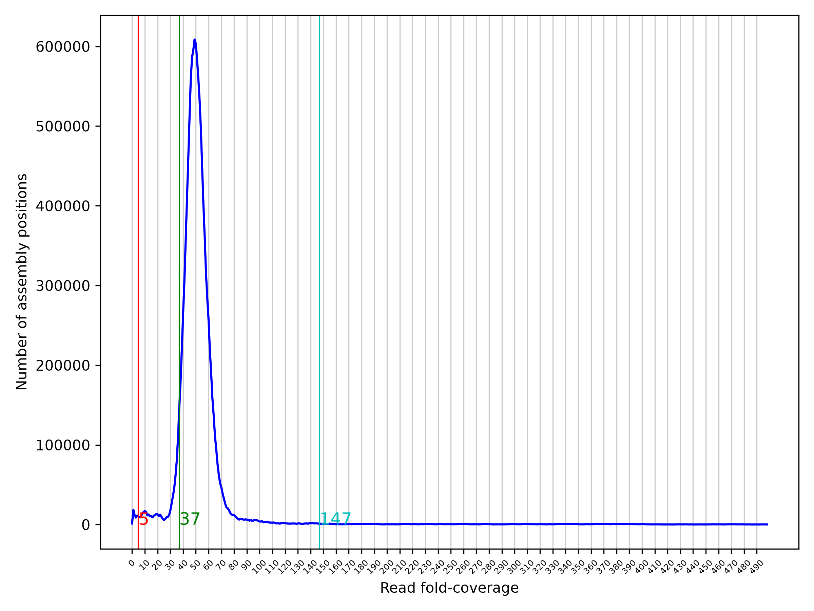{ width="600" }

        Repare na pequena elevação entre 10× e 25×, à esquerda da linha verde: são os trechos duplicados que o purge_dups remove.

    === "NextDenovo"

        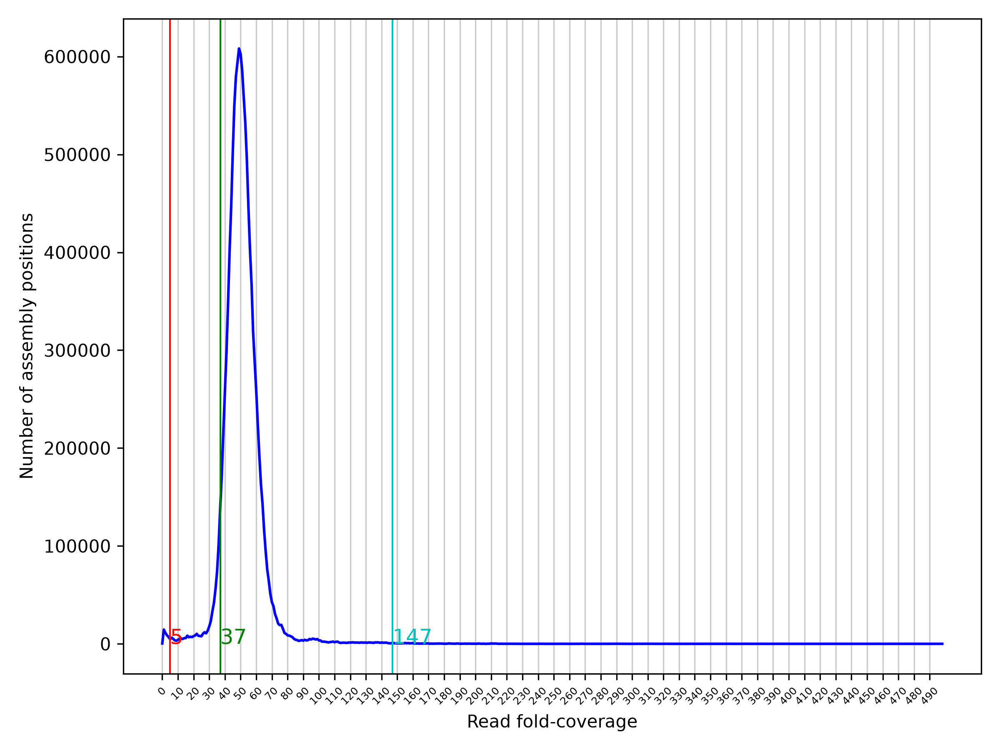{ width="600" }

**Falsas duplicações pelo Merqury**

O Merqury oferece uma régua independente para o mesmo problema. O script `false_duplications.sh` olha o espectro de k-mers da montagem (`*.spectra-cn.hist`): entre os k-mers que aparecem **uma vez** no genoma (pela cobertura nas reads), quantos estão **duas ou mais vezes** na montagem? Essa fração é a taxa de falsas duplicações. As montagens brutas já foram avaliadas pelo Merqury na Etapa 9.2; falta rodar as purgadas. Lembre que as purgadas também estão sem a mitocôndria: os k-mers mitocondriais das reads deixam de ser encontrados na montagem, e a completude cai um pouco por isso, sem relação com o purge_dups.

```bash
cd 8.QC_montagens/merqury
K=../../../4.QC_dadosfiltrados/Scer1_q10_l500.meryl
P=../../../9.Purge_dups

# cada linha: define o nome (n), cria a pasta, entra nela, roda o Merqury e volta
n=Scer1_q10_l500_Flye_purgada;       mkdir -p $n; cd $n; merqury.sh $K $P/Scer1_q10_l500_Flye/Scer1_q10_l500_Flye.purged.fa $n; cd ..
n=Scer1_q10_l500_hifiasm_purgada;    mkdir -p $n; cd $n; merqury.sh $K $P/Scer1_q10_l500_hifiasm/Scer1_q10_l500_hifiasm.purged.fa $n; cd ..
n=Scer1_q10_l500_nextdenovo_purgada; mkdir -p $n; cd $n; merqury.sh $K $P/Scer1_q10_l500_nextdenovo/Scer1_q10_l500_nextdenovo.purged.fa $n; cd ..

# falsas duplicações: bruta x purgada
for s in Scer1_q10_l500_Flye Scer1_q10_l500_hifiasm Scer1_q10_l500_nextdenovo; do
  for v in $s ${s}_purgada; do
    bash $MERQURY/eval/false_duplications.sh $v/$v.*.spectra-cn.hist
  done
done | awk 'NR==1 || !/^hist/' | column -t

cd ../..
```

??? info "O que faz cada comando"
    | Comando | O que faz |
    |---|---|
    | `cd` + `K=` / `P=` | Entra na pasta do Merqury e guarda os caminhos do banco de k-mers (`K`) e das montagens purgadas (`P`). |
    | `n=...; mkdir -p $n; cd $n; merqury.sh ...; cd ..` | Cada linha: guarda o nome, cria a pasta, entra nela, roda o Merqury na montagem purgada e volta. |
    | `for s ...; for v in $s ${s}_purgada` | Para cada montagem, roda nas versões bruta e purgada. |
    | `bash $MERQURY/eval/false_duplications.sh <hist>` | Script do Merqury que lê o histograma `spectra-cn` e calcula a fração de k-mers que aparecem duplicados na montagem sem estar duplicados no genoma. |
    | `awk 'NR==1 || !/^hist/' | column -t` | Mantém só um cabeçalho (o script escreve um por rodada) e alinha as colunas. |
    | `cd ../..` | Volta para a pasta do projeto. |

O script usa a variável `$MERQURY`, que aponta para a pasta de instalação do Merqury (a mesma usada pelo `merqury.sh`). Se ela estiver vazia, use o caminho completo (no nosso servidor, `/home/lgbio/programas/merqury/eval/false_duplications.sh`).

Na saída, as colunas `1`, `2`, `3`, `4` e `>4` contam os k-mers de cópia única nas reads que aparecem 1, 2, 3, 4 ou mais vezes na montagem; `dup%` é a porcentagem que aparece mais de uma vez, ou seja, a taxa de falsas duplicações.

??? note "Ver saída do comando"
    ```
    hist                                                                                                                  cutoff  1         2       3      4      >4        dup(>1)   all       dup%
    Scer1_q10_l500_Flye/Scer1_q10_l500_Flye.assembly.spectra-cn.hist                                                      45      10811670  34061   15943  1333   7         51344     10863014  0.47265
    Scer1_q10_l500_Flye_purgada/Scer1_q10_l500_Flye_purgada.Scer1_q10_l500_Flye.purged.spectra-cn.hist                    45      10812916  14401   7915   22316  10835232  0.205958
    Scer1_q10_l500_hifiasm/Scer1_q10_l500_hifiasm.Scer1_q10_l500_hifiasm.p_ctg.spectra-cn.hist                            45      10691393  177186  1783   977    268       180214    10871607  1.65766
    Scer1_q10_l500_hifiasm_purgada/Scer1_q10_l500_hifiasm_purgada.Scer1_q10_l500_hifiasm.purged.spectra-cn.hist           45      10774377  31294   69     2      31365     10805742  0.290262
    Scer1_q10_l500_nextdenovo/Scer1_q10_l500_nextdenovo.nd.asm.spectra-cn.hist                                            45      10756032  42305   5328   11     5         47649     10803681  0.441044
    Scer1_q10_l500_nextdenovo_purgada/Scer1_q10_l500_nextdenovo_purgada.Scer1_q10_l500_nextdenovo.purged.spectra-cn.hist  45      10761370  27681   4678   11     5         32375     10793745  0.299942
    ```

    Em algumas linhas as colunas parecem "desalinhadas": quando não há k-mers em 4 ou mais cópias, o script simplesmente não imprime essas colunas, e os números seguintes andam para a esquerda. Na tabela abaixo, os valores já estão nas colunas certas.

`cutoff` (45) é a contagem nas reads abaixo da qual o script considera um k-mer como de **cópia única** no genoma.

| Montagem | Versão | 1 cópia | 2 cópias | 3 cópias | 4+ cópias | dup% |
|---|---|---|---|---|---|---|
| Scer1 Flye | bruta | 10.811.670 | 34.061 | 15.943 | 1.340 | **0,47%** |
| | purgada | 10.812.916 | 14.401 | 7.915 | 0 | **0,21%** |
| Scer1 Hifiasm | bruta | 10.691.393 | 177.186 | 1.783 | 1.245 | **1,66%** |
| | purgada | 10.774.377 | 31.294 | 69 | 2 | **0,29%** |
| Scer1 NextDenovo | bruta | 10.756.032 | 42.305 | 5.328 | 16 | **0,44%** |
| | purgada | 10.761.370 | 27.681 | 4.678 | 16 | **0,30%** |

- **O purge_dups funcionou nas três montagens.** A taxa de falsas duplicações caiu em todas, e de forma mais forte no Hifiasm: de 1,66% para 0,29%, uma redução de quase seis vezes. É a mesma história contada pelo histograma de cobertura e pelos BUSCOs duplicados, agora por uma régua independente (k-mers, sem alinhamento).
- **Os k-mers duplicados viraram cópia única.** No Hifiasm, a coluna "1 cópia" **aumentou** ~83 mil k-mers: eles estavam em duas cópias na montagem e passaram a estar em uma só, que é exatamente o que se espera de uma remoção de duplicata bem feita.
- **O custo é pequeno.** A coluna `all` (k-mers de cópia única das reads encontrados na montagem) cai um pouco: ~28 mil no Flye, ~66 mil no Hifiasm e ~10 mil no NextDenovo, menos de 0,7% do total. São trechos que só existiam nas sequências removidas. Uma parte vem das pontas e dos contigs `REPEAT` e do rDNA, e o restante pode ser conteúdo real perdido, que vale acompanhar pela completude do BUSCO a seguir.
- **Por que não chega a zero?** Restam ~0,2–0,3% de k-mers em duas ou mais cópias, que o purge_dups não remove porque estão **no meio** de contigs (lembre que o `-e` só corta pontas e contigs inteiros) ou porque são cópias reais muito parecidas, como genes de famílias subteloméricas.

**BUSCO das montagens purgadas:** a duplicação de genes é a medida mais direta do efeito do purge_dups.

```bash
conda activate busco
busco -i 9.Purge_dups/Scer1_q10_l500_Flye/Scer1_q10_l500_Flye.purged.fa             -l saccharomycetaceae_odb12 -m genome -o 8.QC_montagens/BUSCO/Scer1_q10_l500_Flye_purgada -c 24
busco -i 9.Purge_dups/Scer1_q10_l500_hifiasm/Scer1_q10_l500_hifiasm.purged.fa       -l saccharomycetaceae_odb12 -m genome -o 8.QC_montagens/BUSCO/Scer1_q10_l500_hifiasm_purgada -c 24
busco -i 9.Purge_dups/Scer1_q10_l500_nextdenovo/Scer1_q10_l500_nextdenovo.purged.fa -l saccharomycetaceae_odb12 -m genome -o 8.QC_montagens/BUSCO/Scer1_q10_l500_nextdenovo_purgada -c 24
conda deactivate

# comparar bruta x purgada
for s in Scer1_q10_l500_Flye Scer1_q10_l500_hifiasm Scer1_q10_l500_nextdenovo; do
  echo "$s  bruta:    $(grep -h 'C:' 8.QC_montagens/BUSCO/$s/short_summary*.txt | tr -d '\t ')"
  echo "$s  purgada:  $(grep -h 'C:' 8.QC_montagens/BUSCO/${s}_purgada/short_summary*.txt | tr -d '\t ')"
done
```

??? info "O que faz cada comando"
    | Comando | O que faz |
    |---|---|
    | `busco -i <purgada> ... -c 24` | Roda o BUSCO nas montagens purgadas. O `-c` é o número de processadores; os outros parâmetros são os da Etapa 9.3. |
    | `for s ...; grep -h 'C:' ... | tr -d '\t '` | Mostra lado a lado a linha de resultado do BUSCO da montagem bruta e da purgada. O `tr -d` apaga tabulações e espaços, para a linha ficar compacta. |

??? example "Saída: BUSCO bruta x purgada"

    ```text
    Scer1_q10_l500_Flye  bruta:    C:99.7%[S:99.6%,D:0.1%],F:0.0%,M:0.3%,n:3282,E:1.7%
    Scer1_q10_l500_Flye  purgada:  C:99.6%[S:99.6%,D:0.0%],F:0.0%,M:0.3%,n:3282,E:1.7%
    Scer1_q10_l500_hifiasm  bruta:    C:99.7%[S:98.0%,D:1.7%],F:0.0%,M:0.3%,n:3282,E:1.6%
    Scer1_q10_l500_hifiasm  purgada:  C:99.7%[S:99.5%,D:0.2%],F:0.0%,M:0.3%,n:3282,E:1.6%
    Scer1_q10_l500_nextdenovo  bruta:    C:99.6%[S:99.5%,D:0.2%],F:0.0%,M:0.3%,n:3282,E:1.6%
    Scer1_q10_l500_nextdenovo  purgada:  C:99.6%[S:99.5%,D:0.1%],F:0.0%,M:0.3%,n:3282,E:1.6%
    ```

    Trecho do resumo completo de uma das montagens purgadas (Hifiasm):

    ```text
    |C:99.7%[S:99.5%,D:0.2%],F:0.0%,M:0.3%,n:3282,E:1.6%   |
    |3272    Complete BUSCOs (C)    (of which 53 contain internal stop codons)
    |3266    Complete and single-copy BUSCOs (S)
    |6    Complete and duplicated BUSCOs (D)
    |1    Fragmented BUSCOs (F)
    |9    Missing BUSCOs (M)
    WARNING: 53 of 3272 Complete matches (1.6%) contain internal stop codons in Miniprot gene predictions
    ```

| Montagem | Versão | Completos (C) | Cópia única (S) | Duplicados (D) | Faltando (M) |
|---|---|---|---|---|---|
| Scer1 Flye | bruta | 99,7% | 99,6% | 0,1% | 0,3% |
| | purgada | 99,6% | 99,6% | **0,0%** (1 gene) | 0,3% |
| Scer1 Hifiasm | bruta | 99,7% | 98,0% | 1,7% | 0,3% |
| | purgada | 99,7% | 99,5% | **0,2%** (6 genes) | 0,3% |
| Scer1 NextDenovo | bruta | 99,6% | 99,5% | 0,2% | 0,3% |
| | purgada | 99,6% | 99,5% | **0,1%** (4 genes) | 0,3% |

- **A duplicação caiu sem perda de completude.** No Hifiasm, os genes duplicados passaram de 1,7% (~56 genes) para 0,2% (6 genes), e esses ~50 genes voltaram para a coluna de cópia única (S: 98,0% → 99,5%). O total de completos não mudou: o purge_dups tirou a **segunda cópia**, não o gene.
- **Flye e NextDenovo quase não mudaram**, porque já tinham pouca duplicação. A diferença de 0,1 ponto no C do Flye equivale a um ou dois genes e está dentro da variação esperada.
- **Os três indicadores concordam.** Histograma de cobertura, k-mers do Merqury e BUSCO contam a mesma história: o Hifiasm era a montagem com mais falsas duplicações, e o purge_dups as removeu.
- **O `E:` e o aviso de *stop codons*.** Cerca de 1,6% dos genes completos têm um códon de parada no meio da predição. Erros de indel (bases a mais ou a menos que quebram a fase de leitura) produzem esse sinal, mas compare com a **referência S288C** na Etapa 9.3: ela também tem `E:1,5%` (49 genes), e uma referência de alta qualidade não tem esses erros. Ou seja, quase todo esse valor é um "fundo" que vem da própria predição de genes (o Miniprot), e não da montagem. Voltamos a ele na Etapa 14.1, depois do polimento.

**Montagens que seguem para o polimento:** as três da Scer1 purgadas e as duas da Scer2 só com a parte nuclear, todas com o mesmo padrão de nome.

```bash
mkdir -p 9.Montagens-purgadas
cp 9.Purge_dups/Scer1_q10_l500_Flye/Scer1_q10_l500_Flye.purged.fa             9.Montagens-purgadas/Scer1_q10_l500_Flye.fasta
cp 9.Purge_dups/Scer1_q10_l500_hifiasm/Scer1_q10_l500_hifiasm.purged.fa       9.Montagens-purgadas/Scer1_q10_l500_hifiasm.fasta
cp 9.Purge_dups/Scer1_q10_l500_nextdenovo/Scer1_q10_l500_nextdenovo.purged.fa 9.Montagens-purgadas/Scer1_q10_l500_nextdenovo.fasta
cp 9.Montagens-nucleares/Scer2_q10_l500_Flye.fasta    9.Montagens-purgadas/
cp 9.Montagens-nucleares/Scer2_q10_l500_hifiasm.fasta 9.Montagens-purgadas/
ls -lh 9.Montagens-purgadas/
```

??? info "O que faz cada comando"
    | Comando | O que faz |
    |---|---|
    | `mkdir -p 9.Montagens-purgadas` | Cria a pasta com a versão de cada montagem que segue para o polimento. |
    | `cp <purgada> 9.Montagens-purgadas/<nome>.fasta` | Scer1: copia a montagem purgada com um nome padronizado. |
    | `cp 9.Montagens-nucleares/Scer2_...` | Scer2: copia a montagem só sem a mitocôndria (sem purge_dups). |
    | `ls -lh` | Lista os arquivos com o tamanho em formato legível (K, M). |

### Checklist da Etapa 9

- [ ] Tenho relatórios QUAST (HTML) para as cinco montagens
- [ ] Tenho `merqury_summary.tsv` consolidado
- [ ] Tenho BUSCO `short_summary` de cada montagem e da referência
- [ ] Entendi por que Merqury, BUSCO e QUAST podem discordar sobre "completude"
- [ ] Separei os contigs mitocondriais (`9.Mitocondria/`) e tenho as montagens nucleares em `9.Montagens-nucleares/`
- [ ] Rodei o purge_dups nas montagens da Scer1, conferi o histograma e os limites de corte, e tenho as montagens de entrada do polimento em `9.Montagens-purgadas/`

---

## :material-numeric-10-circle: Etapa 10 — Polimento (Medaka e Illumina)

O polimento tem como objetivo corrigir erros residuais da montagem, melhorando a acurácia das bases. O ideal seria usar reads Illumina (muito mais precisas, com padrão de erro diferente do Nanopore) para essa correção, uma abordagem conhecida como polimento híbrido. Quando não há dados Illumina disponíveis, como é o caso da Scer2, é possível usar os próprios reads Nanopore para polir a montagem. O Medaka faz esse polimento a partir de um modelo neural treinado especificamente para reads ONT. Essa abordagem não chega à precisão do polimento híbrido com Illumina, mas ainda pode trazer ganhos de acurácia em relação à montagem bruta. Para a Scer1 existem reads Illumina públicas da mesma linhagem, e faremos o polimento híbrido na Etapa 10.1.

O Medaka precisa de um modelo compatível com a química da flowcell e com o basecaller usados no sequenciamento. Quando essa informação não está nos metadados, o cabeçalho das reads pode dar pistas: ele traz o ID da flowcell usada.

```bash
zcat 0.DadosBrutos/Scer1.fastq.gz | head -1
zcat 0.DadosBrutos/Scer2.fastq.gz | head -1
```

??? info "O que faz cada comando"
    | Comando | O que faz |
    |---|---|
    | `zcat <reads> | head -1` | Mostra o cabeçalho da primeira read, onde às vezes aparecem o basecaller e o modelo usados. |

??? note "Ver saída do comando"

    ```bash
    $ zcat 0.DadosBrutos/Scer1.fastq.gz | head -1
    @ERR13367646.1 ch1252_read6_c2980bb1-9b8d-46a0-96d5-bf2f96d18a28_fail_PAG90098 length=444
    $ zcat 0.DadosBrutos/Scer2.fastq.gz | head -1
    @ERR13375657.1 ch627_read31_20a0a16c-59dc-4400-b4d4-83fe876f3727_fail_PAK00454 length=396
    ```

O final do cabeçalho mostra o ID da flowcell: **PAG90098** para o Scer1 e **PAK00454** para o Scer2. O prefixo indica o tipo de flowcell PromethION: **PAG** corresponde à química **R9.4.1** e **PAK** à química **R10.4.1**. Por isso, as duas amostras usarão modelos diferentes no Medaka.

Listar modelos disponíveis no Medaka para confirmar qual usar:

```bash
medaka tools list_models
```

??? info "O que faz cada comando"
    | Comando | O que faz |
    |---|---|
    | `medaka tools list_models` | Lista os modelos disponíveis na versão instalada do Medaka. |

??? note "Ver exemplo de saída do comando"

    ```bash
    $ medaka tools list_models
    2026-07-07 22:49:27.515180: W tensorflow/stream_executor/platform/default/dso_loader.cc:64] Could not load dynamic library 'libcudart.so.11.0'; dlerror: libcudart.so.11.0: cannot open shared object file: No such file or directory; LD_LIBRARY_PATH: /opt/jdk-19/lib/server/
    2026-07-07 22:49:27.515204: I tensorflow/stream_executor/cuda/cudart_stub.cc:29] Ignore above cudart dlerror if you do not have a GPU set up on your machine.
    Available: r103_fast_g507, r103_fast_snp_g507, r103_fast_variant_g507, r103_hac_g507, r103_hac_snp_g507, r103_hac_variant_g507, r103_min_high_g345, r103_min_high_g360, r103_prom_high_g360, r103_prom_snp_g3210, r103_prom_variant_g3210, r103_sup_g507, r103_sup_snp_g507, r103_sup_variant_g507, r1041_e82_400bps_fast_g615, r1041_e82_400bps_fast_variant_g615, r1041_e82_400bps_hac_g615, r1041_e82_400bps_hac_variant_g615, r1041_e82_400bps_sup_g615, r1041_e82_400bps_sup_variant_g615, r104_e81_fast_g5015, r104_e81_fast_variant_g5015, r104_e81_hac_g5015, r104_e81_hac_variant_g5015, r104_e81_sup_g5015, r104_e81_sup_g610, r104_e81_sup_variant_g610, r10_min_high_g303, r10_min_high_g340, r941_e81_fast_g514, r941_e81_fast_variant_g514, r941_e81_hac_g514, r941_e81_hac_variant_g514, r941_e81_sup_g514, r941_e81_sup_variant_g514, r941_min_fast_g303, r941_min_fast_g507, r941_min_fast_snp_g507, r941_min_fast_variant_g507, r941_min_hac_g507, r941_min_hac_snp_g507, r941_min_hac_variant_g507, r941_min_high_g303, r941_min_high_g330, r941_min_high_g340_rle, r941_min_high_g344, r941_min_high_g351, r941_min_high_g360, r941_min_sup_g507, r941_min_sup_snp_g507, r941_min_sup_variant_g507, r941_prom_fast_g303, r941_prom_fast_g507, r941_prom_fast_snp_g507, r941_prom_fast_variant_g507, r941_prom_hac_g507, r941_prom_hac_snp_g507, r941_prom_hac_variant_g507, r941_prom_high_g303, r941_prom_high_g330, r941_prom_high_g344, r941_prom_high_g360, r941_prom_high_g4011, r941_prom_snp_g303, r941_prom_snp_g322, r941_prom_snp_g360, r941_prom_sup_g507, r941_prom_sup_snp_g507, r941_prom_sup_variant_g507, r941_prom_variant_g303, r941_prom_variant_g322, r941_prom_variant_g360, r941_sup_plant_g610, r941_sup_plant_variant_g610
    Default consensus:  r941_min_hac_g507
    Default variant:  r941_min_hac_variant_g507


    ```

Para o nosso caso, os modelos mais próximos são:

- **Scer1** (PromethION, R9.4.1): `-m r941_prom_hac_g507`
- **Scer2** (PromethION, R10.4.1): `-m r1041_e82_400bps_hac_g615`

Como baixamos os FASTQ do SRA, não sabemos em qual modo o basecalling foi feito (FAST, HAC ou SUP). Usamos os modelos HAC, um meio-termo. Se o sequenciamento for seu, use o modelo que corresponde ao basecaller e ao modo que você usou (por exemplo, `r941_prom_sup_g507` para SUP).

**Comando para rodar o Medaka**

```bash
mkdir -p 9.Polimento-Medaka
conda activate medaka

# reads e modelo de cada amostra (o modelo depende da flowcell)
R1=2.Filtragem-dadosbrutos/Scer1_q10_l500.fastq.gz;  M1=r941_prom_hac_g507           # Scer1: R9.4.1
R2=2.Filtragem-dadosbrutos/Scer2_q10_l500.fastq.gz;  M2=r1041_e82_400bps_hac_g615    # Scer2: R10.4.1

# uma linha por montagem (o tee -a junta tudo num log só)
# para rodar de novo, apague antes a pasta de saída: rm -rf 9.Polimento-Medaka/<montagem>
medaka_consensus -i $R1 -d 9.Montagens-purgadas/Scer1_q10_l500_Flye.fasta       -o 9.Polimento-Medaka/Scer1_q10_l500_Flye       -t 24 -m $M1 2>&1 | tee -a 9.Polimento-Medaka/medaka.log
medaka_consensus -i $R1 -d 9.Montagens-purgadas/Scer1_q10_l500_hifiasm.fasta    -o 9.Polimento-Medaka/Scer1_q10_l500_hifiasm    -t 24 -m $M1 2>&1 | tee -a 9.Polimento-Medaka/medaka.log
medaka_consensus -i $R1 -d 9.Montagens-purgadas/Scer1_q10_l500_nextdenovo.fasta -o 9.Polimento-Medaka/Scer1_q10_l500_nextdenovo -t 24 -m $M1 2>&1 | tee -a 9.Polimento-Medaka/medaka.log
medaka_consensus -i $R2 -d 9.Montagens-purgadas/Scer2_q10_l500_Flye.fasta       -o 9.Polimento-Medaka/Scer2_q10_l500_Flye       -t 24 -m $M2 2>&1 | tee -a 9.Polimento-Medaka/medaka.log
medaka_consensus -i $R2 -d 9.Montagens-purgadas/Scer2_q10_l500_hifiasm.fasta    -o 9.Polimento-Medaka/Scer2_q10_l500_hifiasm    -t 24 -m $M2 2>&1 | tee -a 9.Polimento-Medaka/medaka.log

conda deactivate
```

??? info "O que faz cada comando"
    | Comando | O que faz |
    |---|---|
    | `mkdir -p` + `conda activate medaka` | Cria a pasta e entra no ambiente do Medaka. |
    | `R1=...; M1=...` / `R2=...; M2=...` | Reads e modelo de cada amostra. O modelo depende da flowcell (R9.4.1 na Scer1, R10.4.1 na Scer2). |
    | `medaka_consensus -i <reads> -d <montagem>` | Alinha as reads na montagem e corrige as bases com uma rede neural treinada para o tipo de dado. |
    | `-o` / `-t 24` / `-m <modelo>` | Pasta de saída, número de processadores e modelo. |
    | `2>&1 | tee -a <log>` | Junta as mensagens de erro (`2>`) com a saída normal, mostra na tela e acrescenta (`-a`) ao log, sem apagar o que as linhas anteriores escreveram. |
    | `conda deactivate` | Sai do ambiente. |

O Medaka parte das montagens de `9.Montagens-purgadas/` (Etapa 9.5): todas sem a mitocôndria, e as da Scer1 também sem duplicatas. O `rm -rf` antes de cada execução é importante: se a pasta de saída já existir, o Medaka reaproveita o alinhamento antigo em vez de refazê-lo.

O log fica em `9.Polimento-Medaka/medaka.log`. Ele é longo (mais de mil linhas para as cinco montagens), então abaixo está só a execução da Scer1 Flye, resumida:

??? example "Saída: medaka.log (Scer1 Flye, resumida)"

    ```text
    Checking program versions
    This is medaka 2.2.1
    Program    Version    Required   Pass
    bcftools   1.23.1     1.11       True
    bgzip      1.23.1     1.11       True
    minimap2   2.30       2.11       True
    samtools   1.23.1     1.11       True
    tabix      1.23.1     1.11       True
    Aligning basecalls to draft
    Using the existing fai index file .../9.Montagens-purgadas/Scer1_q10_l500_Flye.fasta.fai
    Using the existing mmi index file .../9.Montagens-purgadas/Scer1_q10_l500_Flye.fasta.map-ont.mmi
    [M::mm_idx_stat] kmer size: 15; skip: 10; is_hpc: 0; #seq: 37
    [M::worker_pipeline::26.452*17.57] mapped 140416 sequences
    [M::worker_pipeline::34.498*17.34] mapped 90021 sequences
    [M::main] Real time: 34.674 sec; CPU: 598.412 sec; Peak RSS: 4.572 GB
    Running medaka inference
    [21:21:29 - Predict] Reducing threads, anymore is a waste.
    [21:21:29 - Predict] Setting pytorch intra/inter-op threads to 2/1.
    [21:21:29 - Predict] Processing region(s): contig_10_1:0-257647 contig_100_1:0-1059572 ... scaffold_33_1:0-1036318
    [21:21:29 - Predict] Using model: .../r941_prom_hac_g507_model_pt.tar.gz.
    [21:21:29 - Predict] Model device: cpu
    [21:21:29 - PWorker] Running inference for 11.9M draft bases.
    [21:21:34 - Feature] Pileup counts do not span requested region, requested contig_20_1:0-29297, received 0-28224.
    [21:21:35 - Feature] Pileup counts do not span requested region, requested contig_25_1:0-421592, received 673-1906.
    [21:21:35 - Feature] Pileup counts do not span requested region, requested contig_25_1:0-421592, received 2609-421591.
    [21:21:40 - Feature] Pileup counts do not span requested region, requested scaffold_33_1:0-1000000, received 100-999999.
    [21:26:43 - PWorker] Processed 22 batches
    [21:26:51 - Predict] Finished processing all regions.
    [21:26:55 - TrimOlap] contig_25_1:673.0-1906.0 and contig_25_1:2609.0-8760.0 cannot be concatenated as there is no overlap and they do not abut.
    Polished assembly written to 9.Polimento-Medaka/Scer1_q10_l500_Flye/consensus.fasta, have a nice day.
    ```

**Lendo o log.** O Medaka trabalha em duas fases:

1. **Alinhamento** (`Aligning basecalls to draft`): o minimap2 alinha todas as reads contra a montagem. As mensagens `Using the existing ... index file` aparecem porque os índices (`.fai` e `.mmi`) ficam ao lado do FASTA de entrada, em `9.Montagens-purgadas/`, e não na pasta de saída. Eles sobrevivem ao `rm -rf` e são reaproveitados, o que não é problema, já que a montagem de entrada não mudou.
2. **Inferência** (`Running medaka inference`): uma rede neural (`GRUModel`) lê a pilha de reads em cada posição e decide a base mais provável. É a fase mais demorada, cerca de 5 minutos por montagem da Scer1.

Algumas mensagens assustam mas são normais:

- **`Reducing threads, anymore is a waste`**: rodando na CPU (`Model device: cpu`), a inferência usa poucos threads de forma eficiente, então o Medaka ignora parte do `-t 24`. O alinhamento, por outro lado, usa todos.
- **`Pileup counts do not span requested region`**: há trechos sem reads alinhadas, geralmente nas pontas dos contigs ou em contigs pequenos. Nesses trechos o Medaka não tem o que corrigir e mantém a sequência original. Na Scer1 isso ocorre poucas vezes por montagem (de 1 a 4), e na Scer2 Flye, com ~6x de cobertura, um pouco mais (9).
- **`cannot be concatenated as there is no overlap`**: no `contig_25_1` há um buraco de cobertura (entre 1906 e 2609 pb), e o Medaka não consegue emendar as duas partes polidas. O contig não é cortado: o trecho sem cobertura fica como estava na montagem.

Ao final, cada pasta tem um `consensus.fasta`, a montagem polida:

```bash
ls -l 9.Polimento-Medaka/*/consensus.fasta
```

??? info "O que faz cada comando"
    | Comando | O que faz |
    |---|---|
    | `ls -l 9.Polimento-Medaka/*/consensus.fasta` | Lista a montagem polida (`consensus.fasta`) de cada pasta. O `*` vale para qualquer nome de pasta. |

??? example "Saída: arquivos polidos"

    ```text
    -rw-rw-r--+ 1 renata renata 11972061 nov 18 21:26 9.Polimento-Medaka/Scer1_q10_l500_Flye/consensus.fasta
    -rw-rw-r--+ 1 renata renata 12168275 nov 18 21:32 9.Polimento-Medaka/Scer1_q10_l500_hifiasm/consensus.fasta
    -rw-rw-r--+ 1 renata renata 12018251 nov 18 21:38 9.Polimento-Medaka/Scer1_q10_l500_nextdenovo/consensus.fasta
    -rw-rw-r--+ 1 renata renata  8261274 nov 18 21:45 9.Polimento-Medaka/Scer2_q10_l500_Flye/consensus.fasta
    -rw-rw-r--+ 1 renata renata    86915 nov 18 21:46 9.Polimento-Medaka/Scer2_q10_l500_hifiasm/consensus.fasta
    ```

Cada montagem da Scer1 levou cerca de 6 minutos; a Scer2 Flye, 7 minutos; e a Scer2 Hifiasm, menos de 1 minuto, por ser minúscula. O tamanho mostrado pelo `ls` está em **bytes** do arquivo (inclui cabeçalhos e quebras de linha), não em pares de base, mas já mostra que o Medaka não muda o tamanho da montagem: ele corrige bases e pequenos indels, sem juntar nem descartar contigs. A comparação de verdade, antes e depois do polimento, vem na Etapa 11.

!!! warning "Scer2 Hifiasm: quase nada sobrou"
    O arquivo da Scer2 Hifiasm tem só ~87 kb. A montagem bruta tinha 189 kb, dos quais 102 kb eram o contig mitocondrial separado na Etapa 9.4; o que resta é um punhado de contigs nucleares. Com ~6x de cobertura, o Hifiasm praticamente não montou o genoma nuclear da Scer2. A montagem segue no tutorial só para comparação.

!!! tip "FASTAs polidos disponíveis no repositório"
    [:material-dna: Scer1_Flye_medaka_consensus.fasta](https://github.com/LGBIO-UFG/PRO-BIOINFO/blob/main/data/exemplos/nanopore/assemblies/Scer1_Flye_medaka_consensus.fasta) ·
    [:material-dna: Scer2_Flye_medaka_consensus.fasta](https://github.com/LGBIO-UFG/PRO-BIOINFO/blob/main/data/exemplos/nanopore/assemblies/Scer2_Flye_medaka_consensus.fasta) ·
    [:material-dna: Scer1_Hifiasm_medaka_consensus.fasta](https://github.com/LGBIO-UFG/PRO-BIOINFO/blob/main/data/exemplos/nanopore/assemblies/Scer1_Hifiasm_medaka_consensus.fasta) ·
    [:material-dna: Scer2_Hifiasm_medaka_consensus.fasta](https://github.com/LGBIO-UFG/PRO-BIOINFO/blob/main/data/exemplos/nanopore/assemblies/Scer2_Hifiasm_medaka_consensus.fasta) ·
    [:material-dna: Scer1_NextDenovo_medaka_consensus.fasta](https://github.com/LGBIO-UFG/PRO-BIOINFO/blob/main/data/exemplos/nanopore/assemblies/Scer1_NextDenovo_medaka_consensus.fasta)

### 10.1 Polimento híbrido com reads Illumina

O polimento mais eficiente para montagens Nanopore usa reads Illumina: elas são curtas, mas muito precisas, e têm um perfil de erro diferente do Nanopore (substituições raras, quase nenhum erro em homopolímeros). É uma situação comum na prática: o genoma é montado com reads longas e uma rodada Illumina da mesma linhagem é usada para corrigir as bases.

Nesta etapa vamos polir as três montagens da Scer1 (Flye, Hifiasm e NextDenovo), já polidas com o Medaka, usando reads Illumina reais da mesma linhagem. O polimento é feito em sequência: primeiro o Medaka corrige com as próprias reads Nanopore, depois as reads Illumina corrigem o que sobrou.

!!! note "Sobre os dados desta etapa"
    A amostra Scer1 é a linhagem **CBS7963**. Além do sequenciamento Nanopore usado até aqui (projeto PRJEB77686), essa linhagem foi sequenciada com Illumina no projeto *1002 Saccharomyces cerevisiae genomes* (PRJEB13017):

    | | |
    |---|---|
    | Run | [ERR1309041](https://www.ebi.ac.uk/ena/browser/view/ERR1309041){ target=_blank } |
    | Plataforma | Illumina HiSeq 2000, paired-end, 2×100 pb |
    | Volume | 16,2 milhões de pares, 3,2 Gb (≈ 260× de cobertura) |

    A amostra Scer2 (SM.9.1.AL1) também foi sequenciada nesse projeto ([ERR1309387](https://www.ebi.ac.uk/ena/browser/view/ERR1309387){ target=_blank }). Para manter o tempo de execução razoável, esta etapa usa só a Scer1; repetir o polimento na Scer2 fica como exercício opcional.

    Dois detalhes que valem para dados reais em geral: as reads Illumina e Nanopore vieram de **culturas diferentes** da mesma linhagem, sequenciadas com anos de diferença, então pode haver algumas mutações reais entre elas (poucas, perto dos erros de montagem). E muitas linhagens de *S. cerevisiae* são **diploides e heterozigotas**: nos sítios heterozigotos as reads discordam entre si, e os polidores tendem, corretamente, a não alterar a base. A CBS7963 não tem esse problema: é haploide (37 SNPs heterozigotos no genoma inteiro, segundo o próprio projeto 1002 Genomes, que gerou estas reads).

??? tip "Instalação: ambiente `polimento`"
    ```bash
    conda create -n polimento -c conda-forge -c bioconda \
      "polypolish>=0.6" pypolca bwa samtools seqtk pilon
    ```

    A versão do Polypolish precisa ser 0.6 ou mais nova: as anteriores usam outra sintaxe (`polypolish_insert_filter.py`).

**Baixar uma parte das reads Illumina:**

Os arquivos completos têm ~1,5 GB cada (≈ 260× de cobertura), muito mais do que o polimento precisa. Em vez de baixar tudo e depois sortear uma fração, vamos ler **só o começo** de cada arquivo direto do ENA: o `head` pega os primeiros 2,4 milhões de reads (4 linhas por read = 9.600.000 linhas), o que dá ≈ 40× (2,4 M pares × 2 × 100 pb ÷ 12 Mb), e o `wget` para sozinho quando o `head` termina.

Isso funciona por dois motivos. Num FASTQ Illumina, a ordem das reads segue a posição na lâmina do sequenciador, e não a posição no genoma, então as primeiras reads cobrem o genoma inteiro. E os arquivos R1 e R2 estão na mesma ordem, então as primeiras 2,4 milhões de reads de cada um formam os mesmos pares.

```bash
mkdir -p 0.DadosBrutos/illumina
URL=ftp://ftp.sra.ebi.ac.uk/vol1/fastq/ERR130/001/ERR1309041
for r in 1 2; do
  wget -qO- $URL/ERR1309041_$r.fastq.gz | zcat | head -n 9600000 | gzip > 0.DadosBrutos/illumina/Scer1_ilmn_40x_$r.fq.gz
done

ls -lh 0.DadosBrutos/illumina/
for r in 1 2; do echo "R$r: $(( $(zcat 0.DadosBrutos/illumina/Scer1_ilmn_40x_$r.fq.gz | wc -l) / 4 )) reads"; done
zcat 0.DadosBrutos/illumina/Scer1_ilmn_40x_1.fq.gz | head -1
zcat 0.DadosBrutos/illumina/Scer1_ilmn_40x_2.fq.gz | head -1
```

??? info "O que faz cada comando"
    | Comando | O que faz |
    |---|---|
    | `mkdir -p` + `URL=...` | Cria a pasta das reads Illumina e guarda o endereço da corrida no ENA. |
    | `for r in 1 2; do ... done` | Repete para os dois arquivos do par (R1 e R2). |
    | `wget -qO- <endereço>` | Baixa o arquivo sem mensagens (`-q`) e manda o conteúdo para o próximo comando (`-O-`), sem salvar no disco. |
    | `zcat | head -n 9600000 | gzip > ...` | Descomprime, fica só com as primeiras 9.600.000 linhas (2,4 milhões de reads, já que cada read ocupa 4 linhas; cerca de 40× do genoma) e comprime de novo. |
    | `ls -lh` | Mostra os arquivos e os tamanhos. |
    | `echo "R$r: $(( $(zcat ... | wc -l) / 4 )) reads"` | Conta as linhas de cada arquivo e divide por 4 para ter o número de reads. |
    | `zcat ... | head -1` | Mostra o cabeçalho da primeira read de cada arquivo, para conferir que os dois arquivos formam um par. |

Mensagens como *"gzip: stdout: Broken pipe"* são esperadas: indicam apenas que o `head` fechou a leitura quando chegou ao número de linhas pedido. Para conferir que os pares estão corretos, as duas últimas linhas devem mostrar o **mesmo nome de read** em R1 e R2.

??? tip "Alternativa: baixar tudo e sortear"
    Se você precisar dos arquivos completos, baixe-os e sorteie uma fração com o `seqtk`. Usar a **mesma semente** (`-s 42`) nos dois arquivos garante que os mesmos pares sejam sorteados em R1 e R2. O sorteio é mais rigoroso que pegar o começo do arquivo, mas exige baixar ~2,9 GB.

    ```bash
    wget -nc -P 0.DadosBrutos/illumina ftp://ftp.sra.ebi.ac.uk/vol1/fastq/ERR130/001/ERR1309041/ERR1309041_1.fastq.gz
    wget -nc -P 0.DadosBrutos/illumina ftp://ftp.sra.ebi.ac.uk/vol1/fastq/ERR130/001/ERR1309041/ERR1309041_2.fastq.gz
    md5sum 0.DadosBrutos/illumina/ERR1309041_*.fastq.gz
    # esperado: 27978d9658c241b7e7d78a66cbb4f10b  ERR1309041_1.fastq.gz
    #           e5a6fa179a09891484e88bf116746fa1  ERR1309041_2.fastq.gz

    conda activate polimento
    for r in 1 2; do
      seqtk sample -s 42 0.DadosBrutos/illumina/ERR1309041_$r.fastq.gz 0.15 | gzip > 0.DadosBrutos/illumina/Scer1_ilmn_40x_$r.fq.gz
    done
    conda deactivate
    ```

??? note "Ver saída do comando"

    ```bash
    $ ls -lh 0.DadosBrutos/illumina/
    total 427M
    -rw-rw-r--+ 1 renata renata 214M nov 17 18:47 Scer1_ilmn_40x_1.fq.gz
    -rw-rw-r--+ 1 renata renata 214M nov 17 19:07 Scer1_ilmn_40x_2.fq.gz

    $ for r in 1 2; do echo "R$r: $(( $(zcat 0.DadosBrutos/illumina/Scer1_ilmn_40x_$r.fq.gz | wc -l) / 4 )) reads"; done
    R1: 2400000 reads
    R2: 2400000 reads

    $ zcat 0.DadosBrutos/illumina/Scer1_ilmn_40x_1.fq.gz | head -1
    @ERR1309041.1 H8:D2C6RACXX:2:1101:2101:2243/1
    $ zcat 0.DadosBrutos/illumina/Scer1_ilmn_40x_2.fq.gz | head -1
    @ERR1309041.1 H8:D2C6RACXX:2:1101:2101:2243/2
    ```

    O nome da read é o mesmo nos dois arquivos; só muda o sufixo `/1` (R1) ou `/2` (R2). O restante do nome traz o instrumento, a flowcell (`D2C6RACXX`), a lane (`2`), o tile (`1101`) e as coordenadas x:y do cluster na lâmina. Por isso a ordem das reads segue a lâmina, e não o genoma. Pelo horário dos arquivos, cada download levou cerca de 20 minutos.

**Polir as três montagens da Scer1 com Polypolish e pypolca:**

O Polypolish usa **todos** os alinhamentos de cada read (`bwa mem -a`), inclusive os de regiões repetitivas, e só altera uma base quando as reads concordam. Isso o torna muito conservador: ele quase nunca introduz erros novos. O pypolca roda em seguida e corrige o que o Polypolish deixou passar, principalmente indels.

O laço abaixo repete o mesmo processo para as três montagens da Scer1 já polidas com o Medaka. Para cada uma, ele copia a montagem para uma pasta própria em `9.Polimento-Illumina/`, alinha as reads, roda o Polypolish e o pypolca e salva o resultado final como `<montagem>_hibrido.fasta`. Leva cerca de 5 minutos por montagem.

```bash
conda activate polimento
D=0.DadosBrutos/illumina
mkdir -p 9.Polimento-Illumina

s=Scer1_q10_l500_Flye   # troque e rode o bloco de novo para: Scer1_q10_l500_hifiasm, Scer1_q10_l500_nextdenovo
echo "===== $s ====="
O=9.Polimento-Illumina/$s
# apaga resultados anteriores: o pypolca não sobrescreve uma pasta existente
rm -rf $O
mkdir -p $O

# montagem polida com Medaka (Etapa 10)
cp 9.Polimento-Medaka/$s/consensus.fasta $O/${s}_medaka.fasta

# alinhamento: cada arquivo de reads separadamente, com todos os alinhamentos (-a)
bwa index $O/${s}_medaka.fasta
bwa mem -t 24 -a $O/${s}_medaka.fasta $D/Scer1_ilmn_40x_1.fq.gz > $O/aln_1.sam
bwa mem -t 24 -a $O/${s}_medaka.fasta $D/Scer1_ilmn_40x_2.fq.gz > $O/aln_2.sam

# Polypolish
polypolish filter --in1 $O/aln_1.sam --in2 $O/aln_2.sam --out1 $O/filt_1.sam --out2 $O/filt_2.sam
polypolish polish $O/${s}_medaka.fasta $O/filt_1.sam $O/filt_2.sam \
  > $O/${s}_polypolish.fasta 2> $O/polypolish.log

# pypolca
pypolca run -a $O/${s}_polypolish.fasta -1 $D/Scer1_ilmn_40x_1.fq.gz -2 $D/Scer1_ilmn_40x_2.fq.gz \
  -t 24 -o $O/pypolca --careful
cp $O/pypolca/pypolca_corrected.fasta $O/${s}_hibrido.fasta

# os SAM são grandes e só servem de entrada para o Polypolish
rm $O/aln_*.sam $O/filt_*.sam

conda deactivate
```

??? info "O que faz cada comando"
    | Comando | O que faz |
    |---|---|
    | `conda activate polimento` + `D=...` | Entra no ambiente e guarda a pasta das reads Illumina. |
    | `s=...` + `O=...` | Montagem a processar e a pasta dela. Troque e rode de novo para as outras. |
    | `rm -rf $O` + `mkdir -p $O` | Apaga resultados anteriores e recria a pasta (o pypolca não sobrescreve uma pasta existente). |
    | `cp .../consensus.fasta ..._medaka.fasta` | Copia a montagem polida com o Medaka, ponto de partida deste polimento. |
    | `bwa index` | Indexa a montagem para o alinhamento. |
    | `bwa mem -t 24 -a` | Alinha as reads Illumina na montagem, um arquivo do par de cada vez. O `-a` guarda todos os alinhamentos de cada read, o que o Polypolish usa para corrigir regiões repetidas. |
    | `polypolish filter --in1 --in2 --out1 --out2` | Descarta alinhamentos em que os dois lados do par não batem em distância e orientação. |
    | `polypolish polish` | Corrige as bases da montagem usando os alinhamentos filtrados. As mensagens vão para `polypolish.log`. |
    | `pypolca run -a <montagem> -1 <R1> -2 <R2>` | Segunda correção, com outro método, sobre a saída do Polypolish. |
    | `-t 24 -o <pasta> --careful` | Processadores, pasta de saída e modo cuidadoso (só corrige quando a evidência é forte). |
    | `cp .../pypolca_corrected.fasta ..._hibrido.fasta` | Salva o resultado final com o nome `_hibrido`. |
    | `rm $O/aln_*.sam $O/filt_*.sam` | Apaga os alinhamentos, que são grandes e não são mais necessários. |
    | `conda deactivate` | Sai do ambiente. |

Rode o bloco uma vez para cada montagem, trocando a linha `s=`. Ao final, cada montagem terá três versões: a bruta (Etapas 5–7), a polida com Medaka (`9.Polimento-Medaka/<montagem>/consensus.fasta`) e a polida com Medaka + Illumina (`9.Polimento-Illumina/<montagem>/<montagem>_hibrido.fasta`).

??? note "Ver saída do comando (resumida)"

    ```bash
    ===== Scer1_q10_l500_Flye =====
    [main] CMD: bwa index 9.Polimento-Illumina/Scer1_q10_l500_Flye/Scer1_q10_l500_Flye_medaka.fasta
    [main] Real time: 11.882 sec
    [M::mem_process_seqs] Processed 2400000 reads in 184.459 CPU sec, 45.796 real sec
    [M::mem_process_seqs] Processed 2400000 reads in 178.449 CPU sec, 33.244 real sec

    Starting Polypolish filter
    Polypolish version: 0.7.1
    9.Polimento-Illumina/Scer1_q10_l500_Flye/aln_1.sam: 3,837,861 alignments from 2,195,039 reads
    9.Polimento-Illumina/Scer1_q10_l500_Flye/aln_2.sam: 3,828,088 alignments from 2,187,951 reads
    Matching read pairs: 2,171,427
    fr: 1,725,247 pairs
    rf: 398 pairs
    ff: 284 pairs
    rr: 305 pairs
    Automatically determined correct orientation: fr
    Low threshold:  96 (0.1st percentile)
    High threshold: 630 (99.9th percentile)
    Filtering 9.Polimento-Illumina/Scer1_q10_l500_Flye/aln_1.sam:
      3,445,256 pass
      392,605 fail
    Filtering 9.Polimento-Illumina/Scer1_q10_l500_Flye/aln_2.sam:
      3,429,916 pass
      398,172 fail
    Alignments before filtering: 7,665,949
    Alignments after filtering:  6,875,172

    INFO | You are using pypolca version 0.5.0
    INFO | Samtools v1.24 found.
    INFO | freebayes v1.3.9 found.
    INFO | bwa v0.7.19-r1273 found.
    INFO | Creating BWA index
    INFO | Aligning reads with BWA
    INFO | Sorting and indexing alignment file
    INFO | Calling variants.
    INFO | POLCA has found variants. Fixing
    INFO | Stats BEFORE polishing:
    INFO | Substitution Errors Found: 179
    INFO | Insertion/Deletion Errors Found: 557
    INFO | Assembly Size: 11971488
    INFO | Consensus Quality Before Polishing: 99.99
    INFO | Consensus QV Before Polishing: 42.11
    INFO | pypolca has finished
    INFO | Elapsed time: 119.67 seconds

    ===== Scer1_q10_l500_hifiasm =====
    [main] CMD: bwa index 9.Polimento-Illumina/Scer1_q10_l500_hifiasm/Scer1_q10_l500_hifiasm_medaka.fasta
    [main] Real time: 6.680 sec
    [M::mem_process_seqs] Processed 2400000 reads in 148.048 CPU sec, 6.413 real sec
    [M::mem_process_seqs] Processed 2400000 reads in 148.487 CPU sec, 6.502 real sec

    Starting Polypolish filter
    Polypolish version: 0.7.1
    9.Polimento-Illumina/Scer1_q10_l500_hifiasm/aln_1.sam: 7,454,593 alignments from 2,211,479 reads
    9.Polimento-Illumina/Scer1_q10_l500_hifiasm/aln_2.sam: 7,426,822 alignments from 2,204,580 reads
    Matching read pairs: 2,190,465
    fr: 1,709,449 pairs
    rf: 279 pairs
    ff: 245 pairs
    rr: 260 pairs
    Automatically determined correct orientation: fr
    Low threshold:  96 (0.1st percentile)
    High threshold: 630 (99.9th percentile)
    Filtering 9.Polimento-Illumina/Scer1_q10_l500_hifiasm/aln_1.sam:
      6,895,048 pass
      559,545 fail
    Filtering 9.Polimento-Illumina/Scer1_q10_l500_hifiasm/aln_2.sam:
      6,862,564 pass
      564,258 fail
    Alignments before filtering: 14,881,415
    Alignments after filtering:  13,757,612

    INFO | You are using pypolca version 0.5.0
    INFO | Samtools v1.24 found.
    INFO | freebayes v1.3.9 found.
    INFO | bwa v0.7.19-r1273 found.
    INFO | Creating BWA index
    INFO | Aligning reads with BWA
    INFO | Sorting and indexing alignment file
    INFO | Calling variants.
    INFO | POLCA has found variants. Fixing
    INFO | Stats BEFORE polishing:
    INFO | Substitution Errors Found: 118
    INFO | Insertion/Deletion Errors Found: 571
    INFO | Assembly Size: 12167653
    INFO | Consensus Quality Before Polishing: 99.99
    INFO | Consensus QV Before Polishing: 42.47
    INFO | pypolca has finished
    INFO | Elapsed time: 117.36 seconds

    ===== Scer1_q10_l500_nextdenovo =====
    [main] CMD: bwa index 9.Polimento-Illumina/Scer1_q10_l500_nextdenovo/Scer1_q10_l500_nextdenovo_medaka.fasta
    [main] Real time: 6.777 sec
    [M::mem_process_seqs] Processed 2400000 reads in 159.300 CPU sec, 7.423 real sec
    [M::mem_process_seqs] Processed 2400000 reads in 157.404 CPU sec, 7.744 real sec

    Starting Polypolish filter
    Polypolish version: 0.7.1
    9.Polimento-Illumina/Scer1_q10_l500_nextdenovo/aln_1.sam: 3,967,895 alignments from 2,152,884 reads
    9.Polimento-Illumina/Scer1_q10_l500_nextdenovo/aln_2.sam: 3,961,385 alignments from 2,145,693 reads
    Matching read pairs: 2,137,056
    fr: 1,697,490 pairs
    rf: 237 pairs
    ff: 267 pairs
    rr: 268 pairs
    Automatically determined correct orientation: fr
    Low threshold:  99 (0.1st percentile)
    High threshold: 631 (99.9th percentile)
    Filtering 9.Polimento-Illumina/Scer1_q10_l500_nextdenovo/aln_1.sam:
      3,508,765 pass
      459,130 fail
    Filtering 9.Polimento-Illumina/Scer1_q10_l500_nextdenovo/aln_2.sam:
      3,493,606 pass
      467,779 fail
    Alignments before filtering: 7,929,280
    Alignments after filtering:  7,002,371

    INFO | You are using pypolca version 0.5.0
    INFO | Samtools v1.24 found.
    INFO | freebayes v1.3.9 found.
    INFO | bwa v0.7.19-r1273 found.
    INFO | Creating BWA index
    INFO | Aligning reads with BWA
    INFO | Sorting and indexing alignment file
    INFO | Calling variants.
    INFO | POLCA has found variants. Fixing
    INFO | Stats BEFORE polishing:
    INFO | Substitution Errors Found: 341
    INFO | Insertion/Deletion Errors Found: 1001
    INFO | Assembly Size: 12016795
    INFO | Consensus Quality Before Polishing: 99.99
    INFO | Consensus QV Before Polishing: 39.52
    INFO | pypolca has finished
    INFO | Elapsed time: 129.84 seconds
    ```

    O log completo tem também os textos explicativos do Polypolish e a lista de parâmetros do pypolca, omitidos aqui.

??? info "Como ler a saída"
    | | Flye | Hifiasm | NextDenovo |
    |---|---|---|---|
    | Reads de R1 alinhadas | 2.195.039 (91,5%) | 2.211.479 (92,1%) | 2.152.884 (89,7%) |
    | Alinhamentos por read | ~1,7 | ~3,4 | ~1,8 |
    | Alinhamentos descartados pelo filtro | 10,3% | 7,6% | 11,7% |
    | pypolca: substituições / indels corrigidos | 179 / 557 | 118 / 571 | 341 / 1.001 |
    | QV estimado pelo pypolca (após o Polypolish) | 42,11 | 42,47 | 39,52 |

    - **~8–10% das reads não alinham:** as montagens que entram aqui não têm mais a mitocôndria (Etapa 9.4), e boa parte das reads Illumina que sobram deve ser justamente de DNA mitocondrial, que está presente em dezenas de cópias por célula. Isso não atrapalha: essas reads não teriam onde alinhar no genoma nuclear de qualquer forma. O mesmo vale para outros elementos que não estão nas montagens, como o plasmídeo 2-mícrons.
    - **Mais alinhamentos do que reads:** com `bwa mem -a`, uma read de uma região repetitiva é registrada em **todas** as cópias. O genoma de levedura tem muitas repetições (retrotransposons Ty, rDNA, subtelômeros), e é justamente nelas que o Polypolish leva vantagem sobre polidores que usam só o melhor alinhamento.
    - **Hifiasm, ~3,4 alinhamentos por read:** o dobro das outras montagens. Mesmo depois do purge_dups, o Hifiasm guarda mais cópias de regiões repetitivas, como as unidades do rDNA (Etapa 9.5), e cada read dessas regiões alinha em todas elas.
    - **Orientação e inserto:** nas três montagens, quase todos os pares estão na orientação `fr`, como esperado para uma biblioteca paired-end comum. Pares fora do intervalo de tamanho de inserto (~100–630 pb), ou discordantes, são marcados como `fail` e não são usados.
    - **pypolca:** os números em *"Stats BEFORE polishing"* referem-se à montagem que **entrou** no pypolca, já polida pelo Medaka e pelo Polypolish. Em montagens Nanopore, a maior parte dos erros residuais são indels em homopolímeros (sequências como `AAAAAA`), e é para isso que rodamos o pypolca por último. O NextDenovo, que não faz polimento interno, chega a esta etapa com quase o dobro de erros residuais das outras montagens.

**Quantas correções foram feitas?**

O log do Polypolish informa, para cada contig, quantas posições foram alteradas (linhas `N positions changed`); o `awk` abaixo soma todas. O relatório do pypolca só tem o bloco *"Stats BEFORE polishing"*: são os erros que ele **encontrou e corrigiu** na montagem que recebeu, isto é, a que já tinha passado pelo Polypolish.

```bash
for s in Scer1_q10_l500_Flye Scer1_q10_l500_hifiasm Scer1_q10_l500_nextdenovo; do
  O=9.Polimento-Illumina/$s
  echo "===== $s"
  awk '/positions? changed/ {gsub(",","",$1); s+=$1} END {print "Polypolish - posições alteradas:", s}' $O/polypolish.log
  grep -E 'Substitution|Insertion' $O/pypolca/pypolca.report | sed 's/^/pypolca - /'
done
```

??? info "O que faz cada comando"
    | Comando | O que faz |
    |---|---|
    | `for s in ...; do ... done` | Repete para cada montagem da Scer1. |
    | `awk '/positions? changed/ {...}' polypolish.log` | Soma o número de posições alteradas pelo Polypolish em todos os contigs. |
    | `grep -E 'Substitution|Insertion' ... | sed 's/^/pypolca - /'` | Mostra as linhas de substituições e inserções do relatório do pypolca, com `pypolca -` na frente de cada linha. |

??? note "Ver saída do comando"

    ```bash
    ===== Scer1_q10_l500_Flye
    Polypolish - posições alteradas: 1854
    pypolca - Substitution Errors Found: 179
    pypolca - Insertion/Deletion Errors Found: 557
    ===== Scer1_q10_l500_hifiasm
    Polypolish - posições alteradas: 1583
    pypolca - Substitution Errors Found: 118
    pypolca - Insertion/Deletion Errors Found: 571
    ===== Scer1_q10_l500_nextdenovo
    Polypolish - posições alteradas: 2784
    pypolca - Substitution Errors Found: 341
    pypolca - Insertion/Deletion Errors Found: 1001
    ```

| Montagem | Polypolish (posições alteradas) | pypolca (correções) | Total |
|---|---|---|---|
| Flye | 1.854 | 736 | 2.590 |
| Hifiasm | 1.583 | 689 | 2.272 |
| NextDenovo | 2.784 | 1.342 | 4.126 |

Mesmo depois do Medaka, cada montagem ainda tinha milhares de bases que as reads Illumina contradizem. Os números não são diretamente comparáveis entre as ferramentas: o Polypolish conta **bases** alteradas (um indel de 3 pb vale 3), e o pypolca conta **eventos** (cada substituição ou indel vale 1). O NextDenovo, que não faz polimento interno, foi o que mais precisou de correções nas duas ferramentas. Mais correções não significam, por si só, uma montagem melhor ou pior: quem diz se a montagem melhorou é o QV do Merqury, na Etapa 11.

??? tip "Alternativa clássica: Pilon"
    O Pilon foi por muitos anos o padrão para polimento com Illumina e ainda aparece em muitos artigos. Ele é mais lento, usa mais memória e descarta reads com alinhamento ambíguo, o que pode deixar erros sem correção em regiões repetitivas. Exemplo para uma montagem:

    ```bash
    conda activate polimento
    D=0.DadosBrutos/illumina
    s=Scer1_q10_l500_Flye
    O=9.Polimento-Illumina/$s
    bwa mem -t 24 $O/${s}_medaka.fasta $D/Scer1_ilmn_40x_1.fq.gz $D/Scer1_ilmn_40x_2.fq.gz \
      | samtools sort -@ 8 -o $O/pilon_aln.bam
    samtools index $O/pilon_aln.bam
    pilon -Xmx16G --genome $O/${s}_medaka.fasta --frags $O/pilon_aln.bam \
      --outdir $O/pilon --output ${s}_pilon --changes --threads 24
    conda deactivate
    ```

    O arquivo `${s}_pilon.changes` lista cada alteração feita.

A avaliação das três versões de cada montagem (bruta, Medaka e Medaka + Illumina) fica para a Etapa 11.

### Checklist da Etapa 10

- [ ] Identifiquei o modelo Medaka correto para cada amostra (R9.4.1 × R10.4.1)
- [ ] Tenho `consensus.fasta` polido em `9.Polimento-Medaka/<sample>_<assembler>/`
- [ ] Poli as três montagens da Scer1 (já polidas com Medaka) com as reads Illumina (Polypolish + pypolca)
- [ ] Tenho `<montagem>_hibrido.fasta` em `9.Polimento-Illumina/<montagem>/`

---

## :material-numeric-9-plus-circle: Etapa 11 — Avaliação da qualidade após o polimento

Agora comparamos as versões de cada montagem lado a lado:

| Amostra | Versões |
|---|---|
| Scer1 (Flye, Hifiasm, NextDenovo) | bruta → purgada (sem mitocôndria + purge_dups) → Medaka → Medaka + Illumina (híbrido) |
| Scer2 (Flye, Hifiasm) | bruta → Medaka (sobre a parte nuclear; sem polimento Illumina) |

A versão "bruta" é a montagem original, ainda com a mitocôndria; todas as outras já estão sem ela (Etapa 9.4).

Usamos três réguas: o **QUAST** (contiguidade e comparação com a referência), o **Merqury com k-mers Nanopore** (as mesmas reads usadas na montagem) e, para a Scer1, o **Merqury com k-mers Illumina** (uma régua independente).

### 11.1 Estatísticas básicas (QUAST)

```bash
quast.py \
  -r ncbi_dataset/data/GCF_000146045.2/GCF_000146045.2_R64_genomic.fna \
  -o 8.QC_montagens/quast-polimento_q10_l500 \
  -s \
  -t 24 \
  --labels "Scer1_Flye,Scer1_Flye_purgada,Scer1_Flye_medaka,Scer1_Flye_hibrido,Scer1_Hifiasm,Scer1_Hifiasm_purgada,Scer1_Hifiasm_medaka,Scer1_Hifiasm_hibrido,Scer1_NextDenovo,Scer1_NextDenovo_purgada,Scer1_NextDenovo_medaka,Scer1_NextDenovo_hibrido,Scer2_Flye,Scer2_Flye_medaka,Scer2_Hifiasm,Scer2_Hifiasm_medaka" \
  5.Montagem-Flye/Scer1_q10_l500/assembly.fasta \
  9.Montagens-purgadas/Scer1_q10_l500_Flye.fasta \
  9.Polimento-Medaka/Scer1_q10_l500_Flye/consensus.fasta \
  9.Polimento-Illumina/Scer1_q10_l500_Flye/Scer1_q10_l500_Flye_hibrido.fasta \
  6.Montagem-hifiasm/Scer1_q10_l500_hifiasm.p_ctg.fa \
  9.Montagens-purgadas/Scer1_q10_l500_hifiasm.fasta \
  9.Polimento-Medaka/Scer1_q10_l500_hifiasm/consensus.fasta \
  9.Polimento-Illumina/Scer1_q10_l500_hifiasm/Scer1_q10_l500_hifiasm_hibrido.fasta \
  7.Montagem-NextDenovo/Scer1_q10_l500/01_rundir/03.ctg_graph/nd.asm.fasta \
  9.Montagens-purgadas/Scer1_q10_l500_nextdenovo.fasta \
  9.Polimento-Medaka/Scer1_q10_l500_nextdenovo/consensus.fasta \
  9.Polimento-Illumina/Scer1_q10_l500_nextdenovo/Scer1_q10_l500_nextdenovo_hibrido.fasta \
  5.Montagem-Flye/Scer2_q10_l500/assembly.fasta \
  9.Polimento-Medaka/Scer2_q10_l500_Flye/consensus.fasta \
  6.Montagem-hifiasm/Scer2_q10_l500_hifiasm.p_ctg.fa \
  9.Polimento-Medaka/Scer2_q10_l500_hifiasm/consensus.fasta
```

??? info "O que faz cada comando"
    | Comando | O que faz |
    |---|---|
    | `quast.py -r <referência>` | Mesmo QUAST da Etapa 9.1, agora com todas as versões de cada montagem: bruta, purgada, Medaka e híbrida. |
    | `-o` / `-s` / `-t 24` | Pasta de saída, avaliação também dos scaffolds quebrados nos `N` e número de processadores. |
    | `--labels "..."` | Nomes das versões nas tabelas, na mesma ordem dos arquivos listados depois. |
    | `\` no fim da linha | Continua o comando na linha de baixo (o comando é um só, quebrado em várias linhas para facilitar a leitura). |

Abra os arquivos report.html e icarus.html no seu navegador de internet.

!!! note "QUAST reaproveita alinhamentos"
    Se a pasta de saída já existir, o QUAST avisa `Existing results can be reused` e, para cada montagem cujo rótulo (`--labels`) já foi analisado, usa o alinhamento antigo (`Using existing alignments...`). Isso só é seguro se o arquivo daquela montagem não mudou. Na dúvida, apague a pasta antes (`rm -rf 8.QC_montagens/quast-polimento_q10_l500`).

??? note "Ver saída do comando (resumida)"

    ```bash
    $ quast.py -r ncbi_dataset/data/GCF_000146045.2/GCF_000146045.2_R64_genomic.fna -o 8.QC_montagens/quast-polimento_q10_l500 -s -t 24 --labels "..." (16 montagens)

    Version: 5.3.0, fb88221c

    Started: 2026-11-19 09:45:49

    Main parameters:
      MODE: default, threads: 24, split scaffolds: true, min contig length: 500, min alignment length: 65, \
      min alignment IDY: 95.0, ambiguity: one, min local misassembly length: 200, min extensive misassembly length: 1000

    WARNING: Can't draw plots: python-matplotlib is missing or corrupted.

    Contigs:
      Pre-processing...
      1  5.Montagem-Flye/Scer1_q10_l500/assembly.fasta ==> Scer1_Flye
      1      79 scaffolds (Scer1_Flye) were broken into 81 contigs (Scer1_Flye_broken)
      2  9.Montagens-purgadas/Scer1_q10_l500_Flye.fasta ==> Scer1_Flye_purgada
      2      37 scaffolds (Scer1_Flye_purgada) were broken into 39 contigs (Scer1_Flye_purgada_broken)
      3  9.Polimento-Medaka/Scer1_q10_l500_Flye/consensus.fasta ==> Scer1_Flye_medaka
      3      37 scaffolds (Scer1_Flye_medaka) were broken into 38 contigs (Scer1_Flye_medaka_broken)
      4  9.Polimento-Illumina/Scer1_q10_l500_Flye/Scer1_q10_l500_Flye_hibrido.fasta ==> Scer1_Flye_hibrido
      4      37 scaffolds (Scer1_Flye_hibrido) were broken into 38 contigs (Scer1_Flye_hibrido_broken)
      5  6.Montagem-hifiasm/Scer1_q10_l500_hifiasm.p_ctg.fa ==> Scer1_Hifiasm
      5      WARNING: nothing was broken, skipping 'Scer1_Hifiasm broken' from further analysis
      (... o mesmo para as demais montagens ...)

    Running Basic statistics processor...
      Reference genome:
        GCF_000146045.2_R64_genomic.fna, length = 12157105, num fragments = 17, GC % = 38.15
      Calculating N50 and L50...
        1  Scer1_Flye, N50 = 751043, L50 = 7, auN = 760329.1, Total length = 12301315, GC % = 37.98, # N's per 100 kbp =  1.63
        3  Scer1_Flye_purgada, N50 = 754184, L50 = 6, auN = 778986.7, Total length = 11962229, GC % = 38.38, # N's per 100 kbp =  1.67
        5  Scer1_Flye_medaka, N50 = 754537, L50 = 6, auN = 779324.0, Total length = 11971521, GC % = 38.37, # N's per 100 kbp =  0.84
        7  Scer1_Flye_hibrido, N50 = 754533, L50 = 6, auN = 779307.9, Total length = 11971151, GC % = 38.36, # N's per 100 kbp =  0.84
        9  Scer1_Hifiasm, N50 = 709754, L50 = 8, auN = 663675.9, Total length = 12980404, GC % = 37.68, # N's per 100 kbp =  0.00
        10 Scer1_Hifiasm_purgada, N50 = 722953, L50 = 7, auN = 704379.3, Total length = 12161687, GC % = 38.43, # N's per 100 kbp =  0.00
        11 Scer1_Hifiasm_medaka, N50 = 723241, L50 = 7, auN = 704731.3, Total length = 12167915, GC % = 38.43, # N's per 100 kbp =  0.00
        12 Scer1_Hifiasm_hibrido, N50 = 723225, L50 = 7, auN = 704706.3, Total length = 12167298, GC % = 38.42, # N's per 100 kbp =  0.00
        13 Scer1_NextDenovo, N50 = 766859, L50 = 7, auN = 750855.2, Total length = 12123689, GC % = 38.39, # N's per 100 kbp =  0.00
        14 Scer1_NextDenovo_purgada, N50 = 766859, L50 = 7, auN = 757129.3, Total length = 12016151, GC % = 38.36, # N's per 100 kbp =  0.00
        15 Scer1_NextDenovo_medaka, N50 = 766989, L50 = 7, auN = 757192.5, Total length = 12017915, GC % = 38.36, # N's per 100 kbp =  0.00
        16 Scer1_NextDenovo_hibrido, N50 = 766906, L50 = 7, auN = 757054.6, Total length = 12015996, GC % = 38.36, # N's per 100 kbp =  0.00
        17 Scer2_Flye, N50 = 16118, L50 = 163, auN = 19945.6, Total length = 8359493, GC % = 38.10, # N's per 100 kbp =  0.00
        18 Scer2_Flye_medaka, N50 = 15859, L50 = 164, auN = 19376.8, Total length = 8251798, GC % = 38.20, # N's per 100 kbp =  0.00
        19 Scer2_Hifiasm, N50 = 102299, L50 = 1, auN = 59051.2, Total length = 189042, GC % = 26.39, # N's per 100 kbp =  0.00
        20 Scer2_Hifiasm_medaka, N50 = 7329, L50 = 5, auN = 8046.9, Total length = 86746, GC % = 37.75, # N's per 100 kbp =  0.00
        (as versões "_broken" do Flye foram omitidas)
    Done.

    Running Contig analyzer...
    WARNING: Version of installed minimap2 differs from its version in the QUAST package (2.28). Please make sure that you use an actual version of software.
      (... mensagens de alinhamento de cada montagem contra a referência ...)
    Done.

    Running NA-NGA calculation...
      1  Scer1_Flye, Largest alignment = 663281, NA50 = 221923, NGA50 = 221923, LA50 = 18, LGA50 = 18
      3  Scer1_Flye_purgada, Largest alignment = 663281, NA50 = 247820, NGA50 = 221923, LA50 = 17, LGA50 = 18
      5  Scer1_Flye_medaka, Largest alignment = 663473, NA50 = 247865, NGA50 = 221961, LA50 = 17, LGA50 = 18
      7  Scer1_Flye_hibrido, Largest alignment = 663474, NA50 = 247835, NGA50 = 221944, LA50 = 17, LGA50 = 18
      9  Scer1_Hifiasm, Largest alignment = 522170, NA50 = 184740, NGA50 = 186270, LA50 = 22, LGA50 = 20
      10 Scer1_Hifiasm_purgada, Largest alignment = 522170, NA50 = 186270, NGA50 = 186270, LA50 = 20, LGA50 = 20
      11 Scer1_Hifiasm_medaka, Largest alignment = 522341, NA50 = 186382, NGA50 = 186382, LA50 = 20, LGA50 = 20
      12 Scer1_Hifiasm_hibrido, Largest alignment = 522334, NA50 = 186340, NGA50 = 186340, LA50 = 20, LGA50 = 20
      13 Scer1_NextDenovo, Largest alignment = 522275, NA50 = 195195, NGA50 = 195195, LA50 = 21, LGA50 = 21
      14 Scer1_NextDenovo_purgada, Largest alignment = 522275, NA50 = 195195, NGA50 = 185942, LA50 = 21, LGA50 = 22
      15 Scer1_NextDenovo_medaka, Largest alignment = 522424, NA50 = 195238, NGA50 = 185986, LA50 = 21, LGA50 = 22
      16 Scer1_NextDenovo_hibrido, Largest alignment = 522356, NA50 = 195208, NGA50 = 185947, LA50 = 21, LGA50 = 22
      17 Scer2_Flye, Largest alignment = 69649, NA50 = 15391, NGA50 = 9628, LA50 = 177, LGA50 = 332
      18 Scer2_Flye_medaka, Largest alignment = 69538, NA50 = 15312, NGA50 = 9297, LA50 = 176, LGA50 = 337
      19 Scer2_Hifiasm, Largest alignment = 52811, NA50 = 7331, LA50 = 5
      20 Scer2_Hifiasm_medaka, Largest alignment = 11295, NA50 = 6039, LA50 = 6
    Done.

    RESULTS:
      Text versions of total report are saved to .../8.QC_montagens/quast-polimento_q10_l500/report.txt, report.tsv, and report.tex
      HTML version (interactive tables and plots) is saved to .../8.QC_montagens/quast-polimento_q10_l500/report.html
      Icarus (contig browser) is saved to .../8.QC_montagens/quast-polimento_q10_l500/icarus.html

    Finished: 2026-11-19 09:47:03
    Elapsed time: 0:01:14.090233
    NOTICEs: 4; WARNINGs: 2; non-fatal ERRORs: 0
    ```

| Montagem | Versão | N50 | Tamanho total | NGA50 |
|---|---|---|---|---|
| Scer1 Flye | bruta | 751.043 | 12.301.315 | 221.923 |
| | purgada | 754.184 | 11.962.229 | 221.923 |
| | Medaka | 754.537 | 11.971.521 | 221.961 |
| | híbrido | 754.533 | 11.971.151 | 221.944 |
| Scer1 Hifiasm | bruta | 709.754 | 12.980.404 | 186.270 |
| | purgada | 722.953 | 12.161.687 | 186.270 |
| | Medaka | 723.241 | 12.167.915 | 186.382 |
| | híbrido | 723.225 | 12.167.298 | 186.340 |
| Scer1 NextDenovo | bruta | 766.859 | 12.123.689 | 195.195 |
| | purgada | 766.859 | 12.016.151 | 185.942 |
| | Medaka | 766.989 | 12.017.915 | 185.986 |
| | híbrido | 766.906 | 12.015.996 | 185.947 |
| Scer2 Flye | bruta | 16.118 | 8.359.493 | 9.628 |
| | Medaka | 15.859 | 8.251.798 | 9.297 |
| Scer2 Hifiasm | bruta | 102.299 | 189.042 | — |
| | Medaka | 7.329 | 86.746 | — |

!!! tip "Como interpretar"
    **Da bruta para a purgada** (mitocôndria + purge_dups, Etapas 9.4 e 9.5):

    - **O tamanho cai para perto do genoma de referência** (12,16 Mb): −339 kb no Flye, −819 kb no Hifiasm e −108 kb no NextDenovo. No Hifiasm, a montagem purgada (12,16 Mb) fica praticamente do tamanho da referência.
    - **O N50 sobe um pouco** (Flye 751 → 754 kb; Hifiasm 710 → 723 kb), porque saíram contigs pequenos (mitocondriais e duplicados) e o N50 é calculado sobre um total menor. Não é ganho real de contiguidade.
    - **O NGA50, que é medido contra a referência, não mudou no Flye nem no Hifiasm.** Isso mostra que o que saiu era redundante: nenhum trecho do genoma nuclear foi perdido nos blocos grandes. No NextDenovo ele caiu de 195 para 186 kb, sinal de que um dos cortes do purge_dups pegou a ponta de um bloco bem alinhado. É uma perda pequena, mas é o tipo de efeito colateral que vale conferir depois de remover duplicatas.
    - **O GC sobe** (37,7–38,0% → 38,4%), porque o DNA mitocondrial da levedura é muito rico em AT (~17% de GC) e saiu da montagem.

    **Da purgada para o Medaka e o híbrido:**

    - **A contiguidade praticamente não muda.** O polimento corrige bases; ele não junta nem quebra contigs. O número de contigs é o mesmo, e o N50 varia só algumas centenas de pares de bases.
    - **O Medaka aumenta as montagens da Scer1** (de 1,8 a 9,3 kb): o erro mais comum do Nanopore é a **deleção** de bases em homopolímeros, e o Medaka devolve essas bases.
    - **No Flye, o Medaka também preencheu uma das duas lacunas** (`N`) que o Flye tinha deixado entre contigs de um mesmo scaffold: os `N's per 100 kbp` caem de 1,67 para 0,84, e o QUAST passa a quebrar os scaffolds em 38 contigs em vez de 39.
    - **O polimento com Illumina reduz um pouco** (de ~370 pb a ~1,9 kb): ele remove parte das inserções do Medaka que as reads Illumina não confirmam.
    - **Na Scer2**, a comparação com a bruta mistura dois efeitos: a remoção da mitocôndria (90 kb no Flye, 102 kb no Hifiasm) e o polimento. Descontada a mitocôndria, o Medaka reduziu a Scer2 Flye em ~17 kb. Com cobertura baixa (~6×), o Medaka tem pouca informação, e as alterações são menos confiáveis. A Scer2 Hifiasm, sem o contig mitocondrial, fica com só ~87 kb (Etapa 10).
    - Para saber se as bases ficaram **mais corretas**, o QUAST não basta: a comparação com a referência (S288C) mistura erros de montagem com diferenças reais entre linhagens. Para isso, usamos o Merqury (11.2 e 11.3).

**Comparação com a referência.** O `report.txt` traz também as métricas de alinhamento contra a S288C:

```bash
grep -E '^Assembly|^# contigs  |^Genome fraction|^Duplication|^# misassemblies|^# mismatches|^# indels' \
  8.QC_montagens/quast-polimento_q10_l500/report.txt
```

??? info "O que faz cada comando"
    | Comando | O que faz |
    |---|---|
    | `grep -E '^Assembly|^# contigs  |...' report.txt` | Mostra só as linhas do relatório do QUAST que começam com os nomes listados (`^` indica início da linha; `|` separa as opções). |

| Montagem | Versão | Contigs | Fração do genoma (%) | Duplicação | Misassemblies | Mismatches /100 kb | Indels /100 kb |
|---|---|---|---|---|---|---|---|
| Scer1 Flye | bruta | 79 | 95,69 | 1,033 | 155 | 503 | 83,5 |
| | purgada | 37 | 94,92 | 1,019 | 135 | 484 | 72,4 |
| | Medaka | 37 | 95,00 | 1,016 | 131 | 483 | 58,3 |
| | híbrido | 37 | 95,00 | 1,016 | 132 | 482 | **52,5** |
| Scer1 Hifiasm | bruta | 87 | 96,01 | 1,084 | 197 | 497 | 94,6 |
| | purgada | 24 | 95,26 | 1,032 | 169 | 478 | 72,9 |
| | Medaka | 24 | 95,24 | 1,033 | 167 | 478 | 56,8 |
| | híbrido | 24 | 95,28 | 1,033 | 168 | 477 | **51,4** |
| Scer1 NextDenovo | bruta | 29 | 95,47 | 1,028 | 167 | 490 | 83,6 |
| | purgada | 24 | 95,41 | 1,021 | 164 | 488 | 82,0 |
| | Medaka | 24 | 95,33 | 1,021 | 166 | 487 | 61,7 |
| | híbrido | 24 | 95,39 | 1,020 | 164 | 487 | **53,4** |
| Scer2 Flye | bruta | 714 | 65,93 | 1,022 | 69 | 746 | 550 |
| | Medaka | 705 | 65,31 | 1,019 | 61 | 746 | 528 |
| Scer2 Hifiasm | bruta | 14 | 1,18 | 1,083 | 7 | 706 | 439 |
| | Medaka | 13 | 0,61 | 0,998 | 2 | 613 | 159 |

!!! tip "Como interpretar"
    - **A fração do genoma cai ~0,7 ponto da bruta para a purgada no Flye e no Hifiasm.** Isso é exatamente o tamanho da mitocôndria: 85,8 kb de 12,16 Mb da referência são 0,7%. Saiu da montagem e, portanto, deixou de ser "coberta". No NextDenovo, que não tinha mitocôndria, a queda é de só 0,06 ponto (~7 kb), a perda de sequência real que já tinha aparecido no NGA50.
    - **A razão de duplicação do Hifiasm cai de 1,084 para 1,032**, mais uma confirmação de que o purge_dups removeu cópias redundantes.
    - **Os indels são o que o polimento corrige.** Nas três montagens da Scer1, os indels por 100 kb caem a cada etapa, de 83–95 na bruta para 51–53 no híbrido. A queda maior vem do Medaka; o Illumina tira mais um pouco. A queda da bruta para a purgada no Flye e no Hifiasm vem da remoção da mitocôndria e das duplicatas, que concentravam erros.
    - **Os mismatches quase não mudam** (~480 por 100 kb, ou ~0,5%) e não devem mudar: são, em sua maioria, **diferenças reais** entre a CBS7963 e a S288C, e não erros. Duas linhagens de *S. cerevisiae* diferem tipicamente em 0,5–1% das posições. O mesmo vale para boa parte dos indels que restam no híbrido e para os misassemblies, que incluem rearranjos verdadeiros entre linhagens. É por isso que medimos a qualidade das bases com o Merqury, que não depende de uma referência.
    - **Na Scer2 Flye**, o Medaka reduziu pouco os indels (550 → 528). Com ~6× de cobertura, sobram muitos erros, e a fração do genoma montada é de só 65%. A Scer2 Hifiasm cobre menos de 1% do genoma.

!!! tip "Relatório pré-computado"
    [:material-file-chart: QUAST report.html (pós-polimento)](outputs/quast-polimento/report.html){ target=_blank } ·
    [:material-file-chart: QUAST icarus.html](outputs/quast-polimento/icarus.html){ target=_blank }

### 11.2 Qualidade das bases e completude por k-mers Nanopore (Merqury)

Como na Etapa 9.2, usamos os k-mers das reads Nanopore filtradas. As montagens brutas foram avaliadas na 9.2 e as purgadas na 9.5; agora avaliamos as versões polidas, e o resumo junta todas.

```bash
cd 8.QC_montagens/merqury
K1=../../../4.QC_dadosfiltrados/Scer1_q10_l500.meryl
K2=../../../4.QC_dadosfiltrados/Scer2_q10_l500.meryl
MED=../../../9.Polimento-Medaka
ILM=../../../9.Polimento-Illumina

# cada linha: define o nome (n), cria a pasta, entra nela, roda o Merqury e volta
# (o rm -rf apaga resultados antigos: o Merqury reaproveita arquivos existentes)

# Scer1: versões Medaka e híbrida (a versão purgada já foi avaliada na Etapa 9.5)
n=Scer1_q10_l500_Flye_medaka;        rm -rf $n; mkdir $n; cd $n; merqury.sh $K1 $MED/Scer1_q10_l500_Flye/consensus.fasta $n; cd ..
n=Scer1_q10_l500_hifiasm_medaka;     rm -rf $n; mkdir $n; cd $n; merqury.sh $K1 $MED/Scer1_q10_l500_hifiasm/consensus.fasta $n; cd ..
n=Scer1_q10_l500_nextdenovo_medaka;  rm -rf $n; mkdir $n; cd $n; merqury.sh $K1 $MED/Scer1_q10_l500_nextdenovo/consensus.fasta $n; cd ..
n=Scer1_q10_l500_Flye_hibrido;       rm -rf $n; mkdir $n; cd $n; merqury.sh $K1 $ILM/Scer1_q10_l500_Flye/$n.fasta $n; cd ..
n=Scer1_q10_l500_hifiasm_hibrido;    rm -rf $n; mkdir $n; cd $n; merqury.sh $K1 $ILM/Scer1_q10_l500_hifiasm/$n.fasta $n; cd ..
n=Scer1_q10_l500_nextdenovo_hibrido; rm -rf $n; mkdir $n; cd $n; merqury.sh $K1 $ILM/Scer1_q10_l500_nextdenovo/$n.fasta $n; cd ..

# Scer2: versão Medaka
n=Scer2_q10_l500_Flye_medaka;        rm -rf $n; mkdir $n; cd $n; merqury.sh $K2 $MED/Scer2_q10_l500_Flye/consensus.fasta $n; cd ..
n=Scer2_q10_l500_hifiasm_medaka;     rm -rf $n; mkdir $n; cd $n; merqury.sh $K2 $MED/Scer2_q10_l500_hifiasm/consensus.fasta $n; cd ..

cd ../..
```

??? info "O que faz cada comando"
    | Comando | O que faz |
    |---|---|
    | `cd` + `K1=` / `K2=` / `MED=` / `ILM=` | Entra na pasta do Merqury e guarda os caminhos dos bancos de k-mers de cada amostra e das pastas de polimento. |
    | `n=...; rm -rf $n; mkdir $n; cd $n; merqury.sh ...; cd ..` | Cada linha: guarda o nome, apaga resultados antigos, cria a pasta, entra nela, roda o Merqury e volta. |
    | `cd ../..` | Volta para a pasta do projeto. |

??? note "Ver saída do comando (resumida)"

    ```bash
    # Scer1: versões Medaka
    read: Scer1_q10_l500.meryl

    No haplotype dbs provided.
    Running Merqury in non-trio mode...

    asm1: consensus.fasta
    out : Scer1_q10_l500_Flye_medaka

    Get spectra-cn plots and QV stats
    (... o mesmo para Scer1_q10_l500_hifiasm_medaka e Scer1_q10_l500_nextdenovo_medaka ...)

    # Scer1: versões híbridas
    read: Scer1_q10_l500.meryl

    No haplotype dbs provided.
    Running Merqury in non-trio mode...

    asm1: Scer1_q10_l500_Flye_hibrido.fasta
    out : Scer1_q10_l500_Flye_hibrido

    Get spectra-cn plots and QV stats
    (... o mesmo para Scer1_q10_l500_hifiasm_hibrido e Scer1_q10_l500_nextdenovo_hibrido ...)

    # Scer2: versões Medaka
    read: Scer2_q10_l500.meryl

    No haplotype dbs provided.
    Running Merqury in non-trio mode...

    asm1: consensus.fasta
    out : Scer2_q10_l500_Flye_medaka

    Get spectra-cn plots and QV stats
    (... o mesmo para Scer2_q10_l500_hifiasm_medaka ...)
    ```

    O Merqury não mostra os resultados na tela: o QV e a completude ficam nos arquivos `.qv` e `.completeness.stats` dentro da pasta de cada amostra, que vamos juntar a seguir. Repare que, para as versões Medaka, a montagem aparece sempre como `consensus.fasta`; é por isso que cada amostra roda em uma pasta própria.

Cada linha faz o mesmo que os blocos da Etapa 9.2, só que numa linha: guarda o nome da saída em `n`, cria a pasta, entra nela, roda o Merqury e volta (`cd ..`). As variáveis `K1`, `K2`, `MED` e `ILM` só encurtam os caminhos. Eles começam com `../../../` porque o Merqury roda três pastas abaixo da pasta principal (`8.QC_montagens/merqury/<nome>/`).

**Juntar os resultados do Merqury em um arquivo:**

```bash
cd 8.QC_montagens/merqury

echo -e "Sample\tQV\tError_rate\tCompleteness" > merqury_summary_polimento.tsv

for prefix in Scer1_q10_l500_Flye Scer1_q10_l500_Flye_purgada Scer1_q10_l500_Flye_medaka Scer1_q10_l500_Flye_hibrido \
              Scer1_q10_l500_hifiasm Scer1_q10_l500_hifiasm_purgada Scer1_q10_l500_hifiasm_medaka Scer1_q10_l500_hifiasm_hibrido \
              Scer1_q10_l500_nextdenovo Scer1_q10_l500_nextdenovo_purgada Scer1_q10_l500_nextdenovo_medaka Scer1_q10_l500_nextdenovo_hibrido \
              Scer2_q10_l500_Flye Scer2_q10_l500_Flye_medaka \
              Scer2_q10_l500_hifiasm Scer2_q10_l500_hifiasm_medaka; do
  qv=$(awk 'END{print $4}' ${prefix}/${prefix}.qv 2>/dev/null)
  err=$(awk 'END{print $5}' ${prefix}/${prefix}.qv 2>/dev/null)
  comp=$(awk 'END{print $5}' ${prefix}/${prefix}.completeness.stats 2>/dev/null)
  echo -e "$prefix\t$qv\t$err\t$comp"
done >> merqury_summary_polimento.tsv

column -t merqury_summary_polimento.tsv

cd ../..
```

??? info "O que faz cada comando"
    | Comando | O que faz |
    |---|---|
    | `cd` + `echo -e "..." > <tabela>` | Entra na pasta e cria a tabela com o cabeçalho. |
    | `for prefix in ...; do ... done >> <tabela>` | Para cada versão, lê QV e taxa de erro (colunas 4 e 5 do `.qv`) e completude (coluna 5 do `.completeness.stats`) e acrescenta uma linha à tabela, como na Etapa 9.2. |
    | `column -t` + `cd ../..` | Mostra a tabela com as colunas alinhadas e volta para a pasta do projeto. |

??? note "Ver saída do comando"

    ```bash
    $ column -t merqury_summary_polimento.tsv
    Sample                             QV       Error_rate   Completeness
    Scer1_q10_l500_Flye                43.3392  4.63532e-05  93.9846
    Scer1_q10_l500_Flye_purgada        45.3423  2.92259e-05  93.0454
    Scer1_q10_l500_Flye_medaka         43.3389  4.63569e-05  93.0713
    Scer1_q10_l500_Flye_hibrido        44.971   3.18349e-05  93.0835
    Scer1_q10_l500_hifiasm             49.3833  1.15257e-05  94.0388
    Scer1_q10_l500_hifiasm_purgada     50.7533  8.40761e-06  92.9639
    Scer1_q10_l500_hifiasm_medaka      46.3397  2.3229e-05   93.0422
    Scer1_q10_l500_hifiasm_hibrido     49.7119  1.06859e-05  93.0596
    Scer1_q10_l500_nextdenovo          42.3283  5.85018e-05  92.4538
    Scer1_q10_l500_nextdenovo_purgada  42.8126  5.23281e-05  92.3822
    Scer1_q10_l500_nextdenovo_medaka   40.6819  8.54688e-05  92.5878
    Scer1_q10_l500_nextdenovo_hibrido  43.0445  4.96073e-05  92.6542
    Scer2_q10_l500_Flye                25.1942  0.00302399   89.9916
    Scer2_q10_l500_Flye_medaka         25.5501  0.00278608   24.4887
    Scer2_q10_l500_hifiasm             38.7082  0.000134641  71.8306
    Scer2_q10_l500_hifiasm_medaka      32.5242  0.000559221  6.4674
    ```

QV com k-mers **Nanopore**:

| Montagem | Bruta | Purgada | Medaka | Híbrido (Medaka + Illumina) |
|---|---|---|---|---|
| Scer1 Flye | 43,3 | 45,3 | 43,3 | 45,0 |
| Scer1 Hifiasm | 49,4 | 50,8 | 46,3 | 49,7 |
| Scer1 NextDenovo | 42,3 | 42,8 | 40,7 | 43,0 |
| Scer2 Flye | 25,2 | — | 25,6 | — |
| Scer2 Hifiasm | 38,7 | — | 32,5 | — |

Na Scer2 não há versão purgada: a coluna "Medaka" já é só a parte nuclear (sem a mitocôndria) e polida.

**Da bruta para a purgada, o QV sobe** nas três montagens da Scer1 (+0,5 a +2,0). O que saiu (cópias redundantes da mitocôndria, duplicatas e contigs `JUNK` de baixa cobertura) concentrava mais erros do que o resto da montagem.

**A completude** (fração dos k-mers confiáveis das reads presentes na montagem):

- **Scer1: cai ~1 ponto da bruta para a purgada** e depois praticamente não muda. Esse ponto é a mitocôndria: seus k-mers estão nas reads, mas não estão mais na montagem nuclear. O polimento não acrescenta nem remove regiões, como vimos no QUAST.
- **Scer2: despenca** (Flye 90,0% → 24,5%; Hifiasm 71,8% → 6,5%). Isso não é o Medaka estragando a montagem. A pista está na Scer2 Hifiasm bruta: ela tem só 189 kb, dos quais 102 kb são a mitocôndria, e mesmo assim tinha "71,8% de completude", algo impossível se a régua fosse o genoma nuclear. Com ~6× de cobertura, a maioria dos k-mers nucleares aparece poucas vezes nas reads e fica abaixo do limite que o Merqury usa para considerar um k-mer confiável. Sobram como "confiáveis" sobretudo os k-mers de sequências com muitas cópias, e a principal delas é o DNA mitocondrial, com dezenas de cópias por célula. Quando a mitocôndria sai da montagem, a completude cai junto. Na Scer2, a completude do Merqury mede quase só a mitocôndria e não diz nada sobre o genoma nuclear.

    Dá para confirmar olhando o arquivo `.completeness.stats`, cuja 4ª coluna é o número de k-mers confiáveis das reads:

    ```bash
    cd 8.QC_montagens/merqury
    cat Scer1_q10_l500_Flye/*.completeness.stats
    cat Scer2_q10_l500_Flye/*.completeness.stats Scer2_q10_l500_Flye_medaka/*.completeness.stats
    cd ../..
    ```

    ```text
    assembly        all     11299872        12023116        93.9846
    assembly        all     104986  116662  89.9916
    consensus       all     28569   116662  24.4887
    ```

    Na Scer1 são ~12 milhões de k-mers confiáveis, o tamanho do genoma. Na Scer2 são só ~117 mil, cem vezes menos e da ordem do tamanho da mitocôndria (~86 kb). A Scer2 Flye bruta continha ~105 mil deles; sem a mitocôndria, restam ~29 mil.

!!! question "O Medaka piorou as montagens?"
    Por esta régua, sim: da purgada para o Medaka, o QV cai nas três montagens da Scer1 (−2,0 a −4,4), e o polimento com Illumina recupera quase tudo. Mas lembre o que estamos usando como régua: os k-mers das **mesmas reads Nanopore** usadas na montagem e no próprio Medaka.

    As reads Nanopore têm **erros sistemáticos**, principalmente em homopolímeros: muitas reads erram do mesmo jeito no mesmo lugar. A montagem herda esses erros, e eles também estão nos k-mers das reads, então o Merqury não os conta como erro. Quando o Medaka corrige um desses erros, a sequência corrigida gera k-mers que quase não aparecem nas reads, e o Merqury passa a contá-los como erro. Ou seja, esta régua pode **punir justamente as correções**.

    Para decidir, precisamos de uma régua que não compartilhe os erros do Nanopore: os k-mers Illumina, na próxima seção.

!!! tip "Resultado pré-computado"
    [:material-file-document: merqury_summary_polimento.tsv](outputs/merqury/merqury_summary_polimento.tsv)

!!! warning "Quando o Medaka não melhora"
    Em dados R9.4.1 com montadores que já fazem polimento interno (Flye, Hifiasm), o ganho do Medaka pode ser marginal ou até negativo. O Medaka é mais útil em dados R10.4+ ou quando usado com montadores sem polimento interno. Sempre compare o QV antes e depois usando o Merqury.

**Os gráficos de espectro antes e depois (Scer1 Hifiasm)**

O Hifiasm é a montagem em que a mudança aparece melhor. Compare as quatro versões, olhando a **base** do gráfico:

=== "Bruta"

    

=== "Purgada"

    

=== "Medaka"

    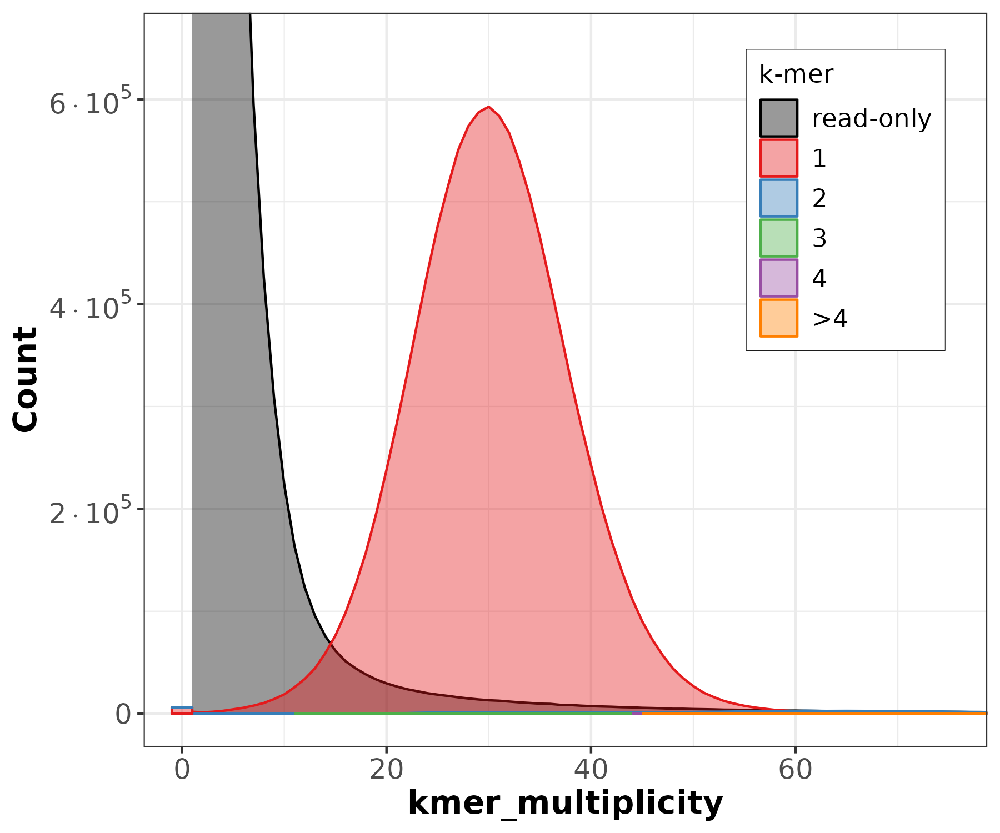

=== "Híbrida (Medaka + Illumina)"

    

- **Bruta → purgada:** a corcova **azul** sob o pico principal (falsas duplicações) **desaparece**. É a confirmação visual do que o purge_dups fez.
- **Purgada → Medaka → híbrida:** os gráficos ficam praticamente iguais. O polimento muda algumas centenas a milhares de bases em 12 Mb, pouco demais para aparecer nesta escala. Para medir o efeito do polimento, use o QV, e de preferência o QV com k-mers Illumina (11.3).

Os gráficos das outras montagens, em todas as versões, estão em [`outputs/merqury/spectra-cn/`](https://github.com/LGBIO-UFG/PRO-BIOINFO/tree/main/docs/cursos/nanopore/outputs/merqury/spectra-cn){ target=_blank }. No Flye e no NextDenovo, que quase não tinham falsas duplicações, as quatro versões são praticamente idênticas.

### 11.3 Qualidade das bases com k-mers Illumina (Merqury, só Scer1)

Os k-mers das reads Nanopore têm os mesmos vieses de erro das montagens feitas com elas: um erro sistemático do Nanopore (como os de homopolímeros) aparece tanto na montagem quanto na régua e não é contado. Os k-mers das reads Illumina são uma régua **independente** e mais confiável. Vamos medir as três versões de cada montagem da Scer1 com eles.

```bash
D=0.DadosBrutos/illumina
meryl k=21 memory=24 threads=24 count $D/Scer1_ilmn_40x_1.fq.gz $D/Scer1_ilmn_40x_2.fq.gz output 4.QC_dadosfiltrados/Scer1_ilmn.meryl

mkdir -p 8.QC_montagens/merqury_illumina && cd 8.QC_montagens/merqury_illumina
M=../../../4.QC_dadosfiltrados/Scer1_ilmn.meryl
PUR=../../../9.Montagens-purgadas
MED=../../../9.Polimento-Medaka
ILM=../../../9.Polimento-Illumina

# cada linha: define o nome (n), cria a pasta, entra nela, roda o Merqury e volta (como na 11.2)
# montagens brutas (os caminhos são diferentes para cada montador)
n=Scer1_q10_l500_Flye;       rm -rf $n; mkdir $n; cd $n; merqury.sh $M ../../../5.Montagem-Flye/Scer1_q10_l500/assembly.fasta $n; cd ..
n=Scer1_q10_l500_hifiasm;    rm -rf $n; mkdir $n; cd $n; merqury.sh $M ../../../6.Montagem-hifiasm/Scer1_q10_l500_hifiasm.p_ctg.fa $n; cd ..
n=Scer1_q10_l500_nextdenovo; rm -rf $n; mkdir $n; cd $n; merqury.sh $M ../../../7.Montagem-NextDenovo/Scer1_q10_l500/01_rundir/03.ctg_graph/nd.asm.fasta $n; cd ..

# versões purgada, Medaka e híbrida
n=Scer1_q10_l500_Flye_purgada;       rm -rf $n; mkdir $n; cd $n; merqury.sh $M $PUR/Scer1_q10_l500_Flye.fasta $n; cd ..
n=Scer1_q10_l500_Flye_medaka;        rm -rf $n; mkdir $n; cd $n; merqury.sh $M $MED/Scer1_q10_l500_Flye/consensus.fasta $n; cd ..
n=Scer1_q10_l500_Flye_hibrido;       rm -rf $n; mkdir $n; cd $n; merqury.sh $M $ILM/Scer1_q10_l500_Flye/$n.fasta $n; cd ..
n=Scer1_q10_l500_hifiasm_purgada;    rm -rf $n; mkdir $n; cd $n; merqury.sh $M $PUR/Scer1_q10_l500_hifiasm.fasta $n; cd ..
n=Scer1_q10_l500_hifiasm_medaka;     rm -rf $n; mkdir $n; cd $n; merqury.sh $M $MED/Scer1_q10_l500_hifiasm/consensus.fasta $n; cd ..
n=Scer1_q10_l500_hifiasm_hibrido;    rm -rf $n; mkdir $n; cd $n; merqury.sh $M $ILM/Scer1_q10_l500_hifiasm/$n.fasta $n; cd ..
n=Scer1_q10_l500_nextdenovo_purgada; rm -rf $n; mkdir $n; cd $n; merqury.sh $M $PUR/Scer1_q10_l500_nextdenovo.fasta $n; cd ..
n=Scer1_q10_l500_nextdenovo_medaka;  rm -rf $n; mkdir $n; cd $n; merqury.sh $M $MED/Scer1_q10_l500_nextdenovo/consensus.fasta $n; cd ..
n=Scer1_q10_l500_nextdenovo_hibrido; rm -rf $n; mkdir $n; cd $n; merqury.sh $M $ILM/Scer1_q10_l500_nextdenovo/$n.fasta $n; cd ..

# resumo
echo -e "Sample\tQV\tError_rate\tCompleteness" > merqury_illumina_summary.tsv
for s in Scer1_q10_l500_Flye Scer1_q10_l500_hifiasm Scer1_q10_l500_nextdenovo; do
  for prefix in $s ${s}_purgada ${s}_medaka ${s}_hibrido; do
    qv=$(awk 'END{print $4}' ${prefix}/${prefix}.qv 2>/dev/null)
    err=$(awk 'END{print $5}' ${prefix}/${prefix}.qv 2>/dev/null)
    comp=$(awk 'END{print $5}' ${prefix}/${prefix}.completeness.stats 2>/dev/null)
    echo -e "$prefix\t$qv\t$err\t$comp"
  done
done >> merqury_illumina_summary.tsv
column -t merqury_illumina_summary.tsv

cd ../..
```

??? info "O que faz cada comando"
    | Comando | O que faz |
    |---|---|
    | `meryl k=21 ... count <R1> <R2> output ...` | Conta os k-mers das reads Illumina (os dois arquivos do par juntos). |
    | `mkdir -p ... && cd ...` | Cria a pasta e entra nela (o `&&` só entra se a pasta foi criada). |
    | `M=` / `PUR=` / `MED=` / `ILM=` | Guardam os caminhos do banco Illumina e das pastas de cada versão. |
    | `n=...; rm -rf $n; mkdir $n; cd $n; merqury.sh ...; cd ..` | Cada linha avalia uma versão, como na Etapa 11.2, agora com os k-mers Illumina. |
    | `for s ...; for prefix in $s ${s}_purgada ...` | Monta a tabela-resumo: para cada montagem, percorre as quatro versões e lê QV, erro e completude. |
    | `column -t` + `cd ../..` | Mostra a tabela e volta para a pasta do projeto. |

Cada versão é avaliada numa pasta própria. Isso evita um problema do Merqury: ele guarda os k-mers de cada montagem num banco com o **nome do arquivo FASTA** (por exemplo, `consensus.meryl`) e reaproveita esse banco, sem avisar, se ele já existir na pasta. Como várias montagens têm o mesmo nome de arquivo (`consensus.fasta`), avaliá-las na mesma pasta faria a segunda receber o resultado da primeira.

??? note "Ver saída do comando (resumida)"

    ```bash
    $ meryl k=21 memory=24 threads=24 count 0.DadosBrutos/illumina/Scer1_ilmn_40x_1.fq.gz 0.DadosBrutos/illumina/Scer1_ilmn_40x_2.fq.gz output 4.QC_dadosfiltrados/Scer1_ilmn.meryl

    Found 1 command tree.

    Counting 1278 (estimated) million canonical 21-mers from 2 input files:
        sequence-file: 0.DadosBrutos/illumina/Scer1_ilmn_40x_1.fq.gz
        sequence-file: 0.DadosBrutos/illumina/Scer1_ilmn_40x_2.fq.gz
    (...)
    FINAL CONFIGURATION
    -------------------

    Estimated to require 4539 MB memory out of 24 GB allowed.
    Estimated to require 2 batches.
    (...)
    Input complete.  Writing results to '4.QC_dadosfiltrados/Scer1_ilmn.meryl', using 24 threads.
    finishIteration()--

    Finished counting.

    Cleaning up.

    Bye.

    $ merqury.sh $M ../../../5.Montagem-Flye/Scer1_q10_l500/assembly.fasta Scer1_q10_l500_Flye
    read: Scer1_ilmn.meryl

    No haplotype dbs provided.
    Running Merqury in non-trio mode...

    asm1: assembly.fasta
    out : Scer1_q10_l500_Flye

    Get spectra-cn plots and QV stats

    (... o mesmo para as outras versões ...)

    $ column -t merqury_illumina_summary.tsv
    Sample                             QV       Error_rate   Completeness
    Scer1_q10_l500_Flye                32.5739  0.000552852  99.3021
    Scer1_q10_l500_Flye_purgada        33.881   0.000409164  98.5443
    Scer1_q10_l500_Flye_medaka         34.9703  0.000318394  98.8318
    Scer1_q10_l500_Flye_hibrido        36.2018  0.000239785  98.9676
    Scer1_q10_l500_hifiasm             32.1296  0.000612401  99.2242
    Scer1_q10_l500_hifiasm_purgada     35.6488  0.000272346  98.52
    Scer1_q10_l500_hifiasm_medaka      38.6867  0.000135309  98.887
    Scer1_q10_l500_hifiasm_hibrido     41.2846  7.43949e-05  99.017
    Scer1_q10_l500_nextdenovo          32.0048  0.000630261  97.8113
    Scer1_q10_l500_nextdenovo_purgada  32.0963  0.000617116  97.7385
    Scer1_q10_l500_nextdenovo_medaka   33.9771  0.000400209  98.2778
    Scer1_q10_l500_nextdenovo_hibrido  35.4923  0.00028234   98.4936
    ```

!!! tip "Resultado pré-computado"
    [:material-file-document: merqury_illumina_summary.tsv](outputs/merqury/merqury_illumina_summary.tsv)

QV da Scer1 pelas duas réguas:

| Montagem | Régua | Bruta | Purgada | Medaka | Híbrido (Medaka + Illumina) |
|---|---|---|---|---|---|
| Flye | Nanopore (11.2) | 43,3 | 45,3 | 43,3 | 45,0 |
| | **Illumina** | **32,6** | **33,9** | **35,0** | **36,2** |
| Hifiasm | Nanopore (11.2) | 49,4 | 50,8 | 46,3 | 49,7 |
| | **Illumina** | **32,1** | **35,6** | **38,7** | **41,3** |
| NextDenovo | Nanopore (11.2) | 42,3 | 42,8 | 40,7 | 43,0 |
| | **Illumina** | **32,0** | **32,1** | **34,0** | **35,5** |

!!! tip "Como interpretar"
    - **Pela régua Illumina, cada passo melhorou as três montagens.** A remoção da mitocôndria e das duplicatas trouxe de +0,1 a +3,5 de QV, o Medaka mais +1,1 a +3,0, e o polimento com Illumina mais +1,2 a +2,6. Do começo ao fim, o Hifiasm foi de QV 32,1 para 41,3: a taxa de erro caiu de ~1 a cada 1.600 bases para ~1 a cada 13.000.
    - **Por que a purgada já melhora o QV?** O DNA mitocondrial é tão rico em AT (~17% de GC) que o Illumina o cobre mal, e os k-mers dos contigs mitocondriais parecem erros para esta régua. O ganho é maior no Hifiasm (+3,5), que tinha 49 contigs mitocondriais, e quase nulo no NextDenovo (+0,1), que não tinha nenhum.
    - **A completude cai um pouco na purgada e volta a subir com o polimento.** A queda (~0,8 ponto no Flye e no Hifiasm) é a mitocôndria: as reads Illumina também têm k-mers mitocondriais, que deixaram de estar na montagem. Depois, cada polimento devolve à montagem k-mers corretos que antes estavam com erro.
    - **As duas réguas discordam, e em sentidos opostos.** A régua Nanopore dizia que o Medaka piorava as montagens; a régua Illumina, que é independente dos erros do Nanopore, mostra que ele melhorou. A régua Nanopore estava punindo as correções, como discutimos na 11.2.
    - **A régua Nanopore também superestima a qualidade:** ela dá QV 42–51 para as montagens, contra 32–41 pela régua Illumina. Os erros sistemáticos do Nanopore estão tanto na montagem quanto nas reads, e por isso não são contados.
    - **A melhor montagem muda conforme a régua.** As três montagens brutas estavam empatadas pela régua Illumina (QV ~32). Depois de todas as etapas, o Hifiasm se destaca (41,3), seguido do Flye (36,2) e do NextDenovo (35,5).
    - **Lição geral:** avalie uma montagem com uma régua que não compartilhe os vieses dos dados usados para construí-la. Quando não há dados independentes (como na Scer2), o QV do Merqury com as próprias reads deve ser lido com cautela, principalmente para comparar versões antes e depois do polimento.


??? info "Onde estão os erros que sobram? (QV por contig)"
    O Merqury também calcula o QV de cada sequência (aqui, a montagem Flye híbrida), no arquivo `<saída>.<montagem>.qv`. Ordenando pelo número de k-mers com erro (2ª coluna), vemos onde eles se concentram:

    ```bash
    cd 8.QC_montagens/merqury_illumina/Scer1_q10_l500_Flye_hibrido
    sort -k2,2nr Scer1_q10_l500_Flye_hibrido.Scer1_q10_l500_Flye_hibrido.qv | head
    cd ../../..
    ```

    ```text
    contig_108_1    16888   32725   14.6889 0.033971
    contig_100_1    11110   1059905 32.9959 0.000501655
    contig_138_1    6940    8341    10.8914 0.0814438
    contig_123_1    5621    6386    10.1723 0.0961095
    contig_36_1     5161    5769    9.9308  0.101606
    contig_150_1    2397    139847  30.8463 0.000822935
    contig_12_1     2126    814232  39.0486 0.000124491
    contig_93_1     1879    913413  40.0853 9.80542e-05
    contig_10_1     1859    257809  34.6274 0.000344554
    contig_103_1    1480    754513  40.2922 9.34936e-05
    ```

    As colunas são: contig, k-mers com erro, tamanho, QV e taxa de erro.

    - **Quatro contigs pequenos** (`contig_108_1`, `contig_138_1`, `contig_123_1` e `contig_36_1`, com QV entre 10 e 15) somam só ~53 kb, ou 0,4% da montagem, mas concentram mais da metade dos k-mers com erro. Sem eles, o QV da montagem ficaria perto de 40.
    - **Nos cromossomos grandes, o QV fica entre 39 e 40** (`contig_12_1`, `contig_93_1`, `contig_103_1`).

    **O que são esses quatro contigs?** Não são mitocondriais, porque a mitocôndria já foi separada na Etapa 9.4. Para descobrir, medimos o GC deles e procuramos onde alinham na referência:

    ```bash
    conda activate polimento
    f=9.Polimento-Illumina/Scer1_q10_l500_Flye/Scer1_q10_l500_Flye_hibrido.fasta
    samtools faidx $f
    samtools faidx $f contig_108_1 contig_138_1 contig_123_1 contig_36_1 > pequenos.fa

    # tamanho e GC de cada um
    awk '/^>/{if(n) print id, n, sprintf("%.1f%%", 100*gc/n); id=substr($1,2); n=0; gc=0; next}
         {n+=length($0); gc+=gsub(/[GCgc]/,"")} END{print id, n, sprintf("%.1f%%", 100*gc/n)}' pequenos.fa

    # onde alinham na referência? (contig, tamanho, cromossomo, início, fim, bases idênticas, tamanho do alinhamento)
    minimap2 -x asm10 ncbi_dataset/data/GCF_000146045.2/GCF_000146045.2_R64_genomic.fna pequenos.fa \
      | cut -f1,2,6,8,9,10,11 | sort -k1,1 -k6,6nr
    conda deactivate
    ```

    ```text
    contig_108_1 32745 39.2%
    contig_138_1 8361 38.8%
    contig_123_1 6406 33.0%
    contig_36_1 5789 36.9%

    contig_108_1    32745   NC_001141.2     119     26093   14569   33152
    contig_108_1    32745   NC_001147.6     11551   30627   12575   19452
    contig_123_1    6406    NC_001142.9     197547  203767  6109    6220
    contig_123_1    6406    NC_001140.6     85562   91731   5513    6169
    contig_123_1    6406    NC_001148.4     436919  443109  5420    6191
    contig_123_1    6406    NC_001145.3     504794  504870  55      76
    contig_138_1    8361    NC_001141.2     37277   39169   1224    1892
    contig_138_1    8361    NC_001144.5     1064465 1072808 72      8343
    (... alinhamentos curtos omitidos ...)
    contig_36_1     5789    NC_001136.10    1523090 1523989 389     899
    contig_36_1     5789    NC_001133.9     1308    2087    331     780
    ```

    - **O GC é de levedura** (33–39%), então não é contaminação bacteriana.
    - **`contig_123_1` é um retrotransposon Ty.** Ele tem ~6 kb, o tamanho de um elemento Ty completo, e alinha quase inteiro em três cromossomos diferentes (X, VIII e XVI), justamente porque o genoma tem várias cópias desse elemento.
    - **Os outros três são de regiões subteloméricas**, as pontas dos cromossomos: o início dos cromossomos IX, XV e I e o final dos cromossomos XII e IV. Os alinhamentos são parciais e com muitas diferenças (no `contig_108_1`, só ~44% de bases idênticas). Essas regiões são cheias de repetições e mudam muito entre linhagens.

    **Por que o QV deles é tão baixo?** Para responder, alinhamos as reads Nanopore e as Illumina na montagem e contamos quantas caem em cada contig, com o `contig_12_1` (um cromossomo grande) como comparação. Contamos de duas formas: com todas as reads e só com as de MAPQ ≥ 1, as que o Medaka e o pypolca usam.

    ```bash
    conda activate polimento
    f=9.Polimento-Illumina/Scer1_q10_l500_Flye/Scer1_q10_l500_Flye_hibrido.fasta
    C=cobertura_pequenos
    D=0.DadosBrutos/illumina
    mkdir -p $C

    minimap2 -ax map-ont -t 24 $f 2.Filtragem-dadosbrutos/Scer1_q10_l500.fastq.gz | samtools sort -@ 8 -o $C/ont.bam
    samtools index $C/ont.bam
    bwa index -p $C/hib $f
    bwa mem -t 24 $C/hib $D/Scer1_ilmn_40x_1.fq.gz $D/Scer1_ilmn_40x_2.fq.gz | samtools sort -@ 8 -o $C/ilmn.bam
    samtools index $C/ilmn.bam

    for b in ont ilmn; do
      for q in 0 1; do
        echo "== $b, MAPQ >= $q  (contig, reads, % coberto, profundidade média, MAPQ médio)"
        samtools coverage -q $q $C/$b.bam | grep -wE 'contig_108_1|contig_138_1|contig_123_1|contig_36_1|contig_12_1' | cut -f1,4,6,7,9
      done
    done
    conda deactivate
    ```

    | Contig | Nanopore: profundidade (MAPQ médio) | Illumina: % coberto | Illumina: profundidade | Illumina com MAPQ ≥ 1: % coberto |
    |---|---|---|---|---|
    | `contig_12_1` (cromossomo) | 54× (56) | 99,6% | 31× | 98,1% |
    | `contig_123_1` (Ty) | 54× (54) | 3,9% | 0,06× | 0% |
    | `contig_108_1` | 28× (43) | 44,2% | 8,9× | 23,4% |
    | `contig_138_1` | 23× (59) | 14,4% | 1,2× | 0% |
    | `contig_36_1` | 16× (60) | 11,6% | 1,2× | 11,6% |

    - **As reads Nanopore cobrem os quatro contigs normalmente**, com profundidade parecida com a do genoma e MAPQ alto: são reads que alinham só ali, e não em outra cópia. Ou seja, são **sequências reais** da cultura sequenciada com Nanopore, e o Medaka teve reads para poli-las. Pelo mesmo motivo o purge_dups não as removeu: a cobertura delas está dentro dos limites normais (5–147×), e elas não se parecem com nenhum outro contig.
    - **As reads Illumina praticamente não existem nesses contigs.** Elas cobrem de 0% a 44% de cada um, contra 99,6% do cromossomo.
    - **O QV baixo, portanto, não é erro de base.** O Merqury conta como "erro" todo k-mer da montagem que não aparece nas reads usadas como régua. Uma sequência correta que simplesmente não existe nas reads Illumina recebe QV ~10. Pelo mesmo motivo, os polidores Illumina não tinham reads para corrigir nada ali.

    A explicação mais provável é a diferença entre as culturas. As reads Illumina e Nanopore vieram de culturas diferentes da mesma linhagem, sequenciadas com anos de diferença, e os elementos Ty e as regiões subteloméricas são justamente as partes mais variáveis do genoma da levedura: elementos Ty se movem e se perdem, e subtelômeros se rearranjam. Uma cópia de Ty ou um trecho subtelomérico presente em uma cultura pode faltar na outra. Contaminação cruzada com outra linhagem também produziria esse padrão, e com estes dados não dá para separar as duas hipóteses.

    **Lição:** quando o QV do Merqury "empaca", olhe o QV por contig antes de concluir que o polimento falhou. E lembre que o QV do Merqury mede a concordância com a régua: uma sequência ausente das reads usadas como régua aparece como erro, mesmo que esteja correta.

!!! question "Para pensar"
    - O Medaka melhorou as montagens pela régua Nanopore (11.2)? E pela régua Illumina (11.3)? As duas réguas concordam?
    - Quanto do ganho total veio do Medaka e quanto do polimento com Illumina?
    - A montagem com melhor QV mudou depois do polimento híbrido?
    - Por que um QV medido com k-mers das próprias reads Nanopore pode superestimar a qualidade de uma montagem Nanopore?

### 11.4 Versões que seguem no tutorial

Para a Scer1, a régua independente (k-mers Illumina) mostrou que o polimento melhorou as três montagens: seguiremos com as versões **híbridas** (purge_dups + Medaka + Illumina). Para a Scer2, não polimos com Illumina e, portanto, não temos como confirmar o efeito do Medaka. Pelo que vimos na Scer1, em que a régua Nanopore "puniu" correções que a régua Illumina confirmou, é provável que o Medaka também tenha melhorado a Scer2 (que, além disso, é R10.4.1, uma química mais precisa); seguiremos com as versões **Medaka**, lembrando que, com cobertura de ~6×, esse efeito não pôde ser verificado.

Primeiro, copiamos a versão escolhida de cada montagem para uma mesma pasta, com nomes padronizados:

```bash
# apaga versões anteriores (e índices .fai antigos, que ficariam desatualizados)
rm -rf 9.Montagens-polidas
mkdir -p 9.Montagens-polidas

# Scer1: purge_dups + Medaka + Illumina
cp 9.Polimento-Illumina/Scer1_q10_l500_Flye/Scer1_q10_l500_Flye_hibrido.fasta             9.Montagens-polidas/Scer1_q10_l500_Flye.fasta
cp 9.Polimento-Illumina/Scer1_q10_l500_hifiasm/Scer1_q10_l500_hifiasm_hibrido.fasta       9.Montagens-polidas/Scer1_q10_l500_hifiasm.fasta
cp 9.Polimento-Illumina/Scer1_q10_l500_nextdenovo/Scer1_q10_l500_nextdenovo_hibrido.fasta 9.Montagens-polidas/Scer1_q10_l500_nextdenovo.fasta

# Scer2: Medaka
cp 9.Polimento-Medaka/Scer2_q10_l500_Flye/consensus.fasta    9.Montagens-polidas/Scer2_q10_l500_Flye.fasta
cp 9.Polimento-Medaka/Scer2_q10_l500_hifiasm/consensus.fasta 9.Montagens-polidas/Scer2_q10_l500_hifiasm.fasta

ls -lh 9.Montagens-polidas/
```

??? info "O que faz cada comando"
    | Comando | O que faz |
    |---|---|
    | `rm -rf` + `mkdir -p 9.Montagens-polidas` | Apaga a pasta antiga (e os índices `.fai` desatualizados) e cria de novo. |
    | `cp <versão escolhida> 9.Montagens-polidas/<nome>.fasta` | Copia a versão que segue no tutorial com um nome padronizado: híbrida na Scer1, Medaka na Scer2. |
    | `ls -lh` | Lista os arquivos e os tamanhos. |

??? example "Saída: ls 9.Montagens-polidas"

    ```text
    total 44M
    -rw-rw-r--+ 1 renata renata  12M nov 19 10:38 Scer1_q10_l500_Flye.fasta
    -rw-rw-r--+ 1 renata renata  12M nov 19 10:38 Scer1_q10_l500_hifiasm.fasta
    -rw-rw-r--+ 1 renata renata  12M nov 19 10:38 Scer1_q10_l500_nextdenovo.fasta
    -rw-rw-r--+ 1 renata renata 7,9M nov 19 10:38 Scer2_q10_l500_Flye.fasta
    -rw-rw-r--+ 1 renata renata  85K nov 19 10:38 Scer2_q10_l500_hifiasm.fasta
    ```

A partir daqui, todas as etapas usam os arquivos de `9.Montagens-polidas/` (só a parte nuclear, já que a mitocôndria foi separada na Etapa 9.4).

### Checklist da Etapa 11

- [ ] QUAST com as versões bruta, Medaka e híbrida de cada montagem
- [ ] Merqury (k-mers Nanopore) para as versões polidas de todas as montagens
- [ ] Merqury (k-mers Illumina) para as três versões das montagens da Scer1
- [ ] Copiei a versão escolhida de cada montagem para `9.Montagens-polidas/`

---

## :material-numeric-9-plus-circle: Etapa 12 — Scaffolding :material-flask-outline: *(opcional)*

### 12.1 - Scaffolding com referência

Nesse caso, como temos um genoma de referência da própria espécie, vamos testar utilizar o RagTag para o scaffolding das montagens polidas, só com a parte nuclear (Etapas 9.4 e 11.4)


```bash
mkdir -p 10.Scaffolding
REF=ncbi_dataset/data/GCF_000146045.2/GCF_000146045.2_R64_genomic.fna

# uma linha por montagem. Para rodar de novo, apague antes a pasta de saída (rm -rf 10.Scaffolding/<montagem>):
# o RagTag reaproveita o alinhamento (.paf) que encontrar na pasta
ragtag.py scaffold $REF 9.Montagens-polidas/Scer1_q10_l500_Flye.fasta       -o 10.Scaffolding/Scer1_q10_l500_Flye       -t 24
ragtag.py scaffold $REF 9.Montagens-polidas/Scer2_q10_l500_Flye.fasta       -o 10.Scaffolding/Scer2_q10_l500_Flye       -t 24
ragtag.py scaffold $REF 9.Montagens-polidas/Scer1_q10_l500_hifiasm.fasta    -o 10.Scaffolding/Scer1_q10_l500_hifiasm    -t 24
ragtag.py scaffold $REF 9.Montagens-polidas/Scer2_q10_l500_hifiasm.fasta    -o 10.Scaffolding/Scer2_q10_l500_hifiasm    -t 24
ragtag.py scaffold $REF 9.Montagens-polidas/Scer1_q10_l500_nextdenovo.fasta -o 10.Scaffolding/Scer1_q10_l500_nextdenovo -t 24
```

??? info "O que faz cada comando"
    | Comando | O que faz |
    |---|---|
    | `mkdir -p` + `REF=...` | Cria a pasta e guarda o caminho da referência. |
    | `ragtag.py scaffold $REF <montagem>` | Alinha os contigs na referência e os ordena e orienta em scaffolds, um por cromossomo. |
    | `-o` / `-t 24` | Pasta de saída e número de processadores. |

??? note "Ver saída do comando (resumida)"

    ```bash
    Thu Nov 19 10:50:15 2026 --- VERSION: RagTag v2.1.0
    Thu Nov 19 10:50:15 2026 --- CMD: ragtag.py scaffold ncbi_dataset/data/GCF_000146045.2/GCF_000146045.2_R64_genomic.fna 9.Montagens-polidas/Scer1_q10_l500_Flye.fasta -o 10.Scaffolding/Scer1_q10_l500_Flye -t 24
    Thu Nov 19 10:50:15 2026 --- WARNING: Without '-u' invoked, some component/object AGP pairs might share the same ID. Some external programs/databases don't like this. To ensure valid AGP format, use '-u'.
    Thu Nov 19 10:50:15 2026 --- INFO: Mapping the query genome to the reference genome
    Thu Nov 19 10:50:15 2026 --- INFO: Running: minimap2 -x asm5 -t 24 ncbi_dataset/data/GCF_000146045.2/GCF_000146045.2_R64_genomic.fna 9.Montagens-polidas/Scer1_q10_l500_Flye.fasta > 10.Scaffolding/Scer1_q10_l500_Flye/ragtag.scaffold.asm.paf 2> 10.Scaffolding/Scer1_q10_l500_Flye/ragtag.scaffold.asm.paf.log
    Thu Nov 19 10:50:17 2026 --- INFO: Finished running : minimap2 -x asm5 (...)
    Thu Nov 19 10:50:17 2026 --- INFO: Reading whole genome alignments
    Thu Nov 19 10:50:17 2026 --- INFO: Filtering and merging alignments
    Thu Nov 19 10:50:17 2026 --- INFO: Ordering and orienting query sequences
    Thu Nov 19 10:50:17 2026 --- INFO: Writing scaffolds
    Thu Nov 19 10:50:17 2026 --- INFO: Writing: 10.Scaffolding/Scer1_q10_l500_Flye/ragtag.scaffold.agp
    Thu Nov 19 10:50:17 2026 --- INFO: Running: ragtag_agp2fa.py 10.Scaffolding/Scer1_q10_l500_Flye/ragtag.scaffold.agp 9.Montagens-polidas/Scer1_q10_l500_Flye.fasta > 10.Scaffolding/Scer1_q10_l500_Flye/ragtag.scaffold.fasta 2> 10.Scaffolding/Scer1_q10_l500_Flye/ragtag.scaffold.err
    Thu Nov 19 10:50:17 2026 --- INFO: Finished running : ragtag_agp2fa.py (...)
    Thu Nov 19 10:50:17 2026 --- INFO: Running: ragtag_stats.py 10.Scaffolding/Scer1_q10_l500_Flye/ragtag.scaffold.agp 10.Scaffolding/Scer1_q10_l500_Flye/ragtag.scaffold.confidence.txt > 10.Scaffolding/Scer1_q10_l500_Flye/ragtag.scaffold.stats 2> 10.Scaffolding/Scer1_q10_l500_Flye/ragtag.scaffold.err
    Thu Nov 19 10:50:17 2026 --- INFO: Finished running : ragtag_stats.py (...)
    Thu Nov 19 10:50:17 2026 --- INFO: Goodbye

    (... o mesmo para Scer2_q10_l500_Flye, Scer1_q10_l500_hifiasm, Scer2_q10_l500_hifiasm e Scer1_q10_l500_nextdenovo ...)
    ```

    O RagTag roda em poucos segundos por montagem: ele alinha os contigs contra a referência com o minimap2 (`-x asm5`, para sequências muito parecidas), decide a ordem e a orientação de cada contig e escreve os scaffolds (`ragtag.scaffold.fasta`) e a descrição de como foram montados (`ragtag.scaffold.agp`). O *WARNING* sobre `-u` não é um erro: ele só avisa que, sem essa opção, alguns nomes no arquivo AGP podem se repetir, o que incomoda alguns programas externos.

**Analisar os resultados**
```bash
for prefix in Scer1_q10_l500_Flye Scer2_q10_l500_Flye Scer1_q10_l500_hifiasm Scer2_q10_l500_hifiasm Scer1_q10_l500_nextdenovo; do
  echo "=== $prefix ==="
  cat 10.Scaffolding/${prefix}/ragtag.scaffold.stats
  echo
done
```

??? info "O que faz cada comando"
    | Comando | O que faz |
    |---|---|
    | `for prefix ...; cat .../ragtag.scaffold.stats` | Mostra, para cada montagem, quantos contigs e bases o RagTag conseguiu posicionar. |

??? note "Ver saída do comando"

    ```bash
    === Scer1_q10_l500_Flye ===
    placed_sequences	placed_bp	unplaced_sequences	unplaced_bp	gap_bp	gap_sequences
    28	11918716	9	52435	1100	11

    === Scer2_q10_l500_Flye ===
    placed_sequences	placed_bp	unplaced_sequences	unplaced_bp	gap_bp	gap_sequences
    684	8161366	22	90827	66800	668

    === Scer1_q10_l500_hifiasm ===
    placed_sequences	placed_bp	unplaced_sequences	unplaced_bp	gap_bp	gap_sequences
    23	12154698	1	12600	600	6

    === Scer2_q10_l500_hifiasm ===
    placed_sequences	placed_bp	unplaced_sequences	unplaced_bp	gap_bp	gap_sequences
    11	63845	2	22901	300	3

    === Scer1_q10_l500_nextdenovo ===
    placed_sequences	placed_bp	unplaced_sequences	unplaced_bp	gap_bp	gap_sequences
    23	11978592	1	37404	700	7
    ```

| Montagem | Contigs | Posicionados (placed) | pb posicionados | Não posicionados (unplaced) | pb não posicionados | Lacunas (gaps) |
|---|---|---|---|---|---|---|
| Scer1 Flye | 37 | 28 | 11.918.716 | 9 | 52.435 | 11 |
| Scer1 Hifiasm | 24 | 23 | 12.154.698 | 1 | 12.600 | 6 |
| Scer1 NextDenovo | 24 | 23 | 11.978.592 | 1 | 37.404 | 7 |
| Scer2 Flye | 706 | 684 | 8.161.366 | 22 | 90.827 | 668 |
| Scer2 Hifiasm | 13 | 11 | 63.845 | 2 | 22.901 | 3 |

!!! tip "Como interpretar"
    - **Placed** são os contigs que o RagTag conseguiu ordenar e orientar ao longo de um cromossomo da referência; **unplaced** são os que ele não conseguiu posicionar com confiança (ficam como sequências soltas no FASTA final). Cada **gap** é uma junção entre dois contigs, preenchida com 100 `N`.
    - **Nas três montagens da Scer1, praticamente todo o genoma foi posicionado** nos 16 cromossomos nucleares da referência: sobram só 13 a 52 kb como *unplaced*. No Flye, são 9 contigs pequenos, provavelmente incluindo parte dos contigs de Ty e subteloméricos que discutimos no QV por contig (Etapa 11.3): sequências repetitivas, que alinham em vários lugares da referência, são difíceis de posicionar.
    - **O purge_dups fez diferença aqui.** Sem ele, o Hifiasm deixava ~770 kb sem posição, em 63 contigs: eram as cópias duplicadas, e como a referência só tem uma cópia de cada região, o RagTag não tinha onde colocar a segunda. Na versão purgada, sobra um único contig de 12,6 kb.
    - **Poucas junções bastam para chegar aos cromossomos:** 6 a 11 lacunas no total. As montagens da Scer1 já eram quase cromossômicas antes do scaffolding.
    - **Scer2 Flye:** quase todos os 706 contigs foram posicionados, mas com 668 lacunas. O resultado parece um genoma "completo", mas é uma colcha de retalhos: a ordem dos pedaços vem da referência, e não dos dados da Scer2. Com cobertura de ~6×, o scaffolding por referência só esconde a fragmentação.
    - **Scer2 Hifiasm:** a montagem tem só ~87 kb (sem a mitocôndria); não há o que escafolear.
    - **Cuidado:** o scaffolding por referência assume que a sua linhagem tem a mesma organização cromossômica da referência (S288C). Rearranjos reais da linhagem estudada são "corrigidos" para a ordem da referência e deixam de ser visíveis. Por isso, na próxima seção, compararemos com um scaffolding que não usa referência.

!!! tip "Scaffolds RagTag disponíveis no repositório"
    [:material-dna: Scer1_Flye_ragtag_scaffold.fasta](https://github.com/LGBIO-UFG/PRO-BIOINFO/blob/main/data/exemplos/nanopore/assemblies/Scer1_Flye_ragtag_scaffold.fasta) ·
    [:material-dna: Scer2_Flye_ragtag_scaffold.fasta](https://github.com/LGBIO-UFG/PRO-BIOINFO/blob/main/data/exemplos/nanopore/assemblies/Scer2_Flye_ragtag_scaffold.fasta) ·
    [:material-dna: Scer1_Hifiasm_ragtag_scaffold.fasta](https://github.com/LGBIO-UFG/PRO-BIOINFO/blob/main/data/exemplos/nanopore/assemblies/Scer1_Hifiasm_ragtag_scaffold.fasta)

### 12.2 Scaffolding sem a referência:

```bash
mkdir -p 10.Scaffolding-Longstitch
BASE=$(pwd)

# montagem a processar: troque as duas linhas e rode o bloco de novo para cada montagem
prefix=Scer1_q10_l500_Flye
sample=Scer1
#   Scer2_q10_l500_Flye        Scer2
#   Scer1_q10_l500_hifiasm     Scer1
#   Scer2_q10_l500_hifiasm     Scer2
#   Scer1_q10_l500_nextdenovo  Scer1

# apaga resultados anteriores: o LongStitch (make) pula etapas cujos arquivos já existem
rm -rf 10.Scaffolding-Longstitch/${prefix}
mkdir -p 10.Scaffolding-Longstitch/${prefix}
cd 10.Scaffolding-Longstitch/${prefix}
ln -sf ${BASE}/9.Montagens-polidas/${prefix}.fasta draft.fa
ln -sf ${BASE}/2.Filtragem-dadosbrutos/${sample}_q10_l500.fastq.gz ${sample}_q10_l500.fastq.gz
longstitch run \
  draft=draft \
  reads=${sample}_q10_l500 \
  G=12000000 t=24 2>&1 | tee -a ../longstitch.log    # o log de todas as montagens fica em 10.Scaffolding-Longstitch/
cd ${BASE}
```

??? info "O que faz cada comando"
    | Comando | O que faz |
    |---|---|
    | `BASE=$(pwd)` | Guarda o caminho da pasta do projeto, para voltar depois e montar caminhos completos. |
    | `prefix=` / `sample=` | Montagem e amostra a processar. Troque e rode de novo para as outras (combinações no comentário). |
    | `rm -rf` + `mkdir -p` + `cd` | Apaga resultados anteriores, cria a pasta da montagem e entra nela. |
    | `ln -sf <arquivo> <nome>` | Cria um atalho (*link* simbólico) com o nome que o LongStitch espera, sem copiar o arquivo: `draft.fa` para a montagem e `<amostra>_q10_l500.fastq.gz` para as reads. |
    | `longstitch run draft=draft reads=...` | Corrige erros de montagem (Tigmint) e une contigs (ntLink) usando as reads longas. Os nomes vão sem a extensão. |
    | `G=12000000 t=24` | Tamanho do genoma e número de processadores. |
    | `2>&1 | tee -a ../longstitch.log` | Mostra a saída na tela e acrescenta ao log comum de todas as montagens. |
    | `cd ${BASE}` | Volta para a pasta do projeto. |

A saída do LongStitch é muito longa e passa do limite de rolagem do terminal. O `2>&1 | tee` grava tudo em `10.Scaffolding-Longstitch/longstitch.log`, para consultar depois (por exemplo, `grep -E 'Attempted corrections|Optimal n' 10.Scaffolding-Longstitch/longstitch.log`).

??? note "Ver exemplo de saída do comando (Scer1 NextDenovo, resumida)"

    ```bash
    tigmint-make tigmint-long draft=draft reads=Scer1_q10_l500 cut=250 t=24 G=12000000 span=auto dist=auto longmap=ont
    samtools faidx draft.fa
    /usr/local/bin/miniconda/miniconda3/envs/longstitch/bin/share/tigmint-1.2.10-4/bin/tigmint_estimate_dist.py Scer1_q10_l500.fastq.gz -n 1000000 -o Scer1_q10_l500.tigmint-long.params.tsv
    (...)
    long-to-linked-pe v1.2.10: Using more than 6 threads does not scale, reverting to 6.
    [M::main::0.885*1.01] loaded/built the index for 24 target sequence(s)
    [M::mm_idx_stat::0.970*1.01] distinct minimizers: 2069979 (95.79% are singletons); average occurrences: 1.088; average spacing: 5.335; total length: 12015996
    [M::worker_pipeline::54.700*2.99] mapped 2046130 sequences
    [M::worker_pipeline::60.655*2.72] mapped 915664 sequences
    [M::main] Real time: 60.701 sec; CPU: 164.990 sec; Peak RSS: 1.408 GB
    /usr/local/bin/miniconda/miniconda3/envs/longstitch/bin/share/tigmint-1.2.10-4/bin/tigmint-cut -p24 -w1000 -t0 -m3000 -f Scer1_q10_l500.tigmint-long.params.tsv -o draft.Scer1_q10_l500.cut250.molecule.size2000.distauto.trim0.window1000.spanauto.breaktigs.fa (...)
    Started at: 2026-11-19 11:01:25.231099
    Reading contig lengths...
    Finding breakpoints...
    Attempted corrections: 57
    Cutting assembly at breakpoints...
    DONE!
    Ended at: 2026-11-19 11:01:35.337145

    ntLink scaffold target=draft.cut250.tigmint.fa reads="Scer1_q10_l500.fastq.gz" t=24 k=32 w=100 z=1000 n=2 a=1 conservative=True
    indexlr 1.7.8: Using more than 5 threads does not scale, reverting to 5.
    Running pairing stage of ntLink ...
    2026-11-19 11:01:37.115217 : Reading minimizers draft.cut250.tigmint.fa
    2026-11-19 11:01:38.101648 : Finding pairs
    2026-11-19 11:03:09.677501 : Building scaffold graph
    2026-11-19 11:03:09.679199 : Printing graph draft.cut250.tigmint.fa.k32.w100.z1000.n2.scaffold.dot
    2026-11-19 11:03:09.681190 : DONE!
    (... abyss-scaffold testado com n = 2 a 10 ...)
    Running ntLink stitch paths stage...
    2026-11-19 11:03:14.833662  : Finding optimal n...
    2026-11-19 11:03:14.834125  : Optimal n = 2 at N50 = 912835.0
    Printing paths for optimal N50, no stitching...
    Total number of components in graph: 24
    Assessing putative overlaps...
    2026-11-19 11:03:18.663270 : DONE!
    MergeContigs -k2 draft.cut250.tigmint.fa.k32.w100.z1000.trimmed_scafs.fa draft.cut250.tigmint.fa.k32.w100.z1000.trimmed_scafs.path > draft.cut250.tigmint.fa.k32.w100.z1000.stitch.abyss-scaffold.fa
    Done ntLink! Final post-ntLink scaffolds can be found in: draft.cut250.tigmint.fa.k32.w100.z1000.ntLink.scaffolds.fa
    Done LongStitch steps Tigmint-long and ntLink! Scaffolds can be found in: draft.k32.w100.tigmint-ntLink.longstitch-scaffolds.fa
    ```

    Os avisos *"Using more than 6 threads does not scale"* e *"Using more than 5 threads does not scale"* só informam que essas etapas usam no máximo 5 ou 6 threads, mesmo pedindo 24; não são erros. Três linhas resumem o que aconteceu:

    - **`Attempted corrections: 57`**: o Tigmint encontrou 57 pontos onde as reads longas não sustentam a continuidade do contig e **cortou** a montagem nesses pontos.
    - **`Optimal n = 2 at N50 = 912835.0`**: o ntLink testou de 2 a 10 o número mínimo de reads exigido para ligar dois contigs (`n`) e escolheu o valor que deu o maior N50.
    - **`Done LongStitch steps ...`**: os scaffolds finais estão em `draft.k32.w100.tigmint-ntLink.longstitch-scaffolds.fa`.

    Em outras montagens, os números mudam: na Scer1 Hifiasm foram 29 cortes (n ótimo = 6, N50 = 600.849), e na Scer2 Hifiasm, nenhum corte e nenhuma junção, já que a montagem é minúscula.

**Resumo do LongStitch para as cinco montagens**, a partir do log:

```bash
grep -E 'tigmint-make|Attempted corrections|Optimal n|Done LongStitch' 10.Scaffolding-Longstitch/longstitch.log
```

??? info "O que faz cada comando"
    | Comando | O que faz |
    |---|---|
    | `grep -E '...' longstitch.log` | Mostra só as linhas importantes do log: início do Tigmint, número de correções, parâmetro escolhido e fim de cada rodada. |

??? note "Ver saída do comando"

    ```bash
    # na ordem do laço: Scer1 Flye, Scer2 Flye, Scer1 Hifiasm, Scer2 Hifiasm, Scer1 NextDenovo
    tigmint-make tigmint-long draft=draft reads=Scer1_q10_l500 cut=250 t=24 G=12000000 span=auto dist=auto longmap=ont
    Attempted corrections: 29
    2026-11-19 10:55:53.010262  : Optimal n = 2 at N50 = 746925.0
    echo "Done LongStitch steps Tigmint-long and ntLink! Scaffolds can be found in: draft.k32.w100.tigmint-ntLink.longstitch-scaffolds.fa"
    Done LongStitch steps Tigmint-long and ntLink! Scaffolds can be found in: draft.k32.w100.tigmint-ntLink.longstitch-scaffolds.fa
    tigmint-make tigmint-long draft=draft reads=Scer2_q10_l500 cut=250 t=24 G=12000000 span=auto dist=auto longmap=ont
    Attempted corrections: 3
    2026-11-19 10:56:19.795264  : Optimal n = 2 at N50 = 19450.0
    echo "Done LongStitch steps Tigmint-long and ntLink! Scaffolds can be found in: draft.k32.w100.tigmint-ntLink.longstitch-scaffolds.fa"
    Done LongStitch steps Tigmint-long and ntLink! Scaffolds can be found in: draft.k32.w100.tigmint-ntLink.longstitch-scaffolds.fa
    tigmint-make tigmint-long draft=draft reads=Scer1_q10_l500 cut=250 t=24 G=12000000 span=auto dist=auto longmap=ont
    Attempted corrections: 29
    2026-11-19 10:59:44.681608  : Optimal n = 6 at N50 = 600849.0
    echo "Done LongStitch steps Tigmint-long and ntLink! Scaffolds can be found in: draft.k32.w100.tigmint-ntLink.longstitch-scaffolds.fa"
    Done LongStitch steps Tigmint-long and ntLink! Scaffolds can be found in: draft.k32.w100.tigmint-ntLink.longstitch-scaffolds.fa
    tigmint-make tigmint-long draft=draft reads=Scer2_q10_l500 cut=250 t=24 G=12000000 span=auto dist=auto longmap=ont
    Attempted corrections: 0
    2026-11-19 11:00:02.947255  : Optimal n = 2 at N50 = 7329.0
    echo "Done LongStitch steps Tigmint-long and ntLink! Scaffolds can be found in: draft.k32.w100.tigmint-ntLink.longstitch-scaffolds.fa"
    Done LongStitch steps Tigmint-long and ntLink! Scaffolds can be found in: draft.k32.w100.tigmint-ntLink.longstitch-scaffolds.fa
    tigmint-make tigmint-long draft=draft reads=Scer1_q10_l500 cut=250 t=24 G=12000000 span=auto dist=auto longmap=ont
    Attempted corrections: 57
    2026-11-19 11:03:14.834125  : Optimal n = 2 at N50 = 912835.0
    echo "Done LongStitch steps Tigmint-long and ntLink! Scaffolds can be found in: draft.k32.w100.tigmint-ntLink.longstitch-scaffolds.fa"
    Done LongStitch steps Tigmint-long and ntLink! Scaffolds can be found in: draft.k32.w100.tigmint-ntLink.longstitch-scaffolds.fa
    ```

| Montagem | Cortes do Tigmint | n ótimo (ntLink) | N50 antes (QUAST, 11.1) | N50 depois do LongStitch |
|---|---|---|---|---|
| Scer1 Flye | 29 | 2 | 754.533 | 746.925 |
| Scer1 Hifiasm | 29 | 6 | 723.225 | 600.849 |
| Scer1 NextDenovo | 57 | 2 | 766.906 | 912.835 |
| Scer2 Flye | 3 | 2 | 15.859 | 19.450 |
| Scer2 Hifiasm | 0 | 2 | 7.329 | 7.329 |

O "N50 antes" é o das versões que entraram no LongStitch: as híbridas da Scer1 e as Medaka da Scer2 (tabela da Etapa 11.1).

!!! tip "Como interpretar"
    - **O LongStitch nem sempre aumenta o N50.** No Flye, o N50 praticamente não mudou (755 → 747 kb); no Hifiasm, **caiu** (723 → 601 kb): o Tigmint cortou os contigs em 29 pontos, e o ntLink não conseguiu religar todos os pedaços. No NextDenovo, ao contrário, o ntLink juntou mais do que o Tigmint cortou, e o N50 subiu de 767 kb para 913 kb.
    - **Cortar pode ser bom.** Um corte do Tigmint indica um ponto onde as reads longas não sustentam a continuidade do contig: pode ser uma junção errada do montador (*misassembly*). Um N50 menor com menos junções erradas é uma montagem **melhor**, não pior. Investigamos alguns desses cortes na seção 12.4.
    - **Menos cortes que na versão sem purge_dups.** Antes da remoção da mitocôndria e das duplicatas, o Tigmint cortava o Flye em 38 pontos e o Hifiasm em 52. Uma explicação provável: com cópias redundantes na montagem, as reads de uma região se dividem entre as cópias, e cada cópia parece ter "poucas reads" sustentando a continuidade.
    - **Na Scer2 Flye, o ganho é pequeno** (16 → 19 kb): com ~6× de cobertura, há poucas reads ligando os contigs. Na Scer2 Hifiasm, não houve cortes nem junções.
    - Compare com o RagTag (12.1): lá, quase todo o genoma foi posicionado nos cromossomos, porque a ordem veio da referência. O LongStitch só usa as reads da própria amostra, então só junta o que as reads realmente sustentam.

!!! info "Como o LongStitch funciona"
    O LongStitch encadeia três passos: **Tigmint-long** (quebra contigs em pontos de evidência conflitante, corrigindo misassemblies), **ntLink** (encontra pares de contigs conectados por reads) e **abyss-scaffold** (monta o grafo final de scaffolds). O output principal é `draft.k32.w100.tigmint-ntLink.longstitch-scaffolds.fa`, dentro de cada `10.Scaffolding-Longstitch/<prefix>/`.

!!! tip "Scaffolds LongStitch disponíveis no repositório"
    [:material-dna: Scer1_Flye_longstitch_scaffold.fasta](https://github.com/LGBIO-UFG/PRO-BIOINFO/blob/main/data/exemplos/nanopore/assemblies/Scer1_Flye_longstitch_scaffold.fasta) ·
    [:material-dna: Scer2_Flye_longstitch_scaffold.fasta](https://github.com/LGBIO-UFG/PRO-BIOINFO/blob/main/data/exemplos/nanopore/assemblies/Scer2_Flye_longstitch_scaffold.fasta)

### 12.3 Comparar os resultados dos scaffoldings

```bash
echo -e "Sample\tContigs_assembler\tScaffolds_longstitch\tRagtag_placed\tRagtag_placed_bp\tRagtag_unplaced" > scaffolding_summary.tsv

for prefix in Scer1_q10_l500_Flye Scer1_q10_l500_hifiasm Scer1_q10_l500_nextdenovo Scer2_q10_l500_Flye Scer2_q10_l500_hifiasm; do
  pre=$(grep -c "^>" 9.Montagens-polidas/${prefix}.fasta 2>/dev/null)

  longstitch=$(grep -c "^>" 10.Scaffolding-Longstitch/${prefix}/draft.k32.w100.tigmint-ntLink.longstitch-scaffolds.fa 2>/dev/null)
  ragtag_placed=$(awk 'NR==2{print $1}' 10.Scaffolding/${prefix}/ragtag.scaffold.stats 2>/dev/null)
  ragtag_bp=$(awk 'NR==2{print $2}' 10.Scaffolding/${prefix}/ragtag.scaffold.stats 2>/dev/null)
  ragtag_unplaced=$(awk 'NR==2{print $3}' 10.Scaffolding/${prefix}/ragtag.scaffold.stats 2>/dev/null)

  echo -e "$prefix\t$pre\t$longstitch\t$ragtag_placed\t$ragtag_bp\t$ragtag_unplaced"
done >> scaffolding_summary.tsv

cat scaffolding_summary.tsv
```

??? info "O que faz cada comando"
    | Comando | O que faz |
    |---|---|
    | `echo -e "..." > scaffolding_summary.tsv` | Cria a tabela com o cabeçalho. |
    | `grep -c "^>" <fasta>` | Conta as sequências do arquivo: contigs antes do scaffolding e scaffolds do LongStitch. |
    | `awk 'NR==2{print $1}' ragtag.scaffold.stats` | Lê a segunda linha das estatísticas do RagTag: contigs posicionados (`$1`), bases posicionadas (`$2`) e contigs não posicionados (`$3`). |
    | `done >> ...` + `cat` | Acrescenta uma linha por montagem e mostra a tabela. |

??? note "Ver saída do comando"

    ```bash
    $ cat scaffolding_summary.tsv
    Sample	Contigs_assembler	Scaffolds_longstitch	Ragtag_placed	Ragtag_placed_bp	Ragtag_unplaced
    Scer1_q10_l500_Flye	37	75	28	11918716	9
    Scer1_q10_l500_hifiasm	24	71	23	12154698	1
    Scer1_q10_l500_nextdenovo	24	112	23	11978592	1
    Scer2_q10_l500_Flye	706	614	684	8161366	22
    Scer2_q10_l500_hifiasm	13	13	11	63845	2
    ```

| Montagem | Contigs (montagem polida) | Scaffolds LongStitch | RagTag: posicionados | RagTag: não posicionados |
|---|---|---|---|---|
| Scer1 Flye | 37 | 75 | 28 | 9 |
| Scer1 Hifiasm | 24 | 71 | 23 | 1 |
| Scer1 NextDenovo | 24 | 112 | 23 | 1 |
| Scer2 Flye | 706 | 614 | 684 | 22 |
| Scer2 Hifiasm | 13 | 13 | 11 | 2 |

!!! question "Por que o LongStitch aumentou o número de sequências na Scer1?"
    Nas três montagens da Scer1, o LongStitch terminou com **mais** sequências do que a montagem de entrada (37 → 75, 24 → 71, 24 → 112). Scaffolding deveria juntar contigs, e não multiplicá-los. A explicação está nos cortes do Tigmint (12.2): cada corte transforma um contig em dois ou mais pedaços, e o ntLink só religa os pedaços quando há reads suficientes ligando um ao outro. Os que sobram ficam como sequências separadas.

    Isso aconteceu até no NextDenovo, cujo N50 **subiu** (de 767 kb para 913 kb): o ntLink juntou bem os contigs grandes, mas sobraram muitos fragmentos pequenos dos 57 cortes. Por isso, número de sequências e N50 contam histórias diferentes e precisam ser lidos juntos.

    Já na Scer2 Flye, com só 3 cortes, o efeito de juntar predominou: de 706 para 614 sequências. A seção 12.4 mostra como investigar o que aconteceu num dos contigs mais cortados.

### 12.4 Verificar o que houve para que aumentasse tanto o número de scaffolds (OPCIONAL)

```bash
# 0) defina o alvo
PREFIX=Scer1_q10_l500_Flye
cd 10.Scaffolding-Longstitch/${PREFIX}

# 1) quais contigs mais quebraram no tigmint?
awk '{split($4,a,"-"); print a[1]}' draft.*breaktigs.fa.bed | sort | uniq -c | sort -rn | head -5

# 2) extrai o contig mais suspeito (troque pelo nome que apareceu acima)
CONTIG=contig_108_1
samtools faidx draft.fa ${CONTIG} > ${CONTIG}.fa

# 3) blast local contra a referência inteira (16 cromossomos)
blastn -query ${CONTIG}.fa \
  -subject ../../ncbi_dataset/data/GCF_000146045.2/GCF_000146045.2_R64_genomic.fna \
  -outfmt "6 sseqid pident length qstart qend evalue bitscore" \
  -max_target_seqs 10 | LC_ALL=C sort -k7,7gr | head -20

# 4) o que o RagTag decidiu fazer com esse mesmo contig?
grep -w "${CONTIG}" ../../10.Scaffolding/${PREFIX}/ragtag.scaffold.agp

cd ../..

```

??? info "O que faz cada comando"
    | Comando | O que faz |
    |---|---|
    | `PREFIX=` + `cd` | Montagem a investigar; entra na pasta dela no LongStitch. |
    | `awk '{split($4,a,"-"); print a[1]}' ... | sort | uniq -c | sort -rn | head -5` | Lê os pontos de quebra do Tigmint, tira o sufixo de cada pedaço para ficar com o nome do contig original, conta quantas quebras cada contig teve e mostra os 5 com mais quebras. |
    | `CONTIG=` + `samtools faidx draft.fa ${CONTIG}` | Extrai a sequência do contig suspeito. |
    | `blastn -query <contig> -subject <referência>` | Compara o contig com a referência inteira, sem precisar de um banco BLAST (`-subject` usa o arquivo direto). |
    | `-outfmt "6 ..."` / `-max_target_seqs 10` | Saída em tabela com as colunas escolhidas; no máximo 10 sequências da referência. |
    | `LC_ALL=C sort -k7,7gr | head -20` | Ordena pelo *bitscore* (coluna 7, do maior para o menor) e mostra os 20 melhores alinhamentos. |
    | `grep -w "${CONTIG}" ragtag.scaffold.agp` | Mostra onde o RagTag colocou esse contig. O `-w` busca a palavra inteira. |
    | `cd ../..` | Volta para a pasta do projeto. |

??? note "Ver saída do comando"

    ```bash
    $ awk '{split($4,a,"-"); print a[1]}' draft.*breaktigs.fa.bed | sort | uniq -c | sort -rn | head -5
         19 contig_108_1
          7 contig_13_1
          7 contig_100_1
          5 contig_16_1
          5 contig_12_1
    ```

Na saída do BLAST, as colunas são: cromossomo da referência (`sseqid`), identidade (%), comprimento do alinhamento, início e fim no contig (`qstart`, `qend`), e-value e bitscore. O `LC_ALL=C` antes do `sort` é necessário em computadores configurados em português: nesse idioma, o `sort -n` trata o ponto como separador de milhar (e "99.0" vira 990), embaralhando a ordem.

??? note "Ver saída dos passos 2 a 4"

    ```bash
    $ CONTIG=contig_108_1
    $ samtools faidx draft.fa ${CONTIG} > ${CONTIG}.fa

    $ blastn -query ${CONTIG}.fa -subject ../../ncbi_dataset/data/GCF_000146045.2/GCF_000146045.2_R64_genomic.fna \
        -outfmt "6 sseqid pident length qstart qend evalue bitscore" -max_target_seqs 10 | LC_ALL=C sort -k7,7gr | head -20
    NC_001147.6	97.158	10310	20319	30576	0.0	17344
    NC_001141.2	98.182	8965	23629	32566	0.0	15603
    NC_001142.9	98.532	6881	1	6841	0.0	12107
    NC_001141.2	98.503	6881	1	6841	0.0	12096
    NC_001139.9	97.301	6668	7861	14513	0.0	11289
    NC_001139.9	95.243	6012	1880	7861	0.0	9446
    NC_001137.3	95.541	5831	1880	7691	0.0	9249
    NC_001148.4	95.186	5837	1880	7688	0.0	9143
    NC_001147.6	95.012	5854	1880	7691	0.0	9082
    NC_001146.8	96.724	5037	1880	6891	0.0	8362
    NC_001136.10	96.555	5051	1880	6891	0.0	8307
    NC_001144.5	96.555	5051	1880	6891	0.0	8307
    NC_001142.9	98.273	4574	23629	28202	0.0	7991
    NC_001147.6	95.781	4053	16258	20301	0.0	6523
    NC_001137.3	96.841	3102	1689	4771	0.0	5158
    NC_001147.6	97.129	2891	13353	16238	0.0	4867
    NC_001144.5	96.556	2904	1880	4771	0.0	4789
    NC_001134.8	93.770	2472	5253	7688	0.0	3653
    NC_001148.4	95.216	2153	1761	3910	0.0	3402
    NC_001144.5	95.123	2153	1761	3910	0.0	3391
    (...)

    $ grep -w "${CONTIG}" ../../10.Scaffolding/${PREFIX}/ragtag.scaffold.agp
    NC_001141.2_RagTag	1	32745	1	W	contig_108_1	1	32745	+
    ```

    Os identificadores `NC_...` são os cromossomos da referência S288C: NC_001133 = I, NC_001134 = II, NC_001136 = IV, NC_001137 = V, NC_001139 = VII, NC_001141 = IX, NC_001142 = X, NC_001144 = XII, NC_001146 = XIV, NC_001147 = XV, NC_001148 = XVI.

| Trecho do contig_108_1 (32,7 kb) | Melhor alinhamento na referência | Identidade |
|---|---|---|
| 1–6.841 | cromossomos IX **e** X (mesma sequência nos dois) | 98,5% |
| 1.880–7.861 | **oito cromossomos diferentes** (IV, V, VII, XII, XIV, XV, XVI...) | 95–97% |
| 7.861–14.513 | cromossomo VII | 97,3% |
| 20.319–30.576 | cromossomo XV | 97,2% |
| 23.629–32.566 | cromossomo IX | 98,2% |

!!! question "O que aconteceu com o contig_108_1?"
    - **É um mosaico de sequências repetitivas.** Trechos diferentes do contig se parecem com regiões de cromossomos diferentes, e um deles aparece em oito cromossomos. Em *S. cerevisiae*, as regiões próximas aos telômeros (**subtelômeros**) compartilham elementos repetidos entre vários cromossomos e são as partes do genoma que mais variam entre linhagens.
    - **A identidade de 95–98% é baixa para a mesma espécie** (o normal fica acima de 99%). Este contig também apareceu na Etapa 11.3: teve o pior QV pela régua Illumina (≈ 15), porque as reads Illumina cobrem menos da metade dele, e a cobertura Nanopore é de 28×, cerca de metade da média do genoma (54×). Lá concluímos que é uma sequência subtelomérica presente na cultura sequenciada com Nanopore, mas muito diferente (ou ausente) na cultura sequenciada com Illumina.
    - **RagTag e LongStitch discordam.** O LongStitch (Tigmint) **cortou** o contig em 19 pontos, porque as reads longas da amostra não sustentam a continuidade dele. O RagTag, guiado pela referência, colocou o contig **inteiro** no início do cromossomo IX (`NC_001141.2_RagTag`, posições 1–32.745), por ser o melhor alinhamento.
    - **Lição:** regiões repetitivas, como os subtelômeros, são onde os montadores mais erram e onde as ferramentas de scaffolding mais discordam. É também por isso que o número de sequências do LongStitch aumentou (12.3): muitos cortes caem nessas regiões. Antes de confiar na estrutura de uma região assim, confira por mais de um método.


### 12.5 Comparação visual com a referência (dotplot)

Tabelas e números resumem bem, mas um **dotplot** mostra de uma vez como a montagem se relaciona com a referência. Cada alinhamento entre a montagem (eixo Y) e a referência (eixo X) vira um segmento no gráfico:

- **diagonal contínua**: a montagem segue a referência naquele trecho;
- **diagonal invertida** (descendo): o trecho está na fita oposta à da referência. Se for um contig **inteiro** descendo, isso só quer dizer que o montador o escreveu na outra orientação (o montador não sabe qual fita é a "certa"). Se for um pedaço **no meio** de uma diagonal que sobe, é uma inversão;
- **segmento fora da diagonal**: o trecho pertence a outro cromossomo da referência (translocação, ou erro de montagem);
- **vários segmentos na mesma altura**: sequência repetida, que alinha em vários lugares.

Vamos usar o [D-GENIES](https://dgenies.toulouse.inrae.fr){ target=_blank }, que faz o alinhamento e o gráfico interativo pela web. Copie para o seu computador a referência e as três versões da montagem Scer1 Flye: sem scaffolding, scaffolding com RagTag e scaffolding com LongStitch.

```bash
# no terminal do SEU computador (ajuste usuário, servidor e caminho)
P=usuario@servidor:caminho/do/projeto
scp $P/ncbi_dataset/data/GCF_000146045.2/GCF_000146045.2_R64_genomic.fna S288C_referencia.fasta
scp $P/9.Montagens-polidas/Scer1_q10_l500_Flye.fasta Scer1_Flye_contigs.fasta
scp $P/10.Scaffolding/Scer1_q10_l500_Flye/ragtag.scaffold.fasta Scer1_Flye_ragtag.fasta
scp $P/10.Scaffolding-Longstitch/Scer1_q10_l500_Flye/draft.k32.w100.tigmint-ntLink.longstitch-scaffolds.fa Scer1_Flye_longstitch.fasta
```

??? info "O que faz cada comando"
    | Comando | O que faz |
    |---|---|
    | `P=usuario@servidor:caminho/do/projeto` | Guarda o endereço do projeto no servidor (ajuste para o seu). |
    | `scp $P/<arquivo> <nome local>` | Copia o arquivo do servidor para o seu computador, já com um nome mais curto. Rode no terminal do **seu computador**, não no servidor. |

!!! tip "Arquivos para o dotplot"
    Se não tiver acesso ao servidor, baixe os mesmos arquivos do repositório:
    [:material-dna: S288C_R64_referencia.fasta](https://github.com/LGBIO-UFG/PRO-BIOINFO/blob/main/data/exemplos/nanopore/assemblies/S288C_R64_referencia.fasta) ·
    [:material-dna: Scer1_Flye_hibrido.fasta](https://github.com/LGBIO-UFG/PRO-BIOINFO/blob/main/data/exemplos/nanopore/assemblies/Scer1_Flye_hibrido.fasta) (contigs, sem scaffolding) ·
    [:material-dna: Scer1_Flye_ragtag_scaffold.fasta](https://github.com/LGBIO-UFG/PRO-BIOINFO/blob/main/data/exemplos/nanopore/assemblies/Scer1_Flye_ragtag_scaffold.fasta) ·
    [:material-dna: Scer1_Flye_longstitch_scaffold.fasta](https://github.com/LGBIO-UFG/PRO-BIOINFO/blob/main/data/exemplos/nanopore/assemblies/Scer1_Flye_longstitch_scaffold.fasta)

No D-GENIES, em **Run**: escolha a referência como **Target** e uma das montagens como **Query**, e clique em **Submit**. Repita para as três versões. Para salvar a figura, use **Export** → **PNG**.

=== "Contigs (sem scaffolding)"

    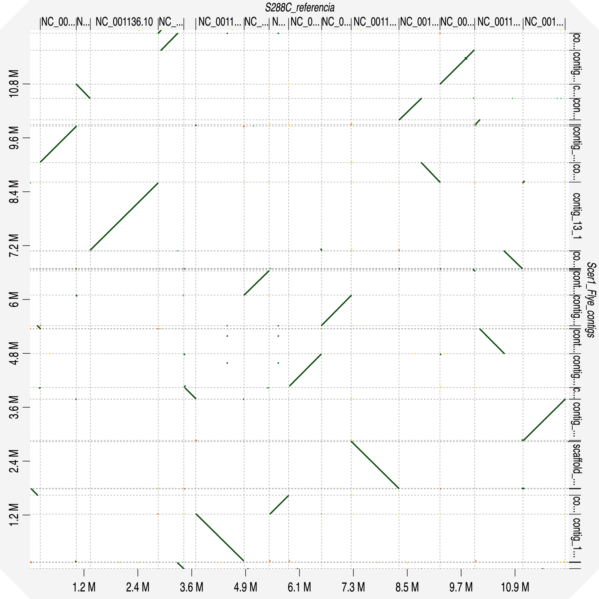{ width="700" }

=== "RagTag"

    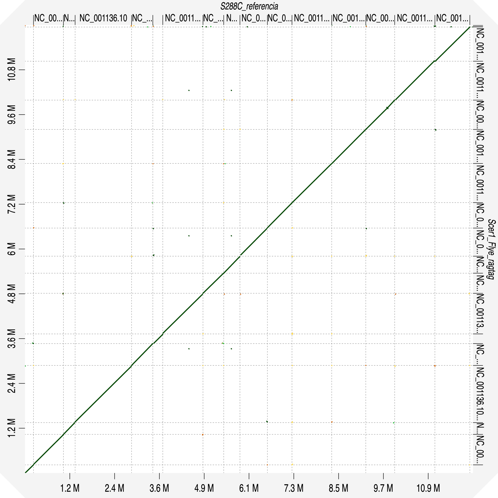{ width="700" }

=== "LongStitch"

    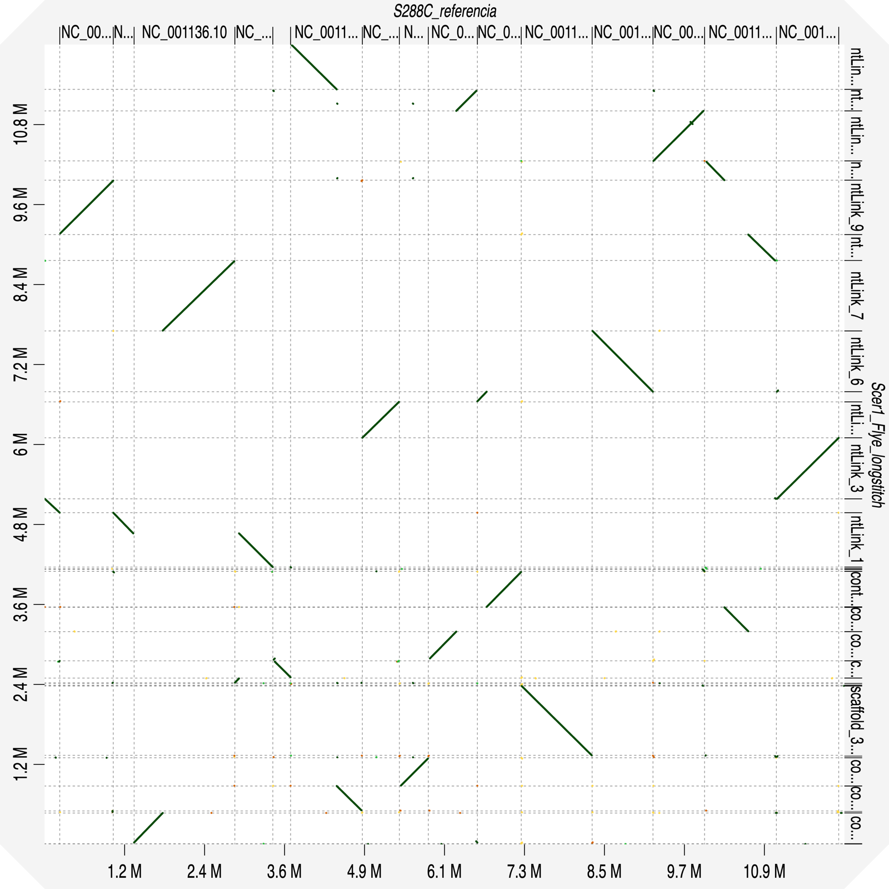{ width="700" }

No eixo X estão os 16 cromossomos da referência (de `NC_001133`, cromossomo I, a `NC_001148`, cromossomo XVI); no eixo Y, as sequências da montagem, que o D-GENIES ordena para formar a melhor diagonal possível. A cor indica a identidade do alinhamento: verde-escuro é alta, amarelo e laranja são mais baixas.

- **Contigs:** cada cromossomo da referência é coberto por um ou poucos contigs. O `contig_13_1`, por exemplo, cobre sozinho praticamente todo o cromossomo IV (`NC_001136`, 1,5 Mb). Muitos segmentos descem, mas são contigs inteiros na orientação oposta, e não inversões. As quebras entre contigs são os pontos onde o montador parou.
- **RagTag:** uma única diagonal limpa, subindo de ponta a ponta. O RagTag ordenou **e orientou** os contigs pela referência, por isso nenhum segmento desce. Parece perfeito, mas é em parte circular: a ordem veio da própria referência. A faixa cinza no topo do eixo Y são os contigs que ele não posicionou, e os pontos soltos na linha de cima são esses contigs alinhando em vários cromossomos (sequências repetitivas, como os da Etapa 11.3).
- **LongStitch:** mais pedaços do que nos contigs, por causa dos cortes do Tigmint (12.2), mas cada junção foi feita com base nas reads da própria amostra, e não na referência.
- **Pontos soltos fora da diagonal**, nos três gráficos: sequências repetidas (elementos Ty, subtelômeros) que também alinham em outros lugares do genoma.

**Algum scaffold junta cromossomos diferentes?** No gráfico do LongStitch, algumas faixas do eixo Y parecem conter pedaços de mais de um cromossomo. Para não depender só do olho, contamos, para cada sequência, quantos kb alinham em cada cromossomo da referência (só alinhamentos de 10 kb ou mais) e listamos as que têm 50 kb ou mais em dois cromossomos diferentes. Fazemos isso nos contigs e nos scaffolds do LongStitch, para saber quem criou a junção:

```bash
conda activate polimento
REF=ncbi_dataset/data/GCF_000146045.2/GCF_000146045.2_R64_genomic.fna
for f in 9.Montagens-polidas/Scer1_q10_l500_Flye.fasta \
         10.Scaffolding-Longstitch/Scer1_q10_l500_Flye/draft.k32.w100.tigmint-ntLink.longstitch-scaffolds.fa; do
  echo "== $f  (sequências com >= 50 kb alinhados em mais de um cromossomo)"
  minimap2 -x asm5 -t 24 $REF $f 2>/dev/null \
    | awk '$11>=10000{b[$1"\t"$6]+=$11} END{for(k in b) if(b[k]>=50000) print k"\t"int(b[k]/1000)"kb"}' \
    | sort -k1,1 -k3,3nr \
    | awk '{n[$1]++; l[$1]=l[$1]" "$2"("$3")"} END{for(s in n) if(n[s]>1) print s":"l[s]}'
done
conda deactivate
```

??? info "O que faz cada comando"
    | Comando | O que faz |
    |---|---|
    | `conda activate polimento` + `REF=...` | Entra no ambiente com o `minimap2` e guarda o caminho da referência. |
    | `for f in <contigs> <scaffolds>; do ... done` | Repete para os contigs e para os scaffolds do LongStitch. |
    | `minimap2 -x asm5 $REF $f` | Alinha as sequências na referência. |
    | `awk '$11>=10000{...} ...'` | Considera só alinhamentos de 10 kb ou mais (coluna 11) e soma, para cada par sequência–cromossomo, o total alinhado; guarda os pares com 50 kb ou mais. |
    | `sort ... | awk '{n[$1]++; ...}'` | Lista só as sequências que alinham em mais de um cromossomo (possíveis uniões erradas). |
    | `conda deactivate` | Sai do ambiente. |

```text
== 9.Montagens-polidas/Scer1_q10_l500_Flye.fasta  (sequências com >= 50 kb alinhados em mais de um cromossomo)
contig_13_1: NC_001136.10(1558kb) NC_001144.5(52kb)
== 10.Scaffolding-Longstitch/Scer1_q10_l500_Flye/draft.k32.w100.tigmint-ntLink.longstitch-scaffolds.fa  (sequências com >= 50 kb alinhados em mais de um cromossomo)
ntLink_1: NC_001137.3(520kb) NC_001135.5(310kb)
contig_13_1-1::contig_13_1:0-459546: NC_001136.10(443kb) NC_001144.5(52kb)
```

- **`ntLink_1` foi criado pelo ntLink:** ele juntou um trecho de 520 kb do cromossomo V (`NC_001137`) com praticamente o cromossomo III inteiro (`NC_001135`, 316 kb). Nos contigs, esses dois cromossomos estavam separados. Lembre que o n ótimo escolhido para esta montagem foi 2 (12.2): bastaram **duas reads** ligando as pontas para o ntLink fazer a junção. Ela pode ser um erro, por exemplo uma ligação através de repetições subteloméricas, que são parecidas entre cromossomos, ou um rearranjo real da CBS7963. Só com estes dados não dá para decidir. É o tipo de junção que precisa ser conferida antes de ser aceita: por exemplo, contando quantas reads atravessam o ponto de junção, ou procurando o mesmo rearranjo em outra montagem independente.
- **`contig_13_1` já vinha assim do Flye:** além de cobrir o cromossomo IV inteiro, ele tem 52 kb que alinham no cromossomo XII (`NC_001144`). O Tigmint cortou esse contig em alguns pontos, mas não neste: o pedaço que tem os dois (`contig_13_1:0-459546`) continuou inteiro. Isso quer dizer que as reads longas sustentam a continuidade, um indício de que a estrutura existe de fato no genoma da CBS7963, e não de erro de montagem. Mas, de novo, confirmar exigiria olhar o ponto exato e as reads que passam por ele.
- **Lição:** o dotplot e a contagem por cromossomo são boas formas de **encontrar** junções suspeitas. Decidir se são reais ou erros já exige olhar as reads que passam pelo ponto de junção.

### Checklist da Etapa 12

- [ ] Tenho scaffolds RagTag de cada montagem em `10.Scaffolding/`
- [ ] Tenho scaffolds LongStitch em `10.Scaffolding-Longstitch/`
- [ ] Comparei número de placed vs. unplaced no RagTag
- [ ] Entendi por que o número de scaffolds pode aumentar em regiões repetitivas/subteloméricas
- [ ] Comparei os contigs e os dois scaffoldings com a referência num dotplot (D-GENIES)

---

## :material-numeric-9-plus-circle: Etapa 13 — Checagem e remoção de contaminantes (BlobToolKit)

Mesmo uma montagem com boas métricas de completude e contiguidade pode conter sequências que não pertencem ao organismo de interesse: DNA de bactérias ou de outros organismos presentes na cultura, contaminação humana do laboratório, vetores. Nenhuma das métricas anteriores detecta isso. O BUSCO, por exemplo, só procura genes de levedura e simplesmente ignora um contig bacteriano.

A abordagem do **BlobToolKit** combina três informações para cada contig:

- **a taxonomia**, pelo melhor resultado de BLAST contra um banco de nucleotídeos de todos os organismos (aqui, o `core_nt` do NCBI);
- **o conteúdo de GC**, que costuma ser diferente entre organismos distantes;
- **a cobertura de reads**: um contaminante presente em pequena quantidade na cultura forma contigs com cobertura bem diferente da do genoma principal.

Contigs do organismo de interesse formam um agrupamento (*blob*) compacto, com GC e cobertura parecidos e a mesma taxonomia. Contaminantes aparecem como pontos de outra cor, fora do agrupamento.

Essas informações ficam num banco de dados do BlobToolKit, o *BlobDir*, que vamos reaproveitar no snail plot da Etapa 14.4. A checagem de contaminantes vem **antes** das checagens finais de qualidade. Se houver contigs a remover, BUSCO, telômeros e snail plot devem ser calculados na montagem já limpa, e uma montagem com boas métricas pode perder pontos se carregar contaminantes. Rodamos nas três candidatas da Scer1 e na Scer2 Flye (a Scer2 Hifiasm, com ~87 kb, fica de fora).

!!! warning "Numa montagem nova, faça esta checagem mais cedo"
    Aqui a checagem veio depois do polimento e do scaffolding, e isso **não mudou nada**: nenhum contig precisou ser removido. Mas, se houver contaminação, a ordem importa. O ideal é checar logo depois da montagem, antes do purge_dups, do polimento e do scaffolding:

    - **Scaffolding:** um contig contaminante pode ser ligado a um contig do genoma, sobretudo no scaffolding sem referência (LongStitch). Remover um contig solto é só tirá-lo do FASTA. Separar um contaminante de dentro de um scaffold exige quebrar o scaffold.
    - **Polimento:** polir contaminantes é tempo de processamento perdido. Além disso, reads do contaminante podem alinhar em regiões parecidas do genoma e atrapalhar a correção.

    Mesmo checando cedo, vale repetir no fim, antes de submeter o genoma: é rápido e confirma que a versão final está limpa. O NCBI também faz essa triagem na submissão, com o FCS-GX (Etapa 4).

!!! note "Bancos usados"
    - **`core_nt`**: versão do `nt` mantida pelo NCBI desde 2024, sem a maior parte das sequências redundantes de grandes projetos de sequenciamento. É bem menor que o `nt` completo, o que torna o BLAST mais rápido, mas ainda cobre todos os grupos de organismos.
    - **`new_taxdump`**: a árvore taxonômica do NCBI, que o BlobToolKit usa para converter o identificador de taxonomia de cada hit (`staxids`) em espécie, gênero, filo etc.

    Ajuste os dois caminhos abaixo para o seu servidor. Para baixar o taxdump: `curl -L https://ftp.ncbi.nih.gov/pub/taxonomy/new_taxdump/new_taxdump.tar.gz | tar xzf -`.

### 13.1 BLAST contra o `core_nt`

Este é o passo mais demorado da etapa: no nosso servidor, com 24 threads, levou de 10 a 26 minutos por montagem (~1h10 para as quatro). O tempo depende muito do disco e da memória disponível para carregar o banco, então rode dentro do `tmux`. O `date` antes e depois de cada montagem registra quanto tempo cada uma levou.

```bash
DB=/media/hd16-databases/blast_dbs/core_nt/core_nt
MONTAGENS="Scer1_q10_l500_Flye Scer1_q10_l500_hifiasm Scer1_q10_l500_nextdenovo Scer2_q10_l500_Flye"   # usada nos resumos adiante
mkdir -p 13.Contaminantes

p=Scer1_q10_l500_Flye   # troque e rode o bloco de novo para: Scer1_q10_l500_hifiasm, Scer1_q10_l500_nextdenovo, Scer2_q10_l500_Flye
echo "$(date) início $p" | tee -a 13.Contaminantes/blast.log
blastn -task megablast \
  -query 9.Montagens-polidas/$p.fasta \
  -db $DB \
  -outfmt "6 qseqid staxids bitscore std" \
  -max_target_seqs 10 -max_hsps 1 -evalue 1e-25 \
  -num_threads 24 \
  -out 13.Contaminantes/$p.blastn.out
echo "$(date) fim $p" | tee -a 13.Contaminantes/blast.log
```

??? info "O que faz cada comando"
    | Comando | O que faz |
    |---|---|
    | `DB=` / `MONTAGENS=` | Caminho do banco `core_nt` e lista das montagens (usada nos resumos adiante). |
    | `p=...` | Montagem a processar. Troque e rode de novo para as outras. |
    | `echo "$(date) início $p" | tee -a blast.log` | Anota no log a hora de início (o BLAST demora; assim dá para acompanhar). |
    | `blastn -task megablast` | Modo rápido do BLAST, para sequências muito parecidas. |
    | `-query` / `-db` | Montagem a comparar e banco de dados. |
    | `-outfmt "6 qseqid staxids bitscore std"` | Tabela com o contig, o identificador taxonômico do hit, o *bitscore* e as colunas padrão: o formato que o BlobToolKit espera. |
    | `-max_target_seqs 10 -max_hsps 1 -evalue 1e-25` | No máximo 10 sequências do banco por contig, um alinhamento por par e só hits muito significativos. |
    | `-num_threads 24` / `-out` | Número de processadores e arquivo de saída. |

O formato de saída `6 qseqid staxids bitscore std` é o que o BlobToolKit espera: o nome do contig, o taxid do hit, o *bitscore* e as colunas padrão do BLAST. O `-task megablast` é o modo mais rápido do `blastn`, adequado para encontrar sequências muito parecidas.

```text
qui 19 nov 2026 12:10:05 -03 início Scer1_q10_l500_Flye
qui 19 nov 2026 12:35:44 -03 fim Scer1_q10_l500_Flye
qui 19 nov 2026 12:35:44 -03 início Scer1_q10_l500_hifiasm
qui 19 nov 2026 12:57:38 -03 fim Scer1_q10_l500_hifiasm
qui 19 nov 2026 12:57:38 -03 início Scer1_q10_l500_nextdenovo
qui 19 nov 2026 13:11:12 -03 fim Scer1_q10_l500_nextdenovo
qui 19 nov 2026 13:11:12 -03 início Scer2_q10_l500_Flye
qui 19 nov 2026 13:20:48 -03 fim Scer2_q10_l500_Flye
```

| Montagem | Tempo |
|---|---|
| Scer1 Flye | 25 min 39 s |
| Scer1 Hifiasm | 21 min 54 s |
| Scer1 NextDenovo | 13 min 34 s |
| Scer2 Flye | 9 min 36 s |

O tempo não acompanha só o tamanho da montagem (as três da Scer1 têm ~12 Mb). Pesam também o número de hits de cada contig no banco e, provavelmente, o fato de o primeiro BLAST precisar ler o `core_nt` do disco, enquanto os seguintes aproveitam o banco já em cache na memória. A Scer2, com 8 Mb em 706 contigs curtos, foi a mais rápida.

Para conferir se o BLAST terminou para todos os contigs:

```bash
wc -l 13.Contaminantes/*.blastn.out
```

??? info "O que faz cada comando"
    | Comando | O que faz |
    |---|---|
    | `wc -l 13.Contaminantes/*.blastn.out` | Conta as linhas (hits) de cada resultado do BLAST. |

```text
   370 13.Contaminantes/Scer1_q10_l500_Flye.blastn.out
   240 13.Contaminantes/Scer1_q10_l500_hifiasm.blastn.out
   240 13.Contaminantes/Scer1_q10_l500_nextdenovo.blastn.out
  7038 13.Contaminantes/Scer2_q10_l500_Flye.blastn.out
  7888 total
```

Como pedimos `-max_target_seqs 10 -max_hsps 1`, cada contig tem no máximo 10 linhas. As contas fecham: 37 contigs × 10 = 370 na Flye, 24 × 10 = 240 na Hifiasm e na NextDenovo. Ou seja, todos os contigs da Scer1 tiveram 10 hits. Na Scer2 (706 contigs), 7038 linhas significam que pelo menos 704 contigs tiveram hit. Para saber exatamente quantos contigs têm algum hit:

```bash
cut -f1 13.Contaminantes/Scer1_q10_l500_hifiasm.blastn.out | sort -u | wc -l
```

??? info "O que faz cada comando"
    | Comando | O que faz |
    |---|---|
    | `cut -f1 ... | sort -u | wc -l` | Pega a coluna 1 (nome do contig), remove as repetições (`sort -u`) e conta quantos contigs tiveram pelo menos um hit. |

```text
24
```

Contigs sem nenhum hit não são necessariamente contaminantes. Podem ser sequências repetitivas ou regiões ausentes do banco, e por isso são mantidos na Etapa 13.5.

### 13.2 Cobertura de reads

```bash
conda activate polimento   # minimap2 e samtools

p=Scer1_q10_l500_Flye   # troque e rode o bloco de novo para: Scer1_q10_l500_hifiasm, Scer1_q10_l500_nextdenovo, Scer2_q10_l500_Flye
R=2.Filtragem-dadosbrutos/Scer1_q10_l500.fastq.gz   # na Scer2_q10_l500_Flye, use Scer2_q10_l500.fastq.gz
minimap2 -ax map-ont -t 24 9.Montagens-polidas/$p.fasta $R \
  | samtools sort -@ 8 -o 13.Contaminantes/$p.bam
samtools index -c 13.Contaminantes/$p.bam   # índice .csi, o formato que o BlobToolKit espera

conda deactivate
```

??? info "O que faz cada comando"
    | Comando | O que faz |
    |---|---|
    | `conda activate polimento` | Entra no ambiente com o `minimap2` e o `samtools`. |
    | `p=` / `R=` | Montagem e reads da amostra correspondente. Troque e rode de novo para as outras. |
    | `minimap2 -ax map-ont` | Alinha as reads Nanopore na montagem. O `-a` gera a saída em SAM. |
    | `| samtools sort -@ 8 -o <arquivo>.bam` | Ordena os alinhamentos por posição e salva em BAM (formato binário, menor). O `-@` é o número de processadores. |
    | `samtools index -c` | Cria o índice `.csi` do BAM, o formato que o BlobToolKit espera. |
    | `conda deactivate` | Sai do ambiente. |

!!! warning "Use `samtools index -c`"
    O BlobToolKit procura o índice no formato `.csi`. Com o índice padrão (`.bai`), ele tenta criar o `.csi` sozinho e falha com `FileNotFoundError: ... .bam.csi`. Em seguida, o blob plot também falha (`Plot axis not defined: y`), porque a cobertura não foi adicionada. A opção `-c` cria o `.csi` direto.

Saída resumida (só as linhas principais de cada montagem):

```text
[M::main::0.555*2.41] loaded/built the index for 37 target sequence(s)
[M::worker_pipeline::90.662*5.35] mapped 140416 sequences
[M::worker_pipeline::96.884*6.20] mapped 90021 sequences
[M::main] CMD: minimap2 -ax map-ont -t 24 9.Montagens-polidas/Scer1_q10_l500_Flye.fasta 2.Filtragem-dadosbrutos/Scer1_q10_l500.fastq.gz
[M::main] Real time: 97.050 sec; CPU: 600.806 sec; Peak RSS: 4.440 GB
[bam_sort_core] merging from 0 files and 8 in-memory blocks...
...
[M::main::0.411*3.13] loaded/built the index for 24 target sequence(s)
[M::main] CMD: minimap2 -ax map-ont -t 24 9.Montagens-polidas/Scer1_q10_l500_hifiasm.fasta 2.Filtragem-dadosbrutos/Scer1_q10_l500.fastq.gz
[M::main] Real time: 33.017 sec; CPU: 578.394 sec; Peak RSS: 4.785 GB
...
[M::main::0.415*3.27] loaded/built the index for 24 target sequence(s)
[M::main] CMD: minimap2 -ax map-ont -t 24 9.Montagens-polidas/Scer1_q10_l500_nextdenovo.fasta 2.Filtragem-dadosbrutos/Scer1_q10_l500.fastq.gz
[M::main] Real time: 25.384 sec; CPU: 403.606 sec; Peak RSS: 4.683 GB
...
[M::main::0.274*3.24] loaded/built the index for 706 target sequence(s)
[M::worker_pipeline::2.619*8.97] mapped 33006 sequences
[M::main] CMD: minimap2 -ax map-ont -t 24 9.Montagens-polidas/Scer2_q10_l500_Flye.fasta 2.Filtragem-dadosbrutos/Scer2_q10_l500.fastq.gz
[M::main] Real time: 2.643 sec; CPU: 23.507 sec; Peak RSS: 0.714 GB
```

Na Scer1, foram 230.437 reads (140.416 + 90.021, em dois lotes) e na Scer2, 33.006. O alinhamento é rápido: menos de 2 minutos por montagem da Scer1 e poucos segundos na Scer2. O `samtools sort` sem `-m` usa 768 MB por thread, por isso tudo coube na memória ("8 in-memory blocks") sem arquivos temporários. Note que `mapped` conta os reads processados, não os que de fato alinharam. A cobertura de cada contig é o que o BlobToolKit vai calcular a partir do BAM no próximo passo.

### 13.3 Juntar tudo no BlobDir e desenhar o blob plot

??? tip "Instalação: ambiente `blobtoolkit`"
    ```bash
    conda create -n blobtoolkit -c conda-forge python=3.9
    conda activate blobtoolkit
    pip install blobtoolkit blobtk
    conda deactivate
    ```

    O pacote `blobtoolkit` cria o banco de dados (*BlobDir*) da montagem; o `blobtk` desenha os gráficos.

    Atenção: o BlobTools **v1**, mais antigo, e o BlobToolKit se chamam `blobtools` na linha de comando. Para saber qual está ativo, rode `blobtools --version`: o v1 responde `1.1.1`; o BlobToolKit, `4.x`.

```bash
TAXDUMP=/media/hd16-databases/GEP2/DBs/taxdump
conda activate blobtoolkit
mkdir -p 13.Contaminantes/blobdir

p=Scer1_q10_l500_Flye   # troque e rode o bloco de novo para: Scer1_q10_l500_hifiasm, Scer1_q10_l500_nextdenovo, Scer2_q10_l500_Flye

# 1) criar o BlobDir com as sequências da montagem (tamanho, GC e Ns de cada contig)
rm -rf 13.Contaminantes/blobdir/$p
blobtools create --fasta 9.Montagens-polidas/$p.fasta 13.Contaminantes/blobdir/$p

# 2) acrescentar os hits do BLAST (taxonomia) e a cobertura
blobtools add \
  --hits 13.Contaminantes/$p.blastn.out \
  --taxrule bestsumorder \
  --taxdump $TAXDUMP \
  --cov 13.Contaminantes/$p.bam \
  --replace \
  13.Contaminantes/blobdir/$p

ls 13.Contaminantes/blobdir/$p/
```

??? info "O que faz cada comando"
    | Comando | O que faz |
    |---|---|
    | `TAXDUMP=...` + `conda activate blobtoolkit` | Caminho da taxonomia do NCBI e ambiente do BlobToolKit. |
    | `p=...` | Montagem a processar. Troque e rode de novo para as outras. |
    | `rm -rf` + `blobtools create --fasta <montagem> <pasta>` | Apaga um BlobDir antigo e cria um novo, com tamanho, GC e Ns de cada contig. |
    | `blobtools add --hits <blast>` | Acrescenta os hits do BLAST. |
    | `--taxrule bestsumorder --taxdump <pasta>` | Regra para atribuir a taxonomia de cada contig e base de taxonomia usada (explicada abaixo). |
    | `--cov <bam>` | Acrescenta a cobertura de reads de cada contig. |
    | `--replace` | Substitui os campos se eles já existirem (permite rodar de novo). |
    | `ls <pasta>` | Lista os arquivos do BlobDir, um por campo. |

O `rm -rf` e o `--replace` deixam o comando ser repetido: sem eles, o BlobToolKit não sobrescreve campos que já existem no BlobDir.

```text
Loading mapping data from 13.Contaminantes/Scer1_q10_l500_hifiasm.bam as Scer1_q10_l500_hifiasm
[+]        Locating alignments: ████████████████████████████████████████      24/24
Parsing taxdump
...
bestsumorder_class.json
...
bestsumorder_genus.json
...
bestsumorder_phylum.json
...
bestsumorder_species.json
...
gc.json
identifiers.json
length.json
meta.json
ncount.json
Scer1_q10_l500_hifiasm_cov.json
```

Além dos campos criados pelo `blobtools create` (`gc`, `length`, `ncount`), o BlobDir tem a cobertura (`*_cov.json`) e a taxonomia de cada contig em todos os níveis, de superreino a espécie (`bestsumorder_*.json`).

Com os dados no BlobDir, desenhe o blob plot:

```bash
python -c "import blobtk; blobtk.plot.blob(blobdir='13.Contaminantes/blobdir/Scer1_q10_l500_Flye', output='13.Contaminantes/Scer1_q10_l500_Flye.blob.png')"
python -c "import blobtk; blobtk.plot.blob(blobdir='13.Contaminantes/blobdir/Scer1_q10_l500_hifiasm', output='13.Contaminantes/Scer1_q10_l500_hifiasm.blob.png')"
python -c "import blobtk; blobtk.plot.blob(blobdir='13.Contaminantes/blobdir/Scer1_q10_l500_nextdenovo', output='13.Contaminantes/Scer1_q10_l500_nextdenovo.blob.png')"
python -c "import blobtk; blobtk.plot.blob(blobdir='13.Contaminantes/blobdir/Scer2_q10_l500_Flye', output='13.Contaminantes/Scer2_q10_l500_Flye.blob.png')"

conda deactivate
ls -lh 13.Contaminantes/*.png
```

??? info "O que faz cada comando"
    | Comando | O que faz |
    |---|---|
    | `python -c "import blobtk; blobtk.plot.blob(...)"` | Roda uma linha de Python que desenha o blob plot a partir do BlobDir (`blobdir=`) e salva a imagem (`output=`). |
    | `conda deactivate` + `ls -lh *.png` | Sai do ambiente e lista as imagens geradas. |

O `--taxrule bestsumorder` soma os *bitscores* dos hits de cada táxon ao longo do contig e atribui o contig ao táxon com a maior soma; é a regra padrão do BlobToolKit.

=== "Scer1 Flye"

    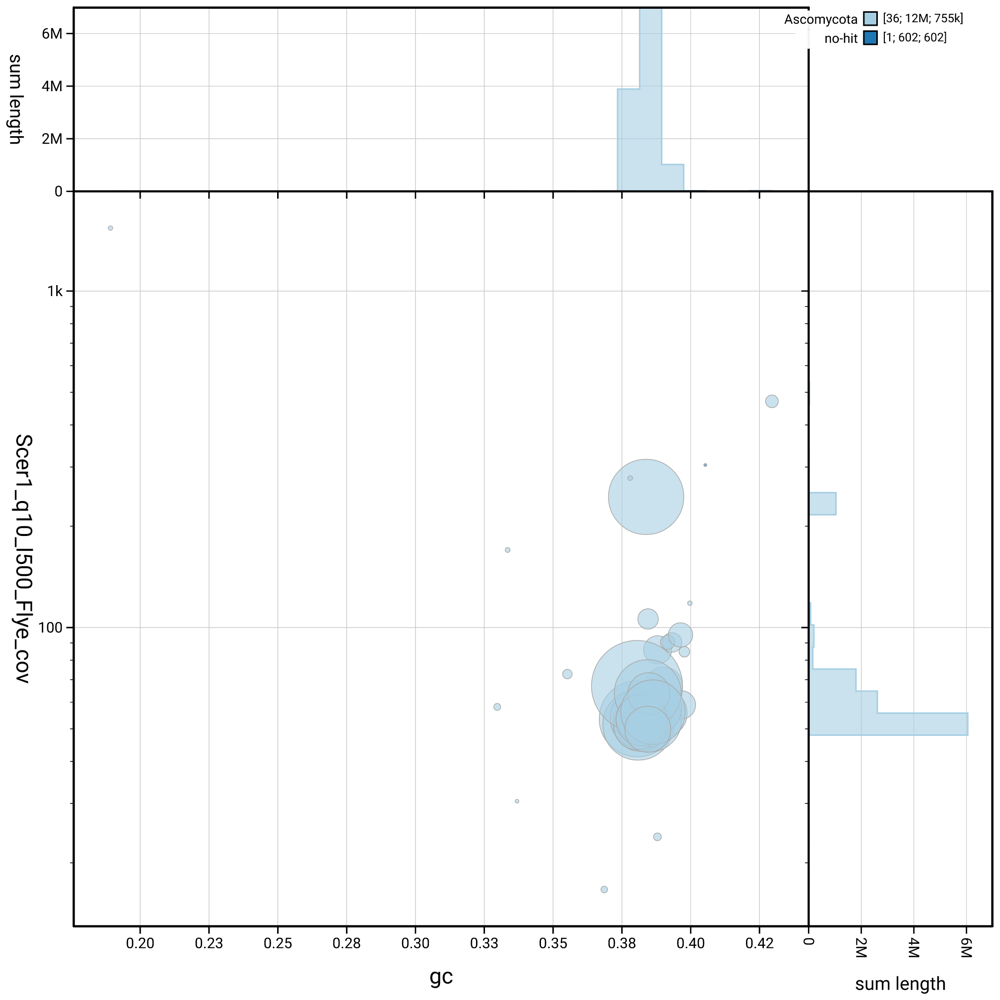{ width="650" }

=== "Scer1 Hifiasm"

    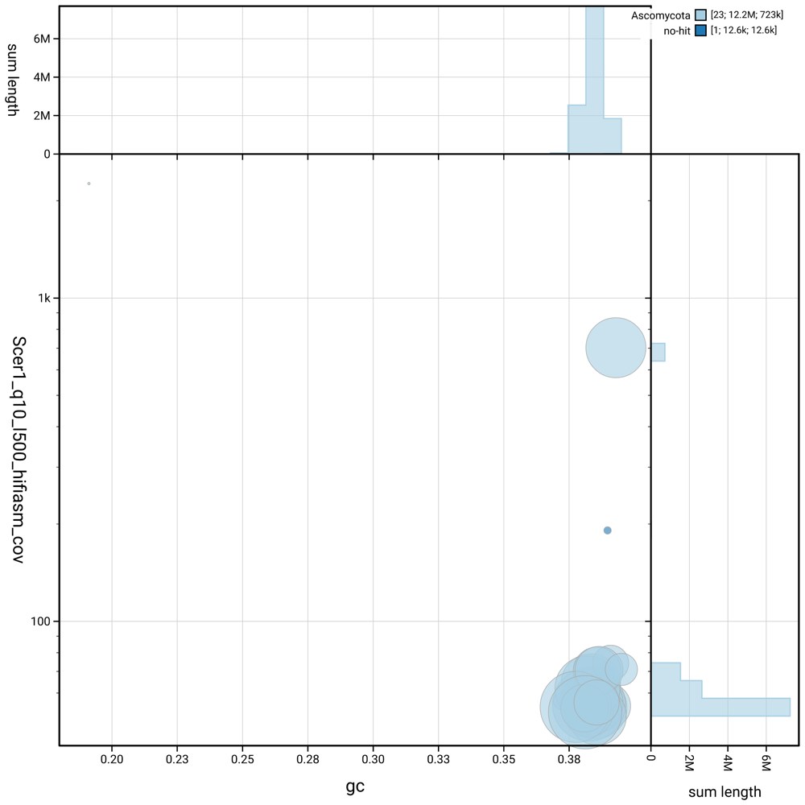{ width="650" }

=== "Scer1 NextDenovo"

    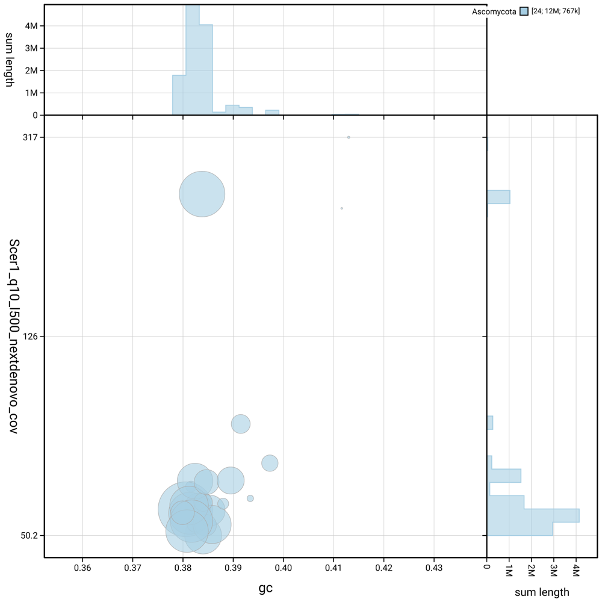{ width="650" }

=== "Scer2 Flye"

    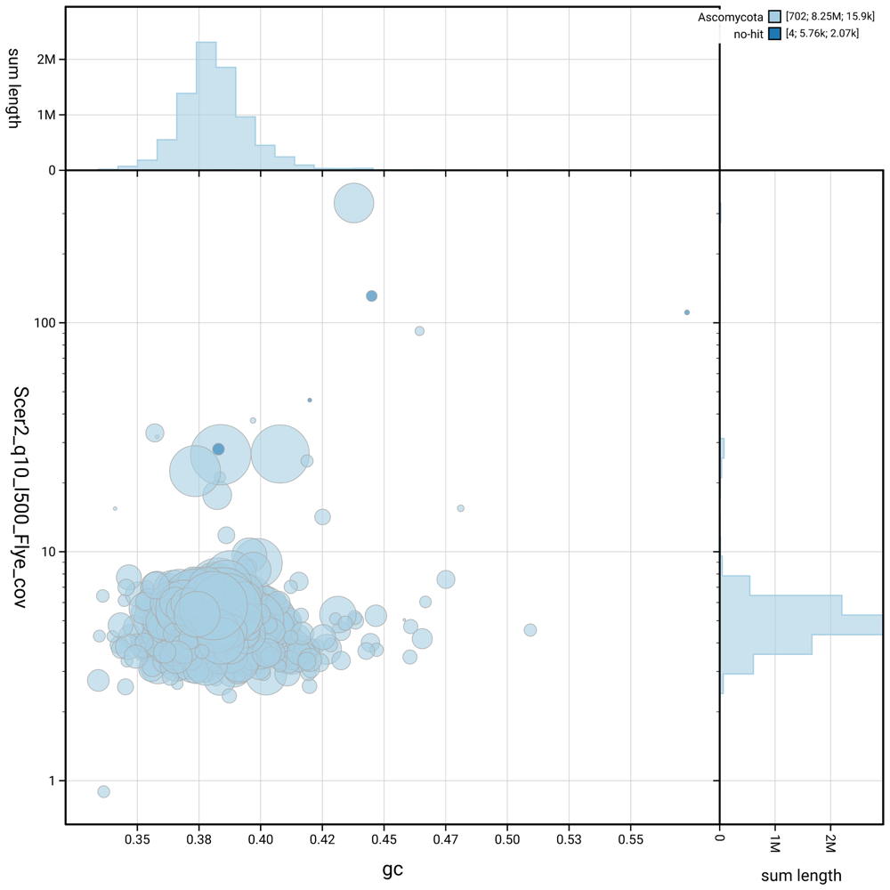{ width="650" }

Cada círculo é um contig: a posição horizontal é o GC, a vertical é a cobertura (em escala logarítmica), o tamanho do círculo é proporcional ao comprimento e a cor é o filo atribuído pelo BLAST. Os histogramas nas margens somam o comprimento dos contigs em cada faixa de GC (em cima) e de cobertura (à direita). A legenda mostra, para cada filo, o número de contigs, o tamanho total e o N50.

!!! example "Como ler os blob plots"
    - **Uma cor só.** Nas quatro montagens, todos os contigs são *Ascomycota*, exceto os `no-hit` (azul-escuro), que já investigamos na 13.4. Um contaminante apareceria como um círculo de outra cor, em geral com GC e cobertura diferentes do agrupamento principal.
    - **O agrupamento principal.** Na Scer1, os contigs cromossômicos se concentram em GC de ~38–39% e cobertura de ~50–70×. Na Scer2, o agrupamento fica em ~4–8×, reflexo da cobertura baixa dessa amostra.
    - **Pontos acima do agrupamento são sequências em várias cópias, não contaminantes.** Na Scer1 Hifiasm, o círculo grande perto de 700× é o contig do chrXII com o rDNA, e o ponto azul-escuro perto de 190× é o plasmídeo 2-mícron. Na Scer1 Flye, há um círculo semelhante perto de 250×.
    - **O ponto isolado no canto superior esquerdo** (GC ~19%, cobertura >2000×) da Scer1 Flye e da Scer1 Hifiasm é um pequeno fragmento de DNA mitocondrial que sobrou nas montagens. O mtDNA da levedura é muito rico em AT e está em muitas cópias por célula, por isso ele aparece longe de todo o resto, mesmo sendo da própria levedura. Na Etapa 15, ele reaparece na tabela por cromossomo como chrMT.
    - **Na Scer2, um grupo de contigs grandes em ~20–30×** e alguns pontos acima de 100× também ficam fora do agrupamento principal. Todos são *Saccharomyces* e provavelmente correspondem a regiões repetidas (rDNA, elementos Ty, cópias subteloméricas) que o Flye não conseguiu separar com tão pouca cobertura.

    **Lição:** GC ou cobertura fora do padrão, sozinhos, não indicam contaminação. É a combinação com a taxonomia, a cor do ponto, que permite decidir.

### 13.4 Tabela por contig e resumo por filo

```bash
conda activate blobtoolkit
for prefix in $MONTAGENS; do
  blobtools filter \
    --table 13.Contaminantes/$prefix.contigs.tsv \
    --table-fields gc,length,${prefix}_cov,bestsumorder_phylum,bestsumorder_genus \
    13.Contaminantes/blobdir/$prefix

  head -3 13.Contaminantes/$prefix.contigs.tsv
  echo "===== $prefix (filo: contigs, pb)"
  awk -F'\t' 'NR==1{for(i=1;i<=NF;i++){if($i=="bestsumorder_phylum")f=i; if($i=="length")l=i}; next}
               {n[$f]++; b[$f]+=$l} END{for(x in n) print x": "n[x]" contigs, "b[x]" pb"}' \
    13.Contaminantes/$prefix.contigs.tsv | sort
  echo "===== $prefix (gênero: contigs)"
  cut -f7 13.Contaminantes/$prefix.contigs.tsv | tail -n +2 | sort | uniq -c | sort -k1,1nr
done
conda deactivate
```

??? info "O que faz cada comando"
    | Comando | O que faz |
    |---|---|
    | `for prefix in $MONTAGENS; do ... done` | Repete para cada montagem (a variável `MONTAGENS` foi definida na Etapa 13.1). |
    | `blobtools filter --table <arquivo> --table-fields ...` | Exporta do BlobDir uma tabela com um contig por linha e as colunas escolhidas (GC, tamanho, cobertura, filo e gênero). |
    | `head -3` | Mostra as três primeiras linhas da tabela. |
    | `awk -F'\t' 'NR==1{...} {n[$f]++; b[$f]+=$l} ...'` | Localiza as colunas pelo nome, no cabeçalho, e soma contigs e bases por filo. |
    | `cut -f7 | tail -n +2 | sort | uniq -c | sort -k1,1nr` | Pega a coluna do gênero, pula o cabeçalho e conta quantos contigs há de cada gênero, do mais comum para o menos comum. |

A tabela tem uma linha por contig:

```text
index   identifiers     gc      length  Scer1_q10_l500_hifiasm_cov      bestsumorder_phylum       bestsumorder_genus
0       ptg000003l_1    0.3853  767108  54.0292 Ascomycota      Saccharomyces
1       ptg000020l_1    0.3898  419705  54.733  Ascomycota      Saccharomyces
```

Resumo por filo e por gênero:

```text
===== Scer1_q10_l500_Flye (filo: contigs, pb)
Ascomycota: 36 contigs, 11970549 pb
no-hit: 1 contigs, 602 pb
===== Scer1_q10_l500_Flye (gênero: contigs)
     36 Saccharomyces
      1 no-hit
===== Scer1_q10_l500_hifiasm (filo: contigs, pb)
Ascomycota: 23 contigs, 12154698 pb
no-hit: 1 contigs, 12600 pb
===== Scer1_q10_l500_hifiasm (gênero: contigs)
     23 Saccharomyces
      1 no-hit
===== Scer1_q10_l500_nextdenovo (filo: contigs, pb)
Ascomycota: 24 contigs, 12015996 pb
===== Scer1_q10_l500_nextdenovo (gênero: contigs)
     24 Saccharomyces
===== Scer2_q10_l500_Flye (filo: contigs, pb)
Ascomycota: 702 contigs, 8246431 pb
no-hit: 4 contigs, 5762 pb
===== Scer2_q10_l500_Flye (gênero: contigs)
    702 Saccharomyces
      4 no-hit
```

**Nenhuma das quatro montagens tem contaminantes.** Todos os contigs com taxonomia atribuída são de *Saccharomyces*. Não há nenhum contig de bactéria, de humano ou de outro fungo. Sobram só alguns poucos contigs `no-hit`, que somam de 602 pb a 12,6 kb por montagem.

!!! example "O que são os contigs `no-hit`?"
    Pelo `wc -l` da 13.1, todos os contigs da Scer1 tiveram hits no BLAST. Então `no-hit` aqui não significa "sem hit". Para ver quais são os hits desses contigs e a que táxon pertencem:

    ```bash
    # hits dos contigs no-hit: contig, taxid, identidade, tamanho do alinhamento
    for prefix in Scer1_q10_l500_Flye Scer1_q10_l500_hifiasm; do
      for c in $(awk -F'\t' '$6=="no-hit"{print $2}' 13.Contaminantes/$prefix.contigs.tsv); do
        echo "===== $prefix  $c"
        grep -P "^${c}\t" 13.Contaminantes/$prefix.blastn.out | cut -f1,2,6,7 | head -5
      done
    done

    # nome de cada taxid no taxdump
    for t in 2987691 106612 1945504 32630 2986916 2985547; do
      echo -e "$t\t$(grep -P "^${t}\t" $TAXDUMP/names.dmp | grep 'scientific name' | cut -f3)"
    done
    ```

    ```text
    2987691 Expression vector YHp26352
    106612  Expression vector pGP100
    1945504 Yeast expression vector pSCUDT2MFE6L
    32630   synthetic construct
    2986916 Expression vector YHp22601
    2985547 Expression vector YHp17606
    ```

    Os 10 melhores hits dos dois contigs são **vetores de expressão para levedura**, com 99,1–99,5% de identidade. Vetores não pertencem a nenhum filo ou gênero, então o BlobToolKit não consegue atribuir esses contigs a um táxon e os marca como `no-hit`.

    Isso não quer dizer que a cultura esteja contaminada por um vetor. Muitos vetores de levedura (os YEp) carregam um pedaço do **plasmídeo 2-mícron**, um plasmídeo natural de *S. cerevisiae* com ~6,3 kb. Como pedimos só os 10 melhores hits (`-max_target_seqs 10`) e há muitos vetores com a mesma sequência no banco, eles ocuparam todas as 10 posições e empurraram para fora as entradas de *S. cerevisiae*.

    O contig da Hifiasm, `ptg000045c_1`, confirma a suspeita. O `c` no nome indica que o Hifiasm o montou como **circular**, e seus 12.600 pb são exatamente 2 × 6.300 pb. Alinhando o contig contra ele mesmo:

    ```bash
    samtools faidx 9.Montagens-polidas/Scer1_q10_l500_hifiasm.fasta ptg000045c_1 > c45.fa
    minimap2 -X -c c45.fa c45.fa 2>/dev/null | cut -f1-12
    ```

    ```text
    ptg000045c_1  12600  0     3027   +  ptg000045c_1  12600  6300   9327   3027  3027  0
    ptg000045c_1  12600  5370  6300   +  ptg000045c_1  12600  11670  12600  930   930   60
    ptg000045c_1  12600  2436  5961   -  ptg000045c_1  12600  8736   12261  3525  3525  60
    ptg000045c_1  12600  2436  3027   -  ptg000045c_1  12600  5370   5961   591   591   60
    ptg000045c_1  12600  8736  9327   -  ptg000045c_1  12600  11670  12261  591   591   0
    ```

    - **Duas metades de 6.300 pb.** O início e o fim de cada metade são idênticos na mesma orientação (`+`).
    - **Duas repetições invertidas de ~590 pb em cada metade** (2436–3027 × 5370–5961 e o equivalente na outra metade). Elas correspondem às duas repetições invertidas de ~600 pb do 2-mícron.
    - **A região entre as repetições está invertida de uma metade para a outra** (2436–5961 × 8736–12261, `-`). No 2-mícron, a recombinase FLP inverte essa região, e a célula tem as duas formas do plasmídeo, A e B.

    Ou seja, o Hifiasm montou **as duas formas do plasmídeo 2-mícron**, uma após a outra, em um contig circular. É DNA da própria levedura e não deve ser removido. Também explica por que o RagTag (Etapa 12.1) deixou esse contig sem posição: o 2-mícron não é um cromossomo. O contig `no-hit` da Flye (`contig_128_1`, 602 pb) tem os mesmos vetores como melhores hits. Pelo tamanho, provavelmente é só uma das repetições invertidas do 2-mícron que a Flye não conseguiu resolver.

    **Lição geral:** um `no-hit` precisa ser investigado, não descartado. Aqui, com mais hits por contig (por exemplo, `-max_target_seqs 50`), as entradas de *S. cerevisiae* provavelmente entrariam na soma e o contig seria classificado como *Saccharomyces*.

### 13.5 Remover os contaminantes (só se houver)

!!! tip "Nas nossas amostras, este passo não é necessário"
    O resumo da 13.4 mostrou que **nenhum contig é de outro organismo**. Todos são *Saccharomyces* ou `no-hit`, e os `no-hit` são o plasmídeo 2-mícron, ou seja, DNA da própria levedura. Não há nada a remover. As montagens de `9.Montagens-polidas/` seguem para a Etapa 14 como estão. Se você remover contigs, use `13.Montagens-descontaminadas/` no lugar de `9.Montagens-polidas/` daqui em diante.

    O passo fica documentado porque o pipeline deve servir para outros organismos e outras culturas, em que contaminantes podem aparecer. Rode-o quando o resumo por filo mostrar contigs fora do filo esperado.

Quando houver contigs a remover, a regra mais simples e transparente é: manter só os contigs atribuídos ao filo do organismo (**Ascomycota**, para *S. cerevisiae*) e os contigs sem nenhum hit (`no-hit`), que serão examinados à parte. Contigs `no-hit` **não são automaticamente contaminantes**: podem ser sequências do próprio organismo ausentes do banco ou, como vimos na 13.4, sequências cujos melhores hits não têm taxonomia. Por isso a regra os mantém, e eles devem ser investigados um a um.

```bash
FILO=Ascomycota
mkdir -p 13.Montagens-descontaminadas
conda activate polimento
for prefix in $MONTAGENS; do
  t=13.Contaminantes/$prefix.contigs.tsv
  rm -f 13.Contaminantes/$prefix.manter.txt 13.Contaminantes/$prefix.removidos.tsv
  # as colunas são localizadas pelo nome, na primeira linha da tabela
  awk -F'\t' -v F=$FILO -v M=13.Contaminantes/$prefix.manter.txt -v R=13.Contaminantes/$prefix.removidos.tsv '
    NR==1 { for(i=1;i<=NF;i++){ if($i=="identifiers")id=i; if($i=="bestsumorder_phylum")f=i;
                                if($i=="bestsumorder_genus")g=i; if($i=="length")l=i; if($i ~ /_cov$/)c=i }; next }
    $f==F || $f=="no-hit" { print $id > M; next }
    { print $id"\t"$f"\t"$g"\t"$l"\t"$c > R }' $t
  touch 13.Contaminantes/$prefix.removidos.tsv
  samtools faidx 9.Montagens-polidas/$prefix.fasta -r 13.Contaminantes/$prefix.manter.txt > 13.Montagens-descontaminadas/$prefix.fasta
  echo "$prefix: $(wc -l < 13.Contaminantes/$prefix.manter.txt) contigs mantidos, $(wc -l < 13.Contaminantes/$prefix.removidos.tsv) removidos"
  cat 13.Contaminantes/$prefix.removidos.tsv
done
conda deactivate
```

??? info "O que faz cada comando"
    | Comando | O que faz |
    |---|---|
    | `FILO=Ascomycota` | Filo esperado para a levedura: contigs desse filo são mantidos. |
    | `mkdir -p` + `conda activate polimento` | Cria a pasta de saída e entra no ambiente com o `samtools`. |
    | `for prefix in $MONTAGENS; do ... done` | Repete para cada montagem. |
    | `rm -f ...` | Apaga listas de uma rodada anterior. |
    | `awk -F'\t' -v F=... -v M=... -v R=... '...'` | Localiza as colunas pelo nome e separa os contigs: os do filo esperado ou sem hit (`no-hit`) vão para a lista de manter; os outros vão para a tabela de removidos. |
    | `touch <removidos>.tsv` | Cria a tabela vazia se nenhum contig foi removido, para os comandos seguintes não darem erro. |
    | `samtools faidx <montagem> -r <manter.txt>` | Extrai só os contigs da lista de manter. |
    | `echo ...` + `cat <removidos>.tsv` | Mostra quantos contigs ficaram e quantos saíram, e lista os removidos. |

O arquivo `.removidos.tsv` lista, para cada contig removido, o filo, o gênero, o tamanho e a cobertura. **Sempre confira essa lista antes de aceitar a remoção**: um contig da própria levedura pode ter o melhor hit num organismo errado por causa de uma sequência mal anotada no banco, e um contaminante pode estar escondido dentro de um contig grande, sem que o contig inteiro seja atribuído a ele.

!!! note "Comparando com o Kraken2"
    Vale voltar à Etapa 4 e comparar. O Kraken2 classificou ~24% dos reads como humanos e ~5 a 8% como *B. cereus*, mas usando um banco sem fungos. Nas montagens, **não apareceu nenhum contig de humano nem de *Bacillus***: aquelas classificações eram, em grande parte, falsos positivos, e descartar os reads "contaminados" teria jogado fora dados de levedura. Se houvesse contigs de *Bacillus* com cobertura própria, aí sim seria evidência de contaminação real. É por isso que, em montagens Nanopore, a avaliação nos contigs costuma ser mais confiável que a classificação read a read.

### Checklist da Etapa 13

- [ ] Rodei o BLAST das montagens candidatas contra o `core_nt`
- [ ] Gerei o blob plot e identifiquei se há contigs fora do agrupamento principal de *Saccharomyces*
- [ ] Investiguei os contigs `no-hit` e decidi se há contigs a remover (aqui, nenhum)
- [ ] Comparei com os resultados de contaminação do Kraken2 (Etapa 4)

---

## :material-numeric-9-plus-circle: Etapa 14 — Comparação das montagens candidatas

Chegamos ao momento de decidir com qual montagem seguir. Note que, embora tenhamos gerado scaffolds com RagTag e LongStitch nas etapas anteriores, a comparação e a escolha aqui são feitas com base nas montagens **sem** scaffolding (os contigs de cada montador, já sem duplicatas e polidos). O scaffolding depende de decisões adicionais (sintenia com uma referência, no caso do RagTag, ou suporte de long reads atravessando regiões repetitivas, no caso do LongStitch) que podem introduzir viés ou fragmentar ainda mais a montagem justamente nas regiões repetitivas/subteloméricas, como vimos na investigação anterior. Por isso, preferimos avaliar a qualidade "pura" de cada montador antes de aplicar qualquer scaffolding.

### 14.1 Comparar as estatísticas das montagens polidas (sem scaffolding)

Antes de montar a tabela, precisamos do BUSCO das montagens finais (purgadas, polidas e só com a parte nuclear); na Etapa 9.3, rodamos o BUSCO nas montagens brutas. Corrigir indels pode consertar genes com a fase de leitura quebrada, então vale conferir:

```bash
conda activate busco
busco -i 9.Montagens-polidas/Scer1_q10_l500_Flye.fasta       -l saccharomycetaceae_odb12 -m genome -o 8.QC_montagens/BUSCO/Scer1_q10_l500_Flye_final -c 24
busco -i 9.Montagens-polidas/Scer1_q10_l500_hifiasm.fasta    -l saccharomycetaceae_odb12 -m genome -o 8.QC_montagens/BUSCO/Scer1_q10_l500_hifiasm_final -c 24
busco -i 9.Montagens-polidas/Scer1_q10_l500_nextdenovo.fasta -l saccharomycetaceae_odb12 -m genome -o 8.QC_montagens/BUSCO/Scer1_q10_l500_nextdenovo_final -c 24
busco -i 9.Montagens-polidas/Scer2_q10_l500_Flye.fasta       -l saccharomycetaceae_odb12 -m genome -o 8.QC_montagens/BUSCO/Scer2_q10_l500_Flye_final -c 24
busco -i 9.Montagens-polidas/Scer2_q10_l500_hifiasm.fasta    -l saccharomycetaceae_odb12 -m genome -o 8.QC_montagens/BUSCO/Scer2_q10_l500_hifiasm_final -c 24
conda deactivate
```

??? info "O que faz cada comando"
    | Comando | O que faz |
    |---|---|
    | `busco -i 9.Montagens-polidas/<montagem> ... -o ..._final -c 24` | Roda o BUSCO nas versões finais (polidas) de cada montagem, com os mesmos parâmetros da Etapa 9.3. |

??? note "Ver saída do comando (resumida)"

    ```text
    # Scer1_q10_l500_Flye (híbrida)
    |C:99.6%[S:99.6%,D:0.1%],F:0.0%,M:0.4%,n:3282,E:1.5%   |
    WARNING: 50 of 3270 Complete matches (1.5%) contain internal stop codons in Miniprot gene predictions

    # Scer1_q10_l500_hifiasm (híbrida)
    |C:99.7%[S:99.5%,D:0.2%],F:0.0%,M:0.3%,n:3282,E:1.6%   |
    WARNING: 52 of 3272 Complete matches (1.6%) contain internal stop codons in Miniprot gene predictions

    # Scer1_q10_l500_nextdenovo (híbrida)
    |C:99.6%[S:99.5%,D:0.1%],F:0.0%,M:0.4%,n:3282,E:1.5%   |
    WARNING: 50 of 3269 Complete matches (1.5%) contain internal stop codons in Miniprot gene predictions

    # Scer2_q10_l500_Flye (Medaka)
    |C:66.7%[S:66.5%,D:0.2%],F:3.0%,M:30.4%,n:3282,E:1.6%  |
    WARNING: 34 of 2188 Complete matches (1.6%) contain internal stop codons in Miniprot gene predictions

    # Scer2_q10_l500_hifiasm (Medaka)
    |C:0.5%[S:0.5%,D:0.0%],F:0.1%,M:99.5%,n:3282           |
    ```

| Montagem | Completos (C) | Duplicados (D) | Faltando (M) | Genes com *stop codon* interno |
|---|---|---|---|---|
| Referência S288C (Etapa 9.3) | 99,9% | 0,0% | 0,1% | 49 (1,5%) |
| Scer1 Flye: bruta → final | 99,7% → 99,6% | 0,1% → 0,1% | 0,3% → 0,4% | 54 → 50 |
| Scer1 Hifiasm: bruta → final | 99,7% → 99,7% | 1,7% → 0,2% | 0,3% → 0,3% | 51 → 52 |
| Scer1 NextDenovo: bruta → final | 99,6% → 99,6% | 0,2% → 0,1% | 0,3% → 0,4% | 52 → 50 |
| Scer2 Flye: bruta → final | 66,7% → 66,7% | 0,1% → 0,2% | 30,2% → 30,4% | 30 → 34 |
| Scer2 Hifiasm (final) | 0,5% | 0,0% | 99,5% | — |

- **A completude da Scer1 já era quase máxima e continua assim** (99,6–99,7%, contra 99,9% da referência). O polimento não "achou" genes novos, porque nas montagens brutas quase nenhum estava faltando ou fragmentado.
- **A duplicação do Hifiasm caiu de 1,7% para 0,2%**: esse é o efeito do purge_dups (Etapa 9.5), e não do polimento.
- **Os genes com *stop codon* interno quase não mudaram** (50–52 nas montagens finais) e ficaram praticamente iguais aos da **referência** (49). Isso mostra que esse número, aqui, não mede erros de montagem: é um fundo da predição de genes, que aparece até na referência. Ele seria útil para comparar montagens com muitos erros de indel (QV baixo); nas nossas, que já partiam de QV acima de 30, o BUSCO não tem resolução para mostrar o ganho do polimento. Quem mostrou esse ganho foi o Merqury com k-mers Illumina (11.3).
- **Scer2 Flye: 66,7% completo**, igual à bruta. Com ~6× de cobertura, um terço dos genes simplesmente não foi montado, e o polimento não tem como recuperá-los. A **Scer2 Hifiasm**, com ~87 kb, tem só 15 genes completos.

Agora juntamos QUAST (11.1), BUSCO e Merqury (11.2 e 11.3) das versões polidas numa tabela só:

```bash
QREPORT=8.QC_montagens/quast-polimento_q10_l500/report.tsv
MERQURY=8.QC_montagens/merqury/merqury_summary_polimento.tsv
MERQURY_ILMN=8.QC_montagens/merqury_illumina/merqury_illumina_summary.tsv

# versão escolhida de cada montagem (Etapa 11.4)
declare -A versao=(
  [Scer1_q10_l500_Flye]="hibrido"
  [Scer1_q10_l500_hifiasm]="hibrido"
  [Scer1_q10_l500_nextdenovo]="hibrido"
  [Scer2_q10_l500_Flye]="medaka"
  [Scer2_q10_l500_hifiasm]="medaka"
)

# nome de cada montagem no relatório do QUAST (--labels da Etapa 11.1)
declare -A quast_label=(
  [Scer1_q10_l500_Flye]="Scer1_Flye_hibrido"
  [Scer1_q10_l500_hifiasm]="Scer1_Hifiasm_hibrido"
  [Scer1_q10_l500_nextdenovo]="Scer1_NextDenovo_hibrido"
  [Scer2_q10_l500_Flye]="Scer2_Flye_medaka"
  [Scer2_q10_l500_hifiasm]="Scer2_Hifiasm_medaka"
)

get_quast_value () {
  awk -F'\t' -v label="$1" -v metric="$2" '
    NR==1 { for(i=1;i<=NF;i++) if($i==label) col=i }
    $1==metric { print $col }
  ' "$QREPORT"
}

echo -e "Sample\tVersao\tContigs\tTotal_length_bp\tN50\tGC(%)\tGenome_fraction(%)\tMisassemblies\tBUSCO_Complete\tBUSCO_Single\tBUSCO_Duplicated\tBUSCO_Fragmented\tBUSCO_Missing\tQV_Nanopore\tCompleteness_Nanopore\tQV_Illumina" > 8.QC_montagens/qc_summary.tsv

for prefix in Scer1_q10_l500_Flye Scer1_q10_l500_hifiasm Scer1_q10_l500_nextdenovo Scer2_q10_l500_Flye Scer2_q10_l500_hifiasm; do

  v=${versao[$prefix]}
  label=${quast_label[$prefix]}

  # --- QUAST ---
  contigs=$(get_quast_value "$label" "# contigs")
  total_len=$(get_quast_value "$label" "Total length")
  n50=$(get_quast_value "$label" "N50")
  gc=$(get_quast_value "$label" "GC (%)")
  genome_frac=$(get_quast_value "$label" "Genome fraction (%)")
  misassemblies=$(get_quast_value "$label" "# misassemblies")

  # --- BUSCO ---
  busco_line=$(grep -h "C:" 8.QC_montagens/BUSCO/${prefix}_final/short_summary*.txt 2>/dev/null | head -1)
  bc=$(grep -oP 'C:\K[0-9.]+' <<< "$busco_line")
  bs=$(grep -oP 'S:\K[0-9.]+' <<< "$busco_line")
  bd=$(grep -oP 'D:\K[0-9.]+' <<< "$busco_line")
  bf=$(grep -oP 'F:\K[0-9.]+' <<< "$busco_line")
  bm=$(grep -oP 'M:\K[0-9.]+' <<< "$busco_line")

  # --- Merqury: k-mers Nanopore e, para a Scer1, k-mers Illumina ---
  read qv comp <<< $(awk -F'\t' -v p="${prefix}_${v}" '$1==p{print $2, $4}' "$MERQURY")
  qv_ilmn=$(awk -F'\t' -v p="${prefix}_${v}" '$1==p{print $2}' "$MERQURY_ILMN")

  echo -e "$prefix\t$v\t$contigs\t$total_len\t$n50\t$gc\t$genome_frac\t$misassemblies\t$bc\t$bs\t$bd\t$bf\t$bm\t${qv:-NA}\t${comp:-NA}\t${qv_ilmn:-NA}"
done >> 8.QC_montagens/qc_summary.tsv

column -t -s $'\t' 8.QC_montagens/qc_summary.tsv
```

??? info "O que faz cada comando"
    | Comando | O que faz |
    |---|---|
    | `QREPORT=` / `MERQURY=` / `MERQURY_ILMN=` | Caminhos das tabelas do QUAST e do Merqury (Nanopore e Illumina) de onde os valores serão lidos. |
    | `declare -A versao=(...)` | Cria um dicionário (*array* associativo): para cada montagem, a versão escolhida na Etapa 11.4. |
    | `declare -A quast_label=(...)` | Outro dicionário: o nome de cada montagem no relatório do QUAST. |
    | `get_quast_value () { ... }` | Função que recebe o nome da montagem e o da métrica e devolve o valor: acha a coluna da montagem no cabeçalho e a linha da métrica. |
    | `echo -e "Sample..." > qc_summary.tsv` | Cria a tabela com o cabeçalho. |
    | `v=${versao[$prefix]}` | Busca no dicionário a versão da montagem atual. |
    | `grep -oP 'C:\K[0-9.]+'` | Extrai o número logo depois de `C:` na linha do BUSCO (o `\K` descarta o `C:` do resultado). O mesmo para S, D, F e M. |
    | `read qv comp <<< $(awk ...)` | Lê QV e completude do Merqury e guarda nas variáveis `qv` e `comp`. |
    | `${qv:-NA}` | Usa NA se a variável estiver vazia (a Scer2 não tem QV Illumina). |
    | `column -t -s $'\t'` | Mostra a tabela com as colunas alinhadas. |

??? note "Ver saída do comando"

    ```bash
    $ column -t -s $'\t' 8.QC_montagens/qc_summary.tsv
    Sample                     Versao   Contigs  Total_length_bp  N50     GC(%)  Genome_fraction(%)  Misassemblies  BUSCO_Complete  BUSCO_Single  BUSCO_Duplicated  BUSCO_Fragmented  BUSCO_Missing  QV_Nanopore  Completeness_Nanopore  QV_Illumina
    Scer1_q10_l500_Flye        hibrido  37       11971151         754533  38.36  95.000              132            99.6            99.6          0.1               0.0               0.4            44.971       93.0835                36.2018
    Scer1_q10_l500_hifiasm     hibrido  24       12167298         723225  38.42  95.281              168            99.7            99.5          0.2               0.0               0.3            49.7119      93.0596                41.2846
    Scer1_q10_l500_nextdenovo  hibrido  24       12015996         766906  38.36  95.394              164            99.6            99.5          0.1               0.0               0.4            43.0445      92.6542                35.4923
    Scer2_q10_l500_Flye        medaka   705      8251798          15859   38.20  65.310              61             66.7            66.5          0.2               3.0               30.4           25.5501      24.4887                NA
    Scer2_q10_l500_hifiasm     medaka   13       86746            7329    37.75  0.608               2              0.5             0.5           0.0               0.1               99.5           32.5242      6.4674                 NA
    ```

### 14.2 Resumo de QC das montagens (Merqury + BUSCO + QUAST)

| Montagem | Versão | Contigs | Tamanho (Mb) | N50 (kb) | Fração do genoma (%) | Misassemblies | BUSCO C / D (%) | QV Nanopore | QV Illumina |
|---|---|---|---|---|---|---|---|---|---|
| Scer1 Flye | híbrida | 37 | 11,97 | 755 | 95,0 | **132** | 99,6 / 0,1 | 45,0 | 36,2 |
| Scer1 Hifiasm | híbrida | **24** | 12,17 | 723 | 95,3 | 168 | **99,7** / 0,2 | 49,7 | **41,3** |
| Scer1 NextDenovo | híbrida | **24** | 12,02 | **767** | **95,4** | 164 | 99,6 / 0,1 | 43,0 | 35,5 |
| Scer2 Flye | Medaka | 705 | 8,25 | 16 | 65,3 | 61 | 66,7 / 0,2 | 25,6 | — |
| Scer2 Hifiasm | Medaka | 13 | 0,09 | 7 | 0,6 | 2 | 0,5 / 0,0 | 32,5 | — |

!!! tip "Qual montagem escolher?"
    - **Na Scer1, as três montagens chegaram muito perto umas das outras** depois da remoção de duplicatas e do polimento: 24–37 contigs, ~12 Mb, N50 de 720–770 kb, 95% do genoma de referência e BUSCO de 99,6–99,7%. Por essas métricas, qualquer uma delas seria uma boa montagem.
    - **O que separa as três é a qualidade das bases.** Pela régua independente (k-mers Illumina), o **Hifiasm** tem QV 41,3, contra 36,2 do Flye e 35,5 do NextDenovo, ou seja, cerca de **3 a 4 vezes menos erros**. Ele também empata no menor número de contigs (24). Por isso, ele é a melhor candidata a montagem final da Scer1.
    - **O Flye tem menos misassemblies** (132, contra 164–168). Lembre, porém, que boa parte dos "misassemblies" do QUAST são diferenças estruturais reais entre a CBS7963 e a S288C (11.1), e não erros. Um número um pouco maior não é, por si só, motivo para descartar uma montagem.
    - **A régua Nanopore teria escolhido a mesma montagem** (QV 49,7), mas os valores dela são inflados em 7,5 a 9 pontos, e as diferenças entre as montagens são menores do que parecem. Sem as reads Illumina, não teríamos como saber de quanto foi o ganho real.
    - **Na Scer2, a Flye é a única utilizável**, mas é uma montagem incompleta: 705 contigs, 65% do genoma e dois terços dos genes. Com ~6× de cobertura, nenhum montador consegue fazer muito melhor. Os números de completude do Merqury da Scer2 não devem ser usados para comparar com a Scer1 (veja 11.2).
    - **A escolha depende do objetivo.** Para anotação de genes, o QV e o BUSCO pesam mais; para estudar rearranjos cromossômicos, a contiguidade e a ausência de junções erradas (12.5) pesam mais. A seguir, os telômeros mostram mais um critério: quantos cromossomos foram montados de ponta a ponta. A escolha final vem depois dos telômeros e do snail plot.

### 14.3 Telômeros: quantos cromossomos foram montados de ponta a ponta?

Nenhuma das métricas anteriores responde a uma pergunta simples: **os cromossomos estão completos**, de um telômero ao outro? Um contig que começa e termina em telômero representa um cromossomo inteiro (*telomere-to-telomere*, T2T). Como *S. cerevisiae* tem 16 cromossomos, o máximo esperado é 16 contigs T2T, ou 32 pontas teloméricas.

Para responder, procuramos a repetição telomérica nas pontas de cada contig com o **tidk** (*telomere identification toolkit*), que funciona para qualquer organismo: primeiro ele descobre qual é a repetição telomérica, depois conta quantas vezes ela aparece ao longo de cada contig.

??? tip "Instalação: ambiente `tidk`"
    ```bash
    conda create -n tidk -c conda-forge -c bioconda tidk
    ```

    Se o tidk já estiver instalado no sistema (teste com `tidk --version`), não é preciso criar nem ativar o ambiente.

**1) Descobrir o motivo telomérico.** O `tidk explore` procura repetições curtas em sequência nas pontas dos contigs e lista as mais frequentes. Em vertebrados e plantas, o primeiro da lista costuma ser óbvio (`TTAGGG`, `TTTAGGG`):

```bash
conda activate tidk
mkdir -p 11.Telomeros
tidk explore --minimum 5 --maximum 12 9.Montagens-polidas/Scer1_q10_l500_hifiasm.fasta > 11.Telomeros/explore_Scer1_hifiasm.tsv
head 11.Telomeros/explore_Scer1_hifiasm.tsv
```

??? info "O que faz cada comando"
    | Comando | O que faz |
    |---|---|
    | `conda activate tidk` + `mkdir -p` | Entra no ambiente do tidk e cria a pasta. |
    | `tidk explore --minimum 5 --maximum 12` | Procura as sequências repetidas em tandem mais frequentes, de 5 a 12 pb, candidatas a repetição telomérica. |
    | `head` | Mostra as primeiras linhas, com os candidatos mais frequentes. |

??? note "Ver saída do comando"

    ```text
    Warning! No clades found in the database. Run 'tidk build' to fetch the latest data.

    [+]     Exploring genome for potential telomeric repeats between lengths 5 and 12.
    (...)
    [+]     Finished searching genome
    [+]     Generating output

    $ head 11.Telomeros/explore_Scer1_hifiasm.tsv
    canonical_repeat_unit   count_repeat_runs_gt_100
    ACACACCC        3076
    ACACCACACCC     2398
    AAATAGCCCT      2386
    ACACCC  2241
    ACACCCACC       1542
    AAAAG   1478
    ACACACACCC      1257
    ACACACC 1189
    ACGAT   924
    ```

    O aviso *"No clades found in the database"* se refere ao `tidk find`, outro comando do tidk, que usa um banco de motivos já conhecidos; ele não afeta o `explore` nem o `search`.

O `explore` lista as repetições que aparecem em sequências longas (a coluna conta quantas vezes cada unidade forma um trecho repetido), escritas sempre na fita rica em C. Repare na lista: quase todas as primeiras são **variações da mesma coisa**, `ACACACCC`, `ACACCACACCC`, `ACACCC`, `ACACCCACC`, `ACACACC`... É exatamente o telômero irregular C₁₋₃A da levedura: em vez de um motivo dominante, aparecem vários parecidos. Em um organismo com telômero regular, o primeiro da lista se destacaria muito dos outros. Qual delas usar na busca? Num telômero **regular**, a resposta é simples: a primeira da lista. Num telômero **irregular**, como o da levedura, vale escolher a unidade **mais curta da família** (`ACACCC`). O `tidk search` conta cópias **exatas** do motivo, e um motivo longo como `ACACACCC` quase nunca se repete inteiro várias vezes seguidas numa sequência que "escorrega" o tempo todo entre variantes. Testamos os dois: com `ACACACCC`, o tidk encontrou só 5 cópias na primeira janela de um contig telomérico do Hifiasm e praticamente nenhuma ponta telomérica em todas as montagens; com `ACACCC`, encontrou 35 cópias na mesma janela. O `tidk search` procura também o complemento reverso do motivo (`GGGTGT`) na outra fita.

**2) Contar o motivo ao longo dos contigs.** Com o motivo escolhido, o `tidk search` conta quantas cópias dele aparecem em janelas de 1 kb ao longo de cada contig, nas duas fitas:

```bash
MOTIVO=ACACCC   # a unidade mais curta da família encontrada no passo 1

for f in 5.Montagem-Flye/Scer1_q10_l500/assembly.fasta \
         6.Montagem-hifiasm/Scer1_q10_l500_hifiasm.p_ctg.fa \
         7.Montagem-NextDenovo/Scer1_q10_l500/01_rundir/03.ctg_graph/nd.asm.fasta \
         9.Montagens-polidas/*.fasta; do
  p=$(echo $f | tr '/' '_' | sed 's/\.fa.*$//')
  tidk search --string $MOTIVO --window 1000 --output $p --dir 11.Telomeros $f
done 2> 11.Telomeros/tidk_search.log   # o progresso (uma linha por contig) vai para o log
ls 11.Telomeros/
head -5 11.Telomeros/9.Montagens-polidas_Scer1_q10_l500_hifiasm_telomeric_repeat_windows.tsv
conda deactivate
```

??? info "O que faz cada comando"
    | Comando | O que faz |
    |---|---|
    | `MOTIVO=ACACCC` | Repetição telomérica a procurar, escolhida no passo anterior. |
    | `for f in <montagens>; do ... done` | Repete para as montagens brutas da Scer1 e para todas as polidas. |
    | `p=$(echo $f | tr '/' '_' | sed 's/\.fa.*$//')` | Cria um nome de saída a partir do caminho: troca `/` por `_` e tira a extensão. |
    | `tidk search --string $MOTIVO --window 1000` | Conta quantas vezes a repetição aparece em cada janela de 1.000 pb de cada contig. |
    | `--output $p --dir 11.Telomeros` | Prefixo e pasta dos arquivos de saída. |
    | `2> tidk_search.log` | Manda as mensagens de progresso para um log, em vez da tela. |
    | `ls` / `head -5` | Lista os arquivos gerados e mostra o começo de um deles. |

??? note "Ver saída do comando"

    ```text
    $ head -5 11.Telomeros/9.Montagens-polidas_Scer1_q10_l500_hifiasm_telomeric_repeat_windows.tsv
    id      window  forward_repeat_number   reverse_repeat_number   telomeric_repeat
    ptg000003l_1    1000    35      0       ACACCC
    ptg000003l_1    2000    0       0       ACACCC
    ptg000003l_1    3000    0       0       ACACCC
    ptg000003l_1    4000    0       2       ACACCC
    ```

    Cada linha é uma janela de 1 kb: o contig `ptg000003l_1` tem 35 cópias do motivo no primeiro kb (a ponta telomérica) e praticamente nenhuma depois. As colunas `forward` e `reverse` contam o motivo em cada fita: na ponta esquerda de um cromossomo aparece `ACACCC` (forward), e na ponta direita, o complemento `GGGTGT` (reverse).

**3) Resumir: quantas pontas de contig têm telômero?** Uma ponta é considerada telomérica quando a primeira (ou a última) janela de 1 kb do contig tem pelo menos 10 cópias do motivo, somando as duas fitas. Num contig com menos de 1 kb, a primeira e a última janela são a mesma, então ele conta no máximo como uma ponta:

```bash
for t in 11.Telomeros/*_telomeric_repeat_windows.tsv; do
  awk -F'\t' -v MIN=10 '
    NR>1 { n=$3+$4; if(!($1 in prim)) prim[$1]=n; ult[$1]=n; nj[$1]++ }
    END  { for(c in prim){ e=prim[c]>=MIN; d=(nj[c]>1 && ult[c]>=MIN)   # contig de uma janela só: uma ponta
                           t2t+=(e&&d); uma+=((e||d)&&!(e&&d)) }
           printf "%s\tT2T: %d\tuma ponta: %d\tpontas teloméricas: %d\n", FILENAME, t2t, uma, 2*t2t+uma }' $t
done
```

??? info "O que faz cada comando"
    | Comando | O que faz |
    |---|---|
    | `for t in ...; do awk ...; done` | Para cada resultado do tidk, conta quantos contigs têm telômero nas duas pontas (T2T) ou só numa. |
    | `n=$3+$4` | Repetições nas duas fitas (colunas 3 e 4) em cada janela. |
    | `prim[$1]` / `ult[$1]` | Guardam o valor da primeira e da última janela de cada contig. |
    | `MIN=10` | Uma ponta conta como telomérica com 10 ou mais repetições. |

??? note "Ver saída do comando"

    ```text
    11.Telomeros/5.Montagem-Flye_Scer1_q10_l500_assembly_telomeric_repeat_windows.tsv                              T2T: 3  uma ponta: 12  pontas teloméricas: 18
    11.Telomeros/6.Montagem-hifiasm_Scer1_q10_l500_hifiasm.p_ctg_telomeric_repeat_windows.tsv                     T2T: 3  uma ponta: 16  pontas teloméricas: 22
    11.Telomeros/7.Montagem-NextDenovo_Scer1_q10_l500_01_rundir_03.ctg_graph_nd.asm_telomeric_repeat_windows.tsv  T2T: 0  uma ponta: 1   pontas teloméricas: 1
    11.Telomeros/9.Montagens-polidas_Scer1_q10_l500_Flye_telomeric_repeat_windows.tsv                              T2T: 3  uma ponta: 10  pontas teloméricas: 16
    11.Telomeros/9.Montagens-polidas_Scer1_q10_l500_hifiasm_telomeric_repeat_windows.tsv                           T2T: 3  uma ponta: 16  pontas teloméricas: 22
    11.Telomeros/9.Montagens-polidas_Scer1_q10_l500_nextdenovo_telomeric_repeat_windows.tsv                        T2T: 0  uma ponta: 1   pontas teloméricas: 1
    11.Telomeros/9.Montagens-polidas_Scer2_q10_l500_Flye_telomeric_repeat_windows.tsv                              T2T: 0  uma ponta: 11  pontas teloméricas: 11
    11.Telomeros/9.Montagens-polidas_Scer2_q10_l500_hifiasm_telomeric_repeat_windows.tsv                           T2T: 0  uma ponta: 1   pontas teloméricas: 1
    ```

| Montagem | Bruta: T2T / pontas | Final: T2T / pontas | Máximo possível |
|---|---|---|---|
| Scer1 Flye | 3 / 18 | 3 / 16 | 16 / 32 |
| Scer1 Hifiasm | 3 / 22 | **3 / 22** | 16 / 32 |
| Scer1 NextDenovo | 0 / 1 | 0 / 1 | 16 / 32 |
| Scer2 Flye | — | 0 / 11 | 16 / 32 |
| Scer2 Hifiasm | — | 0 / 1 | 16 / 32 |

**4) Visualizar.** O `tidk plot` desenha, para cada contig, o número de cópias do motivo ao longo do comprimento:

```bash
tidk plot --tsv 11.Telomeros/9.Montagens-polidas_Scer1_q10_l500_hifiasm_telomeric_repeat_windows.tsv \
          --output 11.Telomeros/tidk_Scer1_hifiasm
```

??? info "O que faz cada comando"
    | Comando | O que faz |
    |---|---|
    | `tidk plot --tsv <resultado> --output <prefixo>` | Desenha um gráfico (SVG) com as repetições teloméricas ao longo de cada contig. |

O resultado é um SVG, que pode ser aberto no navegador. Cada painel é um contig, do início (à esquerda) ao fim (à direita), com o nome e o tamanho embaixo. Um **pico na ponta** é um telômero: com picos nas duas pontas, o contig é T2T; com pico numa ponta só, ele termina num telômero de um lado e foi interrompido do outro. Cuidado com a escala: cada painel tem o seu próprio eixo Y, então num contig **sem** telômero o ruído de fundo (1 ou 2 cópias espalhadas) aparece ampliado e pode parecer importante.

??? example "Ver figura: tidk plot da montagem Scer1 Hifiasm final (24 contigs)"

    { width="700" }

!!! tip "Como interpretar"
    - **Só 3 dos 16 cromossomos saíram inteiros** (T2T) no Flye e no Hifiasm. Mas o Hifiasm chega a 22 das 32 pontas: dois terços dos cromossomos têm pelo menos uma ponta montada até o telômero. O que falta, em geral, é o meio: os cromossomos quebram em repetições internas longas, como o rDNA do cromossomo XII e os elementos Ty, que as reads não conseguem atravessar.
    - **O NextDenovo quase não tem telômeros** (1 ponta), embora tenha N50 e fração do genoma parecidos com os das outras montagens. Tudo indica que ele não estende os contigs até as pontas dos cromossomos, onde estão as repetições subteloméricas e teloméricas. Isso não aparece em nenhuma das métricas anteriores: é um bom exemplo de por que olhar mais de um critério.
    - **Do bruto para o final, o Hifiasm não perdeu nenhuma ponta; o Flye perdeu duas** (18 → 16). O mais provável é que essas pontas estivessem em trechos removidos pelo purge_dups (Etapa 9.5), que corta pontas de contigs e contigs inteiros classificados como duplicados. É um custo pequeno, mas que vale conhecer.
    - **A Scer2 Flye tem 11 pontas teloméricas**, mesmo com ~6× de cobertura e 705 contigs: alguns pedaços pequenos das pontas dos cromossomos foram montados, só que soltos.
    - **Este é mais um ponto a favor do Hifiasm** como montagem final da Scer1, somado ao QV (14.2).
    - **Atenção:** contar telômeros não verifica se o que está entre eles está certo. Na Etapa 15, vamos ver que um dos 3 T2T do Hifiasm (o do chrV) é, na verdade, uma junção errada.

!!! note "Os parâmetros dependem do organismo"
    O tamanho da janela (`--window`) e o mínimo de cópias (`MIN`) precisam combinar com o tamanho dos telômeros: em vertebrados e plantas, eles têm vários kb e janelas de 10 kb funcionam bem; em levedura, têm só ~300 pb, por isso usamos janelas de 1 kb. Confira sempre o resultado olhando algumas pontas no arquivo `.tsv`. Isso vale especialmente para telômeros irregulares, como o da levedura: comparamos este resultado com um script que procura o padrão irregular TG₁₋₃ por expressão regular, e os dois concordaram (no máximo uma ponta de diferença por montagem).

### 14.4 Snail plot

O **snail plot** ("gráfico caracol") é a figura de resumo de montagem que aparece em muitas publicações de genomas, como as do Darwin Tree of Life. Ele é produzido pelo [BlobToolKit](https://blobtoolkit.genomehubs.org){ target=_blank } e mostra, numa só imagem:

- **o anel externo azul**: a composição de bases (GC e AT) ao longo da montagem;
- **o círculo cinza**: os contigs ordenados do maior para o menor, com o comprimento de cada um no raio e a fração acumulada da montagem no ângulo (de 0 a 100%);
- **as faixas coloridas**: o maior contig (vermelho), o N50 (laranja-escuro) e o N90 (laranja-claro);
- **o canto superior direito**: a completude do BUSCO, quando ela é fornecida.

O snail plot usa o ambiente `blobtoolkit` e o BlobDir criados na Etapa 13.3. Quanto mais a área cinza se aproxima de um "disco cheio" com bordas regulares, mais contígua é a montagem. Uma montagem fragmentada vira uma espiral fina que desce rápido.

```bash
conda activate blobtoolkit
mkdir -p 14.Snailplot

p=Scer1_q10_l500_Flye   # troque e rode o bloco de novo para: Scer1_q10_l500_hifiasm, Scer1_q10_l500_nextdenovo,
                        #                                     Scer2_q10_l500_Flye, Scer2_q10_l500_hifiasm
B=13.Contaminantes/blobdir/$p

# 1) reaproveitar o BlobDir da Etapa 13.3; criar só se ele não existir (aqui, a Scer2 Hifiasm)
[ -d $B ] || blobtools create --fasta 9.Montagens-polidas/$p.fasta $B

# 2) acrescentar o resultado do BUSCO (Etapa 14.1)
blobtools add --busco 8.QC_montagens/BUSCO/${p}_final/run_saccharomycetaceae_odb12/full_table.tsv --replace $B

# 3) desenhar o snail plot
python -c "import blobtk; blobtk.plot.snail(blobdir='$B', output='14.Snailplot/$p.snail.png')"

conda deactivate
ls -lh 14.Snailplot/*.png
```

??? info "O que faz cada comando"
    | Comando | O que faz |
    |---|---|
    | `conda activate blobtoolkit` + `mkdir -p` | Entra no ambiente e cria a pasta. |
    | `p=` / `B=` | Montagem a processar e o BlobDir dela. Troque e rode de novo para as outras. |
    | `[ -d $B ] || blobtools create ...` | Se o BlobDir não existe (`-d` testa se a pasta existe), cria um novo. Se existe, reaproveita o da Etapa 13.3. |
    | `blobtools add --busco <full_table.tsv> --replace` | Acrescenta ao BlobDir o resultado do BUSCO da versão final. |
    | `python -c "import blobtk; blobtk.plot.snail(...)"` | Desenha o snail plot e salva a imagem. |
    | `conda deactivate` + `ls -lh` | Sai do ambiente e lista as imagens. |

Se o passo 2 der erro (o formato do `full_table.tsv` muda entre versões do BUSCO), o snail plot ainda pode ser gerado sem ele: só o painel do BUSCO fica de fora. Copie os arquivos `.png` para o seu computador (`scp`) para visualizá-los.

=== "Scer1 Flye"

    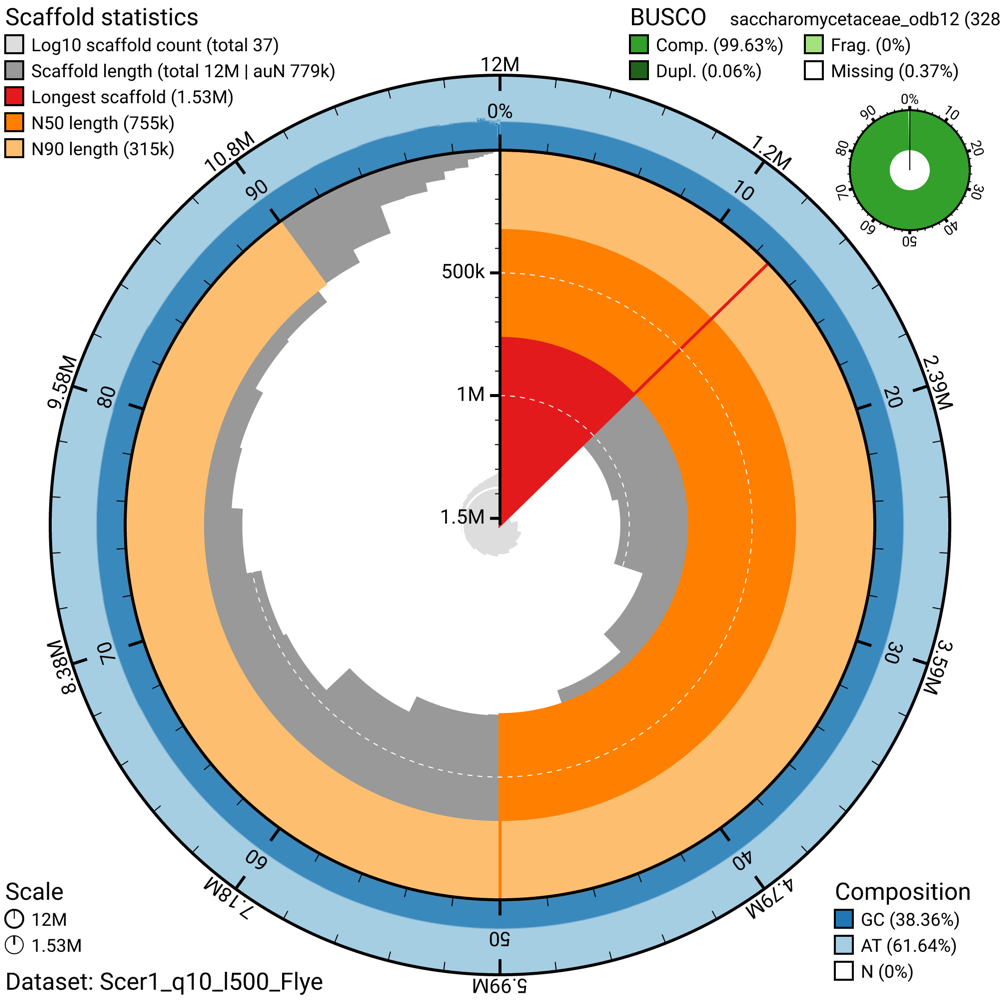{ width="650" }

=== "Scer1 Hifiasm"

    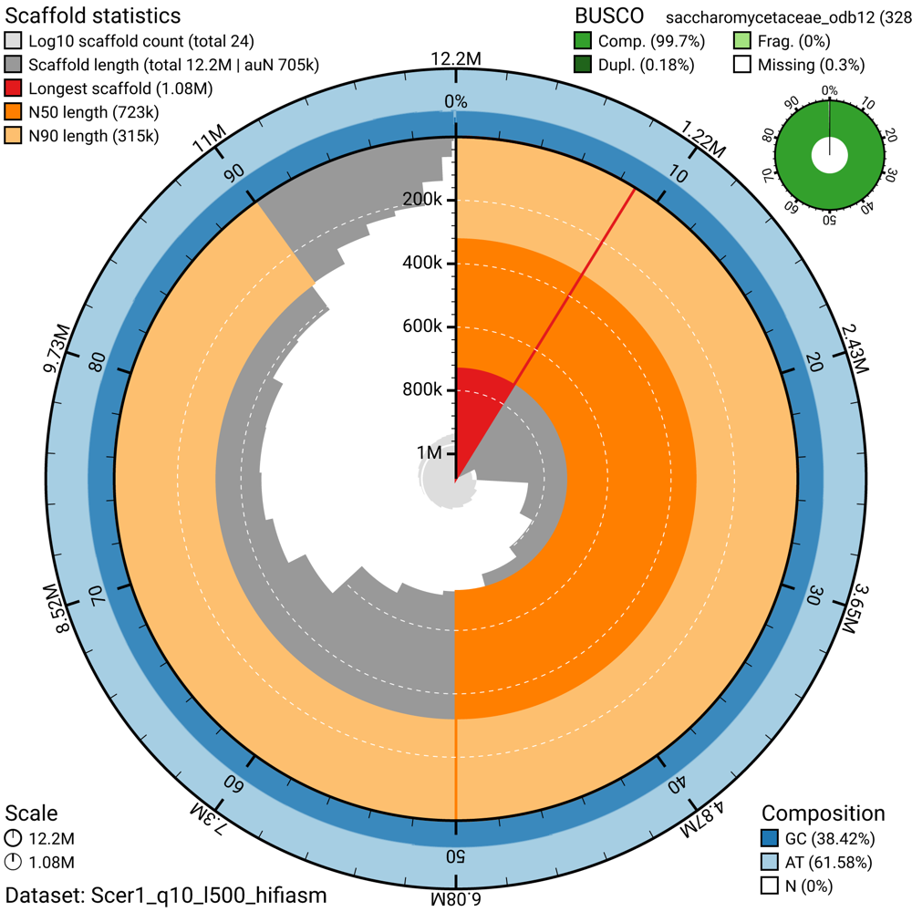{ width="650" }

=== "Scer1 NextDenovo"

    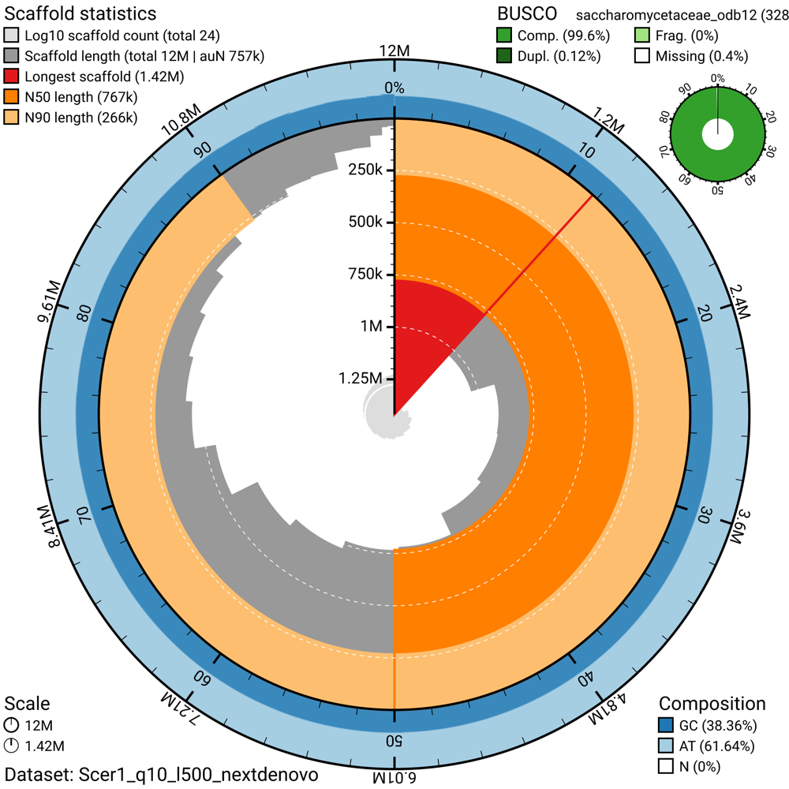{ width="650" }

=== "Scer2 Flye"

    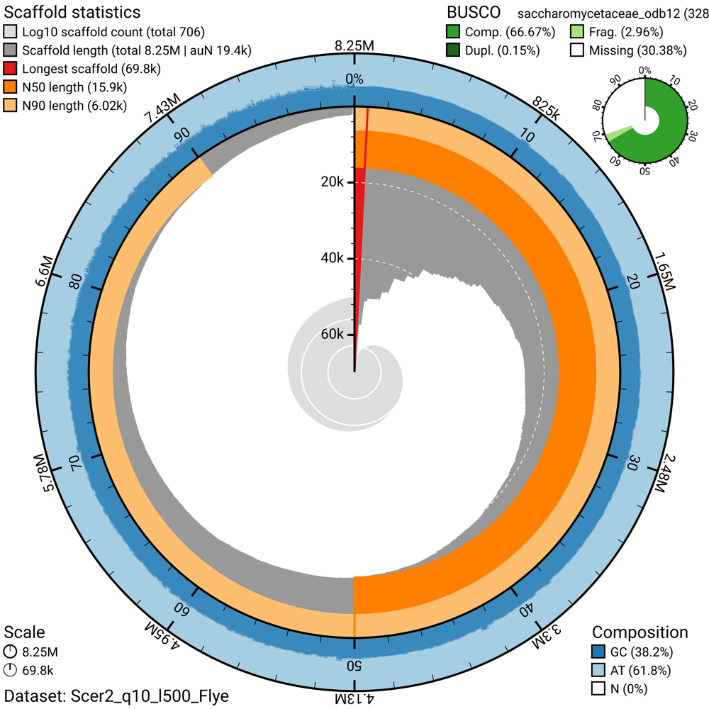{ width="650" }

=== "Scer2 Hifiasm"

    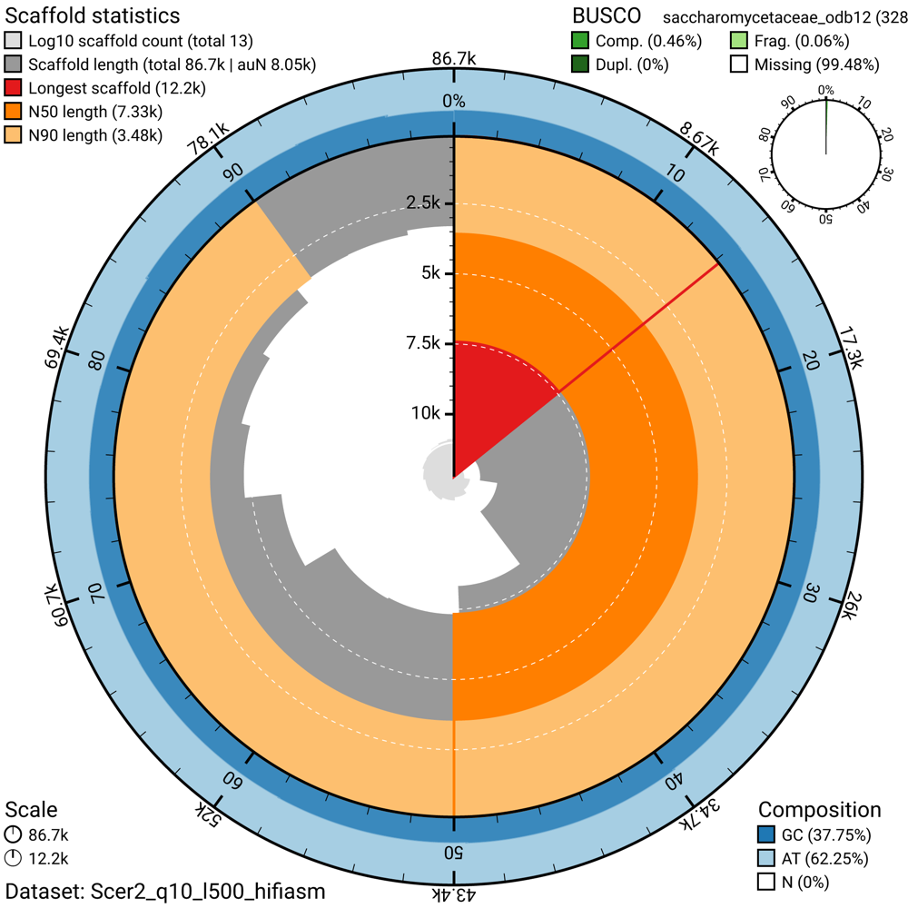{ width="650" }


!!! warning "Cuidado com a escala"
    O raio do círculo cinza é ajustado ao **maior contig de cada montagem**, e o círculo externo, ao tamanho total dela (veja o quadro *Scale*, no canto inferior esquerdo). Na Scer1, o centro do gráfico vale ~1,1 Mb; na Scer2 Flye, só 70 kb. Por isso, os desenhos parecem mais parecidos do que são: compare sempre os números da legenda, e não só a forma.

!!! question "Para comparar"
    - Coloque lado a lado a Scer1 Hifiasm e a Scer2 Flye. Na Scer1, 24 contigs cobrem 12,2 Mb, e o N50 (723 kb) aparece como uma faixa laranja larga. Na Scer2, são 706 contigs em 8,25 Mb, com N50 de 16 kb e a espiral cinza descendo até contigs de poucos kb. O BUSCO, no canto superior direito, mostra a mesma diferença: 99,7% contra 66,7%.
    - Entre as três montagens da Scer1, o que muda no gráfico? Compare o maior contig, o N50, o N90 e o número de contigs na legenda com a tabela da Etapa 14.2.
    - Na Scer2 Hifiasm, o snail plot ainda é desenhado, mas representa só ~87 kb. Que informação da legenda deixa isso claro de imediato?

### Checklist da Etapa 14

- [ ] Gerei a tabela consolidada de QUAST + Merqury + BUSCO
- [ ] Entendi por que as três métricas de completude podem divergir
- [ ] Comparei as montagens candidatas por mais de um critério (não apenas pelo maior N50)
- [ ] Contei os telômeros e os cromossomos montados de ponta a ponta (T2T) em cada montagem
- [ ] Gerei o snail plot de cada montagem final

---

## :material-flag-checkered: Escolha da montagem final

Com a checagem de contaminantes e as comparações feitas, temos todas as informações para escolher a montagem final. Reúna os critérios das etapas anteriores:

| Critério | Onde | O que olhar |
|---|---|---|
| Qualidade das bases | 11.3 e 14.2 | QV pela régua **Illumina** (a régua Nanopore infla os valores) |
| Completude gênica | 14.1 | BUSCO completos e duplicados |
| Contiguidade | 11.1 e 14.2 | número de contigs, N50, fração do genoma |
| Cromossomos completos | 14.3 | contigs T2T e pontas teloméricas |
| Erros estruturais | 11.1, 12.5 | misassemblies (lembrando que muitos são diferenças reais entre linhagens) e junções entre cromossomos |
| Contaminação | 13 | contigs de outros organismos e quanto da montagem eles representam |

Como a Etapa 13 não removeu nenhum contig, os números são os da 14.2, agora com os telômeros (14.3) e a contaminação (13):

| Montagem | Contigs | N50 (kb) | BUSCO C (%) | QV Illumina | T2T / pontas teloméricas | Misassemblies | Contaminantes |
|---|---|---|---|---|---|---|---|
| Scer1 Flye híbrida | 37 | 755 | 99,6 | 36,2 | 3 / 16 | **132** | nenhum |
| **Scer1 Hifiasm híbrida** | **24** | 723 | **99,7** | **41,3** | **3 / 22** | 168 | nenhum (+ 2-mícron) |
| Scer1 NextDenovo híbrida | **24** | **767** | 99,6 | 35,5 | 0 / 1 | 164 | nenhum |
| Scer2 Flye Medaka | 705 | 16 | 66,7 | — | 0 / 11 | 61 | nenhum |

!!! success "Montagem final"
    **Scer1: Hifiasm híbrida** (`9.Montagens-polidas/Scer1_q10_l500_hifiasm.fasta`). Ela tem o maior QV pela régua independente, com 3 a 4 vezes menos erros que as outras duas, o maior BUSCO, o menor número de contigs e o maior número de pontas teloméricas. Além disso, é a única com o plasmídeo 2-mícron montado completo. A NextDenovo tem o maior N50, mas quase não tem telômeros nas pontas. A Flye tem menos misassemblies, mas boa parte deles são diferenças reais entre linhagens (11.1).

    Ela não é perfeita: na Etapa 15, a tabela por cromossomo revela duas junções erradas envolvendo o chrV, que reduzem os T2T de 3 para 2. Os outros critérios continuam a favor dela, e as junções podem ser corrigidas, quebrando os contigs nesses pontos.

    **Scer2: Flye Medaka**, por ser a única utilizável, mas como um rascunho: 65% do genoma e dois terços dos genes. Para uma montagem completa, é preciso sequenciar mais (~6× é muito pouco).

    Em todas as montagens, a checagem de contaminantes não encontrou nada além de levedura. Isso confirma que os ~24% de reads "humanos" e os ~5–8% de *B. cereus* do Kraken2 (Etapa 4) eram falsos positivos.

Não existe uma regra única: o peso de cada critério depende do objetivo. Para anotação de genes, pesam mais o QV e o BUSCO; para estudar a organização dos cromossomos, a contiguidade, os telômeros e a ausência de junções erradas; para comparar com uma referência, os scaffolds do RagTag (Etapa 12) podem ser mais úteis do que os contigs.

---

## :material-numeric-9-plus-circle: Etapa 15 — Tabela por cromossomo

Com a montagem escolhida, vale descrevê-la cromossomo a cromossomo. Até aqui, olhamos cada critério para a montagem inteira. Esta etapa junta, em **uma linha por contig**, tudo o que já calculamos e diz a qual cromossomo da referência cada contig corresponde. Assim, dá para responder perguntas como: "o cromossomo IV foi montado em um contig só?", "tem telômero nas duas pontas?", "onde estão os genes BUSCO?", "algum contig tem QV ou cobertura fora do padrão?".

| Coluna | De onde vem | Etapa |
|---|---|---|
| cromossomo, alinhado_% | alinhamento contra a referência S288C (`minimap2`, novo aqui) | 15 |
| tamanho_pb, GC_%, cobertura, gênero | tabela do BlobToolKit | 13.4 |
| telomero_esq, telomero_dir | janelas do `tidk search` (mesmo critério da 14.3: ≥10 cópias na primeira/última janela) | 14.3 |
| QV | QV por contig do Merqury, régua Illumina (só Scer1) | 11.3 |
| BUSCO | genes BUSCO completos (únicos ou duplicados) em cada contig | 14.1 |

### 15.1 Alinhar as montagens à referência

```bash
REF=ncbi_dataset/data/GCF_000146045.2/GCF_000146045.2_R64_genomic.fna
MONTAGENS="Scer1_q10_l500_Flye Scer1_q10_l500_hifiasm Scer1_q10_l500_nextdenovo Scer2_q10_l500_Flye"   # usada no passo 15.2
mkdir -p 15.Tabela-cromossomos

# nomes dos cromossomos: NC_001133.9 -> chrI, ..., NC_001224.1 -> chrMT
grep '>' $REF | sed -E 's/^>([^ ]+) .*chromosome ([^,]+),.*/\1\tchr\2/; s/^>([^ ]+) .*mitochondrion.*/\1\tchrMT/' \
  > 15.Tabela-cromossomos/R64_nomes.tsv
cat 15.Tabela-cromossomos/R64_nomes.tsv

conda activate polimento
# -x asm10: modo do minimap2 para comparar montagens com até cerca de 10% de divergência
minimap2 -x asm10 --secondary=no -t 24 $REF 9.Montagens-polidas/Scer1_q10_l500_Flye.fasta       > 15.Tabela-cromossomos/Scer1_q10_l500_Flye.vs_R64.paf
minimap2 -x asm10 --secondary=no -t 24 $REF 9.Montagens-polidas/Scer1_q10_l500_hifiasm.fasta    > 15.Tabela-cromossomos/Scer1_q10_l500_hifiasm.vs_R64.paf
minimap2 -x asm10 --secondary=no -t 24 $REF 9.Montagens-polidas/Scer1_q10_l500_nextdenovo.fasta > 15.Tabela-cromossomos/Scer1_q10_l500_nextdenovo.vs_R64.paf
minimap2 -x asm10 --secondary=no -t 24 $REF 9.Montagens-polidas/Scer2_q10_l500_Flye.fasta       > 15.Tabela-cromossomos/Scer2_q10_l500_Flye.vs_R64.paf
conda deactivate
```

??? info "O que faz cada comando"
    | Comando | O que faz |
    |---|---|
    | `REF=` / `MONTAGENS=` / `mkdir -p` | Referência, lista das montagens (usada no passo 15.2) e pasta de saída. |
    | `grep '>' $REF | sed -E '...'` | Pega os cabeçalhos da referência e transforma cada um em `identificador<TAB>nome curto` (`NC_001133.9` → `chrI`; o mitocondrial vira `chrMT`). |
    | `cat R64_nomes.tsv` | Mostra a tabela de nomes. |
    | `minimap2 -x asm10 --secondary=no` | Alinha cada montagem na referência. O `--secondary=no` mantém só o melhor alinhamento de cada trecho. |
    | `> <montagem>.vs_R64.paf` | Salva o alinhamento em PAF, uma linha por alinhamento. |

Cada contig é atribuído ao cromossomo com o qual ele tem mais bases alinhadas. A coluna `alinhado_%` diz quanto do contig alinhou nesse cromossomo. Um valor bem abaixo de 100% indica um contig que junta pedaços de cromossomos diferentes (como os da Etapa 12.5) ou que tem muita sequência ausente da S288C.

### 15.2 Montar a tabela

O `awk` abaixo lê os cinco arquivos, um depois do outro, e junta as informações pelo nome do contig. Nas tabelas com cabeçalho, as colunas são localizadas pelo nome, então o comando funciona mesmo que a ordem delas mude.

```bash
for P in $MONTAGENS; do
  BLOB=13.Contaminantes/$P.contigs.tsv
  TELO=11.Telomeros/9.Montagens-polidas_${P}_telomeric_repeat_windows.tsv
  BUSCO=8.QC_montagens/BUSCO/${P}_final/run_saccharomycetaceae_odb12/full_table.tsv
  QV=8.QC_montagens/merqury_illumina/${P}_hibrido/${P}_hibrido.${P}_hibrido.qv
  [ -f $QV ] || QV=/dev/null          # a Scer2 não tem Illumina: coluna QV fica "-"

  awk -F'\t' -v OFS='\t' -v MIN=10 '
    FILENAME==ARGV[1] { nome[$1]=$2; ordem[$1]=FNR; next }                         # referência
    FILENAME==ARGV[2] { a[$1,$6]+=$11; if(a[$1,$6]>best[$1]){best[$1]=a[$1,$6]; chr[$1]=$6}; next }   # PAF
    FILENAME==ARGV[3] { if(FNR==1) next; n=$3+$4; if(!($1 in ini)) ini[$1]=n; fim[$1]=n; nj[$1]++; next }  # tidk
    FILENAME==ARGV[4] { qv[$1]=$4; next }                                           # Merqury
    FILENAME==ARGV[5] { if($0 ~ /^#/) next; if($2=="Complete" || $2=="Duplicated") bu[$3]++; next }  # BUSCO
    { sub(/[ \r]+$/, "") }                                                          # tira espaço/\r no fim da linha
    FNR==1 { for(i=1;i<=NF;i++){ if($i=="identifiers")id=i; if($i=="length")l=i; if($i=="gc")g=i
                                 if($i ~ /_cov$/)c=i; if($i ~ /bestsumorder_genus/)ge=i }
             print "ordem","contig","cromossomo","alinhado_%","tamanho_pb","GC_%","cobertura",
                   "telomero_esq","telomero_dir","QV","BUSCO","genero"; next }
    { k=$id
      r = (k in chr) ? nome[chr[k]] : "-"
      o = (k in chr) ? ordem[chr[k]] : 99
      pct = (k in chr) ? 100*best[k]/$l : -1; if(pct>100) pct=100
      te = (ini[k]>=MIN) ? "sim" : "nao"
      td = (nj[k]>1 && fim[k]>=MIN) ? "sim" : "nao"
      print o, k, r, (pct<0 ? "-" : sprintf("%.0f",pct)), $l, sprintf("%.1f",100*$g), sprintf("%.0f",$c),
            te, td, ((k in qv) ? sprintf("%.1f",qv[k]) : "-"), bu[k]+0, $ge }
  ' 15.Tabela-cromossomos/R64_nomes.tsv 15.Tabela-cromossomos/$P.vs_R64.paf $TELO $QV $BUSCO $BLOB \
    > 15.Tabela-cromossomos/$P.tmp

  # ordena pela ordem dos cromossomos na referência (I, II, ..., XVI) e, dentro de cada um, pelo tamanho
  ( head -1 15.Tabela-cromossomos/$P.tmp
    tail -n +2 15.Tabela-cromossomos/$P.tmp | sort -t$'\t' -k1,1n -k5,5nr ) | cut -f2- \
    > 15.Tabela-cromossomos/$P.tsv
  rm 15.Tabela-cromossomos/$P.tmp
done

column -t 15.Tabela-cromossomos/Scer1_q10_l500_hifiasm.tsv
```

??? info "O que faz cada comando"
    | Comando | O que faz |
    |---|---|
    | `for P in $MONTAGENS; do ... done` | Monta uma tabela para cada montagem. |
    | `BLOB=` / `TELO=` / `BUSCO=` / `QV=` | Arquivos de onde vêm as colunas: tabela do BlobToolKit, telômeros, BUSCO e QV por contig. |
    | `[ -f $QV ] || QV=/dev/null` | Se não existe o arquivo de QV (Scer2, sem Illumina), usa um arquivo vazio; a coluna QV fica `-`. |
    | `awk ... FILENAME==ARGV[1] ...` | O `awk` lê os seis arquivos em sequência e trata cada um de um jeito: nomes dos cromossomos, PAF (o cromossomo com mais bases alinhadas é o de cada contig), tidk (telômero na primeira e na última janela), Merqury (QV), BUSCO (genes completos por contig) e, por último, a tabela do BlobToolKit, que dá uma linha por contig. |
    | `sort -t$'\t' -k1,1n -k5,5nr` | Ordena pela ordem dos cromossomos na referência e, dentro de cada um, do maior contig para o menor. |
    | `cut -f2-` | Tira a coluna de ordem, usada só para ordenar. |
    | `rm ... .tmp` + `column -t` | Apaga o arquivo temporário e mostra a tabela da Scer1 Hifiasm. |

```text
contig        cromossomo  alinhado_%  tamanho_pb  GC_%  cobertura  telomero_esq  telomero_dir  QV    BUSCO  genero
ptg000018l_1  chrI        100         212114      39.5  71         sim           nao           49.5  45     Saccharomyces
ptg000002l_1  chrII       100         804899      38.4  56         nao           sim           44.4  222    Saccharomyces
ptg000009l_1  chrIII      100         315378      38.6  61         sim           sim           59.8  74     Saccharomyces
ptg000001l_1  chrIV       100         1013101     37.8  54         nao           sim           50.1  296    Saccharomyces
ptg000014l_1  chrIV       95          464614      38.6  71         sim           nao           46.8  128    Saccharomyces
ptg000058l_1  chrIV       91          62763       37.2  57         nao           nao           50.1  19     Saccharomyces
ptg000007l_1  chrV        84          547688      38.4  60         sim           sim           47.7  141    Saccharomyces
ptg000023l_1  chrV        62          228556      38.8  59         sim           nao           54.3  59     Saccharomyces
ptg000021l_1  chrVI       92          262861      39.1  74         nao           nao           44.3  62     Saccharomyces
ptg000005l_1  chrVII      100         1078464     38.1  52         nao           sim           34.5  317    Saccharomyces
ptg000015l_1  chrVIII     100         412697      38.6  56         sim           nao           45.5  112    Saccharomyces
ptg000024l_1  chrVIII     100         137647      38.8  67         nao           sim           49.6  34     Saccharomyces
ptg000020l_1  chrIX       98          419705      39.0  55         sim           nao           44.0  105    Saccharomyces
ptg000003l_1  chrX        99          767108      38.5  54         sim           sim           54.1  201    Saccharomyces
ptg000006l_1  chrXI       96          709870      38.3  64         sim           nao           51.8  181    Saccharomyces
ptg000004l_1  chrXII      100         723225      39.3  702        sim           nao           43.2  155    Saccharomyces
ptg000013l_1  chrXII      100         458450      38.6  70         sim           nao           44.8  119    Saccharomyces
ptg000017l_1  chrXIII     100         487182      38.2  52         sim           nao           45.5  145    Saccharomyces
ptg000011l_1  chrXIII     95          455882      38.1  54         sim           nao           32.2  126    Saccharomyces
ptg000010l_1  chrXIV      100         673501      38.6  51         sim           nao           57.7  203    Saccharomyces
ptg000008l_1  chrXV       100         1066884     38.3  55         sim           nao           48.4  290    Saccharomyces
ptg000012l_1  chrXVI      100         850467      38.2  62         nao           nao           41.9  244    Saccharomyces
ptg000069l_1  chrMT       51          1642        19.1  2260       nao           nao           35.8  0      Saccharomyces
ptg000045c_1  -           -           12600       39.0  191        nao           nao           +inf  0      no-hit
```

O `cat` mostra os 17 nomes da referência: `NC_001133.9 chrI` até `NC_001148.4 chrXVI` e `NC_001224.1 chrMT`. O alinhamento leva menos de 1 segundo por montagem.

Para a apresentação (relatório, artigo, slides), a mesma tabela pode ser convertida em Markdown:

```bash
for P in $MONTAGENS; do
  awk -F'\t' 'NR==1{ print "| Cromossomo | Contig | Alinhado (%) | Tamanho (pb) | GC (%) | Cobertura (×) | Telômero E / D | BUSCO | QV | Melhor hit |"
                     print "|---|---|---:|---:|---:|---:|:---:|---:|---:|---|"; next }
              { e=($7=="sim")?"sim":"não"; d=($8=="sim")?"sim":"não"
                printf "| %s | `%s` | %s | %s | %s | %s | %s / %s | %s | %s | *%s* |\n", $2,$1,$3,$4,$5,$6,e,d,$10,$9,$11 }' \
    15.Tabela-cromossomos/$P.tsv > 15.Tabela-cromossomos/$P.md
done
```

??? info "O que faz cada comando"
    | Comando | O que faz |
    |---|---|
    | `for P in $MONTAGENS; do awk ...; done` | Converte cada tabela `.tsv` numa tabela Markdown (`.md`), pronta para colar num relatório ou no GitHub. |
    | `NR==1{ print "| Cromossomo | ..." }` | Na primeira linha, escreve o cabeçalho e a linha de alinhamento das colunas. |
    | `printf "| %s | ..."` | Nas outras, escreve os valores de cada contig entre barras verticais, com o nome do contig em código e o gênero em itálico. |

Na Scer1 Hifiasm, a montagem escolhida, fica assim (cromossomos T2T em negrito):

| Cromossomo | Contig | Alinhado (%) | Tamanho (pb) | GC (%) | Cobertura (×) | Telômero E / D | BUSCO | QV | Melhor hit |
|---|---|---:|---:|---:|---:|:---:|---:|---:|---|
| chrI | `ptg000018l_1` | 100 | 212.114 | 39,5 | 71 | sim / não | 45 | 49,5 | *Saccharomyces* |
| chrII | `ptg000002l_1` | 100 | 804.899 | 38,4 | 56 | não / sim | 222 | 44,4 | *Saccharomyces* |
| **chrIII** | `ptg000009l_1` | 100 | 315.378 | 38,6 | 61 | sim / sim | 74 | 59,8 | *Saccharomyces* |
| chrIV | `ptg000001l_1` | 100 | 1.013.101 | 37,8 | 54 | não / sim | 296 | 50,1 | *Saccharomyces* |
| chrIV | `ptg000014l_1` | 95 | 464.614 | 38,6 | 71 | sim / não | 128 | 46,8 | *Saccharomyces* |
| chrIV | `ptg000058l_1` | 91 | 62.763 | 37,2 | 57 | não / não | 19 | 50,1 | *Saccharomyces* |
| **chrV** | `ptg000007l_1` | 84 | 547.688 | 38,4 | 60 | sim / sim | 141 | 47,7 | *Saccharomyces* |
| chrV | `ptg000023l_1` | 62 | 228.556 | 38,8 | 59 | sim / não | 59 | 54,3 | *Saccharomyces* |
| chrVI | `ptg000021l_1` | 92 | 262.861 | 39,1 | 74 | não / não | 62 | 44,3 | *Saccharomyces* |
| chrVII | `ptg000005l_1` | 100 | 1.078.464 | 38,1 | 52 | não / sim | 317 | 34,5 | *Saccharomyces* |
| chrVIII | `ptg000015l_1` | 100 | 412.697 | 38,6 | 56 | sim / não | 112 | 45,5 | *Saccharomyces* |
| chrVIII | `ptg000024l_1` | 100 | 137.647 | 38,8 | 67 | não / sim | 34 | 49,6 | *Saccharomyces* |
| chrIX | `ptg000020l_1` | 98 | 419.705 | 39,0 | 55 | sim / não | 105 | 44,0 | *Saccharomyces* |
| **chrX** | `ptg000003l_1` | 99 | 767.108 | 38,5 | 54 | sim / sim | 201 | 54,1 | *Saccharomyces* |
| chrXI | `ptg000006l_1` | 96 | 709.870 | 38,3 | 64 | sim / não | 181 | 51,8 | *Saccharomyces* |
| chrXII | `ptg000004l_1` | 100 | 723.225 | 39,3 | 702 | sim / não | 155 | 43,2 | *Saccharomyces* |
| chrXII | `ptg000013l_1` | 100 | 458.450 | 38,6 | 70 | sim / não | 119 | 44,8 | *Saccharomyces* |
| chrXIII | `ptg000017l_1` | 100 | 487.182 | 38,2 | 52 | sim / não | 145 | 45,5 | *Saccharomyces* |
| chrXIII | `ptg000011l_1` | 95 | 455.882 | 38,1 | 54 | sim / não | 126 | 32,2 | *Saccharomyces* |
| chrXIV | `ptg000010l_1` | 100 | 673.501 | 38,6 | 51 | sim / não | 203 | 57,7 | *Saccharomyces* |
| chrXV | `ptg000008l_1` | 100 | 1.066.884 | 38,3 | 55 | sim / não | 290 | 48,4 | *Saccharomyces* |
| chrXVI | `ptg000012l_1` | 100 | 850.467 | 38,2 | 62 | não / não | 244 | 41,9 | *Saccharomyces* |
| chrMT | `ptg000069l_1` | 51 | 1.642 | 19,1 | 2260 | não / não | 0 | 35,8 | *Saccharomyces* |
| 2-mícron | `ptg000045c_1` | - | 12.600 | 39,0 | 191 | não / não | 0 | +inf | sem hit (vetores) |

!!! example "O que a tabela da Scer1 Hifiasm mostra"
    - **Os 16 cromossomos estão representados.** Onze foram montados em **um contig só** (I, II, III, VI, VII, IX, X, XI, XIV, XV e XVI). Os outros estão em 2 contigs (V, VIII, XII e XIII) ou em 3 (IV, o maior cromossomo).
    - **Os três T2T da 14.3 aparecem como chrIII, chrV e chrX.** O do chrV, porém, não é o que parece (veja o quadro abaixo). A tabela também mostra os 22 telômeros da 14.3 distribuídos pelos cromossomos. Repare nos pares `sim`/`nao` + `nao`/`sim` em cromossomos quebrados em dois, como o chrVIII: cada metade traz o telômero da sua ponta. O cromossomo está completo, com uma quebra no meio.
    - **O chrXII tem um contig com cobertura de 702×**, cerca de 13 vezes a média de ~55×. É o **rDNA**: na levedura, ~150 cópias em tandem de uma unidade de 9,1 kb, no chrXII. O montador colapsa todas as cópias em poucas, e as reads de todas elas se acumulam ali. A cobertura é uma forma de estimar o número de cópias.
    - **Um contig de 1,6 kb do chrMT sobrou** na montagem (`ptg000069l_1`). Ele tem GC de 19% (o mtDNA da levedura é muito rico em AT) e cobertura de 2260×. Ele escapou da separação da mitocôndria na Etapa 9.4, provavelmente porque só ~51% dele alinha no mtDNA de referência. É um bom exemplo de como a tabela por contig revela o que as métricas da montagem inteira escondem.
    - **O 2-mícron (`ptg000045c_1`, 13.4) tem cobertura de 191×**, ~3,5 vezes a do genoma nuclear, ou seja, várias cópias por célula. O QV `+inf` indica que nenhum k-mer dele está ausente das reads Illumina: zero erros detectados.
    - **Dois contigs têm QV bem abaixo dos outros** (ptg000005, chrVII, com 34,5, e ptg000011, chrXIII, com 32,2). Nos demais, o QV fica entre 42 e 60. Vale olhar esses dois como fizemos na 11.3.
    - **`alinhado_%` abaixo de 90%** em dois contigs do chrV (84% e 62%): parte deles alinha em outro cromossomo. Investigamos esse caso no quadro abaixo.

!!! example "Investigando o chrV: um T2T que é uma junção errada"
    Por que o chrV, que tem um contig T2T, aparece em dois contigs, e nenhum deles alinha 100% no chrV? Para ver onde cada pedaço dos dois contigs cai na referência:

    ```bash
    for c in ptg000007l_1 ptg000023l_1; do
      awk -v c=$c '$1==c && $11>=10000' 15.Tabela-cromossomos/Scer1_q10_l500_hifiasm.vs_R64.paf \
        | sort -k3,3n | cut -f1-12 | column -t
    done
    ```

    ```text
    ptg000007l_1  547688  456     454294  +  NC_001137.3  576874  0       448958  406710  458057  60
    ptg000007l_1  547688  448890  547011  +  NC_001148.4  948066  850787  948048  90891   98460   60
    ptg000023l_1  228556  1495    127638  -  NC_001137.3  576874  436624  576371  108700  141360  60
    ptg000023l_1  228556  127669  221717  -  NC_001146.8  784333  8992    102496  84566   94078   60
    ```

    | Contig | Parte 1 | Parte 2 |
    |---|---|---|
    | `ptg000007l_1` (548 kb, T2T) | chrV 0–449 kb | **chrXVI** 851–948 kb (ponta do braço direito) |
    | `ptg000023l_1` (229 kb) | chrV 437–577 kb | **chrXIV** 9–102 kb (braço esquerdo) |

    Juntos, os dois contigs cobrem o chrV inteiro, mas cada um está ligado a um pedaço de outro cromossomo. A tabela confirma: o contig do chrXVI (`ptg000012l_1`, 850 kb) termina exatamente onde começa o pedaço de chrXVI do `ptg000007`, e o do chrXIV (`ptg000010l_1`, 674 kb) começa onde termina o pedaço de chrXIV do `ptg000023`. Há duas explicações possíveis: um **rearranjo real** da CBS7963 (translocação entre os cromossomos V, XIV e XVI) ou **duas junções erradas** do Hifiasm.

    **Teste 1: as reads atravessam as junções?** Contamos as reads que cobrem a junção inteira, com 1 kb de margem de cada lado, e comparamos com um trecho comum do mesmo contig, do mesmo tamanho:

    ```bash
    conda activate polimento
    BAM=13.Contaminantes/Scer1_q10_l500_hifiasm.bam
    # reads (MAPQ>=20, alinhamento primário) que começam antes de A e terminam depois de B
    span () {
      samtools view -q 20 -F 0x904 $BAM "$1:$2-$3" | awk -v a=$2 -v b=$3 '
        { len=0; c=$6
          while (match(c, /[0-9]+[MDN=X]/)) { len+=substr(c,RSTART,RLENGTH-1); c=substr(c,RSTART+RLENGTH) }
          if ($4<=a && $4+len>=b) n++ }
        END { print n+0 }'
    }
    echo "ptg7  junção chrV|chrXVI: $(span ptg000007l_1 447890 455294)  controle: $(span ptg000007l_1 200000 207404)"
    echo "ptg23 junção chrV|chrXIV: $(span ptg000023l_1 126638 128669)  controle: $(span ptg000023l_1 60000 62031)"
    conda deactivate
    ```

    ```text
    ptg7  junção chrV|chrXVI: 0  controle: 7
    ptg23 junção chrV|chrXIV: 17  controle: 34
    ```

    Nenhuma read atravessa a junção chrV|chrXVI, contra 7 no controle. Ali, os dois pedaços se sobrepõem em ~5,4 kb, o que sugere uma repetição, e só reads com mais de ~7 kb conseguiriam atravessá-la. A junção chrV|chrXIV tem metade das reads do controle. Como a janela é curta (2 kb), essas reads podem estar apenas atravessando uma sequência repetida que existe nos dois cromossomos.

    **Teste 2: os outros montadores fizeram as mesmas junções?** Usando os PAFs da 15.1:

    ```bash
    for P in Scer1_q10_l500_Flye Scer1_q10_l500_nextdenovo; do
      echo "===== $P"
      awk '$11>=10000 && ($6=="NC_001137.3" || $6=="NC_001148.4" || $6=="NC_001146.8")' \
          15.Tabela-cromossomos/$P.vs_R64.paf | sort -k1,1 -k3,3n | cut -f1-4,6,8,9 | column -t
    done
    ```

    ```text
    ===== Scer1_q10_l500_Flye
    contig_103_1  754533  201     754516  NC_001146.8  4       766864
    contig_149_1  377922  12      372641  NC_001137.3  63026   435837
    contig_20_1   29304   30      29023   NC_001146.8  754970  783974
    contig_21_1   70113   504     64185   NC_001137.3  0       63017
    contig_23_1   136493  273     126747  NC_001137.3  436624  576743
    contig_93_1   913433  24      912797  NC_001148.4  9635    948048
    ===== Scer1_q10_l500_nextdenovo
    ctg000000_1   132323  8       132309  NC_001137.3  314381  448292
    ctg000090_1   37404   5475    37387   NC_001146.8  4       15783
    ctg000100_1   134961  7325    134656  NC_001137.3  436624  576725
    ctg000120_1   766906  3580    766860  NC_001146.8  9015    783974
    ctg000150_1   395161  385289  395111  NC_001146.8  4       9842
    ctg000240_1   321021  144     321009  NC_001137.3  0       314367
    ctg000260_1   918772  60      918758  NC_001148.4  9617    948048
    ```

    Tanto no Flye quanto no NextDenovo, o **chrXVI** (`contig_93_1`, `ctg000260_1`) e o **chrXIV** (`contig_103_1`, `ctg000120_1`) estão inteiros, sem quebra em 851 kb nem em 102 kb. E os dois quebram o chrV no mesmo lugar, por volta de 436–449 kb: o pedaço da direita sempre começa em 436.624.

    **Teste 3: olhar as reads no IGV.** Os números ficam mais claros quando vemos as reads. Para não baixar o BAM inteiro, recortamos só as regiões de interesse: as duas junções e um controle.

    ```bash
    conda activate polimento
    mkdir -p 15.Tabela-cromossomos/igv && cd 15.Tabela-cromossomos/igv
    samtools view -b ../../13.Contaminantes/Scer1_q10_l500_hifiasm.bam \
      ptg000007l_1:190000-215000 ptg000007l_1:430000-470000 ptg000023l_1:110000-145000 \
      | samtools sort -o hifiasm_juncoes.bam       # o IGV exige o BAM ordenado e indexado
    samtools index hifiasm_juncoes.bam
    samtools faidx ../../9.Montagens-polidas/Scer1_q10_l500_hifiasm.fasta ptg000007l_1 ptg000023l_1 > hifiasm_chrV.fasta
    samtools faidx hifiasm_chrV.fasta
    cd ../.. && conda deactivate
    ```

    Copie os quatro arquivos para o seu computador (`scp`). Se preferir, baixe os que já preparamos: [`hifiasm_chrV.fasta`](https://github.com/LGBIO-UFG/PRO-BIOINFO/blob/main/data/exemplos/nanopore/igv/hifiasm_chrV.fasta), [`.fai`](https://github.com/LGBIO-UFG/PRO-BIOINFO/blob/main/data/exemplos/nanopore/igv/hifiasm_chrV.fasta.fai), [`hifiasm_juncoes.bam`](https://github.com/LGBIO-UFG/PRO-BIOINFO/blob/main/data/exemplos/nanopore/igv/hifiasm_juncoes.bam) e [`.bai`](https://github.com/LGBIO-UFG/PRO-BIOINFO/blob/main/data/exemplos/nanopore/igv/hifiasm_juncoes.bam.bai). Depois abra o [IGV no navegador](https://igv.org/app){ target=_blank }, sem precisar instalar nada:

    1. **Genome → Local File**: selecione o `hifiasm_chrV.fasta` **e** o `.fai` juntos;
    2. **Tracks → Local File**: selecione o `hifiasm_juncoes.bam` **e** o `.bai` juntos;
    3. digite cada região na caixa de busca: `ptg000007l_1:445,000-458,000` (junção chrV|chrXVI), `ptg000007l_1:196,000-211,000` (controle) e `ptg000023l_1:122,000-133,000` (junção chrV|chrXIV).

    No IGV, cada barra é uma read. **Cinza** são as reads com alinhamento único; **brancas** (transparentes) são as com MAPQ 0, que alinham igualmente bem em mais de um lugar da montagem. Os traços roxos e coloridos são indels e diferenças de base, normais em reads Nanopore. O gráfico cinza acima das reads é a cobertura (o número à esquerda é o máximo da escala).

    === "Junção chrV|chrXVI"

        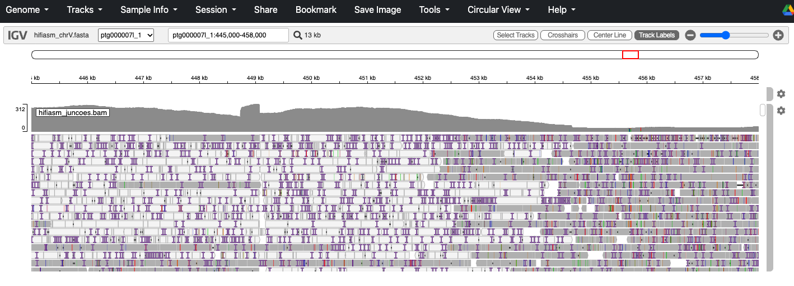

        A escala da cobertura vai até 312×. Até ~452 kb, a cobertura fica em ~250–300×, cerca de 5 vezes a média do genoma, e as reads são quase todas brancas. A junção cai dentro de uma **sequência repetida em várias cópias**. Depois de ~452 kb, a cobertura volta ao normal e as reads ficam cinza, mas nenhuma read cinza vem do lado esquerdo atravessando a repetição. Não há nada nas reads que ligue o chrV ao chrXVI.

    === "Controle (meio do chrV)"

        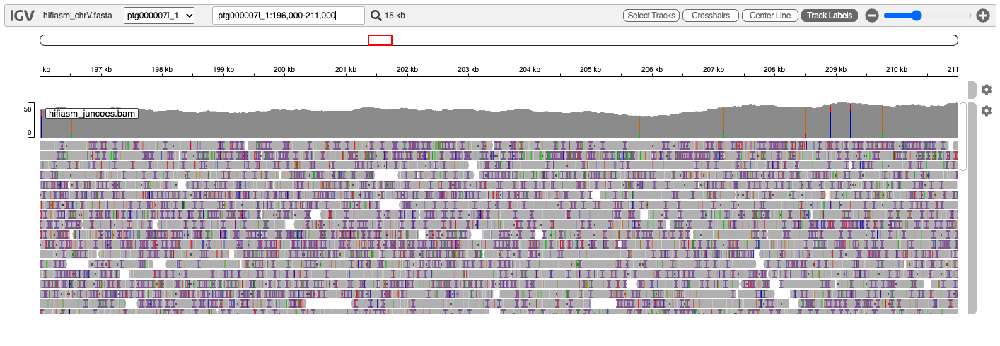

        É assim que uma região bem montada aparece: cobertura uniforme de ~55× (a escala vai só até 58), reads cinza e muitas reads longas cruzando a janela inteira, sem cortes.

    === "Junção chrV|chrXIV"

        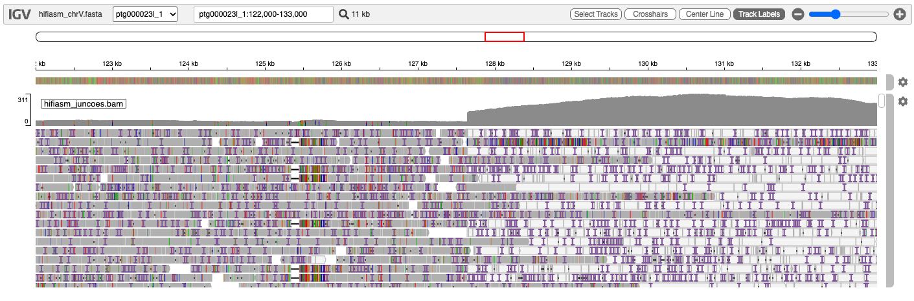

        Do lado esquerdo (chrV), a cobertura é normal e as reads são cinza. A escala vai até 311×, por isso ela parece baixa. Em ~127,7 kb, exatamente na junção, a cobertura salta para ~300× e as reads ficam brancas: começa a mesma região repetida. As reads do chrV entram na repetição, mas daí em diante o alinhamento é ambíguo. Por isso, as 17 reads do Teste 1 não comprovam a ligação com o chrXIV.

    **Conclusão:** o mais provável é que o Hifiasm tenha feito **duas junções erradas** numa região repetitiva do chrV, em ~437–449 kb, que nenhum dos três montadores conseguiu atravessar. O Flye e o NextDenovo pararam ali. O Hifiasm "continuou" em cromossomos errados. Portanto, o contig `ptg000007l_1` tem telômero nas duas pontas, mas não é um cromossomo: é o chrV esquerdo colado à ponta do chrXVI. Na Scer1 Hifiasm, os T2T de verdade são **2** (chrIII e chrX), e não 3.

    **Lições:**

    - **T2T quer dizer "telômero nas duas pontas", não "cromossomo correto".** A contagem de telômeros da 14.3 não tem como perceber uma junção errada.
    - **Desconfie de contigs que alinham em mais de um cromossomo.** Translocações reais existem em levedura, mas a primeira hipótese a testar é erro de montagem. Os testes são reads atravessando a junção e outros montadores concordando com ela.
    - **Como corrigir:** quebrar os contigs nas junções sem suporte, por exemplo com `samtools faidx` (`ptg000007l_1:1-448890` e `ptg000007l_1:454295-547688`), ou usar ferramentas que fazem isso a partir das reads, como o `ragtag.py correct` ou o Inspector. Isso não muda as outras métricas da montagem (QV, BUSCO), mas muda a contagem de T2T e o que se pode afirmar sobre a estrutura dos cromossomos.

!!! tip "Checagem de rotina: confira as junções com as reads"
    Sempre que um contig alinhar em mais de um cromossomo, ou que um T2T parecer bom demais, olhe as reads na região antes de tirar conclusões. Rearranjos reais têm reads atravessando a junção; junções erradas, não. Duas ferramentas ajudam:

    - **[IGV](https://igv.org){ target=_blank }**: abra a montagem (`.fasta`) e o BAM das reads (o da 13.2) e vá até a junção, como no Teste 3 acima. Numa junção correta, várias reads passam inteiras de um lado para o outro. Numa junção errada, as reads param na junção ou aparecem cortadas (*soft-clipped*) exatamente ali, e a cobertura cai.
    - **[Inspector](https://github.com/ChongLab/Inspector){ target=_blank }**: avalia a montagem inteira a partir das reads longas (aceita Nanopore com `--datatype nanopore`) e lista as regiões com erros estruturais, sem precisar saber onde procurar. Ele também pode corrigir as que encontrar.

    Um exemplo do que vale olhar: o T2T do chrVI na Flye (`contig_10_1`) alinha no chrVI no meio, mas as pontas (~11 kb de cada lado) alinham em subtelômeros do chrXII e do chrVIII, com MAPQ baixo (23–33). Pontas de cromossomos de levedura compartilham famílias de sequências subteloméricas, que variam entre linhagens. Por isso, isso provavelmente é uma diferença real da CBS7963, e não um erro, mas só as reads podem confirmar.

O arquivo `.tsv` abre direto em planilhas (Excel, LibreOffice, Google Sheets), o que facilita filtrar e colorir.

!!! question "Para explorar a tabela"
    - Quantos dos 16 cromossomos foram montados em **um contig só**? Quais estão quebrados em vários?
    - Os contigs com `sim` nas duas colunas de telômero são os T2T da Etapa 14.3. A que cromossomos eles correspondem?
    - Algum contig tem cobertura muito acima da média (cópias a mais, como rDNA ou Ty) ou QV bem abaixo dos outros (como os da Etapa 11.3)?
    - Os contigs que o RagTag deixou sem posição (Etapa 12.1) aparecem aqui com `-` ou com `alinhado_%` baixo?
    - O comando gera a tabela também para as outras candidatas. Compare as tabelas da Flye, da Hifiasm e da NextDenovo: em quais cromossomos uma montadora foi melhor que as outras? Isso confirma a escolha feita acima?

### Checklist da Etapa 15

- [ ] Gerei a tabela por contig da montagem escolhida (e das outras candidatas) em `15.Tabela-cromossomos/`
- [ ] Identifiquei quais cromossomos estão completos (um contig, com telômeros nas duas pontas)

!!! tip "Próximos passos típicos"
    - **Projetos sem Illumina:** sequenciar uma biblioteca Illumina da mesma linhagem, tanto para o polimento híbrido quanto para ter uma régua independente de qualidade
    - **Detecção de elementos repetitivos:** RepeatModeler + RepeatMasker
    - **Anotação estrutural:** BRAKER3 ou MAKER
    - **Anotação funcional:** InterProScan, eggNOG-mapper

---

## :material-license: Licença

Este tutorial é distribuído sob [CC BY 4.0](https://creativecommons.org/licenses/by/4.0/). Reutilize com atribuição.

## :material-bug: Reportar problemas

Encontrou erro, comando obsoleto, ou tem sugestão? Abra uma [issue no GitHub](https://github.com/LGBIO-UFG/PRO-BIOINFO/issues) usando o template "Erro no tutorial".

