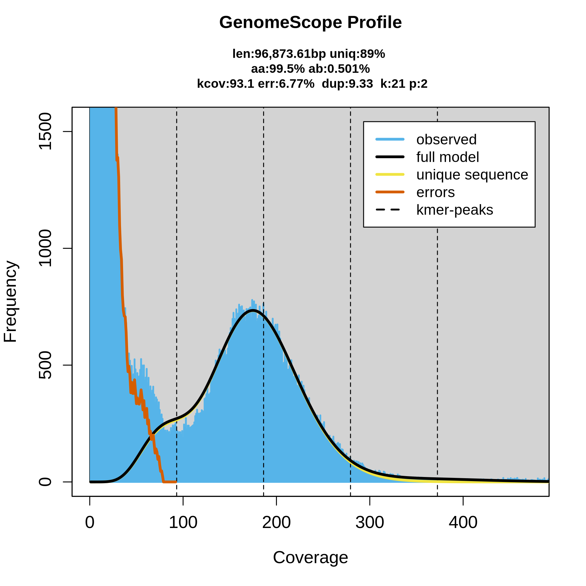
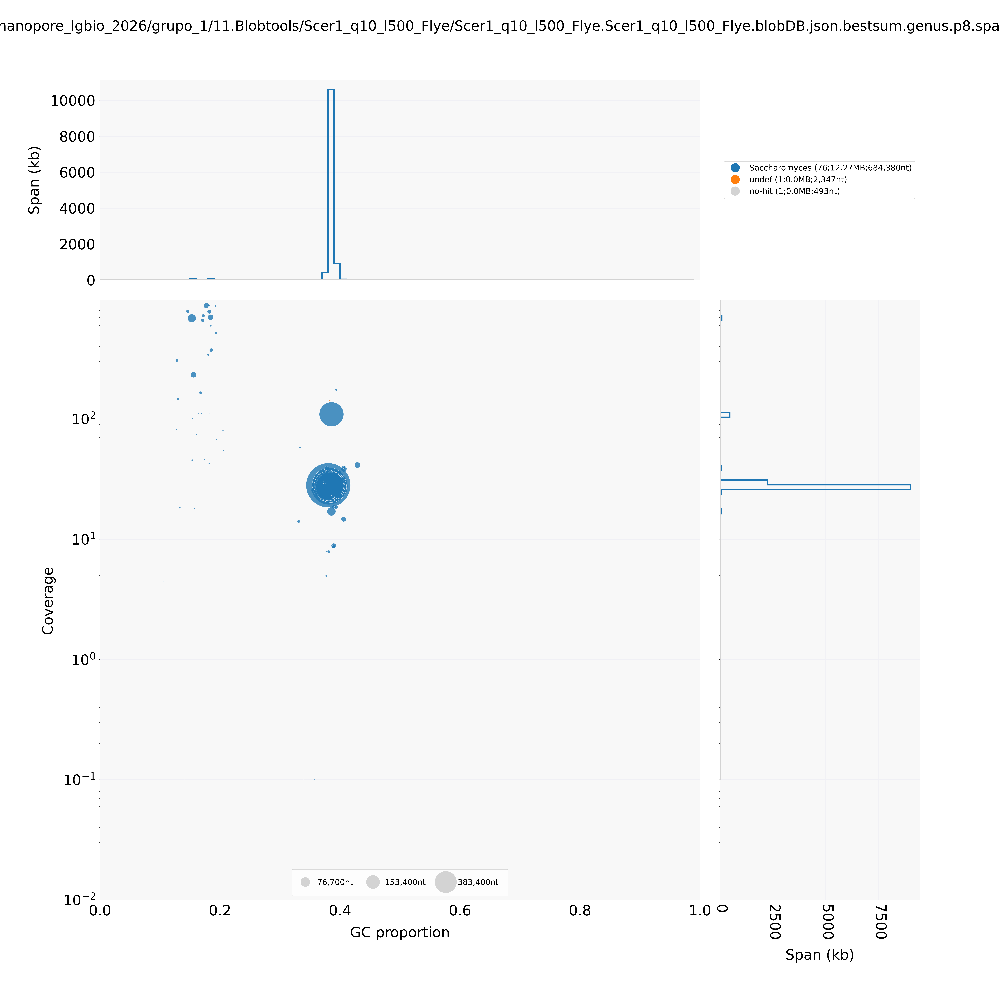
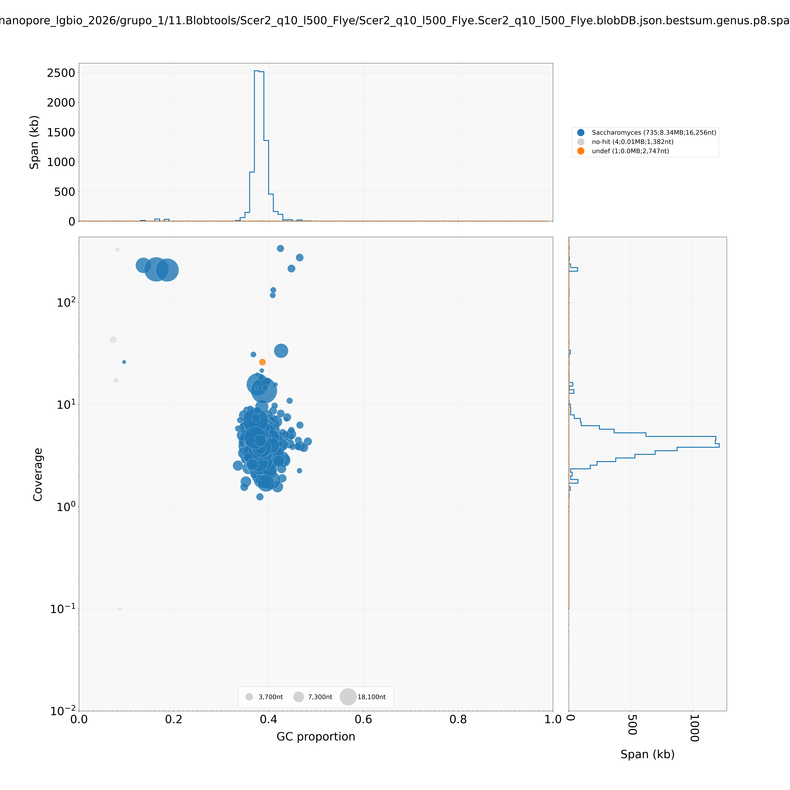

# Montagem de genomas com dados Nanopore

!!! abstract "Resumo"
    Tutorial prático de montagem *de novo* de genomas a partir de dados de sequenciamento Oxford Nanopore Technology (ONT). Cobrimos o pipeline completo: download dos dados públicos, controle de qualidade, filtragem, exploração de contaminantes (Kraken2), estimativa do genoma por k-mers (GenomeScope2), três estratégias de montagem (Flye, Hifiasm, NextDenovo), avaliação comparativa (QUAST, Merqury, BUSCO), polimento (Medaka), scaffolding com e sem referência (RagTag, LongStitch), escolha da montagem final e checagem de contaminação na montagem com BlobTools.

**Autora:** Profa. Renata de Oliveira Dias
**Instituição:** Laboratório de Genética & Biodiversidade (LGBio) — Instituto de Ciências Biológicas (ICB) / Universidade Federal de Goiás (UFG)
**Contato:** [renata_dias@ufg.br](mailto:renata_dias@ufg.br)
**Última atualização:** Julho de 2026

## :material-target: Objetivos de aprendizagem

Ao final deste curso, você será capaz de:

- [ ] Baixar dados públicos de sequenciamento ONT de bancos como ENA/SRA
- [ ] Avaliar qualidade de leituras longas com NanoPlot
- [ ] Remover adaptadores residuais (Porechop_ABI) e filtrar por qualidade/tamanho (Chopper)
- [ ] Explorar contaminantes com Kraken2 e interpretar suas limitações
- [ ] Estimar parâmetros do genoma a partir de k-mers (Meryl + GenomeScope2)
- [ ] Executar e comparar montagens *de novo* com Flye, Hifiasm e NextDenovo
- [ ] Avaliar montagens com QUAST, Merqury e BUSCO e entender por que essas métricas podem discordar
- [ ] Polir montagens com Medaka e avaliar quando o polimento realmente ajuda
- [ ] Realizar scaffolding com referência (RagTag) e sem referência (LongStitch)
- [ ] Escolher a montagem final com base em múltiplas evidências, não em uma métrica isolada
- [ ] Checar contaminação diretamente na montagem com BlobTools

## :material-clock-outline: Carga horária estimada

**~16 horas** 

## :material-tools: Pré-requisitos

| Item                | Detalhes                                                                          |
| ------------------- | ---------------------------------------------------------------------------------- |
| Curso anterior      | [Bash / Linux para bioinformática](../bash/index.md)                              |
| Biologia molecular  | Conceitos de sequenciamento, genoma, contig, scaffold                             |
| Softwares           | SRA Toolkit, NanoPlot, Porechop_ABI, Chopper, Kraken2, Meryl, GenomeScope2, Flye, Hifiasm, NextDenovo, QUAST, Merqury, BUSCO, Medaka, RagTag, LongStitch, minimap2, samtools, BLAST+, BlobTools |
| Recurso             | Servidor Linux com boa quantidade de RAM/threads e várias dezenas de GB de storage livre |

## :material-database: Dados do exercício

Utilizamos duas amostras de *Saccharomyces cerevisiae* sequenciadas com PromethION, depositadas no projeto [PRJEB77686](https://www.ebi.ac.uk/ena/browser/view/PRJEB77686) (ScRAP — *S. cerevisiae* Reference Assembly Panel), parte do estudo de Loegler et al. (2025).

| Amostra | Accession | Linhagem | Bases | Read N50 |
|---------|-----------|----------|-------|----------|
| **Scer1** | [ERR13367646](https://www.ebi.ac.uk/ena/browser/view/ERR13367646) | CBS7963 | ~1 Gb | 5.592 bp |
| **Scer2** | [ERR13375657](https://www.ebi.ac.uk/ena/browser/view/ERR13375657) | SM.9.1.AL1 | ~108 Mb | 1.865 bp |

!!! warning "Atenção à cobertura"
    Scer2 tem cobertura muito baixa para montagem de qualidade — usada aqui apenas para fins didáticos e comparação entre montadores. Ao longo do tutorial ela serve de contraste: mesma metodologia, dados insuficientes.

!!! quote "Referência"
    Loegler V. et al. *From genotype to phenotype with 1,086 near telomere-to-telomere yeast genomes*. **Nature** (2025). DOI: [10.1038/s41586-025-08616-z](https://doi.org/10.1038/s41586-025-08616-z)

## :material-download: Acesso aos resultados pré-computados

Não conseguiu rodar localmente, ou quer conferir se seus resultados batem com os esperados? Os principais outputs deste tutorial estão disponíveis para download/visualização direta na página, próximos de cada etapa. Resumo dos principais:

<div class="grid cards" markdown>

-   :material-file-chart: **Relatórios de QC**

    NanoPlot (bruto e filtrado), estatísticas Kraken2, GenomeScope2

    [:octicons-arrow-right-24: Ir para a Etapa 2](#etapa-2-controle-de-qualidade-dos-dados-brutos-nanoplot)

-   :material-chart-box: **Avaliação das montagens**

    QUAST, Merqury e BUSCO — antes e depois do polimento

    [:octicons-arrow-right-24: Ir para a Etapa 9](#etapa-9-avaliacao-da-qualidade-das-montagens)

-   :material-dna: **Montagens (FASTA)**

    Flye, Hifiasm, NextDenovo, versões polidas e scaffolded

    [:octicons-arrow-right-24: Ver data/exemplos/nanopore/assemblies/](https://github.com/LGBIO-UFG/PRO-BIOINFO/tree/main/data/exemplos/nanopore/assemblies)

-   :material-image-multiple: **Blob plots (BlobTools)**

    Checagem de contaminação nas montagens finais

    [:octicons-arrow-right-24: Ir para a Etapa 14](#etapa-14-checagem-de-contaminantes-na-montagem-blobtools)
</div>

---

## :material-numeric-1-circle: Etapa 1 — Obtenção dos dados públicos

Os dados estão disponíveis no ENA. O download pode ser feito via SRA Toolkit (`prefetch` + `fasterq-dump`) ou diretamente via FTP do ENA, que costuma ser mais rápido.

**Opção 1 — SRA Toolkit (recomendado para arquivos grandes):**

```bash
mkdir 0.DadosBrutos
prefetch ERR13367646 -O 0.DadosBrutos
fasterq-dump 0.DadosBrutos/ERR13367646/ERR13367646.sra --outdir 0.DadosBrutos --outfile Scer1.fastq --progress && gzip 0.DadosBrutos/Scer1.fastq

prefetch ERR13375657 -O 0.DadosBrutos
fasterq-dump 0.DadosBrutos/ERR13375657/ERR13375657.sra --outdir 0.DadosBrutos --outfile Scer2.fastq --progress && gzip 0.DadosBrutos/Scer2.fastq
```

??? note "Ver saída do comando"

    ```bash
    $ prefetch ERR13367646 -O 0.DadosBrutos

    2026-06-04T14:11:41 prefetch.3.0.0: Current preference is set to retrieve SRA Normalized Format files with full base quality scores.
    2026-06-04T14:11:42 prefetch.3.0.0: 1) Downloading 'ERR13367646'...
    2026-06-04T14:11:42 prefetch.3.0.0: SRA Normalized Format file is being retrieved, if this is different from your preference, it may be due to current file availability.
    2026-06-04T14:11:42 prefetch.3.0.0:  Downloading via HTTPS...
    2026-06-04T14:12:36 prefetch.3.0.0:  HTTPS download succeed
    2026-06-04T14:12:37 prefetch.3.0.0:  'ERR13367646' is valid
    2026-06-04T14:12:37 prefetch.3.0.0: 1) 'ERR13367646' was downloaded successfully
    2026-06-04T14:12:37 prefetch.3.0.0: 'ERR13367646' has 0 unresolved dependencies

    $ fasterq-dump 0.DadosBrutos/ERR13367646/ERR13367646.sra --outdir 0.DadosBrutos --outfile Scer1.fastq --progress && gzip 0.DadosBrutos/Scer1.fastq
    join   :|-------------------------------------------------- 100%   
    concat :|-------------------------------------------------- 100%   
    spots read      : 349,324
    reads read      : 349,324
    reads written   : 349,324

    $ prefetch ERR13375657 -O 0.DadosBrutos

    2026-06-04T14:12:12 prefetch.3.0.0: Current preference is set to retrieve SRA Normalized Format files with full base quality scores.
    2026-06-04T14:12:12 prefetch.3.0.0: 1) Downloading 'ERR13375657'...
    2026-06-04T14:12:12 prefetch.3.0.0: SRA Normalized Format file is being retrieved, if this is different from your preference, it may be due to current file availability.
    2026-06-04T14:12:12 prefetch.3.0.0:  Downloading via HTTPS...
    2026-06-04T14:12:27 prefetch.3.0.0:  HTTPS download succeed
    2026-06-04T14:12:27 prefetch.3.0.0:  'ERR13375657' is valid
    2026-06-04T14:12:27 prefetch.3.0.0: 1) 'ERR13375657' was downloaded successfully
    2026-06-04T14:12:27 prefetch.3.0.0: 'ERR13375657' has 0 unresolved dependencies

    $ fasterq-dump 0.DadosBrutos/ERR13375657/ERR13375657.sra --outdir 0.DadosBrutos --outfile Scer2.fastq --progress && gzip 0.DadosBrutos/Scer2.fastq
    join   :|-------------------------------------------------- 100%   
    concat :|-------------------------------------------------- 100%   
    spots read      : 57,918
    reads read      : 57,918
    reads written   : 57,918
    ```


**Opção 2 — wget direto do ENA (mais simples):**

```bash
mkdir 0.DadosBrutos
wget -P 0.DadosBrutos ftp://ftp.sra.ebi.ac.uk/vol1/fastq/ERR133/046/ERR13367646/ERR13367646.fastq.gz
wget -P 0.DadosBrutos ftp://ftp.sra.ebi.ac.uk/vol1/fastq/ERR133/057/ERR13375657/ERR13375657.fastq.gz

# Renomear para padronizar
mv 0.DadosBrutos/ERR13367646.fastq.gz 0.DadosBrutos/Scer1.fastq.gz
mv 0.DadosBrutos/ERR13375657.fastq.gz 0.DadosBrutos/Scer2.fastq.gz
```

??? note "Ver saída do comando"

    ```bash
    $ wget -P 0.DadosBrutos ftp://ftp.sra.ebi.ac.uk/vol1/fastq/ERR133/046/ERR13367646/ERR13367646.fastq.gz
    --2026-07-07 23:37:28--  ftp://ftp.sra.ebi.ac.uk/vol1/fastq/ERR133/046/ERR13367646/ERR13367646.fastq.gz
           => '0.DadosBrutos/ERR13367646.fastq.gz'
    Resolving ftp.sra.ebi.ac.uk (ftp.sra.ebi.ac.uk)... 193.62.193.165
    Connecting to ftp.sra.ebi.ac.uk (ftp.sra.ebi.ac.uk)|193.62.193.165|:21... connected.

    Logging in as anonymous ... Logged in!
    ==> SYST ... done.    ==> PWD ... done.
    ==> TYPE I ... done.  ==> CWD (1) /vol1/fastq/ERR133/046/ERR13367646 ... done.
    ==> SIZE ERR13367646.fastq.gz ... 952022096
    ==> PASV ... done.    ==> RETR ERR13367646.fastq.gz ... done.
    Length: 952022096 (908M) (unauthoritative)
    
    ERR13367646.fastq.gz             100%[=========================================================>] 907.92M   597KB/s    in 31m 15s 

    2026-07-08 00:08:45 (496 KB/s) - '0.DadosBrutos/ERR13367646.fastq.gz' saved [952022096]

    $ wget -P 0.DadosBrutos ftp://ftp.sra.ebi.ac.uk/vol1/fastq/ERR133/057/ERR13375657/ERR13375657.fastq.gz
    --2026-07-08 00:08:45--  ftp://ftp.sra.ebi.ac.uk/vol1/fastq/ERR133/057/ERR13375657/ERR13375657.fastq.gz
           => '0.DadosBrutos/ERR13375657.fastq.gz'
    Resolving ftp.sra.ebi.ac.uk (ftp.sra.ebi.ac.uk)... 193.62.193.165
    Connecting to ftp.sra.ebi.ac.uk (ftp.sra.ebi.ac.uk)|193.62.193.165|:21... connected.
    Logging in as anonymous ... Logged in!
    ==> SYST ... done.    ==> PWD ... done.
    ==> TYPE I ... done.  ==> CWD (1) /vol1/fastq/ERR133/057/ERR13375657 ... done.
    ==> SIZE ERR13375657.fastq.gz ... 101703198
    ==> PASV ... done.    ==> RETR ERR13375657.fastq.gz ... done.
    Length: 101703198 (97M) (unauthoritative)

    ERR13375657.fastq.gz             100%[=========================================================>]  96.99M   605KB/s    in 4m 2s   

    2026-07-08 00:12:49 (410 KB/s) - '0.DadosBrutos/ERR13375657.fastq.gz' saved [101703198]
    ```

**Verificar integridade após o download:**
```bash
gzip -t 0.DadosBrutos/Scer1.fastq.gz && echo "OK" || echo "CORROMPIDO"
gzip -t 0.DadosBrutos/Scer2.fastq.gz && echo "OK" || echo "CORROMPIDO"
```

??? note "Ver saída do comando"

    ```bash
    $ gzip -t 0.DadosBrutos/Scer1.fastq.gz && echo "OK" || echo "CORROMPIDO"
    OK
    $ gzip -t 0.DadosBrutos/Scer2.fastq.gz && echo "OK" || echo "CORROMPIDO"
    OK
    ```

## :material-numeric-2-circle: Etapa 2 — Controle de qualidade dos dados brutos (NanoPlot)

O NanoPlot gera estatísticas e gráficos interativos para avaliar a qualidade das reads antes de qualquer processamento.


```bash
mkdir 1.QC_dadosbrutos/
NanoPlot --fastq 0.DadosBrutos/Scer1.fastq.gz -o 1.QC_dadosbrutos/ --prefix Scer1_ --threads 20 --loglength
NanoPlot --fastq 0.DadosBrutos/Scer2.fastq.gz -o 1.QC_dadosbrutos/ --prefix Scer2_ --threads 20 --loglength
```

**Visualizar estatísticas**

```bash
more 1.QC_dadosbrutos/Scer1_NanoStats.txt
more 1.QC_dadosbrutos/Scer2_NanoStats.txt 
```

??? note "Ver saída do comando"

    ```bash
    $ more 1.QC_dadosbrutos/Scer1_NanoStats.txt 
    General summary:         
    Mean read length:                 2,909.1
    Mean read quality:                   11.6
    Median read length:               1,599.0
    Median read quality:                 12.8
    Number of reads:                349,324.0
    Read length N50:                  5,592.0
    STDEV read length:                3,578.7
    Total bases:              1,016,222,921.0
    Number, percentage and megabases of reads above quality cutoffs
    >Q10:	274368 (78.5%) 840.0Mb
    >Q15:	84994 (24.3%) 262.8Mb
    >Q20:	2246 (0.6%) 2.5Mb
    >Q25:	34 (0.0%) 0.0Mb
    >Q30:	4 (0.0%) 0.0Mb
    Top 5 highest mean basecall quality scores and their read lengths
    1:	31.2 (217)
    2:	30.9 (265)
    3:	30.4 (102)
    4:	30.1 (264)
    5:	29.4 (213)
    Top 5 longest reads and their mean basecall quality score
    1:	88753 (7.6)
    2:	82457 (11.0)
    3:	79554 (4.3)
    4:	71052 (12.0)
    5:	49948 (13.8)
    
    $ more 1.QC_dadosbrutos/Scer2_NanoStats.txt 
    General summary:         
    Mean read length:                1,865.7
    Mean read quality:                  10.9
    Median read length:              1,127.0
    Median read quality:                12.2
    Number of reads:                57,918.0
    Read length N50:                 3,145.0
    STDEV read length:               2,252.9
    Total bases:               108,057,273.0
    Number, percentage and megabases of reads above quality cutoffs
    >Q10:	41441 (71.6%) 82.1Mb
    >Q15:	12940 (22.3%) 26.6Mb
    >Q20:	561 (1.0%) 0.8Mb
    >Q25:	16 (0.0%) 0.0Mb
    >Q30:	0 (0.0%) 0.0Mb
    Top 5 highest mean basecall quality scores and their read lengths
    1:	28.5 (139)
    2:	28.0 (142)
    3:	27.9 (552)
    4:	26.9 (310)
    5:	26.7 (387)
    Top 5 longest reads and their mean basecall quality score
    1:	88333 (7.8)
    2:	71372 (13.3)
    3:	70398 (13.3)
    4:	63207 (10.1)
    5:	46792 (5.1)
    ```


**O que observar:**
- **N50:** tamanho da read mediana ponderada (quanto maior, melhor para montagem)
- **Mean quality:** qualidade média das bases (Q≥10 é aceitável para Nanopore R9.4)
- **Total bases:** cobertura estimada (divida pelo tamanho do genoma ~12Mb)
- Compare Scer1 (~1Gb, ~83x) e Scer2 (~108Mb, ~9x). Como veremos ao longo desse tutorial, a diferença de cobertura vai impactar diretamente a qualidade das montagens.

!!! tip "Resultados pré-computados"
    [:material-file-document: Scer1_NanoStats.txt](outputs/qc/Scer1_NanoStats.txt) ·
    [:material-file-document: Scer2_NanoStats.txt](outputs/qc/Scer2_NanoStats.txt) ·
    [:material-file-chart: Relatório NanoPlot Scer1 (HTML)](outputs/qc/Scer1_NanoPlot-report.html){ target=_blank } ·
    [:material-file-chart: Relatório NanoPlot Scer2 (HTML)](outputs/qc/Scer2_NanoPlot-report.html){ target=_blank }

!!! danger "Atenção: verifique se a biblioteca foi preparada com DCS (controle lambda)"
    O **DCS** (*DNA Control Strand*) é uma fita controle de DNA: um amplicon padrão de **3,6 kb** que mapeia na extremidade 3' do genoma do fago lambda e é usado como controle positivo de qualidade. Ele vem incluído nos kits de ligação da Oxford Nanopore e é adicionado na etapa de *end-prep*, quando o protocolo indica.

    Se o DCS foi usado, as reads de lambda estão misturadas às reads da sua amostra e **devem ser removidas**. A remoção é feita na **Etapa 3.2**, junto com o filtro de qualidade e tamanho (Chopper).

    **Não sabe se o DCS foi usado?** Abra o gráfico *Read lengths vs Average read quality* do relatório NanoPlot. Um **pico estreito e muito alto por volta de 3,6 kb** no histograma de comprimento, com uma "coluna" vertical de pontos nessa mesma posição no gráfico de dispersão, indica a presença do DCS:

    

    Nesse caso, siga as instruções do quadro **"Se a biblioteca tiver DCS (lambda)"** na Etapa 3.2.

## :material-numeric-3-circle: Etapa 3 — Filtragem dos dados brutos de sequenciamento

Esta etapa é dividida em duas partes: remoção de adaptadores residuais e filtro por qualidade/tamanho.

### 3.1 Remoção de adaptadores (Porechop_ABI)

O Porechop_ABI usa uma abordagem *ab initio*. Ele descobre os adaptadores diretamente nas reads sem precisar de um banco de dados externo, o que é útil quando o kit de sequenciamento não é conhecido.

!!! warning "Atenção aos avisos"
    Mensagens como *"this file is already trimmed"* indicam que o basecaller (Dorado) já removeu parte dos adaptadores. O Porechop_ABI ainda consegue remover resíduos remanescentes. Veja no resultado que adaptadores SQK-NSK007 foram encontrados e removidos em ambas as amostras.

```bash
conda init
source ~/.bashrc
mkdir -p 2.Filtragem-dadosbrutos
conda activate porechop_abi_env
porechop_abi -abi -i 0.DadosBrutos/Scer1.fastq.gz -o 2.Filtragem-dadosbrutos/Scer1_trim.fastq.gz --format fastq.gz -t 20 
porechop_abi -abi -i 0.DadosBrutos/Scer2.fastq.gz -o 2.Filtragem-dadosbrutos/Scer2_trim.fastq.gz --format fastq.gz -t 20 
conda deactivate
```

??? note "Ver saída do comando"

    ```bash
    $ porechop_abi -abi -i 0.DadosBrutos/Scer1.fastq.gz -o 2.Filtragem-dadosbrutos/Scer1_trim.fastq.gz --format fastq.gz -t 20 

    Ab Initio Phase
    Starting with a 10 run batch.
    Using config file:/home/lgbio/programas/porechop_abi/Porechop_ABI/porechop_abi/ab_initio.config
    Command line:
     /home/lgbio/programas/porechop_abi/Porechop_ABI/porechop_abi/approx_counter 0.DadosBrutos/Scer1.fastq.gz -v 1 --config /home/lgbio/programas/porechop_abi/Porechop_ABI/porechop_abi/ab_initio.config -o ./tmp/temp_approx_kmer_count -nt 20 -mr 10
    Kmer size:             16
    Sampled sequences:     40000
    Sampling length        100
    LC filter threshold:   1
    Adjusted LC threshold: 1
    Nb thread:             20
    Number of kept kmer:   500
    Number of runs:        10
    Verbosity level:       1

    A total of 10 runs will be performed.
    [334.902 ms]    Parsing FASTA file
    [15850.1 ms]    Number of sequences found: 349324.
    Starting run number 1
    [15850.1 ms]    Working on sequence start.
    [24126.9 ms]    Working on sequence end.
    Starting run number 2
    [31561 ms]      Working on sequence start.
    [38662.3 ms]    Working on sequence end.
    Starting run number 3
    [46021.6 ms]    Working on sequence start.
    [52991.7 ms]    Working on sequence end.
    Starting run number 4
    [60436.5 ms]    Working on sequence start.
    [67517.8 ms]    Working on sequence end.
    Starting run number 5
    [74812.3 ms]    Working on sequence start.
    [81866.6 ms]    Working on sequence end.
    Starting run number 6
    [89248.9 ms]    Working on sequence start.
    [96560.6 ms]    Working on sequence end.
    Starting run number 7
    [103856 ms]     Working on sequence start.
    [110917 ms]     Working on sequence end.
    Starting run number 8
    [118201 ms]     Working on sequence start.
    [125110 ms]     Working on sequence end.
    Starting run number 9
    [132367 ms]     Working on sequence start.
    [139400 ms]     Working on sequence end.
    Starting run number 10
    [146739 ms]     Working on sequence start.
    [153769 ms]     Working on sequence end.
    Assembling run 1
    /!\      The most frequent kmer has been found in less than 10% of the reads starts after approximate count (2.44%)
    /!\      It could mean this file is already trimmed or the sample do not contains detectable adapters.
    /!\      The most frequent kmer has been found in less than 10% of the reads ends after approximate count (4.97%)
    /!\      It could mean this file is already trimmed or the sample do not contains detectable adapters.
    Assembling run 2
    /!\      The most frequent kmer has been found in less than 10% of the reads starts after approximate count (2.34%)
    /!\      It could mean this file is already trimmed or the sample do not contains detectable adapters.
    /!\      The most frequent kmer has been found in less than 10% of the reads ends after approximate count (4.92%)
    /!\      It could mean this file is already trimmed or the sample do not contains detectable adapters.
    Assembling run 3
    /!\      The most frequent kmer has been found in less than 10% of the reads starts after approximate count (2.4375%)
    /!\      It could mean this file is already trimmed or the sample do not contains detectable adapters.
    /!\      The most frequent kmer has been found in less than 10% of the reads ends after approximate count (4.8925%)
    /!\      It could mean this file is already trimmed or the sample do not contains detectable adapters.
    Assembling run 4
    /!\      The most frequent kmer has been found in less than 10% of the reads starts after approximate count (2.255%)
    /!\      It could mean this file is already trimmed or the sample do not contains detectable adapters.
    /!\      The most frequent kmer has been found in less than 10% of the reads ends after approximate count (5.22%)
    /!\      It could mean this file is already trimmed or the sample do not contains detectable adapters.
    Assembling run 5
    /!\      The most frequent kmer has been found in less than 10% of the reads starts after approximate count (2.4175%)
    /!\      It could mean this file is already trimmed or the sample do not contains detectable adapters.
    /!\      The most frequent kmer has been found in less than 10% of the reads ends after approximate count (4.905%)
    /!\      It could mean this file is already trimmed or the sample do not contains detectable adapters.
    Assembling run 6
    /!\      The most frequent kmer has been found in less than 10% of the reads starts after approximate count (2.3675%)
    /!\      It could mean this file is already trimmed or the sample do not contains detectable adapters.
    /!\      The most frequent kmer has been found in less than 10% of the reads ends after approximate count (5.195%)
    /!\      It could mean this file is already trimmed or the sample do not contains detectable adapters.
    Assembling run 7
    /!\      The most frequent kmer has been found in less than 10% of the reads starts after approximate count (2.16%)
    /!\      It could mean this file is already trimmed or the sample do not contains detectable adapters.
    /!\      The most frequent kmer has been found in less than 10% of the reads ends after approximate count (5.1475%)
    /!\      It could mean this file is already trimmed or the sample do not contains detectable adapters.
    Assembling run 8
    /!\      The most frequent kmer has been found in less than 10% of the reads starts after approximate count (2.2675%)
    /!\      It could mean this file is already trimmed or the sample do not contains detectable adapters.
    /!\      The most frequent kmer has been found in less than 10% of the reads ends after approximate count (5.1375%)
    /!\      It could mean this file is already trimmed or the sample do not contains detectable adapters.
    Assembling run 9
    /!\      The most frequent kmer has been found in less than 10% of the reads starts after approximate count (2.38%)
    /!\      It could mean this file is already trimmed or the sample do not contains detectable adapters.
    /!\      The most frequent kmer has been found in less than 10% of the reads ends after approximate count (5.2975%)
    /!\      It could mean this file is already trimmed or the sample do not contains detectable adapters.
    Assembling run 10
    /!\      The most frequent kmer has been found in less than 10% of the reads starts after approximate count (2.2325%)
    /!\      It could mean this file is already trimmed or the sample do not contains detectable adapters.
    /!\      The most frequent kmer has been found in less than 10% of the reads ends after approximate count (4.98%)
    /!\      It could mean this file is already trimmed or the sample do not contains detectable adapters.
    /!\      The adapters currently found are not all identical.
    /!\      A consensus will be made.
    /!\      Launching 20 additional runs to build a consensus.
    Following with a 20 run batch.
    Using config file:/home/lgbio/programas/porechop_abi/Porechop_ABI/porechop_abi/ab_initio.config
    Command line:
     /home/lgbio/programas/porechop_abi/Porechop_ABI/porechop_abi/approx_counter 0.DadosBrutos/Scer1.fastq.gz -v 1 --config /home/lgbio/programas/porechop_abi/Porechop_ABI/porechop_abi/ab_initio.config -o ./tmp/temp_approx_kmer_count_sup -nt 20 -mr 20
    Kmer size:             16
    Sampled sequences:     40000
    Sampling length        100
    LC filter threshold:   1
    Adjusted LC threshold: 1
    Nb thread:             20
    Number of kept kmer:   500
    Number of runs:        20
    Verbosity level:       1

    A total of 20 runs will be performed.
    [7.52815 ms]    Parsing FASTA file
    [14972.6 ms]    Number of sequences found: 349324.
    Starting run number 1
    [14972.6 ms]    Working on sequence start.
    [22484.7 ms]    Working on sequence end.
    Starting run number 2
    [29753.4 ms]    Working on sequence start.
    [36811.2 ms]    Working on sequence end.
    Starting run number 3
    [44282.5 ms]    Working on sequence start.
    [51378.9 ms]    Working on sequence end.
    Starting run number 4
    [58830.3 ms]    Working on sequence start.
    [65962.1 ms]    Working on sequence end.
    Starting run number 5
    [73336.6 ms]    Working on sequence start.
    [80394.9 ms]    Working on sequence end.
    Starting run number 6
    [87717.1 ms]    Working on sequence start.
    [94794.8 ms]    Working on sequence end.
    Starting run number 7
    [102105 ms]     Working on sequence start.
    [109157 ms]     Working on sequence end.
    Starting run number 8
    [116478 ms]     Working on sequence start.
    [123489 ms]     Working on sequence end.
    Starting run number 9
    [130826 ms]     Working on sequence start.
    [137876 ms]     Working on sequence end.
    Starting run number 10
    [145500 ms]     Working on sequence start.
    [152690 ms]     Working on sequence end.
    Starting run number 11
    [160067 ms]     Working on sequence start.
    [167122 ms]     Working on sequence end.
    Starting run number 12
    [174407 ms]     Working on sequence start.
    [181454 ms]     Working on sequence end.
    Starting run number 13
    [188798 ms]     Working on sequence start.
    [195850 ms]     Working on sequence end.
    Starting run number 14
    [203221 ms]     Working on sequence start.
    [210342 ms]     Working on sequence end.
    Starting run number 15
    [217665 ms]     Working on sequence start.
    [226463 ms]     Working on sequence end.
    Starting run number 16
    [233622 ms]     Working on sequence start.
    [240599 ms]     Working on sequence end.
    Starting run number 17
    [247919 ms]     Working on sequence start.
    [255075 ms]     Working on sequence end.
    Starting run number 18
    [262392 ms]     Working on sequence start.
    [269454 ms]     Working on sequence end.
    Starting run number 19
    [276830 ms]     Working on sequence start.
    [283960 ms]     Working on sequence end.
    Starting run number 20
    [291297 ms]     Working on sequence start.
    [298321 ms]     Working on sequence end.
    Assembling run 1
    /!\      The most frequent kmer has been found in less than 10% of the reads starts after approximate count (2.32%)
    /!\      It could mean this file is already trimmed or the sample do not contains detectable adapters.
    /!\      The most frequent kmer has been found in less than 10% of the reads ends after approximate count (5.345%)
    /!\      It could mean this file is already trimmed or the sample do not contains detectable adapters.
    Assembling run 2
    /!\      The most frequent kmer has been found in less than 10% of the reads starts after approximate count (2.375%)
    /!\      It could mean this file is already trimmed or the sample do not contains detectable adapters.
    /!\      The most frequent kmer has been found in less than 10% of the reads ends after approximate count (5.275%)
    /!\      It could mean this file is already trimmed or the sample do not contains detectable adapters.
    Assembling run 3
    /!\      The most frequent kmer has been found in less than 10% of the reads starts after approximate count (2.3025%)
    /!\      It could mean this file is already trimmed or the sample do not contains detectable adapters.
    /!\      The most frequent kmer has been found in less than 10% of the reads ends after approximate count (5.0825%)
    /!\      It could mean this file is already trimmed or the sample do not contains detectable adapters.
    Assembling run 4
    /!\      The most frequent kmer has been found in less than 10% of the reads starts after approximate count (2.2525%)
    /!\      It could mean this file is already trimmed or the sample do not contains detectable adapters.
    /!\      The most frequent kmer has been found in less than 10% of the reads ends after approximate count (5.0175%)
    /!\      It could mean this file is already trimmed or the sample do not contains detectable adapters.
    Assembling run 5
    /!\      The most frequent kmer has been found in less than 10% of the reads starts after approximate count (2.465%)
    /!\      It could mean this file is already trimmed or the sample do not contains detectable adapters.
    /!\      The most frequent kmer has been found in less than 10% of the reads ends after approximate count (5.1925%)
    /!\      It could mean this file is already trimmed or the sample do not contains detectable adapters.
    Assembling run 6
    /!\      The most frequent kmer has been found in less than 10% of the reads starts after approximate count (2.315%)
    /!\      It could mean this file is already trimmed or the sample do not contains detectable adapters.
    /!\      The most frequent kmer has been found in less than 10% of the reads ends after approximate count (4.8625%)
    /!\      It could mean this file is already trimmed or the sample do not contains detectable adapters.
    Assembling run 7
    /!\      The most frequent kmer has been found in less than 10% of the reads starts after approximate count (2.1875%)
    /!\      It could mean this file is already trimmed or the sample do not contains detectable adapters.
    /!\      The most frequent kmer has been found in less than 10% of the reads ends after approximate count (5.065%)
    /!\      It could mean this file is already trimmed or the sample do not contains detectable adapters.
    Assembling run 8
    /!\      The most frequent kmer has been found in less than 10% of the reads starts after approximate count (2.3275%)
    /!\      It could mean this file is already trimmed or the sample do not contains detectable adapters.
    /!\      The most frequent kmer has been found in less than 10% of the reads ends after approximate count (5.34%)
    /!\      It could mean this file is already trimmed or the sample do not contains detectable adapters.
    Assembling run 9
    /!\      The most frequent kmer has been found in less than 10% of the reads starts after approximate count (2.445%)
    /!\      It could mean this file is already trimmed or the sample do not contains detectable adapters.
    /!\      The most frequent kmer has been found in less than 10% of the reads ends after approximate count (5.1175%)
    /!\      It could mean this file is already trimmed or the sample do not contains detectable adapters.
    Assembling run 10
    /!\      The most frequent kmer has been found in less than 10% of the reads starts after approximate count (2.2625%)
    /!\      It could mean this file is already trimmed or the sample do not contains detectable adapters.
    /!\      The most frequent kmer has been found in less than 10% of the reads ends after approximate count (5.2575%)
    /!\      It could mean this file is already trimmed or the sample do not contains detectable adapters.
    Assembling run 11
    /!\      The most frequent kmer has been found in less than 10% of the reads starts after approximate count (2.3425%)
    /!\      It could mean this file is already trimmed or the sample do not contains detectable adapters.
    /!\      The most frequent kmer has been found in less than 10% of the reads ends after approximate count (5.2375%)
    /!\      It could mean this file is already trimmed or the sample do not contains detectable adapters.
    Assembling run 12
    /!\      The most frequent kmer has been found in less than 10% of the reads starts after approximate count (2.1975%)
    /!\      It could mean this file is already trimmed or the sample do not contains detectable adapters.
    /!\      The most frequent kmer has been found in less than 10% of the reads ends after approximate count (5.1375%)
    /!\      It could mean this file is already trimmed or the sample do not contains detectable adapters.
    Assembling run 13
    /!\      The most frequent kmer has been found in less than 10% of the reads starts after approximate count (2.48%)
    /!\      It could mean this file is already trimmed or the sample do not contains detectable adapters.
    /!\      The most frequent kmer has been found in less than 10% of the reads ends after approximate count (5.16%)
    /!\      It could mean this file is already trimmed or the sample do not contains detectable adapters.
    Assembling run 14
    /!\      The most frequent kmer has been found in less than 10% of the reads starts after approximate count (2.17%)
    /!\      It could mean this file is already trimmed or the sample do not contains detectable adapters.
    /!\      The most frequent kmer has been found in less than 10% of the reads ends after approximate count (4.9675%)
    /!\      It could mean this file is already trimmed or the sample do not contains detectable adapters.
    Assembling run 15
    /!\      The most frequent kmer has been found in less than 10% of the reads starts after approximate count (2.1775%)
    /!\      It could mean this file is already trimmed or the sample do not contains detectable adapters.
    /!\      The most frequent kmer has been found in less than 10% of the reads ends after approximate count (5.3525%)
    /!\      It could mean this file is already trimmed or the sample do not contains detectable adapters.
    Assembling run 16
    /!\      The most frequent kmer has been found in less than 10% of the reads starts after approximate count (2.495%)
    /!\      It could mean this file is already trimmed or the sample do not contains detectable adapters.
    /!\      The most frequent kmer has been found in less than 10% of the reads ends after approximate count (5.11%)
    /!\      It could mean this file is already trimmed or the sample do not contains detectable adapters.
    Assembling run 17
    /!\      The most frequent kmer has been found in less than 10% of the reads starts after approximate count (2.4325%)
    /!\      It could mean this file is already trimmed or the sample do not contains detectable adapters.
    /!\      The most frequent kmer has been found in less than 10% of the reads ends after approximate count (5.1325%)
    /!\      It could mean this file is already trimmed or the sample do not contains detectable adapters.
    Assembling run 18
    /!\      The most frequent kmer has been found in less than 10% of the reads starts after approximate count (2.295%)
    /!\      It could mean this file is already trimmed or the sample do not contains detectable adapters.
    /!\      The most frequent kmer has been found in less than 10% of the reads ends after approximate count (5.2025%)
    /!\      It could mean this file is already trimmed or the sample do not contains detectable adapters.
    Assembling run 19
    /!\      The most frequent kmer has been found in less than 10% of the reads starts after approximate count (2.295%)
    /!\      It could mean this file is already trimmed or the sample do not contains detectable adapters.
    /!\      The most frequent kmer has been found in less than 10% of the reads ends after approximate count (5.0975%)
    /!\      It could mean this file is already trimmed or the sample do not contains detectable adapters.
    Assembling run 20
    /!\      The most frequent kmer has been found in less than 10% of the reads starts after approximate count (2.43%)
    /!\      It could mean this file is already trimmed or the sample do not contains detectable adapters.
    /!\      The most frequent kmer has been found in less than 10% of the reads ends after approximate count (5.275%)
    /!\      It could mean this file is already trimmed or the sample do not contains detectable adapters.
    Consensus step done
    /!\      Frequency warning triggered by 30/30 runs for start adapters
    /!\      Frequency warning triggered by 30/30 runs for end adapters

    Rebuild adapters:

    Start
    Consensus_1_start_(100.0%)
    GTACTTCGTTCAGTTACGTATTGCTAAGGTTAACCTGGGAGCATCAGGTAGTAACAGCAGCACC

    End
    Consensus_1_end_(100.0%)
    AGGTGCTGCTGTTACTACCTGATGCTCCCAGGTTAACCTTAGCAATACGTAACTTAA

    Building consensus adapter objects
    The inference of adapters sequence is done.

    Loading reads
    0.DadosBrutos/Scer1.fastq.gz
    349,324 reads loaded


    Looking for known adapter sets
    10,000 / 10,000 (100.0%)
                                            Best
                                            read       Best
                                            start      read end
      Set                                   %ID        %ID
      SQK-NSK007                                96.6       81.8
      Rapid                                     68.5        0.0
      RBK004_upstream                           76.9        0.0
      SQK-MAP006                                78.6       82.6
      SQK-MAP006 short                          74.1       75.9
      PCR adapters 1                            78.3       83.3
      PCR adapters 2                            81.8       82.6
      PCR adapters 3                            79.2       78.3
      1D^2 part 1                               75.0       73.3
      1D^2 part 2                               85.3       80.6
      cDNA SSP                                  73.7       70.5
      Barcode 1 (reverse)                       84.0       80.0
      Barcode 2 (reverse)                       79.2       83.3
      Barcode 3 (reverse)                       76.9       75.0
      Barcode 4 (reverse)                       77.8       76.9
      Barcode 5 (reverse)                       80.0       77.8
      Barcode 6 (reverse)                       76.9       76.9
      Barcode 7 (reverse)                       80.0       76.9
      Barcode 8 (reverse)                       80.0       76.9
      Barcode 9 (reverse)                       79.2       76.9
      Barcode 10 (reverse)                      80.0       81.5
      Barcode 11 (reverse)                      76.9       80.0
      Barcode 12 (reverse)                      80.0       79.2
      Barcode 1 (forward)                       77.8       80.0
      Barcode 2 (forward)                       79.2       80.0
      Barcode 3 (forward)                       76.0       77.8
      Barcode 4 (forward)                       79.2       76.0
      Barcode 5 (forward)                       80.8       79.2
      Barcode 6 (forward)                       76.0       80.0
      Barcode 7 (forward)                       80.8       79.2
      Barcode 8 (forward)                       79.2       80.0
      Barcode 9 (forward)                       77.8       77.8
      Barcode 10 (forward)                      80.0       76.9
      Barcode 11 (forward)                      77.8       80.8
      Barcode 12 (forward)                      79.2       80.8
      Barcode 13 (forward)                      79.2       76.9
      Barcode 14 (forward)                      77.8       80.0
      Barcode 15 (forward)                      76.0       84.6
      Barcode 16 (forward)                      79.2       79.2
      Barcode 17 (forward)                      80.0       79.2
      Barcode 18 (forward)                      77.8       80.0
      Barcode 19 (forward)                      79.2       80.0
      Barcode 20 (forward)                      76.0       80.8
      Barcode 21 (forward)                      80.0       76.9
      Barcode 22 (forward)                      76.9       80.0
      Barcode 23 (forward)                      77.8       77.8
      Barcode 24 (forward)                      76.0       92.3
      Barcode 25 (forward)                      77.8       79.2
      Barcode 26 (forward)                      80.0       80.0
      Barcode 27 (forward)                      76.0       83.3
      Barcode 28 (forward)                      76.0       79.2
      Barcode 29 (forward)                      76.9       76.0
      Barcode 30 (forward)                      76.9       76.9
      Barcode 31 (forward)                      79.2       76.9
      Barcode 32 (forward)                      76.9       80.0
      Barcode 33 (forward)                      76.0       79.2
      Barcode 34 (forward)                      80.0       79.2
      Barcode 35 (forward)                      80.8       76.0
      Barcode 36 (forward)                      80.0       79.2
      Barcode 37 (forward)                      79.2       79.2
      Barcode 38 (forward)                      81.5       79.2
      Barcode 39 (forward)                      76.9       76.9
      Barcode 40 (forward)                      79.2       76.0
      Barcode 41 (forward)                      76.0       79.2
      Barcode 42 (forward)                      76.9       76.9
      Barcode 43 (forward)                      77.8       76.9
      Barcode 44 (forward)                      76.0       75.0
      Barcode 45 (forward)                      77.8       76.9
      Barcode 46 (forward)                      80.0       76.0
      Barcode 47 (forward)                      76.0       79.2
      Barcode 48 (forward)                      79.2       83.3
      Barcode 49 (forward)                      80.8       76.9
      Barcode 50 (forward)                      77.8       76.9
      Barcode 51 (forward)                      76.9       79.2
      Barcode 52 (forward)                      84.0       80.0
      Barcode 53 (forward)                      76.9       76.0
      Barcode 54 (forward)                      78.6       80.0
      Barcode 55 (forward)                      76.0       79.2
      Barcode 56 (forward)                      76.9       80.0
      Barcode 57 (forward)                      76.0       77.8
      Barcode 58 (forward)                      80.0       76.9
      Barcode 59 (forward)                      79.2       88.0
      Barcode 60 (forward)                      79.2       79.2
      Barcode 61 (forward)                      76.9       76.9
      Barcode 62 (forward)                      75.0       76.0
      Barcode 63 (forward)                      76.0       83.3
      Barcode 64 (forward)                      80.0       76.0
      Barcode 65 (forward)                      80.0       79.2
      Barcode 66 (forward)                      76.9       76.0
      Barcode 67 (forward)                      76.0       76.0
      Barcode 68 (forward)                      77.8       76.0
      Barcode 69 (forward)                      80.0       79.2
      Barcode 70 (forward)                      76.0       76.0
      Barcode 71 (forward)                     100.0      100.0
      Barcode 72 (forward)                      79.2       79.2
      Barcode 73 (forward)                      76.9       80.0
      Barcode 74 (forward)                      80.0       80.0
      Barcode 75 (forward)                      76.9       78.6
      Barcode 76 (forward)                      76.9       77.8
      Barcode 77 (forward)                      75.0       80.0
      Barcode 78 (forward)                      80.0       77.8
      Barcode 79 (forward)                      76.9       79.2
      Barcode 80 (forward)                      80.8       76.9
      Barcode 81 (forward)                      78.6       79.2
      Barcode 82 (forward)                      77.8       79.2
      Barcode 83 (forward)                      76.0       76.9
      Barcode 84 (forward)                      79.2       76.9
      Barcode 85 (forward)                      76.0       79.2
      Barcode 86 (forward)                      76.9       76.0
      Barcode 87 (forward)                      75.0       77.8
      Barcode 88 (forward)                      80.0       80.8
      Barcode 89 (forward)                      80.8       77.8
      Barcode 90 (forward)                      76.0       75.0
      Barcode 91 (forward)                      75.0       76.9
      Barcode 92 (forward)                      80.0       79.2
      Barcode 93 (forward)                      80.0       80.0
      Barcode 94 (forward)                      76.9       75.0
      Barcode 95 (forward)                      80.0       79.2
      Barcode 96 (forward)                      76.9       79.2
      Consensus_1_start_(100.0%)_adapter        87.7        0.0
      Consensus_1_end_(100.0%)_adapter           0.0       84.5


    Trimming adapters from read ends
         SQK-NSK007_Y_Top: AATGTACTTCGTTCAGTTACGTATTGCT
      SQK-NSK007_Y_Bottom: GCAATACGTAACTGAACGAAGT
                     BC24: GCATAGTTCTGCATGATGGGTTAG
                 BC24_rev: CTAACCCATCATGCAGAACTATGC
                     BC71: CCTGGGAGCATCAGGTAGTAACAG
                 BC71_rev: CTGTTACTACCTGATGCTCCCAGG

    349,324 / 349,324 (100.0%)

     39,752 / 349,324 reads had adapters trimmed from their start (496,208 bp removed)
     55,520 / 349,324 reads had adapters trimmed from their end (860,293 bp removed)


    Splitting reads containing middle adapters
    349,324 / 349,324 (100.0%)

    738 / 349,324 reads were split based on middle adapters


    Saving trimmed reads to file

    Saved result to /media/hd16-databases/usuarios/renatadias/curso-nanopore-nov26/2.Filtragem-dadosbrutos/Scer1_trim.fastq.gz
    
    ### Scer2
    $ porechop_abi -abi -i 0.DadosBrutos/Scer2.fastq.gz -o 2.Filtragem-dadosbrutos/Scer2_trim.fastq.gz --format fastq.gz -t 20 

    Ab Initio Phase
    Starting with a 10 run batch.
    Using config file:/home/lgbio/programas/porechop_abi/Porechop_ABI/porechop_abi/ab_initio.config
    Command line:
     /home/lgbio/programas/porechop_abi/Porechop_ABI/porechop_abi/approx_counter 0.DadosBrutos/Scer2.fastq.gz -v 1 --config /home/lgbio/programas/porechop_abi/Porechop_ABI/porechop_abi/ab_initio.config -o ./tmp/temp_approx_kmer_count -nt 20 -mr 10
    Kmer size:             16
    Sampled sequences:     40000
    Sampling length        100
    LC filter threshold:   1
    Adjusted LC threshold: 1
    Nb thread:             20
    Number of kept kmer:   500
    Number of runs:        10
    Verbosity level:       1

    A total of 10 runs will be performed.
    [7.71936 ms]    Parsing FASTA file
    [1520.96 ms]    Number of sequences found: 57918.
    Starting run number 1
    [1520.99 ms]    Working on sequence start.
    [9232.48 ms]    Working on sequence end.
    Starting run number 2
    [17182.3 ms]    Working on sequence start.
    [24738.5 ms]    Working on sequence end.
    Starting run number 3
    [32535.2 ms]    Working on sequence start.
    [40042 ms]      Working on sequence end.
    Starting run number 4
    [48701.5 ms]    Working on sequence start.
    [56081 ms]      Working on sequence end.
    Starting run number 5
    [63797.5 ms]    Working on sequence start.
    [71214.8 ms]    Working on sequence end.
    Starting run number 6
    [78974.7 ms]    Working on sequence start.
    [86438 ms]      Working on sequence end.
    Starting run number 7
    [94219 ms]      Working on sequence start.
    [101574 ms]     Working on sequence end.
    Starting run number 8
    [109250 ms]     Working on sequence start.
    [116702 ms]     Working on sequence end.
    Starting run number 9
    [124452 ms]     Working on sequence start.
    [131900 ms]     Working on sequence end.
    Starting run number 10
    [139661 ms]     Working on sequence start.
    [147132 ms]     Working on sequence end.
    Assembling run 1
    /!\      The most frequent kmer has been found in less than 10% of the reads starts after approximate count (2.245%)
    /!\      It could mean this file is already trimmed or the sample do not contains detectable adapters.
    /!\      The most frequent kmer has been found in less than 10% of the reads ends after approximate count (4.95%)
    /!\      It could mean this file is already trimmed or the sample do not contains detectable adapters.
    Assembling run 2
    /!\      The most frequent kmer has been found in less than 10% of the reads starts after approximate count (2.12%)
    /!\      It could mean this file is already trimmed or the sample do not contains detectable adapters.
    /!\      The most frequent kmer has been found in less than 10% of the reads ends after approximate count (4.765%)
    /!\      It could mean this file is already trimmed or the sample do not contains detectable adapters.
    Assembling run 3
    /!\      The most frequent kmer has been found in less than 10% of the reads starts after approximate count (2.295%)
    /!\      It could mean this file is already trimmed or the sample do not contains detectable adapters.
    /!\      The most frequent kmer has been found in less than 10% of the reads ends after approximate count (4.6875%)
    /!\      It could mean this file is already trimmed or the sample do not contains detectable adapters.
    Assembling run 4
    /!\      The most frequent kmer has been found in less than 10% of the reads starts after approximate count (2.175%)
    /!\      It could mean this file is already trimmed or the sample do not contains detectable adapters.
    /!\      The most frequent kmer has been found in less than 10% of the reads ends after approximate count (4.66%)
    /!\      It could mean this file is already trimmed or the sample do not contains detectable adapters.
    Assembling run 5
    /!\      The most frequent kmer has been found in less than 10% of the reads starts after approximate count (2.2%)
    /!\      It could mean this file is already trimmed or the sample do not contains detectable adapters.
    /!\      The most frequent kmer has been found in less than 10% of the reads ends after approximate count (4.695%)
    /!\      It could mean this file is already trimmed or the sample do not contains detectable adapters.
    Assembling run 6
    /!\      The most frequent kmer has been found in less than 10% of the reads starts after approximate count (2.2925%)
    /!\      It could mean this file is already trimmed or the sample do not contains detectable adapters.
    /!\      The most frequent kmer has been found in less than 10% of the reads ends after approximate count (4.6425%)
    /!\      It could mean this file is already trimmed or the sample do not contains detectable adapters.
    Assembling run 7
    /!\      The most frequent kmer has been found in less than 10% of the reads starts after approximate count (2.2%)
    /!\      It could mean this file is already trimmed or the sample do not contains detectable adapters.
    /!\      The most frequent kmer has been found in less than 10% of the reads ends after approximate count (4.715%)
    /!\      It could mean this file is already trimmed or the sample do not contains detectable adapters.
    Assembling run 8
    /!\      The most frequent kmer has been found in less than 10% of the reads starts after approximate count (2.24%)
    /!\      It could mean this file is already trimmed or the sample do not contains detectable adapters.
    /!\      The most frequent kmer has been found in less than 10% of the reads ends after approximate count (4.7%)
    /!\      It could mean this file is already trimmed or the sample do not contains detectable adapters.
    Assembling run 9
    /!\      The most frequent kmer has been found in less than 10% of the reads starts after approximate count (2.17%)
    /!\      It could mean this file is already trimmed or the sample do not contains detectable adapters.
    /!\      The most frequent kmer has been found in less than 10% of the reads ends after approximate count (4.96%)
    /!\      It could mean this file is already trimmed or the sample do not contains detectable adapters.
    Assembling run 10
    /!\      The most frequent kmer has been found in less than 10% of the reads starts after approximate count (2.2125%)
    /!\      It could mean this file is already trimmed or the sample do not contains detectable adapters.
    /!\      The most frequent kmer has been found in less than 10% of the reads ends after approximate count (4.69%)
    /!\      It could mean this file is already trimmed or the sample do not contains detectable adapters.
    /!\      The adapters currently found are not all identical.
    /!\      A consensus will be made.
    /!\      Launching 20 additional runs to build a consensus.
    Following with a 20 run batch.
    Using config file:/home/lgbio/programas/porechop_abi/Porechop_ABI/porechop_abi/ab_initio.config
    Command line:
     /home/lgbio/programas/porechop_abi/Porechop_ABI/porechop_abi/approx_counter 0.DadosBrutos/Scer2.fastq.gz -v 1 --config /home/lgbio/programas/porechop_abi/Porechop_ABI/porechop_abi/ab_initio.config -o ./tmp/temp_approx_kmer_count_sup -nt 20 -mr 20
    Kmer size:             16
    Sampled sequences:     40000
    Sampling length        100
    LC filter threshold:   1
    Adjusted LC threshold: 1
    Nb thread:             20
    Number of kept kmer:   500
    Number of runs:        20
    Verbosity level:       1

    A total of 20 runs will be performed.
    [7.66331 ms]    Parsing FASTA file
    [1519.48 ms]    Number of sequences found: 57918.
    Starting run number 1
    [1519.51 ms]    Working on sequence start.
    [8777.44 ms]    Working on sequence end.
    Starting run number 2
    [16421 ms]      Working on sequence start.
    [23651.6 ms]    Working on sequence end.
    Starting run number 3
    [31685.6 ms]    Working on sequence start.
    [38871.8 ms]    Working on sequence end.
    Starting run number 4
    [46463.4 ms]    Working on sequence start.
    [53639.9 ms]    Working on sequence end.
    Starting run number 5
    [61086.2 ms]    Working on sequence start.
    [68404 ms]      Working on sequence end.
    Starting run number 6
    [76268.9 ms]    Working on sequence start.
    [83443.6 ms]    Working on sequence end.
    Starting run number 7
    [90929.5 ms]    Working on sequence start.
    [98148.5 ms]    Working on sequence end.
    Starting run number 8
    [105599 ms]     Working on sequence start.
    [112795 ms]     Working on sequence end.
    Starting run number 9
    [120292 ms]     Working on sequence start.
    [127487 ms]     Working on sequence end.
    Starting run number 10
    [134950 ms]     Working on sequence start.
    [142160 ms]     Working on sequence end.
    Starting run number 11
    [149656 ms]     Working on sequence start.
    [156898 ms]     Working on sequence end.
    Starting run number 12
    [164422 ms]     Working on sequence start.
    [171627 ms]     Working on sequence end.
    Starting run number 13
    [179178 ms]     Working on sequence start.
    [186370 ms]     Working on sequence end.
    Starting run number 14
    [193881 ms]     Working on sequence start.
    [201082 ms]     Working on sequence end.
    Starting run number 15
    [208542 ms]     Working on sequence start.
    [215711 ms]     Working on sequence end.
    Starting run number 16
    [223182 ms]     Working on sequence start.
    [230440 ms]     Working on sequence end.
    Starting run number 17
    [237992 ms]     Working on sequence start.
    [245220 ms]     Working on sequence end.
    Starting run number 18
    [252706 ms]     Working on sequence start.
    [259924 ms]     Working on sequence end.
    Starting run number 19
    [267485 ms]     Working on sequence start.
    [274748 ms]     Working on sequence end.
    Starting run number 20
    [282293 ms]     Working on sequence start.
    [289483 ms]     Working on sequence end.
    Assembling run 1
    /!\      The most frequent kmer has been found in less than 10% of the reads starts after approximate count (2.3375%)
    /!\      It could mean this file is already trimmed or the sample do not contains detectable adapters.
    /!\      The most frequent kmer has been found in less than 10% of the reads ends after approximate count (4.73%)
    /!\      It could mean this file is already trimmed or the sample do not contains detectable adapters.
    Assembling run 2
    /!\      The most frequent kmer has been found in less than 10% of the reads starts after approximate count (2.39%)
    /!\      It could mean this file is already trimmed or the sample do not contains detectable adapters.
    /!\      The most frequent kmer has been found in less than 10% of the reads ends after approximate count (4.7975%)
    /!\      It could mean this file is already trimmed or the sample do not contains detectable adapters.
    Assembling run 3
    /!\      The most frequent kmer has been found in less than 10% of the reads starts after approximate count (2.295%)
    /!\      It could mean this file is already trimmed or the sample do not contains detectable adapters.
    /!\      The most frequent kmer has been found in less than 10% of the reads ends after approximate count (4.8425%)
    /!\      It could mean this file is already trimmed or the sample do not contains detectable adapters.
    Assembling run 4
    /!\      The most frequent kmer has been found in less than 10% of the reads starts after approximate count (2.2075%)
    /!\      It could mean this file is already trimmed or the sample do not contains detectable adapters.
    /!\      The most frequent kmer has been found in less than 10% of the reads ends after approximate count (4.7425%)
    /!\      It could mean this file is already trimmed or the sample do not contains detectable adapters.
    Assembling run 5
    /!\      The most frequent kmer has been found in less than 10% of the reads starts after approximate count (2.205%)
    /!\      It could mean this file is already trimmed or the sample do not contains detectable adapters.
    /!\      The most frequent kmer has been found in less than 10% of the reads ends after approximate count (4.5625%)
    /!\      It could mean this file is already trimmed or the sample do not contains detectable adapters.
    Assembling run 6
    /!\      The most frequent kmer has been found in less than 10% of the reads starts after approximate count (2.2975%)
    /!\      It could mean this file is already trimmed or the sample do not contains detectable adapters.
    /!\      The most frequent kmer has been found in less than 10% of the reads ends after approximate count (4.735%)
    /!\      It could mean this file is already trimmed or the sample do not contains detectable adapters.
    Assembling run 7
    /!\      The most frequent kmer has been found in less than 10% of the reads starts after approximate count (2.16%)
    /!\      It could mean this file is already trimmed or the sample do not contains detectable adapters.
    /!\      The most frequent kmer has been found in less than 10% of the reads ends after approximate count (4.6975%)
    /!\      It could mean this file is already trimmed or the sample do not contains detectable adapters.
    Assembling run 8
    /!\      The most frequent kmer has been found in less than 10% of the reads starts after approximate count (2.2925%)
    /!\      It could mean this file is already trimmed or the sample do not contains detectable adapters.
    /!\      The most frequent kmer has been found in less than 10% of the reads ends after approximate count (4.88%)
    /!\      It could mean this file is already trimmed or the sample do not contains detectable adapters.
    Assembling run 9
    /!\      The most frequent kmer has been found in less than 10% of the reads starts after approximate count (2.0775%)
    /!\      It could mean this file is already trimmed or the sample do not contains detectable adapters.
    /!\      The most frequent kmer has been found in less than 10% of the reads ends after approximate count (4.76%)
    /!\      It could mean this file is already trimmed or the sample do not contains detectable adapters.
    Assembling run 10
    /!\      The most frequent kmer has been found in less than 10% of the reads starts after approximate count (2.235%)
    /!\      It could mean this file is already trimmed or the sample do not contains detectable adapters.
    /!\      The most frequent kmer has been found in less than 10% of the reads ends after approximate count (4.735%)
    /!\      It could mean this file is already trimmed or the sample do not contains detectable adapters.
    Assembling run 11
    /!\      The most frequent kmer has been found in less than 10% of the reads starts after approximate count (2.2675%)
    /!\      It could mean this file is already trimmed or the sample do not contains detectable adapters.
    /!\      The most frequent kmer has been found in less than 10% of the reads ends after approximate count (4.7025%)
    /!\      It could mean this file is already trimmed or the sample do not contains detectable adapters.
    Assembling run 12
    /!\      The most frequent kmer has been found in less than 10% of the reads starts after approximate count (2.0825%)
    /!\      It could mean this file is already trimmed or the sample do not contains detectable adapters.
    /!\      The most frequent kmer has been found in less than 10% of the reads ends after approximate count (4.8%)
    /!\      It could mean this file is already trimmed or the sample do not contains detectable adapters.
    Assembling run 13
    /!\      The most frequent kmer has been found in less than 10% of the reads starts after approximate count (2.2625%)
    /!\      It could mean this file is already trimmed or the sample do not contains detectable adapters.
    /!\      The most frequent kmer has been found in less than 10% of the reads ends after approximate count (5.015%)
    /!\      It could mean this file is already trimmed or the sample do not contains detectable adapters.
    Assembling run 14
    /!\      The most frequent kmer has been found in less than 10% of the reads starts after approximate count (2.2775%)
    /!\      It could mean this file is already trimmed or the sample do not contains detectable adapters.
    /!\      The most frequent kmer has been found in less than 10% of the reads ends after approximate count (4.825%)
    /!\      It could mean this file is already trimmed or the sample do not contains detectable adapters.
    Assembling run 15
    /!\      The most frequent kmer has been found in less than 10% of the reads starts after approximate count (2.2%)
    /!\      It could mean this file is already trimmed or the sample do not contains detectable adapters.
    /!\      The most frequent kmer has been found in less than 10% of the reads ends after approximate count (4.7875%)
    /!\      It could mean this file is already trimmed or the sample do not contains detectable adapters.
    Assembling run 16
    /!\      The most frequent kmer has been found in less than 10% of the reads starts after approximate count (2.245%)
    /!\      It could mean this file is already trimmed or the sample do not contains detectable adapters.
    /!\      The most frequent kmer has been found in less than 10% of the reads ends after approximate count (4.7%)
    /!\      It could mean this file is already trimmed or the sample do not contains detectable adapters.
    Assembling run 17
    /!\      The most frequent kmer has been found in less than 10% of the reads starts after approximate count (2.2375%)
    /!\      It could mean this file is already trimmed or the sample do not contains detectable adapters.
    /!\      The most frequent kmer has been found in less than 10% of the reads ends after approximate count (4.99%)
    /!\      It could mean this file is already trimmed or the sample do not contains detectable adapters.
    Assembling run 18
    /!\      The most frequent kmer has been found in less than 10% of the reads starts after approximate count (2.2775%)
    /!\      It could mean this file is already trimmed or the sample do not contains detectable adapters.
    /!\      The most frequent kmer has been found in less than 10% of the reads ends after approximate count (4.89%)
    /!\      It could mean this file is already trimmed or the sample do not contains detectable adapters.
    Assembling run 19
    /!\      The most frequent kmer has been found in less than 10% of the reads starts after approximate count (2.2125%)
    /!\      It could mean this file is already trimmed or the sample do not contains detectable adapters.
    /!\      The most frequent kmer has been found in less than 10% of the reads ends after approximate count (4.655%)
    /!\      It could mean this file is already trimmed or the sample do not contains detectable adapters.
    Assembling run 20
    /!\      The most frequent kmer has been found in less than 10% of the reads starts after approximate count (2.295%)
    /!\      It could mean this file is already trimmed or the sample do not contains detectable adapters.
    /!\      The most frequent kmer has been found in less than 10% of the reads ends after approximate count (4.8%)
    /!\      It could mean this file is already trimmed or the sample do not contains detectable adapters.
    Consensus step done
    /!\      Frequency warning triggered by 30/30 runs for start adapters
    /!\      Frequency warning triggered by 30/30 runs for end adapters

    Rebuild adapters:

    Start
    Consensus_1_start_(100.0%)
    GTACTTCGTTCAGTTACGTATTGCTAAGGTTAATACAGTCCGAGCCT

    End
    Consensus_1_end_(100.0%)
    AGGTGCTGAATCACATGAACTCGGACTGTATTAACCTTAGCAATACGTAACTTA

    Building consensus adapter objects
    The inference of adapters sequence is done.

    Loading reads
    0.DadosBrutos/Scer2.fastq.gz
    57,918 reads loaded


    Looking for known adapter sets
    10,000 / 10,000 (100.0%)
                                            Best
                                            read       Best
                                            start      read end
      Set                                   %ID        %ID
      SQK-NSK007                                96.4       81.8
      Rapid                                     67.3        0.0
      RBK004_upstream                           75.0        0.0
      SQK-MAP006                                78.6       82.6
      SQK-MAP006 short                          76.9       75.0
      PCR adapters 1                            78.3       83.3
      PCR adapters 2                            90.9       82.6
      PCR adapters 3                            78.3       80.0
      1D^2 part 1                               75.9       74.1
      1D^2 part 2                               88.6       78.1
      cDNA SSP                                  69.8       69.0
      Barcode 1 (reverse)                       84.0       76.9
      Barcode 2 (reverse)                       77.8       80.0
      Barcode 3 (reverse)                       78.6       76.0
      Barcode 4 (reverse)                       79.2       78.6
      Barcode 5 (reverse)                       76.9       80.0
      Barcode 6 (reverse)                       77.8       79.2
      Barcode 7 (reverse)                       79.2       76.0
      Barcode 8 (reverse)                       76.0       79.2
      Barcode 9 (reverse)                       79.2       79.2
      Barcode 10 (reverse)                      76.9       79.2
      Barcode 11 (reverse)                      76.9       76.9
      Barcode 12 (reverse)                      83.3       95.8
      Barcode 1 (forward)                       80.0       80.0
      Barcode 2 (forward)                       80.0       80.8
      Barcode 3 (forward)                       80.0       76.9
      Barcode 4 (forward)                       80.8       76.9
      Barcode 5 (forward)                       80.0       77.8
      Barcode 6 (forward)                       79.2       80.8
      Barcode 7 (forward)                       76.9       80.8
      Barcode 8 (forward)                       76.0       79.2
      Barcode 9 (forward)                       80.0       76.0
      Barcode 10 (forward)                      80.0       76.9
      Barcode 11 (forward)                      80.0       80.8
      Barcode 12 (forward)                      76.9       83.3
      Barcode 13 (forward)                      80.0       87.5
      Barcode 14 (forward)                      76.9       76.9
      Barcode 15 (forward)                      79.2       76.0
      Barcode 16 (forward)                      80.0       76.9
      Barcode 17 (forward)                      80.8       76.0
      Barcode 18 (forward)                      76.0       79.2
      Barcode 19 (forward)                      80.0       77.8
      Barcode 20 (forward)                      76.9       77.8
      Barcode 21 (forward)                      80.0       76.0
      Barcode 22 (forward)                      76.9       80.0
      Barcode 23 (forward)                      79.2       80.0
      Barcode 24 (forward)                      80.0       80.0
      Barcode 25 (forward)                      76.9       77.8
      Barcode 26 (forward)                      79.2       80.8
      Barcode 27 (forward)                      83.3       79.2
      Barcode 28 (forward)                      79.2       79.2
      Barcode 29 (forward)                      76.0       76.9
      Barcode 30 (forward)                      92.0       79.2
      Barcode 31 (forward)                      80.0       80.0
      Barcode 32 (forward)                      80.8       76.9
      Barcode 33 (forward)                      77.8       77.8
      Barcode 34 (forward)                      77.8       76.9
      Barcode 35 (forward)                      80.8       81.5
      Barcode 36 (forward)                      80.8       76.9
      Barcode 37 (forward)                      79.2       80.0
      Barcode 38 (forward)                      84.6       80.0
      Barcode 39 (forward)                      79.2       76.0
      Barcode 40 (forward)                      78.6       80.0
      Barcode 41 (forward)                      79.2       79.2
      Barcode 42 (forward)                      76.0       76.9
      Barcode 43 (forward)                      77.8       79.2
      Barcode 44 (forward)                      79.2       79.2
      Barcode 45 (forward)                      80.0       76.9
      Barcode 46 (forward)                      80.0       76.0
      Barcode 47 (forward)                      79.2       79.2
      Barcode 48 (forward)                      92.0       81.5
      Barcode 49 (forward)                      80.0       80.0
      Barcode 50 (forward)                      80.8       77.8
      Barcode 51 (forward)                      80.8       77.8
      Barcode 52 (forward)                      80.8       80.0
      Barcode 53 (forward)                      80.0       77.8
      Barcode 54 (forward)                      79.2       80.8
      Barcode 55 (forward)                      78.6       76.9
      Barcode 56 (forward)                      79.2       80.0
      Barcode 57 (forward)                      76.9       76.9
      Barcode 58 (forward)                      87.5       76.9
      Barcode 59 (forward)                      83.3       80.0
      Barcode 60 (forward)                      76.9       77.8
      Barcode 61 (forward)                      91.7       80.8
      Barcode 62 (forward)                      80.0       76.0
      Barcode 63 (forward)                      80.0       79.2
      Barcode 64 (forward)                      80.8       78.6
      Barcode 65 (forward)                      76.9       76.0
      Barcode 66 (forward)                      76.9       76.9
      Barcode 67 (forward)                      79.2       80.0
      Barcode 68 (forward)                      79.2       76.9
      Barcode 69 (forward)                     100.0      100.0
      Barcode 70 (forward)                      76.0       79.2
      Barcode 71 (forward)                      79.2       79.2
      Barcode 72 (forward)                      79.2       76.9
      Barcode 73 (forward)                      77.8       76.9
      Barcode 74 (forward)                      79.2       80.0
      Barcode 75 (forward)                      76.9       78.6
      Barcode 76 (forward)                      76.0       76.9
      Barcode 77 (forward)                      80.0       79.2
      Barcode 78 (forward)                      79.2       79.2
      Barcode 79 (forward)                      76.9       77.8
      Barcode 80 (forward)                      80.8       80.8
      Barcode 81 (forward)                      80.0       76.0
      Barcode 82 (forward)                      79.2       80.8
      Barcode 83 (forward)                      80.8       76.9
      Barcode 84 (forward)                      80.0       79.2
      Barcode 85 (forward)                      79.2       77.8
      Barcode 86 (forward)                      77.8       79.2
      Barcode 87 (forward)                      80.0       80.0
      Barcode 88 (forward)                      80.0       80.0
      Barcode 89 (forward)                      80.0       79.2
      Barcode 90 (forward)                      76.0       75.0
      Barcode 91 (forward)                      76.0       76.0
      Barcode 92 (forward)                      77.8       76.9
      Barcode 93 (forward)                      79.2       76.9
      Barcode 94 (forward)                      76.0       76.0
      Barcode 95 (forward)                      80.8       76.9
      Barcode 96 (forward)                      76.9       80.0
      Consensus_1_start_(100.0%)_adapter        91.7        0.0
      Consensus_1_end_(100.0%)_adapter           0.0       90.9


    Trimming adapters from read ends
                SQK-NSK007_Y_Top: AATGTACTTCGTTCAGTTACGTATTGCT
             SQK-NSK007_Y_Bottom: GCAATACGTAACTGAACGAAGT
                     PCR_2_start: TTTCTGTTGGTGCTGATATTGC
                       PCR_2_end: GCAATATCAGCACCAACAGAAA
                        BC12_rev: TCCGATTCTGCTTCTTTCTACCTG
                            BC12: CAGGTAGAAAGAAGCAGAATCGGA
                            BC30: TCAGTGAGGATCTACTTCGACCCA
                        BC30_rev: TGGGTCGAAGTAGATCCTCACTGA
                            BC48: CATCTGGAACGTGGTACACCTGTA
                        BC48_rev: TACAGGTGTACCACGTTCCAGATG
                            BC61: AGAGGGTACTATGTGCCTCAGCAC
                        BC61_rev: GTGCTGAGGCACATAGTACCCTCT
                            BC69: TACAGTCCGAGCCTCATGTGATCT
                        BC69_rev: AGATCACATGAGGCTCGGACTGTA
      Consensus_1_start_(100.0%): GTACTTCGTTCAGTTACGTATTGCTAAGGTTAATACAGTCCGAGCCT

        Consensus_1_end_(100.0%): AGGTGCTGAATCACATGAACTCGGACTGTATTAACCTTAGCAATACGTAACTTA

                      NB12_start: AATGTACTTCGTTCAGTTACGTATTGCTAAGGTTAATCCGATTCTGCTTCTTTCTACCTGCAGCACCT
                        NB12_end: AGGTGCTGCAGGTAGAAAGAAGCAGAATCGGATTAACCTTAGCAATACGTAACTGAACGAAGT

    57,918 / 57,918 (100.0%)

    12,715 / 57,918 reads had adapters trimmed from their start (174,084 bp removed)
    13,566 / 57,918 reads had adapters trimmed from their end (220,542 bp removed)


    Splitting reads containing middle adapters
    57,918 / 57,918 (100.0%)

    43 / 57,918 reads were split based on middle adapters


    Saving trimmed reads to file

    Saved result to /media/hd16-databases/usuarios/renatadias/curso-nanopore-nov26/2.Filtragem-dadosbrutos/Scer2_trim.fastq.gz

    ```


??? note "Como ler a saída do Porechop_ABI"

    A saída tem três partes. Só algumas delas são evidência real de adaptador.

    **1. Adaptadores inferidos (`Rebuild adapters`).** O programa procura, sem consultar nenhum banco, sequências repetidas no início e no fim dos reads. No exemplo, o consenso do início tem três blocos: o adaptador de sequenciamento da ONT (`GTACTTCGTTCAGTTACGTATTGCT`), o trecho de ligação `AAGGTTAA` e um barcode. O consenso do fim é o reverso complementar da mesma estrutura. Como essa informação vem dos próprios reads, é a evidência mais confiável do que está de fato nos seus dados.

    **2. Tabela de conjuntos conhecidos (`Looking for known adapter sets`).** Os valores são a **melhor identidade entre os 10.000 reads analisados**, não a fração de reads que tem o adaptador. Para sequências curtas de 24 a 28 bases, o acaso já produz identidades de 75 a 85%. Por isso, a maioria das linhas é ruído. Só importam as que se destacam, como o `SQK-NSK007` (96,6% no início), o `Barcode 71` (100% nas duas pontas) e os próprios consensos inferidos.

    **3. Lista de adaptadores aparados (`Trimming adapters from read ends`).** É o que o programa de fato removeu. Aqui entram os conjuntos que passaram do limiar de identidade (90% por padrão). No exemplo, entraram o adaptador Y da ONT e o barcode BC71. Os consensos inferidos ficaram de fora porque não atingiram 90% (87,7% no início e 84,5% no fim). Mesmo assim, as partes que eles contêm (o adaptador Y e o BC71) foram removidas pelos conjuntos conhecidos. O BC24 também entrou, mas é um provável falso positivo: só apareceu no final dos reads (92,3%), e barcodes reais aparecem nas duas pontas.

    **O nome do kit na tabela não identifica o kit usado.** O `SQK-NSK007` foi a primeira versão de kit que continha essa sequência, e o mesmo adaptador aparece em kits de ligação posteriores. Para saber o kit, consulte os metadados da corrida (por exemplo, o campo `library_construction_protocol` no ENA).

    **Números finais.** No exemplo do Scer1, 11,4% dos reads tinham adaptador no início e 15,9% no fim, e 738 reads (0,2%) foram divididos por adaptadores no meio, que são quimeras. Os trechos removidos tinham em média 12 a 15 bases, bem menos que as 64 bases do consenso inferido. Isso indica que o basecaller já tinha aparado a maior parte dos adaptadores e restavam apenas fragmentos. No total, foram removidas cerca de 1,36 Mb de 1,02 Gb (0,13%), então o impacto na cobertura é desprezível.

    **O resultado do `-abi` pode variar um pouco entre rodadas.** A fase *ab initio* sorteia 40.000 reads (`Sampled sequences: 40000`), então o consenso inferido muda de uma rodada para outra. Em outra rodada com o Scer1, o consenso do início saiu mais curto (49 bases) e com identidade de 94,0%, acima do limiar de 90%, e por isso entrou na lista de trimming. O resultado mudou pouco: 40.770 reads aparados no início (em vez de 39.752), 739 divididos no meio (em vez de 738) e ~1,43 Mb removidas no total (em vez de ~1,36 Mb). Se os seus números forem um pouco diferentes dos mostrados aqui, é isso que está acontecendo.

    **O que conferir depois de rodar:**

    - O consenso e o barcode inferidos para o Scer2 são os mesmos do Scer1? Cada arquivo é tratado separadamente. Neste tutorial, não são: o Scer1 tem o barcode BC71 (`Barcode 71` com 100% nas duas pontas) e o Scer2 tem o BC69 (`Barcode 69` com 100%). O consenso do início do Scer2 termina em `...TACAGTCCGAGCCT`, que é o começo do BC69, enquanto o do Scer1 contém o BC71 (`CCTGGGAGCATCAGGT...`).
    - Se nenhum consenso com identidade alta aparecer, é provável que os adaptadores já tenham sido removidos no basecalling, e o resultado do trimming será próximo de zero.
    - Rode o NanoPlot depois da remoção e confirme que o N50 e o número de reads praticamente não mudaram.

??? tip "Extra: usar adaptadores já conhecidos (sem barcodes)"

    Se você **já sabe quais adaptadores foram usados** e a biblioteca **não tem barcodes**, pode pular a inferência *ab initio* e passar o adaptador diretamente com `--custom_adapters` (`-cap`), em um arquivo de texto com o nome e as sequências do adaptador. Combinado com `--discard_database` (`-ddb`), que ignora o banco padrão do Porechop, o processo fica mais rápido e evita falsos positivos.

    Com barcodes, como nos dados deste tutorial (BC71), prefira o `-abi`: o arquivo abaixo contém só o adaptador de sequenciamento, e o barcode ficaria nos reads.

    ```bash
    # arquivo de adaptador conhecido (formato: nome / seq inicial / seq final)
    cat > sqk_nsk007.txt << EOF
    SQK-NSK007
    AATGTACTTCGTTCAGTTACGTATTGCT
    GCAATACGTAACTGAACGAAGT
    EOF

    porechop_abi -cap sqk_nsk007.txt -ddb -i 0.DadosBrutos/Scer1.fastq.gz -o 2.Filtragem-dadosbrutos/Scer1_trim_cap.fastq.gz --format fastq.gz -t 20
    ```

    **Comparação com os dados do exemplo (Scer1):**

    | | `-abi` (com barcode) | `-cap` + `-ddb` (só adaptador) |
    |---|---|---|
    | Reads aparados no início | 39.752 (11,4%) | 15.546 (4,5%) |
    | Reads aparados no fim | 55.520 (15,9%) | 26.715 (7,6%) |
    | Bases removidas no total | ~1,36 Mb | ~0,60 Mb |
    | Reads divididos no meio | 738 | 378 |

    A diferença vem, em grande parte, do barcode (BC71), que o `-abi` infere dos reads e o arquivo com só o adaptador não conhece. Nos dois casos a fração de dados removida é muito pequena (~0,13% das bases com `-abi` e ~0,06% com `-cap`), então o efeito na montagem tende a ser pequeno. Mas o resultado mostra por que, quando a biblioteca tem barcode, o `-abi` é a opção mais completa.

    **Conferindo se o barcode foi removido:** Para confirmar que o `-abi` remove o barcode, contamos os reads que ainda têm um trecho exato do BC71 nas pontas (primeiras e últimas 100 bases). No arquivo bruto, foram 216 no início e 1.248 no fim. Depois do `-abi`, caíram para 7 e 34. Depois do `-cap`, ficaram em 217 e 1.220, praticamente iguais ao bruto. Como o padrão é exato e os reads têm erros, esses números são apenas um limite inferior do que existe de fato.

    ```bash
    for f in 0.DadosBrutos/Scer1.fastq.gz \
             2.Filtragem-dadosbrutos/Scer1_trim.fastq.gz \
             2.Filtragem-dadosbrutos/Scer1_trim_cap.fastq.gz; do
      echo "== $f"
      echo -n "início: "
      seqkit subseq -r 1:100 "$f" | seqkit grep -s -P -p CCTGGGAGCATCAGGT | seqkit stats -T | tail -n 1 | cut -f4
      echo -n "fim:    "
      seqkit subseq -r -100:-1 "$f" | seqkit grep -s -P -p ACCTGATGCTCCCAGG | seqkit stats -T | tail -n 1 | cut -f4
    done
    ```


### 3.2 Filtro por qualidade e tamanho (Chopper)

| Parâmetro | Valor | Justificativa |
|-----------|-------|---------------|
| `-q 10` | Phred ≥ 10 | Remove reads com >10% de erro, o mínimo aceitável para Nanopore R9.4 |
| `-l 500` | ≥ 500bp | Remove reads curtas que prejudicam a montagem |

??? tip "Extra: como funciona a escala Phred"

    A escala é logarítmica: P(erro) = 10^(-Q/10)

    | Phred Score (Q) | Probabilidade de erro | Acurácia |
    |---|---|---|
    | Q10 | 10% (1 em 10) | 90% |
    | Q20 | 1% (1 em 100) | 99% |
    | Q30 | 0,1% (1 em 1.000) | 99,9% |
    | Q40 | 0,01% (1 em 10.000) | 99,99% |


```bash
chopper -q 10 -l 500 -t 32 < 2.Filtragem-dadosbrutos/Scer1_trim.fastq.gz | gzip > 2.Filtragem-dadosbrutos/Scer1_q10_l500.fastq.gz
chopper -q 10 -l 500 -t 32 < 2.Filtragem-dadosbrutos/Scer2_trim.fastq.gz | gzip > 2.Filtragem-dadosbrutos/Scer2_q10_l500.fastq.gz
```

??? note "Ver saída do comando"

    ```bash
    $ chopper -q 10 -l 500 -t 32 < 2.Filtragem-dadosbrutos/Scer1_trim.fastq.gz | gzip > 2.Filtragem-dadosbrutos/Scer1_q10_l500.fastq.gz

    Kept 230437 reads out of 349286 reads
   
    $ chopper -q 10 -l 500 -t 32 < 2.Filtragem-dadosbrutos/Scer2_trim.fastq.gz | gzip > 2.Filtragem-dadosbrutos/Scer2_q10_l500.fastq.gz
    Kept 33006 reads out of 57784 reads


    ```


!!! example "Resultado"
    Scer1 manteve 230.437 de 349.286 reads (66%) e Scer2 manteve 33.006 de 57.784 (57%). A maior taxa de descarte em Scer2 é esperada dado o N50 mais baixo dessa amostra.

!!! danger "Se a biblioteca tiver DCS (lambda)"
    Se na Etapa 2 você identificou o pico do DCS em ~3,6 kb (ou sabe que o DCS foi usado no preparo da biblioteca), remova as reads de lambda **nesta etapa**, no lugar do comando do Chopper acima. Primeiro, baixe a referência do fago lambda (NC_001416.1):

    ```bash
    mkdir -p 0.DadosBrutos/reference
    curl -o 0.DadosBrutos/reference/lambda_NC_001416.1.fasta \
      "https://eutils.ncbi.nlm.nih.gov/entrez/eutils/efetch.fcgi?db=nuccore&id=NC_001416.1&rettype=fasta&retmode=text"
    ```

    **Opção 1 (recomendada): Chopper com `--contam`.** O próprio Chopper alinha cada read contra a referência de lambda e descarta as que alinham, no mesmo passo do filtro de qualidade e tamanho:

    ```bash
    chopper -q 10 -l 500 -t 32 --contam 0.DadosBrutos/reference/lambda_NC_001416.1.fasta \
      < 2.Filtragem-dadosbrutos/Scer1_trim.fastq.gz \
      2> 2.Filtragem-dadosbrutos/Scer1_chopper.log \
      | gzip > 2.Filtragem-dadosbrutos/Scer1_q10_l500.fastq.gz

    cat 2.Filtragem-dadosbrutos/Scer1_chopper.log
    ```

    A opção `--contam` existe nas versões mais recentes do Chopper; confira com `chopper --help | grep contam`. Como a saída tem o mesmo nome (`Scer1_q10_l500.fastq.gz`), as etapas seguintes não mudam.

    ??? tip "Opção 2: NanoLyse antes do Chopper"
        Se a sua versão do Chopper não tiver `--contam`, remova o lambda com o NanoLyse e depois rode o Chopper normalmente sobre o arquivo sem lambda:

        ```bash
        gunzip -c 2.Filtragem-dadosbrutos/Scer1_trim.fastq.gz \
          | NanoLyse --reference 0.DadosBrutos/reference/lambda_NC_001416.1.fasta \
            2> 2.Filtragem-dadosbrutos/Scer1_nanolyse.log \
          | gzip > 2.Filtragem-dadosbrutos/Scer1_trim_no_lambda.fastq.gz

        cat 2.Filtragem-dadosbrutos/Scer1_nanolyse.log

        chopper -q 10 -l 500 -t 32 < 2.Filtragem-dadosbrutos/Scer1_trim_no_lambda.fastq.gz | gzip > 2.Filtragem-dadosbrutos/Scer1_q10_l500.fastq.gz
        ```

    Repita para cada amostra que tiver o pico (troque `Scer1` pelo nome da amostra).

    !!! note "Quando a remoção do lambda não é necessária"
        Se o seu pipeline remove as **reads menores que 4 kb** (por exemplo, `chopper -l 4000`), não é preciso remover o lambda separadamente: como o DCS tem ~3,6 kb, as reads de lambda são eliminadas junto com as reads curtas. Neste tutorial usamos `-l 500`, então, se houver DCS, a remoção é necessária.

## :material-numeric-4-circle: Etapa 4 — Classificação taxonômica dos reads com Kraken2 :material-flask-outline: *(opcional)*

!!! info "Por que esta etapa é opcional"
    Em pipelines Illumina, é comum classificar os reads com o Kraken2 e descartar os que parecem contaminantes antes da montagem. Na montagem de genomas de organismos isolados com Nanopore, a verificação de contaminação costuma ser feita **depois da montagem**, com o **BlobTools** (Etapa 14): os contigs são longos e trazem cobertura, conteúdo GC e classificação taxonômica juntos, o que torna a avaliação muito mais confiável do que olhar read por read.

    Mostramos o Kraken2 aqui para quem está acostumado com o fluxo Illumina e para ilustrar um cuidado importante: **o resultado depende inteiramente do banco de dados usado**. Os arquivos `*_clean.fastq.gz` gerados nesta etapa **não são usados** no restante do tutorial; as montagens usam `Scer*_q10_l500.fastq.gz`.

??? example "Rodar o Kraken2 e explorar a classificação (opcional)"

    O Kraken2 classifica cada read comparando seus k-mers com um banco de referência. Os reads **não classificados** seriam mantidos como dados "limpos".

    !!! warning "Limitação do banco minikraken2"
        O minikraken2 inclui apenas bactérias, arqueias, vírus e humano, **sem fungos**. Para classificar reads de levedura de forma confiável, seria necessário um banco que inclua fungos (ex.: `PlusPF`).

    ```bash
    mkdir 3.Descontaminacao
    kraken2 --db /home/lgbio/lgbio_database/minikraken2_v2_8GB_201904_UPDATE --threads 20 --gzip-compressed --output 3.Descontaminacao/Scer1_kraken.out --report 3.Descontaminacao/Scer1_kraken_report.txt --unclassified-out /dev/stdout 2.Filtragem-dadosbrutos/Scer1_q10_l500.fastq.gz | gzip > 3.Descontaminacao/Scer1_clean.fastq.gz

    kraken2 --db /home/lgbio/lgbio_database/minikraken2_v2_8GB_201904_UPDATE --threads 20 --gzip-compressed --output 3.Descontaminacao/Scer2_kraken.out --report 3.Descontaminacao/Scer2_kraken_report.txt --unclassified-out /dev/stdout 2.Filtragem-dadosbrutos/Scer2_q10_l500.fastq.gz | gzip > 3.Descontaminacao/Scer2_clean.fastq.gz
    ```

    ??? note "Ver saída do comando"

        ```bash
        $ kraken2 --db /home/lgbio/lgbio_database/minikraken2_v2_8GB_201904_UPDATE --threads 20 --gzip-compressed --output 3.Descontaminacao/Scer1_kraken.out --report 3.Descontaminacao/Scer1_kraken_report.txt --unclassified-out /dev/stdout 2.Filtragem-dadosbrutos/Scer1_q10_l500.fastq.gz | gzip > 3.Descontaminacao/Scer1_clean.fastq.gz
        Loading database information... done.
        230437 sequences (824.96 Mbp) processed in 73.962s (186.9 Kseq/m, 669.23 Mbp/m).
          78405 sequences classified (34.02%)
          152032 sequences unclassified (65.98%)

        $ kraken2 --db /home/lgbio/lgbio_database/minikraken2_v2_8GB_201904_UPDATE --threads 20 --gzip-compressed --output 3.Descontaminacao/Scer2_kraken.out --report 3.Descontaminacao/Scer2_kraken_report.txt --unclassified-out /dev/stdout 2.Filtragem-dadosbrutos/Scer2_q10_l500.fastq.gz | gzip > 3.Descontaminacao/Scer2_clean.fastq.gz
        Loading database information... done.
        33006 sequences (79.21 Mbp) processed in 7.200s (275.0 Kseq/m, 660.05 Mbp/m).
          10718 sequences classified (32.47%)
          22288 sequences unclassified (67.53%)

        ```


    **Explorar o que o Kraken2 classificou** (não remove dados). Visualizar os organismos mais abundantes:

    ```bash
    # Top 20 organismos mais abundantes (excluindo não classificados)
    sort -k2 -rn 3.Descontaminacao/Scer1_kraken_report.txt | grep -v "unclassified" | head -20
    sort -k2 -rn 3.Descontaminacao/Scer2_kraken_report.txt | grep -v "unclassified" | head -20

    ```

    **Entendendo o relatório:**
    O arquivo `kraken_report.txt` tem 6 colunas:

    1. % de reads
    2. reads nesse táxon + descendentes
    3. reads apenas nesse táxon
    4. rank taxonômico (S=espécie, G=gênero, F=família...)
    5. taxID
    6. nome

    ??? note "Ver saída do comando"

        ```bash
        $ sort -k2 -rn 3.Descontaminacao/Scer1_kraken_report.txt | grep -v "unclassified" | head -20
        34.02	78405	95	R	1	root
        32.89	75788	644	R1	131567	  cellular organisms
        23.54	54235	54235	S	9606	                                                              Homo sapiens
        23.54	54235	0	P9	32524	                                  Amniota
        23.54	54235	0	P8	32523	                                Tetrapoda
        23.54	54235	0	P	7711	                Chordata
        23.54	54235	0	P7	1338369	                              Dipnotetrapodomorpha
        23.54	54235	0	P6	8287	                            Sarcopterygii
        23.54	54235	0	P5	117571	                          Euteleostomi
        23.54	54235	0	P4	117570	                        Teleostomi
        23.54	54235	0	P3	7776	                      Gnathostomata
        23.54	54235	0	P2	7742	                    Vertebrata
        23.54	54235	0	P1	89593	                  Craniata
        23.54	54235	0	O	9443	                                              Primates
        23.54	54235	0	O4	314295	                                                      Hominoidea
        23.54	54235	0	O3	9526	                                                    Catarrhini
        23.54	54235	0	O2	314293	                                                  Simiiformes
        23.54	54235	0	O1	376913	                                                Haplorrhini
        23.54	54235	0	K3	33511	              Deuterostomia
        23.54	54235	0	K	33208	        Metazoa

        $ sort -k2 -rn 3.Descontaminacao/Scer2_kraken_report.txt | grep -v "unclassified" | head -20
        32.47	10718	6	R	1	root
        31.85	10512	48	R1	131567	  cellular organisms
        24.63	8130	8130	S	9606	                                                              Homo sapiens
        24.63	8130	0	P9	32524	                                  Amniota
        24.63	8130	0	P8	32523	                                Tetrapoda
        24.63	8130	0	P	7711	                Chordata
        24.63	8130	0	P7	1338369	                              Dipnotetrapodomorpha
        24.63	8130	0	P6	8287	                            Sarcopterygii
        24.63	8130	0	P5	117571	                          Euteleostomi
        24.63	8130	0	P4	117570	                        Teleostomi
        24.63	8130	0	P3	7776	                      Gnathostomata
        24.63	8130	0	P2	7742	                    Vertebrata
        24.63	8130	0	P1	89593	                  Craniata
        24.63	8130	0	O	9443	                                              Primates
        24.63	8130	0	O4	314295	                                                      Hominoidea
        24.63	8130	0	O3	9526	                                                    Catarrhini
        24.63	8130	0	O2	314293	                                                  Simiiformes
        24.63	8130	0	O1	376913	                                                Haplorrhini
        24.63	8130	0	K3	33511	              Deuterostomia
        24.63	8130	0	K	33208	        Metazoa
        ```


    **Extrair apenas espécies classificadas:**

    ```bash
    awk '$4=="S"' 3.Descontaminacao/Scer1_kraken_report.txt | sort -k2 -rn | head -20
    awk '$4=="S"' 3.Descontaminacao/Scer2_kraken_report.txt | sort -k2 -rn | head -20
    ```

    ??? note "Ver saída do comando"

        ```bash
        $ awk '$4=="S"' 3.Descontaminacao/Scer1_kraken_report.txt | sort -k2 -rn | head -20
         23.54	54235	54235	S	9606	                                                              Homo sapiens
          7.65	17633	321	S	1396	                    Bacillus cereus
          0.17	394	394	S	1405	                    Bacillus mycoides
          0.06	140	140	S	856	                Fusobacterium varium
          0.06	130	130	S	1980001	                  Cellulosimicrobium sp. TH-20
          0.03	68	68	S	471223	                  Geobacillus sp. WCH70
          0.03	68	0	S	336988	                  Oenococcus kitaharae
          0.03	65	65	S	47885	                  Pseudomonas oryzihabitans
          0.02	55	55	S	2014542	                Alcanivorax sp. N3-2A
          0.02	39	39	S	28037	                  Streptococcus mitis
          0.02	37	37	S	1540872	                Candidatus Gracilibacteria bacterium HOT-871
          0.02	35	35	S	29575	                Taylorella equigenitalis
          0.01	33	2	S	1296	                  Staphylococcus sciuri
          0.01	32	32	S	777	                Coxiella burnetii
          0.01	27	0	S	851	                Fusobacterium nucleatum
          0.01	26	26	S	545612	                Bartonella sp. OE 1-1
          0.01	26	26	S	237610	                Pseudomonas psychrotolerans
          0.01	25	0	S	938406	                  Calothrix brevissima
          0.01	24	24	S	164393	                  Lactobacillus fuchuensis
          0.01	24	0	S	1219	                  Prochlorococcus marinus

        $ awk '$4=="S"' 3.Descontaminacao/Scer2_kraken_report.txt | sort -k2 -rn | head -20
          24.63	8130	8130	S	9606	                                                              Homo sapiens
          5.21	1721	71	S	1396	                    Bacillus cereus
          0.76	252	252	S	1980001	                  Cellulosimicrobium sp. TH-20
          0.12	41	41	S	1405	                    Bacillus mycoides
          0.08	25	25	S	944	                  Ehrlichia canis
          0.03	11	11	S	2014542	                Alcanivorax sp. N3-2A
          0.03	10	10	S	856	                Fusobacterium varium
          0.02	7	7	S	1244531	                  Campylobacter iguaniorum
          0.02	6	6	S	562	                Escherichia coli
          0.01	4	4	S	87541	                  Aerococcus christensenii
          0.01	4	4	S	1288	                  Staphylococcus xylosus
          0.01	4	0	S	668	                Aliivibrio fischeri
          0.01	4	0	S	165096	                  Weissella koreensis
          0.01	3	3	S	74700	                  Entomoplasma freundtii
          0.01	3	3	S	46867	                  Clostridium chauvoei
          0.01	3	3	S	28037	                  Streptococcus mitis
          0.01	3	3	S	2027857	                    Mariniflexile sp. TRM1-10
          0.01	3	3	S	1540872	                Candidatus Gracilibacteria bacterium HOT-871
          0.01	3	3	S	1283	                  Staphylococcus haemolyticus
          0.01	3	0	S	1296	                  Staphylococcus sciuri

        ```

    **Como interpretar o resultado**

    O Kraken2 classificou cerca de um terço dos reads (34% no Scer1 e 32% no Scer2), a maior parte como *Homo sapiens* (~24%) e *Bacillus cereus* (~5 a 8%):

    | Amostra | Reads totais | Classificadas | *Homo sapiens* | *B. cereus* |
    |---------|-------------|---------------|------------|-------------|
    | Scer1 | 230,437 | 34.02% | 23.54% | 7.65% |
    | Scer2 | 33,006 | 32.47% | 24.63% | 5.21% |

    !!! danger "Isso não deve ser lido como contaminação"
        É muito improvável que um quarto dos reads de uma amostra de levedura seja DNA humano. O mais provável é que boa parte dessas classificações sejam **falsos positivos**:

        - **O banco não tem fungos.** Os reads de *S. cerevisiae* não têm onde se encaixar, e qualquer semelhança com o que existe no banco basta para atribuí-los a outro organismo.
        - **Reads longos acumulam acertos ao acaso.** Com o padrão `--confidence 0`, um read é classificado se alguns poucos k-mers coincidirem com o banco. Um read Nanopore de vários kb tem milhares de k-mers; regiões repetitivas, de baixa complexidade ou com erros de sequenciamento produzem coincidências suficientes. O genoma humano, grande e cheio de repetições, atrai muitas dessas coincidências.
        - **As proporções são quase idênticas nas duas bibliotecas** (23,5% e 24,6% de "humano"). Contaminação real costuma variar entre bibliotecas; um valor constante combina mais com um viés do banco.

        Se usássemos os arquivos `*_clean.fastq.gz`, descartaríamos cerca de um terço dos reads de levedura. Para uma classificação confiável, use um banco que inclua fungos (ex.: `PlusPF`) e um limiar de confiança maior (ex.: `--confidence 0.1`).

        As demais espécies classificadas representam <1% cada e também são provavelmente artefatos. O *B. cereus* pode ser artefato ou uma contaminação real em pequena quantidade; a Etapa 14 ajuda a decidir.

    !!! tip "Resultados pré-computados"
        [:material-file-document: Scer1 Kraken report](outputs/kraken/Scer1_kraken_report.txt) ·
        [:material-file-document: Scer2 Kraken report](outputs/kraken/Scer2_kraken_report.txt)

    !!! note "Compare com a Etapa 14"
        Seguimos o tutorial **sem** aplicar essa filtragem. Na Etapa 14, o BlobTools avalia a contaminação diretamente nos contigs da montagem, e lá comparamos os dois resultados.


## :material-numeric-5-circle: Etapa 5 — Controle de qualidade dos dados filtrados

### 5.1 - Comparar as estatísticas antes e após a filtragem para avaliar o impacto do processamento

```bash
mkdir 4.QC_dadosfiltrados/
NanoPlot --fastq  2.Filtragem-dadosbrutos/Scer1_q10_l500.fastq.gz -o 4.QC_dadosfiltrados/ --prefix Scer1_q10_l500_ --threads 20 --loglength
NanoPlot --fastq  2.Filtragem-dadosbrutos/Scer2_q10_l500.fastq.gz -o 4.QC_dadosfiltrados/ --prefix Scer2_q10_l500_ --threads 20 --loglength
```

**Visualizar estatísticas**

!!! tip "O que observar"
    Observe o N50, a qualidade média (mean quality) e a distribuição de tamanhos das reads.

```bash
cat 1.QC_dadosbrutos/Scer1_NanoStats.txt
cat 4.QC_dadosfiltrados/Scer1_q10_l500_NanoStats.txt
cat 1.QC_dadosbrutos/Scer2_NanoStats.txt
cat 4.QC_dadosfiltrados/Scer2_q10_l500_NanoStats.txt
```

??? note "Ver saída do comando"

    ```bash
    ### Scer1 - Bruto
    $ cat 1.QC_dadosbrutos/Scer1_NanoStats.txt
    General summary:         
    Mean read length:                 2,909.1
    Mean read quality:                   11.6
    Median read length:               1,599.0
    Median read quality:                 12.8
    Number of reads:                349,324.0
    Read length N50:                  5,592.0
    STDEV read length:                3,578.7
    Total bases:              1,016,222,921.0
    Number, percentage and megabases of reads above quality cutoffs
    >Q10:	274368 (78.5%) 840.0Mb
    >Q15:	84994 (24.3%) 262.8Mb
    >Q20:	2246 (0.6%) 2.5Mb
    >Q25:	34 (0.0%) 0.0Mb
    >Q30:	4 (0.0%) 0.0Mb
    Top 5 highest mean basecall quality scores and their read lengths
    1:	31.2 (217)
    2:	30.9 (265)
    3:	30.4 (102)
    4:	30.1 (264)
    5:	29.4 (213)
    Top 5 longest reads and their mean basecall quality score
    1:	88753 (7.6)
    2:	82457 (11.0)
    3:	79554 (4.3)
    4:	71052 (12.0)
    5:	49948 (13.8)

    ### Scer1 - Filtrado
    $ cat 4.QC_dadosfiltrados/Scer1_q10_l500_NanoStats.txt
    General summary:         
    Mean read length:                3,580.0
    Mean read quality:                  13.3
    Median read length:              2,280.0
    Median read quality:                13.8
    Number of reads:               230,437.0
    Read length N50:                 5,790.0
    STDEV read length:               3,739.4
    Total bases:               824,955,177.0
    Number, percentage and megabases of reads above quality cutoffs
    >Q10:	230437 (100.0%) 825.0Mb
    >Q15:	72837 (31.6%) 259.6Mb
    >Q20:	1329 (0.6%) 2.3Mb
    >Q25:	5 (0.0%) 0.0Mb
    >Q30:	0 (0.0%) 0.0Mb
    Top 5 highest mean basecall quality scores and their read lengths
    1:	26.5 (567)
    2:	26.1 (657)
    3:	25.6 (7242)
    4:	25.4 (926)
    5:	25.0 (660)
    Top 5 longest reads and their mean basecall quality score
    1:	82457 (11.0)
    2:	71052 (12.0)
    3:	49939 (13.8)
    4:	49916 (14.5)
    5:	48511 (12.0)

    ### Scer2 - Bruto
    $ cat 1.QC_dadosbrutos/Scer2_NanoStats.txt
    General summary:         
    Mean read length:                1,865.7
    Mean read quality:                  10.9
    Median read length:              1,127.0
    Median read quality:                12.2
    Number of reads:                57,918.0
    Read length N50:                 3,145.0
    STDEV read length:               2,252.9
    Total bases:               108,057,273.0
    Number, percentage and megabases of reads above quality cutoffs
    >Q10:	41441 (71.6%) 82.1Mb
    >Q15:	12940 (22.3%) 26.6Mb
    >Q20:	561 (1.0%) 0.8Mb
    >Q25:	16 (0.0%) 0.0Mb
    >Q30:	0 (0.0%) 0.0Mb
    Top 5 highest mean basecall quality scores and their read lengths
    1:	28.5 (139)
    2:	28.0 (142)
    3:	27.9 (552)
    4:	26.9 (310)
    5:	26.7 (387)
    Top 5 longest reads and their mean basecall quality score
    1:	88333 (7.8)
    2:	71372 (13.3)
    3:	70398 (13.3)
    4:	63207 (10.1)
    5:	46792 (5.1)

    ### Scer2 - Filtrado
    $ cat 4.QC_dadosfiltrados/Scer2_q10_l500_NanoStats.txt
    General summary:         
    Mean read length:               2,399.8
    Mean read quality:                 13.3
    Median read length:             1,585.0
    Median read quality:               13.7
    Number of reads:               33,006.0
    Read length N50:                3,484.0
    STDEV read length:              2,413.2
    Total bases:               79,206,228.0
    Number, percentage and megabases of reads above quality cutoffs
    >Q10:	33006 (100.0%) 79.2Mb
    >Q15:	10503 (31.8%) 25.9Mb
    >Q20:	392 (1.2%) 0.7Mb
    >Q25:	1 (0.0%) 0.0Mb
    >Q30:	0 (0.0%) 0.0Mb
    Top 5 highest mean basecall quality scores and their read lengths
    1:	27.9 (552)
    2:	25.0 (580)
    3:	24.7 (749)
    4:	24.0 (656)
    5:	24.0 (1233)
    Top 5 longest reads and their mean basecall quality score
    1:	71372 (13.3)
    2:	70392 (13.3)
    3:	63200 (10.1)
    4:	31363 (16.0)
    5:	30179 (12.8)

    ```


**Comparação antes vs. após filtragem:**

| Métrica | Scer1 bruto | Scer1 filtrado | Scer2 bruto | Scer2 filtrado |
|---------|-------------|----------------|-------------|----------------|
| Número de reads | 349,324 | 230,437 | 57,918 | 33,006 |
| Total de bases | ~1Gb | 825.0Mb | ~108Mb | 79.2Mb |
| Mean quality | 11.6 | 13.3 | 10.9 | 13.3 |
| Read N50 | 5,592bp | 5,790bp | 3,145bp | 3,484bp |
| Reads mantidas | — | 66.0% | — | 57.0% |

!!! tip "Resultados pré-computados"
    [:material-file-document: Scer1_q10_l500_NanoStats.txt](outputs/qc/Scer1_q10_l500_NanoStats.txt) ·
    [:material-file-document: Scer2_q10_l500_NanoStats.txt](outputs/qc/Scer2_q10_l500_NanoStats.txt) ·
    [:material-file-chart: Relatório NanoPlot Scer1 filtrado (HTML)](outputs/qc/Scer1_q10_l500_NanoPlot-report.html){ target=_blank } ·
    [:material-file-chart: Relatório NanoPlot Scer2 filtrado (HTML)](outputs/qc/Scer2_q10_l500_NanoPlot-report.html){ target=_blank }

### 5.2 Checar a qualidade dos dados filtrados pela distribuição de k-mers

### Contagem de k-mers (k=21) com Meryl
```bash
meryl k=21 memory=24 threads=20 count 2.Filtragem-dadosbrutos/Scer1_q10_l500.fastq.gz output 4.QC_dadosfiltrados/Scer1_q10_l500.meryl
meryl k=21 memory=24 threads=20 count 2.Filtragem-dadosbrutos/Scer2_q10_l500.fastq.gz output 4.QC_dadosfiltrados/Scer2_q10_l500.meryl
```

??? note "Ver saída do comando"

    ```bash 
    $ meryl k=21 memory=24 threads=20 count 2.Filtragem-dadosbrutos/Scer1_q10_l500.fastq.gz output 4.QC_dadosfiltrados/Scer1_q10_l500.meryl

    Found 1 command tree.

    Counting 2230 (estimated) million canonical 21-mers from 1 input file:
        sequence-file: 2.Filtragem-dadosbrutos/Scer1_q10_l500.fastq.gz


    SIMPLE MODE
    -----------

      21-mers
        -> 4398046511104 entries for counts up to 65535.
        -> 64 Tbits memory used

      2339132415 input bases
        -> expected max count of 9356529, needing 9 extra bits.
        -> 36 Tbits memory used

      12 TB memory needed


    COMPLEX MODE
    ------------

    prefix     # of   struct   kmers/    segs/      min     data    total
      bits   prefix   memory   prefix   prefix   memory   memory   memory
    ------  -------  -------  -------  -------  -------  -------  -------
         1     2  P    11 MB   557 MM   714 kS  8192  B  5717 MB  5729 MB
         2     4  P    10 MB   278 MM   348 kS    16 kB  5578 MB  5589 MB
         3     8  P    10 MB   139 MM   169 kS    32 kB  5438 MB  5449 MB
         4    16  P    10 MB    69 MM    82 kS    64 kB  5300 MB  5310 MB
         5    32  P    10 MB    34 MM    40 kS   128 kB  5162 MB  5172 MB
         6    64  P    10 MB    17 MM    19 kS   256 kB  5020 MB  5030 MB
         7   128  P     9 MB  8923 kM  9763  S   512 kB  4881 MB  4891 MB
         8   256  P    10 MB  4461 kM  4745  S  1024 kB  4745 MB  4755 MB
         9   512  P    10 MB  2230 kM  2303  S  2048 kB  4606 MB  4616 MB
        10  1024  P    11 MB  1115 kM  1116  S  4096 kB  4464 MB  4475 MB
        11  2048  P    14 MB   557 kM   541  S  8192 kB  4328 MB  4342 MB
        12  4096  P    20 MB   278 kM   262  S    16 MB  4192 MB  4212 MB
        13  8192  P    33 MB   139 kM   127  S    32 MB  4064 MB  4097 MB
        14    16 kP    58 MB    69 kM    62  S    64 MB  3968 MB  4026 MB
        15    32 kP   108 MB    34 kM    30  S   128 MB  3840 MB  3948 MB  Best Value!
        16    64 kP   209 MB    17 kM    15  S   256 MB  3840 MB  4049 MB
        17   128 kP   411 MB  8924  M     7  S   512 MB  3584 MB  3995 MB
        18   256 kP   816 MB  4462  M     4  S  1024 MB  4096 MB  4912 MB
        19   512 kP  1624 MB  2231  M     2  S  2048 MB  4096 MB  5720 MB
        20  1024 kP  3240 MB  1116  M     1  S  4096 MB  4096 MB  7336 MB
        21  2048 kP  6480 MB   558  M     1  S  8192 MB  8192 MB    14 GB
        22  4096 kP    12 GB   279  M     1  S    16 GB    16 GB    28 GB
        23  8192 kP    25 GB   140  M     1  S    32 GB    32 GB    57 GB
        24    16 MP    50 GB    70  M     1  S    64 GB    64 GB   114 GB
        25    32 MP   101 GB    35  M     1  S   128 GB   128 GB   229 GB


    FINAL CONFIGURATION
    -------------------

    Estimated to require 7667 MB memory out of 24 GB allowed.
    Estimated to require 2 batches.

    Configured complex mode for 7.488 GB memory per batch, and up to 2 batches.

    Start counting with THREADED method.
    Used 0.585 GB / 23.844 GB to store      2079826 kmers; need 0.032 GB to sort       107783 kmers
    Used 0.699 GB / 23.844 GB to store     50002774 kmers; need 0.048 GB to sort       160637 kmers
    Used 0.807 GB / 23.844 GB to store     85447237 kmers; need 0.072 GB to sort       241761 kmers
    Used 0.912 GB / 23.844 GB to store    118809251 kmers; need 0.098 GB to sort       330174 kmers
    Used 1.017 GB / 23.844 GB to store    152169925 kmers; need 0.123 GB to sort       413898 kmers
    Used 1.123 GB / 23.844 GB to store    185525747 kmers; need 0.148 GB to sort       495923 kmers
    Used 1.229 GB / 23.844 GB to store    218887656 kmers; need 0.171 GB to sort       572849 kmers
    Used 1.335 GB / 23.844 GB to store    252250389 kmers; need 0.195 GB to sort       655612 kmers
    Used 1.441 GB / 23.844 GB to store    285611941 kmers; need 0.223 GB to sort       747184 kmers
    Used 1.548 GB / 23.844 GB to store    318962563 kmers; need 0.245 GB to sort       821244 kmers
    Used 1.654 GB / 23.844 GB to store    352309262 kmers; need 0.273 GB to sort       917681 kmers
    Used 1.767 GB / 23.844 GB to store    387753450 kmers; need 0.291 GB to sort       976578 kmers
    Used 1.867 GB / 23.844 GB to store    419032341 kmers; need 0.319 GB to sort      1070500 kmers
    Used 1.974 GB / 23.844 GB to store    452393201 kmers; need 0.343 GB to sort      1149531 kmers
    Used 2.079 GB / 23.844 GB to store    485747179 kmers; need 0.368 GB to sort      1236351 kmers
    Used 2.186 GB / 23.844 GB to store    519097939 kmers; need 0.391 GB to sort      1313438 kmers
    Used 2.292 GB / 23.844 GB to store    552459034 kmers; need 0.414 GB to sort      1390341 kmers
    Used 2.399 GB / 23.844 GB to store    585817835 kmers; need 0.435 GB to sort      1460054 kmers
    Used 2.499 GB / 23.844 GB to store    617090772 kmers; need 0.462 GB to sort      1549692 kmers
    Used 2.611 GB / 23.844 GB to store    652537551 kmers; need 0.485 GB to sort      1626862 kmers
    Used 2.719 GB / 23.844 GB to store    685900447 kmers; need 0.507 GB to sort      1701769 kmers
    Used 2.825 GB / 23.844 GB to store    719258965 kmers; need 0.528 GB to sort      1772109 kmers
    Used 2.925 GB / 23.844 GB to store    750532392 kmers; need 0.555 GB to sort      1863928 kmers
    Used 3.032 GB / 23.844 GB to store    783888643 kmers; need 0.577 GB to sort      1936530 kmers
    Used 3.145 GB / 23.844 GB to store    819327431 kmers; need 0.590 GB to sort      1978681 kmers

    Input complete.  Writing results to '4.QC_dadosfiltrados/Scer1_q10_l500.meryl', using 20 threads.
    finishIteration()--

    Finished counting.

    Cleaning up.

    Bye.

    $ meryl k=21 memory=24 threads=20 count 2.Filtragem-dadosbrutos/Scer2_q10_l500.fastq.gz output 4.QC_dadosfiltrados/Scer2_q10_l500.meryl

    Found 1 command tree.

    Counting 215 (estimated) million canonical 21-mers from 1 input file:
        sequence-file: 2.Filtragem-dadosbrutos/Scer2_q10_l500.fastq.gz


    SIMPLE MODE
    -----------

      21-mers
        -> 4398046511104 entries for counts up to 65535.
        -> 64 Tbits memory used

      226163685 input bases
        -> expected max count of 904654, needing 5 extra bits.
        -> 20 Tbits memory used

      10 TB memory needed


    COMPLEX MODE
    ------------

    prefix     # of   struct   kmers/    segs/      min     data    total
      bits   prefix   memory   prefix   prefix   memory   memory   memory
    ------  -------  -------  -------  -------  -------  -------  -------
         1     2  P  1112 kB    53 MM    69 kS  8192  B   552 MB   553 MB
         2     4  P  1091 kB    26 MM    33 kS    16 kB   539 MB   540 MB
         3     8  P  1077 kB    13 MM    16 kS    32 kB   525 MB   526 MB
         4    16  P  1075 kB  6901 kM  8200  S    64 kB   512 MB   513 MB
         5    32  P  1099 kB  3450 kM  3994  S   128 kB   499 MB   500 MB
         6    64  P  1173 kB  1725 kM  1942  S   256 kB   485 MB   486 MB
         7   128  P  1348 kB   862 kM   944  S   512 kB   472 MB   473 MB
         8   256  P  1726 kB   431 kM   459  S  1024 kB   459 MB   460 MB
         9   512  P  2508 kB   215 kM   223  S  2048 kB   446 MB   448 MB
        10  1024  P  4096 kB   107 kM   108  S  4096 kB   432 MB   436 MB  Best Value!
        11  2048  P  7312 kB    53 kM    53  S  8192 kB   424 MB   431 MB
        12  4096  P    13 MB    26 kM    26  S    16 MB   416 MB   429 MB
        13  8192  P    26 MB    13 kM    13  S    32 MB   416 MB   442 MB
        14    16 kP    51 MB  6902  M     6  S    64 MB   384 MB   435 MB
        15    32 kP   101 MB  3451  M     3  S   128 MB   384 MB   485 MB
        16    64 kP   203 MB  1726  M     2  S   256 MB   512 MB   715 MB
        17   128 kP   405 MB   863  M     1  S   512 MB   512 MB   917 MB
        18   256 kP   810 MB   432  M     1  S  1024 MB  1024 MB  1834 MB
        19   512 kP  1620 MB   216  M     1  S  2048 MB  2048 MB  3668 MB
        20  1024 kP  3240 MB   108  M     1  S  4096 MB  4096 MB  7336 MB
        21  2048 kP  6480 MB    54  M     1  S  8192 MB  8192 MB    14 GB


    FINAL CONFIGURATION
    -------------------

    Estimated to require 868 MB memory out of 24 GB allowed.
    Estimated to require 2 batches.

    Configured complex mode for 0.848 GB memory per batch, and up to 2 batches.

    Start counting with THREADED method.
    Used 0.270 GB / 23.844 GB to store      2074041 kmers; need 0.123 GB to sort       413833 kmers
    Used 0.332 GB / 23.844 GB to store     18701309 kmers; need 0.200 GB to sort       671083 kmers
    Used 0.411 GB / 23.844 GB to store     39491103 kmers; need 0.326 GB to sort      1093307 kmers
    Used 0.474 GB / 23.844 GB to store     56121601 kmers; need 0.393 GB to sort      1318021 kmers

    Input complete.  Writing results to '4.QC_dadosfiltrados/Scer2_q10_l500.meryl', using 20 threads.
    finishIteration()--

    Finished counting.

    Cleaning up.

    Bye.


    ```


**Gerar histograma (para uso posterior no GenomeScope):**

```bash
meryl histogram 4.QC_dadosfiltrados/Scer1_q10_l500.meryl | sed 's/\t/ /g' > 4.QC_dadosfiltrados/Scer1_q10_l500.hist
meryl histogram 4.QC_dadosfiltrados/Scer2_q10_l500.meryl | sed 's/\t/ /g' > 4.QC_dadosfiltrados/Scer2_q10_l500.hist
```

??? note "Ver saída do comando"

    ```bash
    $ meryl histogram 4.QC_dadosfiltrados/Scer1_q10_l500.meryl | sed 's/\t/ /g' > 4.QC_dadosfiltrados/Scer1_q10_l500.hist

    Found 1 command tree.
    ####
    $ meryl histogram 4.QC_dadosfiltrados/Scer2_q10_l500.meryl | sed 's/\t/ /g' > 4.QC_dadosfiltrados/Scer2_q10_l500.hist

    Found 1 command tree.

    ```


### Rodar o GenomeScope2:
```bash
conda activate genomescope2_env
genomescope2 -i 4.QC_dadosfiltrados/Scer1_q10_l500.hist -o 4.QC_dadosfiltrados/Scer1_q10_l500_genomescope -k 21 -p 2 --name_prefix "Scer1_Oxford_Nanopore"
genomescope2 -i 4.QC_dadosfiltrados/Scer2_q10_l500.hist -o 4.QC_dadosfiltrados/Scer2_q10_l500_genomescope -k 21 -p 2 --name_prefix "Scer2_Oxford_Nanopore"
conda deactivate
```

??? note "Ver saída do comando"

    ```bash
    $ genomescope2 -i 4.QC_dadosfiltrados/Scer1_q10_l500.hist -o 4.QC_dadosfiltrados/Scer1_q10_l500_genomescope -k 21 -p 2 --name_prefix "Scer1_Oxford_Nanopore"
    GenomeScope analyzing 4.QC_dadosfiltrados/Scer1_q10_l500.hist p=2 k=21 outdir=4.QC_dadosfiltrados/Scer1_q10_l500_genomescope
    aa:99.7% ab:0.307%
    Model converged het:0.00307 kcov:15.5 err:0.0204 model fit:0.684 len:17179584

    ####
    $ genomescope2 -i 4.QC_dadosfiltrados/Scer2_q10_l500.hist -o 4.QC_dadosfiltrados/Scer2_q10_l500_genomescope -k 21 -p 2 --name_prefix "Scer2_Oxford_Nanopore"
    GenomeScope analyzing 4.QC_dadosfiltrados/Scer2_q10_l500.hist p=2 k=21 outdir=4.QC_dadosfiltrados/Scer2_q10_l500_genomescope
    Fontconfig warning: using without calling FcInit()
    aa:99.5% ab:0.501%
    Model converged het:0.00501 kcov:93.1 err:0.0677 model fit:9.33 len:96874
    
    ```


=== "Scer1"

    

    [:material-download: Baixar imagem em alta resolução](outputs/genomescope/Scer1_Oxford_Nanopore_linear_plot.png){ target=_blank }

=== "Scer2"

    

    [:material-download: Baixar imagem em alta resolução](outputs/genomescope/Scer2_Oxford_Nanopore_linear_plot.png){ target=_blank }


**Interpretando os resultados:**

- *Scer1:* genoma estimado em ~17,2 Mb, heterozigosidade ~0,31%, cobertura de k-mers (`kcov`) ~15,5x e erro estimado de ~2%. O tamanho está acima do esperado para *S. cerevisiae* (~12 Mb). Isso é comum com reads Nanopore: a taxa de erro gera muitos k-mers com erro que o modelo não separa completamente dos k-mers reais, o que infla a estimativa de tamanho (e pode inflar também a heterozigosidade). Conteúdo repetitivo também contribui.
- *Scer2:* resultado sem confiança (genoma estimado de apenas ~97 kb, `kcov` ~93x, model fit 9,33%). Com cobertura de ~6x e erro de ~7%, os k-mers do genoma nuclear quase não se separam dos k-mers com erro, e o modelo se ajusta a outra coisa: o pico em ~175x no gráfico corresponde a ~97 kb de sequência presente em muitas cópias, o que é compatível com o **DNA mitocondrial** da levedura (~86 kb, dezenas de cópias por célula), possivelmente somado a outras sequências multicópia, como o plasmídeo 2-micron e o rDNA. Esse resultado não deve ser usado para estimar o genoma.

!!! note "Por que a `kcov` do Scer1 é tão menor que a cobertura de reads?"
    A cobertura de reads do Scer1 filtrado é de ~69x (825 Mb / 12 Mb), mas a `kcov` é de ~15,5x. Dois fatores explicam a diferença. Primeiro, com ~2 a 4% de erro por base, só uma fração dos 21-mers de cada read sai sem erro (por exemplo, (1 − 0,04)^21 ≈ 42%). Segundo, com `-p 2`, a `kcov` corresponde à cobertura de **uma** cópia (haplótipo), e o pico homozigoto aparece em ~2 × `kcov` ≈ 31x. Isso é esperado em dados Nanopore e não indica problema nos dados.

## :material-numeric-6-circle: Etapa 6 — Montagem com Flye

O Flye é um montador baseado em grafos de repeat, robusto para dados de longa leitura com cobertura variável. É especialmente recomendado quando a cobertura é baixa (como Scer2).

### Comando
```bash
mkdir 5.Montagem-Flye
mkdir 5.Montagem-Flye/Scer1_q10_l500
mkdir 5.Montagem-Flye/Scer2_q10_l500
conda activate flye_env
flye --genome-size 12M --scaffold --nano-hq 2.Filtragem-dadosbrutos/Scer1_q10_l500.fastq.gz  -o 5.Montagem-Flye/Scer1_q10_l500 -t 24

flye --genome-size 12M --scaffold --nano-hq 2.Filtragem-dadosbrutos/Scer2_q10_l500.fastq.gz  -o 5.Montagem-Flye/Scer2_q10_l500 -t 24

conda deactivate
```

??? note "Ver saída do comando"

    ```bash
    $ flye --genome-size 12M --scaffold --nano-hq 2.Filtragem-dadosbrutos/Scer1_q10_l500.fastq.gz  -o 5.Montagem-Flye/Scer1_q10_l500 -t 24
    [2026-11-16 20:45:21] INFO: Starting Flye 2.9.6-b1802
    [2026-11-16 20:45:21] INFO: >>>STAGE: configure
    [2026-11-16 20:45:21] INFO: Configuring run
    [2026-11-16 20:45:37] INFO: Total read length: 824955177
    [2026-11-16 20:45:37] INFO: Input genome size: 12000000
    [2026-11-16 20:45:37] INFO: Estimated coverage: 68
    [2026-11-16 20:45:37] INFO: Reads N50/N90: 5790 / 1593
    [2026-11-16 20:45:37] INFO: Minimum overlap set to 2000
    [2026-11-16 20:45:37] INFO: >>>STAGE: assembly
    [2026-11-16 20:45:37] INFO: Assembling disjointigs
    [2026-11-16 20:45:37] INFO: Reading sequences
    [2026-11-16 20:45:48] INFO: Building minimizer index
    [2026-11-16 20:45:48] INFO: Pre-calculating index storage
    0% 10% 20% 30% 40% 50% 60% 70% 80% 90% 100%
    [2026-11-16 20:45:55] INFO: Filling index
    0% 10% 20% 30% 40% 50% 60% 70% 80% 90% 100%
    [2026-11-16 20:46:05] INFO: Extending reads
    [2026-11-16 20:47:12] INFO: Overlap-based coverage: 38
    [2026-11-16 20:47:12] INFO: Median overlap divergence: 0.0778406
    0% 10% 20% 30% 40% 50% 60% 70% 80% 90% 100%
    [2026-11-16 20:48:34] INFO: Assembled 75 disjointigs
    [2026-11-16 20:48:35] INFO: Generating sequence
    0% 10% 20% 30% 40% 50% 60% 70% 80% 90% 100%
    [2026-11-16 20:48:38] INFO: Filtering contained disjointigs
    0% 10% 20% 30% 40% 50% 60% 70% 80% 90% 100%
    [2026-11-16 20:48:39] INFO: Contained seqs: 28
    [2026-11-16 20:48:41] INFO: >>>STAGE: consensus
    [2026-11-16 20:48:41] INFO: Running Minimap2
    [2026-11-16 20:50:40] INFO: Computing consensus
    [2026-11-16 20:51:28] INFO: Alignment error rate: 0.093479
    [2026-11-16 20:51:28] INFO: >>>STAGE: repeat
    [2026-11-16 20:51:28] INFO: Building and resolving repeat graph
    [2026-11-16 20:51:28] INFO: Parsing disjointigs
    [2026-11-16 20:51:28] INFO: Building repeat graph
    0% 10% 20% 30% 40% 50% 60% 70% 80% 90% 100%
    [2026-11-16 20:51:34] INFO: Median overlap divergence: 0.0601956
    [2026-11-16 20:51:34] INFO: Parsing reads
    [2026-11-16 20:51:45] INFO: Aligning reads to the graph
    0% 10% 20% 30% 40% 50% 60% 70% 80% 90% 100%
    [2026-11-16 20:52:23] INFO: Aligned read sequence: 657881709 / 707879832 (0.929369)
    [2026-11-16 20:52:23] INFO: Median overlap divergence: 0.0394759
    [2026-11-16 20:52:23] INFO: Mean edge coverage: 54
    [2026-11-16 20:52:23] INFO: Simplifying the graph
    [2026-11-16 20:52:25] INFO: >>>STAGE: contigger
    [2026-11-16 20:52:25] INFO: Generating contigs
    [2026-11-16 20:52:25] INFO: Reading sequences
    [2026-11-16 20:52:37] INFO: Generated 98 contigs
    [2026-11-16 20:52:37] INFO: Added 2 scaffold connections
    [2026-11-16 20:52:38] INFO: >>>STAGE: polishing
    [2026-11-16 20:52:38] INFO: Polishing genome (1/1)
    [2026-11-16 20:52:38] INFO: Running minimap2
    [2026-11-16 20:53:49] INFO: Separating alignment into bubbles
    [2026-11-16 20:54:50] INFO: Alignment error rate: 0.072587
    [2026-11-16 20:54:50] INFO: Correcting bubbles
    0% 10% 20% 30% 40% 50% 60% 70% 80% 90% 100%
    [2026-11-16 20:57:40] INFO: >>>STAGE: finalize
    [2026-11-16 20:57:40] INFO: Assembly statistics:

            Total length:   12301315
            Fragments:      79
            Fragments N50:  751043
            Largest frg:    1526486
            Scaffolds:      2
            Mean coverage:  58

    [2026-11-16 20:57:40] INFO: Final assembly: /media/hd16-databases/usuarios/renatadias/curso-nanopore-nov26/5.Montagem-Flye/Scer1_q10_l500/assembly.fasta

    $ flye --genome-size 12M --scaffold --nano-hq 2.Filtragem-dadosbrutos/Scer2_q10_l500.fastq.gz  -o 5.Montagem-Flye/Scer2_q10_l500 -t 24
    [2026-11-16 20:57:40] INFO: Starting Flye 2.9.6-b1802
    [2026-11-16 20:57:40] INFO: >>>STAGE: configure
    [2026-11-16 20:57:40] INFO: Configuring run
    [2026-11-16 20:57:41] INFO: Total read length: 79206228
    [2026-11-16 20:57:41] INFO: Input genome size: 12000000
    [2026-11-16 20:57:41] INFO: Estimated coverage: 6
    [2026-11-16 20:57:41] INFO: Reads N50/N90: 3484 / 1062
    [2026-11-16 20:57:41] INFO: Minimum overlap set to 1000
    [2026-11-16 20:57:41] INFO: >>>STAGE: assembly
    [2026-11-16 20:57:41] INFO: Assembling disjointigs
    [2026-11-16 20:57:41] INFO: Reading sequences
    [2026-11-16 20:57:42] INFO: Building minimizer index
    [2026-11-16 20:57:42] INFO: Pre-calculating index storage
    0% 10% 20% 30% 40% 50% 60% 70% 80% 90% 100%
    [2026-11-16 20:57:43] INFO: Filling index
    0% 10% 20% 30% 40% 50% 60% 70% 80% 90% 100%
    [2026-11-16 20:57:45] INFO: Extending reads
    [2026-11-16 20:57:57] INFO: Overlap-based coverage: 4
    [2026-11-16 20:57:57] INFO: Median overlap divergence: 0.0729167
    0% 10% 20% 30% 40% 50% 60% 70% 80% 90% 100%
    [2026-11-16 20:58:01] INFO: Assembled 1070 disjointigs
    [2026-11-16 20:58:01] INFO: Generating sequence
    0% 10% 20% 30% 40% 50% 60% 70% 80% 90% 100%
    [2026-11-16 20:58:02] INFO: Filtering contained disjointigs
    0% 10% 20% 30% 40% 50% 60% 70% 80% 90% 100%
    [2026-11-16 20:58:02] INFO: Contained seqs: 57
    [2026-11-16 20:58:02] INFO: >>>STAGE: consensus
    [2026-11-16 20:58:02] INFO: Running Minimap2
    [2026-11-16 20:58:10] INFO: Computing consensus
    [2026-11-16 20:58:19] INFO: Alignment error rate: 0.086339
    [2026-11-16 20:58:19] INFO: >>>STAGE: repeat
    [2026-11-16 20:58:19] INFO: Building and resolving repeat graph
    [2026-11-16 20:58:19] INFO: Parsing disjointigs
    [2026-11-16 20:58:19] INFO: Building repeat graph
    0% 10% 20% 30% 40% 50% 60% 70% 80% 90% 100%
    [2026-11-16 20:58:21] INFO: Median overlap divergence: 0.0702313
    [2026-11-16 20:58:21] INFO: Parsing reads
    [2026-11-16 20:58:22] INFO: Aligning reads to the graph
    0% 10% 20% 30% 40% 50% 60% 70% 80% 90% 100%
    [2026-11-16 20:58:24] INFO: Aligned read sequence: 60590940 / 72330336 (0.837698)
    [2026-11-16 20:58:24] INFO: Median overlap divergence: 0.0379287
    [2026-11-16 20:58:24] INFO: Mean edge coverage: 5
    [2026-11-16 20:58:24] INFO: Simplifying the graph
    [2026-11-16 20:58:25] INFO: >>>STAGE: contigger
    [2026-11-16 20:58:25] INFO: Generating contigs
    [2026-11-16 20:58:25] INFO: Reading sequences
    [2026-11-16 20:58:26] INFO: Generated 747 contigs
    [2026-11-16 20:58:26] INFO: Added 0 scaffold connections
    [2026-11-16 20:58:26] INFO: >>>STAGE: polishing
    [2026-11-16 20:58:26] INFO: Polishing genome (1/1)
    [2026-11-16 20:58:26] INFO: Running minimap2
    [2026-11-16 20:58:31] INFO: Separating alignment into bubbles
    [2026-11-16 20:58:45] INFO: Alignment error rate: 0.062868
    [2026-11-16 20:58:45] INFO: Correcting bubbles
    0% 10% 20% 30% 40% 50% 60% 70% 80% 90% 100%
    [2026-11-16 20:59:04] INFO: >>>STAGE: finalize
    [2026-11-16 20:59:04] INFO: Assembly statistics:

            Total length:   8359888
            Fragments:      715
            Fragments N50:  16118
            Largest frg:    78752
            Scaffolds:      0
            Mean coverage:  8

    [2026-11-16 20:59:04] INFO: Final assembly: /media/hd16-databases/usuarios/renatadias/curso-nanopore-nov26/5.Montagem-Flye/Scer2_q10_l500/assembly.fasta


    ```

!!! tip "FASTAs disponíveis no repositório"
    [:material-dna: Scer1_Flye_assembly.fasta](https://github.com/LGBIO-UFG/PRO-BIOINFO/blob/main/data/exemplos/nanopore/assemblies/Scer1_Flye_assembly.fasta) ·
    [:material-dna: Scer2_Flye_assembly.fasta](https://github.com/LGBIO-UFG/PRO-BIOINFO/blob/main/data/exemplos/nanopore/assemblies/Scer2_Flye_assembly.fasta)

### Checklist da Etapa 6

- [ ] Tenho `assembly.fasta` para Scer1 e Scer2 em `5.Montagem-Flye/`

---

## :material-numeric-7-circle: Etapa 7 — Montagem com Hifiasm

O Hifiasm foi desenvolvido para dados HiFi (PacBio), mas tem suporte para Nanopore via `--ont`. Usa correção de erros baseada em overlap, geralmente gerando menos contigs que o Flye.

**Comando**

```bash
mkdir 6.Montagem-hifiasm
hifiasm -o 6.Montagem-hifiasm/Scer1_q10_l500_hifiasm -t 12 --primary --write-ec --ont 2.Filtragem-dadosbrutos/Scer1_q10_l500.fastq.gz 2> 6.Montagem-hifiasm/Scer1_q10_l500_hifiasm.log

hifiasm -o 6.Montagem-hifiasm/Scer2_q10_l500_hifiasm -t 12 --primary --write-ec --ont 2.Filtragem-dadosbrutos/Scer2_q10_l500.fastq.gz 2> 6.Montagem-hifiasm/Scer2_q10_l500_hifiasm.log
```

??? note "Ver saída do comando"

    ```bash
    ### Scer1
    $ hifiasm -o 6.Montagem-hifiasm/Scer1_q10_l500_hifiasm -t 12 --primary --write-ec --ont 2.Filtragem-dadosbrutos/Scer1_q10_l500.fastq.gz 2> 6.Montagem-hifiasm/Scer1_q10_l500_hifiasm.log
    ### Scer2
    $ hifiasm -o 6.Montagem-hifiasm/Scer2_q10_l500_hifiasm -t 12 --primary --write-ec --ont 2.Filtragem-dadosbrutos/Scer2_q10_l500.fastq.gz 2> 6.Montagem-hifiasm/Scer2_q10_l500_hifiasm.log
    ```


### Converter o GFA para FASTA

```bash
awk '/^S/{print ">"$2"\n"$3}' 6.Montagem-hifiasm/Scer1_q10_l500_hifiasm.p_ctg.gfa > 6.Montagem-hifiasm/Scer1_q10_l500_hifiasm.p_ctg.fa
awk '/^S/{print ">"$2"\n"$3}' 6.Montagem-hifiasm/Scer2_q10_l500_hifiasm.p_ctg.gfa > 6.Montagem-hifiasm/Scer2_q10_l500_hifiasm.p_ctg.fa

```

!!! tip "FASTAs disponíveis no repositório"
    [:material-dna: Scer1_Hifiasm_assembly.fa](https://github.com/LGBIO-UFG/PRO-BIOINFO/blob/main/data/exemplos/nanopore/assemblies/Scer1_Hifiasm_assembly.fa) ·
    [:material-dna: Scer2_Hifiasm_assembly.fa](https://github.com/LGBIO-UFG/PRO-BIOINFO/blob/main/data/exemplos/nanopore/assemblies/Scer2_Hifiasm_assembly.fa)

### Checklist da Etapa 7

- [ ] Tenho `Scer1_q10_l500_hifiasm.p_ctg.fa` e `Scer2_q10_l500_hifiasm.p_ctg.fa`

---

## :material-numeric-8-circle: Etapa 8 — Montagem com NextDenovo

O NextDenovo faz uma etapa de correção de erros nas reads (baseada em sobreposições entre elas) antes da montagem propriamente dita, o que ajuda a compensar reads mais ruidosas ou com cobertura mais baixa. Para rodar o NextDenovo, primeiro precisamos preparar um arquivo de configuração (`run.cfg`).

**Criar o arquivo de configuração**

```bash
mkdir 7.Montagem-NextDenovo/
mkdir 7.Montagem-NextDenovo/Scer1_q10_l500
realpath 2.Filtragem-dadosbrutos/Scer1_q10_l500.fastq.gz > 7.Montagem-NextDenovo/Scer1_q10_l500/input.fofn
cp /home/lgbio/programas/NextDenovo/doc/run.cfg 7.Montagem-NextDenovo/Scer1_q10_l500/.
nano 7.Montagem-NextDenovo/Scer1_q10_l500/run.cfg 
```
Edite o arquivo `run.cfg` alterando os seguintes parâmetros

```
read_type = ont
genome_size = 12m
```

**Comando para rodar:**
```bash
nextDenovo 7.Montagem-NextDenovo/Scer1_q10_l500/run.cfg
```
??? note "Ver saída do comando"

    ```bash
    $ nextDenovo 7.Montagem-NextDenovo/Scer1_q10_l500/run.cfg
    [2423043 INFO] 2026-11-16 20:46:53 NextDenovo start...
    [2423043 INFO] 2026-11-16 20:46:53 version:2.5.2 logfile:pid2423043.log.info
    [2423043 WARNING] 2026-11-16 20:46:53 Re-write workdir
    [2423043 INFO] 2026-11-16 20:46:53 mkdir: /media/hd16-databases/usuarios/renatadias/curso-nanopore-nov26/7.Montagem-NextDenovo/Scer1_q10_l500/01_rundir
    [2423043 INFO] 2026-11-16 20:46:53 mkdir: /media/hd16-databases/usuarios/renatadias/curso-nanopore-nov26/7.Montagem-NextDenovo/Scer1_q10_l500/01_rundir/01.raw_align
    [2423043 INFO] 2026-11-16 20:46:53 mkdir: /media/hd16-databases/usuarios/renatadias/curso-nanopore-nov26/7.Montagem-NextDenovo/Scer1_q10_l500/01_rundir/02.cns_align
    [2423043 INFO] 2026-11-16 20:46:53 mkdir: /media/hd16-databases/usuarios/renatadias/curso-nanopore-nov26/7.Montagem-NextDenovo/Scer1_q10_l500/01_rundir/03.ctg_graph
    [2423043 INFO] 2026-11-16 20:46:58 Total jobs: 1
    [2423043 INFO] 2026-11-16 20:46:58 Submitted jobID:[2423049] jobCmd:[/media/hd16-databases/usuarios/renatadias/curso-nanopore-nov26/7.Montagem-NextDenovo/Scer1_q10_l500/01_rundir/01.raw_align/01.db_stat.sh.work/db_stat1/nextDenovo.sh] in the local_cycle.
    [2423043 INFO] 2026-11-16 20:47:07 db_stat done
    [2423043 INFO] 2026-11-16 20:47:07 updated options:
    rerun:                        3
    task:                         all
    deltmp:                       1
    rewrite:                      1
    read_type:                    ont
    job_type:                     local
    input_type:                   raw
    read_cutoff:                  1k
    seed_depth:                   25.0
    pa_correction:                3
    seed_cutfiles:                3
    genome_size:                  12m
    parallel_jobs:                20
    seed_cutoff:                  7803
    blocksize:                    28263802
    job_prefix:                   nextDenovo
    ctg_cns_options:              -p 15
    nextgraph_options:            -a 1
    sort_options:                 -m 20g -t 15 -k 40
    minimap2_options_map:         -x map-ont
    minimap2_options_raw:         -t 8 -x ava-ont
    correction_options:           -p 15 -max_lq_length 10000 -r ont -min_len_seed 3901
    minimap2_options_cns:         -t 8 -x ava-ont -k 17 -w 17 --minlen 780 --maxhan1 3901
    workdir:                      /media/hd16-databases/usuarios/renatadias/curso-nanopore-nov26/7.Montagem-NextDenovo/Scer1_q10_l500/01_rundir
    input_fofn:                   /media/hd16-databases/usuarios/renatadias/curso-nanopore-nov26/7.Montagem-NextDenovo/Scer1_q10_l500/input.fofn
    raw_aligndir:                 /media/hd16-databases/usuarios/renatadias/curso-nanopore-nov26/7.Montagem-NextDenovo/Scer1_q10_l500/01_rundir/01.raw_align
    cns_aligndir:                 /media/hd16-databases/usuarios/renatadias/curso-nanopore-nov26/7.Montagem-NextDenovo/Scer1_q10_l500/01_rundir/02.cns_align
    ctg_graphdir:                 /media/hd16-databases/usuarios/renatadias/curso-nanopore-nov26/7.Montagem-NextDenovo/Scer1_q10_l500/01_rundir/03.ctg_graph
    [2423043 INFO] 2026-11-16 20:47:07 summary of input data:
    file: /media/hd16-databases/usuarios/renatadias/curso-nanopore-nov26/7.Montagem-NextDenovo/Scer1_q10_l500/01_rundir/01.raw_align/input.reads.stat
    [Read length stat]
    Types            Count (#) Length (bp)
    N10                   3858   15868
    N20                   9732   11734
    N30                  17362    9253
    N40                  26905    7470
    N50                  38677    6060
    N60                  53234    4879
    N70                  71506    3834
    N80                  95244    2877
    N90                 128373    1956

    Types               Count (#)           Bases (bp)  Depth (X)
    Raw                    230437            824955177      68.75
    Filtered                46851             34206736       2.85
    Clean                  183586            790748441      65.90

    *Suggested seed_cutoff (genome size: 12.00Mb, expected seed depth: 45, real seed depth: 25.00): 7803 bp
    *NOTE: The read/seed length is too short, and the assembly result is unexpected and please check the assembly quality carefully. Of course, it's better to sequencing more longer reads and try again.
    [2423043 INFO] 2026-11-16 20:47:12 Total jobs: 1
    [2423043 INFO] 2026-11-16 20:47:12 Submitted jobID:[2423165] jobCmd:[/media/hd16-databases/usuarios/renatadias/curso-nanopore-nov26/7.Montagem-NextDenovo/Scer1_q10_l500/01_rundir/01.raw_align/02.db_split.sh.work/db_split1/nextDenovo.sh] in the local_cycle.
    [2423043 INFO] 2026-11-16 20:47:22 db_split done
    [2423043 INFO] 2026-11-16 20:47:22 Total jobs: 60
    [2423043 INFO] 2026-11-16 20:47:22 Submitted jobID:[2423205] jobCmd:[/media/hd16-databases/usuarios/renatadias/curso-nanopore-nov26/7.Montagem-NextDenovo/Scer1_q10_l500/01_rundir/01.raw_align/03.raw_align.sh.work/raw_align01/nextDenovo.sh] in the local_cycle.
    [2423043 INFO] 2026-11-16 20:47:23 Submitted jobID:[2423211] jobCmd:[/media/hd16-databases/usuarios/renatadias/curso-nanopore-nov26/7.Montagem-NextDenovo/Scer1_q10_l500/01_rundir/01.raw_align/03.raw_align.sh.work/raw_align02/nextDenovo.sh] in the local_cycle.
    [2423043 INFO] 2026-11-16 20:47:23 Submitted jobID:[2423220] jobCmd:[/media/hd16-databases/usuarios/renatadias/curso-nanopore-nov26/7.Montagem-NextDenovo/Scer1_q10_l500/01_rundir/01.raw_align/03.raw_align.sh.work/raw_align03/nextDenovo.sh] in the local_cycle.
    [2423043 INFO] 2026-11-16 20:47:24 Submitted jobID:[2423229] jobCmd:[/media/hd16-databases/usuarios/renatadias/curso-nanopore-nov26/7.Montagem-NextDenovo/Scer1_q10_l500/01_rundir/01.raw_align/03.raw_align.sh.work/raw_align04/nextDenovo.sh] in the local_cycle.
    [2423043 INFO] 2026-11-16 20:47:24 Submitted jobID:[2423243] jobCmd:[/media/hd16-databases/usuarios/renatadias/curso-nanopore-nov26/7.Montagem-NextDenovo/Scer1_q10_l500/01_rundir/01.raw_align/03.raw_align.sh.work/raw_align05/nextDenovo.sh] in the local_cycle.
    [2423043 INFO] 2026-11-16 20:47:25 Submitted jobID:[2423261] jobCmd:[/media/hd16-databases/usuarios/renatadias/curso-nanopore-nov26/7.Montagem-NextDenovo/Scer1_q10_l500/01_rundir/01.raw_align/03.raw_align.sh.work/raw_align06/nextDenovo.sh] in the local_cycle.
    [2423043 INFO] 2026-11-16 20:47:25 Submitted jobID:[2423270] jobCmd:[/media/hd16-databases/usuarios/renatadias/curso-nanopore-nov26/7.Montagem-NextDenovo/Scer1_q10_l500/01_rundir/01.raw_align/03.raw_align.sh.work/raw_align07/nextDenovo.sh] in the local_cycle.
    [2423043 INFO] 2026-11-16 20:47:26 Submitted jobID:[2423280] jobCmd:[/media/hd16-databases/usuarios/renatadias/curso-nanopore-nov26/7.Montagem-NextDenovo/Scer1_q10_l500/01_rundir/01.raw_align/03.raw_align.sh.work/raw_align08/nextDenovo.sh] in the local_cycle.
    [2423043 INFO] 2026-11-16 20:47:26 Submitted jobID:[2423302] jobCmd:[/media/hd16-databases/usuarios/renatadias/curso-nanopore-nov26/7.Montagem-NextDenovo/Scer1_q10_l500/01_rundir/01.raw_align/03.raw_align.sh.work/raw_align09/nextDenovo.sh] in the local_cycle.
    [2423043 INFO] 2026-11-16 20:47:27 Submitted jobID:[2423314] jobCmd:[/media/hd16-databases/usuarios/renatadias/curso-nanopore-nov26/7.Montagem-NextDenovo/Scer1_q10_l500/01_rundir/01.raw_align/03.raw_align.sh.work/raw_align10/nextDenovo.sh] in the local_cycle.
    [2423043 INFO] 2026-11-16 20:47:27 Submitted jobID:[2423348] jobCmd:[/media/hd16-databases/usuarios/renatadias/curso-nanopore-nov26/7.Montagem-NextDenovo/Scer1_q10_l500/01_rundir/01.raw_align/03.raw_align.sh.work/raw_align11/nextDenovo.sh] in the local_cycle.
    [2423043 INFO] 2026-11-16 20:47:28 Submitted jobID:[2423360] jobCmd:[/media/hd16-databases/usuarios/renatadias/curso-nanopore-nov26/7.Montagem-NextDenovo/Scer1_q10_l500/01_rundir/01.raw_align/03.raw_align.sh.work/raw_align12/nextDenovo.sh] in the local_cycle.
    [2423043 INFO] 2026-11-16 20:47:28 Submitted jobID:[2423376] jobCmd:[/media/hd16-databases/usuarios/renatadias/curso-nanopore-nov26/7.Montagem-NextDenovo/Scer1_q10_l500/01_rundir/01.raw_align/03.raw_align.sh.work/raw_align13/nextDenovo.sh] in the local_cycle.
    [2423043 INFO] 2026-11-16 20:47:29 Submitted jobID:[2423385] jobCmd:[/media/hd16-databases/usuarios/renatadias/curso-nanopore-nov26/7.Montagem-NextDenovo/Scer1_q10_l500/01_rundir/01.raw_align/03.raw_align.sh.work/raw_align14/nextDenovo.sh] in the local_cycle.
    [2423043 INFO] 2026-11-16 20:47:29 Submitted jobID:[2423402] jobCmd:[/media/hd16-databases/usuarios/renatadias/curso-nanopore-nov26/7.Montagem-NextDenovo/Scer1_q10_l500/01_rundir/01.raw_align/03.raw_align.sh.work/raw_align15/nextDenovo.sh] in the local_cycle.
    [2423043 INFO] 2026-11-16 20:47:30 Submitted jobID:[2423428] jobCmd:[/media/hd16-databases/usuarios/renatadias/curso-nanopore-nov26/7.Montagem-NextDenovo/Scer1_q10_l500/01_rundir/01.raw_align/03.raw_align.sh.work/raw_align16/nextDenovo.sh] in the local_cycle.
    [2423043 INFO] 2026-11-16 20:47:30 Submitted jobID:[2423467] jobCmd:[/media/hd16-databases/usuarios/renatadias/curso-nanopore-nov26/7.Montagem-NextDenovo/Scer1_q10_l500/01_rundir/01.raw_align/03.raw_align.sh.work/raw_align17/nextDenovo.sh] in the local_cycle.
    [2423043 INFO] 2026-11-16 20:47:31 Submitted jobID:[2423497] jobCmd:[/media/hd16-databases/usuarios/renatadias/curso-nanopore-nov26/7.Montagem-NextDenovo/Scer1_q10_l500/01_rundir/01.raw_align/03.raw_align.sh.work/raw_align18/nextDenovo.sh] in the local_cycle.
    [2423043 INFO] 2026-11-16 20:47:31 Submitted jobID:[2423534] jobCmd:[/media/hd16-databases/usuarios/renatadias/curso-nanopore-nov26/7.Montagem-NextDenovo/Scer1_q10_l500/01_rundir/01.raw_align/03.raw_align.sh.work/raw_align19/nextDenovo.sh] in the local_cycle.
    [2423043 INFO] 2026-11-16 20:47:32 Submitted jobID:[2423570] jobCmd:[/media/hd16-databases/usuarios/renatadias/curso-nanopore-nov26/7.Montagem-NextDenovo/Scer1_q10_l500/01_rundir/01.raw_align/03.raw_align.sh.work/raw_align20/nextDenovo.sh] in the local_cycle.
    [2423043 INFO] 2026-11-16 20:47:51 Submitted jobID:[2423836] jobCmd:[/media/hd16-databases/usuarios/renatadias/curso-nanopore-nov26/7.Montagem-NextDenovo/Scer1_q10_l500/01_rundir/01.raw_align/03.raw_align.sh.work/raw_align21/nextDenovo.sh] in the local_cycle.
    [2423043 INFO] 2026-11-16 20:47:51 Submitted jobID:[2423844] jobCmd:[/media/hd16-databases/usuarios/renatadias/curso-nanopore-nov26/7.Montagem-NextDenovo/Scer1_q10_l500/01_rundir/01.raw_align/03.raw_align.sh.work/raw_align22/nextDenovo.sh] in the local_cycle.
    [2423043 INFO] 2026-11-16 20:47:52 Submitted jobID:[2423850] jobCmd:[/media/hd16-databases/usuarios/renatadias/curso-nanopore-nov26/7.Montagem-NextDenovo/Scer1_q10_l500/01_rundir/01.raw_align/03.raw_align.sh.work/raw_align23/nextDenovo.sh] in the local_cycle.
    [2423043 INFO] 2026-11-16 20:47:53 Submitted jobID:[2423861] jobCmd:[/media/hd16-databases/usuarios/renatadias/curso-nanopore-nov26/7.Montagem-NextDenovo/Scer1_q10_l500/01_rundir/01.raw_align/03.raw_align.sh.work/raw_align24/nextDenovo.sh] in the local_cycle.
    [2423043 INFO] 2026-11-16 20:47:56 Submitted jobID:[2423881] jobCmd:[/media/hd16-databases/usuarios/renatadias/curso-nanopore-nov26/7.Montagem-NextDenovo/Scer1_q10_l500/01_rundir/01.raw_align/03.raw_align.sh.work/raw_align25/nextDenovo.sh] in the local_cycle.
    [2423043 INFO] 2026-11-16 20:47:59 Submitted jobID:[2424048] jobCmd:[/media/hd16-databases/usuarios/renatadias/curso-nanopore-nov26/7.Montagem-NextDenovo/Scer1_q10_l500/01_rundir/01.raw_align/03.raw_align.sh.work/raw_align26/nextDenovo.sh] in the local_cycle.
    [2423043 INFO] 2026-11-16 20:47:59 Submitted jobID:[2424075] jobCmd:[/media/hd16-databases/usuarios/renatadias/curso-nanopore-nov26/7.Montagem-NextDenovo/Scer1_q10_l500/01_rundir/01.raw_align/03.raw_align.sh.work/raw_align27/nextDenovo.sh] in the local_cycle.
    [2423043 INFO] 2026-11-16 20:48:00 Submitted jobID:[2424112] jobCmd:[/media/hd16-databases/usuarios/renatadias/curso-nanopore-nov26/7.Montagem-NextDenovo/Scer1_q10_l500/01_rundir/01.raw_align/03.raw_align.sh.work/raw_align28/nextDenovo.sh] in the local_cycle.
    [2423043 INFO] 2026-11-16 20:48:00 Submitted jobID:[2424147] jobCmd:[/media/hd16-databases/usuarios/renatadias/curso-nanopore-nov26/7.Montagem-NextDenovo/Scer1_q10_l500/01_rundir/01.raw_align/03.raw_align.sh.work/raw_align29/nextDenovo.sh] in the local_cycle.
    [2423043 INFO] 2026-11-16 20:48:01 Submitted jobID:[2424174] jobCmd:[/media/hd16-databases/usuarios/renatadias/curso-nanopore-nov26/7.Montagem-NextDenovo/Scer1_q10_l500/01_rundir/01.raw_align/03.raw_align.sh.work/raw_align30/nextDenovo.sh] in the local_cycle.
    [2423043 INFO] 2026-11-16 20:48:02 Submitted jobID:[2424236] jobCmd:[/media/hd16-databases/usuarios/renatadias/curso-nanopore-nov26/7.Montagem-NextDenovo/Scer1_q10_l500/01_rundir/01.raw_align/03.raw_align.sh.work/raw_align31/nextDenovo.sh] in the local_cycle.
    [2423043 INFO] 2026-11-16 20:48:02 Submitted jobID:[2424381] jobCmd:[/media/hd16-databases/usuarios/renatadias/curso-nanopore-nov26/7.Montagem-NextDenovo/Scer1_q10_l500/01_rundir/01.raw_align/03.raw_align.sh.work/raw_align32/nextDenovo.sh] in the local_cycle.
    [2423043 INFO] 2026-11-16 20:48:03 Submitted jobID:[2424485] jobCmd:[/media/hd16-databases/usuarios/renatadias/curso-nanopore-nov26/7.Montagem-NextDenovo/Scer1_q10_l500/01_rundir/01.raw_align/03.raw_align.sh.work/raw_align33/nextDenovo.sh] in the local_cycle.
    [2423043 INFO] 2026-11-16 20:48:04 Submitted jobID:[2424600] jobCmd:[/media/hd16-databases/usuarios/renatadias/curso-nanopore-nov26/7.Montagem-NextDenovo/Scer1_q10_l500/01_rundir/01.raw_align/03.raw_align.sh.work/raw_align34/nextDenovo.sh] in the local_cycle.
    [2423043 INFO] 2026-11-16 20:48:06 Submitted jobID:[2425138] jobCmd:[/media/hd16-databases/usuarios/renatadias/curso-nanopore-nov26/7.Montagem-NextDenovo/Scer1_q10_l500/01_rundir/01.raw_align/03.raw_align.sh.work/raw_align35/nextDenovo.sh] in the local_cycle.
    [2423043 INFO] 2026-11-16 20:48:07 Submitted jobID:[2425359] jobCmd:[/media/hd16-databases/usuarios/renatadias/curso-nanopore-nov26/7.Montagem-NextDenovo/Scer1_q10_l500/01_rundir/01.raw_align/03.raw_align.sh.work/raw_align36/nextDenovo.sh] in the local_cycle.
    [2423043 INFO] 2026-11-16 20:48:08 Submitted jobID:[2425455] jobCmd:[/media/hd16-databases/usuarios/renatadias/curso-nanopore-nov26/7.Montagem-NextDenovo/Scer1_q10_l500/01_rundir/01.raw_align/03.raw_align.sh.work/raw_align37/nextDenovo.sh] in the local_cycle.
    [2423043 INFO] 2026-11-16 20:48:09 Submitted jobID:[2425660] jobCmd:[/media/hd16-databases/usuarios/renatadias/curso-nanopore-nov26/7.Montagem-NextDenovo/Scer1_q10_l500/01_rundir/01.raw_align/03.raw_align.sh.work/raw_align38/nextDenovo.sh] in the local_cycle.
    [2423043 INFO] 2026-11-16 20:48:25 Submitted jobID:[2426537] jobCmd:[/media/hd16-databases/usuarios/renatadias/curso-nanopore-nov26/7.Montagem-NextDenovo/Scer1_q10_l500/01_rundir/01.raw_align/03.raw_align.sh.work/raw_align39/nextDenovo.sh] in the local_cycle.
    [2423043 INFO] 2026-11-16 20:48:28 Submitted jobID:[2426548] jobCmd:[/media/hd16-databases/usuarios/renatadias/curso-nanopore-nov26/7.Montagem-NextDenovo/Scer1_q10_l500/01_rundir/01.raw_align/03.raw_align.sh.work/raw_align40/nextDenovo.sh] in the local_cycle.
    [2423043 INFO] 2026-11-16 20:48:30 Submitted jobID:[2426556] jobCmd:[/media/hd16-databases/usuarios/renatadias/curso-nanopore-nov26/7.Montagem-NextDenovo/Scer1_q10_l500/01_rundir/01.raw_align/03.raw_align.sh.work/raw_align41/nextDenovo.sh] in the local_cycle.
    [2423043 INFO] 2026-11-16 20:48:30 Submitted jobID:[2426565] jobCmd:[/media/hd16-databases/usuarios/renatadias/curso-nanopore-nov26/7.Montagem-NextDenovo/Scer1_q10_l500/01_rundir/01.raw_align/03.raw_align.sh.work/raw_align42/nextDenovo.sh] in the local_cycle.
    [2423043 INFO] 2026-11-16 20:48:32 Submitted jobID:[2426588] jobCmd:[/media/hd16-databases/usuarios/renatadias/curso-nanopore-nov26/7.Montagem-NextDenovo/Scer1_q10_l500/01_rundir/01.raw_align/03.raw_align.sh.work/raw_align43/nextDenovo.sh] in the local_cycle.
    [2423043 INFO] 2026-11-16 20:48:36 Submitted jobID:[2426929] jobCmd:[/media/hd16-databases/usuarios/renatadias/curso-nanopore-nov26/7.Montagem-NextDenovo/Scer1_q10_l500/01_rundir/01.raw_align/03.raw_align.sh.work/raw_align44/nextDenovo.sh] in the local_cycle.
    [2423043 INFO] 2026-11-16 20:48:36 Submitted jobID:[2426935] jobCmd:[/media/hd16-databases/usuarios/renatadias/curso-nanopore-nov26/7.Montagem-NextDenovo/Scer1_q10_l500/01_rundir/01.raw_align/03.raw_align.sh.work/raw_align45/nextDenovo.sh] in the local_cycle.
    [2423043 INFO] 2026-11-16 20:48:37 Submitted jobID:[2427283] jobCmd:[/media/hd16-databases/usuarios/renatadias/curso-nanopore-nov26/7.Montagem-NextDenovo/Scer1_q10_l500/01_rundir/01.raw_align/03.raw_align.sh.work/raw_align46/nextDenovo.sh] in the local_cycle.
    [2423043 INFO] 2026-11-16 20:48:38 Submitted jobID:[2427463] jobCmd:[/media/hd16-databases/usuarios/renatadias/curso-nanopore-nov26/7.Montagem-NextDenovo/Scer1_q10_l500/01_rundir/01.raw_align/03.raw_align.sh.work/raw_align47/nextDenovo.sh] in the local_cycle.
    [2423043 INFO] 2026-11-16 20:48:38 Submitted jobID:[2427513] jobCmd:[/media/hd16-databases/usuarios/renatadias/curso-nanopore-nov26/7.Montagem-NextDenovo/Scer1_q10_l500/01_rundir/01.raw_align/03.raw_align.sh.work/raw_align48/nextDenovo.sh] in the local_cycle.
    [2423043 INFO] 2026-11-16 20:48:39 Submitted jobID:[2427520] jobCmd:[/media/hd16-databases/usuarios/renatadias/curso-nanopore-nov26/7.Montagem-NextDenovo/Scer1_q10_l500/01_rundir/01.raw_align/03.raw_align.sh.work/raw_align49/nextDenovo.sh] in the local_cycle.
    [2423043 INFO] 2026-11-16 20:48:39 Submitted jobID:[2427537] jobCmd:[/media/hd16-databases/usuarios/renatadias/curso-nanopore-nov26/7.Montagem-NextDenovo/Scer1_q10_l500/01_rundir/01.raw_align/03.raw_align.sh.work/raw_align50/nextDenovo.sh] in the local_cycle.
    [2423043 INFO] 2026-11-16 20:48:40 Submitted jobID:[2427862] jobCmd:[/media/hd16-databases/usuarios/renatadias/curso-nanopore-nov26/7.Montagem-NextDenovo/Scer1_q10_l500/01_rundir/01.raw_align/03.raw_align.sh.work/raw_align51/nextDenovo.sh] in the local_cycle.
    [2423043 INFO] 2026-11-16 20:48:41 Submitted jobID:[2427886] jobCmd:[/media/hd16-databases/usuarios/renatadias/curso-nanopore-nov26/7.Montagem-NextDenovo/Scer1_q10_l500/01_rundir/01.raw_align/03.raw_align.sh.work/raw_align52/nextDenovo.sh] in the local_cycle.
    [2423043 INFO] 2026-11-16 20:48:41 Submitted jobID:[2427900] jobCmd:[/media/hd16-databases/usuarios/renatadias/curso-nanopore-nov26/7.Montagem-NextDenovo/Scer1_q10_l500/01_rundir/01.raw_align/03.raw_align.sh.work/raw_align53/nextDenovo.sh] in the local_cycle.
    [2423043 INFO] 2026-11-16 20:48:42 Submitted jobID:[2427943] jobCmd:[/media/hd16-databases/usuarios/renatadias/curso-nanopore-nov26/7.Montagem-NextDenovo/Scer1_q10_l500/01_rundir/01.raw_align/03.raw_align.sh.work/raw_align54/nextDenovo.sh] in the local_cycle.
    [2423043 INFO] 2026-11-16 20:48:43 Submitted jobID:[2427985] jobCmd:[/media/hd16-databases/usuarios/renatadias/curso-nanopore-nov26/7.Montagem-NextDenovo/Scer1_q10_l500/01_rundir/01.raw_align/03.raw_align.sh.work/raw_align55/nextDenovo.sh] in the local_cycle.
    [2423043 INFO] 2026-11-16 20:48:46 Submitted jobID:[2428093] jobCmd:[/media/hd16-databases/usuarios/renatadias/curso-nanopore-nov26/7.Montagem-NextDenovo/Scer1_q10_l500/01_rundir/01.raw_align/03.raw_align.sh.work/raw_align56/nextDenovo.sh] in the local_cycle.
    [2423043 INFO] 2026-11-16 20:48:59 Submitted jobID:[2428246] jobCmd:[/media/hd16-databases/usuarios/renatadias/curso-nanopore-nov26/7.Montagem-NextDenovo/Scer1_q10_l500/01_rundir/01.raw_align/03.raw_align.sh.work/raw_align57/nextDenovo.sh] in the local_cycle.
    [2423043 INFO] 2026-11-16 20:49:05 Submitted jobID:[2428261] jobCmd:[/media/hd16-databases/usuarios/renatadias/curso-nanopore-nov26/7.Montagem-NextDenovo/Scer1_q10_l500/01_rundir/01.raw_align/03.raw_align.sh.work/raw_align58/nextDenovo.sh] in the local_cycle.
    [2423043 INFO] 2026-11-16 20:49:05 Submitted jobID:[2428267] jobCmd:[/media/hd16-databases/usuarios/renatadias/curso-nanopore-nov26/7.Montagem-NextDenovo/Scer1_q10_l500/01_rundir/01.raw_align/03.raw_align.sh.work/raw_align59/nextDenovo.sh] in the local_cycle.
    [2423043 INFO] 2026-11-16 20:49:08 Submitted jobID:[2428290] jobCmd:[/media/hd16-databases/usuarios/renatadias/curso-nanopore-nov26/7.Montagem-NextDenovo/Scer1_q10_l500/01_rundir/01.raw_align/03.raw_align.sh.work/raw_align60/nextDenovo.sh] in the local_cycle.
    [2423043 INFO] 2026-11-16 20:49:57 raw_align done
    [2423043 INFO] 2026-11-16 20:50:02 Total jobs: 3
    [2423043 INFO] 2026-11-16 20:50:02 Submitted jobID:[2428443] jobCmd:[/media/hd16-databases/usuarios/renatadias/curso-nanopore-nov26/7.Montagem-NextDenovo/Scer1_q10_l500/01_rundir/01.raw_align/04.sort_align.sh.work/sort_align1/nextDenovo.sh] in the local_cycle.
    [2423043 INFO] 2026-11-16 20:50:03 Submitted jobID:[2428455] jobCmd:[/media/hd16-databases/usuarios/renatadias/curso-nanopore-nov26/7.Montagem-NextDenovo/Scer1_q10_l500/01_rundir/01.raw_align/04.sort_align.sh.work/sort_align2/nextDenovo.sh] in the local_cycle.
    [2423043 INFO] 2026-11-16 20:50:03 Submitted jobID:[2428462] jobCmd:[/media/hd16-databases/usuarios/renatadias/curso-nanopore-nov26/7.Montagem-NextDenovo/Scer1_q10_l500/01_rundir/01.raw_align/04.sort_align.sh.work/sort_align3/nextDenovo.sh] in the local_cycle.
    [2423043 INFO] 2026-11-16 20:50:16 sort_align done
    [2423043 INFO] 2026-11-16 20:50:16 remove temporary result: /media/hd16-databases/usuarios/renatadias/curso-nanopore-nov26/7.Montagem-NextDenovo/Scer1_q10_l500/01_rundir/01.raw_align/03.raw_align.sh.work/raw_align01/input.seed.001.2bit.0.ovl
    [2423043 INFO] 2026-11-16 20:50:16 remove temporary result: /media/hd16-databases/usuarios/renatadias/curso-nanopore-nov26/7.Montagem-NextDenovo/Scer1_q10_l500/01_rundir/01.raw_align/03.raw_align.sh.work/raw_align02/input.seed.001.2bit.1.ovl
    [2423043 INFO] 2026-11-16 20:50:16 remove temporary result: /media/hd16-databases/usuarios/renatadias/curso-nanopore-nov26/7.Montagem-NextDenovo/Scer1_q10_l500/01_rundir/01.raw_align/03.raw_align.sh.work/raw_align03/input.seed.001.2bit.2.ovl
    [2423043 INFO] 2026-11-16 20:50:16 remove temporary result: /media/hd16-databases/usuarios/renatadias/curso-nanopore-nov26/7.Montagem-NextDenovo/Scer1_q10_l500/01_rundir/01.raw_align/03.raw_align.sh.work/raw_align04/input.seed.001.2bit.3.ovl
    [2423043 INFO] 2026-11-16 20:50:16 remove temporary result: /media/hd16-databases/usuarios/renatadias/curso-nanopore-nov26/7.Montagem-NextDenovo/Scer1_q10_l500/01_rundir/01.raw_align/03.raw_align.sh.work/raw_align05/input.seed.001.2bit.4.ovl
    [2423043 INFO] 2026-11-16 20:50:16 remove temporary result: /media/hd16-databases/usuarios/renatadias/curso-nanopore-nov26/7.Montagem-NextDenovo/Scer1_q10_l500/01_rundir/01.raw_align/03.raw_align.sh.work/raw_align06/input.seed.001.2bit.5.ovl
    [2423043 INFO] 2026-11-16 20:50:16 remove temporary result: /media/hd16-databases/usuarios/renatadias/curso-nanopore-nov26/7.Montagem-NextDenovo/Scer1_q10_l500/01_rundir/01.raw_align/03.raw_align.sh.work/raw_align07/input.seed.001.2bit.6.ovl
    [2423043 INFO] 2026-11-16 20:50:16 remove temporary result: /media/hd16-databases/usuarios/renatadias/curso-nanopore-nov26/7.Montagem-NextDenovo/Scer1_q10_l500/01_rundir/01.raw_align/03.raw_align.sh.work/raw_align08/input.seed.001.2bit.7.ovl
    [2423043 INFO] 2026-11-16 20:50:16 remove temporary result: /media/hd16-databases/usuarios/renatadias/curso-nanopore-nov26/7.Montagem-NextDenovo/Scer1_q10_l500/01_rundir/01.raw_align/03.raw_align.sh.work/raw_align09/input.seed.001.2bit.8.ovl
    [2423043 INFO] 2026-11-16 20:50:16 remove temporary result: /media/hd16-databases/usuarios/renatadias/curso-nanopore-nov26/7.Montagem-NextDenovo/Scer1_q10_l500/01_rundir/01.raw_align/03.raw_align.sh.work/raw_align10/input.seed.001.2bit.9.ovl
    [2423043 INFO] 2026-11-16 20:50:16 remove temporary result: /media/hd16-databases/usuarios/renatadias/curso-nanopore-nov26/7.Montagem-NextDenovo/Scer1_q10_l500/01_rundir/01.raw_align/03.raw_align.sh.work/raw_align11/input.seed.001.2bit.10.ovl
    [2423043 INFO] 2026-11-16 20:50:16 remove temporary result: /media/hd16-databases/usuarios/renatadias/curso-nanopore-nov26/7.Montagem-NextDenovo/Scer1_q10_l500/01_rundir/01.raw_align/03.raw_align.sh.work/raw_align12/input.seed.001.2bit.11.ovl
    [2423043 INFO] 2026-11-16 20:50:16 remove temporary result: /media/hd16-databases/usuarios/renatadias/curso-nanopore-nov26/7.Montagem-NextDenovo/Scer1_q10_l500/01_rundir/01.raw_align/03.raw_align.sh.work/raw_align13/input.seed.001.2bit.12.ovl
    [2423043 INFO] 2026-11-16 20:50:16 remove temporary result: /media/hd16-databases/usuarios/renatadias/curso-nanopore-nov26/7.Montagem-NextDenovo/Scer1_q10_l500/01_rundir/01.raw_align/03.raw_align.sh.work/raw_align14/input.seed.001.2bit.13.ovl
    [2423043 INFO] 2026-11-16 20:50:16 remove temporary result: /media/hd16-databases/usuarios/renatadias/curso-nanopore-nov26/7.Montagem-NextDenovo/Scer1_q10_l500/01_rundir/01.raw_align/03.raw_align.sh.work/raw_align15/input.seed.001.2bit.14.ovl
    [2423043 INFO] 2026-11-16 20:50:16 remove temporary result: /media/hd16-databases/usuarios/renatadias/curso-nanopore-nov26/7.Montagem-NextDenovo/Scer1_q10_l500/01_rundir/01.raw_align/03.raw_align.sh.work/raw_align16/input.seed.001.2bit.15.ovl
    [2423043 INFO] 2026-11-16 20:50:16 remove temporary result: /media/hd16-databases/usuarios/renatadias/curso-nanopore-nov26/7.Montagem-NextDenovo/Scer1_q10_l500/01_rundir/01.raw_align/03.raw_align.sh.work/raw_align17/input.seed.001.2bit.16.ovl
    [2423043 INFO] 2026-11-16 20:50:16 remove temporary result: /media/hd16-databases/usuarios/renatadias/curso-nanopore-nov26/7.Montagem-NextDenovo/Scer1_q10_l500/01_rundir/01.raw_align/03.raw_align.sh.work/raw_align18/input.seed.001.2bit.17.ovl
    [2423043 INFO] 2026-11-16 20:50:16 remove temporary result: /media/hd16-databases/usuarios/renatadias/curso-nanopore-nov26/7.Montagem-NextDenovo/Scer1_q10_l500/01_rundir/01.raw_align/03.raw_align.sh.work/raw_align19/input.seed.001.2bit.18.ovl
    [2423043 INFO] 2026-11-16 20:50:16 remove temporary result: /media/hd16-databases/usuarios/renatadias/curso-nanopore-nov26/7.Montagem-NextDenovo/Scer1_q10_l500/01_rundir/01.raw_align/03.raw_align.sh.work/raw_align20/input.seed.001.2bit.19.ovl
    [2423043 INFO] 2026-11-16 20:50:16 remove temporary result: /media/hd16-databases/usuarios/renatadias/curso-nanopore-nov26/7.Montagem-NextDenovo/Scer1_q10_l500/01_rundir/01.raw_align/03.raw_align.sh.work/raw_align21/input.seed.001.2bit.20.ovl
    [2423043 INFO] 2026-11-16 20:50:16 remove temporary result: /media/hd16-databases/usuarios/renatadias/curso-nanopore-nov26/7.Montagem-NextDenovo/Scer1_q10_l500/01_rundir/01.raw_align/03.raw_align.sh.work/raw_align20/input.seed.003.2bit.19.ovl
    [2423043 INFO] 2026-11-16 20:50:16 remove temporary result: /media/hd16-databases/usuarios/renatadias/curso-nanopore-nov26/7.Montagem-NextDenovo/Scer1_q10_l500/01_rundir/01.raw_align/03.raw_align.sh.work/raw_align22/input.seed.003.2bit.21.ovl
    [2423043 INFO] 2026-11-16 20:50:16 remove temporary result: /media/hd16-databases/usuarios/renatadias/curso-nanopore-nov26/7.Montagem-NextDenovo/Scer1_q10_l500/01_rundir/01.raw_align/03.raw_align.sh.work/raw_align23/input.seed.003.2bit.22.ovl
    [2423043 INFO] 2026-11-16 20:50:16 remove temporary result: /media/hd16-databases/usuarios/renatadias/curso-nanopore-nov26/7.Montagem-NextDenovo/Scer1_q10_l500/01_rundir/01.raw_align/03.raw_align.sh.work/raw_align24/input.seed.003.2bit.23.ovl
    [2423043 INFO] 2026-11-16 20:50:16 remove temporary result: /media/hd16-databases/usuarios/renatadias/curso-nanopore-nov26/7.Montagem-NextDenovo/Scer1_q10_l500/01_rundir/01.raw_align/03.raw_align.sh.work/raw_align25/input.seed.003.2bit.24.ovl
    [2423043 INFO] 2026-11-16 20:50:16 remove temporary result: /media/hd16-databases/usuarios/renatadias/curso-nanopore-nov26/7.Montagem-NextDenovo/Scer1_q10_l500/01_rundir/01.raw_align/03.raw_align.sh.work/raw_align26/input.seed.003.2bit.25.ovl
    [2423043 INFO] 2026-11-16 20:50:16 remove temporary result: /media/hd16-databases/usuarios/renatadias/curso-nanopore-nov26/7.Montagem-NextDenovo/Scer1_q10_l500/01_rundir/01.raw_align/03.raw_align.sh.work/raw_align27/input.seed.003.2bit.26.ovl
    [2423043 INFO] 2026-11-16 20:50:16 remove temporary result: /media/hd16-databases/usuarios/renatadias/curso-nanopore-nov26/7.Montagem-NextDenovo/Scer1_q10_l500/01_rundir/01.raw_align/03.raw_align.sh.work/raw_align28/input.seed.003.2bit.27.ovl
    [2423043 INFO] 2026-11-16 20:50:16 remove temporary result: /media/hd16-databases/usuarios/renatadias/curso-nanopore-nov26/7.Montagem-NextDenovo/Scer1_q10_l500/01_rundir/01.raw_align/03.raw_align.sh.work/raw_align29/input.seed.003.2bit.28.ovl
    [2423043 INFO] 2026-11-16 20:50:16 remove temporary result: /media/hd16-databases/usuarios/renatadias/curso-nanopore-nov26/7.Montagem-NextDenovo/Scer1_q10_l500/01_rundir/01.raw_align/03.raw_align.sh.work/raw_align30/input.seed.003.2bit.29.ovl
    [2423043 INFO] 2026-11-16 20:50:16 remove temporary result: /media/hd16-databases/usuarios/renatadias/curso-nanopore-nov26/7.Montagem-NextDenovo/Scer1_q10_l500/01_rundir/01.raw_align/03.raw_align.sh.work/raw_align31/input.seed.003.2bit.30.ovl
    [2423043 INFO] 2026-11-16 20:50:16 remove temporary result: /media/hd16-databases/usuarios/renatadias/curso-nanopore-nov26/7.Montagem-NextDenovo/Scer1_q10_l500/01_rundir/01.raw_align/03.raw_align.sh.work/raw_align32/input.seed.003.2bit.31.ovl
    [2423043 INFO] 2026-11-16 20:50:16 remove temporary result: /media/hd16-databases/usuarios/renatadias/curso-nanopore-nov26/7.Montagem-NextDenovo/Scer1_q10_l500/01_rundir/01.raw_align/03.raw_align.sh.work/raw_align33/input.seed.003.2bit.32.ovl
    [2423043 INFO] 2026-11-16 20:50:16 remove temporary result: /media/hd16-databases/usuarios/renatadias/curso-nanopore-nov26/7.Montagem-NextDenovo/Scer1_q10_l500/01_rundir/01.raw_align/03.raw_align.sh.work/raw_align34/input.seed.003.2bit.33.ovl
    [2423043 INFO] 2026-11-16 20:50:16 remove temporary result: /media/hd16-databases/usuarios/renatadias/curso-nanopore-nov26/7.Montagem-NextDenovo/Scer1_q10_l500/01_rundir/01.raw_align/03.raw_align.sh.work/raw_align35/input.seed.003.2bit.34.ovl
    [2423043 INFO] 2026-11-16 20:50:16 remove temporary result: /media/hd16-databases/usuarios/renatadias/curso-nanopore-nov26/7.Montagem-NextDenovo/Scer1_q10_l500/01_rundir/01.raw_align/03.raw_align.sh.work/raw_align36/input.seed.003.2bit.35.ovl
    [2423043 INFO] 2026-11-16 20:50:16 remove temporary result: /media/hd16-databases/usuarios/renatadias/curso-nanopore-nov26/7.Montagem-NextDenovo/Scer1_q10_l500/01_rundir/01.raw_align/03.raw_align.sh.work/raw_align37/input.seed.003.2bit.36.ovl
    [2423043 INFO] 2026-11-16 20:50:16 remove temporary result: /media/hd16-databases/usuarios/renatadias/curso-nanopore-nov26/7.Montagem-NextDenovo/Scer1_q10_l500/01_rundir/01.raw_align/03.raw_align.sh.work/raw_align38/input.seed.003.2bit.37.ovl
    [2423043 INFO] 2026-11-16 20:50:16 remove temporary result: /media/hd16-databases/usuarios/renatadias/curso-nanopore-nov26/7.Montagem-NextDenovo/Scer1_q10_l500/01_rundir/01.raw_align/03.raw_align.sh.work/raw_align39/input.seed.003.2bit.38.ovl
    [2423043 INFO] 2026-11-16 20:50:16 remove temporary result: /media/hd16-databases/usuarios/renatadias/curso-nanopore-nov26/7.Montagem-NextDenovo/Scer1_q10_l500/01_rundir/01.raw_align/03.raw_align.sh.work/raw_align40/input.seed.003.2bit.39.ovl
    [2423043 INFO] 2026-11-16 20:50:16 remove temporary result: /media/hd16-databases/usuarios/renatadias/curso-nanopore-nov26/7.Montagem-NextDenovo/Scer1_q10_l500/01_rundir/01.raw_align/03.raw_align.sh.work/raw_align41/input.seed.003.2bit.40.ovl
    [2423043 INFO] 2026-11-16 20:50:16 remove temporary result: /media/hd16-databases/usuarios/renatadias/curso-nanopore-nov26/7.Montagem-NextDenovo/Scer1_q10_l500/01_rundir/01.raw_align/03.raw_align.sh.work/raw_align21/input.seed.002.2bit.20.ovl
    [2423043 INFO] 2026-11-16 20:50:16 remove temporary result: /media/hd16-databases/usuarios/renatadias/curso-nanopore-nov26/7.Montagem-NextDenovo/Scer1_q10_l500/01_rundir/01.raw_align/03.raw_align.sh.work/raw_align41/input.seed.002.2bit.40.ovl
    [2423043 INFO] 2026-11-16 20:50:16 remove temporary result: /media/hd16-databases/usuarios/renatadias/curso-nanopore-nov26/7.Montagem-NextDenovo/Scer1_q10_l500/01_rundir/01.raw_align/03.raw_align.sh.work/raw_align42/input.seed.002.2bit.41.ovl
    [2423043 INFO] 2026-11-16 20:50:16 remove temporary result: /media/hd16-databases/usuarios/renatadias/curso-nanopore-nov26/7.Montagem-NextDenovo/Scer1_q10_l500/01_rundir/01.raw_align/03.raw_align.sh.work/raw_align43/input.seed.002.2bit.42.ovl
    [2423043 INFO] 2026-11-16 20:50:16 remove temporary result: /media/hd16-databases/usuarios/renatadias/curso-nanopore-nov26/7.Montagem-NextDenovo/Scer1_q10_l500/01_rundir/01.raw_align/03.raw_align.sh.work/raw_align44/input.seed.002.2bit.43.ovl
    [2423043 INFO] 2026-11-16 20:50:16 remove temporary result: /media/hd16-databases/usuarios/renatadias/curso-nanopore-nov26/7.Montagem-NextDenovo/Scer1_q10_l500/01_rundir/01.raw_align/03.raw_align.sh.work/raw_align45/input.seed.002.2bit.44.ovl
    [2423043 INFO] 2026-11-16 20:50:16 remove temporary result: /media/hd16-databases/usuarios/renatadias/curso-nanopore-nov26/7.Montagem-NextDenovo/Scer1_q10_l500/01_rundir/01.raw_align/03.raw_align.sh.work/raw_align46/input.seed.002.2bit.45.ovl
    [2423043 INFO] 2026-11-16 20:50:16 remove temporary result: /media/hd16-databases/usuarios/renatadias/curso-nanopore-nov26/7.Montagem-NextDenovo/Scer1_q10_l500/01_rundir/01.raw_align/03.raw_align.sh.work/raw_align47/input.seed.002.2bit.46.ovl
    [2423043 INFO] 2026-11-16 20:50:16 remove temporary result: /media/hd16-databases/usuarios/renatadias/curso-nanopore-nov26/7.Montagem-NextDenovo/Scer1_q10_l500/01_rundir/01.raw_align/03.raw_align.sh.work/raw_align48/input.seed.002.2bit.47.ovl
    [2423043 INFO] 2026-11-16 20:50:16 remove temporary result: /media/hd16-databases/usuarios/renatadias/curso-nanopore-nov26/7.Montagem-NextDenovo/Scer1_q10_l500/01_rundir/01.raw_align/03.raw_align.sh.work/raw_align49/input.seed.002.2bit.48.ovl
    [2423043 INFO] 2026-11-16 20:50:16 remove temporary result: /media/hd16-databases/usuarios/renatadias/curso-nanopore-nov26/7.Montagem-NextDenovo/Scer1_q10_l500/01_rundir/01.raw_align/03.raw_align.sh.work/raw_align50/input.seed.002.2bit.49.ovl
    [2423043 INFO] 2026-11-16 20:50:16 remove temporary result: /media/hd16-databases/usuarios/renatadias/curso-nanopore-nov26/7.Montagem-NextDenovo/Scer1_q10_l500/01_rundir/01.raw_align/03.raw_align.sh.work/raw_align51/input.seed.002.2bit.50.ovl
    [2423043 INFO] 2026-11-16 20:50:16 remove temporary result: /media/hd16-databases/usuarios/renatadias/curso-nanopore-nov26/7.Montagem-NextDenovo/Scer1_q10_l500/01_rundir/01.raw_align/03.raw_align.sh.work/raw_align52/input.seed.002.2bit.51.ovl
    [2423043 INFO] 2026-11-16 20:50:16 remove temporary result: /media/hd16-databases/usuarios/renatadias/curso-nanopore-nov26/7.Montagem-NextDenovo/Scer1_q10_l500/01_rundir/01.raw_align/03.raw_align.sh.work/raw_align53/input.seed.002.2bit.52.ovl
    [2423043 INFO] 2026-11-16 20:50:16 remove temporary result: /media/hd16-databases/usuarios/renatadias/curso-nanopore-nov26/7.Montagem-NextDenovo/Scer1_q10_l500/01_rundir/01.raw_align/03.raw_align.sh.work/raw_align54/input.seed.002.2bit.53.ovl
    [2423043 INFO] 2026-11-16 20:50:16 remove temporary result: /media/hd16-databases/usuarios/renatadias/curso-nanopore-nov26/7.Montagem-NextDenovo/Scer1_q10_l500/01_rundir/01.raw_align/03.raw_align.sh.work/raw_align55/input.seed.002.2bit.54.ovl
    [2423043 INFO] 2026-11-16 20:50:16 remove temporary result: /media/hd16-databases/usuarios/renatadias/curso-nanopore-nov26/7.Montagem-NextDenovo/Scer1_q10_l500/01_rundir/01.raw_align/03.raw_align.sh.work/raw_align56/input.seed.002.2bit.55.ovl
    [2423043 INFO] 2026-11-16 20:50:16 remove temporary result: /media/hd16-databases/usuarios/renatadias/curso-nanopore-nov26/7.Montagem-NextDenovo/Scer1_q10_l500/01_rundir/01.raw_align/03.raw_align.sh.work/raw_align57/input.seed.002.2bit.56.ovl
    [2423043 INFO] 2026-11-16 20:50:16 remove temporary result: /media/hd16-databases/usuarios/renatadias/curso-nanopore-nov26/7.Montagem-NextDenovo/Scer1_q10_l500/01_rundir/01.raw_align/03.raw_align.sh.work/raw_align58/input.seed.002.2bit.57.ovl
    [2423043 INFO] 2026-11-16 20:50:16 remove temporary result: /media/hd16-databases/usuarios/renatadias/curso-nanopore-nov26/7.Montagem-NextDenovo/Scer1_q10_l500/01_rundir/01.raw_align/03.raw_align.sh.work/raw_align59/input.seed.002.2bit.58.ovl
    [2423043 INFO] 2026-11-16 20:50:16 remove temporary result: /media/hd16-databases/usuarios/renatadias/curso-nanopore-nov26/7.Montagem-NextDenovo/Scer1_q10_l500/01_rundir/01.raw_align/03.raw_align.sh.work/raw_align60/input.seed.002.2bit.59.ovl
    [2423043 INFO] 2026-11-16 20:50:21 Total jobs: 3
    [2423043 INFO] 2026-11-16 20:50:21 Submitted jobID:[2428608] jobCmd:[/media/hd16-databases/usuarios/renatadias/curso-nanopore-nov26/7.Montagem-NextDenovo/Scer1_q10_l500/01_rundir/02.cns_align/01.seed_cns.sh.work/seed_cns1/nextDenovo.sh] in the local_cycle.
    [2423043 INFO] 2026-11-16 20:50:21 Submitted jobID:[2428614] jobCmd:[/media/hd16-databases/usuarios/renatadias/curso-nanopore-nov26/7.Montagem-NextDenovo/Scer1_q10_l500/01_rundir/02.cns_align/01.seed_cns.sh.work/seed_cns2/nextDenovo.sh] in the local_cycle.
    [2423043 INFO] 2026-11-16 20:50:22 Submitted jobID:[2428632] jobCmd:[/media/hd16-databases/usuarios/renatadias/curso-nanopore-nov26/7.Montagem-NextDenovo/Scer1_q10_l500/01_rundir/02.cns_align/01.seed_cns.sh.work/seed_cns3/nextDenovo.sh] in the local_cycle.
    [2423043 INFO] 2026-11-16 20:50:44 seed_cns done
    [2423043 INFO] 2026-11-16 20:50:44 seed_cns finished, and final corrected reads file:
    [2423043 INFO] 2026-11-16 20:50:44  /media/hd16-databases/usuarios/renatadias/curso-nanopore-nov26/7.Montagem-NextDenovo/Scer1_q10_l500/01_rundir/02.cns_align/01.seed_cns.sh.work/seed_cns*/cns.fasta
    [2423043 INFO] 2026-11-16 20:50:44 Total jobs: 6
    [2423043 INFO] 2026-11-16 20:50:44 Submitted jobID:[2429603] jobCmd:[/media/hd16-databases/usuarios/renatadias/curso-nanopore-nov26/7.Montagem-NextDenovo/Scer1_q10_l500/01_rundir/02.cns_align/02.cns_align.sh.work/cns_align1/nextDenovo.sh] in the local_cycle.
    [2423043 INFO] 2026-11-16 20:50:45 Submitted jobID:[2429756] jobCmd:[/media/hd16-databases/usuarios/renatadias/curso-nanopore-nov26/7.Montagem-NextDenovo/Scer1_q10_l500/01_rundir/02.cns_align/02.cns_align.sh.work/cns_align2/nextDenovo.sh] in the local_cycle.
    [2423043 INFO] 2026-11-16 20:50:45 Submitted jobID:[2429886] jobCmd:[/media/hd16-databases/usuarios/renatadias/curso-nanopore-nov26/7.Montagem-NextDenovo/Scer1_q10_l500/01_rundir/02.cns_align/02.cns_align.sh.work/cns_align3/nextDenovo.sh] in the local_cycle.
    [2423043 INFO] 2026-11-16 20:50:46 Submitted jobID:[2430056] jobCmd:[/media/hd16-databases/usuarios/renatadias/curso-nanopore-nov26/7.Montagem-NextDenovo/Scer1_q10_l500/01_rundir/02.cns_align/02.cns_align.sh.work/cns_align4/nextDenovo.sh] in the local_cycle.
    [2423043 INFO] 2026-11-16 20:50:46 Submitted jobID:[2430199] jobCmd:[/media/hd16-databases/usuarios/renatadias/curso-nanopore-nov26/7.Montagem-NextDenovo/Scer1_q10_l500/01_rundir/02.cns_align/02.cns_align.sh.work/cns_align5/nextDenovo.sh] in the local_cycle.
    [2423043 INFO] 2026-11-16 20:50:47 Submitted jobID:[2430317] jobCmd:[/media/hd16-databases/usuarios/renatadias/curso-nanopore-nov26/7.Montagem-NextDenovo/Scer1_q10_l500/01_rundir/02.cns_align/02.cns_align.sh.work/cns_align6/nextDenovo.sh] in the local_cycle.
    [2423043 INFO] 2026-11-16 20:50:55 cns_align done
    [2423043 INFO] 2026-11-16 20:51:00 Total jobs: 1
    [2423043 INFO] 2026-11-16 20:51:00 Submitted jobID:[2431305] jobCmd:[/media/hd16-databases/usuarios/renatadias/curso-nanopore-nov26/7.Montagem-NextDenovo/Scer1_q10_l500/01_rundir/03.ctg_graph/01.ctg_graph.sh.work/ctg_graph1/nextDenovo.sh] in the local_cycle.
    [2423043 INFO] 2026-11-16 20:51:01 ctg_graph done
    [2423043 INFO] 2026-11-16 20:51:01 Total jobs: 21
    [2423043 INFO] 2026-11-16 20:51:01 Submitted jobID:[2431320] jobCmd:[/media/hd16-databases/usuarios/renatadias/curso-nanopore-nov26/7.Montagem-NextDenovo/Scer1_q10_l500/01_rundir/03.ctg_graph/02.ctg_align.sh.work/ctg_align01/nextDenovo.sh] in the local_cycle.
    [2423043 INFO] 2026-11-16 20:51:01 Submitted jobID:[2431347] jobCmd:[/media/hd16-databases/usuarios/renatadias/curso-nanopore-nov26/7.Montagem-NextDenovo/Scer1_q10_l500/01_rundir/03.ctg_graph/02.ctg_align.sh.work/ctg_align02/nextDenovo.sh] in the local_cycle.
    [2423043 INFO] 2026-11-16 20:51:02 Submitted jobID:[2431388] jobCmd:[/media/hd16-databases/usuarios/renatadias/curso-nanopore-nov26/7.Montagem-NextDenovo/Scer1_q10_l500/01_rundir/03.ctg_graph/02.ctg_align.sh.work/ctg_align03/nextDenovo.sh] in the local_cycle.
    [2423043 INFO] 2026-11-16 20:51:07 Submitted jobID:[2431571] jobCmd:[/media/hd16-databases/usuarios/renatadias/curso-nanopore-nov26/7.Montagem-NextDenovo/Scer1_q10_l500/01_rundir/03.ctg_graph/02.ctg_align.sh.work/ctg_align04/nextDenovo.sh] in the local_cycle.
    [2423043 INFO] 2026-11-16 20:51:08 Submitted jobID:[2431682] jobCmd:[/media/hd16-databases/usuarios/renatadias/curso-nanopore-nov26/7.Montagem-NextDenovo/Scer1_q10_l500/01_rundir/03.ctg_graph/02.ctg_align.sh.work/ctg_align05/nextDenovo.sh] in the local_cycle.
    [2423043 INFO] 2026-11-16 20:51:08 Submitted jobID:[2431724] jobCmd:[/media/hd16-databases/usuarios/renatadias/curso-nanopore-nov26/7.Montagem-NextDenovo/Scer1_q10_l500/01_rundir/03.ctg_graph/02.ctg_align.sh.work/ctg_align06/nextDenovo.sh] in the local_cycle.
    [2423043 INFO] 2026-11-16 20:51:09 Submitted jobID:[2431867] jobCmd:[/media/hd16-databases/usuarios/renatadias/curso-nanopore-nov26/7.Montagem-NextDenovo/Scer1_q10_l500/01_rundir/03.ctg_graph/02.ctg_align.sh.work/ctg_align07/nextDenovo.sh] in the local_cycle.
    [2423043 INFO] 2026-11-16 20:51:10 Submitted jobID:[2431928] jobCmd:[/media/hd16-databases/usuarios/renatadias/curso-nanopore-nov26/7.Montagem-NextDenovo/Scer1_q10_l500/01_rundir/03.ctg_graph/02.ctg_align.sh.work/ctg_align08/nextDenovo.sh] in the local_cycle.
    [2423043 INFO] 2026-11-16 20:51:10 Submitted jobID:[2432001] jobCmd:[/media/hd16-databases/usuarios/renatadias/curso-nanopore-nov26/7.Montagem-NextDenovo/Scer1_q10_l500/01_rundir/03.ctg_graph/02.ctg_align.sh.work/ctg_align09/nextDenovo.sh] in the local_cycle.
    [2423043 INFO] 2026-11-16 20:51:12 Submitted jobID:[2432143] jobCmd:[/media/hd16-databases/usuarios/renatadias/curso-nanopore-nov26/7.Montagem-NextDenovo/Scer1_q10_l500/01_rundir/03.ctg_graph/02.ctg_align.sh.work/ctg_align10/nextDenovo.sh] in the local_cycle.
    [2423043 INFO] 2026-11-16 20:51:12 Submitted jobID:[2432195] jobCmd:[/media/hd16-databases/usuarios/renatadias/curso-nanopore-nov26/7.Montagem-NextDenovo/Scer1_q10_l500/01_rundir/03.ctg_graph/02.ctg_align.sh.work/ctg_align11/nextDenovo.sh] in the local_cycle.
    [2423043 INFO] 2026-11-16 20:51:13 Submitted jobID:[2432261] jobCmd:[/media/hd16-databases/usuarios/renatadias/curso-nanopore-nov26/7.Montagem-NextDenovo/Scer1_q10_l500/01_rundir/03.ctg_graph/02.ctg_align.sh.work/ctg_align12/nextDenovo.sh] in the local_cycle.
    [2423043 INFO] 2026-11-16 20:51:14 Submitted jobID:[2432433] jobCmd:[/media/hd16-databases/usuarios/renatadias/curso-nanopore-nov26/7.Montagem-NextDenovo/Scer1_q10_l500/01_rundir/03.ctg_graph/02.ctg_align.sh.work/ctg_align13/nextDenovo.sh] in the local_cycle.
    [2423043 INFO] 2026-11-16 20:51:14 Submitted jobID:[2432475] jobCmd:[/media/hd16-databases/usuarios/renatadias/curso-nanopore-nov26/7.Montagem-NextDenovo/Scer1_q10_l500/01_rundir/03.ctg_graph/02.ctg_align.sh.work/ctg_align14/nextDenovo.sh] in the local_cycle.
    [2423043 INFO] 2026-11-16 20:51:15 Submitted jobID:[2432548] jobCmd:[/media/hd16-databases/usuarios/renatadias/curso-nanopore-nov26/7.Montagem-NextDenovo/Scer1_q10_l500/01_rundir/03.ctg_graph/02.ctg_align.sh.work/ctg_align15/nextDenovo.sh] in the local_cycle.
    [2423043 INFO] 2026-11-16 20:51:16 Submitted jobID:[2432703] jobCmd:[/media/hd16-databases/usuarios/renatadias/curso-nanopore-nov26/7.Montagem-NextDenovo/Scer1_q10_l500/01_rundir/03.ctg_graph/02.ctg_align.sh.work/ctg_align16/nextDenovo.sh] in the local_cycle.
    [2423043 INFO] 2026-11-16 20:51:17 Submitted jobID:[2432745] jobCmd:[/media/hd16-databases/usuarios/renatadias/curso-nanopore-nov26/7.Montagem-NextDenovo/Scer1_q10_l500/01_rundir/03.ctg_graph/02.ctg_align.sh.work/ctg_align17/nextDenovo.sh] in the local_cycle.
    [2423043 INFO] 2026-11-16 20:51:17 Submitted jobID:[2432820] jobCmd:[/media/hd16-databases/usuarios/renatadias/curso-nanopore-nov26/7.Montagem-NextDenovo/Scer1_q10_l500/01_rundir/03.ctg_graph/02.ctg_align.sh.work/ctg_align18/nextDenovo.sh] in the local_cycle.
    [2423043 INFO] 2026-11-16 20:51:18 Submitted jobID:[2432925] jobCmd:[/media/hd16-databases/usuarios/renatadias/curso-nanopore-nov26/7.Montagem-NextDenovo/Scer1_q10_l500/01_rundir/03.ctg_graph/02.ctg_align.sh.work/ctg_align19/nextDenovo.sh] in the local_cycle.
    [2423043 INFO] 2026-11-16 20:51:18 Submitted jobID:[2432986] jobCmd:[/media/hd16-databases/usuarios/renatadias/curso-nanopore-nov26/7.Montagem-NextDenovo/Scer1_q10_l500/01_rundir/03.ctg_graph/02.ctg_align.sh.work/ctg_align20/nextDenovo.sh] in the local_cycle.
    [2423043 INFO] 2026-11-16 20:51:19 Submitted jobID:[2433074] jobCmd:[/media/hd16-databases/usuarios/renatadias/curso-nanopore-nov26/7.Montagem-NextDenovo/Scer1_q10_l500/01_rundir/03.ctg_graph/02.ctg_align.sh.work/ctg_align21/nextDenovo.sh] in the local_cycle.
    [2423043 INFO] 2026-11-16 20:51:21 ctg_align done
    [2423043 INFO] 2026-11-16 20:51:26 Total jobs: 3
    [2423043 INFO] 2026-11-16 20:51:26 Submitted jobID:[2433246] jobCmd:[/media/hd16-databases/usuarios/renatadias/curso-nanopore-nov26/7.Montagem-NextDenovo/Scer1_q10_l500/01_rundir/03.ctg_graph/03.ctg_cns.sh.work/ctg_cns1/nextDenovo.sh] in the local_cycle.
    [2423043 INFO] 2026-11-16 20:51:27 Submitted jobID:[2433270] jobCmd:[/media/hd16-databases/usuarios/renatadias/curso-nanopore-nov26/7.Montagem-NextDenovo/Scer1_q10_l500/01_rundir/03.ctg_graph/03.ctg_cns.sh.work/ctg_cns2/nextDenovo.sh] in the local_cycle.
    [2423043 INFO] 2026-11-16 20:51:27 Submitted jobID:[2433295] jobCmd:[/media/hd16-databases/usuarios/renatadias/curso-nanopore-nov26/7.Montagem-NextDenovo/Scer1_q10_l500/01_rundir/03.ctg_graph/03.ctg_cns.sh.work/ctg_cns3/nextDenovo.sh] in the local_cycle.
    [2423043 INFO] 2026-11-16 20:51:33 ctg_cns done
    [2423043 INFO] 2026-11-16 20:51:33 remove temporary result: /media/hd16-databases/usuarios/renatadias/curso-nanopore-nov26/7.Montagem-NextDenovo/Scer1_q10_l500/01_rundir/03.ctg_graph/02.ctg_align.sh.work/ctg_align01/input.seed.001.2bit.sort.bam
    [2423043 INFO] 2026-11-16 20:51:33 remove temporary result: /media/hd16-databases/usuarios/renatadias/curso-nanopore-nov26/7.Montagem-NextDenovo/Scer1_q10_l500/01_rundir/03.ctg_graph/02.ctg_align.sh.work/ctg_align02/input.seed.003.2bit.sort.bam
    [2423043 INFO] 2026-11-16 20:51:33 remove temporary result: /media/hd16-databases/usuarios/renatadias/curso-nanopore-nov26/7.Montagem-NextDenovo/Scer1_q10_l500/01_rundir/03.ctg_graph/02.ctg_align.sh.work/ctg_align03/input.seed.002.2bit.sort.bam
    [2423043 INFO] 2026-11-16 20:51:33 remove temporary result: /media/hd16-databases/usuarios/renatadias/curso-nanopore-nov26/7.Montagem-NextDenovo/Scer1_q10_l500/01_rundir/03.ctg_graph/02.ctg_align.sh.work/ctg_align04/input.part.006.2bit.sort.bam
    [2423043 INFO] 2026-11-16 20:51:33 remove temporary result: /media/hd16-databases/usuarios/renatadias/curso-nanopore-nov26/7.Montagem-NextDenovo/Scer1_q10_l500/01_rundir/03.ctg_graph/02.ctg_align.sh.work/ctg_align05/input.part.015.2bit.sort.bam
    [2423043 INFO] 2026-11-16 20:51:33 remove temporary result: /media/hd16-databases/usuarios/renatadias/curso-nanopore-nov26/7.Montagem-NextDenovo/Scer1_q10_l500/01_rundir/03.ctg_graph/02.ctg_align.sh.work/ctg_align06/input.part.010.2bit.sort.bam
    [2423043 INFO] 2026-11-16 20:51:33 remove temporary result: /media/hd16-databases/usuarios/renatadias/curso-nanopore-nov26/7.Montagem-NextDenovo/Scer1_q10_l500/01_rundir/03.ctg_graph/02.ctg_align.sh.work/ctg_align07/input.part.009.2bit.sort.bam
    [2423043 INFO] 2026-11-16 20:51:33 remove temporary result: /media/hd16-databases/usuarios/renatadias/curso-nanopore-nov26/7.Montagem-NextDenovo/Scer1_q10_l500/01_rundir/03.ctg_graph/02.ctg_align.sh.work/ctg_align08/input.part.014.2bit.sort.bam
    [2423043 INFO] 2026-11-16 20:51:33 remove temporary result: /media/hd16-databases/usuarios/renatadias/curso-nanopore-nov26/7.Montagem-NextDenovo/Scer1_q10_l500/01_rundir/03.ctg_graph/02.ctg_align.sh.work/ctg_align09/input.part.005.2bit.sort.bam
    [2423043 INFO] 2026-11-16 20:51:33 remove temporary result: /media/hd16-databases/usuarios/renatadias/curso-nanopore-nov26/7.Montagem-NextDenovo/Scer1_q10_l500/01_rundir/03.ctg_graph/02.ctg_align.sh.work/ctg_align10/input.part.008.2bit.sort.bam
    [2423043 INFO] 2026-11-16 20:51:33 remove temporary result: /media/hd16-databases/usuarios/renatadias/curso-nanopore-nov26/7.Montagem-NextDenovo/Scer1_q10_l500/01_rundir/03.ctg_graph/02.ctg_align.sh.work/ctg_align11/input.part.002.2bit.sort.bam
    [2423043 INFO] 2026-11-16 20:51:33 remove temporary result: /media/hd16-databases/usuarios/renatadias/curso-nanopore-nov26/7.Montagem-NextDenovo/Scer1_q10_l500/01_rundir/03.ctg_graph/02.ctg_align.sh.work/ctg_align12/input.part.004.2bit.sort.bam
    [2423043 INFO] 2026-11-16 20:51:33 remove temporary result: /media/hd16-databases/usuarios/renatadias/curso-nanopore-nov26/7.Montagem-NextDenovo/Scer1_q10_l500/01_rundir/03.ctg_graph/02.ctg_align.sh.work/ctg_align13/input.part.012.2bit.sort.bam
    [2423043 INFO] 2026-11-16 20:51:33 remove temporary result: /media/hd16-databases/usuarios/renatadias/curso-nanopore-nov26/7.Montagem-NextDenovo/Scer1_q10_l500/01_rundir/03.ctg_graph/02.ctg_align.sh.work/ctg_align14/input.part.016.2bit.sort.bam
    [2423043 INFO] 2026-11-16 20:51:33 remove temporary result: /media/hd16-databases/usuarios/renatadias/curso-nanopore-nov26/7.Montagem-NextDenovo/Scer1_q10_l500/01_rundir/03.ctg_graph/02.ctg_align.sh.work/ctg_align15/input.part.011.2bit.sort.bam
    [2423043 INFO] 2026-11-16 20:51:33 remove temporary result: /media/hd16-databases/usuarios/renatadias/curso-nanopore-nov26/7.Montagem-NextDenovo/Scer1_q10_l500/01_rundir/03.ctg_graph/02.ctg_align.sh.work/ctg_align16/input.part.013.2bit.sort.bam
    [2423043 INFO] 2026-11-16 20:51:33 remove temporary result: /media/hd16-databases/usuarios/renatadias/curso-nanopore-nov26/7.Montagem-NextDenovo/Scer1_q10_l500/01_rundir/03.ctg_graph/02.ctg_align.sh.work/ctg_align17/input.part.001.2bit.sort.bam
    [2423043 INFO] 2026-11-16 20:51:33 remove temporary result: /media/hd16-databases/usuarios/renatadias/curso-nanopore-nov26/7.Montagem-NextDenovo/Scer1_q10_l500/01_rundir/03.ctg_graph/02.ctg_align.sh.work/ctg_align18/input.part.018.2bit.sort.bam
    [2423043 INFO] 2026-11-16 20:51:33 remove temporary result: /media/hd16-databases/usuarios/renatadias/curso-nanopore-nov26/7.Montagem-NextDenovo/Scer1_q10_l500/01_rundir/03.ctg_graph/02.ctg_align.sh.work/ctg_align19/input.part.017.2bit.sort.bam
    [2423043 INFO] 2026-11-16 20:51:33 remove temporary result: /media/hd16-databases/usuarios/renatadias/curso-nanopore-nov26/7.Montagem-NextDenovo/Scer1_q10_l500/01_rundir/03.ctg_graph/02.ctg_align.sh.work/ctg_align20/input.part.007.2bit.sort.bam
    [2423043 INFO] 2026-11-16 20:51:33 remove temporary result: /media/hd16-databases/usuarios/renatadias/curso-nanopore-nov26/7.Montagem-NextDenovo/Scer1_q10_l500/01_rundir/03.ctg_graph/02.ctg_align.sh.work/ctg_align21/input.part.003.2bit.sort.bam
    [2423043 INFO] 2026-11-16 20:51:33 nextDenovo finished
    [2423043 INFO] 2026-11-16 20:51:33 final assembly file:
    [2423043 INFO] 2026-11-16 20:51:33  /media/hd16-databases/usuarios/renatadias/curso-nanopore-nov26/7.Montagem-NextDenovo/Scer1_q10_l500/01_rundir/03.ctg_graph/nd.asm.fasta 
    [2423043 INFO] 2026-11-16 20:51:33 final stat file:
    [2423043 INFO] 2026-11-16 20:51:33  /media/hd16-databases/usuarios/renatadias/curso-nanopore-nov26/7.Montagem-NextDenovo/Scer1_q10_l500/01_rundir/03.ctg_graph/nd.asm.fasta.stat 
    [2423043 INFO] 2026-11-16 20:51:33 asm stat:
    [2423043 INFO] 2026-11-16 20:51:33 
    Type           Length (bp)            Count (#)
    N10              1417670                   1
    N20              1034621                   2
    N30               914158                   4
    N40               892283                   5
    N50               766859                   7
    N60               728438                   8
    N70               547530                  10
    N80               395080                  13
    N90               257183                  17

    Min.               12342                   -
    Max.             1417670                   -
    Ave.              418058                   -
    Total           12123689                  29


    ```


**Configuração:**
```bash
mkdir 7.Montagem-NextDenovo/Scer2_q10_l500
realpath 2.Filtragem-dadosbrutos/Scer2_q10_l500.fastq.gz > 7.Montagem-NextDenovo/Scer2_q10_l500/input.fofn
cp /home/lgbio/programas/NextDenovo/doc/run.cfg 7.Montagem-NextDenovo/Scer2_q10_l500/.
nano 7.Montagem-NextDenovo/Scer2_q10_l500/run.cfg 
```
Edite o arquivo `run.cfg` alterando os seguintes parâmetros:

```
read_type = ont
genome_size = 12m
```

**Comando para rodar:**
```bash
nextDenovo 7.Montagem-NextDenovo/Scer2_q10_l500/run.cfg
```


??? note "Ver saída do comando"

    ```bash
    $ nextDenovo 7.Montagem-NextDenovo/Scer2_q10_l500/run.cfg
    [2447828 INFO] 2026-11-16 21:01:24 NextDenovo start...
    [2447828 INFO] 2026-11-16 21:01:24 version:2.5.2 logfile:pid2447828.log.info
    [2447828 WARNING] 2026-11-16 21:01:24 Re-write workdir
    [2447828 INFO] 2026-11-16 21:01:24 mkdir: /media/hd16-databases/usuarios/renatadias/curso-nanopore-nov26/7.Montagem-NextDenovo/Scer2_q10_l500/01_rundir
    [2447828 INFO] 2026-11-16 21:01:24 mkdir: /media/hd16-databases/usuarios/renatadias/curso-nanopore-nov26/7.Montagem-NextDenovo/Scer2_q10_l500/01_rundir/01.raw_align
    [2447828 INFO] 2026-11-16 21:01:24 mkdir: /media/hd16-databases/usuarios/renatadias/curso-nanopore-nov26/7.Montagem-NextDenovo/Scer2_q10_l500/01_rundir/02.cns_align
    [2447828 INFO] 2026-11-16 21:01:24 mkdir: /media/hd16-databases/usuarios/renatadias/curso-nanopore-nov26/7.Montagem-NextDenovo/Scer2_q10_l500/01_rundir/03.ctg_graph
    [2447828 INFO] 2026-11-16 21:01:29 Total jobs: 1
    [2447828 INFO] 2026-11-16 21:01:29 Submitted jobID:[2447834] jobCmd:[/media/hd16-databases/usuarios/renatadias/curso-nanopore-nov26/7.Montagem-NextDenovo/Scer2_q10_l500/01_rundir/01.raw_align/01.db_stat.sh.work/db_stat1/nextDenovo.sh] in the local_cycle.
    [2447828 INFO] 2026-11-16 21:01:30 db_stat done
    [2447828 INFO] 2026-11-16 21:01:30 updated options:
    rerun:                        3
    task:                         all
    deltmp:                       1
    rewrite:                      1
    read_type:                    ont
    job_type:                     local
    input_type:                   raw
    read_cutoff:                  1k
    seed_depth:                   6.03
    pa_correction:                3
    seed_cutfiles:                3
    genome_size:                  12m
    parallel_jobs:                20
    seed_cutoff:                  1001
    blocksize:                    10000000
    job_prefix:                   nextDenovo
    ctg_cns_options:              -p 15
    nextgraph_options:            -a 1
    sort_options:                 -m 20g -t 15 -k 4
    minimap2_options_map:         -x map-ont
    minimap2_options_raw:         -t 8 -x ava-ont
    correction_options:           -p 15 -max_lq_length 10000 -r ont -min_len_seed 500
    minimap2_options_cns:         -t 8 -x ava-ont -k 17 -w 17 --minlen 100 --maxhan1 500
    workdir:                      /media/hd16-databases/usuarios/renatadias/curso-nanopore-nov26/7.Montagem-NextDenovo/Scer2_q10_l500/01_rundir
    input_fofn:                   /media/hd16-databases/usuarios/renatadias/curso-nanopore-nov26/7.Montagem-NextDenovo/Scer2_q10_l500/input.fofn
    raw_aligndir:                 /media/hd16-databases/usuarios/renatadias/curso-nanopore-nov26/7.Montagem-NextDenovo/Scer2_q10_l500/01_rundir/01.raw_align
    cns_aligndir:                 /media/hd16-databases/usuarios/renatadias/curso-nanopore-nov26/7.Montagem-NextDenovo/Scer2_q10_l500/01_rundir/02.cns_align
    ctg_graphdir:                 /media/hd16-databases/usuarios/renatadias/curso-nanopore-nov26/7.Montagem-NextDenovo/Scer2_q10_l500/01_rundir/03.ctg_graph
    [2447828 INFO] 2026-11-16 21:01:30 summary of input data:
    file: /media/hd16-databases/usuarios/renatadias/curso-nanopore-nov26/7.Montagem-NextDenovo/Scer2_q10_l500/01_rundir/01.raw_align/input.reads.stat 
    [Read length stat]
    Types            Count (#) Length (bp)
    N10                    531   10337
    N20                   1367    7520
    N30                   2455    5961
    N40                   3811    4773
    N50                   5496    3864
    N60                   7586    3110
    N70                  10184    2494
    N80                  13455    1960
    N90                  17729    1463

    Types               Count (#)           Bases (bp)  Depth (X)
    Raw                     33006             79206228       6.60
    Filtered                 9315              6860892       0.57
    Clean                   23691             72345336       6.03

    *Suggested seed_cutoff (genome size: 12.00Mb, expected seed depth: 45, real seed depth: 6.03): 1001 bp
    *NOTE: The read/seed length is too short, and the assembly result is unexpected and please check the assembly quality carefully. Of course, it's better to sequencing more longer reads and try again.
    [2447828 ERROR] 2026-11-16 21:01:30 the input data is insufficient for an assembly.
    ERROR conda.cli.main_run:execute(142): `conda run /home/lgbio/programas/NextDenovo/nextDenovo 7.Montagem-NextDenovo/Scer2_q10_l500/run.cfg` failed. (See above for error)

    ```


!!! danger "NextDenovo na Scer2"
    O NextDenovo **não conseguiu rodar** para a amostra Scer2. O próprio log revela o motivo: a profundidade real de seeds foi de apenas 6,03x, bem abaixo dos 45x esperados para um genoma de ~12 Mb (`real seed depth: 6.03`), levando ao erro `the input data is insufficient for an assembly`. Isso confirma que o Scer2 tem cobertura de sequenciamento insuficiente para essa amostra, não é um bug do NextDenovo.

!!! tip "FASTA disponível no repositório"
    [:material-dna: Scer1_NextDenovo_assembly.fasta](https://github.com/LGBIO-UFG/PRO-BIOINFO/blob/main/data/exemplos/nanopore/assemblies/Scer1_NextDenovo_assembly.fasta)

### Checklist da Etapa 8

- [ ] Tenho `nd.asm.fasta` para Scer1 em `7.Montagem-NextDenovo/Scer1_q10_l500/01_rundir/03.ctg_graph/`
- [ ] Entendi por que Scer2 não gerou montagem

---

## :material-numeric-9-circle: Etapa 9 — Avaliação da qualidade das montagens

Utilizamos três ferramentas complementares:

| Ferramenta | O que avalia |
|------------|-------------|
| QUAST | Contiguidade, tamanho, erros em relação à referência |
| Merqury | Qualidade de bases (QV) e completude por k-mers |
| BUSCO | Completude de genes conservados |


* Fazer download do genoma de referência: *
  
```bash
datasets download genome accession GCF_000146045.2 --include genome --filename Scer_reference.zip
unzip Scer_reference.zip
```

### 9.1 Estatísticas básicas (QUAST)

!!! warning "Ao rodar o QUAST de novo"
    Se o diretório de saída já existir, o QUAST **reaproveita os alinhamentos antigos** (`Using existing alignments...`). Se as montagens mudaram, apague o diretório antes de rodar de novo: `rm -rf 8.QC_montagens/quast_q10_l500`.

```bash
quast.py -r ncbi_dataset/data/GCF_000146045.2/GCF_000146045.2_R64_genomic.fna -s 5.Montagem-Flye/Scer1_q10_l500/assembly.fasta 6.Montagem-hifiasm/Scer1_q10_l500_hifiasm.p_ctg.fa 7.Montagem-NextDenovo/Scer1_q10_l500/01_rundir/03.ctg_graph/nd.asm.fasta 5.Montagem-Flye/Scer2_q10_l500/assembly.fasta 6.Montagem-hifiasm/Scer2_q10_l500_hifiasm.p_ctg.fa -o 8.QC_montagens/quast_q10_l500 -t 24 --labels "Scer1_Flye,Scer1_Hifiasm,Scer1_NextDenovo,Scer2_Flye,Scer2_Hifiasm"
```

??? note "Ver saída do comando"

    ```bash
    $ quast.py -r ncbi_dataset/data/GCF_000146045.2/GCF_000146045.2_R64_genomic.fna -s 5.Montagem-Flye/Scer1_q10_l500/assembly.fasta 6.Montagem-hifiasm/Scer1_q10_l500_hifiasm.p_ctg.fa 7.Montagem-NextDenovo/Scer1_q10_l500/01_rundir/03.ctg_graph/nd.asm.fasta 5.Montagem-Flye/Scer2_q10_l500/assembly.fasta 6.Montagem-hifiasm/Scer2_q10_l500_hifiasm.p_ctg.fa -o 8.QC_montagens/quast_q10_l500 -t 24 --labels "Scer1_Flye,Scer1_Hifiasm,Scer1_NextDenovo,Scer2_Flye,Scer2_Hifiasm"
    /usr/local/bin/quast.py -r ncbi_dataset/data/GCF_000146045.2/GCF_000146045.2_R64_genomic.fna -s 5.Montagem-Flye/Scer1_q10_l500/assembly.fasta 6.Montagem-hifiasm/Scer1_q10_l500_hifiasm.p_ctg.fa 7.Montagem-NextDenovo/Scer1_q10_l500/01_rundir/03.ctg_graph/nd.asm.fasta 5.Montagem-Flye/Scer2_q10_l500/assembly.fasta 6.Montagem-hifiasm/Scer2_q10_l500_hifiasm.p_ctg.fa -o 8.QC_montagens/quast_q10_l500 -t 24 --labels Scer1_Flye,Scer1_Hifiasm,Scer1_NextDenovo,Scer2_Flye,Scer2_Hifiasm

    Version: 5.3.0, fb88221c

    System information:
      OS: Linux-5.15.0-139-generic-x86_64-with-Ubuntu-20.04-focal (linux_64)
      Python version: 2.7.18
      CPUs number: 144

    Started: 2026-11-16 21:06:37

    Logging to /media/hd16-databases/usuarios/renatadias/curso-nanopore-nov26/8.QC_montagens/quast_q10_l500/quast.log

    CWD: /media/hd16-databases/usuarios/renatadias/curso-nanopore-nov26
    Main parameters:
      MODE: default, threads: 24, split scaffolds: true, min contig length: 500, min alignment length: 65, \
      min alignment IDY: 95.0, ambiguity: one, min local misassembly length: 200, min extensive misassembly length: 1000

    WARNING: Can't draw plots: python-matplotlib is missing or corrupted.

    Reference:
      /media/hd16-databases/usuarios/renatadias/curso-nanopore-nov26/ncbi_dataset/data/GCF_000146045.2/GCF_000146045.2_R64_genomic.fna ==> GCF_000146045.2_R64_genomic

    Contigs:
      Pre-processing...
      1  5.Montagem-Flye/Scer1_q10_l500/assembly.fasta ==> Scer1_Flye
      1    breaking scaffolds into contigs:
      1      79 scaffolds (Scer1_Flye) were broken into 81 contigs (Scer1_Flye_broken)
      2  6.Montagem-hifiasm/Scer1_q10_l500_hifiasm.p_ctg.fa ==> Scer1_Hifiasm
      2    breaking scaffolds into contigs:
      2      WARNING: nothing was broken, skipping 'Scer1_Hifiasm broken' from further analysis
      3  7.Montagem-NextDenovo/Scer1_q10_l500/01_rundir/03.ctg_graph/nd.asm.fasta ==> Scer1_NextDenovo
      3    breaking scaffolds into contigs:
      3      WARNING: nothing was broken, skipping 'Scer1_NextDenovo broken' from further analysis
      4  5.Montagem-Flye/Scer2_q10_l500/assembly.fasta ==> Scer2_Flye
      4    breaking scaffolds into contigs:
      4      WARNING: nothing was broken, skipping 'Scer2_Flye broken' from further analysis
      5  6.Montagem-hifiasm/Scer2_q10_l500_hifiasm.p_ctg.fa ==> Scer2_Hifiasm
      5    breaking scaffolds into contigs:
      5      WARNING: nothing was broken, skipping 'Scer2_Hifiasm broken' from further analysis

    2026-11-16 21:06:38
    Running Basic statistics processor...
      Reference genome:
    GCF_000146045.2_R64_genomic.fna, length = 12157105, num fragments = 17, GC % = 38.15
      Contig files:
    1  Scer1_Flye
    2  Scer1_Flye_broken
    3  Scer1_Hifiasm
    4  Scer1_NextDenovo
    5  Scer2_Flye
    6  Scer2_Hifiasm
      Calculating N50 and L50...
    1  Scer1_Flye, N50 = 751043, L50 = 7, auN = 760329.1, Total length = 12301315, GC % = 37.98, # N's per 100 kbp =  1.63
    2  Scer1_Flye_broken, N50 = 681036, L50 = 7, auN = 715300.6, Total length = 12301115, GC % = 37.98, # N's per 100 kbp =  0.00
    3  Scer1_Hifiasm, N50 = 709754, L50 = 8, auN = 663675.9, Total length = 12980404, GC % = 37.68, # N's per 100 kbp =  0.00
    4  Scer1_NextDenovo, N50 = 766859, L50 = 7, auN = 750855.2, Total length = 12123689, GC % = 38.39, # N's per 100 kbp =  0.00
    5  Scer2_Flye, N50 = 16118, L50 = 163, auN = 19945.6, Total length = 8359493, GC % = 38.10, # N's per 100 kbp =  0.00
    6  Scer2_Hifiasm, N50 = 102299, L50 = 1, auN = 59051.2, Total length = 189042, GC % = 26.39, # N's per 100 kbp =  0.00
    Done.

    2026-11-16 21:06:41
    Running Contig analyzer...
    WARNING: Version of installed minimap2 differs from its version in the QUAST package (2.28). Please make sure that you use an actual version of software.
      1  Scer1_Flye
      2  Scer1_Flye_broken
      1  Logging to files /media/hd16-databases/usuarios/renatadias/curso-nanopore-nov26/8.QC_montagens/quast_q10_l500/contigs_reports/contigs_report_Scer1_Flye.stdout and contigs_report_Scer1_Flye.stderr...
      3  Scer1_Hifiasm
      2  Logging to files /media/hd16-databases/usuarios/renatadias/curso-nanopore-nov26/8.QC_montagens/quast_q10_l500/contigs_reports/contigs_report_Scer1_Flye_broken.stdout and contigs_report_Scer1_Flye_broken.stderr...
      1  Aligning contigs to the reference
      4  Scer1_NextDenovo
      3  Logging to files /media/hd16-databases/usuarios/renatadias/curso-nanopore-nov26/8.QC_montagens/quast_q10_l500/contigs_reports/contigs_report_Scer1_Hifiasm.stdout and contigs_report_Scer1_Hifiasm.stderr...
      2  Aligning contigs to the reference
      5  Scer2_Flye
      6  Scer2_Hifiasm
      3  Aligning contigs to the reference
      4  Logging to files /media/hd16-databases/usuarios/renatadias/curso-nanopore-nov26/8.QC_montagens/quast_q10_l500/contigs_reports/contigs_report_Scer1_NextDenovo.stdout and contigs_report_Scer1_NextDenovo.stderr...
      5  Logging to files /media/hd16-databases/usuarios/renatadias/curso-nanopore-nov26/8.QC_montagens/quast_q10_l500/contigs_reports/contigs_report_Scer2_Flye.stdout and contigs_report_Scer2_Flye.stderr...
      4  Aligning contigs to the reference
      6  Logging to files /media/hd16-databases/usuarios/renatadias/curso-nanopore-nov26/8.QC_montagens/quast_q10_l500/contigs_reports/contigs_report_Scer2_Hifiasm.stdout and contigs_report_Scer2_Hifiasm.stderr...
      5  Aligning contigs to the reference
      6  Aligning contigs to the reference
    WARNING: Version of installed minimap2 differs from its version in the QUAST package (2.28). Please make sure that you use an actual version of software.
    WARNING: Version of installed minimap2 differs from its version in the QUAST package (2.28). Please make sure that you use an actual version of software.
    WARNING: Version of installed minimap2 differs from its version in the QUAST package (2.28). Please make sure that you use an actual version of software.
    WARNING: Version of installed minimap2 differs from its version in the QUAST package (2.28). Please make sure that you use an actual version of software.
    WARNING: Version of installed minimap2 differs from its version in the QUAST package (2.28). Please make sure that you use an actual version of software.
    WARNING: Version of installed minimap2 differs from its version in the QUAST package (2.28). Please make sure that you use an actual version of software.
      6  Analysis is finished.
      5  Analysis is finished.
      2  Analysis is finished.
      1  Analysis is finished.
      4  Analysis is finished.
      3  Analysis is finished.
      Creating total report...
    saved to /media/hd16-databases/usuarios/renatadias/curso-nanopore-nov26/8.QC_montagens/quast_q10_l500/contigs_reports/misassemblies_report.txt, misassemblies_report.tsv, and misassemblies_report.tex
      Transposed version of total report...
    saved to /media/hd16-databases/usuarios/renatadias/curso-nanopore-nov26/8.QC_montagens/quast_q10_l500/contigs_reports/transposed_report_misassemblies.txt, transposed_report_misassemblies.tsv, and transposed_report_misassemblies.tex
      Creating total report...
    saved to /media/hd16-databases/usuarios/renatadias/curso-nanopore-nov26/8.QC_montagens/quast_q10_l500/contigs_reports/unaligned_report.txt, unaligned_report.tsv, and unaligned_report.tex
    Done.

    2026-11-16 21:06:47
    Running NA-NGA calculation...
      1  Scer1_Flye, Largest alignment = 663281, NA50 = 221923, NGA50 = 221923, LA50 = 18, LGA50 = 18
      2  Scer1_Flye_broken, Largest alignment = 663281, NA50 = 221923, NGA50 = 221923, LA50 = 18, LGA50 = 18
      3  Scer1_Hifiasm, Largest alignment = 522170, NA50 = 184740, NGA50 = 186270, LA50 = 22, LGA50 = 20
      4  Scer1_NextDenovo, Largest alignment = 522275, NA50 = 195195, NGA50 = 195195, LA50 = 21, LGA50 = 21
      5  Scer2_Flye, Largest alignment = 69649, NA50 = 15391, NGA50 = 9628, LA50 = 177, LGA50 = 332
      6  Scer2_Hifiasm, Largest alignment = 52811, NA50 = 7331, LA50 = 5
    Done.

    2026-11-16 21:06:48
    Running Genome analyzer...
      NOTICE: No file with genomic features were provided. Use the --features option if you want to specify it.

      NOTICE: No file with operons were provided. Use the -O option if you want to specify it.
      1  Scer1_Flye
      2  Scer1_Flye_broken
      3  Scer1_Hifiasm
      4  Scer1_NextDenovo
      5  Scer2_Flye
      6  Scer2_Hifiasm
      6  Analysis is finished.
      5  Analysis is finished.
      3  Analysis is finished.
      1  Analysis is finished.
      4  Analysis is finished.
      2  Analysis is finished.
    Done.

    NOTICE: Genes are not predicted by default. Use --gene-finding or --glimmer option to enable it.

    2026-11-16 21:06:51
    Creating large visual summaries...
    This may take a while: press Ctrl-C to skip this step..
      1 of 1: Creating Icarus viewers...
    Done

    2026-11-16 21:06:51
    RESULTS:
      Text versions of total report are saved to /media/hd16-databases/usuarios/renatadias/curso-nanopore-nov26/8.QC_montagens/quast_q10_l500/report.txt, report.tsv, and report.tex
      Text versions of transposed total report are saved to /media/hd16-databases/usuarios/renatadias/curso-nanopore-nov26/8.QC_montagens/quast_q10_l500/transposed_report.txt, transposed_report.tsv, and transposed_report.tex
      HTML version (interactive tables and plots) is saved to /media/hd16-databases/usuarios/renatadias/curso-nanopore-nov26/8.QC_montagens/quast_q10_l500/report.html
      Icarus (contig browser) is saved to /media/hd16-databases/usuarios/renatadias/curso-nanopore-nov26/8.QC_montagens/quast_q10_l500/icarus.html
      Log is saved to /media/hd16-databases/usuarios/renatadias/curso-nanopore-nov26/8.QC_montagens/quast_q10_l500/quast.log

    Finished: 2026-11-16 21:06:51
    Elapsed time: 0:00:14.613269
    NOTICEs: 3; WARNINGs: 2; non-fatal ERRORs: 0

    Thank you for using QUAST!


    ```

### Imprimir os resultados de estatística do quast na tela
```bash
cat 8.QC_montagens/quast_q10_l500/report.tsv 
```

??? note "Ver saída do comando"

    ```bash
    $ cat 8.QC_montagens/quast_q10_l500/report.tsv 
    Assembly	Scer1_Flye	Scer1_Flye_broken	Scer1_Hifiasm	Scer1_NextDenovo	Scer2_Flye	Scer2_Hifiasm
    # contigs (>= 0 bp)	79	81	87	29	715	14
    # contigs (>= 1000 bp)	70	72	87	29	705	14
    # contigs (>= 5000 bp)	51	53	43	29	524	8
    # contigs (>= 10000 bp)	41	43	38	29	327	4
    # contigs (>= 25000 bp)	26	27	31	25	64	1
    # contigs (>= 50000 bp)	23	24	25	22	7	1
    Total length (>= 0 bp)	12301315	12301115	12980404	12123689	8359888	189042
    Total length (>= 1000 bp)	12294955	12294755	12980404	12123689	8353022	189042
    Total length (>= 5000 bp)	12252549	12252349	12864037	12123689	7745098	165487
    Total length (>= 10000 bp)	12180974	12180774	12825604	12123689	6306489	136504
    Total length (>= 25000 bp)	11953482	11939740	12704491	12057480	2237848	102299
    Total length (>= 50000 bp)	11866354	11852612	12491884	11949322	418598	102299
    # contigs	79	81	87	29	714	14
    Largest contig	1526486	1526486	1078125	1417670	78752	102299
    Total length	12301315	12301115	12980404	12123689	8359493	189042
    Reference length	12157105	12157105	12157105	12157105	12157105	12157105
    GC (%)	37.98	37.98	37.68	38.39	38.10	26.39
    Reference GC (%)	38.15	38.15	38.15	38.15	38.15	38.15
    N50	751043	681036	709754	766859	16118	102299
    NG50	754184	681036	722953	766859	10683	-
    N90	257647	257647	228503	257183	6041	4737
    NG90	314926	314926	315275	257183	-	-
    auN	760329.1	715300.6	663675.9	750855.2	19945.6	59051.2
    auNG	769348.3	723773.9	708621.1	748791.4	13715.0	918.2
    L50	7	7	8	7	163	1
    LG50	6	7	7	7	305	-
    L90	17	18	19	17	484	9
    LG90	16	17	17	17	-	-
    # misassemblies	155	153	197	167	69	7
    # misassembled contigs	37	38	31	28	57	2
    Misassembled contigs length	12051755	12038013	12663919	12111347	1008974	112971
    # local misassemblies	113	113	164	100	53	12
    # scaffold gap ext. mis.	0	0	0	0	0	0
    # scaffold gap loc. mis.	0	0	0	0	0	0
    # unaligned mis. contigs	0	1	6	0	1	0
    # unaligned contigs	5 + 38 part	5 + 39 part	1 + 40 part	0 + 21 part	7 + 56 part	1 + 2 part
    Unaligned length	249141	248778	294366	158032	146129	33588
    Genome fraction (%)	95.690	95.688	96.009	95.472	65.928	1.178
    Duplication ratio	1.033	1.033	1.084	1.028	1.022	1.083
    # N's per 100 kbp	1.63	0.00	0.00	0.00	0.00	0.00
    # mismatches per 100 kbp	503.38	503.38	496.83	490.14	746.31	705.74
    # indels per 100 kbp	83.49	83.47	94.61	83.61	550.26	439.31
    Largest alignment	663281	663281	522170	522275	69649	52811
    Total aligned length	12021604	12021492	12651190	11937235	8188554	155015
    NA50	221923	221923	184740	195195	15391	7331
    NGA50	221923	221923	186270	195195	9628	-
    NA90	32628	32588	17418	37670	4777	-
    NGA90	39422	39422	39995	36235	-	-
    auNA	245597.7	244945.6	204126.5	211321.9	18028.1	19375.4
    auNGA	248511.0	247847.2	217950.3	210741.0	12396.5	301.3
    LA50	18	18	22	21	177	5
    LGA50	18	18	20	21	332	-
    LA90	64	65	97	68	538	-
    LGA90	61	61	67	69	-	-

    ```


Abra os arquivos report.html e icarus.html no seu navegador de internet.

!!! tip "Relatório pré-computado"
    [:material-file-chart: QUAST report.html](outputs/quast/report.html){ target=_blank } ·
    [:material-file-chart: QUAST icarus.html (navegador de contigs)](outputs/quast/icarus.html){ target=_blank }

### 9.2 Qualidade das bases e completude por k-mers (Merqury)

```bash
mkdir -p 8.QC_montagens/merqury
# Scer1_Flye
mkdir -p 8.QC_montagens/merqury/Scer1_q10_l500_Flye
cd 8.QC_montagens/merqury/Scer1_q10_l500_Flye
merqury.sh ../../../4.QC_dadosfiltrados/Scer1_q10_l500.meryl ../../../5.Montagem-Flye/Scer1_q10_l500/assembly.fasta Scer1_q10_l500_Flye
cd ../../..

# Scer2_Flye
mkdir -p 8.QC_montagens/merqury/Scer2_q10_l500_Flye
cd 8.QC_montagens/merqury/Scer2_q10_l500_Flye
merqury.sh ../../../4.QC_dadosfiltrados/Scer2_q10_l500.meryl ../../../5.Montagem-Flye/Scer2_q10_l500/assembly.fasta Scer2_q10_l500_Flye
cd ../../..

# Scer1_hifiasm
mkdir -p 8.QC_montagens/merqury/Scer1_q10_l500_hifiasm
cd 8.QC_montagens/merqury/Scer1_q10_l500_hifiasm
merqury.sh ../../../4.QC_dadosfiltrados/Scer1_q10_l500.meryl ../../../6.Montagem-hifiasm/Scer1_q10_l500_hifiasm.p_ctg.fa Scer1_q10_l500_hifiasm
cd ../../..

# Scer2_hifiasm
mkdir -p 8.QC_montagens/merqury/Scer2_q10_l500_hifiasm
cd 8.QC_montagens/merqury/Scer2_q10_l500_hifiasm
merqury.sh ../../../4.QC_dadosfiltrados/Scer2_q10_l500.meryl ../../../6.Montagem-hifiasm/Scer2_q10_l500_hifiasm.p_ctg.fa Scer2_q10_l500_hifiasm
cd ../../..

# Scer1_nextdenovo
mkdir -p 8.QC_montagens/merqury/Scer1_q10_l500_nextdenovo
cd 8.QC_montagens/merqury/Scer1_q10_l500_nextdenovo
merqury.sh ../../../4.QC_dadosfiltrados/Scer1_q10_l500.meryl ../../../7.Montagem-NextDenovo/Scer1_q10_l500/01_rundir/03.ctg_graph/nd.asm.fasta Scer1_q10_l500_nextdenovo
cd ../../..
```

??? note "Ver saída do comando"

    ```bash
    ### Scer1 - Flye
    $ merqury.sh ../../../4.QC_dadosfiltrados/Scer1_q10_l500.meryl ../../../5.Montagem-Flye/Scer1_q10_l500/assembly.fasta Scer1_q10_l500_Flye
    read: Scer1_q10_l500.meryl

    No haplotype dbs provided.
    Running Merqury in non-trio mode...

    asm1: assembly.fasta
    out : Scer1_q10_l500_Flye


    Get spectra-cn plots and QV stats

    #### Scer2 - Flye
    $ merqury.sh ../../../4.QC_dadosfiltrados/Scer2_q10_l500.meryl ../../../5.Montagem-Flye/Scer2_q10_l500/assembly.fasta Scer2_q10_l500_Flye
    read: Scer2_q10_l500.meryl

    No haplotype dbs provided.
    Running Merqury in non-trio mode...

    asm1: assembly.fasta
    out : Scer2_q10_l500_Flye


    Get spectra-cn plots and QV stats

    ### Scer1 - Hifiasm
    $ merqury.sh ../../../4.QC_dadosfiltrados/Scer1_q10_l500.meryl ../../../6.Montagem-hifiasm/Scer1_q10_l500_hifiasm.p_ctg.fa Scer1_q10_l500_hifiasm
    read: Scer1_q10_l500.meryl

    No haplotype dbs provided.
    Running Merqury in non-trio mode...

    asm1: Scer1_q10_l500_hifiasm.p_ctg.fa
    out : Scer1_q10_l500_hifiasm


    Get spectra-cn plots and QV stats

    ### Scer2 - Hifiasm
    $ merqury.sh ../../../4.QC_dadosfiltrados/Scer2_q10_l500.meryl ../../../6.Montagem-hifiasm/Scer2_q10_l500_hifiasm.p_ctg.fa Scer2_q10_l500_hifiasm
    read: Scer2_q10_l500.meryl

    No haplotype dbs provided.
    Running Merqury in non-trio mode...

    asm1: Scer2_q10_l500_hifiasm.p_ctg.fa
    out : Scer2_q10_l500_hifiasm


    Get spectra-cn plots and QV stats

    ### Scer1 - NextDenovo
    $ merqury.sh ../../../4.QC_dadosfiltrados/Scer1_q10_l500.meryl ../../../7.Montagem-NextDenovo/Scer1_q10_l500/01_rundir/03.ctg_graph/nd.asm.fasta Scer1_q10_l500_nextdenovo
    read: Scer1_q10_l500.meryl

    No haplotype dbs provided.
    Running Merqury in non-trio mode...

    asm1: nd.asm.fasta
    out : Scer1_q10_l500_nextdenovo


    Get spectra-cn plots and QV stats
    ```


**Juntar os resultados do Merqury em um arquivo:**

```bash
cd 8.QC_montagens/merqury

echo -e "Sample\tQV\tError_rate\tCompleteness" > merqury_summary.tsv

for prefix in Scer1_q10_l500_Flye Scer2_q10_l500_Flye Scer1_q10_l500_hifiasm Scer2_q10_l500_hifiasm Scer1_q10_l500_nextdenovo; do
  qv=$(awk 'END{print $4}' ${prefix}/${prefix}.qv 2>/dev/null)
  err=$(awk 'END{print $5}' ${prefix}/${prefix}.qv 2>/dev/null)
  comp=$(awk 'END{print $5}' ${prefix}/${prefix}.completeness.stats 2>/dev/null)
  echo -e "$prefix\t$qv\t$err\t$comp"
done >> merqury_summary.tsv

cat merqury_summary.tsv

cd ../..
```

??? note "Ver saída do comando"

    ```bash
    $ cat merqury_summary.tsv
    Sample	QV	Error_rate	Completeness
    Scer1_q10_l500_Flye	43.3392	4.63532e-05	93.9846
    Scer2_q10_l500_Flye	25.1942	0.00302399	89.9916
    Scer1_q10_l500_hifiasm	49.3833	1.15257e-05	94.0388
    Scer2_q10_l500_hifiasm	38.7082	0.000134641	71.8306
    Scer1_q10_l500_nextdenovo	42.3283	5.85018e-05	92.4538
    ```

!!! tip "Resultado pré-computado"
    [:material-file-document: merqury_summary.tsv](outputs/merqury/merqury_summary.tsv)

### 9.3 Completude de genes conservados (BUSCO)

O BUSCO (*Benchmarking Universal Single-Copy Orthologs*) avalia a completude do assembly a partir de um conjunto curado de genes esperados como cópia única em quase todas as espécies de uma linhagem específica. Nesse tutorial, utilizaremos o banco `saccharomycetaceae_odb12`, adequado para leveduras. Diferente do Merqury (que usa só os reads, sem referência) e do QUAST (que depende de um genoma de referência), o BUSCO não precisa de nenhum dos dois: ele busca os genes conservados diretamente na montagem, via alinhamento de proteínas e modelos HMM.

O resultado classifica cada gene esperado em quatro categorias:

- **Complete (C):** gene encontrado por completo. Pode ser *single-copy (S)*, uma cópia, o esperado para um genoma haploide, ou *duplicated (D)*, mais de uma cópia, sinal de possível haplótipo não colapsado ou expansão gênica real
- **Fragmented (F):** gene encontrado só parcialmente
- **Missing (M):** gene não encontrado


```bash
# Escolha o dataset mais adequado
busco --list-datasets
# Nesse caso, podemos usar o saccharomycetaceae_odb12.2
busco -i ncbi_dataset/data/GCF_000146045.2/GCF_000146045.2_R64_genomic.fna -l saccharomycetaceae_odb12 -m genome -o 8.QC_montagens/BUSCO/Scer_referencia
busco -i 5.Montagem-Flye/Scer1_q10_l500/assembly.fasta -l saccharomycetaceae_odb12 -m genome -o 8.QC_montagens/BUSCO/Scer1_q10_l500_Flye
busco -i 5.Montagem-Flye/Scer2_q10_l500/assembly.fasta -l saccharomycetaceae_odb12 -m genome -o 8.QC_montagens/BUSCO/Scer2_q10_l500_Flye
busco -i 6.Montagem-hifiasm/Scer1_q10_l500_hifiasm.p_ctg.fa -l saccharomycetaceae_odb12 -m genome -o 8.QC_montagens/BUSCO/Scer1_q10_l500_hifiasm
busco -i 6.Montagem-hifiasm/Scer2_q10_l500_hifiasm.p_ctg.fa -l saccharomycetaceae_odb12 -m genome -o 8.QC_montagens/BUSCO/Scer2_q10_l500_hifiasm
busco -i 7.Montagem-NextDenovo/Scer1_q10_l500/01_rundir/03.ctg_graph/nd.asm.fasta -l saccharomycetaceae_odb12 -m genome -o 8.QC_montagens/BUSCO/Scer1_q10_l500_nextdenovo
```

??? note "Ver exemplo de saída do comando"

    ```bash
    $ busco -i ncbi_dataset/data/GCF_000146045.2/GCF_000146045.2_R64_genomic.fna -l saccharomycetaceae_odb12 -m genome -o 8.QC_montagens/BUSCO/Scer_referencia

    2026-11-17 14:20:17 INFO:       ***** Start a BUSCO v6.0.0 analysis, current time: 11/17/2026 14:20:17 *****
    2026-11-17 14:20:17 INFO:       Configuring BUSCO with /home/lgbio/busco/config/config.ini
    2026-11-17 14:20:17 INFO:       Running genome mode
    2026-11-17 14:20:17 INFO:       Downloading information on latest versions of BUSCO data...
    2026-11-17 14:20:21 INFO:       Input file is /media/hd16-databases/usuarios/renatadias/curso-nanopore-nov26/ncbi_dataset/data/GCF_000146045.2/GCF_000146045.2_R64_genomic.fna
    2026-11-17 14:20:21 INFO:       Downloading file 'https://busco-data.ezlab.org/v5/data/lineages/saccharomycetaceae_odb12.2026-05-22.tar.gz'
    2026-11-17 14:20:39 INFO:       Decompressing file '/media/hd16-databases/usuarios/renatadias/curso-nanopore-nov26/busco_downloads/lineages/saccharomycetaceae_odb12.tar.gz'
    2026-11-17 14:20:48 INFO:       Running BUSCO using lineage dataset saccharomycetaceae_odb12 (eukaryota, 2026-05-22)
    2026-11-17 14:20:48 INFO:       Running 1 job(s) on bbtools, starting at 11/17/2026 14:20:48
    2026-11-17 14:20:50 INFO:       [bbtools]       1 of 1 task(s) completed
    2026-11-17 14:20:50 INFO:       Running 1 job(s) on miniprot_index, starting at 11/17/2026 14:20:50
    2026-11-17 14:20:51 INFO:       [miniprot_index]        1 of 1 task(s) completed
    2026-11-17 14:20:52 INFO:       Running 1 job(s) on miniprot_align, starting at 11/17/2026 14:20:52
    2026-11-17 14:32:11 INFO:       [miniprot_align]        1 of 1 task(s) completed
    2026-11-17 14:32:13 INFO:       ***** Run HMMER on gene sequences *****
    2026-11-17 14:32:17 INFO:       Running 3282 job(s) on hmmsearch, starting at 11/17/2026 14:32:17
    2026-11-17 14:32:31 INFO:       [hmmsearch]     329 of 3282 task(s) completed
    2026-11-17 14:32:42 INFO:       [hmmsearch]     657 of 3282 task(s) completed
    2026-11-17 14:32:54 INFO:       [hmmsearch]     985 of 3282 task(s) completed
    2026-11-17 14:33:07 INFO:       [hmmsearch]     1313 of 3282 task(s) completed
    2026-11-17 14:33:19 INFO:       [hmmsearch]     1641 of 3282 task(s) completed
    2026-11-17 14:33:30 INFO:       [hmmsearch]     1970 of 3282 task(s) completed
    2026-11-17 14:33:43 INFO:       [hmmsearch]     2298 of 3282 task(s) completed
    2026-11-17 14:33:57 INFO:       [hmmsearch]     2626 of 3282 task(s) completed
    2026-11-17 14:34:12 INFO:       [hmmsearch]     2954 of 3282 task(s) completed
    2026-11-17 14:34:23 INFO:       [hmmsearch]     3282 of 3282 task(s) completed
    2026-11-17 14:34:24 INFO:       10 candidate overlapping regions found
    2026-11-17 14:34:24 INFO:       3465 exons in total
    2026-11-17 14:34:24 WARNING:    49 of 3278 Complete matches (1.5%) contain internal stop codons in Miniprot gene predictions
    2026-11-17 14:34:25 INFO:

        -------------------------------------------------------------------------------------------
        |Results from dataset saccharomycetaceae_odb12                                             |
        -------------------------------------------------------------------------------------------
        |C:99.9%[S:99.8%,D:0.0%],F:0.0%,M:0.1%,n:3282,E:1.5%                                       |
        |3278    Complete BUSCOs (C)    (of which 49 contain internal stop codons)                 |
        |3277    Complete and single-copy BUSCOs (S)                                               |
        |1    Complete and duplicated BUSCOs (D)                                                   |
        |0    Fragmented BUSCOs (F)                                                                |
        |4    Missing BUSCOs (M)                                                                   |
        |3282    Total BUSCO groups searched                                                       |
        -------------------------------------------------------------------------------------------
    2026-11-17 14:34:25 INFO:       BUSCO analysis done with WARNING(s). Total running time: 843 seconds

    ***** Summary of warnings: *****
    2026-11-17 14:34:24 WARNING:busco.busco_tools.hmmer     49 of 3278 Complete matches (1.5%) contain internal stop codons in Miniprot gene predictions

    2026-11-17 14:34:25 INFO:       Results written in 8.QC_montagens/BUSCO/Scer_referencia
    2026-11-17 14:34:25 INFO:       For assistance with interpreting the results, please consult the userguide: https://busco.ezlab.org/busco_userguide.html

    2026-11-17 14:34:25 INFO:       Visit this page https://gitlab.com/ezlab/busco#how-to-cite-busco to see how to cite BUSCO
    2026-11-17 14:34:25 INFO:       Thank you for using BUSCO! Anonymous usage data is gathered to improve the tool. You may opt out with --opt-out-run-stats.

    $ busco -i 5.Montagem-Flye/Scer1_q10_l500/assembly.fasta -l saccharomycetaceae_odb12 -m genome -o 8.QC_montagens/BUSCO/Scer1_q10_l500_Flye
    2026-11-17 14:34:27 INFO:       ***** Start a BUSCO v6.0.0 analysis, current time: 11/17/2026 14:34:27 *****
    2026-11-17 14:34:27 INFO:       Configuring BUSCO with /home/lgbio/busco/config/config.ini
    2026-11-17 14:34:27 INFO:       Running genome mode
    2026-11-17 14:34:27 INFO:       Downloading information on latest versions of BUSCO data...
    2026-11-17 14:34:31 INFO:       Input file is /media/hd16-databases/usuarios/renatadias/curso-nanopore-nov26/5.Montagem-Flye/Scer1_q10_l500/assembly.fasta
    2026-11-17 14:34:31 INFO:       The local file or folder /media/hd16-databases/usuarios/renatadias/curso-nanopore-nov26/busco_downloads/lineages/saccharomycetaceae_odb12 is the last available version.
    2026-11-17 14:34:31 INFO:       Running BUSCO using lineage dataset saccharomycetaceae_odb12 (eukaryota, 2026-05-22)
    2026-11-17 14:34:31 INFO:       Running 1 job(s) on bbtools, starting at 11/17/2026 14:34:31
    2026-11-17 14:34:32 INFO:       [bbtools]       1 of 1 task(s) completed
    2026-11-17 14:34:32 INFO:       Running 1 job(s) on miniprot_index, starting at 11/17/2026 14:34:32
    2026-11-17 14:34:34 INFO:       [miniprot_index]        1 of 1 task(s) completed
    2026-11-17 14:34:35 INFO:       Running 1 job(s) on miniprot_align, starting at 11/17/2026 14:34:35
    2026-11-17 14:46:11 INFO:       [miniprot_align]        1 of 1 task(s) completed
    2026-11-17 14:46:13 INFO:       ***** Run HMMER on gene sequences *****
    2026-11-17 14:46:17 INFO:       Running 3282 job(s) on hmmsearch, starting at 11/17/2026 14:46:17
    2026-11-17 14:46:32 INFO:       [hmmsearch]     329 of 3282 task(s) completed
    2026-11-17 14:46:44 INFO:       [hmmsearch]     657 of 3282 task(s) completed
    2026-11-17 14:46:59 INFO:       [hmmsearch]     985 of 3282 task(s) completed
    2026-11-17 14:47:11 INFO:       [hmmsearch]     1313 of 3282 task(s) completed
    2026-11-17 14:47:24 INFO:       [hmmsearch]     1641 of 3282 task(s) completed
    2026-11-17 14:47:38 INFO:       [hmmsearch]     1970 of 3282 task(s) completed
    2026-11-17 14:47:51 INFO:       [hmmsearch]     2298 of 3282 task(s) completed
    2026-11-17 14:48:09 INFO:       [hmmsearch]     2626 of 3282 task(s) completed
    2026-11-17 14:48:24 INFO:       [hmmsearch]     2954 of 3282 task(s) completed
    2026-11-17 14:48:41 INFO:       [hmmsearch]     3282 of 3282 task(s) completed
    2026-11-17 14:48:42 INFO:       18 candidate overlapping regions found
    2026-11-17 14:48:42 INFO:       3481 exons in total
    2026-11-17 14:48:43 WARNING:    54 of 3271 Complete matches (1.7%) contain internal stop codons in Miniprot gene predictions
    2026-11-17 14:48:43 INFO:

        -------------------------------------------------------------------------------------------
        |Results from dataset saccharomycetaceae_odb12                                             |
        -------------------------------------------------------------------------------------------
        |C:99.7%[S:99.6%,D:0.1%],F:0.0%,M:0.3%,n:3282,E:1.7%                                       |
        |3271    Complete BUSCOs (C)    (of which 54 contain internal stop codons)                 |
        |3268    Complete and single-copy BUSCOs (S)                                               |
        |3    Complete and duplicated BUSCOs (D)                                                   |
        |1    Fragmented BUSCOs (F)                                                                |
        |10    Missing BUSCOs (M)                                                                  |
        |3282    Total BUSCO groups searched                                                       |
        -------------------------------------------------------------------------------------------
    2026-11-17 14:48:43 INFO:       BUSCO analysis done with WARNING(s). Total running time: 852 seconds

    ***** Summary of warnings: *****
    2026-11-17 14:48:43 WARNING:busco.busco_tools.hmmer     54 of 3271 Complete matches (1.7%) contain internal stop codons in Miniprot gene predictions

    2026-11-17 14:48:43 INFO:       Results written in 8.QC_montagens/BUSCO/Scer1_q10_l500_Flye
    2026-11-17 14:48:43 INFO:       For assistance with interpreting the results, please consult the userguide: https://busco.ezlab.org/busco_userguide.html

    2026-11-17 14:48:43 INFO:       Visit this page https://gitlab.com/ezlab/busco#how-to-cite-busco to see how to cite BUSCO
    2026-11-17 14:48:43 INFO:       Thank you for using BUSCO! Anonymous usage data is gathered to improve the tool. You may opt out with --opt-out-run-stats.

    $ busco -i 5.Montagem-Flye/Scer2_q10_l500/assembly.fasta -l saccharomycetaceae_odb12 -m genome -o 8.QC_montagens/BUSCO/Scer2_q10_l500_Flye
    2026-11-17 14:48:46 INFO:       ***** Start a BUSCO v6.0.0 analysis, current time: 11/17/2026 14:48:46 *****
    2026-11-17 14:48:46 INFO:       Configuring BUSCO with /home/lgbio/busco/config/config.ini
    2026-11-17 14:48:46 INFO:       Running genome mode
    2026-11-17 14:48:46 INFO:       Downloading information on latest versions of BUSCO data...
    2026-11-17 14:48:51 INFO:       Input file is /media/hd16-databases/usuarios/renatadias/curso-nanopore-nov26/5.Montagem-Flye/Scer2_q10_l500/assembly.fasta
    2026-11-17 14:48:51 INFO:       The local file or folder /media/hd16-databases/usuarios/renatadias/curso-nanopore-nov26/busco_downloads/lineages/saccharomycetaceae_odb12 is the last available version.
    2026-11-17 14:48:51 INFO:       Running BUSCO using lineage dataset saccharomycetaceae_odb12 (eukaryota, 2026-05-22)
    2026-11-17 14:48:51 INFO:       Running 1 job(s) on bbtools, starting at 11/17/2026 14:48:51
    2026-11-17 14:48:53 INFO:       [bbtools]       1 of 1 task(s) completed
    2026-11-17 14:48:53 INFO:       Running 1 job(s) on miniprot_index, starting at 11/17/2026 14:48:53
    2026-11-17 14:48:54 INFO:       [miniprot_index]        1 of 1 task(s) completed
    2026-11-17 14:48:56 INFO:       Running 1 job(s) on miniprot_align, starting at 11/17/2026 14:48:56
    2026-11-17 15:00:31 INFO:       [miniprot_align]        1 of 1 task(s) completed
    2026-11-17 15:00:34 INFO:       ***** Run HMMER on gene sequences *****
    2026-11-17 15:00:37 INFO:       Running 2790 job(s) on hmmsearch, starting at 11/17/2026 15:00:37
    2026-11-17 15:00:47 INFO:       [hmmsearch]     279 of 2790 task(s) completed
    2026-11-17 15:00:55 INFO:       [hmmsearch]     558 of 2790 task(s) completed
    2026-11-17 15:01:03 INFO:       [hmmsearch]     837 of 2790 task(s) completed
    2026-11-17 15:01:11 INFO:       [hmmsearch]     1116 of 2790 task(s) completed
    2026-11-17 15:01:20 INFO:       [hmmsearch]     1395 of 2790 task(s) completed
    2026-11-17 15:01:27 INFO:       [hmmsearch]     1674 of 2790 task(s) completed
    2026-11-17 15:01:35 INFO:       [hmmsearch]     1953 of 2790 task(s) completed
    2026-11-17 15:01:46 INFO:       [hmmsearch]     2232 of 2790 task(s) completed
    2026-11-17 15:01:57 INFO:       [hmmsearch]     2511 of 2790 task(s) completed
    2026-11-17 15:02:05 INFO:       [hmmsearch]     2790 of 2790 task(s) completed
    2026-11-17 15:02:06 INFO:       10 candidate overlapping regions found
    2026-11-17 15:02:06 INFO:       2431 exons in total
    2026-11-17 15:02:07 WARNING:    30 of 2190 Complete matches (1.4%) contain internal stop codons in Miniprot gene predictions
    2026-11-17 15:02:07 INFO:

        -------------------------------------------------------------------------------------------
        |Results from dataset saccharomycetaceae_odb12                                             |
        -------------------------------------------------------------------------------------------
        |C:66.7%[S:66.6%,D:0.1%],F:3.0%,M:30.2%,n:3282,E:1.4%                                      |
        |2190    Complete BUSCOs (C)    (of which 30 contain internal stop codons)                 |
        |2186    Complete and single-copy BUSCOs (S)                                               |
        |4    Complete and duplicated BUSCOs (D)                                                   |
        |100    Fragmented BUSCOs (F)                                                              |
        |992    Missing BUSCOs (M)                                                                 |
        |3282    Total BUSCO groups searched                                                       |
        -------------------------------------------------------------------------------------------
    2026-11-17 15:02:07 INFO:       BUSCO analysis done with WARNING(s). Total running time: 796 seconds

    ***** Summary of warnings: *****
    2026-11-17 15:02:07 WARNING:busco.busco_tools.hmmer     30 of 2190 Complete matches (1.4%) contain internal stop codons in Miniprot gene predictions

    2026-11-17 15:02:07 INFO:       Results written in 8.QC_montagens/BUSCO/Scer2_q10_l500_Flye
    2026-11-17 15:02:07 INFO:       For assistance with interpreting the results, please consult the userguide: https://busco.ezlab.org/busco_userguide.html

    2026-11-17 15:02:07 INFO:       Visit this page https://gitlab.com/ezlab/busco#how-to-cite-busco to see how to cite BUSCO
    2026-11-17 15:02:07 INFO:       Thank you for using BUSCO! Anonymous usage data is gathered to improve the tool. You may opt out with --opt-out-run-stats.

    $ busco -i 6.Montagem-hifiasm/Scer1_q10_l500_hifiasm.p_ctg.fa -l saccharomycetaceae_odb12 -m genome -o 8.QC_montagens/BUSCO/Scer1_q10_l500_hifiasm
    2026-11-17 15:02:10 INFO:       ***** Start a BUSCO v6.0.0 analysis, current time: 11/17/2026 15:02:10 *****
    2026-11-17 15:02:10 INFO:       Configuring BUSCO with /home/lgbio/busco/config/config.ini
    2026-11-17 15:02:10 INFO:       Running genome mode
    2026-11-17 15:02:10 INFO:       Downloading information on latest versions of BUSCO data...
    2026-11-17 15:02:13 INFO:       Input file is /media/hd16-databases/usuarios/renatadias/curso-nanopore-nov26/6.Montagem-hifiasm/Scer1_q10_l500_hifiasm.p_ctg.fa
    2026-11-17 15:02:13 INFO:       The local file or folder /media/hd16-databases/usuarios/renatadias/curso-nanopore-nov26/busco_downloads/lineages/saccharomycetaceae_odb12 is the last available version.
    2026-11-17 15:02:14 INFO:       Running BUSCO using lineage dataset saccharomycetaceae_odb12 (eukaryota, 2026-05-22)
    2026-11-17 15:02:14 INFO:       Running 1 job(s) on bbtools, starting at 11/17/2026 15:02:14
    2026-11-17 15:02:14 INFO:       [bbtools]       1 of 1 task(s) completed
    2026-11-17 15:02:14 INFO:       Running 1 job(s) on miniprot_index, starting at 11/17/2026 15:02:14
    2026-11-17 15:02:16 INFO:       [miniprot_index]        1 of 1 task(s) completed
    2026-11-17 15:02:17 INFO:       Running 1 job(s) on miniprot_align, starting at 11/17/2026 15:02:17
    2026-11-17 15:16:54 INFO:       [miniprot_align]        1 of 1 task(s) completed
    2026-11-17 15:16:56 INFO:       ***** Run HMMER on gene sequences *****
    2026-11-17 15:17:00 INFO:       Running 3282 job(s) on hmmsearch, starting at 11/17/2026 15:17:00
    2026-11-17 15:18:14 INFO:       [hmmsearch]     329 of 3282 task(s) completed
    2026-11-17 15:19:38 INFO:       [hmmsearch]     657 of 3282 task(s) completed
    2026-11-17 15:21:11 INFO:       [hmmsearch]     985 of 3282 task(s) completed
    2026-11-17 15:22:04 INFO:       [hmmsearch]     1313 of 3282 task(s) completed
    2026-11-17 15:22:22 INFO:       [hmmsearch]     1641 of 3282 task(s) completed
    2026-11-17 15:23:15 INFO:       [hmmsearch]     1970 of 3282 task(s) completed
    2026-11-17 15:24:10 INFO:       [hmmsearch]     2298 of 3282 task(s) completed
    2026-11-17 15:25:06 INFO:       [hmmsearch]     2626 of 3282 task(s) completed
    2026-11-17 15:26:07 INFO:       [hmmsearch]     2954 of 3282 task(s) completed
    2026-11-17 15:26:56 INFO:       [hmmsearch]     3282 of 3282 task(s) completed
    2026-11-17 15:26:57 INFO:       17 candidate overlapping regions found
    2026-11-17 15:26:57 INFO:       3538 exons in total
    2026-11-17 15:26:58 WARNING:    51 of 3271 Complete matches (1.6%) contain internal stop codons in Miniprot gene predictions
    2026-11-17 15:26:59 INFO:

        -------------------------------------------------------------------------------------------
        |Results from dataset saccharomycetaceae_odb12                                             |
        -------------------------------------------------------------------------------------------
        |C:99.7%[S:98.0%,D:1.7%],F:0.0%,M:0.3%,n:3282,E:1.6%                                       |
        |3271    Complete BUSCOs (C)    (of which 51 contain internal stop codons)                 |
        |3216    Complete and single-copy BUSCOs (S)                                               |
        |55    Complete and duplicated BUSCOs (D)                                                  |
        |1    Fragmented BUSCOs (F)                                                                |
        |10    Missing BUSCOs (M)                                                                  |
        |3282    Total BUSCO groups searched                                                       |
        -------------------------------------------------------------------------------------------
    2026-11-17 15:26:59 INFO:       BUSCO analysis done with WARNING(s). Total running time: 1485 seconds

    ***** Summary of warnings: *****
    2026-11-17 15:26:58 WARNING:busco.busco_tools.hmmer     51 of 3271 Complete matches (1.6%) contain internal stop codons in Miniprot gene predictions

    2026-11-17 15:26:59 INFO:       Results written in 8.QC_montagens/BUSCO/Scer1_q10_l500_hifiasm
    2026-11-17 15:26:59 INFO:       For assistance with interpreting the results, please consult the userguide: https://busco.ezlab.org/busco_userguide.html

    2026-11-17 15:26:59 INFO:       Visit this page https://gitlab.com/ezlab/busco#how-to-cite-busco to see how to cite BUSCO
    2026-11-17 15:26:59 INFO:       Thank you for using BUSCO! Anonymous usage data is gathered to improve the tool. You may opt out with --opt-out-run-stats.

    $ busco -i 6.Montagem-hifiasm/Scer2_q10_l500_hifiasm.p_ctg.fa -l saccharomycetaceae_odb12 -m genome -o 8.QC_montagens/BUSCO/Scer2_q10_l500_hifiasm
    2026-11-17 15:27:01 INFO:       ***** Start a BUSCO v6.0.0 analysis, current time: 11/17/2026 15:27:01 *****
    2026-11-17 15:27:01 INFO:       Configuring BUSCO with /home/lgbio/busco/config/config.ini
    2026-11-17 15:27:01 INFO:       Running genome mode
    2026-11-17 15:27:01 INFO:       Downloading information on latest versions of BUSCO data...
    2026-11-17 15:27:07 INFO:       Input file is /media/hd16-databases/usuarios/renatadias/curso-nanopore-nov26/6.Montagem-hifiasm/Scer2_q10_l500_hifiasm.p_ctg.fa
    2026-11-17 15:27:07 INFO:       The local file or folder /media/hd16-databases/usuarios/renatadias/curso-nanopore-nov26/busco_downloads/lineages/saccharomycetaceae_odb12 is the last available version.
    2026-11-17 15:27:07 INFO:       Running BUSCO using lineage dataset saccharomycetaceae_odb12 (eukaryota, 2026-05-22)
    2026-11-17 15:27:07 INFO:       Running 1 job(s) on bbtools, starting at 11/17/2026 15:27:07
    2026-11-17 15:27:08 INFO:       [bbtools]       1 of 1 task(s) completed
    2026-11-17 15:27:08 INFO:       Running 1 job(s) on miniprot_index, starting at 11/17/2026 15:27:08
    2026-11-17 15:27:08 INFO:       [miniprot_index]        1 of 1 task(s) completed
    2026-11-17 15:27:13 INFO:       Running 1 job(s) on miniprot_align, starting at 11/17/2026 15:27:13
    2026-11-17 15:27:38 INFO:       [miniprot_align]        1 of 1 task(s) completed
    2026-11-17 15:27:38 INFO:       ***** Run HMMER on gene sequences *****
    2026-11-17 15:27:38 INFO:       Running 116 job(s) on hmmsearch, starting at 11/17/2026 15:27:38
    2026-11-17 15:27:41 INFO:       [hmmsearch]     12 of 116 task(s) completed
    2026-11-17 15:27:42 INFO:       [hmmsearch]     24 of 116 task(s) completed
    2026-11-17 15:27:42 INFO:       [hmmsearch]     35 of 116 task(s) completed
    2026-11-17 15:27:43 INFO:       [hmmsearch]     47 of 116 task(s) completed
    2026-11-17 15:27:46 INFO:       [hmmsearch]     58 of 116 task(s) completed
    2026-11-17 15:27:46 INFO:       [hmmsearch]     70 of 116 task(s) completed
    2026-11-17 15:27:47 INFO:       [hmmsearch]     82 of 116 task(s) completed
    2026-11-17 15:27:47 INFO:       [hmmsearch]     93 of 116 task(s) completed
    2026-11-17 15:27:47 INFO:       [hmmsearch]     105 of 116 task(s) completed
    2026-11-17 15:27:48 INFO:       [hmmsearch]     116 of 116 task(s) completed
    2026-11-17 15:27:48 INFO:       17 exons in total
    2026-11-17 15:27:48 INFO:

        ---------------------------------------------------
        |Results from dataset saccharomycetaceae_odb12     |
        ---------------------------------------------------
        |C:0.5%[S:0.5%,D:0.0%],F:0.1%,M:99.5%,n:3282       |
        |15    Complete BUSCOs (C)                         |
        |15    Complete and single-copy BUSCOs (S)         |
        |0    Complete and duplicated BUSCOs (D)           |
        |2    Fragmented BUSCOs (F)                        |
        |3265    Missing BUSCOs (M)                        |
        |3282    Total BUSCO groups searched               |
        ---------------------------------------------------
    2026-11-17 15:27:48 INFO:       BUSCO analysis done. Total running time: 41 seconds
    2026-11-17 15:27:48 INFO:       Results written in 8.QC_montagens/BUSCO/Scer2_q10_l500_hifiasm
    2026-11-17 15:27:48 INFO:       For assistance with interpreting the results, please consult the userguide: https://busco.ezlab.org/busco_userguide.html

    2026-11-17 15:27:48 INFO:       Visit this page https://gitlab.com/ezlab/busco#how-to-cite-busco to see how to cite BUSCO
    2026-11-17 15:27:48 INFO:       Thank you for using BUSCO! Anonymous usage data is gathered to improve the tool. You may opt out with --opt-out-run-stats.

    $ busco -i 7.Montagem-NextDenovo/Scer1_q10_l500/01_rundir/03.ctg_graph/nd.asm.fasta -l saccharomycetaceae_odb12 -m genome -o 8.QC_montagens/BUSCO/Scer1_q10_l500_nextdenovo

    2026-11-17 15:27:50 INFO:       ***** Start a BUSCO v6.0.0 analysis, current time: 11/17/2026 15:27:50 *****
    2026-11-17 15:27:50 INFO:       Configuring BUSCO with /home/lgbio/busco/config/config.ini
    2026-11-17 15:27:50 INFO:       Running genome mode
    2026-11-17 15:27:50 INFO:       Downloading information on latest versions of BUSCO data...
    2026-11-17 15:27:53 INFO:       Input file is /media/hd16-databases/usuarios/renatadias/curso-nanopore-nov26/7.Montagem-NextDenovo/Scer1_q10_l500/01_rundir/03.ctg_graph/nd.asm.fasta
    2026-11-17 15:27:53 INFO:       The local file or folder /media/hd16-databases/usuarios/renatadias/curso-nanopore-nov26/busco_downloads/lineages/saccharomycetaceae_odb12 is the last available version.
    2026-11-17 15:27:56 INFO:       Running BUSCO using lineage dataset saccharomycetaceae_odb12 (eukaryota, 2026-05-22)
    2026-11-17 15:27:56 INFO:       Running 1 job(s) on bbtools, starting at 11/17/2026 15:27:56
    2026-11-17 15:27:57 INFO:       [bbtools]       1 of 1 task(s) completed
    2026-11-17 15:27:57 INFO:       Running 1 job(s) on miniprot_index, starting at 11/17/2026 15:27:57
    2026-11-17 15:27:59 INFO:       [miniprot_index]        1 of 1 task(s) completed
    2026-11-17 15:28:00 INFO:       Running 1 job(s) on miniprot_align, starting at 11/17/2026 15:28:00
    2026-11-17 15:39:22 INFO:       [miniprot_align]        1 of 1 task(s) completed
    2026-11-17 15:39:24 INFO:       ***** Run HMMER on gene sequences *****
    2026-11-17 15:39:28 INFO:       Running 3282 job(s) on hmmsearch, starting at 11/17/2026 15:39:28
    2026-11-17 15:39:40 INFO:       [hmmsearch]     329 of 3282 task(s) completed
    2026-11-17 15:39:52 INFO:       [hmmsearch]     657 of 3282 task(s) completed
    2026-11-17 15:40:04 INFO:       [hmmsearch]     985 of 3282 task(s) completed
    2026-11-17 15:40:16 INFO:       [hmmsearch]     1313 of 3282 task(s) completed
    2026-11-17 15:40:29 INFO:       [hmmsearch]     1641 of 3282 task(s) completed
    2026-11-17 15:40:42 INFO:       [hmmsearch]     1970 of 3282 task(s) completed
    2026-11-17 15:40:54 INFO:       [hmmsearch]     2298 of 3282 task(s) completed
    2026-11-17 15:41:09 INFO:       [hmmsearch]     2626 of 3282 task(s) completed
    2026-11-17 15:41:23 INFO:       [hmmsearch]     2954 of 3282 task(s) completed
    2026-11-17 15:41:34 INFO:       [hmmsearch]     3282 of 3282 task(s) completed
    2026-11-17 15:41:34 INFO:       18 candidate overlapping regions found
    2026-11-17 15:41:34 INFO:       3481 exons in total
    2026-11-17 15:41:35 WARNING:    52 of 3270 Complete matches (1.6%) contain internal stop codons in Miniprot gene predictions
    2026-11-17 15:41:36 INFO:

        -------------------------------------------------------------------------------------------
        |Results from dataset saccharomycetaceae_odb12                                             |
        -------------------------------------------------------------------------------------------
        |C:99.6%[S:99.5%,D:0.2%],F:0.0%,M:0.3%,n:3282,E:1.6%                                       |
        |3270    Complete BUSCOs (C)    (of which 52 contain internal stop codons)                 |
        |3265    Complete and single-copy BUSCOs (S)                                               |
        |5    Complete and duplicated BUSCOs (D)                                                   |
        |1    Fragmented BUSCOs (F)                                                                |
        |11    Missing BUSCOs (M)                                                                  |
        |3282    Total BUSCO groups searched                                                       |
        -------------------------------------------------------------------------------------------
    2026-11-17 15:41:36 INFO:       BUSCO analysis done with WARNING(s). Total running time: 822 seconds

    ***** Summary of warnings: *****
    2026-11-17 15:41:35 WARNING:busco.busco_tools.hmmer     52 of 3270 Complete matches (1.6%) contain internal stop codons in Miniprot gene predictions

    2026-11-17 15:41:36 INFO:       Results written in 8.QC_montagens/BUSCO/Scer1_q10_l500_nextdenovo
    2026-11-17 15:41:36 INFO:       For assistance with interpreting the results, please consult the userguide: https://busco.ezlab.org/busco_userguide.html

    2026-11-17 15:41:36 INFO:       Visit this page https://gitlab.com/ezlab/busco#how-to-cite-busco to see how to cite BUSCO
    2026-11-17 15:41:36 INFO:       Thank you for using BUSCO! Anonymous usage data is gathered to improve the tool. You may opt out with --opt-out-run-stats.

    ```
  
**Gerar gráficos comparativos com os resultados do BUSCO**

```bash
# Copiar os short_summary de cada run para uma pasta
mkdir 8.QC_montagens/BUSCO/summaries

cp 8.QC_montagens/BUSCO/Scer_referencia/short_summary*.txt 8.QC_montagens/BUSCO/summaries/
cp 8.QC_montagens/BUSCO/Scer1_q10_l500_Flye/short_summary*.txt 8.QC_montagens/BUSCO/summaries/
cp 8.QC_montagens/BUSCO/Scer2_q10_l500_Flye/short_summary*.txt 8.QC_montagens/BUSCO/summaries/
cp 8.QC_montagens/BUSCO/Scer1_q10_l500_hifiasm/short_summary*.txt 8.QC_montagens/BUSCO/summaries/
cp 8.QC_montagens/BUSCO/Scer2_q10_l500_hifiasm/short_summary*.txt 8.QC_montagens/BUSCO/summaries/
cp 8.QC_montagens/BUSCO/Scer1_q10_l500_nextdenovo/short_summary*.txt 8.QC_montagens/BUSCO/summaries/

# Gerar tabelas comparativas
grep -H "C:" 8.QC_montagens/BUSCO/summaries/short_summary*.txt \
| sed -E 's/^(.*):[[:space:]]*C:([0-9.]+)%\[S:([0-9.]+)%,D:([0-9.]+)%\],F:([0-9.]+)%,M:([0-9.]+)%,n:([0-9]+)(,E:([0-9.]+)%)?[[:space:]]*$/\1\t\2\t\3\t\4\t\5\t\6\t\7\t\9/' \
| sed -E 's#^.*/##; s/^short_summary\.[a-z]+\.[^.]+_odb[0-9]+\.//; s/\.txt\t/\t/' \
| { echo -e "Sample\tComplete\tSingle\tDuplicated\tFragmented\tMissing\tn\tE"; cat; } \
| column -t -s $'\t'

# Gerar o gráfico comparativo
conda activate busco
python /home/lgbio/busco/scripts/generate_plot.py -wd 8.QC_montagens/BUSCO/summaries/
```

??? note "Ver saída do comando"

    ```bash
    Sample                     Complete  Single  Duplicated  Fragmented  Missing  n     E
    Scer1_q10_l500_Flye        99.7      99.6    0.1         0.0         0.3      3282  1.7
    Scer1_q10_l500_hifiasm     99.7      98.0    1.7         0.0         0.3      3282  1.6
    Scer1_q10_l500_nextdenovo  99.6      99.5    0.2         0.0         0.3      3282  1.6
    Scer2_q10_l500_Flye        66.7      66.6    0.1         3.0         30.2     3282  1.4
    Scer2_q10_l500_hifiasm     0.5       0.5     0.0         0.1         99.5     3282
    Scer_referencia            99.9      99.8    0.0         0.0         0.1      3282  1.5

    $ python /home/lgbio/busco/scripts/generate_plot.py -wd 8.QC_montagens/BUSCO/summaries/
    2026-11-17 15:44:51 INFO:       ****************** Start plot generation at 11/17/2026 15:44:51 ******************
    2026-11-17 15:44:51 INFO:       Load data ...
    2026-11-17 15:44:51 INFO:       Loaded 8.QC_montagens/BUSCO/summaries/short_summary.specific.saccharomycetaceae_odb12.Scer1_q10_l500_nextdenovo.txt successfully
    2026-11-17 15:44:51 INFO:       Loaded 8.QC_montagens/BUSCO/summaries/short_summary.specific.saccharomycetaceae_odb12.Scer2_q10_l500_hifiasm.txt successfully
    2026-11-17 15:44:51 INFO:       Loaded 8.QC_montagens/BUSCO/summaries/short_summary.specific.saccharomycetaceae_odb12.Scer2_q10_l500_Flye.txt successfully
    2026-11-17 15:44:51 INFO:       Loaded 8.QC_montagens/BUSCO/summaries/short_summary.specific.saccharomycetaceae_odb12.Scer1_q10_l500_Flye.txt successfully
    2026-11-17 15:44:51 INFO:       Loaded 8.QC_montagens/BUSCO/summaries/short_summary.specific.saccharomycetaceae_odb12.Scer1_q10_l500_hifiasm.txt successfully
    2026-11-17 15:44:51 INFO:       Loaded 8.QC_montagens/BUSCO/summaries/short_summary.specific.saccharomycetaceae_odb12.Scer_referencia.txt successfully
    2026-11-17 15:44:51 INFO:       Generate the R code ...
    2026-11-17 15:44:51 INFO:       Run the R code ...
    2026-11-17 15:44:54 INFO:
    [1] "Plotting the figure ..."
    [1] "Done"

    2026-11-17 15:44:54 ERROR:
    Mensagen de aviso:
    The `size` argument of `element_line()` is deprecated as of ggplot2 3.4.0.
    ℹ Please use the `linewidth` argument instead.

    2026-11-17 15:44:54 INFO:       Plot generation done. Total running time: 2.7333452701568604 seconds
    2026-11-17 15:44:54 INFO:       Results written in 8.QC_montagens/BUSCO/summaries/
    ```

!!! note "O ERROR do generate_plot.py não é um erro"
    A mensagem marcada como `ERROR` é só um aviso do ggplot2 sobre um argumento obsoleto (`size` → `linewidth`). O gráfico é gerado normalmente: confira as linhas `"Done"` e `Plot generation done`.

| Sample | Complete (%) | Single (%) | Duplicated (%) | Fragmented (%) | Missing (%) | n | E (%) |
|---|---|---|---|---|---|---|---|
| Scer1_q10_l500_Flye | 99.7 | 99.6 | 0.1 | 0.0 | 0.3 | 3282 | 1.7 |
| Scer1_q10_l500_hifiasm | 99.7 | 98.0 | 1.7 | 0.0 | 0.3 | 3282 | 1.6 |
| Scer1_q10_l500_nextdenovo | 99.6 | 99.5 | 0.2 | 0.0 | 0.3 | 3282 | 1.6 |
| Scer2_q10_l500_Flye | 66.7 | 66.6 | 0.1 | 3.0 | 30.2 | 3282 | 1.4 |
| Scer2_q10_l500_hifiasm | 0.5 | 0.5 | 0.0 | 0.1 | 99.5 | 3282 | — |
| Scer_referencia | 99.9 | 99.8 | 0.0 | 0.0 | 0.1 | 3282 | 1.5 |


!!! tip "Resumos BUSCO pré-computados"
    [:material-image: Gráfico comparativo (PNG)](outputs/busco/busco_figure.png){ target=_blank } ·
    [:material-file-document: Scer1_Flye](outputs/busco/short_summary.specific.saccharomycetaceae_odb12.Scer1_q10_l500_Flye.txt) ·
    [:material-file-document: Scer1_Hifiasm](outputs/busco/short_summary.specific.saccharomycetaceae_odb12.Scer1_q10_l500_hifiasm.txt) ·
    [:material-file-document: Scer1_NextDenovo](outputs/busco/short_summary.specific.saccharomycetaceae_odb12.Scer1_q10_l500_nextdenovo.txt) ·
    [:material-file-document: Scer2_Flye](outputs/busco/short_summary.specific.saccharomycetaceae_odb12.Scer2_q10_l500_Flye.txt) ·
    [:material-file-document: Scer2_Hifiasm](outputs/busco/short_summary.specific.saccharomycetaceae_odb12.Scer2_q10_l500_hifiasm.txt)

!!! tip "Dica"
    Um Complete alto sozinho não garante uma boa montagem. Vale sempre olhar também o Duplicated. Duplicated alto (como encontramos no Hifiasm, 1,7% vs 0,1% do Flye e 0,2% do NextDenovo) costuma indicar heterozigosidade retida (haplótipos não colapsados), não necessariamente erro de montagem.

### Checklist da Etapa 9

- [ ] Tenho relatórios QUAST (HTML) para as cinco montagens
- [ ] Tenho `merqury_summary.tsv` consolidado
- [ ] Tenho BUSCO `short_summary` de cada montagem e da referência
- [ ] Entendi por que Merqury, BUSCO e QUAST podem discordar sobre "completude"

---

## :material-numeric-10-circle: Etapa 10 — Polimento (Medaka e Illumina) :material-flask-outline: *(opcional)*

O polimento tem como objetivo corrigir erros residuais da montagem, melhorando a acurácia das bases. O ideal seria usar reads Illumina (muito mais precisas, com padrão de erro diferente do Nanopore) para essa correção, uma abordagem conhecida como polimento híbrido. Quando não há dados Illumina disponíveis, como é o caso da Scer2, é possível usar os próprios reads Nanopore para polir a montagem. O Medaka faz esse polimento a partir de um modelo neural treinado especificamente para reads ONT. Essa abordagem não chega à precisão do polimento híbrido com Illumina, mas ainda pode trazer ganhos de acurácia em relação à montagem bruta. Para a Scer1 existem reads Illumina públicas da mesma linhagem, e faremos o polimento híbrido na Etapa 10.1.

O Medaka precisa de um modelo compatível com a química da flowcell e com o basecaller usados no sequenciamento. Quando essa informação não está nos metadados, o cabeçalho das reads pode dar pistas: ele traz o ID da flowcell usada.

```bash
zcat 0.DadosBrutos/Scer1.fastq.gz | head -1
zcat 0.DadosBrutos/Scer2.fastq.gz | head -1
```

??? note "Ver saída do comando"

    ```bash
    $ zcat 0.DadosBrutos/Scer1.fastq.gz | head -1
    @ERR13367646.1 ch1252_read6_c2980bb1-9b8d-46a0-96d5-bf2f96d18a28_fail_PAG90098 length=444
    $ zcat 0.DadosBrutos/Scer2.fastq.gz | head -1
    @ERR13375657.1 ch627_read31_20a0a16c-59dc-4400-b4d4-83fe876f3727_fail_PAK00454 length=396
    ```

O final do cabeçalho mostra o ID da flowcell: **PAG90098** para o Scer1 e **PAK00454** para o Scer2. O prefixo indica o tipo de flowcell PromethION: **PAG** corresponde à química **R9.4.1** e **PAK** à química **R10.4.1**. Por isso, as duas amostras usarão modelos diferentes no Medaka.

Listar modelos disponíveis no Medaka para confirmar qual usar:

```bash
medaka tools list_models
```

??? note "Ver exemplo de saída do comando"

    ```bash
    $ medaka tools list_models
    2026-07-07 22:49:27.515180: W tensorflow/stream_executor/platform/default/dso_loader.cc:64] Could not load dynamic library 'libcudart.so.11.0'; dlerror: libcudart.so.11.0: cannot open shared object file: No such file or directory; LD_LIBRARY_PATH: /opt/jdk-19/lib/server/
    2026-07-07 22:49:27.515204: I tensorflow/stream_executor/cuda/cudart_stub.cc:29] Ignore above cudart dlerror if you do not have a GPU set up on your machine.
    Available: r103_fast_g507, r103_fast_snp_g507, r103_fast_variant_g507, r103_hac_g507, r103_hac_snp_g507, r103_hac_variant_g507, r103_min_high_g345, r103_min_high_g360, r103_prom_high_g360, r103_prom_snp_g3210, r103_prom_variant_g3210, r103_sup_g507, r103_sup_snp_g507, r103_sup_variant_g507, r1041_e82_400bps_fast_g615, r1041_e82_400bps_fast_variant_g615, r1041_e82_400bps_hac_g615, r1041_e82_400bps_hac_variant_g615, r1041_e82_400bps_sup_g615, r1041_e82_400bps_sup_variant_g615, r104_e81_fast_g5015, r104_e81_fast_variant_g5015, r104_e81_hac_g5015, r104_e81_hac_variant_g5015, r104_e81_sup_g5015, r104_e81_sup_g610, r104_e81_sup_variant_g610, r10_min_high_g303, r10_min_high_g340, r941_e81_fast_g514, r941_e81_fast_variant_g514, r941_e81_hac_g514, r941_e81_hac_variant_g514, r941_e81_sup_g514, r941_e81_sup_variant_g514, r941_min_fast_g303, r941_min_fast_g507, r941_min_fast_snp_g507, r941_min_fast_variant_g507, r941_min_hac_g507, r941_min_hac_snp_g507, r941_min_hac_variant_g507, r941_min_high_g303, r941_min_high_g330, r941_min_high_g340_rle, r941_min_high_g344, r941_min_high_g351, r941_min_high_g360, r941_min_sup_g507, r941_min_sup_snp_g507, r941_min_sup_variant_g507, r941_prom_fast_g303, r941_prom_fast_g507, r941_prom_fast_snp_g507, r941_prom_fast_variant_g507, r941_prom_hac_g507, r941_prom_hac_snp_g507, r941_prom_hac_variant_g507, r941_prom_high_g303, r941_prom_high_g330, r941_prom_high_g344, r941_prom_high_g360, r941_prom_high_g4011, r941_prom_snp_g303, r941_prom_snp_g322, r941_prom_snp_g360, r941_prom_sup_g507, r941_prom_sup_snp_g507, r941_prom_sup_variant_g507, r941_prom_variant_g303, r941_prom_variant_g322, r941_prom_variant_g360, r941_sup_plant_g610, r941_sup_plant_variant_g610
    Default consensus:  r941_min_hac_g507
    Default variant:  r941_min_hac_variant_g507


    ```

Para o nosso caso, os modelos mais próximos são:

- **Scer1** (PromethION, R9.4.1): `-m r941_prom_hac_g507`
- **Scer2** (PromethION, R10.4.1): `-m r1041_e82_400bps_hac_g615`

**Comando para rodar o Medaka**

```bash
mkdir 9.Polimento-Medaka/
conda activate medaka
medaka_consensus -i 2.Filtragem-dadosbrutos/Scer1_q10_l500.fastq.gz -d 5.Montagem-Flye/Scer1_q10_l500/assembly.fasta -o 9.Polimento-Medaka/Scer1_q10_l500_Flye -t 24 -m r941_prom_hac_g507
medaka_consensus -i 2.Filtragem-dadosbrutos/Scer2_q10_l500.fastq.gz -d 5.Montagem-Flye/Scer2_q10_l500/assembly.fasta -o 9.Polimento-Medaka/Scer2_q10_l500_Flye -t 24 -m r1041_e82_400bps_hac_g615
medaka_consensus -i 2.Filtragem-dadosbrutos/Scer1_q10_l500.fastq.gz -d 6.Montagem-hifiasm/Scer1_q10_l500_hifiasm.p_ctg.fa -o 9.Polimento-Medaka/Scer1_q10_l500_hifiasm -t 24 -m r941_prom_hac_g507
medaka_consensus -i 2.Filtragem-dadosbrutos/Scer2_q10_l500.fastq.gz -d 6.Montagem-hifiasm/Scer2_q10_l500_hifiasm.p_ctg.fa -o 9.Polimento-Medaka/Scer2_q10_l500_hifiasm -t 24 -m r1041_e82_400bps_hac_g615
medaka_consensus -i 2.Filtragem-dadosbrutos/Scer1_q10_l500.fastq.gz -d 7.Montagem-NextDenovo/Scer1_q10_l500/01_rundir/03.ctg_graph/nd.asm.fasta -o 9.Polimento-Medaka/Scer1_q10_l500_nextdenovo -t 24 -m r941_prom_hac_g507
conda deactivate
```

??? note "Ver exemplo de saída do comando"

    ```bash
    $ medaka_consensus -i 2.Filtragem-dadosbrutos/Scer1_q10_l500.fastq.gz -d 5.Montagem-Flye/Scer1_q10_l500/assembly.fasta -o 9.Polimento-Medaka/Scer1_q10_l500_Flye -t 24 -m r941_prom_hac_g507
    Checking program versions
    This is medaka 2.2.1
    Program    Version    Required   Pass     
    bcftools   1.23.1     1.11       True     
    bgzip      1.23.1     1.11       True     
    minimap2   2.30       2.11       True     
    samtools   1.23.1     1.11       True     
    tabix      1.23.1     1.11       True     
    [15:42:06 - MdlStrTGZ] Successfully removed temporary files from /tmp/tmpcavdro2d.
    [15:42:10 - MdlStrTGZ] Successfully removed temporary files from /tmp/tmpz9mj0scp.
    [15:42:13 - MdlStrTGZ] Successfully removed temporary files from /tmp/tmpgkqpntoq.
    [15:42:13 - MdlStrTGZ] Successfully removed temporary files from /tmp/tmp0dv47kci.
    Aligning basecalls to draft
    Using the existing fai index file /media/hd16-databases/usuarios/renatadias/curso-nanopore-nov26/5.Montagem-Flye/Scer1_q10_l500/assembly.fasta.fai
    Using the existing mmi index file /media/hd16-databases/usuarios/renatadias/curso-nanopore-nov26/5.Montagem-Flye/Scer1_q10_l500/assembly.fasta.map-ont.mmi
    [M::main::0.133*1.01] loaded/built the index for 79 target sequence(s)
    [M::mm_mapopt_update::0.173*1.01] mid_occ = 30
    [M::mm_idx_stat] kmer size: 15; skip: 10; is_hpc: 0; #seq: 79
    [M::mm_idx_stat::0.211*1.01] distinct minimizers: 2095877 (95.02% are singletons); average occurrences: 1.100; average spacing: 5.336; total length: 12301315
    [M::worker_pipeline::25.489*17.50] mapped 140416 sequences
    [M::worker_pipeline::33.134*17.11] mapped 90021 sequences
    [M::main] Version: 2.30-r1287
    [M::main] CMD: minimap2 -x map-ont --secondary=no -L --MD -A 2 -B 4 -O 4,24 -E 2,1 -t 24 -a /media/hd16-databases/usuarios/renatadias/curso-nanopore-nov26/5.Montagem-Flye/Scer1_q10_l500/assembly.fasta.map-ont.mmi /media/hd16-databases/usuarios/renatadias/curso-nanopore-nov26/2.Filtragem-dadosbrutos/Scer1_q10_l500.fastq.gz
    [M::main] Real time: 33.285 sec; CPU: 566.991 sec; Peak RSS: 7.010 GB
    [bam_sort_core] merging from 0 files and 24 in-memory blocks...
    Running medaka inference
    [15:42:58 - Predict] Reducing threads, anymore is a waste.
    [15:42:58 - Predict] It looks like you attempted to set a high number of threads. We have scaled this down to an optimal number. If you wish to improve performance please see https://nanoporetech.github.io/medaka/installation.html#improving-parallelism.
    [15:42:58 - Predict] Setting pytorch intra/inter-op threads to 2/1.
    [15:42:58 - Predict] PyTorch reports intra/inter-op threads as 2/1.
    [15:42:58 - Predict] Processing region(s): contig_10:0-257647 contig_100:0-1059572 contig_102:0-751043 contig_103:0-754184 contig_104:0-550446 contig_105:0-1229 contig_108:0-32655 contig_111:0-64339 contig_112:0-20348 contig_113:0-13343 contig_117:0-15062 contig_119:0-4058 contig_12:0-812822 contig_120:0-9322 contig_123:0-6405 contig_125:0-2148 contig_126:0-6995 contig_127:0-758 contig_128:0-602 contig_129:0-2197 contig_13:0-1526486 contig_130:0-2654 contig_133:0-386829 contig_138:0-8360 contig_140:0-6489 contig_141:0-1216 contig_142:0-3667 contig_143:0-9831 contig_145:0-10740 contig_147:0-14055 contig_148:0-431560 contig_149:0-377792 contig_150:0-137357 contig_151:0-101503 contig_153:0-2404 contig_16:0-681036 contig_20:0-29297 contig_21:0-70091 contig_22:0-12049 contig_23:0-136522 contig_24:0-537095 contig_25:0-421592 contig_26:0-25176 contig_30:0-3060 contig_36:0-5787 contig_38:0-13834 contig_39:0-1396 contig_40:0-11907 contig_41:0-6901 contig_42:0-2077 contig_43:0-1149 contig_46:0-701 contig_47:0-15640 contig_48:0-5697 contig_49:0-1305 contig_50:0-1438 contig_51:0-3381 contig_52:0-687 contig_53:0-3022 contig_55:0-21582 contig_56:0-10696 contig_58:0-5788 contig_60:0-625 contig_61:0-12552 contig_63:0-786 contig_64:0-725 contig_67:0-2171 contig_68:0-23578 contig_70:0-1619 contig_72:0-2215 contig_73:0-14979 contig_79:0-314926 contig_80:0-53902 contig_85:0-17127 contig_87:0-477007 contig_93:0-912743 contig_98:0-960 contig_99:0-516 scaffold_33:0-1049860
    [15:42:58 - Predict] Using model: /media/hd2/renata/.medaka/data/r941_prom_hac_g507_model_pt.tar.gz.
    [15:42:58 - Predict] Using minimum mapQ threshold of 1 for read filtering.
    [15:42:58 - MdlStrTGZ] Model GRUModel(
      (gru): GRU(10, 128, num_layers=2, batch_first=True, bidirectional=True)
      (linear): Linear(in_features=256, out_features=5, bias=True)
    )
    [15:42:58 - MdlStrTGZ] loading weights from /tmp/tmpu4l3jybl/model/weights.pt
    [15:42:59 - MdlStrTGZ] Successfully removed temporary files from /tmp/tmpu4l3jybl.
    [15:42:59 - Predict] Model device: cpu
    [15:42:59 - Predict] Running prediction at full precision
    [15:42:59 - Predict] Processing 44 long region(s) with batching.
    [15:42:59 - PWorker] Running inference for 12.2M draft bases.
    [15:43:12 - Feature] Pileup counts do not span requested region, requested contig_20:0-29297, received 0-28224.
    [15:43:12 - Feature] Pileup counts do not span requested region, requested contig_25:0-421592, received 673-1906.
    [15:43:12 - Feature] Pileup counts do not span requested region, requested contig_25:0-421592, received 2609-421591.
    [15:43:13 - Feature] Pileup counts do not span requested region, requested contig_40:0-11907, received 0-4129.
    [15:43:13 - Feature] Pileup counts do not span requested region, requested contig_40:0-11907, received 5398-5814.
    [15:43:13 - Feature] Pileup counts do not span requested region, requested contig_40:0-11907, received 6616-11906.
    [15:43:13 - Feature] Pileup counts do not span requested region, requested contig_38:0-13834, received 2-13833.
    [15:43:13 - Feature] Pileup counts do not span requested region, requested contig_56:0-10696, received 0-10686.
    [15:47:10 - PWorker] Processed 23 batches
    [15:47:10 - PWorker] All done, 3 remainder regions.
    [15:47:10 - Predict] Processing 41 short region(s).
    [15:47:10 - PWorker] Running inference for 0.1M draft bases.
    [15:47:11 - Feature] Pileup counts do not span requested region, requested contig_43:0-1149, received 49-1128.
    [15:47:19 - Feature] Pileup counts do not span requested region, requested contig_52:0-687, received 1-685.
    [15:47:20 - Feature] Pileup counts do not span requested region, requested contig_60:0-625, received 16-624.
    [15:47:24 - Feature] Pileup counts do not span requested region, requested contig_64:0-725, received 90-675.
    [15:47:26 - Feature] Pileup counts do not span requested region, requested contig_72:0-2215, received 0-2210.
    [15:47:27 - Feature] Pileup counts do not span requested region, requested contig_99:0-516, received 4-515.
    [15:47:47 - PWorker] Processed 41 batches
    [15:47:47 - PWorker] All done, 0 remainder regions.
    [15:47:47 - Predict] Finished processing all regions.
    [15:47:50 - DataIndx] Loaded 1/1 (100.00%) sample files.
    [15:47:50 - DataIndx] Loaded 1/1 (100.00%) sample files.
    [15:47:50 - DataIndx] Loaded 1/1 (100.00%) sample files.
    (... mesma linha repetida, uma por contig ...)
    [15:47:50 - DataIndx] Loaded 1/1 (100.00%) sample files.
    [15:47:51 - TrimOlap] contig_25:673.0-1906.0 and contig_25:2609.0-8772.0 cannot be concatenated as there is no overlap and they do not abut.
    [15:47:51 - DataIndx] Loaded 1/1 (100.00%) sample files.
    [15:47:51 - DataIndx] Loaded 1/1 (100.00%) sample files.
    [15:47:51 - DataIndx] Loaded 1/1 (100.00%) sample files.
    (... mesma linha repetida, uma por contig ...)
    [15:47:51 - DataIndx] Loaded 1/1 (100.00%) sample files.
    [15:47:51 - TrimOlap] contig_40:0.0-4129.0 and contig_40:5398.0-5814.0 cannot be concatenated as there is no overlap and they do not abut.
    [15:47:51 - TrimOlap] contig_40:5398.0-5814.0 and contig_40:6616.0-9441.1 cannot be concatenated as there is no overlap and they do not abut.
    [15:47:51 - DataIndx] Loaded 1/1 (100.00%) sample files.
    [15:47:51 - DataIndx] Loaded 1/1 (100.00%) sample files.
    [15:47:51 - DataIndx] Loaded 1/1 (100.00%) sample files.
    (... mesma linha repetida, uma por contig ...)
    [15:47:51 - DataIndx] Loaded 1/1 (100.00%) sample files.
    Polished assembly written to 9.Polimento-Medaka/Scer1_q10_l500_Flye/consensus.fasta, have a nice day.
    $ medaka_consensus -i 2.Filtragem-dadosbrutos/Scer2_q10_l500.fastq.gz -d 5.Montagem-Flye/Scer2_q10_l500/assembly.fasta -o 9.Polimento-Medaka/Scer2_q10_l500_Flye -t 24 -m r1041_e82_400bps_hac_g615
    Checking program versions
    This is medaka 2.2.1
    Program    Version    Required   Pass     
    bcftools   1.23.1     1.11       True     
    bgzip      1.23.1     1.11       True     
    minimap2   2.30       2.11       True     
    samtools   1.23.1     1.11       True     
    tabix      1.23.1     1.11       True     
    [15:48:03 - MdlStrTGZ] Successfully removed temporary files from /tmp/tmpc756xam6.
    [15:48:06 - MdlStrTGZ] Successfully removed temporary files from /tmp/tmp7nszr3cv.
    [15:48:10 - MdlStrTGZ] Successfully removed temporary files from /tmp/tmpxxor0uar.
    [15:48:10 - MdlStrTGZ] Successfully removed temporary files from /tmp/tmp94pbor8z.
    Aligning basecalls to draft
    Using the existing fai index file /media/hd16-databases/usuarios/renatadias/curso-nanopore-nov26/5.Montagem-Flye/Scer2_q10_l500/assembly.fasta.fai
    Using the existing mmi index file /media/hd16-databases/usuarios/renatadias/curso-nanopore-nov26/5.Montagem-Flye/Scer2_q10_l500/assembly.fasta.map-ont.mmi
    [M::main::0.353*0.34] loaded/built the index for 715 target sequence(s)
    [M::mm_mapopt_update::0.377*0.38] mid_occ = 16
    [M::mm_idx_stat] kmer size: 15; skip: 10; is_hpc: 0; #seq: 715
    [M::mm_idx_stat::0.397*0.41] distinct minimizers: 1485786 (96.14% are singletons); average occurrences: 1.053; average spacing: 5.342; total length: 8359888
    [M::worker_pipeline::3.719*10.15] mapped 33006 sequences
    [M::main] Version: 2.30-r1287
    [M::main] CMD: minimap2 -x map-ont --secondary=no -L --MD -A 2 -B 4 -O 4,24 -E 2,1 -t 24 -a /media/hd16-databases/usuarios/renatadias/curso-nanopore-nov26/5.Montagem-Flye/Scer2_q10_l500/assembly.fasta.map-ont.mmi /media/hd16-databases/usuarios/renatadias/curso-nanopore-nov26/2.Filtragem-dadosbrutos/Scer2_q10_l500.fastq.gz
    [M::main] Real time: 3.747 sec; CPU: 37.788 sec; Peak RSS: 1.151 GB
    [bam_sort_core] merging from 0 files and 24 in-memory blocks...
    Running medaka inference
    [15:48:18 - Predict] Reducing threads, anymore is a waste.
    [15:48:18 - Predict] It looks like you attempted to set a high number of threads. We have scaled this down to an optimal number. If you wish to improve performance please see https://nanoporetech.github.io/medaka/installation.html#improving-parallelism.
    [15:48:18 - Predict] Setting pytorch intra/inter-op threads to 2/1.
    [15:48:18 - Predict] PyTorch reports intra/inter-op threads as 2/1.
    [15:48:18 - Predict] Processing region(s): contig_1:0-10508 contig_10:0-2542 contig_100:0-2381 contig_101:0-12856 contig_102:0-11105 contig_103:0-25592 contig_104:0-6824 contig_105:0-9803 contig_106:0-11663 contig_107:0-11896 contig_108:0-4233 contig_109:0-25486 contig_11:0-5248 contig_110:0-40775 contig_111:0-10389 contig_114:0-752 contig_115:0-2072 contig_116:0-39998 contig_117:0-5637 contig_118:0-7693 contig_12:0-9242 contig_120:0-1614 contig_121:0-395 contig_122:0-9947 contig_123:0-23093 contig_124:0-2838 contig_125:0-47651 contig_126:0-13849 contig_127:0-3720 contig_128:0-1382 contig_129:0-33267 contig_13:0-4201 contig_130:0-24002 contig_131:0-13101 contig_132:0-3184 contig_135:0-8541 contig_136:0-7651 contig_137:0-13375 contig_138:0-3089 contig_139:0-18341 contig_14:0-3887 contig_140:0-22618 contig_143:0-522 contig_145:0-19357 contig_146:0-8860 contig_147:0-11358 contig_148:0-7140 contig_149:0-6172 contig_15:0-3724 contig_151:0-13013 contig_152:0-5124 contig_153:0-12348 contig_154:0-7934 contig_155:0-6530 contig_156:0-29095 contig_157:0-9240 contig_158:0-14975 contig_159:0-7108 contig_16:0-10289 contig_162:0-4049 contig_163:0-5176 contig_164:0-2535 contig_167:0-26721 contig_17:0-2455 contig_170:0-3032 contig_171:0-8615 contig_172:0-11000 contig_173:0-22966 contig_174:0-8160 contig_175:0-14754 contig_176:0-17722 contig_177:0-9813 contig_178:0-21171 contig_179:0-16572 contig_18:0-6391 contig_180:0-23796 contig_181:0-18648 contig_182:0-35933 contig_183:0-4527 contig_184:0-17007 contig_185:0-21678 contig_186:0-25180 contig_187:0-15772 contig_188:0-29614 contig_189:0-3692 contig_19:0-6988 contig_190:0-4651 contig_191:0-3063 contig_192:0-15885 contig_193:0-11122 contig_194:0-16118 contig_195:0-15724 contig_196:0-27052 contig_197:0-40911 contig_198:0-2403 contig_199:0-35136 contig_2:0-6895 contig_200:0-26621 contig_201:0-15890 contig_202:0-23627 contig_203:0-11089 contig_204:0-49692 contig_205:0-15834 contig_206:0-26839 contig_207:0-3271 contig_208:0-7660 contig_209:0-16672 contig_210:0-14064 contig_211:0-4764 contig_212:0-5702 contig_213:0-3757 contig_214:0-51035 contig_215:0-32506 contig_216:0-5304 contig_217:0-25395 contig_218:0-13051 contig_219:0-15285 contig_22:0-18047 contig_220:0-6654 contig_221:0-24911 contig_222:0-15355 contig_223:0-37171 contig_224:0-11664 contig_225:0-9389 contig_226:0-6569 contig_227:0-26242 contig_228:0-24451 contig_229:0-4715 contig_230:0-20188 contig_231:0-15660 contig_232:0-27772 contig_233:0-29243 contig_234:0-27602 contig_235:0-23548 contig_236:0-7961 contig_237:0-15880 contig_238:0-29293 contig_239:0-4115 contig_240:0-15765 contig_241:0-4115 contig_242:0-12059 contig_243:0-15579 contig_244:0-13608 contig_245:0-21567 contig_248:0-9077 contig_249:0-12075 contig_25:0-4753 contig_250:0-9490 contig_251:0-50191 contig_252:0-5003 contig_253:0-28075 contig_254:0-20928 contig_255:0-10149 contig_256:0-8353 contig_257:0-12662 contig_258:0-23689 contig_259:0-4332 contig_26:0-15436 contig_260:0-17537 contig_261:0-3886 contig_262:0-17708 contig_263:0-8173 contig_264:0-15900 contig_265:0-16208 contig_268:0-8887 contig_269:0-29331 contig_27:0-2867 contig_270:0-16854 contig_271:0-28694 contig_272:0-24304 contig_273:0-9844 contig_274:0-3274 contig_275:0-6085 contig_276:0-2265 contig_277:0-6052 contig_278:0-4218 contig_279:0-8407 contig_28:0-2759 contig_280:0-7107 contig_281:0-36407 contig_283:0-3363 contig_284:0-6679 contig_285:0-16960 contig_286:0-10704 contig_287:0-11870 contig_288:0-30784 contig_289:0-7570 contig_29:0-15366 contig_290:0-11639 contig_291:0-6705 contig_292:0-19185 contig_293:0-10324 contig_294:0-8977 contig_295:0-14101 contig_296:0-21189 contig_297:0-7457 contig_298:0-2951 contig_299:0-2719 contig_3:0-5741 contig_30:0-5873 contig_300:0-8861 contig_301:0-25120 contig_302:0-12643 contig_303:0-12103 contig_304:0-9171 contig_305:0-17438 contig_306:0-12300 contig_307:0-2957 contig_308:0-23729 contig_309:0-15618 contig_31:0-5570 contig_310:0-6754 contig_311:0-11514 contig_312:0-10996 contig_313:0-57315 contig_314:0-3713 contig_315:0-5093 contig_316:0-33346 contig_317:0-35579 contig_318:0-7580 contig_319:0-17083 contig_32:0-12369 contig_320:0-21608 contig_321:0-4983 contig_322:0-5320 contig_323:0-4929 contig_324:0-6459 contig_325:0-15391 contig_326:0-5209 contig_327:0-6555 contig_328:0-11372 contig_329:0-8137 contig_33:0-2658 contig_332:0-5552 contig_333:0-14461 contig_334:0-4709 contig_335:0-18298 contig_336:0-8118 contig_337:0-25813 contig_338:0-8725 contig_339:0-2763 contig_34:0-6794 contig_340:0-14992 contig_341:0-10470 contig_342:0-15456 contig_343:0-4075 contig_344:0-2912 contig_345:0-4752 contig_346:0-10652 contig_347:0-15629 contig_348:0-20816 contig_349:0-10007 contig_35:0-6304 contig_350:0-17161 contig_351:0-19160 contig_353:0-16445 contig_354:0-3888 contig_355:0-3054 contig_356:0-12275 contig_357:0-4024 contig_358:0-15168 contig_359:0-5586 contig_36:0-10311 contig_360:0-9745 contig_361:0-18502 contig_362:0-3976 contig_363:0-2928 contig_364:0-3654 contig_365:0-37356 contig_366:0-10604 contig_367:0-16479 contig_368:0-7076 contig_369:0-10530 contig_370:0-5304 contig_371:0-5391 contig_372:0-9144 contig_373:0-4508 contig_374:0-16711 contig_375:0-6790 contig_376:0-27175 contig_377:0-12763 contig_378:0-19275 contig_379:0-25041 contig_380:0-12658 contig_381:0-12111 contig_382:0-10043 contig_383:0-6596 contig_384:0-7949 contig_385:0-4683 contig_386:0-4782 contig_387:0-6766 contig_388:0-8525 contig_389:0-2379 contig_39:0-42794 contig_390:0-11789 contig_391:0-15501 contig_392:0-2694 contig_393:0-2817 contig_394:0-16258 contig_395:0-12540 contig_396:0-10967 contig_397:0-4070 contig_398:0-4758 contig_399:0-27985 contig_4:0-3193 contig_40:0-7634 contig_400:0-6789 contig_401:0-6954 contig_402:0-11327 contig_403:0-8210 contig_404:0-8093 contig_405:0-14875 contig_406:0-2728 contig_407:0-10280 contig_408:0-10024 contig_409:0-4435 contig_41:0-69906 contig_410:0-959 contig_412:0-787 contig_413:0-564 contig_414:0-1489 contig_415:0-21712 contig_416:0-5688 contig_417:0-16613 contig_418:0-7061 contig_419:0-850 contig_42:0-19184 contig_420:0-567 contig_421:0-3540 contig_422:0-6690 contig_423:0-8519 contig_424:0-17702 contig_425:0-1064 contig_426:0-15613 contig_427:0-2489 contig_428:0-25311 contig_429:0-13123 contig_43:0-18869 contig_430:0-2249 contig_431:0-3368 contig_432:0-2355 contig_433:0-4680 contig_434:0-21970 contig_435:0-19417 contig_436:0-22221 contig_437:0-9565 contig_438:0-2540 contig_439:0-4828 contig_440:0-10205 contig_441:0-6625 contig_442:0-9750 contig_443:0-8090 contig_444:0-6768 contig_445:0-10372 contig_446:0-2585 contig_447:0-1046 contig_448:0-877 contig_449:0-2313 contig_450:0-13248 contig_451:0-5420 contig_452:0-12959 contig_453:0-593 contig_454:0-2348 contig_456:0-18066 contig_457:0-6876 contig_458:0-7299 contig_459:0-12550 contig_46:0-5901 contig_460:0-12884 contig_461:0-15099 contig_462:0-8535 contig_463:0-9398 contig_464:0-4602 contig_465:0-9034 contig_466:0-6093 contig_467:0-3444 contig_468:0-4068 contig_469:0-9635 contig_47:0-14214 contig_470:0-6128 contig_471:0-17060 contig_472:0-6025 contig_473:0-20878 contig_474:0-19168 contig_475:0-13238 contig_476:0-3308 contig_477:0-4594 contig_478:0-2704 contig_479:0-9686 contig_48:0-5243 contig_480:0-6592 contig_481:0-14444 contig_482:0-12211 contig_483:0-14786 contig_484:0-16336 contig_485:0-7888 contig_486:0-6599 contig_487:0-6841 contig_488:0-4487 contig_489:0-8114 contig_49:0-31962 contig_490:0-3164 contig_491:0-8395 contig_492:0-12675 contig_493:0-9085 contig_494:0-28114 contig_495:0-15522 contig_496:0-3160 contig_497:0-7478 contig_498:0-7863 contig_499:0-2389 contig_5:0-2836 contig_50:0-7762 contig_500:0-12772 contig_501:0-13222 contig_502:0-15114 contig_503:0-15261 contig_504:0-5025 contig_505:0-2474 contig_506:0-3338 contig_507:0-26707 contig_508:0-20384 contig_509:0-7985 contig_51:0-10140 contig_510:0-7027 contig_511:0-6689 contig_512:0-6188 contig_513:0-3723 contig_514:0-4781 contig_515:0-15408 contig_516:0-3278 contig_517:0-6222 contig_518:0-2898 contig_519:0-14594 contig_52:0-42937 contig_520:0-7899 contig_521:0-4706 contig_522:0-23738 contig_523:0-6898 contig_524:0-14422 contig_525:0-7187 contig_526:0-13877 contig_527:0-12737 contig_528:0-10802 contig_529:0-21429 contig_53:0-8488 contig_530:0-17381 contig_531:0-3473 contig_532:0-2766 contig_533:0-5571 contig_534:0-7110 contig_535:0-16453 contig_536:0-5991 contig_537:0-8175 contig_538:0-7093 contig_539:0-11096 contig_54:0-29104 contig_540:0-4103 contig_541:0-2377 contig_542:0-7629 contig_543:0-6074 contig_544:0-8411 contig_545:0-25297 contig_546:0-13324 contig_547:0-2712 contig_548:0-6764 contig_549:0-11904 contig_55:0-11387 contig_550:0-21181 contig_551:0-3373 contig_552:0-9832 contig_553:0-2921 contig_554:0-9338 contig_555:0-5494 contig_556:0-7229 contig_557:0-14713 contig_558:0-20448 contig_559:0-3851 contig_56:0-3869 contig_560:0-8107 contig_561:0-2450 contig_562:0-14814 contig_565:0-19709 contig_566:0-13781 contig_567:0-10904 contig_568:0-9153 contig_569:0-4470 contig_57:0-11182 contig_570:0-10672 contig_571:0-5015 contig_572:0-4491 contig_573:0-12463 contig_574:0-22274 contig_575:0-7819 contig_576:0-6560 contig_577:0-7998 contig_578:0-14622 contig_579:0-21165 contig_58:0-4410 contig_580:0-8301 contig_581:0-2844 contig_582:0-12771 contig_583:0-20302 contig_584:0-2332 contig_585:0-7085 contig_586:0-24862 contig_587:0-7012 contig_588:0-4312 contig_589:0-3117 contig_59:0-8844 contig_590:0-12913 contig_591:0-22132 contig_592:0-2404 contig_593:0-12601 contig_594:0-6315 contig_595:0-4272 contig_598:0-12815 contig_599:0-5840 contig_6:0-10683 contig_60:0-7980 contig_600:0-9593 contig_601:0-9324 contig_602:0-19592 contig_603:0-8950 contig_604:0-22431 contig_605:0-3233 contig_606:0-3478 contig_607:0-16928 contig_608:0-4777 contig_609:0-2399 contig_61:0-5066 contig_610:0-25245 contig_611:0-8006 contig_612:0-2734 contig_613:0-4702 contig_614:0-2445 contig_615:0-7007 contig_616:0-2260 contig_617:0-2358 contig_618:0-4374 contig_619:0-4728 contig_62:0-29484 contig_620:0-16419 contig_621:0-6673 contig_622:0-7300 contig_623:0-6041 contig_624:0-19918 contig_625:0-11340 contig_626:0-10487 contig_627:0-6805 contig_628:0-3830 contig_629:0-20453 contig_63:0-20562 contig_630:0-15426 contig_631:0-32694 contig_632:0-5098 contig_633:0-7527 contig_634:0-2599 contig_635:0-2344 contig_636:0-9149 contig_637:0-10847 contig_638:0-4837 contig_639:0-13582 contig_64:0-1782 contig_640:0-15048 contig_641:0-11030 contig_642:0-15537 contig_643:0-5636 contig_644:0-7930 contig_645:0-2888 contig_646:0-4363 contig_647:0-5929 contig_648:0-2355 contig_649:0-5101 contig_65:0-13860 contig_650:0-18092 contig_651:0-2514 contig_652:0-14323 contig_653:0-3293 contig_654:0-5748 contig_655:0-12135 contig_656:0-16665 contig_657:0-7114 contig_658:0-7709 contig_659:0-3459 contig_66:0-12679 contig_660:0-11692 contig_661:0-2876 contig_662:0-10991 contig_663:0-15328 contig_664:0-4638 contig_665:0-18979 contig_666:0-4451 contig_667:0-6726 contig_668:0-4094 contig_669:0-6195 contig_67:0-17283 contig_670:0-3120 contig_671:0-10446 contig_672:0-2442 contig_673:0-6504 contig_674:0-3121 contig_675:0-24659 contig_676:0-12358 contig_677:0-5251 contig_678:0-7768 contig_679:0-16416 contig_68:0-23116 contig_680:0-8017 contig_681:0-11876 contig_682:0-2570 contig_683:0-11078 contig_684:0-13157 contig_685:0-6725 contig_686:0-4441 contig_687:0-11687 contig_688:0-2820 contig_689:0-5326 contig_69:0-10772 contig_690:0-5002 contig_691:0-10652 contig_692:0-4594 contig_693:0-7498 contig_694:0-2885 contig_695:0-8681 contig_696:0-3123 contig_697:0-10724 contig_698:0-19419 contig_699:0-2473 contig_7:0-12021 contig_70:0-6743 contig_700:0-2673 contig_701:0-3299 contig_702:0-4770 contig_703:0-34429 contig_704:0-13984 contig_705:0-6499 contig_706:0-10125 contig_707:0-2450 contig_708:0-3831 contig_709:0-15254 contig_71:0-7248 contig_710:0-2808 contig_711:0-4293 contig_712:0-20172 contig_713:0-3067 contig_714:0-16963 contig_715:0-3322 contig_716:0-2990 contig_717:0-5187 contig_718:0-4794 contig_719:0-2294 contig_72:0-7230 contig_720:0-9346 contig_721:0-2366 contig_722:0-4685 contig_723:0-5920 contig_724:0-2511 contig_725:0-2882 contig_726:0-4322 contig_727:0-3872 contig_728:0-7720 contig_729:0-3649 contig_73:0-7786 contig_730:0-24584 contig_731:0-9813 contig_732:0-24055 contig_733:0-14328 contig_735:0-47216 contig_736:0-61152 contig_737:0-43167 contig_738:0-14405 contig_739:0-25817 contig_74:0-25107 contig_740:0-12301 contig_741:0-18876 contig_742:0-14242 contig_743:0-15545 contig_744:0-8042 contig_745:0-12004 contig_746:0-78752 contig_747:0-2214 contig_748:0-18217 contig_749:0-50247 contig_75:0-11225 contig_750:0-12337 contig_751:0-25137 contig_752:0-13196 contig_753:0-14500 contig_754:0-7513 contig_755:0-21053 contig_756:0-2751 contig_76:0-49977 contig_77:0-11494 contig_78:0-7254 contig_79:0-9452 contig_8:0-3012 contig_80:0-13840 contig_81:0-9063 contig_82:0-16350 contig_83:0-2383 contig_85:0-11538 contig_86:0-18663 contig_87:0-16254 contig_88:0-4840 contig_89:0-2428 contig_9:0-9204 contig_90:0-37258 contig_91:0-2469 contig_92:0-17139 contig_93:0-13215 contig_94:0-2417 contig_95:0-5991 contig_96:0-22628 contig_99:0-3317
    [15:48:18 - Predict] Using model: /media/hd2/renata/.medaka/data/r1041_e82_400bps_hac_g615_model_pt.tar.gz.
    [15:48:18 - Predict] Using minimum mapQ threshold of 1 for read filtering.
    [15:48:18 - MdlStrTGZ] Model GRUModel(
      (gru): GRU(10, 128, num_layers=2, batch_first=True, bidirectional=True)
      (linear): Linear(in_features=256, out_features=5, bias=True)
    )
    [15:48:18 - MdlStrTGZ] loading weights from /tmp/tmpwtywzy0z/model/weights.pt
    [15:48:18 - MdlStrTGZ] Successfully removed temporary files from /tmp/tmpwtywzy0z.
    [15:48:18 - Predict] Model device: cpu
    [15:48:18 - Predict] Running prediction at full precision
    [15:48:18 - Predict] Processing 327 long region(s) with batching.
    [15:48:18 - PWorker] Running inference for 6.3M draft bases.
    [15:48:40 - Feature] Pileup counts do not span requested region, requested contig_201:0-15890, received 2-15889.
    [15:48:43 - Feature] Pileup counts do not span requested region, requested contig_251:0-50191, received 0-50187.
    [15:48:59 - Feature] Pileup counts do not span requested region, requested contig_483:0-14786, received 0-14759.
    [15:50:27 - PWorker] Processed 9 batches
    [15:50:27 - PWorker] All done, 0 remainder regions.
    [15:50:27 - Predict] Processing 388 short region(s).
    [15:50:27 - PWorker] Running inference for 2.1M draft bases.
    [15:50:28 - Feature] Pileup counts do not span requested region, requested contig_132:0-3184, received 1-2726.
    [15:50:35 - Feature] Pileup counts do not span requested region, requested contig_170:0-3032, received 0-3027.
    [15:51:23 - Feature] Pileup counts do not span requested region, requested contig_354:0-3888, received 31-3887.
    [15:51:23 - Feature] Pileup counts do not span requested region, requested contig_355:0-3054, received 66-3053.
    [15:51:41 - Feature] Pileup counts do not span requested region, requested contig_410:0-959, received 0-799.
    [15:51:46 - Feature] Pileup counts do not span requested region, requested contig_420:0-567, received 0-564.
    [15:53:50 - Feature] Pileup counts do not span requested region, requested contig_83:0-2383, received 597-2017.
    [15:53:52 - Feature] Pileup counts do not span requested region, requested contig_94:0-2417, received 0-2415.
    [15:54:04 - PWorker] Processed 386 batches
    [15:54:04 - PWorker] All done, 0 remainder regions.
    [15:54:04 - Predict] Finished processing all regions.
    [15:54:09 - DataIndx] Loaded 1/1 (100.00%) sample files.
    [15:54:09 - DataIndx] Loaded 1/1 (100.00%) sample files.
    [15:54:09 - DataIndx] Loaded 1/1 (100.00%) sample files.
    (... mesma linha repetida, uma por contig ...)
    [15:54:10 - DataIndx] Loaded 1/1 (100.00%) sample files.
    [15:54:10 - Stitcher] Copying contig 'contig_121' verbatim from input.
    [15:54:10 - Stitcher] Copying contig 'contig_143' verbatim from input.
    Polished assembly written to 9.Polimento-Medaka/Scer2_q10_l500_Flye/consensus.fasta, have a nice day.
    $ medaka_consensus -i 2.Filtragem-dadosbrutos/Scer1_q10_l500.fastq.gz -d 6.Montagem-hifiasm/Scer1_q10_l500_hifiasm.p_ctg.fa -o 9.Polimento-Medaka/Scer1_q10_l500_hifiasm -t 24 -m r941_prom_hac_g507
    Checking program versions
    This is medaka 2.2.1
    Program    Version    Required   Pass
    bcftools   1.23.1     1.11       True
    bgzip      1.23.1     1.11       True
    minimap2   2.30       2.11       True
    samtools   1.23.1     1.11       True
    tabix      1.23.1     1.11       True
    [14:35:56 - MdlStrTGZ] Successfully removed temporary files from /tmp/tmpl04cq5g4.
    [14:35:59 - MdlStrTGZ] Successfully removed temporary files from /tmp/tmp_9qvwv6e.
    [14:36:02 - MdlStrTGZ] Successfully removed temporary files from /tmp/tmphapz4uea.
    [14:36:02 - MdlStrTGZ] Successfully removed temporary files from /tmp/tmpcikq2bk3.
    Aligning basecalls to draft
    Creating fai index file /media/hd16-databases/usuarios/renatadias/curso-nanopore-nov26/6.Montagem-hifiasm/Scer1_q10_l500_hifiasm.p_ctg.fa.fai
    Creating mmi index file /media/hd16-databases/usuarios/renatadias/curso-nanopore-nov26/6.Montagem-hifiasm/Scer1_q10_l500_hifiasm.p_ctg.fa.map-ont.mmi
    [M::mm_idx_gen::0.403*1.01] collected minimizers
    [M::mm_idx_gen::0.492*1.36] sorted minimizers
    [M::main::0.606*1.29] loaded/built the index for 87 target sequence(s)
    [M::mm_idx_stat] kmer size: 15; skip: 10; is_hpc: 0; #seq: 87
    [M::mm_idx_stat::0.646*1.28] distinct minimizers: 2096463 (93.63% are singletons); average occurrences: 1.161; average spacing: 5.333; total length: 12980404
    [M::main] Version: 2.30-r1287
    [M::main] CMD: minimap2 -I 16G -x map-ont -d /media/hd16-databases/usuarios/renatadias/curso-nanopore-nov26/6.Montagem-hifiasm/Scer1_q10_l500_hifiasm.p_ctg.fa.map-ont.mmi /media/hd16-databases/usuarios/renatadias/curso-nanopore-nov26/6.Montagem-hifiasm/Scer1_q10_l500_hifiasm.p_ctg.fa
    [M::main] Real time: 0.660 sec; CPU: 0.839 sec; Peak RSS: 0.121 GB
    [M::main::0.134*1.01] loaded/built the index for 87 target sequence(s)
    [M::mm_mapopt_update::0.176*1.01] mid_occ = 32
    [M::mm_idx_stat] kmer size: 15; skip: 10; is_hpc: 0; #seq: 87
    [M::mm_idx_stat::0.215*1.01] distinct minimizers: 2096463 (93.63% are singletons); average occurrences: 1.161; average spacing: 5.333; total length: 12980404
    [M::worker_pipeline::35.872*19.30] mapped 140416 sequences
    [M::worker_pipeline::50.258*19.34] mapped 90021 sequences
    [M::main] Version: 2.30-r1287
    [M::main] CMD: minimap2 -x map-ont --secondary=no -L --MD -A 2 -B 4 -O 4,24 -E 2,1 -t 24 -a /media/hd16-databases/usuarios/renatadias/curso-nanopore-nov26/6.Montagem-hifiasm/Scer1_q10_l500_hifiasm.p_ctg.fa.map-ont.mmi /media/hd16-databases/usuarios/renatadias/curso-nanopore-nov26/2.Filtragem-dadosbrutos/Scer1_q10_l500.fastq.gz
    [M::main] Real time: 50.408 sec; CPU: 971.999 sec; Peak RSS: 8.698 GB
    [bam_sort_core] merging from 0 files and 24 in-memory blocks...
    Running medaka inference
    [14:37:04 - Predict] Reducing threads, anymore is a waste.
    [14:37:04 - Predict] It looks like you attempted to set a high number of threads. We have scaled this down to an optimal number. If you wish to improve performance please see https://nanoporetech.github.io/medaka/installation.html#improving-parallelism.
    [14:37:04 - Predict] Setting pytorch intra/inter-op threads to 2/1.
    [14:37:04 - Predict] PyTorch reports intra/inter-op threads as 2/1.
    [14:37:04 - Predict] Processing region(s): ptg000001l:0-1012388 ptg000002l:0-804575 ptg000003l:0-766876 ptg000004l:0-722953 ptg000005l:0-1078125 ptg000006l:0-709754 ptg000007l:0-547339 ptg000008l:0-1066355 ptg000009l:0-315275 ptg000010l:0-673242 ptg000011l:0-455748 ptg000012l:0-850117 ptg000013l:0-458128 ptg000014l:0-464034 ptg000015l:0-412423 ptg000016l:0-2515 ptg000017l:0-486836 ptg000018l:0-212016 ptg000019l:0-115403 ptg000020l:0-419491 ptg000021l:0-262714 ptg000022l:0-6664 ptg000023l:0-228503 ptg000024l:0-137803 ptg000025l:0-35889 ptg000026l:0-2437 ptg000027l:0-2077 ptg000028c:0-89648 ptg000029l:0-19688 ptg000030l:0-2496 ptg000031l:0-2344 ptg000032l:0-2756 ptg000033l:0-2628 ptg000034l:0-2718 ptg000035l:0-39131 ptg000036l:0-2544 ptg000037l:0-2128 ptg000038l:0-31260 ptg000039l:0-96126 ptg000040l:0-4677 ptg000041l:0-2694 ptg000042l:0-2815 ptg000043l:0-12486 ptg000044l:0-2661 ptg000045c:0-12600 ptg000046l:0-2274 ptg000047l:0-2191 ptg000048l:0-1969 ptg000049l:0-8990 ptg000050l:0-2337 ptg000051l:0-2115 ptg000052l:0-1801 ptg000053l:0-1733 ptg000054l:0-17477 ptg000055l:0-7247 ptg000056l:0-38893 ptg000057l:0-4330 ptg000058l:0-106012 ptg000059l:0-2100 ptg000060l:0-2086 ptg000061l:0-10346 ptg000062l:0-5946 ptg000063l:0-2808 ptg000064l:0-1718 ptg000065l:0-24138 ptg000066l:0-2278 ptg000067l:0-9586 ptg000068l:0-1809 ptg000069l:0-1641 ptg000070l:0-1964 ptg000071l:0-2358 ptg000072l:0-2293 ptg000073l:0-2868 ptg000074l:0-3011 ptg000075l:0-2268 ptg000076l:0-4785 ptg000077l:0-40312 ptg000078l:0-1816 ptg000079c:0-24378 ptg000080l:0-2598 ptg000081l:0-2091 ptg000082l:0-2293 ptg000083l:0-27122 ptg000084l:0-4602 ptg000085l:0-4262 ptg000086l:0-4305 ptg000087l:0-4173
    [14:37:04 - Predict] Using model: /media/hd2/renata/.medaka/data/r941_prom_hac_g507_model_pt.tar.gz.
    [14:37:04 - Predict] Using minimum mapQ threshold of 1 for read filtering.
    [14:37:04 - MdlStrTGZ] Model GRUModel(
      (gru): GRU(10, 128, num_layers=2, batch_first=True, bidirectional=True)
      (linear): Linear(in_features=256, out_features=5, bias=True)
    )
    [14:37:04 - MdlStrTGZ] loading weights from /tmp/tmppmkbp4nr/model/weights.pt
    [14:37:04 - MdlStrTGZ] Successfully removed temporary files from /tmp/tmppmkbp4nr.
    [14:37:04 - Predict] Model device: cpu
    [14:37:04 - Predict] Running prediction at full precision
    [14:37:05 - Predict] Processing 41 long region(s) with batching.
    [14:37:05 - PWorker] Running inference for 12.8M draft bases.
    [14:37:17 - Feature] Pileup counts do not span requested region, requested ptg000007l:0-547339, received 0-547322.
    [14:38:13 - Feature] Pileup counts do not span requested region, requested ptg000025l:0-35889, received 0-35797.
    [14:38:14 - Feature] Pileup counts do not span requested region, requested ptg000039l:0-96126, received 0-96124.
    [14:38:26 - Feature] Pileup counts do not span requested region, requested ptg000056l:0-38893, received 0-38889.
    [14:38:40 - Feature] Pileup counts do not span requested region, requested ptg000083l:0-27122, received 0-27120.
    [14:38:40 - Feature] Pileup counts do not span requested region, requested ptg000079c:0-24378, received 1-24377.
    [14:41:49 - PWorker] Processed 24 batches
    [14:41:49 - PWorker] All done, 0 remainder regions.
    [14:41:49 - Predict] Processing 49 short region(s).
    [14:41:49 - PWorker] Running inference for 0.2M draft bases.
    [14:41:51 - Feature] Pileup counts do not span requested region, requested ptg000030l:0-2496, received 59-2495.
    [14:41:51 - Feature] Pileup counts do not span requested region, requested ptg000040l:0-4677, received 0-4665.
    [14:41:51 - Feature] Pileup counts do not span requested region, requested ptg000046l:0-2274, received 0-2272.
    [14:41:51 - Feature] Pileup counts do not span requested region, requested ptg000047l:0-2191, received 0-2189.
    [14:41:51 - Feature] Pileup counts do not span requested region, requested ptg000049l:0-8990, received 15-8989.
    [14:41:52 - Feature] Pileup counts do not span requested region, requested ptg000052l:0-1801, received 3-1800.
    [14:41:59 - Feature] Pileup counts do not span requested region, requested ptg000075l:0-2268, received 0-2264.
    [14:42:11 - PWorker] Processed 49 batches
    [14:42:11 - PWorker] All done, 0 remainder regions.
    [14:42:11 - Predict] Finished processing all regions.
    [14:42:15 - DataIndx] Loaded 1/1 (100.00%) sample files.
    [14:42:15 - DataIndx] Loaded 1/1 (100.00%) sample files.
    [14:42:15 - DataIndx] Loaded 1/1 (100.00%) sample files.
    (... mesma linha repetida, uma por contig ...)
    [14:42:16 - DataIndx] Loaded 1/1 (100.00%) sample files.
    Polished assembly written to 9.Polimento-Medaka/Scer1_q10_l500_hifiasm/consensus.fasta, have a nice day.
    $ medaka_consensus -i 2.Filtragem-dadosbrutos/Scer2_q10_l500.fastq.gz -d 6.Montagem-hifiasm/Scer2_q10_l500_hifiasm.p_ctg.fa -o 9.Polimento-Medaka/Scer2_q10_l500_hifiasm -t 24 -m r1041_e82_400bps_hac_g615
    Checking program versions
    This is medaka 2.2.1
    Program    Version    Required   Pass
    bcftools   1.23.1     1.11       True
    bgzip      1.23.1     1.11       True
    minimap2   2.30       2.11       True
    samtools   1.23.1     1.11       True
    tabix      1.23.1     1.11       True
    [14:42:28 - MdlStrTGZ] Successfully removed temporary files from /tmp/tmp7gwzs_da.
    [14:42:31 - MdlStrTGZ] Successfully removed temporary files from /tmp/tmp0hq8gyx2.
    [14:42:34 - MdlStrTGZ] Successfully removed temporary files from /tmp/tmp26jaloz1.
    [14:42:34 - MdlStrTGZ] Successfully removed temporary files from /tmp/tmpiifuv9qx.
    Aligning basecalls to draft
    Creating fai index file /media/hd16-databases/usuarios/renatadias/curso-nanopore-nov26/6.Montagem-hifiasm/Scer2_q10_l500_hifiasm.p_ctg.fa.fai
    Creating mmi index file /media/hd16-databases/usuarios/renatadias/curso-nanopore-nov26/6.Montagem-hifiasm/Scer2_q10_l500_hifiasm.p_ctg.fa.map-ont.mmi
    [M::mm_idx_gen::0.013*1.16] collected minimizers
    [M::mm_idx_gen::0.021*1.76] sorted minimizers
    [M::main::0.028*1.58] loaded/built the index for 14 target sequence(s)
    [M::mm_idx_stat] kmer size: 15; skip: 10; is_hpc: 0; #seq: 14
    [M::mm_idx_stat::0.029*1.56] distinct minimizers: 26785 (80.75% are singletons); average occurrences: 1.335; average spacing: 5.285; total length: 189042
    [M::main] Version: 2.30-r1287
    [M::main] CMD: minimap2 -I 16G -x map-ont -d /media/hd16-databases/usuarios/renatadias/curso-nanopore-nov26/6.Montagem-hifiasm/Scer2_q10_l500_hifiasm.p_ctg.fa.map-ont.mmi /media/hd16-databases/usuarios/renatadias/curso-nanopore-nov26/6.Montagem-hifiasm/Scer2_q10_l500_hifiasm.p_ctg.fa
    [M::main] Real time: 0.031 sec; CPU: 0.047 sec; Peak RSS: 0.006 GB
    [M::main::0.008*1.19] loaded/built the index for 14 target sequence(s)
    [M::mm_mapopt_update::0.009*1.17] mid_occ = 46
    [M::mm_idx_stat] kmer size: 15; skip: 10; is_hpc: 0; #seq: 14
    [M::mm_idx_stat::0.010*1.15] distinct minimizers: 26785 (80.75% are singletons); average occurrences: 1.335; average spacing: 5.285; total length: 189042
    [M::worker_pipeline::2.787*11.49] mapped 33006 sequences
    [M::main] Version: 2.30-r1287
    [M::main] CMD: minimap2 -x map-ont --secondary=no -L --MD -A 2 -B 4 -O 4,24 -E 2,1 -t 24 -a /media/hd16-databases/usuarios/renatadias/curso-nanopore-nov26/6.Montagem-hifiasm/Scer2_q10_l500_hifiasm.p_ctg.fa.map-ont.mmi /media/hd16-databases/usuarios/renatadias/curso-nanopore-nov26/2.Filtragem-dadosbrutos/Scer2_q10_l500.fastq.gz
    [M::main] Real time: 2.793 sec; CPU: 32.028 sec; Peak RSS: 0.976 GB
    [bam_sort_core] merging from 0 files and 24 in-memory blocks...
    Running medaka inference
    [14:42:40 - Predict] Reducing threads, anymore is a waste.
    [14:42:40 - Predict] It looks like you attempted to set a high number of threads. We have scaled this down to an optimal number. If you wish to improve performance please see https://nanoporetech.github.io/medaka/installation.html#improving-parallelism.
    [14:42:40 - Predict] Setting pytorch intra/inter-op threads to 2/1.
    [14:42:40 - Predict] PyTorch reports intra/inter-op threads as 2/1.
    [14:42:40 - Predict] Processing region(s): ptg000001l:0-4737 ptg000002l:0-11309 ptg000003l:0-4144 ptg000004l:0-10672 ptg000005l:0-102299 ptg000006l:0-3306 ptg000007c:0-12224 ptg000008l:0-7282 ptg000009l:0-4425 ptg000010l:0-6041 ptg000011l:0-3462 ptg000012l:0-8329 ptg000013l:0-3481 ptg000014l:0-7331
    [14:42:40 - Predict] Using model: /media/hd2/renata/.medaka/data/r1041_e82_400bps_hac_g615_model_pt.tar.gz.
    [14:42:40 - Predict] Using minimum mapQ threshold of 1 for read filtering.
    [14:42:40 - MdlStrTGZ] Model GRUModel(
      (gru): GRU(10, 128, num_layers=2, batch_first=True, bidirectional=True)
      (linear): Linear(in_features=256, out_features=5, bias=True)
    )
    [14:42:40 - MdlStrTGZ] loading weights from /tmp/tmpwsreel75/model/weights.pt
    [14:42:40 - MdlStrTGZ] Successfully removed temporary files from /tmp/tmpwsreel75.
    [14:42:40 - Predict] Model device: cpu
    [14:42:40 - Predict] Running prediction at full precision
    [14:42:40 - Predict] Processing 4 long region(s) with batching.
    [14:42:40 - PWorker] Running inference for 0.1M draft bases.
    [14:42:41 - Feature] Pileup counts do not span requested region, requested ptg000005l:0-102299, received 0-102297.
    [14:42:48 - PWorker] Processed 1 batches
    [14:42:48 - PWorker] All done, 0 remainder regions.
    [14:42:48 - Predict] Processing 10 short region(s).
    [14:42:48 - PWorker] Running inference for 0.1M draft bases.
    [14:42:54 - PWorker] Processed 10 batches
    [14:42:54 - PWorker] All done, 0 remainder regions.
    [14:42:54 - Predict] Finished processing all regions.
    [14:42:57 - DataIndx] Loaded 1/1 (100.00%) sample files.
    [14:42:57 - DataIndx] Loaded 1/1 (100.00%) sample files.
    [14:42:57 - DataIndx] Loaded 1/1 (100.00%) sample files.
    (... mesma linha repetida, uma por contig ...)
    [14:42:57 - DataIndx] Loaded 1/1 (100.00%) sample files.
    Polished assembly written to 9.Polimento-Medaka/Scer2_q10_l500_hifiasm/consensus.fasta, have a nice day.
    $ medaka_consensus -i 2.Filtragem-dadosbrutos/Scer1_q10_l500.fastq.gz -d 7.Montagem-NextDenovo/Scer1_q10_l500/01_rundir/03.ctg_graph/nd.asm.fasta -o 9.Polimento-Medaka/Scer1_q10_l500_nextdenovo -t 24 -m r941_prom_hac_g507
    Checking program versions
    This is medaka 2.2.1
    Program    Version    Required   Pass
    bcftools   1.23.1     1.11       True
    bgzip      1.23.1     1.11       True
    minimap2   2.30       2.11       True
    samtools   1.23.1     1.11       True
    tabix      1.23.1     1.11       True
    [14:43:10 - MdlStrTGZ] Successfully removed temporary files from /tmp/tmpkr8qkarr.
    [14:43:13 - MdlStrTGZ] Successfully removed temporary files from /tmp/tmp7mxzqkif.
    [14:43:16 - MdlStrTGZ] Successfully removed temporary files from /tmp/tmph9i3dx6a.
    [14:43:17 - MdlStrTGZ] Successfully removed temporary files from /tmp/tmpxh5zwbrv.
    Aligning basecalls to draft
    Creating fai index file /media/hd16-databases/usuarios/renatadias/curso-nanopore-nov26/7.Montagem-NextDenovo/Scer1_q10_l500/01_rundir/03.ctg_graph/nd.asm.fasta.fai
    Creating mmi index file /media/hd16-databases/usuarios/renatadias/curso-nanopore-nov26/7.Montagem-NextDenovo/Scer1_q10_l500/01_rundir/03.ctg_graph/nd.asm.fasta.map-ont.mmi
    [M::mm_idx_gen::0.371*1.01] collected minimizers
    [M::mm_idx_gen::0.457*1.38] sorted minimizers
    [M::main::0.584*1.30] loaded/built the index for 29 target sequence(s)
    [M::mm_idx_stat] kmer size: 15; skip: 10; is_hpc: 0; #seq: 29
    [M::mm_idx_stat::0.627*1.28] distinct minimizers: 2072410 (95.65% are singletons); average occurrences: 1.096; average spacing: 5.336; total length: 12123689
    [M::main] Version: 2.30-r1287
    [M::main] CMD: minimap2 -I 16G -x map-ont -d /media/hd16-databases/usuarios/renatadias/curso-nanopore-nov26/7.Montagem-NextDenovo/Scer1_q10_l500/01_rundir/03.ctg_graph/nd.asm.fasta.map-ont.mmi /media/hd16-databases/usuarios/renatadias/curso-nanopore-nov26/7.Montagem-NextDenovo/Scer1_q10_l500/01_rundir/03.ctg_graph/nd.asm.fasta
    [M::main] Real time: 0.648 sec; CPU: 0.822 sec; Peak RSS: 0.115 GB
    [M::main::0.129*1.01] loaded/built the index for 29 target sequence(s)
    [M::mm_mapopt_update::0.168*1.01] mid_occ = 37
    [M::mm_idx_stat] kmer size: 15; skip: 10; is_hpc: 0; #seq: 29
    [M::mm_idx_stat::0.194*1.01] distinct minimizers: 2072410 (95.65% are singletons); average occurrences: 1.096; average spacing: 5.336; total length: 12123689
    [M::worker_pipeline::24.549*16.49] mapped 140416 sequences
    [M::worker_pipeline::30.576*15.92] mapped 90021 sequences
    [M::main] Version: 2.30-r1287
    [M::main] CMD: minimap2 -x map-ont --secondary=no -L --MD -A 2 -B 4 -O 4,24 -E 2,1 -t 24 -a /media/hd16-databases/usuarios/renatadias/curso-nanopore-nov26/7.Montagem-NextDenovo/Scer1_q10_l500/01_rundir/03.ctg_graph/nd.asm.fasta.map-ont.mmi /media/hd16-databases/usuarios/renatadias/curso-nanopore-nov26/2.Filtragem-dadosbrutos/Scer1_q10_l500.fastq.gz
    [M::main] Real time: 30.735 sec; CPU: 486.828 sec; Peak RSS: 4.177 GB
    [bam_sort_core] merging from 0 files and 24 in-memory blocks...
    Running medaka inference
    [14:44:00 - Predict] Reducing threads, anymore is a waste.
    [14:44:00 - Predict] It looks like you attempted to set a high number of threads. We have scaled this down to an optimal number. If you wish to improve performance please see https://nanoporetech.github.io/medaka/installation.html#improving-parallelism.
    [14:44:00 - Predict] Setting pytorch intra/inter-op threads to 2/1.
    [14:44:00 - Predict] PyTorch reports intra/inter-op threads as 2/1.
    [14:44:00 - Predict] Processing region(s): ctg000000:0-144411 ctg000010:0-257183 ctg000020:0-220029 ctg000030:0-365547 ctg000040:0-914158 ctg000050:0-728438 ctg000060:0-1417670 ctg000070:0-17776 ctg000080:0-22016 ctg000090:0-37438 ctg000100:0-135780 ctg000110:0-266297 ctg000120:0-766859 ctg000130:0-547530 ctg000140:0-415751 ctg000150:0-395080 ctg000160:0-685824 ctg000170:0-781726 ctg000180:0-12342 ctg000190:0-29221 ctg000200:0-14075 ctg000210:0-41499 ctg000220:0-79953 ctg000230:0-213303 ctg000240:0-321058 ctg000250:0-447363 ctg000260:0-918458 ctg000270:0-892283 ctg000280:0-1034621
    [14:44:00 - Predict] Using model: /media/hd2/renata/.medaka/data/r941_prom_hac_g507_model_pt.tar.gz.
    [14:44:00 - Predict] Using minimum mapQ threshold of 1 for read filtering.
    [14:44:00 - MdlStrTGZ] Model GRUModel(
      (gru): GRU(10, 128, num_layers=2, batch_first=True, bidirectional=True)
      (linear): Linear(in_features=256, out_features=5, bias=True)
    )
    [14:44:00 - MdlStrTGZ] loading weights from /tmp/tmptrfsamxx/model/weights.pt
    [14:44:00 - MdlStrTGZ] Successfully removed temporary files from /tmp/tmptrfsamxx.
    [14:44:00 - Predict] Model device: cpu
    [14:44:00 - Predict] Running prediction at full precision
    [14:44:00 - Predict] Processing 31 long region(s) with batching.
    [14:44:00 - PWorker] Running inference for 12.1M draft bases.
    [14:44:02 - Feature] Pileup counts do not span requested region, requested ctg000020:0-220029, received 0-219869.
    [14:48:00 - PWorker] Processed 22 batches
    [14:48:00 - PWorker] All done, 0 remainder regions.
    [14:48:00 - Predict] Finished processing all regions.
    [14:48:03 - DataIndx] Loaded 1/1 (100.00%) sample files.
    [14:48:03 - DataIndx] Loaded 1/1 (100.00%) sample files.
    [14:48:03 - DataIndx] Loaded 1/1 (100.00%) sample files.
    (... mesma linha repetida, uma por contig ...)
    [14:48:03 - DataIndx] Loaded 1/1 (100.00%) sample files.
    Polished assembly written to 9.Polimento-Medaka/Scer1_q10_l500_nextdenovo/consensus.fasta, have a nice day.

    ```

!!! tip "FASTAs polidos disponíveis no repositório"
    [:material-dna: Scer1_Flye_medaka_consensus.fasta](https://github.com/LGBIO-UFG/PRO-BIOINFO/blob/main/data/exemplos/nanopore/assemblies/Scer1_Flye_medaka_consensus.fasta) ·
    [:material-dna: Scer2_Flye_medaka_consensus.fasta](https://github.com/LGBIO-UFG/PRO-BIOINFO/blob/main/data/exemplos/nanopore/assemblies/Scer2_Flye_medaka_consensus.fasta) ·
    [:material-dna: Scer1_Hifiasm_medaka_consensus.fasta](https://github.com/LGBIO-UFG/PRO-BIOINFO/blob/main/data/exemplos/nanopore/assemblies/Scer1_Hifiasm_medaka_consensus.fasta) ·
    [:material-dna: Scer2_Hifiasm_medaka_consensus.fasta](https://github.com/LGBIO-UFG/PRO-BIOINFO/blob/main/data/exemplos/nanopore/assemblies/Scer2_Hifiasm_medaka_consensus.fasta) ·
    [:material-dna: Scer1_NextDenovo_medaka_consensus.fasta](https://github.com/LGBIO-UFG/PRO-BIOINFO/blob/main/data/exemplos/nanopore/assemblies/Scer1_NextDenovo_medaka_consensus.fasta)

### 10.1 Polimento híbrido com reads Illumina

O polimento mais eficiente para montagens Nanopore usa reads Illumina: elas são curtas, mas muito precisas, e têm um perfil de erro diferente do Nanopore (substituições raras, quase nenhum erro em homopolímeros). É uma situação comum na prática: o genoma é montado com reads longas e uma rodada Illumina da mesma linhagem é usada para corrigir as bases.

Nesta etapa vamos polir as três montagens da Scer1 (Flye, Hifiasm e NextDenovo), já polidas com o Medaka, usando reads Illumina reais da mesma linhagem. O polimento é feito em sequência: primeiro o Medaka corrige com as próprias reads Nanopore, depois as reads Illumina corrigem o que sobrou.

!!! note "Sobre os dados desta etapa"
    A amostra Scer1 é a linhagem **CBS7963**. Além do sequenciamento Nanopore usado até aqui (projeto PRJEB77686), essa linhagem foi sequenciada com Illumina no projeto *1002 Saccharomyces cerevisiae genomes* (PRJEB13017):

    | | |
    |---|---|
    | Run | [ERR1309041](https://www.ebi.ac.uk/ena/browser/view/ERR1309041){ target=_blank } |
    | Plataforma | Illumina HiSeq 2000, paired-end, 2×100 pb |
    | Volume | 16,2 milhões de pares, 3,2 Gb (≈ 260× de cobertura) |

    A amostra Scer2 (SM.9.1.AL1) não tem dados Illumina públicos; por isso, esta etapa usa só a Scer1.

    Dois detalhes que valem para dados reais em geral: as reads Illumina e Nanopore vieram de **culturas diferentes** da mesma linhagem, sequenciadas com anos de diferença, então pode haver algumas mutações reais entre elas (poucas, perto dos erros de montagem). E muitas linhagens de *S. cerevisiae* são **diploides e heterozigotas**: nos sítios heterozigotos as reads discordam entre si, e os polidores tendem, corretamente, a não alterar a base.

??? tip "Instalação: ambiente `polimento`"
    ```bash
    conda create -n polimento -c conda-forge -c bioconda \
      "polypolish>=0.6" pypolca bwa samtools seqtk pilon
    ```

    A versão do Polypolish precisa ser 0.6 ou mais nova: as anteriores usam outra sintaxe (`polypolish_insert_filter.py`).

**Baixar uma parte das reads Illumina:**

Os arquivos completos têm ~1,5 GB cada (≈ 260× de cobertura), muito mais do que o polimento precisa. Em vez de baixar tudo e depois sortear uma fração, vamos ler **só o começo** de cada arquivo direto do ENA: o `head` pega os primeiros 2,4 milhões de reads (4 linhas por read = 9.600.000 linhas), o que dá ≈ 40× (2,4 M pares × 2 × 100 pb ÷ 12 Mb), e o `wget` para sozinho quando o `head` termina.

Isso funciona por dois motivos. Num FASTQ Illumina, a ordem das reads segue a posição na lâmina do sequenciador, e não a posição no genoma, então as primeiras reads cobrem o genoma inteiro. E os arquivos R1 e R2 estão na mesma ordem, então as primeiras 2,4 milhões de reads de cada um formam os mesmos pares.

```bash
mkdir -p 0.DadosBrutos/illumina
URL=ftp://ftp.sra.ebi.ac.uk/vol1/fastq/ERR130/001/ERR1309041
for r in 1 2; do
  wget -qO- $URL/ERR1309041_$r.fastq.gz | zcat | head -n 9600000 | gzip > 0.DadosBrutos/illumina/Scer1_ilmn_40x_$r.fq.gz
done

ls -lh 0.DadosBrutos/illumina/
for r in 1 2; do echo "R$r: $(( $(zcat 0.DadosBrutos/illumina/Scer1_ilmn_40x_$r.fq.gz | wc -l) / 4 )) reads"; done
zcat 0.DadosBrutos/illumina/Scer1_ilmn_40x_1.fq.gz | head -1
zcat 0.DadosBrutos/illumina/Scer1_ilmn_40x_2.fq.gz | head -1
```

Mensagens como *"gzip: stdout: Broken pipe"* são esperadas: indicam apenas que o `head` fechou a leitura quando chegou ao número de linhas pedido. Para conferir que os pares estão corretos, as duas últimas linhas devem mostrar o **mesmo nome de read** em R1 e R2.

??? tip "Alternativa: baixar tudo e sortear"
    Se você precisar dos arquivos completos, baixe-os e sorteie uma fração com o `seqtk`. Usar a **mesma semente** (`-s 42`) nos dois arquivos garante que os mesmos pares sejam sorteados em R1 e R2. O sorteio é mais rigoroso que pegar o começo do arquivo, mas exige baixar ~2,9 GB.

    ```bash
    wget -nc -P 0.DadosBrutos/illumina ftp://ftp.sra.ebi.ac.uk/vol1/fastq/ERR130/001/ERR1309041/ERR1309041_1.fastq.gz
    wget -nc -P 0.DadosBrutos/illumina ftp://ftp.sra.ebi.ac.uk/vol1/fastq/ERR130/001/ERR1309041/ERR1309041_2.fastq.gz
    md5sum 0.DadosBrutos/illumina/ERR1309041_*.fastq.gz
    # esperado: 27978d9658c241b7e7d78a66cbb4f10b  ERR1309041_1.fastq.gz
    #           e5a6fa179a09891484e88bf116746fa1  ERR1309041_2.fastq.gz

    conda activate polimento
    for r in 1 2; do
      seqtk sample -s 42 0.DadosBrutos/illumina/ERR1309041_$r.fastq.gz 0.15 | gzip > 0.DadosBrutos/illumina/Scer1_ilmn_40x_$r.fq.gz
    done
    conda deactivate
    ```

??? note "Ver saída do comando"

    ```bash
    $ ls -lh 0.DadosBrutos/illumina/
    total 427M
    -rw-rw-r--+ 1 renata renata 214M nov 17 18:47 Scer1_ilmn_40x_1.fq.gz
    -rw-rw-r--+ 1 renata renata 214M nov 17 19:07 Scer1_ilmn_40x_2.fq.gz

    $ for r in 1 2; do echo "R$r: $(( $(zcat 0.DadosBrutos/illumina/Scer1_ilmn_40x_$r.fq.gz | wc -l) / 4 )) reads"; done
    R1: 2400000 reads
    R2: 2400000 reads

    $ zcat 0.DadosBrutos/illumina/Scer1_ilmn_40x_1.fq.gz | head -1
    @ERR1309041.1 H8:D2C6RACXX:2:1101:2101:2243/1
    $ zcat 0.DadosBrutos/illumina/Scer1_ilmn_40x_2.fq.gz | head -1
    @ERR1309041.1 H8:D2C6RACXX:2:1101:2101:2243/2
    ```

    O nome da read é o mesmo nos dois arquivos; só muda o sufixo `/1` (R1) ou `/2` (R2). O restante do nome traz o instrumento, a flowcell (`D2C6RACXX`), a lane (`2`), o tile (`1101`) e as coordenadas x:y do cluster na lâmina. Por isso a ordem das reads segue a lâmina, e não o genoma. Pelo horário dos arquivos, cada download levou cerca de 20 minutos.

**Polir as três montagens da Scer1 com Polypolish e pypolca:**

O Polypolish usa **todos** os alinhamentos de cada read (`bwa mem -a`), inclusive os de regiões repetitivas, e só altera uma base quando as reads concordam. Isso o torna muito conservador: ele quase nunca introduz erros novos. O pypolca roda em seguida e corrige o que o Polypolish deixou passar, principalmente indels.

O laço abaixo repete o mesmo processo para as três montagens da Scer1 já polidas com o Medaka. Para cada uma, ele copia a montagem para uma pasta própria em `9.Polimento-Illumina/`, alinha as reads, roda o Polypolish e o pypolca e salva o resultado final como `<montagem>_hibrido.fasta`. Leva cerca de 5 minutos por montagem.

```bash
conda activate polimento
D=0.DadosBrutos/illumina

for s in Scer1_q10_l500_Flye Scer1_q10_l500_hifiasm Scer1_q10_l500_nextdenovo; do
  echo "===== $s ====="
  O=9.Polimento-Illumina/$s
  mkdir -p $O

  # montagem polida com Medaka (Etapa 10)
  cp 9.Polimento-Medaka/$s/consensus.fasta $O/${s}_medaka.fasta

  # alinhamento: cada arquivo de reads separadamente, com todos os alinhamentos (-a)
  bwa index $O/${s}_medaka.fasta
  bwa mem -t 24 -a $O/${s}_medaka.fasta $D/Scer1_ilmn_40x_1.fq.gz > $O/aln_1.sam
  bwa mem -t 24 -a $O/${s}_medaka.fasta $D/Scer1_ilmn_40x_2.fq.gz > $O/aln_2.sam

  # Polypolish
  polypolish filter --in1 $O/aln_1.sam --in2 $O/aln_2.sam --out1 $O/filt_1.sam --out2 $O/filt_2.sam
  polypolish polish $O/${s}_medaka.fasta $O/filt_1.sam $O/filt_2.sam \
    > $O/${s}_polypolish.fasta 2> $O/polypolish.log

  # pypolca
  pypolca run -a $O/${s}_polypolish.fasta -1 $D/Scer1_ilmn_40x_1.fq.gz -2 $D/Scer1_ilmn_40x_2.fq.gz \
    -t 24 -o $O/pypolca --careful
  cp $O/pypolca/pypolca_corrected.fasta $O/${s}_hibrido.fasta

  # os SAM são grandes e só servem de entrada para o Polypolish
  rm $O/aln_*.sam $O/filt_*.sam
done 2>&1 | tee 9.Polimento-Illumina/polimento_hibrido.log

conda deactivate
```

O `2>&1 | tee` grava tudo o que aparece na tela em `9.Polimento-Illumina/polimento_hibrido.log`, para você consultar depois. Ao final, cada montagem terá três versões: a bruta (Etapas 5–7), a polida com Medaka (`9.Polimento-Medaka/<montagem>/consensus.fasta`) e a polida com Medaka + Illumina (`9.Polimento-Illumina/<montagem>/<montagem>_hibrido.fasta`).

<!-- SAÍDA: laço de polimento (polypolish filter + pypolca) das 3 montagens -->

??? info "Como ler a saída"
    - **Reads alinhadas:** das 2.400.000 reads de cada arquivo, quase todas alinham (> 99%). As poucas que não alinham vêm de regiões ausentes da montagem ou de contaminação.
    - **Mais alinhamentos do que reads:** com `bwa mem -a`, uma read de uma região repetitiva é registrada em **todas** as cópias, por isso há ~1,8 alinhamento por read. O genoma de levedura tem muitas repetições (retrotransposons Ty, rDNA, subtelômeros), e é justamente nelas que o Polypolish leva vantagem sobre polidores que usam só o melhor alinhamento.
    - **Orientação e inserto:** quase todos os pares estão na orientação `fr`, como esperado para uma biblioteca paired-end comum. Pares fora do intervalo de tamanho de inserto, ou discordantes, são marcados como `fail` (~11% dos alinhamentos) e não são usados.
    - **pypolca:** os números em *"Stats BEFORE polishing"* referem-se à montagem que **entrou** no pypolca, já polida pelo Polypolish. Em montagens Nanopore, a maior parte dos erros residuais são indels em homopolímeros (sequências como `AAAAAA`), e é para isso que rodamos o pypolca depois do Polypolish.

**Quantas correções foram feitas?**

O log do Polypolish informa, para cada contig, quantas posições foram alteradas (linhas `N positions changed`); o `awk` abaixo soma todas. O relatório do pypolca só tem o bloco *"Stats BEFORE polishing"*: são os erros que ele **encontrou e corrigiu** na montagem que recebeu, isto é, a que já tinha passado pelo Polypolish.

```bash
for s in Scer1_q10_l500_Flye Scer1_q10_l500_hifiasm Scer1_q10_l500_nextdenovo; do
  O=9.Polimento-Illumina/$s
  echo "===== $s"
  awk '/positions? changed/ {gsub(",","",$1); s+=$1} END {print "Polypolish - posições alteradas:", s}' $O/polypolish.log
  grep -E 'Substitution|Insertion' $O/pypolca/pypolca.report | sed 's/^/pypolca - /'
done
```

<!-- SAÍDA: contagens das 3 montagens -->

??? tip "Alternativa clássica: Pilon"
    O Pilon foi por muitos anos o padrão para polimento com Illumina e ainda aparece em muitos artigos. Ele é mais lento, usa mais memória e descarta reads com alinhamento ambíguo, o que pode deixar erros sem correção em regiões repetitivas. Exemplo para uma montagem:

    ```bash
    conda activate polimento
    D=0.DadosBrutos/illumina
    s=Scer1_q10_l500_Flye
    O=9.Polimento-Illumina/$s
    bwa mem -t 24 $O/${s}_medaka.fasta $D/Scer1_ilmn_40x_1.fq.gz $D/Scer1_ilmn_40x_2.fq.gz \
      | samtools sort -@ 8 -o $O/pilon_aln.bam
    samtools index $O/pilon_aln.bam
    pilon -Xmx16G --genome $O/${s}_medaka.fasta --frags $O/pilon_aln.bam \
      --outdir $O/pilon --output ${s}_pilon --changes --threads 24
    conda deactivate
    ```

    O arquivo `${s}_pilon.changes` lista cada alteração feita.

A avaliação das três versões de cada montagem (bruta, Medaka e Medaka + Illumina) fica para a Etapa 11.

### Checklist da Etapa 10

- [ ] Identifiquei o modelo Medaka correto para cada amostra (R9.4.1 × R10.4.1)
- [ ] Tenho `consensus.fasta` polido em `9.Polimento-Medaka/<sample>_<assembler>/`
- [ ] Poli as três montagens da Scer1 (já polidas com Medaka) com as reads Illumina (Polypolish + pypolca)
- [ ] Tenho `<montagem>_hibrido.fasta` em `9.Polimento-Illumina/<montagem>/`

---

## :material-numeric-9-plus-circle: Etapa 11 — Avaliação da qualidade após o polimento

Agora comparamos as versões de cada montagem lado a lado:

| Amostra | Versões |
|---|---|
| Scer1 (Flye, Hifiasm, NextDenovo) | bruta → Medaka → Medaka + Illumina (híbrido) |
| Scer2 (Flye, Hifiasm) | bruta → Medaka (não há Illumina para a Scer2) |

Usamos três réguas: o **QUAST** (contiguidade e comparação com a referência), o **Merqury com k-mers Nanopore** (as mesmas reads usadas na montagem) e, para a Scer1, o **Merqury com k-mers Illumina** (uma régua independente).

### 11.1 Estatísticas básicas (QUAST)

```bash
quast.py \
  -r ncbi_dataset/data/GCF_000146045.2/GCF_000146045.2_R64_genomic.fna \
  -o 8.QC_montagens/quast-polimento_q10_l500 \
  -s \
  -t 24 \
  --labels "Scer1_Flye,Scer1_Flye_medaka,Scer1_Flye_hibrido,Scer1_Hifiasm,Scer1_Hifiasm_medaka,Scer1_Hifiasm_hibrido,Scer1_NextDenovo,Scer1_NextDenovo_medaka,Scer1_NextDenovo_hibrido,Scer2_Flye,Scer2_Flye_medaka,Scer2_Hifiasm,Scer2_Hifiasm_medaka" \
  5.Montagem-Flye/Scer1_q10_l500/assembly.fasta \
  9.Polimento-Medaka/Scer1_q10_l500_Flye/consensus.fasta \
  9.Polimento-Illumina/Scer1_q10_l500_Flye/Scer1_q10_l500_Flye_hibrido.fasta \
  6.Montagem-hifiasm/Scer1_q10_l500_hifiasm.p_ctg.fa \
  9.Polimento-Medaka/Scer1_q10_l500_hifiasm/consensus.fasta \
  9.Polimento-Illumina/Scer1_q10_l500_hifiasm/Scer1_q10_l500_hifiasm_hibrido.fasta \
  7.Montagem-NextDenovo/Scer1_q10_l500/01_rundir/03.ctg_graph/nd.asm.fasta \
  9.Polimento-Medaka/Scer1_q10_l500_nextdenovo/consensus.fasta \
  9.Polimento-Illumina/Scer1_q10_l500_nextdenovo/Scer1_q10_l500_nextdenovo_hibrido.fasta \
  5.Montagem-Flye/Scer2_q10_l500/assembly.fasta \
  9.Polimento-Medaka/Scer2_q10_l500_Flye/consensus.fasta \
  6.Montagem-hifiasm/Scer2_q10_l500_hifiasm.p_ctg.fa \
  9.Polimento-Medaka/Scer2_q10_l500_hifiasm/consensus.fasta
```

Abra os arquivos report.html e icarus.html no seu navegador de internet.

<!-- SAÍDA: QUAST 13 versões -->

!!! tip "Relatório pré-computado"
    [:material-file-chart: QUAST report.html (pós-polimento)](outputs/quast-polimento/report.html){ target=_blank } ·
    [:material-file-chart: QUAST icarus.html](outputs/quast-polimento/icarus.html){ target=_blank }

### 11.2 Qualidade das bases e completude por k-mers Nanopore (Merqury)

Como na Etapa 9.2, usamos os k-mers das reads Nanopore filtradas. As montagens brutas já foram avaliadas lá; agora avaliamos as versões polidas.

```bash
cd 8.QC_montagens/merqury

# Scer1: versões Medaka e híbrida
for sample in Scer1_q10_l500_Flye_medaka Scer1_q10_l500_hifiasm_medaka Scer1_q10_l500_nextdenovo_medaka; do
  mkdir -p $sample && cd $sample
  merqury.sh ../../../4.QC_dadosfiltrados/Scer1_q10_l500.meryl \
             ../../../9.Polimento-Medaka/${sample%_medaka}/consensus.fasta \
             $sample
  cd ..
done

for sample in Scer1_q10_l500_Flye_hibrido Scer1_q10_l500_hifiasm_hibrido Scer1_q10_l500_nextdenovo_hibrido; do
  mkdir -p $sample && cd $sample
  merqury.sh ../../../4.QC_dadosfiltrados/Scer1_q10_l500.meryl \
             ../../../9.Polimento-Illumina/${sample%_hibrido}/${sample}.fasta \
             $sample
  cd ..
done

# Scer2: versão Medaka
for sample in Scer2_q10_l500_Flye_medaka Scer2_q10_l500_hifiasm_medaka; do
  mkdir -p $sample && cd $sample
  merqury.sh ../../../4.QC_dadosfiltrados/Scer2_q10_l500.meryl \
             ../../../9.Polimento-Medaka/${sample%_medaka}/consensus.fasta \
             $sample
  cd ..
done

cd ../..
```

O `${sample%_medaka}` remove o sufixo `_medaka` do nome da amostra (por exemplo, `Scer1_q10_l500_Flye_medaka` vira `Scer1_q10_l500_Flye`), que é o nome da pasta de saída do Medaka. O `${sample%_hibrido}` faz o mesmo com o sufixo `_hibrido`.

**Juntar os resultados do Merqury em um arquivo:**

```bash
cd 8.QC_montagens/merqury

echo -e "Sample\tQV\tError_rate\tCompleteness" > merqury_summary_polimento.tsv

for prefix in Scer1_q10_l500_Flye Scer1_q10_l500_Flye_medaka Scer1_q10_l500_Flye_hibrido \
              Scer1_q10_l500_hifiasm Scer1_q10_l500_hifiasm_medaka Scer1_q10_l500_hifiasm_hibrido \
              Scer1_q10_l500_nextdenovo Scer1_q10_l500_nextdenovo_medaka Scer1_q10_l500_nextdenovo_hibrido \
              Scer2_q10_l500_Flye Scer2_q10_l500_Flye_medaka \
              Scer2_q10_l500_hifiasm Scer2_q10_l500_hifiasm_medaka; do
  qv=$(awk 'END{print $4}' ${prefix}/${prefix}.qv 2>/dev/null)
  err=$(awk 'END{print $5}' ${prefix}/${prefix}.qv 2>/dev/null)
  comp=$(awk 'END{print $5}' ${prefix}/${prefix}.completeness.stats 2>/dev/null)
  echo -e "$prefix\t$qv\t$err\t$comp"
done >> merqury_summary_polimento.tsv

column -t merqury_summary_polimento.tsv

cd ../..
```

<!-- SAÍDA: merqury_summary_polimento.tsv -->

!!! tip "Resultado pré-computado"
    [:material-file-document: merqury_summary_polimento.tsv](outputs/merqury/merqury_summary_polimento.tsv)

!!! warning "Quando o Medaka não melhora"
    Em dados R9.4.1 com montadores que já fazem polimento interno (Flye, Hifiasm), o ganho do Medaka pode ser marginal ou até negativo. O Medaka é mais útil em dados R10.4+ ou quando usado com montadores sem polimento interno. Sempre compare o QV antes e depois usando o Merqury.

### 11.3 Qualidade das bases com k-mers Illumina (Merqury, só Scer1)

Os k-mers das reads Nanopore têm os mesmos vieses de erro das montagens feitas com elas: um erro sistemático do Nanopore (como os de homopolímeros) aparece tanto na montagem quanto na régua e não é contado. Os k-mers das reads Illumina são uma régua **independente** e mais confiável. Vamos medir as três versões de cada montagem da Scer1 com eles.

```bash
D=0.DadosBrutos/illumina
meryl k=21 memory=24 threads=24 count $D/Scer1_ilmn_40x_1.fq.gz $D/Scer1_ilmn_40x_2.fq.gz output 4.QC_dadosfiltrados/Scer1_ilmn.meryl

mkdir -p 8.QC_montagens/merqury_illumina && cd 8.QC_montagens/merqury_illumina
M=../../../4.QC_dadosfiltrados/Scer1_ilmn.meryl

# montagens brutas (os caminhos são diferentes para cada montador)
mkdir -p Scer1_q10_l500_Flye && cd Scer1_q10_l500_Flye
merqury.sh $M ../../../5.Montagem-Flye/Scer1_q10_l500/assembly.fasta Scer1_q10_l500_Flye
cd ..
mkdir -p Scer1_q10_l500_hifiasm && cd Scer1_q10_l500_hifiasm
merqury.sh $M ../../../6.Montagem-hifiasm/Scer1_q10_l500_hifiasm.p_ctg.fa Scer1_q10_l500_hifiasm
cd ..
mkdir -p Scer1_q10_l500_nextdenovo && cd Scer1_q10_l500_nextdenovo
merqury.sh $M ../../../7.Montagem-NextDenovo/Scer1_q10_l500/01_rundir/03.ctg_graph/nd.asm.fasta Scer1_q10_l500_nextdenovo
cd ..

# versões Medaka e híbrida
for s in Scer1_q10_l500_Flye Scer1_q10_l500_hifiasm Scer1_q10_l500_nextdenovo; do
  mkdir -p ${s}_medaka && cd ${s}_medaka
  merqury.sh $M ../../../9.Polimento-Medaka/$s/consensus.fasta ${s}_medaka
  cd ..
  mkdir -p ${s}_hibrido && cd ${s}_hibrido
  merqury.sh $M ../../../9.Polimento-Illumina/$s/${s}_hibrido.fasta ${s}_hibrido
  cd ..
done

# resumo
echo -e "Sample\tQV\tError_rate\tCompleteness" > merqury_illumina_summary.tsv
for s in Scer1_q10_l500_Flye Scer1_q10_l500_hifiasm Scer1_q10_l500_nextdenovo; do
  for prefix in $s ${s}_medaka ${s}_hibrido; do
    qv=$(awk 'END{print $4}' ${prefix}/${prefix}.qv 2>/dev/null)
    err=$(awk 'END{print $5}' ${prefix}/${prefix}.qv 2>/dev/null)
    comp=$(awk 'END{print $5}' ${prefix}/${prefix}.completeness.stats 2>/dev/null)
    echo -e "$prefix\t$qv\t$err\t$comp"
  done
done >> merqury_illumina_summary.tsv
column -t merqury_illumina_summary.tsv

cd ../..
```

Cada versão é avaliada numa pasta própria. Isso evita um problema do Merqury: ele guarda os k-mers de cada montagem num banco com o **nome do arquivo FASTA** (por exemplo, `consensus.meryl`) e reaproveita esse banco, sem avisar, se ele já existir na pasta. Como várias montagens têm o mesmo nome de arquivo (`consensus.fasta`), avaliá-las na mesma pasta faria a segunda receber o resultado da primeira.

<!-- SAÍDA: merqury_illumina_summary.tsv + tabela + interpretação -->

??? info "Por que o QV não passa de ~35? (QV por contig)"
    O Merqury também calcula o QV de cada sequência (aqui, a montagem Flye híbrida), no arquivo `<saída>.<montagem>.qv`. Ordenando pelo número de k-mers com erro (2ª coluna), vemos onde eles se concentram:

    ```bash
    cd 8.QC_montagens/merqury_illumina/Scer1_q10_l500_Flye_hibrido
    sort -k2,2nr Scer1_q10_l500_Flye_hibrido.Scer1_q10_l500_Flye_hibrido.qv | head
    cd ../../..
    ```

    ```
    contig_108      16888   32725   14.6889 0.033971
    contig_100      11269   1059850 32.9337 0.000508897
    contig_138      6940    8341    10.8914 0.0814438
    scaffold_33     6503    1050434 35.2919 0.000295671
    contig_123      5621    6386    10.1723 0.0961095
    contig_68       5341    22601   18.9428 0.0127562
    contig_36       5161    5769    9.9308  0.101606
    contig_80       4332    53901   23.9993 0.00398174
    contig_111      3754    64342   25.4385 0.00285856
    contig_12       2147    814323  39.0064 0.000125708
    ```

    Poucos contigs pequenos (QV entre 10 e 25), que somam só ~1,7% da montagem, concentram mais da metade dos k-mers com erro. Nos cromossomos grandes, o QV fica entre 37 e 40. Parte desses contigs pequenos é **DNA mitocondrial**, tão rico em AT (~15% de GC) que o sequenciamento Illumina mal o cobre; os demais são sequências que praticamente não aparecem nas reads Illumina, porque vieram de outra cultura, sequenciada anos antes. Em nenhum dos casos há erro de base para o polidor corrigir.

    **Lição:** quando o QV do Merqury "empaca", olhe o QV por contig antes de concluir que o polimento falhou.

!!! question "Para pensar"
    - O Medaka melhorou as montagens pela régua Nanopore (11.2)? E pela régua Illumina (11.3)? As duas réguas concordam?
    - Quanto do ganho total veio do Medaka e quanto do polimento com Illumina?
    - A montagem com melhor QV mudou depois do polimento híbrido?
    - Por que um QV medido com k-mers das próprias reads Nanopore pode superestimar a qualidade de uma montagem Nanopore?

### Checklist da Etapa 11

- [ ] QUAST com as versões bruta, Medaka e híbrida de cada montagem
- [ ] Merqury (k-mers Nanopore) para as versões polidas de todas as montagens
- [ ] Merqury (k-mers Illumina) para as três versões das montagens da Scer1
- [ ] **Decidi se vou seguir com a versão polida ou a não-polida** para cada amostra

**A partir daqui, vamos seguir sem o polimento, uma vez que na vasta maioria dos casos, ele diminuiu a qualidade das montagens.**

---

## :material-numeric-9-plus-circle: Etapa 12 — Scaffolding :material-flask-outline: *(opcional)*

### 12.1 - Scaffolding com referência

Nesse caso, como temos um genoma de referência da própria espécie, vamos testar utilizar o RagTag para o scaffolding com os dados provenientes do Medaka


```bash
mkdir 10.Scaffolding
ragtag.py scaffold ncbi_dataset/data/GCF_000146045.2/GCF_000146045.2_R64_genomic.fna 5.Montagem-Flye/Scer1_q10_l500/assembly.fasta -o 10.Scaffolding/Scer1_q10_l500_Flye -t 24

ragtag.py scaffold ncbi_dataset/data/GCF_000146045.2/GCF_000146045.2_R64_genomic.fna 5.Montagem-Flye/Scer2_q10_l500/assembly.fasta -o 10.Scaffolding/Scer2_q10_l500_Flye -t 24

ragtag.py scaffold ncbi_dataset/data/GCF_000146045.2/GCF_000146045.2_R64_genomic.fna 6.Montagem-hifiasm/Scer1_q10_l500_hifiasm.p_ctg.fa -o 10.Scaffolding/Scer1_q10_l500_hifiasm -t 24

ragtag.py scaffold ncbi_dataset/data/GCF_000146045.2/GCF_000146045.2_R64_genomic.fna 6.Montagem-hifiasm/Scer2_q10_l500_hifiasm.p_ctg.fa -o 10.Scaffolding/Scer2_q10_l500_hifiasm -t 24

ragtag.py scaffold ncbi_dataset/data/GCF_000146045.2/GCF_000146045.2_R64_genomic.fna 7.Montagem-NextDenovo/Scer1_q10_l500/01_rundir/03.ctg_graph/nd.asm.fasta -o 10.Scaffolding/Scer1_q10_l500_nextdenovo -t 24
```
??? note "Ver saída do comando"

    ```bash
    $ ragtag.py scaffold ncbi_dataset/data/GCF_000146045.2/GCF_000146045.2_R64_genomic.fna 5.Montagem-Flye/Scer1_q10_l500/assembly.fasta -o 10.Scaffolding/Scer1_q10_l500_Flye -t 24
    Tue Jul  7 22:57:54 2026 --- VERSION: RagTag v2.1.0
    Tue Jul  7 22:57:54 2026 --- CMD: ragtag.py scaffold ncbi_dataset/data/GCF_000146045.2/GCF_000146045.2_R64_genomic.fna 5.Montagem-Flye/Scer1_q10_l500/assembly.fasta -o 10.Scaffolding/Scer1_q10_l500_Flye -t 24
    Tue Jul  7 22:57:54 2026 --- WARNING: Without '-u' invoked, some component/object AGP pairs might share the same ID. Some external programs/databases don't like this. To ensure valid AGP format, use '-u'.
    Tue Jul  7 22:57:54 2026 --- INFO: Mapping the query genome to the reference genome
    Tue Jul  7 22:57:54 2026 --- INFO: Running: minimap2 -x asm5 -t 24 /media/hd15-cursos/nanopore_lgbio_2026/grupo_1/ncbi_dataset/data/GCF_000146045.2/GCF_000146045.2_R64_genomic.fna /media/hd15-cursos/nanopore_lgbio_2026/grupo_1/5.Montagem-Flye/Scer1_q10_l500/assembly.fasta > /media/hd15-cursos/nanopore_lgbio_2026/grupo_1/10.Scaffolding/Scer1_q10_l500_Flye/ragtag.scaffold.asm.paf 2> /media/hd15-cursos/nanopore_lgbio_2026/grupo_1/10.Scaffolding/Scer1_q10_l500_Flye/ragtag.scaffold.asm.paf.log
    Tue Jul  7 22:57:55 2026 --- INFO: Finished running : minimap2 -x asm5 -t 24 /media/hd15-cursos/nanopore_lgbio_2026/grupo_1/ncbi_dataset/data/GCF_000146045.2/GCF_000146045.2_R64_genomic.fna /media/hd15-cursos/nanopore_lgbio_2026/grupo_1/5.Montagem-Flye/Scer1_q10_l500/assembly.fasta > /media/hd15-cursos/nanopore_lgbio_2026/grupo_1/10.Scaffolding/Scer1_q10_l500_Flye/ragtag.scaffold.asm.paf 2> /media/hd15-cursos/nanopore_lgbio_2026/grupo_1/10.Scaffolding/Scer1_q10_l500_Flye/ragtag.scaffold.asm.paf.log
    Tue Jul  7 22:57:55 2026 --- INFO: Reading whole genome alignments
    Tue Jul  7 22:57:55 2026 --- INFO: Filtering and merging alignments
    Tue Jul  7 22:57:55 2026 --- INFO: Ordering and orienting query sequences
    Tue Jul  7 22:57:55 2026 --- INFO: Writing scaffolds
    Tue Jul  7 22:57:55 2026 --- INFO: Writing: /media/hd15-cursos/nanopore_lgbio_2026/grupo_1/10.Scaffolding/Scer1_q10_l500_Flye/ragtag.scaffold.agp
    Tue Jul  7 22:57:55 2026 --- INFO: Running: ragtag_agp2fa.py /media/hd15-cursos/nanopore_lgbio_2026/grupo_1/10.Scaffolding/Scer1_q10_l500_Flye/ragtag.scaffold.agp /media/hd15-cursos/nanopore_lgbio_2026/grupo_1/5.Montagem-Flye/Scer1_q10_l500/assembly.fasta > /media/hd15-cursos/nanopore_lgbio_2026/grupo_1/10.Scaffolding/Scer1_q10_l500_Flye/ragtag.scaffold.fasta 2> /media/hd15-cursos/nanopore_lgbio_2026/grupo_1/10.Scaffolding/Scer1_q10_l500_Flye/ragtag.scaffold.err
    Tue Jul  7 22:57:55 2026 --- INFO: Finished running : ragtag_agp2fa.py /media/hd15-cursos/nanopore_lgbio_2026/grupo_1/10.Scaffolding/Scer1_q10_l500_Flye/ragtag.scaffold.agp /media/hd15-cursos/nanopore_lgbio_2026/grupo_1/5.Montagem-Flye/Scer1_q10_l500/assembly.fasta > /media/hd15-cursos/nanopore_lgbio_2026/grupo_1/10.Scaffolding/Scer1_q10_l500_Flye/ragtag.scaffold.fasta 2> /media/hd15-cursos/nanopore_lgbio_2026/grupo_1/10.Scaffolding/Scer1_q10_l500_Flye/ragtag.scaffold.err
    Tue Jul  7 22:57:55 2026 --- INFO: Running: ragtag_stats.py /media/hd15-cursos/nanopore_lgbio_2026/grupo_1/10.Scaffolding/Scer1_q10_l500_Flye/ragtag.scaffold.agp /media/hd15-cursos/nanopore_lgbio_2026/grupo_1/10.Scaffolding/Scer1_q10_l500_Flye/ragtag.scaffold.confidence.txt > /media/hd15-cursos/nanopore_lgbio_2026/grupo_1/10.Scaffolding/Scer1_q10_l500_Flye/ragtag.scaffold.stats 2> /media/hd15-cursos/nanopore_lgbio_2026/grupo_1/10.Scaffolding/Scer1_q10_l500_Flye/ragtag.scaffold.err
    Tue Jul  7 22:57:55 2026 --- INFO: Finished running : ragtag_stats.py /media/hd15-cursos/nanopore_lgbio_2026/grupo_1/10.Scaffolding/Scer1_q10_l500_Flye/ragtag.scaffold.agp /media/hd15-cursos/nanopore_lgbio_2026/grupo_1/10.Scaffolding/Scer1_q10_l500_Flye/ragtag.scaffold.confidence.txt > /media/hd15-cursos/nanopore_lgbio_2026/grupo_1/10.Scaffolding/Scer1_q10_l500_Flye/ragtag.scaffold.stats 2> /media/hd15-cursos/nanopore_lgbio_2026/grupo_1/10.Scaffolding/Scer1_q10_l500_Flye/ragtag.scaffold.err
    Tue Jul  7 22:57:55 2026 --- INFO: Goodbye
    $ 
    $ ragtag.py scaffold ncbi_dataset/data/GCF_000146045.2/GCF_000146045.2_R64_genomic.fna 5.Montagem-Flye/Scer2_q10_l500/assembly.fasta -o 10.Scaffolding/Scer2_q10_l500_Flye -t 24
    Tue Jul  7 22:57:55 2026 --- VERSION: RagTag v2.1.0
    Tue Jul  7 22:57:55 2026 --- CMD: ragtag.py scaffold ncbi_dataset/data/GCF_000146045.2/GCF_000146045.2_R64_genomic.fna 5.Montagem-Flye/Scer2_q10_l500/assembly.fasta -o 10.Scaffolding/Scer2_q10_l500_Flye -t 24
    Tue Jul  7 22:57:55 2026 --- WARNING: Without '-u' invoked, some component/object AGP pairs might share the same ID. Some external programs/databases don't like this. To ensure valid AGP format, use '-u'.
    Tue Jul  7 22:57:55 2026 --- INFO: Mapping the query genome to the reference genome
    Tue Jul  7 22:57:55 2026 --- INFO: Running: minimap2 -x asm5 -t 24 /media/hd15-cursos/nanopore_lgbio_2026/grupo_1/ncbi_dataset/data/GCF_000146045.2/GCF_000146045.2_R64_genomic.fna /media/hd15-cursos/nanopore_lgbio_2026/grupo_1/5.Montagem-Flye/Scer2_q10_l500/assembly.fasta > /media/hd15-cursos/nanopore_lgbio_2026/grupo_1/10.Scaffolding/Scer2_q10_l500_Flye/ragtag.scaffold.asm.paf 2> /media/hd15-cursos/nanopore_lgbio_2026/grupo_1/10.Scaffolding/Scer2_q10_l500_Flye/ragtag.scaffold.asm.paf.log
    Tue Jul  7 22:57:56 2026 --- INFO: Finished running : minimap2 -x asm5 -t 24 /media/hd15-cursos/nanopore_lgbio_2026/grupo_1/ncbi_dataset/data/GCF_000146045.2/GCF_000146045.2_R64_genomic.fna /media/hd15-cursos/nanopore_lgbio_2026/grupo_1/5.Montagem-Flye/Scer2_q10_l500/assembly.fasta > /media/hd15-cursos/nanopore_lgbio_2026/grupo_1/10.Scaffolding/Scer2_q10_l500_Flye/ragtag.scaffold.asm.paf 2> /media/hd15-cursos/nanopore_lgbio_2026/grupo_1/10.Scaffolding/Scer2_q10_l500_Flye/ragtag.scaffold.asm.paf.log
    Tue Jul  7 22:57:56 2026 --- INFO: Reading whole genome alignments
    Tue Jul  7 22:57:56 2026 --- INFO: Filtering and merging alignments
    Tue Jul  7 22:57:56 2026 --- INFO: Ordering and orienting query sequences
    Tue Jul  7 22:57:56 2026 --- INFO: Writing scaffolds
    Tue Jul  7 22:57:56 2026 --- INFO: Writing: /media/hd15-cursos/nanopore_lgbio_2026/grupo_1/10.Scaffolding/Scer2_q10_l500_Flye/ragtag.scaffold.agp
    Tue Jul  7 22:57:56 2026 --- INFO: Running: ragtag_agp2fa.py /media/hd15-cursos/nanopore_lgbio_2026/grupo_1/10.Scaffolding/Scer2_q10_l500_Flye/ragtag.scaffold.agp /media/hd15-cursos/nanopore_lgbio_2026/grupo_1/5.Montagem-Flye/Scer2_q10_l500/assembly.fasta > /media/hd15-cursos/nanopore_lgbio_2026/grupo_1/10.Scaffolding/Scer2_q10_l500_Flye/ragtag.scaffold.fasta 2> /media/hd15-cursos/nanopore_lgbio_2026/grupo_1/10.Scaffolding/Scer2_q10_l500_Flye/ragtag.scaffold.err
    Tue Jul  7 22:57:56 2026 --- INFO: Finished running : ragtag_agp2fa.py /media/hd15-cursos/nanopore_lgbio_2026/grupo_1/10.Scaffolding/Scer2_q10_l500_Flye/ragtag.scaffold.agp /media/hd15-cursos/nanopore_lgbio_2026/grupo_1/5.Montagem-Flye/Scer2_q10_l500/assembly.fasta > /media/hd15-cursos/nanopore_lgbio_2026/grupo_1/10.Scaffolding/Scer2_q10_l500_Flye/ragtag.scaffold.fasta 2> /media/hd15-cursos/nanopore_lgbio_2026/grupo_1/10.Scaffolding/Scer2_q10_l500_Flye/ragtag.scaffold.err
    Tue Jul  7 22:57:56 2026 --- INFO: Running: ragtag_stats.py /media/hd15-cursos/nanopore_lgbio_2026/grupo_1/10.Scaffolding/Scer2_q10_l500_Flye/ragtag.scaffold.agp /media/hd15-cursos/nanopore_lgbio_2026/grupo_1/10.Scaffolding/Scer2_q10_l500_Flye/ragtag.scaffold.confidence.txt > /media/hd15-cursos/nanopore_lgbio_2026/grupo_1/10.Scaffolding/Scer2_q10_l500_Flye/ragtag.scaffold.stats 2> /media/hd15-cursos/nanopore_lgbio_2026/grupo_1/10.Scaffolding/Scer2_q10_l500_Flye/ragtag.scaffold.err
    Tue Jul  7 22:57:56 2026 --- INFO: Finished running : ragtag_stats.py /media/hd15-cursos/nanopore_lgbio_2026/grupo_1/10.Scaffolding/Scer2_q10_l500_Flye/ragtag.scaffold.agp /media/hd15-cursos/nanopore_lgbio_2026/grupo_1/10.Scaffolding/Scer2_q10_l500_Flye/ragtag.scaffold.confidence.txt > /media/hd15-cursos/nanopore_lgbio_2026/grupo_1/10.Scaffolding/Scer2_q10_l500_Flye/ragtag.scaffold.stats 2> /media/hd15-cursos/nanopore_lgbio_2026/grupo_1/10.Scaffolding/Scer2_q10_l500_Flye/ragtag.scaffold.err
    Tue Jul  7 22:57:56 2026 --- INFO: Goodbye
    $ 
    $ ragtag.py scaffold ncbi_dataset/data/GCF_000146045.2/GCF_000146045.2_R64_genomic.fna 6.Montagem-hifiasm/Scer1_q10_l500_hifiasm.p_ctg.fa -o 10.Scaffolding/Scer1_q10_l500_hifiasm -t 24
    Tue Jul  7 22:57:56 2026 --- VERSION: RagTag v2.1.0
    Tue Jul  7 22:57:56 2026 --- CMD: ragtag.py scaffold ncbi_dataset/data/GCF_000146045.2/GCF_000146045.2_R64_genomic.fna 6.Montagem-hifiasm/Scer1_q10_l500_hifiasm.p_ctg.fa -o 10.Scaffolding/Scer1_q10_l500_hifiasm -t 24
    Tue Jul  7 22:57:56 2026 --- WARNING: Without '-u' invoked, some component/object AGP pairs might share the same ID. Some external programs/databases don't like this. To ensure valid AGP format, use '-u'.
    Tue Jul  7 22:57:56 2026 --- INFO: Mapping the query genome to the reference genome
    Tue Jul  7 22:57:56 2026 --- INFO: Running: minimap2 -x asm5 -t 24 /media/hd15-cursos/nanopore_lgbio_2026/grupo_1/ncbi_dataset/data/GCF_000146045.2/GCF_000146045.2_R64_genomic.fna /media/hd15-cursos/nanopore_lgbio_2026/grupo_1/6.Montagem-hifiasm/Scer1_q10_l500_hifiasm.p_ctg.fa > /media/hd15-cursos/nanopore_lgbio_2026/grupo_1/10.Scaffolding/Scer1_q10_l500_hifiasm/ragtag.scaffold.asm.paf 2> /media/hd15-cursos/nanopore_lgbio_2026/grupo_1/10.Scaffolding/Scer1_q10_l500_hifiasm/ragtag.scaffold.asm.paf.log
    Tue Jul  7 22:57:57 2026 --- INFO: Finished running : minimap2 -x asm5 -t 24 /media/hd15-cursos/nanopore_lgbio_2026/grupo_1/ncbi_dataset/data/GCF_000146045.2/GCF_000146045.2_R64_genomic.fna /media/hd15-cursos/nanopore_lgbio_2026/grupo_1/6.Montagem-hifiasm/Scer1_q10_l500_hifiasm.p_ctg.fa > /media/hd15-cursos/nanopore_lgbio_2026/grupo_1/10.Scaffolding/Scer1_q10_l500_hifiasm/ragtag.scaffold.asm.paf 2> /media/hd15-cursos/nanopore_lgbio_2026/grupo_1/10.Scaffolding/Scer1_q10_l500_hifiasm/ragtag.scaffold.asm.paf.log
    Tue Jul  7 22:57:57 2026 --- INFO: Reading whole genome alignments
    Tue Jul  7 22:57:57 2026 --- INFO: Filtering and merging alignments
    Tue Jul  7 22:57:57 2026 --- INFO: Ordering and orienting query sequences
    Tue Jul  7 22:57:57 2026 --- INFO: Writing scaffolds
    Tue Jul  7 22:57:57 2026 --- INFO: Writing: /media/hd15-cursos/nanopore_lgbio_2026/grupo_1/10.Scaffolding/Scer1_q10_l500_hifiasm/ragtag.scaffold.agp
    Tue Jul  7 22:57:58 2026 --- INFO: Running: ragtag_agp2fa.py /media/hd15-cursos/nanopore_lgbio_2026/grupo_1/10.Scaffolding/Scer1_q10_l500_hifiasm/ragtag.scaffold.agp /media/hd15-cursos/nanopore_lgbio_2026/grupo_1/6.Montagem-hifiasm/Scer1_q10_l500_hifiasm.p_ctg.fa > /media/hd15-cursos/nanopore_lgbio_2026/grupo_1/10.Scaffolding/Scer1_q10_l500_hifiasm/ragtag.scaffold.fasta 2> /media/hd15-cursos/nanopore_lgbio_2026/grupo_1/10.Scaffolding/Scer1_q10_l500_hifiasm/ragtag.scaffold.err
    Tue Jul  7 22:57:58 2026 --- INFO: Finished running : ragtag_agp2fa.py /media/hd15-cursos/nanopore_lgbio_2026/grupo_1/10.Scaffolding/Scer1_q10_l500_hifiasm/ragtag.scaffold.agp /media/hd15-cursos/nanopore_lgbio_2026/grupo_1/6.Montagem-hifiasm/Scer1_q10_l500_hifiasm.p_ctg.fa > /media/hd15-cursos/nanopore_lgbio_2026/grupo_1/10.Scaffolding/Scer1_q10_l500_hifiasm/ragtag.scaffold.fasta 2> /media/hd15-cursos/nanopore_lgbio_2026/grupo_1/10.Scaffolding/Scer1_q10_l500_hifiasm/ragtag.scaffold.err
    Tue Jul  7 22:57:58 2026 --- INFO: Running: ragtag_stats.py /media/hd15-cursos/nanopore_lgbio_2026/grupo_1/10.Scaffolding/Scer1_q10_l500_hifiasm/ragtag.scaffold.agp /media/hd15-cursos/nanopore_lgbio_2026/grupo_1/10.Scaffolding/Scer1_q10_l500_hifiasm/ragtag.scaffold.confidence.txt > /media/hd15-cursos/nanopore_lgbio_2026/grupo_1/10.Scaffolding/Scer1_q10_l500_hifiasm/ragtag.scaffold.stats 2> /media/hd15-cursos/nanopore_lgbio_2026/grupo_1/10.Scaffolding/Scer1_q10_l500_hifiasm/ragtag.scaffold.err
    Tue Jul  7 22:57:58 2026 --- INFO: Finished running : ragtag_stats.py /media/hd15-cursos/nanopore_lgbio_2026/grupo_1/10.Scaffolding/Scer1_q10_l500_hifiasm/ragtag.scaffold.agp /media/hd15-cursos/nanopore_lgbio_2026/grupo_1/10.Scaffolding/Scer1_q10_l500_hifiasm/ragtag.scaffold.confidence.txt > /media/hd15-cursos/nanopore_lgbio_2026/grupo_1/10.Scaffolding/Scer1_q10_l500_hifiasm/ragtag.scaffold.stats 2> /media/hd15-cursos/nanopore_lgbio_2026/grupo_1/10.Scaffolding/Scer1_q10_l500_hifiasm/ragtag.scaffold.err
    Tue Jul  7 22:57:58 2026 --- INFO: Goodbye
    $ 
    $ ragtag.py scaffold ncbi_dataset/data/GCF_000146045.2/GCF_000146045.2_R64_genomic.fna 6.Montagem-hifiasm/Scer2_q10_l500_hifiasm.p_ctg.fa -o 10.Scaffolding/Scer2_q10_l500_hifiasm -t 24
    Tue Jul  7 22:57:58 2026 --- VERSION: RagTag v2.1.0
    Tue Jul  7 22:57:58 2026 --- CMD: ragtag.py scaffold ncbi_dataset/data/GCF_000146045.2/GCF_000146045.2_R64_genomic.fna 6.Montagem-hifiasm/Scer2_q10_l500_hifiasm.p_ctg.fa -o 10.Scaffolding/Scer2_q10_l500_hifiasm -t 24
    Tue Jul  7 22:57:58 2026 --- WARNING: Without '-u' invoked, some component/object AGP pairs might share the same ID. Some external programs/databases don't like this. To ensure valid AGP format, use '-u'.
    Tue Jul  7 22:57:58 2026 --- INFO: Mapping the query genome to the reference genome
    Tue Jul  7 22:57:58 2026 --- INFO: Running: minimap2 -x asm5 -t 24 /media/hd15-cursos/nanopore_lgbio_2026/grupo_1/ncbi_dataset/data/GCF_000146045.2/GCF_000146045.2_R64_genomic.fna /media/hd15-cursos/nanopore_lgbio_2026/grupo_1/6.Montagem-hifiasm/Scer2_q10_l500_hifiasm.p_ctg.fa > /media/hd15-cursos/nanopore_lgbio_2026/grupo_1/10.Scaffolding/Scer2_q10_l500_hifiasm/ragtag.scaffold.asm.paf 2> /media/hd15-cursos/nanopore_lgbio_2026/grupo_1/10.Scaffolding/Scer2_q10_l500_hifiasm/ragtag.scaffold.asm.paf.log
    Tue Jul  7 22:57:58 2026 --- INFO: Finished running : minimap2 -x asm5 -t 24 /media/hd15-cursos/nanopore_lgbio_2026/grupo_1/ncbi_dataset/data/GCF_000146045.2/GCF_000146045.2_R64_genomic.fna /media/hd15-cursos/nanopore_lgbio_2026/grupo_1/6.Montagem-hifiasm/Scer2_q10_l500_hifiasm.p_ctg.fa > /media/hd15-cursos/nanopore_lgbio_2026/grupo_1/10.Scaffolding/Scer2_q10_l500_hifiasm/ragtag.scaffold.asm.paf 2> /media/hd15-cursos/nanopore_lgbio_2026/grupo_1/10.Scaffolding/Scer2_q10_l500_hifiasm/ragtag.scaffold.asm.paf.log
    Tue Jul  7 22:57:58 2026 --- INFO: Reading whole genome alignments
    Tue Jul  7 22:57:58 2026 --- INFO: Filtering and merging alignments
    Tue Jul  7 22:57:58 2026 --- INFO: Ordering and orienting query sequences
    Tue Jul  7 22:57:58 2026 --- INFO: Writing scaffolds
    Tue Jul  7 22:57:58 2026 --- INFO: Writing: /media/hd15-cursos/nanopore_lgbio_2026/grupo_1/10.Scaffolding/Scer2_q10_l500_hifiasm/ragtag.scaffold.agp
    Tue Jul  7 22:57:58 2026 --- INFO: Running: ragtag_agp2fa.py /media/hd15-cursos/nanopore_lgbio_2026/grupo_1/10.Scaffolding/Scer2_q10_l500_hifiasm/ragtag.scaffold.agp /media/hd15-cursos/nanopore_lgbio_2026/grupo_1/6.Montagem-hifiasm/Scer2_q10_l500_hifiasm.p_ctg.fa > /media/hd15-cursos/nanopore_lgbio_2026/grupo_1/10.Scaffolding/Scer2_q10_l500_hifiasm/ragtag.scaffold.fasta 2> /media/hd15-cursos/nanopore_lgbio_2026/grupo_1/10.Scaffolding/Scer2_q10_l500_hifiasm/ragtag.scaffold.err
    Tue Jul  7 22:57:58 2026 --- INFO: Finished running : ragtag_agp2fa.py /media/hd15-cursos/nanopore_lgbio_2026/grupo_1/10.Scaffolding/Scer2_q10_l500_hifiasm/ragtag.scaffold.agp /media/hd15-cursos/nanopore_lgbio_2026/grupo_1/6.Montagem-hifiasm/Scer2_q10_l500_hifiasm.p_ctg.fa > /media/hd15-cursos/nanopore_lgbio_2026/grupo_1/10.Scaffolding/Scer2_q10_l500_hifiasm/ragtag.scaffold.fasta 2> /media/hd15-cursos/nanopore_lgbio_2026/grupo_1/10.Scaffolding/Scer2_q10_l500_hifiasm/ragtag.scaffold.err
    Tue Jul  7 22:57:58 2026 --- INFO: Running: ragtag_stats.py /media/hd15-cursos/nanopore_lgbio_2026/grupo_1/10.Scaffolding/Scer2_q10_l500_hifiasm/ragtag.scaffold.agp /media/hd15-cursos/nanopore_lgbio_2026/grupo_1/10.Scaffolding/Scer2_q10_l500_hifiasm/ragtag.scaffold.confidence.txt > /media/hd15-cursos/nanopore_lgbio_2026/grupo_1/10.Scaffolding/Scer2_q10_l500_hifiasm/ragtag.scaffold.stats 2> /media/hd15-cursos/nanopore_lgbio_2026/grupo_1/10.Scaffolding/Scer2_q10_l500_hifiasm/ragtag.scaffold.err
    Tue Jul  7 22:57:58 2026 --- INFO: Finished running : ragtag_stats.py /media/hd15-cursos/nanopore_lgbio_2026/grupo_1/10.Scaffolding/Scer2_q10_l500_hifiasm/ragtag.scaffold.agp /media/hd15-cursos/nanopore_lgbio_2026/grupo_1/10.Scaffolding/Scer2_q10_l500_hifiasm/ragtag.scaffold.confidence.txt > /media/hd15-cursos/nanopore_lgbio_2026/grupo_1/10.Scaffolding/Scer2_q10_l500_hifiasm/ragtag.scaffold.stats 2> /media/hd15-cursos/nanopore_lgbio_2026/grupo_1/10.Scaffolding/Scer2_q10_l500_hifiasm/ragtag.scaffold.err
    Tue Jul  7 22:57:58 2026 --- INFO: Goodbye
    $ 
    $ ragtag.py scaffold ncbi_dataset/data/GCF_000146045.2/GCF_000146045.2_R64_genomic.fna 7.Montagem-NextDenovo/Scer1_q10_l500/01_rundir/03.ctg_graph/nd.asm.fasta -o 10.Scaffolding/Scer1_q10_l500_nextdenovo -t 24
    Tue Jul  7 22:57:58 2026 --- VERSION: RagTag v2.1.0
    Tue Jul  7 22:57:58 2026 --- CMD: ragtag.py scaffold ncbi_dataset/data/GCF_000146045.2/GCF_000146045.2_R64_genomic.fna 7.Montagem-NextDenovo/Scer1_q10_l500/01_rundir/03.ctg_graph/nd.asm.fasta -o 10.Scaffolding/Scer1_q10_l500_nextdenovo -t 24
    Tue Jul  7 22:57:58 2026 --- WARNING: Without '-u' invoked, some component/object AGP pairs might share the same ID. Some external programs/databases don't like this. To ensure valid AGP format, use '-u'.
    Tue Jul  7 22:57:58 2026 --- INFO: Mapping the query genome to the reference genome
    Tue Jul  7 22:57:58 2026 --- INFO: Running: minimap2 -x asm5 -t 24 /media/hd15-cursos/nanopore_lgbio_2026/grupo_1/ncbi_dataset/data/GCF_000146045.2/GCF_000146045.2_R64_genomic.fna /media/hd15-cursos/nanopore_lgbio_2026/grupo_1/7.Montagem-NextDenovo/Scer1_q10_l500/01_rundir/03.ctg_graph/nd.asm.fasta > /media/hd15-cursos/nanopore_lgbio_2026/grupo_1/10.Scaffolding/Scer1_q10_l500_nextdenovo/ragtag.scaffold.asm.paf 2> /media/hd15-cursos/nanopore_lgbio_2026/grupo_1/10.Scaffolding/Scer1_q10_l500_nextdenovo/ragtag.scaffold.asm.paf.log
    Tue Jul  7 22:57:59 2026 --- INFO: Finished running : minimap2 -x asm5 -t 24 /media/hd15-cursos/nanopore_lgbio_2026/grupo_1/ncbi_dataset/data/GCF_000146045.2/GCF_000146045.2_R64_genomic.fna /media/hd15-cursos/nanopore_lgbio_2026/grupo_1/7.Montagem-NextDenovo/Scer1_q10_l500/01_rundir/03.ctg_graph/nd.asm.fasta > /media/hd15-cursos/nanopore_lgbio_2026/grupo_1/10.Scaffolding/Scer1_q10_l500_nextdenovo/ragtag.scaffold.asm.paf 2> /media/hd15-cursos/nanopore_lgbio_2026/grupo_1/10.Scaffolding/Scer1_q10_l500_nextdenovo/ragtag.scaffold.asm.paf.log
    Tue Jul  7 22:57:59 2026 --- INFO: Reading whole genome alignments
    Tue Jul  7 22:57:59 2026 --- INFO: Filtering and merging alignments
    Tue Jul  7 22:57:59 2026 --- INFO: Ordering and orienting query sequences
    Tue Jul  7 22:57:59 2026 --- INFO: Writing scaffolds
    Tue Jul  7 22:57:59 2026 --- INFO: Writing: /media/hd15-cursos/nanopore_lgbio_2026/grupo_1/10.Scaffolding/Scer1_q10_l500_nextdenovo/ragtag.scaffold.agp
    Tue Jul  7 22:57:59 2026 --- INFO: Running: ragtag_agp2fa.py /media/hd15-cursos/nanopore_lgbio_2026/grupo_1/10.Scaffolding/Scer1_q10_l500_nextdenovo/ragtag.scaffold.agp /media/hd15-cursos/nanopore_lgbio_2026/grupo_1/7.Montagem-NextDenovo/Scer1_q10_l500/01_rundir/03.ctg_graph/nd.asm.fasta > /media/hd15-cursos/nanopore_lgbio_2026/grupo_1/10.Scaffolding/Scer1_q10_l500_nextdenovo/ragtag.scaffold.fasta 2> /media/hd15-cursos/nanopore_lgbio_2026/grupo_1/10.Scaffolding/Scer1_q10_l500_nextdenovo/ragtag.scaffold.err
    Tue Jul  7 22:57:59 2026 --- INFO: Finished running : ragtag_agp2fa.py /media/hd15-cursos/nanopore_lgbio_2026/grupo_1/10.Scaffolding/Scer1_q10_l500_nextdenovo/ragtag.scaffold.agp /media/hd15-cursos/nanopore_lgbio_2026/grupo_1/7.Montagem-NextDenovo/Scer1_q10_l500/01_rundir/03.ctg_graph/nd.asm.fasta > /media/hd15-cursos/nanopore_lgbio_2026/grupo_1/10.Scaffolding/Scer1_q10_l500_nextdenovo/ragtag.scaffold.fasta 2> /media/hd15-cursos/nanopore_lgbio_2026/grupo_1/10.Scaffolding/Scer1_q10_l500_nextdenovo/ragtag.scaffold.err
    Tue Jul  7 22:57:59 2026 --- INFO: Running: ragtag_stats.py /media/hd15-cursos/nanopore_lgbio_2026/grupo_1/10.Scaffolding/Scer1_q10_l500_nextdenovo/ragtag.scaffold.agp /media/hd15-cursos/nanopore_lgbio_2026/grupo_1/10.Scaffolding/Scer1_q10_l500_nextdenovo/ragtag.scaffold.confidence.txt > /media/hd15-cursos/nanopore_lgbio_2026/grupo_1/10.Scaffolding/Scer1_q10_l500_nextdenovo/ragtag.scaffold.stats 2> /media/hd15-cursos/nanopore_lgbio_2026/grupo_1/10.Scaffolding/Scer1_q10_l500_nextdenovo/ragtag.scaffold.err
    Tue Jul  7 22:57:59 2026 --- INFO: Finished running : ragtag_stats.py /media/hd15-cursos/nanopore_lgbio_2026/grupo_1/10.Scaffolding/Scer1_q10_l500_nextdenovo/ragtag.scaffold.agp /media/hd15-cursos/nanopore_lgbio_2026/grupo_1/10.Scaffolding/Scer1_q10_l500_nextdenovo/ragtag.scaffold.confidence.txt > /media/hd15-cursos/nanopore_lgbio_2026/grupo_1/10.Scaffolding/Scer1_q10_l500_nextdenovo/ragtag.scaffold.stats 2> /media/hd15-cursos/nanopore_lgbio_2026/grupo_1/10.Scaffolding/Scer1_q10_l500_nextdenovo/ragtag.scaffold.err
    Tue Jul  7 22:57:59 2026 --- INFO: Goodbye

    ```


**Analisar os resultados**
```bash
for prefix in Scer1_q10_l500_Flye Scer2_q10_l500_Flye Scer1_q10_l500_hifiasm Scer2_q10_l500_hifiasm Scer1_q10_l500_nextdenovo; do
  echo "=== $prefix ==="
  cat 10.Scaffolding/${prefix}/ragtag.scaffold.stats
  echo
done
```

??? note "Ver saída do comando"

    ```bash
    $ for prefix in Scer1_q10_l500_Flye Scer2_q10_l500_Flye Scer1_q10_l500_hifiasm Scer2_q10_l500_hifiasm Scer1_q10_l500_nextdenovo; do
    >   echo "=== $prefix ==="
    >   cat 10.Scaffolding/${prefix}/ragtag.scaffold.stats
    >   echo
    > done
    === Scer1_q10_l500_Flye ===
    placed_sequences	placed_bp	unplaced_sequences	unplaced_bp	gap_bp	gap_sequences
    29	11898839	49	370611	1200	12

    === Scer2_q10_l500_Flye ===
    placed_sequences	placed_bp	unplaced_sequences	unplaced_bp	gap_bp	gap_sequences
    706	8173957	34	178893	68900	689

    === Scer1_q10_l500_hifiasm ===
    placed_sequences	placed_bp	unplaced_sequences	unplaced_bp	gap_bp	gap_sequences
    24	12327344	59	622276	700	7

    === Scer2_q10_l500_hifiasm ===
    placed_sequences	placed_bp	unplaced_sequences	unplaced_bp	gap_bp	gap_sequences
    12	146298	2	22896	300	3

    === Scer1_q10_l500_nextdenovo ===
    placed_sequences	placed_bp	unplaced_sequences	unplaced_bp	gap_bp	gap_sequences
    22	11000732	1	37442	700	7

    ```

!!! tip "Scaffolds RagTag disponíveis no repositório"
    [:material-dna: Scer1_Flye_ragtag_scaffold.fasta](https://github.com/LGBIO-UFG/PRO-BIOINFO/blob/main/data/exemplos/nanopore/assemblies/Scer1_Flye_ragtag_scaffold.fasta) ·
    [:material-dna: Scer2_Flye_ragtag_scaffold.fasta](https://github.com/LGBIO-UFG/PRO-BIOINFO/blob/main/data/exemplos/nanopore/assemblies/Scer2_Flye_ragtag_scaffold.fasta) ·
    [:material-dna: Scer1_Hifiasm_ragtag_scaffold.fasta](https://github.com/LGBIO-UFG/PRO-BIOINFO/blob/main/data/exemplos/nanopore/assemblies/Scer1_Hifiasm_ragtag_scaffold.fasta)

### 12.2 Scaffolding sem a referência:

```bash
mkdir -p 10.Scaffolding-Longstitch

BASE=$(pwd)

declare -A draft_path=(
  [Scer1_q10_l500_Flye]="5.Montagem-Flye/Scer1_q10_l500/assembly.fasta"
  [Scer2_q10_l500_Flye]="5.Montagem-Flye/Scer2_q10_l500/assembly.fasta"
  [Scer1_q10_l500_hifiasm]="6.Montagem-hifiasm/Scer1_q10_l500_hifiasm.p_ctg.fa"
  [Scer2_q10_l500_hifiasm]="6.Montagem-hifiasm/Scer2_q10_l500_hifiasm.p_ctg.fa"
  [Scer1_q10_l500_nextdenovo]="7.Montagem-NextDenovo/Scer1_q10_l500/01_rundir/03.ctg_graph/nd.asm.fasta"
)

for prefix in Scer1_q10_l500_Flye Scer2_q10_l500_Flye Scer1_q10_l500_hifiasm Scer2_q10_l500_hifiasm Scer1_q10_l500_nextdenovo; do
  sample=${prefix%%_*}
  mkdir -p 10.Scaffolding-Longstitch/${prefix}
  cd 10.Scaffolding-Longstitch/${prefix}
  ln -sf ${BASE}/${draft_path[$prefix]} draft.fa
  ln -sf ${BASE}/2.Filtragem-dadosbrutos/${sample}_q10_l500.fastq.gz ${sample}_q10_l500.fastq.gz
  longstitch run \
    draft=draft \
    reads=${sample}_q10_l500 \
    G=12000000 t=24
  cd ${BASE}
done
```

??? note "Ver exemplo de saída do comando"

    ```bash
    $ for prefix in Scer1_q10_l500_Flye Scer2_q10_l500_Flye Scer1_q10_l500_hifiasm Scer2_q10_l500_hifiasm Scer1_q10_l500_nextdenovo; do
    >   sample=${prefix%%_*}
    >   mkdir -p 10.Scaffolding-Longstitch/${prefix}
    >   cd 10.Scaffolding-Longstitch/${prefix}
    >   ln -sf ${BASE}/${draft_path[$prefix]} draft.fa
    >   ln -sf ${BASE}/2.Filtragem-dadosbrutos/${sample}_q10_l500.fastq.gz ${sample}_q10_l500.fastq.gz
    >   longstitch run \
    >     draft=draft \
    >     reads=${sample}_q10_l500 \
    >     G=12000000 t=24
    >   cd ${BASE}
    > done
    tigmint-make tigmint-long draft=draft reads=Scer1_q10_l500 cut=250 t=24 G=12000000 span=auto dist=auto longmap=ont
    make[1]: Entrando no diretório '/media/hd15-cursos/nanopore_lgbio_2026/grupo_1/10.Scaffolding-Longstitch/Scer1_q10_l500_Flye'
    samtools faidx draft.fa
    /usr/local/bin/miniconda/miniconda3/envs/longstitch/bin/share/tigmint-1.2.10-4/bin/tigmint_estimate_dist.py Scer1_q10_l500.fastq.gz -n 1000000 -o Scer1_q10_l500.tigmint-long.params.tsv
    sh -c '/usr/local/bin/miniconda/miniconda3/envs/longstitch/bin/share/tigmint-1.2.10-4/bin/../src/long-to-linked-pe -l 250 -m2000 -g12000000 -s -b Scer1_q10_l500.barcode-multiplicity.tsv --bx -t24 --fasta -f Scer1_q10_l500.tigmint-long.params.tsv Scer1_q10_l500.fastq.gz | \
    minimap2 -y -t24 -x map-ont --secondary=no draft.fa - | \
    /usr/local/bin/miniconda/miniconda3/envs/longstitch/bin/share/tigmint-1.2.10-4/bin/tigmint_molecule_paf.py -q0 -s2000 -p Scer1_q10_l500.tigmint-long.params.tsv - | sort -k1,1 -k2,2n -k3,3n  > draft.Scer1_q10_l500.cut250.molecule.size2000.distauto.bed'
    long-to-linked-pe v1.2.10: Using more than 6 threads does not scale, reverting to 6.
    [M::mm_idx_gen::0.306*1.01] collected minimizers
    [M::mm_idx_gen::0.369*3.86] sorted minimizers
    [M::main::0.369*3.86] loaded/built the index for 78 target sequence(s)
    [M::mm_mapopt_update::0.411*3.57] mid_occ = 30
    [M::mm_idx_stat] kmer size: 15; skip: 10; is_hpc: 0; #seq: 78
    [M::mm_idx_stat::0.446*3.37] distinct minimizers: 2095775 (94.98% are singletons); average occurrences: 1.097; average spacing: 5.335; total length: 12269450
    [M::worker_pipeline::11.777*8.54] mapped 2046130 sequences
    [M::worker_pipeline::13.657*7.43] mapped 915590 sequences
    [M::main] Version: 2.31-r1302
    [M::main] CMD: minimap2 -y -t24 -x map-ont --secondary=no draft.fa -
    [M::main] Real time: 13.689 sec; CPU: 101.505 sec; Peak RSS: 1.493 GB
    /usr/local/bin/miniconda/miniconda3/envs/longstitch/bin/share/tigmint-1.2.10-4/bin/tigmint-cut -p24 -w1000 -t0 -m3000 -f Scer1_q10_l500.tigmint-long.params.tsv -o draft.Scer1_q10_l500.cut250.molecule.size2000.distauto.trim0.window1000.spanauto.breaktigs.fa draft.fa draft.Scer1_q10_l500.cut250.molecule.size2000.distauto.bed
    Started at: 2026-07-07 23:00:30.600224
    Reading contig lengths...
    Finding breakpoints...
    Attempted corrections: 39
    Cutting assembly at breakpoints...
    DONE!
    Ended at: 2026-07-07 23:00:34.211554
    ln -sf draft.Scer1_q10_l500.cut250.molecule.size2000.distauto.trim0.window1000.spanauto.breaktigs.fa draft.cut250.tigmint.fa
    make[1]: Saindo do diretório '/media/hd15-cursos/nanopore_lgbio_2026/grupo_1/10.Scaffolding-Longstitch/Scer1_q10_l500_Flye'
    ntLink scaffold target=draft.cut250.tigmint.fa reads="Scer1_q10_l500.fastq.gz" t=24 k=32 w=100 z=1000 n=2 a=1 conservative=True
    make[1]: Entrando no diretório '/media/hd15-cursos/nanopore_lgbio_2026/grupo_1/10.Scaffolding-Longstitch/Scer1_q10_l500_Flye'
    indexlr --long --pos --strand -k 32 -w 100 -t 24 draft.cut250.tigmint.fa > draft.cut250.tigmint.fa.k32.w100.tsv
    indexlr 1.7.8: Using more than 5 threads does not scale, reverting to 5.
    sh -c 'pigz -p24 -f -cd Scer1_q10_l500.fastq.gz | \
    indexlr --long --pos --strand --len -k 32 -w 100 -t 24 - | \
    /usr/local/bin/miniconda/miniconda3/envs/longstitch/bin/share/ntlink-1.3.11-1/bin/ntlink_pair.py -p draft.cut250.tigmint.fa.k32.w100.z1000 -n 2 -m draft.cut250.tigmint.fa.k32.w100.tsv -s draft.cut250.tigmint.fa  \
    -k 32 -a 1 -z 1000 -f 10 -x 0 --verbose -'
    indexlr 1.7.8: Using more than 5 threads does not scale, reverting to 5.
    Running pairing stage of ntLink ...

    Parameters:
    	Read minimizer files:  ['-']
    	-s  draft.cut250.tigmint.fa
    	-m  draft.cut250.tigmint.fa.k32.w100.tsv
    	-p  draft.cut250.tigmint.fa.k32.w100.z1000
    	-n  2
    	-k  32
    	-a  1
    	-z  1000
    	-f  10
    	-x  0.0
    2026-07-07 23:00:34.993570 : Reading minimizers draft.cut250.tigmint.fa
    2026-07-07 23:00:35.281340 : Reading fasta file draft.cut250.tigmint.fa
    2026-07-07 23:00:35.290341 : Finding pairs
    2026-07-07 23:00:55.783325 : Building scaffold graph
    2026-07-07 23:00:55.784869 : Filtering the graph
    2026-07-07 23:00:55.785252 : Printing graph draft.cut250.tigmint.fa.k32.w100.z1000.n2.scaffold.dot
    2026-07-07 23:00:55.787434 : DONE!
    sh -c 'cat draft.cut250.tigmint.fa | \
    cut -d " " -f1  | \
    abyss-scaffold -k2 -n 2 -s1000 --min-gap 20 - draft.cut250.tigmint.fa.k32.w100.z1000.n2.scaffold.dot 1> draft.cut250.tigmint.fa.k32.w100.z1000.n2.abyss-scaffold.path 2>draft.cut250.tigmint.fa.k32.w100.z1000.n2.abyss-scaffold.path.sterr'
    sh -c 'cat draft.cut250.tigmint.fa | \
    cut -d " " -f1  | \
    abyss-scaffold -k2 -n 3 -s1000 --min-gap 20 - draft.cut250.tigmint.fa.k32.w100.z1000.n2.scaffold.dot 1> draft.cut250.tigmint.fa.k32.w100.z1000.n3.abyss-scaffold.path 2>draft.cut250.tigmint.fa.k32.w100.z1000.n3.abyss-scaffold.path.sterr'
    sh -c 'cat draft.cut250.tigmint.fa | \
    cut -d " " -f1  | \
    abyss-scaffold -k2 -n 4 -s1000 --min-gap 20 - draft.cut250.tigmint.fa.k32.w100.z1000.n2.scaffold.dot 1> draft.cut250.tigmint.fa.k32.w100.z1000.n4.abyss-scaffold.path 2>draft.cut250.tigmint.fa.k32.w100.z1000.n4.abyss-scaffold.path.sterr'
    sh -c 'cat draft.cut250.tigmint.fa | \
    cut -d " " -f1  | \
    abyss-scaffold -k2 -n 5 -s1000 --min-gap 20 - draft.cut250.tigmint.fa.k32.w100.z1000.n2.scaffold.dot 1> draft.cut250.tigmint.fa.k32.w100.z1000.n5.abyss-scaffold.path 2>draft.cut250.tigmint.fa.k32.w100.z1000.n5.abyss-scaffold.path.sterr'
    sh -c 'cat draft.cut250.tigmint.fa | \
    cut -d " " -f1  | \
    abyss-scaffold -k2 -n 6 -s1000 --min-gap 20 - draft.cut250.tigmint.fa.k32.w100.z1000.n2.scaffold.dot 1> draft.cut250.tigmint.fa.k32.w100.z1000.n6.abyss-scaffold.path 2>draft.cut250.tigmint.fa.k32.w100.z1000.n6.abyss-scaffold.path.sterr'
    sh -c 'cat draft.cut250.tigmint.fa | \
    cut -d " " -f1  | \
    abyss-scaffold -k2 -n 7 -s1000 --min-gap 20 - draft.cut250.tigmint.fa.k32.w100.z1000.n2.scaffold.dot 1> draft.cut250.tigmint.fa.k32.w100.z1000.n7.abyss-scaffold.path 2>draft.cut250.tigmint.fa.k32.w100.z1000.n7.abyss-scaffold.path.sterr'
    sh -c 'cat draft.cut250.tigmint.fa | \
    cut -d " " -f1  | \
    abyss-scaffold -k2 -n 8 -s1000 --min-gap 20 - draft.cut250.tigmint.fa.k32.w100.z1000.n2.scaffold.dot 1> draft.cut250.tigmint.fa.k32.w100.z1000.n8.abyss-scaffold.path 2>draft.cut250.tigmint.fa.k32.w100.z1000.n8.abyss-scaffold.path.sterr'
    sh -c 'cat draft.cut250.tigmint.fa | \
    cut -d " " -f1  | \
    abyss-scaffold -k2 -n 9 -s1000 --min-gap 20 - draft.cut250.tigmint.fa.k32.w100.z1000.n2.scaffold.dot 1> draft.cut250.tigmint.fa.k32.w100.z1000.n9.abyss-scaffold.path 2>draft.cut250.tigmint.fa.k32.w100.z1000.n9.abyss-scaffold.path.sterr'
    sh -c 'cat draft.cut250.tigmint.fa | \
    cut -d " " -f1  | \
    abyss-scaffold -k2 -n 10 -s1000 --min-gap 20 - draft.cut250.tigmint.fa.k32.w100.z1000.n2.scaffold.dot 1> draft.cut250.tigmint.fa.k32.w100.z1000.n10.abyss-scaffold.path 2>draft.cut250.tigmint.fa.k32.w100.z1000.n10.abyss-scaffold.path.sterr'
    /usr/local/bin/miniconda/miniconda3/envs/longstitch/bin/share/ntlink-1.3.11-1/bin/ntlink_stitch_paths.py --min_n 2 --max_n 10  -p out \
    -g draft.cut250.tigmint.fa.k32.w100.z1000.n2.scaffold.dot --conservative draft.cut250.tigmint.fa.k32.w100.z1000.n2.abyss-scaffold.path draft.cut250.tigmint.fa.k32.w100.z1000.n3.abyss-scaffold.path draft.cut250.tigmint.fa.k32.w100.z1000.n4.abyss-scaffold.path draft.cut250.tigmint.fa.k32.w100.z1000.n5.abyss-scaffold.path draft.cut250.tigmint.fa.k32.w100.z1000.n6.abyss-scaffold.path draft.cut250.tigmint.fa.k32.w100.z1000.n7.abyss-scaffold.path draft.cut250.tigmint.fa.k32.w100.z1000.n8.abyss-scaffold.path draft.cut250.tigmint.fa.k32.w100.z1000.n9.abyss-scaffold.path draft.cut250.tigmint.fa.k32.w100.z1000.n10.abyss-scaffold.path -o draft.cut250.tigmint.fa.k32.w100.z1000.stitch.path --max_gap 12000000
    Running ntLink stitch paths stage...

    2026-07-07 23:00:57.405839  : Finding optimal n...
    2026-07-07 23:00:57.406090  : Optimal n = 10 at N50 = 766493.0
    2026-07-07 23:00:57.406106 : Building path graph
    2026-07-07 23:00:57.406557 : Reading scaffold file draft.cut250.tigmint.fa.k32.w100.z1000.n2.scaffold.dot
    Printing paths for optimal N50, no stitching...

    2026-07-07 23:00:57.409115 : Finding paths

    Total number of components in graph: 28 

    rm -f draft.cut250.tigmint.fa.k32.w100.z1000.n*.abyss-scaffold.path draft.cut250.tigmint.fa.k32.w100.z1000.n*.abyss-scaffold.path.sterr
    sh -c '/usr/local/bin/miniconda/miniconda3/envs/longstitch/bin/share/ntlink-1.3.11-1/bin/ntlink_filter_sequences.py --fasta draft.cut250.tigmint.fa \
    --dot draft.cut250.tigmint.fa.k32.w100.z1000.n2.scaffold.dot --path draft.cut250.tigmint.fa.k32.w100.z1000.stitch.path -k 15 -g 20 -t 24 |\
    indexlr --long --pos -k 15 -w 5 -t 24 - |\
    /usr/local/bin/miniconda/miniconda3/envs/longstitch/bin/share/ntlink-1.3.11-1/bin/ntlink_overlap_sequences.py -m -  --path draft.cut250.tigmint.fa.k32.w100.z1000.stitch.path \
    -s draft.cut250.tigmint.fa -d draft.cut250.tigmint.fa.k32.w100.z1000.n2.scaffold.dot -p draft.cut250.tigmint.fa.k32.w100.z1000 -g 20 -k 15 --outgap 0 --trim_info'
    indexlr 1.7.8: Using more than 5 threads does not scale, reverting to 5.
    Assessing putative overlaps...
    Parameters for overlap stage:
    	-m -
    	-f 0.5
    	-a draft.cut250.tigmint.fa.k32.w100.z1000.stitch.path
    	-s draft.cut250.tigmint.fa
    	-k 15
    	-d draft.cut250.tigmint.fa.k32.w100.z1000.n2.scaffold.dot
    	-g 20
    	--outgap 0
    	-p draft.cut250.tigmint.fa.k32.w100.z1000
    2026-07-07 23:00:57.633826 : Reading fasta file draft.cut250.tigmint.fa
    2026-07-07 23:00:57.644690 : Reading scaffold file draft.cut250.tigmint.fa.k32.w100.z1000.n2.scaffold.dot
    2026-07-07 23:00:57.647341 : Finding valid minimizer regions
    2026-07-07 23:00:57.647536 : Finding scaffold overlaps
    2026-07-07 23:00:58.010764 : Printing trimmed scaffolds
    2026-07-07 23:00:58.028150 : DONE!
    MergeContigs -k2 draft.cut250.tigmint.fa.k32.w100.z1000.trimmed_scafs.fa draft.cut250.tigmint.fa.k32.w100.z1000.trimmed_scafs.path > draft.cut250.tigmint.fa.k32.w100.z1000.stitch.abyss-scaffold.fa
    The minimum coverage of single-end contigs is inf.
    The minimum coverage of merged contigs is inf.
    ln -sf draft.cut250.tigmint.fa.k32.w100.z1000.stitch.abyss-scaffold.fa draft.cut250.tigmint.fa.k32.w100.z1000.ntLink.scaffolds.fa
    echo "Done ntLink! Final post-ntLink scaffolds can be found in: draft.cut250.tigmint.fa.k32.w100.z1000.ntLink.scaffolds.fa"
    Done ntLink! Final post-ntLink scaffolds can be found in: draft.cut250.tigmint.fa.k32.w100.z1000.ntLink.scaffolds.fa
    make[1]: Saindo do diretório '/media/hd15-cursos/nanopore_lgbio_2026/grupo_1/10.Scaffolding-Longstitch/Scer1_q10_l500_Flye'
    ln -sf draft.cut250.tigmint.fa.k32.w100.z1000.ntLink.scaffolds.fa draft.k32.w100.tigmint-ntLink.longstitch-scaffolds.fa
    echo "Done LongStitch steps Tigmint-long and ntLink! Scaffolds can be found in: draft.k32.w100.tigmint-ntLink.longstitch-scaffolds.fa"
    Done LongStitch steps Tigmint-long and ntLink! Scaffolds can be found in: draft.k32.w100.tigmint-ntLink.longstitch-scaffolds.fa
    tigmint-make tigmint-long draft=draft reads=Scer2_q10_l500 cut=250 t=24 G=12000000 span=auto dist=auto longmap=ont
    make[1]: Entrando no diretório '/media/hd15-cursos/nanopore_lgbio_2026/grupo_1/10.Scaffolding-Longstitch/Scer2_q10_l500_Flye'
    samtools faidx draft.fa
    /usr/local/bin/miniconda/miniconda3/envs/longstitch/bin/share/tigmint-1.2.10-4/bin/tigmint_estimate_dist.py Scer2_q10_l500.fastq.gz -n 1000000 -o Scer2_q10_l500.tigmint-long.params.tsv
    sh -c '/usr/local/bin/miniconda/miniconda3/envs/longstitch/bin/share/tigmint-1.2.10-4/bin/../src/long-to-linked-pe -l 250 -m2000 -g12000000 -s -b Scer2_q10_l500.barcode-multiplicity.tsv --bx -t24 --fasta -f Scer2_q10_l500.tigmint-long.params.tsv Scer2_q10_l500.fastq.gz | \
    minimap2 -y -t24 -x map-ont --secondary=no draft.fa - | \
    /usr/local/bin/miniconda/miniconda3/envs/longstitch/bin/share/tigmint-1.2.10-4/bin/tigmint_molecule_paf.py -q0 -s2000 -p Scer2_q10_l500.tigmint-long.params.tsv - | sort -k1,1 -k2,2n -k3,3n  > draft.Scer2_q10_l500.cut250.molecule.size2000.distauto.bed'
    long-to-linked-pe v1.2.10: Using more than 6 threads does not scale, reverting to 6.
    [M::mm_idx_gen::0.206*1.01] collected minimizers
    [M::mm_idx_gen::0.249*3.92] sorted minimizers
    [M::main::0.249*3.92] loaded/built the index for 740 target sequence(s)
    [M::mm_mapopt_update::0.277*3.62] mid_occ = 15
    [M::mm_idx_stat] kmer size: 15; skip: 10; is_hpc: 0; #seq: 740
    [M::mm_idx_stat::0.299*3.43] distinct minimizers: 1484126 (96.14% are singletons); average occurrences: 1.054; average spacing: 5.342; total length: 8352850
    [M::worker_pipeline::1.625*3.92] mapped 242850 sequences
    [M::main] Version: 2.31-r1302
    [M::main] CMD: minimap2 -y -t24 -x map-ont --secondary=no draft.fa -
    [M::main] Real time: 1.643 sec; CPU: 6.386 sec; Peak RSS: 0.188 GB
    /usr/local/bin/miniconda/miniconda3/envs/longstitch/bin/share/tigmint-1.2.10-4/bin/tigmint-cut -p24 -w1000 -t0 -m3000 -f Scer2_q10_l500.tigmint-long.params.tsv -o draft.Scer2_q10_l500.cut250.molecule.size2000.distauto.trim0.window1000.spanauto.breaktigs.fa draft.fa draft.Scer2_q10_l500.cut250.molecule.size2000.distauto.bed
    Started at: 2026-07-07 23:01:01.646602
    Reading contig lengths...
    Finding breakpoints...
    Attempted corrections: 4
    Cutting assembly at breakpoints...
    DONE!
    Ended at: 2026-07-07 23:01:01.849537
    ln -sf draft.Scer2_q10_l500.cut250.molecule.size2000.distauto.trim0.window1000.spanauto.breaktigs.fa draft.cut250.tigmint.fa
    make[1]: Saindo do diretório '/media/hd15-cursos/nanopore_lgbio_2026/grupo_1/10.Scaffolding-Longstitch/Scer2_q10_l500_Flye'
    ntLink scaffold target=draft.cut250.tigmint.fa reads="Scer2_q10_l500.fastq.gz" t=24 k=32 w=100 z=1000 n=2 a=1 conservative=True
    make[1]: Entrando no diretório '/media/hd15-cursos/nanopore_lgbio_2026/grupo_1/10.Scaffolding-Longstitch/Scer2_q10_l500_Flye'
    indexlr --long --pos --strand -k 32 -w 100 -t 24 draft.cut250.tigmint.fa > draft.cut250.tigmint.fa.k32.w100.tsv
    indexlr 1.7.8: Using more than 5 threads does not scale, reverting to 5.
    sh -c 'pigz -p24 -f -cd Scer2_q10_l500.fastq.gz | \
    indexlr --long --pos --strand --len -k 32 -w 100 -t 24 - | \
    /usr/local/bin/miniconda/miniconda3/envs/longstitch/bin/share/ntlink-1.3.11-1/bin/ntlink_pair.py -p draft.cut250.tigmint.fa.k32.w100.z1000 -n 2 -m draft.cut250.tigmint.fa.k32.w100.tsv -s draft.cut250.tigmint.fa  \
    -k 32 -a 1 -z 1000 -f 10 -x 0 --verbose -'
    indexlr 1.7.8: Using more than 5 threads does not scale, reverting to 5.
    Running pairing stage of ntLink ...

    Parameters:
    	Read minimizer files:  ['-']
    	-s  draft.cut250.tigmint.fa
    	-m  draft.cut250.tigmint.fa.k32.w100.tsv
    	-p  draft.cut250.tigmint.fa.k32.w100.z1000
    	-n  2
    	-k  32
    	-a  1
    	-z  1000
    	-f  10
    	-x  0.0
    2026-07-07 23:01:02.510271 : Reading minimizers draft.cut250.tigmint.fa
    2026-07-07 23:01:02.707015 : Reading fasta file draft.cut250.tigmint.fa
    2026-07-07 23:01:02.715837 : Finding pairs
    2026-07-07 23:01:05.061758 : Building scaffold graph
    2026-07-07 23:01:05.063967 : Filtering the graph
    2026-07-07 23:01:05.064427 : Printing graph draft.cut250.tigmint.fa.k32.w100.z1000.n2.scaffold.dot
    2026-07-07 23:01:05.067896 : DONE!
    sh -c 'cat draft.cut250.tigmint.fa | \
    cut -d " " -f1  | \
    abyss-scaffold -k2 -n 2 -s1000 --min-gap 20 - draft.cut250.tigmint.fa.k32.w100.z1000.n2.scaffold.dot 1> draft.cut250.tigmint.fa.k32.w100.z1000.n2.abyss-scaffold.path 2>draft.cut250.tigmint.fa.k32.w100.z1000.n2.abyss-scaffold.path.sterr'
    sh -c 'cat draft.cut250.tigmint.fa | \
    cut -d " " -f1  | \
    abyss-scaffold -k2 -n 3 -s1000 --min-gap 20 - draft.cut250.tigmint.fa.k32.w100.z1000.n2.scaffold.dot 1> draft.cut250.tigmint.fa.k32.w100.z1000.n3.abyss-scaffold.path 2>draft.cut250.tigmint.fa.k32.w100.z1000.n3.abyss-scaffold.path.sterr'
    sh -c 'cat draft.cut250.tigmint.fa | \
    cut -d " " -f1  | \
    abyss-scaffold -k2 -n 4 -s1000 --min-gap 20 - draft.cut250.tigmint.fa.k32.w100.z1000.n2.scaffold.dot 1> draft.cut250.tigmint.fa.k32.w100.z1000.n4.abyss-scaffold.path 2>draft.cut250.tigmint.fa.k32.w100.z1000.n4.abyss-scaffold.path.sterr'
    sh -c 'cat draft.cut250.tigmint.fa | \
    cut -d " " -f1  | \
    abyss-scaffold -k2 -n 5 -s1000 --min-gap 20 - draft.cut250.tigmint.fa.k32.w100.z1000.n2.scaffold.dot 1> draft.cut250.tigmint.fa.k32.w100.z1000.n5.abyss-scaffold.path 2>draft.cut250.tigmint.fa.k32.w100.z1000.n5.abyss-scaffold.path.sterr'
    sh -c 'cat draft.cut250.tigmint.fa | \
    cut -d " " -f1  | \
    abyss-scaffold -k2 -n 6 -s1000 --min-gap 20 - draft.cut250.tigmint.fa.k32.w100.z1000.n2.scaffold.dot 1> draft.cut250.tigmint.fa.k32.w100.z1000.n6.abyss-scaffold.path 2>draft.cut250.tigmint.fa.k32.w100.z1000.n6.abyss-scaffold.path.sterr'
    sh -c 'cat draft.cut250.tigmint.fa | \
    cut -d " " -f1  | \
    abyss-scaffold -k2 -n 7 -s1000 --min-gap 20 - draft.cut250.tigmint.fa.k32.w100.z1000.n2.scaffold.dot 1> draft.cut250.tigmint.fa.k32.w100.z1000.n7.abyss-scaffold.path 2>draft.cut250.tigmint.fa.k32.w100.z1000.n7.abyss-scaffold.path.sterr'
    sh -c 'cat draft.cut250.tigmint.fa | \
    cut -d " " -f1  | \
    abyss-scaffold -k2 -n 8 -s1000 --min-gap 20 - draft.cut250.tigmint.fa.k32.w100.z1000.n2.scaffold.dot 1> draft.cut250.tigmint.fa.k32.w100.z1000.n8.abyss-scaffold.path 2>draft.cut250.tigmint.fa.k32.w100.z1000.n8.abyss-scaffold.path.sterr'
    sh -c 'cat draft.cut250.tigmint.fa | \
    cut -d " " -f1  | \
    abyss-scaffold -k2 -n 9 -s1000 --min-gap 20 - draft.cut250.tigmint.fa.k32.w100.z1000.n2.scaffold.dot 1> draft.cut250.tigmint.fa.k32.w100.z1000.n9.abyss-scaffold.path 2>draft.cut250.tigmint.fa.k32.w100.z1000.n9.abyss-scaffold.path.sterr'
    sh -c 'cat draft.cut250.tigmint.fa | \
    cut -d " " -f1  | \
    abyss-scaffold -k2 -n 10 -s1000 --min-gap 20 - draft.cut250.tigmint.fa.k32.w100.z1000.n2.scaffold.dot 1> draft.cut250.tigmint.fa.k32.w100.z1000.n10.abyss-scaffold.path 2>draft.cut250.tigmint.fa.k32.w100.z1000.n10.abyss-scaffold.path.sterr'
    /usr/local/bin/miniconda/miniconda3/envs/longstitch/bin/share/ntlink-1.3.11-1/bin/ntlink_stitch_paths.py --min_n 2 --max_n 10  -p out \
    -g draft.cut250.tigmint.fa.k32.w100.z1000.n2.scaffold.dot --conservative draft.cut250.tigmint.fa.k32.w100.z1000.n2.abyss-scaffold.path draft.cut250.tigmint.fa.k32.w100.z1000.n3.abyss-scaffold.path draft.cut250.tigmint.fa.k32.w100.z1000.n4.abyss-scaffold.path draft.cut250.tigmint.fa.k32.w100.z1000.n5.abyss-scaffold.path draft.cut250.tigmint.fa.k32.w100.z1000.n6.abyss-scaffold.path draft.cut250.tigmint.fa.k32.w100.z1000.n7.abyss-scaffold.path draft.cut250.tigmint.fa.k32.w100.z1000.n8.abyss-scaffold.path draft.cut250.tigmint.fa.k32.w100.z1000.n9.abyss-scaffold.path draft.cut250.tigmint.fa.k32.w100.z1000.n10.abyss-scaffold.path -o draft.cut250.tigmint.fa.k32.w100.z1000.stitch.path --max_gap 12000000
    Running ntLink stitch paths stage...

    2026-07-07 23:01:06.270886  : Finding optimal n...
    2026-07-07 23:01:06.271148  : Optimal n = 2 at N50 = 19723.0
    2026-07-07 23:01:06.271166 : Building path graph
    2026-07-07 23:01:06.272260 : Reading scaffold file draft.cut250.tigmint.fa.k32.w100.z1000.n2.scaffold.dot
    Printing paths for optimal N50, no stitching...

    2026-07-07 23:01:06.275894 : Finding paths

    Total number of components in graph: 214 

    rm -f draft.cut250.tigmint.fa.k32.w100.z1000.n*.abyss-scaffold.path draft.cut250.tigmint.fa.k32.w100.z1000.n*.abyss-scaffold.path.sterr
    sh -c '/usr/local/bin/miniconda/miniconda3/envs/longstitch/bin/share/ntlink-1.3.11-1/bin/ntlink_filter_sequences.py --fasta draft.cut250.tigmint.fa \
    --dot draft.cut250.tigmint.fa.k32.w100.z1000.n2.scaffold.dot --path draft.cut250.tigmint.fa.k32.w100.z1000.stitch.path -k 15 -g 20 -t 24 |\
    indexlr --long --pos -k 15 -w 5 -t 24 - |\
    /usr/local/bin/miniconda/miniconda3/envs/longstitch/bin/share/ntlink-1.3.11-1/bin/ntlink_overlap_sequences.py -m -  --path draft.cut250.tigmint.fa.k32.w100.z1000.stitch.path \
    -s draft.cut250.tigmint.fa -d draft.cut250.tigmint.fa.k32.w100.z1000.n2.scaffold.dot -p draft.cut250.tigmint.fa.k32.w100.z1000 -g 20 -k 15 --outgap 0 --trim_info'
    indexlr 1.7.8: Using more than 5 threads does not scale, reverting to 5.
    Assessing putative overlaps...
    Parameters for overlap stage:
    	-m -
    	-f 0.5
    	-a draft.cut250.tigmint.fa.k32.w100.z1000.stitch.path
    	-s draft.cut250.tigmint.fa
    	-k 15
    	-d draft.cut250.tigmint.fa.k32.w100.z1000.n2.scaffold.dot
    	-g 20
    	--outgap 0
    	-p draft.cut250.tigmint.fa.k32.w100.z1000
    2026-07-07 23:01:06.513406 : Reading fasta file draft.cut250.tigmint.fa
    2026-07-07 23:01:06.519221 : Reading scaffold file draft.cut250.tigmint.fa.k32.w100.z1000.n2.scaffold.dot
    2026-07-07 23:01:06.523591 : Finding valid minimizer regions
    2026-07-07 23:01:06.524353 : Finding scaffold overlaps
    2026-07-07 23:01:06.962269 : Printing trimmed scaffolds
    2026-07-07 23:01:06.975656 : DONE!
    MergeContigs -k2 draft.cut250.tigmint.fa.k32.w100.z1000.trimmed_scafs.fa draft.cut250.tigmint.fa.k32.w100.z1000.trimmed_scafs.path > draft.cut250.tigmint.fa.k32.w100.z1000.stitch.abyss-scaffold.fa
    The minimum coverage of single-end contigs is inf.
    The minimum coverage of merged contigs is inf.
    ln -sf draft.cut250.tigmint.fa.k32.w100.z1000.stitch.abyss-scaffold.fa draft.cut250.tigmint.fa.k32.w100.z1000.ntLink.scaffolds.fa
    echo "Done ntLink! Final post-ntLink scaffolds can be found in: draft.cut250.tigmint.fa.k32.w100.z1000.ntLink.scaffolds.fa"
    Done ntLink! Final post-ntLink scaffolds can be found in: draft.cut250.tigmint.fa.k32.w100.z1000.ntLink.scaffolds.fa
    make[1]: Saindo do diretório '/media/hd15-cursos/nanopore_lgbio_2026/grupo_1/10.Scaffolding-Longstitch/Scer2_q10_l500_Flye'
    ln -sf draft.cut250.tigmint.fa.k32.w100.z1000.ntLink.scaffolds.fa draft.k32.w100.tigmint-ntLink.longstitch-scaffolds.fa
    echo "Done LongStitch steps Tigmint-long and ntLink! Scaffolds can be found in: draft.k32.w100.tigmint-ntLink.longstitch-scaffolds.fa"
    Done LongStitch steps Tigmint-long and ntLink! Scaffolds can be found in: draft.k32.w100.tigmint-ntLink.longstitch-scaffolds.fa
    tigmint-make tigmint-long draft=draft reads=Scer1_q10_l500 cut=250 t=24 G=12000000 span=auto dist=auto longmap=ont
    make[1]: Entrando no diretório '/media/hd15-cursos/nanopore_lgbio_2026/grupo_1/10.Scaffolding-Longstitch/Scer1_q10_l500_hifiasm'
    samtools faidx draft.fa
    /usr/local/bin/miniconda/miniconda3/envs/longstitch/bin/share/tigmint-1.2.10-4/bin/tigmint_estimate_dist.py Scer1_q10_l500.fastq.gz -n 1000000 -o Scer1_q10_l500.tigmint-long.params.tsv
    sh -c '/usr/local/bin/miniconda/miniconda3/envs/longstitch/bin/share/tigmint-1.2.10-4/bin/../src/long-to-linked-pe -l 250 -m2000 -g12000000 -s -b Scer1_q10_l500.barcode-multiplicity.tsv --bx -t24 --fasta -f Scer1_q10_l500.tigmint-long.params.tsv Scer1_q10_l500.fastq.gz | \
    minimap2 -y -t24 -x map-ont --secondary=no draft.fa - | \
    /usr/local/bin/miniconda/miniconda3/envs/longstitch/bin/share/tigmint-1.2.10-4/bin/tigmint_molecule_paf.py -q0 -s2000 -p Scer1_q10_l500.tigmint-long.params.tsv - | sort -k1,1 -k2,2n -k3,3n  > draft.Scer1_q10_l500.cut250.molecule.size2000.distauto.bed'
    long-to-linked-pe v1.2.10: Using more than 6 threads does not scale, reverting to 6.
    [M::mm_idx_gen::0.318*1.01] collected minimizers
    [M::mm_idx_gen::0.380*3.82] sorted minimizers
    [M::main::0.380*3.82] loaded/built the index for 83 target sequence(s)
    [M::mm_mapopt_update::0.422*3.53] mid_occ = 32
    [M::mm_idx_stat] kmer size: 15; skip: 10; is_hpc: 0; #seq: 83
    [M::mm_idx_stat::0.457*3.34] distinct minimizers: 2096445 (93.56% are singletons); average occurrences: 1.158; average spacing: 5.333; total length: 12949620
    [M::worker_pipeline::15.623*14.95] mapped 2046130 sequences
    [M::worker_pipeline::17.624*13.31] mapped 915590 sequences
    [M::main] Version: 2.31-r1302
    [M::main] CMD: minimap2 -y -t24 -x map-ont --secondary=no draft.fa -
    [M::main] Real time: 17.677 sec; CPU: 234.719 sec; Peak RSS: 1.561 GB
    /usr/local/bin/miniconda/miniconda3/envs/longstitch/bin/share/tigmint-1.2.10-4/bin/tigmint-cut -p24 -w1000 -t0 -m3000 -f Scer1_q10_l500.tigmint-long.params.tsv -o draft.Scer1_q10_l500.cut250.molecule.size2000.distauto.trim0.window1000.spanauto.breaktigs.fa draft.fa draft.Scer1_q10_l500.cut250.molecule.size2000.distauto.bed
    Started at: 2026-07-07 23:01:33.280225
    Reading contig lengths...
    Finding breakpoints...
    Attempted corrections: 61
    Cutting assembly at breakpoints...
    DONE!
    Ended at: 2026-07-07 23:01:34.716906
    ln -sf draft.Scer1_q10_l500.cut250.molecule.size2000.distauto.trim0.window1000.spanauto.breaktigs.fa draft.cut250.tigmint.fa
    make[1]: Saindo do diretório '/media/hd15-cursos/nanopore_lgbio_2026/grupo_1/10.Scaffolding-Longstitch/Scer1_q10_l500_hifiasm'
    ntLink scaffold target=draft.cut250.tigmint.fa reads="Scer1_q10_l500.fastq.gz" t=24 k=32 w=100 z=1000 n=2 a=1 conservative=True
    make[1]: Entrando no diretório '/media/hd15-cursos/nanopore_lgbio_2026/grupo_1/10.Scaffolding-Longstitch/Scer1_q10_l500_hifiasm'
    indexlr --long --pos --strand -k 32 -w 100 -t 24 draft.cut250.tigmint.fa > draft.cut250.tigmint.fa.k32.w100.tsv
    indexlr 1.7.8: Using more than 5 threads does not scale, reverting to 5.
    sh -c 'pigz -p24 -f -cd Scer1_q10_l500.fastq.gz | \
    indexlr --long --pos --strand --len -k 32 -w 100 -t 24 - | \
    /usr/local/bin/miniconda/miniconda3/envs/longstitch/bin/share/ntlink-1.3.11-1/bin/ntlink_pair.py -p draft.cut250.tigmint.fa.k32.w100.z1000 -n 2 -m draft.cut250.tigmint.fa.k32.w100.tsv -s draft.cut250.tigmint.fa  \
    -k 32 -a 1 -z 1000 -f 10 -x 0 --verbose -'
    indexlr 1.7.8: Using more than 5 threads does not scale, reverting to 5.
    Running pairing stage of ntLink ...

    Parameters:
    	Read minimizer files:  ['-']
    	-s  draft.cut250.tigmint.fa
    	-m  draft.cut250.tigmint.fa.k32.w100.tsv
    	-p  draft.cut250.tigmint.fa.k32.w100.z1000
    	-n  2
    	-k  32
    	-a  1
    	-z  1000
    	-f  10
    	-x  0.0
    2026-07-07 23:01:35.541590 : Reading minimizers draft.cut250.tigmint.fa
    2026-07-07 23:01:35.819963 : Reading fasta file draft.cut250.tigmint.fa
    2026-07-07 23:01:35.827869 : Finding pairs
    2026-07-07 23:01:55.249144 : Building scaffold graph
    2026-07-07 23:01:55.249846 : Filtering the graph
    2026-07-07 23:01:55.250081 : Printing graph draft.cut250.tigmint.fa.k32.w100.z1000.n2.scaffold.dot
    2026-07-07 23:01:55.251041 : DONE!
    sh -c 'cat draft.cut250.tigmint.fa | \
    cut -d " " -f1  | \
    abyss-scaffold -k2 -n 2 -s1000 --min-gap 20 - draft.cut250.tigmint.fa.k32.w100.z1000.n2.scaffold.dot 1> draft.cut250.tigmint.fa.k32.w100.z1000.n2.abyss-scaffold.path 2>draft.cut250.tigmint.fa.k32.w100.z1000.n2.abyss-scaffold.path.sterr'
    sh -c 'cat draft.cut250.tigmint.fa | \
    cut -d " " -f1  | \
    abyss-scaffold -k2 -n 3 -s1000 --min-gap 20 - draft.cut250.tigmint.fa.k32.w100.z1000.n2.scaffold.dot 1> draft.cut250.tigmint.fa.k32.w100.z1000.n3.abyss-scaffold.path 2>draft.cut250.tigmint.fa.k32.w100.z1000.n3.abyss-scaffold.path.sterr'
    sh -c 'cat draft.cut250.tigmint.fa | \
    cut -d " " -f1  | \
    abyss-scaffold -k2 -n 4 -s1000 --min-gap 20 - draft.cut250.tigmint.fa.k32.w100.z1000.n2.scaffold.dot 1> draft.cut250.tigmint.fa.k32.w100.z1000.n4.abyss-scaffold.path 2>draft.cut250.tigmint.fa.k32.w100.z1000.n4.abyss-scaffold.path.sterr'
    sh -c 'cat draft.cut250.tigmint.fa | \
    cut -d " " -f1  | \
    abyss-scaffold -k2 -n 5 -s1000 --min-gap 20 - draft.cut250.tigmint.fa.k32.w100.z1000.n2.scaffold.dot 1> draft.cut250.tigmint.fa.k32.w100.z1000.n5.abyss-scaffold.path 2>draft.cut250.tigmint.fa.k32.w100.z1000.n5.abyss-scaffold.path.sterr'
    sh -c 'cat draft.cut250.tigmint.fa | \
    cut -d " " -f1  | \
    abyss-scaffold -k2 -n 6 -s1000 --min-gap 20 - draft.cut250.tigmint.fa.k32.w100.z1000.n2.scaffold.dot 1> draft.cut250.tigmint.fa.k32.w100.z1000.n6.abyss-scaffold.path 2>draft.cut250.tigmint.fa.k32.w100.z1000.n6.abyss-scaffold.path.sterr'
    sh -c 'cat draft.cut250.tigmint.fa | \
    cut -d " " -f1  | \
    abyss-scaffold -k2 -n 7 -s1000 --min-gap 20 - draft.cut250.tigmint.fa.k32.w100.z1000.n2.scaffold.dot 1> draft.cut250.tigmint.fa.k32.w100.z1000.n7.abyss-scaffold.path 2>draft.cut250.tigmint.fa.k32.w100.z1000.n7.abyss-scaffold.path.sterr'
    sh -c 'cat draft.cut250.tigmint.fa | \
    cut -d " " -f1  | \
    abyss-scaffold -k2 -n 8 -s1000 --min-gap 20 - draft.cut250.tigmint.fa.k32.w100.z1000.n2.scaffold.dot 1> draft.cut250.tigmint.fa.k32.w100.z1000.n8.abyss-scaffold.path 2>draft.cut250.tigmint.fa.k32.w100.z1000.n8.abyss-scaffold.path.sterr'
    sh -c 'cat draft.cut250.tigmint.fa | \
    cut -d " " -f1  | \
    abyss-scaffold -k2 -n 9 -s1000 --min-gap 20 - draft.cut250.tigmint.fa.k32.w100.z1000.n2.scaffold.dot 1> draft.cut250.tigmint.fa.k32.w100.z1000.n9.abyss-scaffold.path 2>draft.cut250.tigmint.fa.k32.w100.z1000.n9.abyss-scaffold.path.sterr'
    sh -c 'cat draft.cut250.tigmint.fa | \
    cut -d " " -f1  | \
    abyss-scaffold -k2 -n 10 -s1000 --min-gap 20 - draft.cut250.tigmint.fa.k32.w100.z1000.n2.scaffold.dot 1> draft.cut250.tigmint.fa.k32.w100.z1000.n10.abyss-scaffold.path 2>draft.cut250.tigmint.fa.k32.w100.z1000.n10.abyss-scaffold.path.sterr'
    /usr/local/bin/miniconda/miniconda3/envs/longstitch/bin/share/ntlink-1.3.11-1/bin/ntlink_stitch_paths.py --min_n 2 --max_n 10  -p out \
    -g draft.cut250.tigmint.fa.k32.w100.z1000.n2.scaffold.dot --conservative draft.cut250.tigmint.fa.k32.w100.z1000.n2.abyss-scaffold.path draft.cut250.tigmint.fa.k32.w100.z1000.n3.abyss-scaffold.path draft.cut250.tigmint.fa.k32.w100.z1000.n4.abyss-scaffold.path draft.cut250.tigmint.fa.k32.w100.z1000.n5.abyss-scaffold.path draft.cut250.tigmint.fa.k32.w100.z1000.n6.abyss-scaffold.path draft.cut250.tigmint.fa.k32.w100.z1000.n7.abyss-scaffold.path draft.cut250.tigmint.fa.k32.w100.z1000.n8.abyss-scaffold.path draft.cut250.tigmint.fa.k32.w100.z1000.n9.abyss-scaffold.path draft.cut250.tigmint.fa.k32.w100.z1000.n10.abyss-scaffold.path -o draft.cut250.tigmint.fa.k32.w100.z1000.stitch.path --max_gap 12000000
    Running ntLink stitch paths stage...

    2026-07-07 23:01:56.930656  : Finding optimal n...
    2026-07-07 23:01:56.930909  : Optimal n = 2 at N50 = 768425.0
    2026-07-07 23:01:56.930926 : Building path graph
    2026-07-07 23:01:56.931365 : Reading scaffold file draft.cut250.tigmint.fa.k32.w100.z1000.n2.scaffold.dot
    Printing paths for optimal N50, no stitching...

    2026-07-07 23:01:56.932349 : Finding paths

    Total number of components in graph: 36 

    rm -f draft.cut250.tigmint.fa.k32.w100.z1000.n*.abyss-scaffold.path draft.cut250.tigmint.fa.k32.w100.z1000.n*.abyss-scaffold.path.sterr
    sh -c '/usr/local/bin/miniconda/miniconda3/envs/longstitch/bin/share/ntlink-1.3.11-1/bin/ntlink_filter_sequences.py --fasta draft.cut250.tigmint.fa \
    --dot draft.cut250.tigmint.fa.k32.w100.z1000.n2.scaffold.dot --path draft.cut250.tigmint.fa.k32.w100.z1000.stitch.path -k 15 -g 20 -t 24 |\
    indexlr --long --pos -k 15 -w 5 -t 24 - |\
    /usr/local/bin/miniconda/miniconda3/envs/longstitch/bin/share/ntlink-1.3.11-1/bin/ntlink_overlap_sequences.py -m -  --path draft.cut250.tigmint.fa.k32.w100.z1000.stitch.path \
    -s draft.cut250.tigmint.fa -d draft.cut250.tigmint.fa.k32.w100.z1000.n2.scaffold.dot -p draft.cut250.tigmint.fa.k32.w100.z1000 -g 20 -k 15 --outgap 0 --trim_info'
    indexlr 1.7.8: Using more than 5 threads does not scale, reverting to 5.
    Assessing putative overlaps...
    Parameters for overlap stage:
    	-m -
    	-f 0.5
    	-a draft.cut250.tigmint.fa.k32.w100.z1000.stitch.path
    	-s draft.cut250.tigmint.fa
    	-k 15
    	-d draft.cut250.tigmint.fa.k32.w100.z1000.n2.scaffold.dot
    	-g 20
    	--outgap 0
    	-p draft.cut250.tigmint.fa.k32.w100.z1000
    2026-07-07 23:01:57.151155 : Reading fasta file draft.cut250.tigmint.fa
    2026-07-07 23:01:57.161676 : Reading scaffold file draft.cut250.tigmint.fa.k32.w100.z1000.n2.scaffold.dot
    2026-07-07 23:01:57.162745 : Finding valid minimizer regions
    2026-07-07 23:01:57.162979 : Finding scaffold overlaps
    2026-07-07 23:01:59.038867 : Printing trimmed scaffolds
    2026-07-07 23:01:59.056067 : DONE!
    MergeContigs -k2 draft.cut250.tigmint.fa.k32.w100.z1000.trimmed_scafs.fa draft.cut250.tigmint.fa.k32.w100.z1000.trimmed_scafs.path > draft.cut250.tigmint.fa.k32.w100.z1000.stitch.abyss-scaffold.fa
    The minimum coverage of single-end contigs is inf.
    The minimum coverage of merged contigs is inf.
    ln -sf draft.cut250.tigmint.fa.k32.w100.z1000.stitch.abyss-scaffold.fa draft.cut250.tigmint.fa.k32.w100.z1000.ntLink.scaffolds.fa
    echo "Done ntLink! Final post-ntLink scaffolds can be found in: draft.cut250.tigmint.fa.k32.w100.z1000.ntLink.scaffolds.fa"
    Done ntLink! Final post-ntLink scaffolds can be found in: draft.cut250.tigmint.fa.k32.w100.z1000.ntLink.scaffolds.fa
    make[1]: Saindo do diretório '/media/hd15-cursos/nanopore_lgbio_2026/grupo_1/10.Scaffolding-Longstitch/Scer1_q10_l500_hifiasm'
    ln -sf draft.cut250.tigmint.fa.k32.w100.z1000.ntLink.scaffolds.fa draft.k32.w100.tigmint-ntLink.longstitch-scaffolds.fa
    echo "Done LongStitch steps Tigmint-long and ntLink! Scaffolds can be found in: draft.k32.w100.tigmint-ntLink.longstitch-scaffolds.fa"
    Done LongStitch steps Tigmint-long and ntLink! Scaffolds can be found in: draft.k32.w100.tigmint-ntLink.longstitch-scaffolds.fa
    tigmint-make tigmint-long draft=draft reads=Scer2_q10_l500 cut=250 t=24 G=12000000 span=auto dist=auto longmap=ont
    make[1]: Entrando no diretório '/media/hd15-cursos/nanopore_lgbio_2026/grupo_1/10.Scaffolding-Longstitch/Scer2_q10_l500_hifiasm'
    samtools faidx draft.fa
    /usr/local/bin/miniconda/miniconda3/envs/longstitch/bin/share/tigmint-1.2.10-4/bin/tigmint_estimate_dist.py Scer2_q10_l500.fastq.gz -n 1000000 -o Scer2_q10_l500.tigmint-long.params.tsv
    sh -c '/usr/local/bin/miniconda/miniconda3/envs/longstitch/bin/share/tigmint-1.2.10-4/bin/../src/long-to-linked-pe -l 250 -m2000 -g12000000 -s -b Scer2_q10_l500.barcode-multiplicity.tsv --bx -t24 --fasta -f Scer2_q10_l500.tigmint-long.params.tsv Scer2_q10_l500.fastq.gz | \
    minimap2 -y -t24 -x map-ont --secondary=no draft.fa - | \
    /usr/local/bin/miniconda/miniconda3/envs/longstitch/bin/share/tigmint-1.2.10-4/bin/tigmint_molecule_paf.py -q0 -s2000 -p Scer2_q10_l500.tigmint-long.params.tsv - | sort -k1,1 -k2,2n -k3,3n  > draft.Scer2_q10_l500.cut250.molecule.size2000.distauto.bed'
    long-to-linked-pe v1.2.10: Using more than 6 threads does not scale, reverting to 6.
    [M::mm_idx_gen::0.012*1.14] collected minimizers
    [M::mm_idx_gen::0.017*5.38] sorted minimizers
    [M::main::0.017*5.38] loaded/built the index for 14 target sequence(s)
    [M::mm_mapopt_update::0.019*4.82] mid_occ = 43
    [M::mm_idx_stat] kmer size: 15; skip: 10; is_hpc: 0; #seq: 14
    [M::mm_idx_stat::0.021*4.50] distinct minimizers: 26356 (88.63% are singletons); average occurrences: 1.214; average spacing: 5.290; total length: 169194
    [M::worker_pipeline::1.038*3.99] mapped 242850 sequences
    [M::main] Version: 2.31-r1302
    [M::main] CMD: minimap2 -y -t24 -x map-ont --secondary=no draft.fa -
    [M::main] Real time: 1.047 sec; CPU: 4.152 sec; Peak RSS: 0.112 GB
    /usr/local/bin/miniconda/miniconda3/envs/longstitch/bin/share/tigmint-1.2.10-4/bin/tigmint-cut -p24 -w1000 -t0 -m3000 -f Scer2_q10_l500.tigmint-long.params.tsv -o draft.Scer2_q10_l500.cut250.molecule.size2000.distauto.trim0.window1000.spanauto.breaktigs.fa draft.fa draft.Scer2_q10_l500.cut250.molecule.size2000.distauto.bed
    Started at: 2026-07-07 23:02:02.881410
    Reading contig lengths...
    Finding breakpoints...
    Attempted corrections: 0
    Cutting assembly at breakpoints...
    DONE!
    Ended at: 2026-07-07 23:02:03.042986
    ln -sf draft.Scer2_q10_l500.cut250.molecule.size2000.distauto.trim0.window1000.spanauto.breaktigs.fa draft.cut250.tigmint.fa
    make[1]: Saindo do diretório '/media/hd15-cursos/nanopore_lgbio_2026/grupo_1/10.Scaffolding-Longstitch/Scer2_q10_l500_hifiasm'
    ntLink scaffold target=draft.cut250.tigmint.fa reads="Scer2_q10_l500.fastq.gz" t=24 k=32 w=100 z=1000 n=2 a=1 conservative=True
    make[1]: Entrando no diretório '/media/hd15-cursos/nanopore_lgbio_2026/grupo_1/10.Scaffolding-Longstitch/Scer2_q10_l500_hifiasm'
    indexlr --long --pos --strand -k 32 -w 100 -t 24 draft.cut250.tigmint.fa > draft.cut250.tigmint.fa.k32.w100.tsv
    indexlr 1.7.8: Using more than 5 threads does not scale, reverting to 5.
    sh -c 'pigz -p24 -f -cd Scer2_q10_l500.fastq.gz | \
    indexlr --long --pos --strand --len -k 32 -w 100 -t 24 - | \
    /usr/local/bin/miniconda/miniconda3/envs/longstitch/bin/share/ntlink-1.3.11-1/bin/ntlink_pair.py -p draft.cut250.tigmint.fa.k32.w100.z1000 -n 2 -m draft.cut250.tigmint.fa.k32.w100.tsv -s draft.cut250.tigmint.fa  \
    -k 32 -a 1 -z 1000 -f 10 -x 0 --verbose -'
    indexlr 1.7.8: Using more than 5 threads does not scale, reverting to 5.
    Running pairing stage of ntLink ...

    Parameters:
    	Read minimizer files:  ['-']
    	-s  draft.cut250.tigmint.fa
    	-m  draft.cut250.tigmint.fa.k32.w100.tsv
    	-p  draft.cut250.tigmint.fa.k32.w100.z1000
    	-n  2
    	-k  32
    	-a  1
    	-z  1000
    	-f  10
    	-x  0.0
    2026-07-07 23:02:03.292650 : Reading minimizers draft.cut250.tigmint.fa
    2026-07-07 23:02:03.295392 : Reading fasta file draft.cut250.tigmint.fa
    2026-07-07 23:02:03.295569 : Finding pairs
    2026-07-07 23:02:04.717904 : Building scaffold graph
    2026-07-07 23:02:04.718165 : Filtering the graph
    2026-07-07 23:02:04.718320 : Printing graph draft.cut250.tigmint.fa.k32.w100.z1000.n2.scaffold.dot
    2026-07-07 23:02:04.718590 : DONE!
    sh -c 'cat draft.cut250.tigmint.fa | \
    cut -d " " -f1  | \
    abyss-scaffold -k2 -n 2 -s1000 --min-gap 20 - draft.cut250.tigmint.fa.k32.w100.z1000.n2.scaffold.dot 1> draft.cut250.tigmint.fa.k32.w100.z1000.n2.abyss-scaffold.path 2>draft.cut250.tigmint.fa.k32.w100.z1000.n2.abyss-scaffold.path.sterr'
    sh -c 'cat draft.cut250.tigmint.fa | \
    cut -d " " -f1  | \
    abyss-scaffold -k2 -n 3 -s1000 --min-gap 20 - draft.cut250.tigmint.fa.k32.w100.z1000.n2.scaffold.dot 1> draft.cut250.tigmint.fa.k32.w100.z1000.n3.abyss-scaffold.path 2>draft.cut250.tigmint.fa.k32.w100.z1000.n3.abyss-scaffold.path.sterr'
    sh -c 'cat draft.cut250.tigmint.fa | \
    cut -d " " -f1  | \
    abyss-scaffold -k2 -n 4 -s1000 --min-gap 20 - draft.cut250.tigmint.fa.k32.w100.z1000.n2.scaffold.dot 1> draft.cut250.tigmint.fa.k32.w100.z1000.n4.abyss-scaffold.path 2>draft.cut250.tigmint.fa.k32.w100.z1000.n4.abyss-scaffold.path.sterr'
    sh -c 'cat draft.cut250.tigmint.fa | \
    cut -d " " -f1  | \
    abyss-scaffold -k2 -n 5 -s1000 --min-gap 20 - draft.cut250.tigmint.fa.k32.w100.z1000.n2.scaffold.dot 1> draft.cut250.tigmint.fa.k32.w100.z1000.n5.abyss-scaffold.path 2>draft.cut250.tigmint.fa.k32.w100.z1000.n5.abyss-scaffold.path.sterr'
    sh -c 'cat draft.cut250.tigmint.fa | \
    cut -d " " -f1  | \
    abyss-scaffold -k2 -n 6 -s1000 --min-gap 20 - draft.cut250.tigmint.fa.k32.w100.z1000.n2.scaffold.dot 1> draft.cut250.tigmint.fa.k32.w100.z1000.n6.abyss-scaffold.path 2>draft.cut250.tigmint.fa.k32.w100.z1000.n6.abyss-scaffold.path.sterr'
    sh -c 'cat draft.cut250.tigmint.fa | \
    cut -d " " -f1  | \
    abyss-scaffold -k2 -n 7 -s1000 --min-gap 20 - draft.cut250.tigmint.fa.k32.w100.z1000.n2.scaffold.dot 1> draft.cut250.tigmint.fa.k32.w100.z1000.n7.abyss-scaffold.path 2>draft.cut250.tigmint.fa.k32.w100.z1000.n7.abyss-scaffold.path.sterr'
    sh -c 'cat draft.cut250.tigmint.fa | \
    cut -d " " -f1  | \
    abyss-scaffold -k2 -n 8 -s1000 --min-gap 20 - draft.cut250.tigmint.fa.k32.w100.z1000.n2.scaffold.dot 1> draft.cut250.tigmint.fa.k32.w100.z1000.n8.abyss-scaffold.path 2>draft.cut250.tigmint.fa.k32.w100.z1000.n8.abyss-scaffold.path.sterr'
    sh -c 'cat draft.cut250.tigmint.fa | \
    cut -d " " -f1  | \
    abyss-scaffold -k2 -n 9 -s1000 --min-gap 20 - draft.cut250.tigmint.fa.k32.w100.z1000.n2.scaffold.dot 1> draft.cut250.tigmint.fa.k32.w100.z1000.n9.abyss-scaffold.path 2>draft.cut250.tigmint.fa.k32.w100.z1000.n9.abyss-scaffold.path.sterr'
    sh -c 'cat draft.cut250.tigmint.fa | \
    cut -d " " -f1  | \
    abyss-scaffold -k2 -n 10 -s1000 --min-gap 20 - draft.cut250.tigmint.fa.k32.w100.z1000.n2.scaffold.dot 1> draft.cut250.tigmint.fa.k32.w100.z1000.n10.abyss-scaffold.path 2>draft.cut250.tigmint.fa.k32.w100.z1000.n10.abyss-scaffold.path.sterr'
    /usr/local/bin/miniconda/miniconda3/envs/longstitch/bin/share/ntlink-1.3.11-1/bin/ntlink_stitch_paths.py --min_n 2 --max_n 10  -p out \
    -g draft.cut250.tigmint.fa.k32.w100.z1000.n2.scaffold.dot --conservative draft.cut250.tigmint.fa.k32.w100.z1000.n2.abyss-scaffold.path draft.cut250.tigmint.fa.k32.w100.z1000.n3.abyss-scaffold.path draft.cut250.tigmint.fa.k32.w100.z1000.n4.abyss-scaffold.path draft.cut250.tigmint.fa.k32.w100.z1000.n5.abyss-scaffold.path draft.cut250.tigmint.fa.k32.w100.z1000.n6.abyss-scaffold.path draft.cut250.tigmint.fa.k32.w100.z1000.n7.abyss-scaffold.path draft.cut250.tigmint.fa.k32.w100.z1000.n8.abyss-scaffold.path draft.cut250.tigmint.fa.k32.w100.z1000.n9.abyss-scaffold.path draft.cut250.tigmint.fa.k32.w100.z1000.n10.abyss-scaffold.path -o draft.cut250.tigmint.fa.k32.w100.z1000.stitch.path --max_gap 12000000
    Running ntLink stitch paths stage...

    2026-07-07 23:02:05.011976  : Finding optimal n...
    2026-07-07 23:02:05.012214  : Optimal n = 2 at N50 = 12548.0
    2026-07-07 23:02:05.012231 : Building path graph
    2026-07-07 23:02:05.012425 : Reading scaffold file draft.cut250.tigmint.fa.k32.w100.z1000.n2.scaffold.dot
    Printing paths for optimal N50, no stitching...

    2026-07-07 23:02:05.012814 : Finding paths

    Total number of components in graph: 2 

    rm -f draft.cut250.tigmint.fa.k32.w100.z1000.n*.abyss-scaffold.path draft.cut250.tigmint.fa.k32.w100.z1000.n*.abyss-scaffold.path.sterr
    sh -c '/usr/local/bin/miniconda/miniconda3/envs/longstitch/bin/share/ntlink-1.3.11-1/bin/ntlink_filter_sequences.py --fasta draft.cut250.tigmint.fa \
    --dot draft.cut250.tigmint.fa.k32.w100.z1000.n2.scaffold.dot --path draft.cut250.tigmint.fa.k32.w100.z1000.stitch.path -k 15 -g 20 -t 24 |\
    indexlr --long --pos -k 15 -w 5 -t 24 - |\
    /usr/local/bin/miniconda/miniconda3/envs/longstitch/bin/share/ntlink-1.3.11-1/bin/ntlink_overlap_sequences.py -m -  --path draft.cut250.tigmint.fa.k32.w100.z1000.stitch.path \
    -s draft.cut250.tigmint.fa -d draft.cut250.tigmint.fa.k32.w100.z1000.n2.scaffold.dot -p draft.cut250.tigmint.fa.k32.w100.z1000 -g 20 -k 15 --outgap 0 --trim_info'
    indexlr 1.7.8: Using more than 5 threads does not scale, reverting to 5.
    Assessing putative overlaps...
    Parameters for overlap stage:
    	-m -
    	-f 0.5
    	-a draft.cut250.tigmint.fa.k32.w100.z1000.stitch.path
    	-s draft.cut250.tigmint.fa
    	-k 15
    	-d draft.cut250.tigmint.fa.k32.w100.z1000.n2.scaffold.dot
    	-g 20
    	--outgap 0
    	-p draft.cut250.tigmint.fa.k32.w100.z1000
    2026-07-07 23:02:05.226558 : Reading fasta file draft.cut250.tigmint.fa
    2026-07-07 23:02:05.226769 : Reading scaffold file draft.cut250.tigmint.fa.k32.w100.z1000.n2.scaffold.dot
    2026-07-07 23:02:05.227284 : Finding valid minimizer regions
    2026-07-07 23:02:05.227364 : Finding scaffold overlaps
    2026-07-07 23:02:05.286813 : Printing trimmed scaffolds
    2026-07-07 23:02:05.287428 : DONE!
    MergeContigs -k2 draft.cut250.tigmint.fa.k32.w100.z1000.trimmed_scafs.fa draft.cut250.tigmint.fa.k32.w100.z1000.trimmed_scafs.path > draft.cut250.tigmint.fa.k32.w100.z1000.stitch.abyss-scaffold.fa
    The minimum coverage of single-end contigs is inf.
    The minimum coverage of merged contigs is inf.
    ln -sf draft.cut250.tigmint.fa.k32.w100.z1000.stitch.abyss-scaffold.fa draft.cut250.tigmint.fa.k32.w100.z1000.ntLink.scaffolds.fa
    echo "Done ntLink! Final post-ntLink scaffolds can be found in: draft.cut250.tigmint.fa.k32.w100.z1000.ntLink.scaffolds.fa"
    Done ntLink! Final post-ntLink scaffolds can be found in: draft.cut250.tigmint.fa.k32.w100.z1000.ntLink.scaffolds.fa
    make[1]: Saindo do diretório '/media/hd15-cursos/nanopore_lgbio_2026/grupo_1/10.Scaffolding-Longstitch/Scer2_q10_l500_hifiasm'
    ln -sf draft.cut250.tigmint.fa.k32.w100.z1000.ntLink.scaffolds.fa draft.k32.w100.tigmint-ntLink.longstitch-scaffolds.fa
    echo "Done LongStitch steps Tigmint-long and ntLink! Scaffolds can be found in: draft.k32.w100.tigmint-ntLink.longstitch-scaffolds.fa"
    Done LongStitch steps Tigmint-long and ntLink! Scaffolds can be found in: draft.k32.w100.tigmint-ntLink.longstitch-scaffolds.fa
    tigmint-make tigmint-long draft=draft reads=Scer1_q10_l500 cut=250 t=24 G=12000000 span=auto dist=auto longmap=ont
    make[1]: Entrando no diretório '/media/hd15-cursos/nanopore_lgbio_2026/grupo_1/10.Scaffolding-Longstitch/Scer1_q10_l500_nextdenovo'
    samtools faidx draft.fa
    /usr/local/bin/miniconda/miniconda3/envs/longstitch/bin/share/tigmint-1.2.10-4/bin/tigmint_estimate_dist.py Scer1_q10_l500.fastq.gz -n 1000000 -o Scer1_q10_l500.tigmint-long.params.tsv
    sh -c '/usr/local/bin/miniconda/miniconda3/envs/longstitch/bin/share/tigmint-1.2.10-4/bin/../src/long-to-linked-pe -l 250 -m2000 -g12000000 -s -b Scer1_q10_l500.barcode-multiplicity.tsv --bx -t24 --fasta -f Scer1_q10_l500.tigmint-long.params.tsv Scer1_q10_l500.fastq.gz | \
    minimap2 -y -t24 -x map-ont --secondary=no draft.fa - | \
    /usr/local/bin/miniconda/miniconda3/envs/longstitch/bin/share/tigmint-1.2.10-4/bin/tigmint_molecule_paf.py -q0 -s2000 -p Scer1_q10_l500.tigmint-long.params.tsv - | sort -k1,1 -k2,2n -k3,3n  > draft.Scer1_q10_l500.cut250.molecule.size2000.distauto.bed'
    long-to-linked-pe v1.2.10: Using more than 6 threads does not scale, reverting to 6.
    [M::mm_idx_gen::0.267*1.01] collected minimizers
    [M::mm_idx_gen::0.326*4.00] sorted minimizers
    [M::main::0.326*4.00] loaded/built the index for 23 target sequence(s)
    [M::mm_mapopt_update::0.358*3.74] mid_occ = 30
    [M::mm_idx_stat] kmer size: 15; skip: 10; is_hpc: 0; #seq: 23
    [M::mm_idx_stat::0.389*3.52] distinct minimizers: 1892502 (95.90% are singletons); average occurrences: 1.093; average spacing: 5.335; total length: 11038174
    [M::worker_pipeline::10.893*7.76] mapped 2046130 sequences
    [M::worker_pipeline::12.559*6.80] mapped 915590 sequences
    [M::main] Version: 2.31-r1302
    [M::main] CMD: minimap2 -y -t24 -x map-ont --secondary=no draft.fa -
    [M::main] Real time: 12.602 sec; CPU: 85.386 sec; Peak RSS: 1.436 GB
    /usr/local/bin/miniconda/miniconda3/envs/longstitch/bin/share/tigmint-1.2.10-4/bin/tigmint-cut -p24 -w1000 -t0 -m3000 -f Scer1_q10_l500.tigmint-long.params.tsv -o draft.Scer1_q10_l500.cut250.molecule.size2000.distauto.trim0.window1000.spanauto.breaktigs.fa draft.fa draft.Scer1_q10_l500.cut250.molecule.size2000.distauto.bed
    Started at: 2026-07-07 23:02:26.443332
    Reading contig lengths...
    Finding breakpoints...
    Attempted corrections: 50
    Cutting assembly at breakpoints...
    DONE!
    Ended at: 2026-07-07 23:02:29.756430
    ln -sf draft.Scer1_q10_l500.cut250.molecule.size2000.distauto.trim0.window1000.spanauto.breaktigs.fa draft.cut250.tigmint.fa
    make[1]: Saindo do diretório '/media/hd15-cursos/nanopore_lgbio_2026/grupo_1/10.Scaffolding-Longstitch/Scer1_q10_l500_nextdenovo'
    ntLink scaffold target=draft.cut250.tigmint.fa reads="Scer1_q10_l500.fastq.gz" t=24 k=32 w=100 z=1000 n=2 a=1 conservative=True
    make[1]: Entrando no diretório '/media/hd15-cursos/nanopore_lgbio_2026/grupo_1/10.Scaffolding-Longstitch/Scer1_q10_l500_nextdenovo'
    indexlr --long --pos --strand -k 32 -w 100 -t 24 draft.cut250.tigmint.fa > draft.cut250.tigmint.fa.k32.w100.tsv
    indexlr 1.7.8: Using more than 5 threads does not scale, reverting to 5.
    sh -c 'pigz -p24 -f -cd Scer1_q10_l500.fastq.gz | \
    indexlr --long --pos --strand --len -k 32 -w 100 -t 24 - | \
    /usr/local/bin/miniconda/miniconda3/envs/longstitch/bin/share/ntlink-1.3.11-1/bin/ntlink_pair.py -p draft.cut250.tigmint.fa.k32.w100.z1000 -n 2 -m draft.cut250.tigmint.fa.k32.w100.tsv -s draft.cut250.tigmint.fa  \
    -k 32 -a 1 -z 1000 -f 10 -x 0 --verbose -'
    indexlr 1.7.8: Using more than 5 threads does not scale, reverting to 5.
    Running pairing stage of ntLink ...

    Parameters:
    	Read minimizer files:  ['-']
    	-s  draft.cut250.tigmint.fa
    	-m  draft.cut250.tigmint.fa.k32.w100.tsv
    	-p  draft.cut250.tigmint.fa.k32.w100.z1000
    	-n  2
    	-k  32
    	-a  1
    	-z  1000
    	-f  10
    	-x  0.0
    2026-07-07 23:02:30.380703 : Reading minimizers draft.cut250.tigmint.fa
    2026-07-07 23:02:30.633189 : Reading fasta file draft.cut250.tigmint.fa
    2026-07-07 23:02:30.640295 : Finding pairs
    2026-07-07 23:02:50.276154 : Building scaffold graph
    2026-07-07 23:02:50.277024 : Filtering the graph
    2026-07-07 23:02:50.277295 : Printing graph draft.cut250.tigmint.fa.k32.w100.z1000.n2.scaffold.dot
    2026-07-07 23:02:50.278589 : DONE!
    sh -c 'cat draft.cut250.tigmint.fa | \
    cut -d " " -f1  | \
    abyss-scaffold -k2 -n 2 -s1000 --min-gap 20 - draft.cut250.tigmint.fa.k32.w100.z1000.n2.scaffold.dot 1> draft.cut250.tigmint.fa.k32.w100.z1000.n2.abyss-scaffold.path 2>draft.cut250.tigmint.fa.k32.w100.z1000.n2.abyss-scaffold.path.sterr'
    sh -c 'cat draft.cut250.tigmint.fa | \
    cut -d " " -f1  | \
    abyss-scaffold -k2 -n 3 -s1000 --min-gap 20 - draft.cut250.tigmint.fa.k32.w100.z1000.n2.scaffold.dot 1> draft.cut250.tigmint.fa.k32.w100.z1000.n3.abyss-scaffold.path 2>draft.cut250.tigmint.fa.k32.w100.z1000.n3.abyss-scaffold.path.sterr'
    sh -c 'cat draft.cut250.tigmint.fa | \
    cut -d " " -f1  | \
    abyss-scaffold -k2 -n 4 -s1000 --min-gap 20 - draft.cut250.tigmint.fa.k32.w100.z1000.n2.scaffold.dot 1> draft.cut250.tigmint.fa.k32.w100.z1000.n4.abyss-scaffold.path 2>draft.cut250.tigmint.fa.k32.w100.z1000.n4.abyss-scaffold.path.sterr'
    sh -c 'cat draft.cut250.tigmint.fa | \
    cut -d " " -f1  | \
    abyss-scaffold -k2 -n 5 -s1000 --min-gap 20 - draft.cut250.tigmint.fa.k32.w100.z1000.n2.scaffold.dot 1> draft.cut250.tigmint.fa.k32.w100.z1000.n5.abyss-scaffold.path 2>draft.cut250.tigmint.fa.k32.w100.z1000.n5.abyss-scaffold.path.sterr'
    sh -c 'cat draft.cut250.tigmint.fa | \
    cut -d " " -f1  | \
    abyss-scaffold -k2 -n 6 -s1000 --min-gap 20 - draft.cut250.tigmint.fa.k32.w100.z1000.n2.scaffold.dot 1> draft.cut250.tigmint.fa.k32.w100.z1000.n6.abyss-scaffold.path 2>draft.cut250.tigmint.fa.k32.w100.z1000.n6.abyss-scaffold.path.sterr'
    sh -c 'cat draft.cut250.tigmint.fa | \
    cut -d " " -f1  | \
    abyss-scaffold -k2 -n 7 -s1000 --min-gap 20 - draft.cut250.tigmint.fa.k32.w100.z1000.n2.scaffold.dot 1> draft.cut250.tigmint.fa.k32.w100.z1000.n7.abyss-scaffold.path 2>draft.cut250.tigmint.fa.k32.w100.z1000.n7.abyss-scaffold.path.sterr'
    sh -c 'cat draft.cut250.tigmint.fa | \
    cut -d " " -f1  | \
    abyss-scaffold -k2 -n 8 -s1000 --min-gap 20 - draft.cut250.tigmint.fa.k32.w100.z1000.n2.scaffold.dot 1> draft.cut250.tigmint.fa.k32.w100.z1000.n8.abyss-scaffold.path 2>draft.cut250.tigmint.fa.k32.w100.z1000.n8.abyss-scaffold.path.sterr'
    sh -c 'cat draft.cut250.tigmint.fa | \
    cut -d " " -f1  | \
    abyss-scaffold -k2 -n 9 -s1000 --min-gap 20 - draft.cut250.tigmint.fa.k32.w100.z1000.n2.scaffold.dot 1> draft.cut250.tigmint.fa.k32.w100.z1000.n9.abyss-scaffold.path 2>draft.cut250.tigmint.fa.k32.w100.z1000.n9.abyss-scaffold.path.sterr'
    sh -c 'cat draft.cut250.tigmint.fa | \
    cut -d " " -f1  | \
    abyss-scaffold -k2 -n 10 -s1000 --min-gap 20 - draft.cut250.tigmint.fa.k32.w100.z1000.n2.scaffold.dot 1> draft.cut250.tigmint.fa.k32.w100.z1000.n10.abyss-scaffold.path 2>draft.cut250.tigmint.fa.k32.w100.z1000.n10.abyss-scaffold.path.sterr'
    /usr/local/bin/miniconda/miniconda3/envs/longstitch/bin/share/ntlink-1.3.11-1/bin/ntlink_stitch_paths.py --min_n 2 --max_n 10  -p out \
    -g draft.cut250.tigmint.fa.k32.w100.z1000.n2.scaffold.dot --conservative draft.cut250.tigmint.fa.k32.w100.z1000.n2.abyss-scaffold.path draft.cut250.tigmint.fa.k32.w100.z1000.n3.abyss-scaffold.path draft.cut250.tigmint.fa.k32.w100.z1000.n4.abyss-scaffold.path draft.cut250.tigmint.fa.k32.w100.z1000.n5.abyss-scaffold.path draft.cut250.tigmint.fa.k32.w100.z1000.n6.abyss-scaffold.path draft.cut250.tigmint.fa.k32.w100.z1000.n7.abyss-scaffold.path draft.cut250.tigmint.fa.k32.w100.z1000.n8.abyss-scaffold.path draft.cut250.tigmint.fa.k32.w100.z1000.n9.abyss-scaffold.path draft.cut250.tigmint.fa.k32.w100.z1000.n10.abyss-scaffold.path -o draft.cut250.tigmint.fa.k32.w100.z1000.stitch.path --max_gap 12000000
    Running ntLink stitch paths stage...

    2026-07-07 23:02:51.763259  : Finding optimal n...
    2026-07-07 23:02:51.763511  : Optimal n = 2 at N50 = 647773.0
    2026-07-07 23:02:51.763527 : Building path graph
    2026-07-07 23:02:51.763773 : Reading scaffold file draft.cut250.tigmint.fa.k32.w100.z1000.n2.scaffold.dot
    Printing paths for optimal N50, no stitching...

    2026-07-07 23:02:51.765420 : Finding paths

    Total number of components in graph: 14 

    rm -f draft.cut250.tigmint.fa.k32.w100.z1000.n*.abyss-scaffold.path draft.cut250.tigmint.fa.k32.w100.z1000.n*.abyss-scaffold.path.sterr
    sh -c '/usr/local/bin/miniconda/miniconda3/envs/longstitch/bin/share/ntlink-1.3.11-1/bin/ntlink_filter_sequences.py --fasta draft.cut250.tigmint.fa \
    --dot draft.cut250.tigmint.fa.k32.w100.z1000.n2.scaffold.dot --path draft.cut250.tigmint.fa.k32.w100.z1000.stitch.path -k 15 -g 20 -t 24 |\
    indexlr --long --pos -k 15 -w 5 -t 24 - |\
    /usr/local/bin/miniconda/miniconda3/envs/longstitch/bin/share/ntlink-1.3.11-1/bin/ntlink_overlap_sequences.py -m -  --path draft.cut250.tigmint.fa.k32.w100.z1000.stitch.path \
    -s draft.cut250.tigmint.fa -d draft.cut250.tigmint.fa.k32.w100.z1000.n2.scaffold.dot -p draft.cut250.tigmint.fa.k32.w100.z1000 -g 20 -k 15 --outgap 0 --trim_info'
    indexlr 1.7.8: Using more than 5 threads does not scale, reverting to 5.
    Assessing putative overlaps...
    Parameters for overlap stage:
    	-m -
    	-f 0.5
    	-a draft.cut250.tigmint.fa.k32.w100.z1000.stitch.path
    	-s draft.cut250.tigmint.fa
    	-k 15
    	-d draft.cut250.tigmint.fa.k32.w100.z1000.n2.scaffold.dot
    	-g 20
    	--outgap 0
    	-p draft.cut250.tigmint.fa.k32.w100.z1000
    2026-07-07 23:02:51.986149 : Reading fasta file draft.cut250.tigmint.fa
    2026-07-07 23:02:51.997144 : Reading scaffold file draft.cut250.tigmint.fa.k32.w100.z1000.n2.scaffold.dot
    2026-07-07 23:02:51.998934 : Finding valid minimizer regions
    2026-07-07 23:02:51.999088 : Finding scaffold overlaps
    2026-07-07 23:02:52.423698 : Printing trimmed scaffolds
    2026-07-07 23:02:52.439616 : DONE!
    MergeContigs -k2 draft.cut250.tigmint.fa.k32.w100.z1000.trimmed_scafs.fa draft.cut250.tigmint.fa.k32.w100.z1000.trimmed_scafs.path > draft.cut250.tigmint.fa.k32.w100.z1000.stitch.abyss-scaffold.fa
    The minimum coverage of single-end contigs is inf.
    The minimum coverage of merged contigs is inf.
    ln -sf draft.cut250.tigmint.fa.k32.w100.z1000.stitch.abyss-scaffold.fa draft.cut250.tigmint.fa.k32.w100.z1000.ntLink.scaffolds.fa
    echo "Done ntLink! Final post-ntLink scaffolds can be found in: draft.cut250.tigmint.fa.k32.w100.z1000.ntLink.scaffolds.fa"
    Done ntLink! Final post-ntLink scaffolds can be found in: draft.cut250.tigmint.fa.k32.w100.z1000.ntLink.scaffolds.fa
    make[1]: Saindo do diretório '/media/hd15-cursos/nanopore_lgbio_2026/grupo_1/10.Scaffolding-Longstitch/Scer1_q10_l500_nextdenovo'
    ln -sf draft.cut250.tigmint.fa.k32.w100.z1000.ntLink.scaffolds.fa draft.k32.w100.tigmint-ntLink.longstitch-scaffolds.fa
    echo "Done LongStitch steps Tigmint-long and ntLink! Scaffolds can be found in: draft.k32.w100.tigmint-ntLink.longstitch-scaffolds.fa"
    Done LongStitch steps Tigmint-long and ntLink! Scaffolds can be found in: draft.k32.w100.tigmint-ntLink.longstitch-scaffolds.fa

    ```

!!! info "Como o LongStitch funciona"
    O LongStitch encadeia três passos: **Tigmint-long** (quebra contigs em pontos de evidência conflitante, corrigindo misassemblies), **ntLink** (encontra pares de contigs conectados por reads) e **abyss-scaffold** (monta o grafo final de scaffolds). O output principal é `draft.k32.w100.tigmint-ntLink.longstitch-scaffolds.fa`, dentro de cada `10.Scaffolding-Longstitch/<prefix>/`.

!!! tip "Scaffolds LongStitch disponíveis no repositório"
    [:material-dna: Scer1_Flye_longstitch_scaffold.fasta](https://github.com/LGBIO-UFG/PRO-BIOINFO/blob/main/data/exemplos/nanopore/assemblies/Scer1_Flye_longstitch_scaffold.fasta) ·
    [:material-dna: Scer2_Flye_longstitch_scaffold.fasta](https://github.com/LGBIO-UFG/PRO-BIOINFO/blob/main/data/exemplos/nanopore/assemblies/Scer2_Flye_longstitch_scaffold.fasta)

### 12.3 Comparar os resultados dos scaffoldings

```bash
echo -e "Sample\tContigs_assembler\tScaffolds_longstitch\tRagtag_placed\tRagtag_placed_bp\tRagtag_unplaced" > scaffolding_summary.tsv

for prefix in Scer1_q10_l500_Flye Scer1_q10_l500_hifiasm Scer1_q10_l500_nextdenovo Scer2_q10_l500_Flye Scer2_q10_l500_hifiasm; do
  base=${prefix%_*}        # Scer1_q10_l500 / Scer2_q10_l500
  assembler=${prefix##*_}  # Flye / hifiasm / nextdenovo

  if [ "$assembler" = "Flye" ]; then
    pre=$(grep -c "^>" 5.Montagem-Flye/${base}/assembly.fasta 2>/dev/null)
  elif [ "$assembler" = "hifiasm" ]; then
    pre=$(grep -c "^>" 6.Montagem-hifiasm/${prefix}.p_ctg.fa 2>/dev/null)
  elif [ "$assembler" = "nextdenovo" ]; then
    pre=$(grep -c "^>" 7.Montagem-NextDenovo/${base}/01_rundir/03.ctg_graph/nd.asm.fasta 2>/dev/null)
  fi

  longstitch=$(grep -c "^>" 10.Scaffolding-Longstitch/${prefix}/draft.k32.w100.tigmint-ntLink.longstitch-scaffolds.fa 2>/dev/null)
  ragtag_placed=$(awk 'NR==2{print $1}' 10.Scaffolding/${prefix}/ragtag.scaffold.stats 2>/dev/null)
  ragtag_bp=$(awk 'NR==2{print $2}' 10.Scaffolding/${prefix}/ragtag.scaffold.stats 2>/dev/null)
  ragtag_unplaced=$(awk 'NR==2{print $3}' 10.Scaffolding/${prefix}/ragtag.scaffold.stats 2>/dev/null)

  echo -e "$prefix\t$pre\t$longstitch\t$ragtag_placed\t$ragtag_bp\t$ragtag_unplaced"
done >> scaffolding_summary.tsv

cat scaffolding_summary.tsv
```

??? note "Ver saída do comando"

    ```bash
    $ cat scaffolding_summary.tsv
    Sample	Contigs_assembler	Scaffolds_longstitch	Ragtag_placed	Ragtag_placed_bp	Ragtag_unplaced
    Scer1_q10_l500_Flye	78	130	29	11898839	49
    Scer1_q10_l500_hifiasm	83	179	24	12327344	59
    Scer1_q10_l500_nextdenovo	23	114	22	11000732	1
    Scer2_q10_l500_Flye	740	616	706	8173957	34
    Scer2_q10_l500_hifiasm	14	13	12	146298	2
    ```


### 12.4 Verificar o que houve para que aumentasse tanto o número de scaffolds (OPCIONAL)

```bash
# 0) defina o alvo
PREFIX=Scer1_q10_l500_Flye
cd ~/10.Scaffolding-Longstitch/${PREFIX}

# 1) quais contigs mais quebraram no tigmint?
awk '{split($4,a,"-"); print a[1]}' draft.*breaktigs.fa.bed | sort | uniq -c | sort -rn | head -5

# 2) extrai o contig mais suspeito (troque pelo nome que apareceu acima)
CONTIG=contig_116
samtools faidx draft.fa ${CONTIG} > ${CONTIG}.fa

# 3) blast local contra a referência inteira (16 cromossomos)
blastn -query ${CONTIG}.fa \
  -subject ~/ncbi_dataset/data/GCF_000146045.2/GCF_000146045.2_R64_genomic.fna \
  -outfmt "6 sseqid pident length qstart qend evalue bitscore" \
  -max_target_seqs 10 | sort -k7,7 -rn

# 4) o que o RagTag decidiu fazer com esse mesmo contig?
grep -w "${CONTIG}" ~/10.Scaffolding/${PREFIX}/ragtag.scaffold.agp

cd ../..

```

??? note "Ver saída do comando"

    ```bash
    $ awk '{split($4,a,"-"); print a[1]}' draft.*breaktigs.fa.bed | sort | uniq -c | sort -rn | head -5
         15 contig_116
          9 contig_64
          9 contig_51
          9 contig_40
          9 contig_20

    $ CONTIG=contig_116
    $ samtools faidx draft.fa ${CONTIG} > ${CONTIG}.fa

    $ blastn -query ${CONTIG}.fa \
    >   -subject ~/ncbi_dataset/data/GCF_000146045.2/GCF_000146045.2_R64_genomic.fna \
    >   -outfmt "6 sseqid pident length qstart qend evalue bitscore" \
    >   -max_target_seqs 10 | sort -k7,7 -rn
    NC_001141.2	97.953	8990	9279	18232	0.0	15527
    NC_001147.6	97.965	6978	9285	16251	0.0	12081
    NC_001142.9	98.262	4603	9279	13880	0.0	8037
    NC_001147.6	96.275	4054	2048	6092	0.0	6634
    NC_001147.6	97.133	3209	6091	9293	0.0	5402
    NC_001147.6	99.065	2032	1	2028	0.0	3644
    NC_001139.9	88.914	1777	9398	11170	0.0	2183
    NC_001147.6	80.828	1883	16115	17962	0.0	1437
    NC_001140.6	83.845	978	16898	17872	0.0	928
    NC_001133.9	83.742	978	16898	17872	0.0	922
    NC_001142.9	84.848	825	5	813	0.0	813
    NC_001141.2	84.848	825	5	813	0.0	813
    NC_001141.2	93.359	512	17902	18412	0.0	754
    NC_001139.9	75.106	1655	9540	11171	0.0	723
    NC_001134.8	75.106	1655	9540	11171	0.0	723
    NC_001146.8	86.677	653	40	689	0.0	712
    NC_001141.2	90.845	426	16147	16572	2.25e-160	568
    NC_001135.5	82.263	654	36	687	3.79e-153	544
    NC_001147.6	89.163	406	16066	16462	2.99e-139	497
    NC_001144.5	85.845	438	36	471	1.41e-127	459
    NC_001141.2	80.739	514	15844	16354	5.22e-107	390
    NC_001141.2	86.364	330	17902	18224	2.46e-95	351
    NC_001141.2	84.911	338	17902	18232	8.92e-90	333
    NC_001140.6	81.679	393	16388	16779	1.49e-87	326
    NC_001133.9	81.425	393	16388	16779	6.95e-86	320
    NC_001141.2	84.195	329	17902	18224	1.16e-83	313
    NC_001141.2	85.811	296	17944	18232	1.95e-81	305
    NC_001141.2	83.183	333	17902	18228	3.26e-79	298
    NC_001141.2	86.194	268	36	300	2.53e-75	285
    NC_001139.9	85.766	274	33	304	2.53e-75	285
    NC_001141.2	83.893	298	17902	18193	4.24e-73	278
    NC_001141.2	81.306	337	17902	18232	9.18e-70	267
    NC_001140.6	89.744	195	16061	16254	3.33e-64	248
    NC_001133.9	89.744	195	16061	16254	3.33e-64	248
    NC_001140.6	88.325	197	16274	16469	2.59e-60	235
    NC_001133.9	87.817	197	16274	16469	1.20e-58	230
    NC_001141.2	82.101	257	17902	18157	4.36e-53	211
    NC_001141.2	81.517	211	16360	16570	7.40e-41	171
    NC_001147.6	81.043	211	16360	16570	3.45e-39	165

    $ # 4) o que o RagTag decidiu fazer com esse mesmo contig?
    $ grep -w "${CONTIG}" ~/10.Scaffolding/${PREFIX}/ragtag.scaffold.agp
    NC_001147.6_RagTag	1	18412	1	W	contig_116	1	18412	+
    
    ```

### Checklist da Etapa 12

- [ ] Tenho scaffolds RagTag de cada montagem em `10.Scaffolding/`
- [ ] Tenho scaffolds LongStitch em `10.Scaffolding-Longstitch/`
- [ ] Comparei número de placed vs. unplaced no RagTag
- [ ] Entendi por que o número de scaffolds pode aumentar em regiões repetitivas/subteloméricas

---

## :material-numeric-9-plus-circle: Etapa 13 — Escolha da montagem final

Chegamos ao momento de decidir com qual montagem seguir. Note que, embora tenhamos gerado scaffolds com RagTag e LongStitch nas etapas anteriores, a comparação e a escolha aqui são feitas com base nas montagens **sem** scaffolding (os contigs brutos de cada montador). O scaffolding depende de decisões adicionais (sintenia com uma referência, no caso do RagTag, ou suporte de long reads atravessando regiões repetitivas, no caso do LongStitch) que podem introduzir viés ou fragmentar ainda mais a montagem justamente nas regiões repetitivas/subteloméricas, como vimos na investigação anterior. Por isso, preferimos avaliar a qualidade "pura" de cada montador antes de aplicar qualquer scaffolding.

### 13.1 Comparar as estatísticas das montagens sem scaffolding

```bash
cd

QREPORT=8.QC_montagens/quast-medaka_q10_l500/report.tsv
MERQURY=8.QC_montagens/merqury/merqury_summary.tsv

declare -A label_to_prefix=(
  [Scer1_Flye]="Scer1_q10_l500_Flye"
  [Scer1_Hifiasm]="Scer1_q10_l500_hifiasm"
  [Scer1_NextDenovo]="Scer1_q10_l500_nextdenovo"
  [Scer2_Flye]="Scer2_q10_l500_Flye"
  [Scer2_Hifiasm]="Scer2_q10_l500_hifiasm"
)

get_quast_value () {
  awk -F'\t' -v label="$1" -v metric="$2" '
    NR==1 { for(i=1;i<=NF;i++) if($i==label) col=i }
    $1==metric { print $col }
  ' "$QREPORT"
}

echo -e "Sample\tContigs\tTotal_length_bp\tN50\tGC(%)\tGenome_fraction(%)\tMisassemblies\tBUSCO_Complete\tBUSCO_Single\tBUSCO_Duplicated\tBUSCO_Fragmented\tBUSCO_Missing\tMerqury_QV\tMerqury_ErrorRate\tMerqury_Completeness" > 8.QC_montagens/qc_summary.tsv

for label in Scer1_Flye Scer1_Hifiasm Scer1_NextDenovo Scer2_Flye Scer2_Hifiasm; do

  prefix=${label_to_prefix[$label]}

  # --- QUAST ---
  contigs=$(get_quast_value "$label" "# contigs")
  total_len=$(get_quast_value "$label" "Total length")
  n50=$(get_quast_value "$label" "N50")
  gc=$(get_quast_value "$label" "GC (%)")
  genome_frac=$(get_quast_value "$label" "Genome fraction (%)")
  misassemblies=$(get_quast_value "$label" "# misassemblies")

  # --- BUSCO ---
  busco_dir=8.QC_montagens/BUSCO/${prefix}
  busco_line=$(grep -h "C:" ${busco_dir}/short_summary*.txt 2>/dev/null | head -1)
  bc=$(grep -oP 'C:\K[0-9.]+' <<< "$busco_line")
  bs=$(grep -oP 'S:\K[0-9.]+' <<< "$busco_line")
  bd=$(grep -oP 'D:\K[0-9.]+' <<< "$busco_line")
  bf=$(grep -oP 'F:\K[0-9.]+' <<< "$busco_line")
  bm=$(grep -oP 'M:\K[0-9.]+' <<< "$busco_line")

  # --- Merqury ---
  read qv err comp <<< $(awk -F'\t' -v p="$prefix" '$1==p{print $2, $3, $4}' "$MERQURY")

  echo -e "$prefix\t$contigs\t$total_len\t$n50\t$gc\t$genome_frac\t$misassemblies\t$bc\t$bs\t$bd\t$bf\t$bm\t${qv:-NA}\t${err:-NA}\t${comp:-NA}"
done >> 8.QC_montagens/qc_summary.tsv

column -t -s $'\t' 8.QC_montagens/qc_summary.tsv
```

??? note "Ver saída do comando"

    ```bash
    $ column -t -s $'\t' 8.QC_montagens/qc_summary.tsv
    Sample                     Contigs  Total_length_bp  N50     GC(%)  Genome_fraction(%)  Misassemblies  BUSCO_Complete  BUSCO_Single  BUSCO_Duplicated  BUSCO_Fragmented  BUSCO_Missing  Merqury_QV  Merqury_ErrorRate  Merqury_Completeness
    Scer1_q10_l500_Flye        76       12268473         684380  37.98  95.748              155            99.7            99.5          0.2               0.0               0.3            43.7133     4.25273e-05        92.6002
    Scer1_q10_l500_hifiasm     83       12949620         757070  37.66  95.992              200            99.6            97.9          1.7               0.0               0.4            48.6372     1.36863e-05        92.6749
    Scer1_q10_l500_nextdenovo  23       11038174         760063  38.18  86.765              167            90.6            90.6          0.1               0.0               9.3            40.8752     8.17486e-05        82.7026
    Scer2_q10_l500_Flye        740      8352850          16256   38.12  65.765              67             66.7            66.4          0.3               3.1               30.2           24.3534     0.00366996         95.594
    Scer2_q10_l500_hifiasm     14       169194           12224   27.45  1.185               7              0.5             0.5           0.0               0.1               99.5           37.4762     0.000178805        79.6565

    ```


### 13.2 Resumo de QC das montagens (Merqury + BUSCO + QUAST)

| Sample | Contigs | Total_length_bp | N50 | GC(%) | Genome_fraction(%) | Misassemblies | BUSCO_Complete | BUSCO_Single | BUSCO_Duplicated | BUSCO_Fragmented | BUSCO_Missing | Merqury_QV | Merqury_ErrorRate | Merqury_Completeness |
|---|---|---|---|---|---|---|---|---|---|---|---|---|---|---|
| Scer1_q10_l500_Flye | 76 | 12,268,473 | 684,380 | 37.98 | 95.748 | 155 | 99.7 | 99.5 | 0.2 | 0.0 | 0.3 | 43.7133 | 4.25273e-05 | 92.6002 |
| Scer1_q10_l500_hifiasm | 83 | 12,949,620 | 757,070 | 37.66 | 95.992 | 200 | 99.6 | 97.9 | 1.7 | 0.0 | 0.4 | 48.6372 | 1.36863e-05 | 92.6749 |
| Scer1_q10_l500_nextdenovo | 23 | 11,038,174 | 760,063 | 38.18 | 86.765 | 167 | 90.6 | 90.6 | 0.1 | 0.0 | 9.3 | 40.8752 | 8.17486e-05 | 82.7026 |
| Scer2_q10_l500_Flye | 740 | 8,352,850 | 16,256 | 38.12 | 65.765 | 67 | 66.7 | 66.4 | 0.3 | 3.1 | 30.2 | 24.3534 | 0.00366996 | 95.594 |
| Scer2_q10_l500_hifiasm | 14 | 169,194 | 12,224 | 27.45 | 1.185 | 7 | 0.5 | 0.5 | 0.0 | 0.1 | 99.5 | 37.4762 | 0.000178805 | 79.6565 |

### Pontos de discussão

**"Completude" não é uma medida única.** A tabela traz três definições diferentes de completude, e elas nem sempre concordam. O BUSCO mede presença de genes ortólogos conservados (independe de referência, depende de anotação); o Merqury mede sobreposição de k-mers entre o assembly e os próprios reads (não usa referência nem anotação, só a redundância interna dos dados); o QUAST mede fração da referência coberta por alinhamentos (depende de uma referência externa). O caso mais didático da tabela é o Scer2_q10_l500_hifiasm: Merqury diz 79,66% de completude, enquanto BUSCO diz 0,5% e QUAST diz 1,19%. As duas métricas baseadas em referência/anotação concordam que a montagem é praticamente inexistente; o Merqury "erra" porque sua métrica é uma razão sobre os k-mers sólidos dos próprios reads (com cobertura muito baixa, esse denominador também fica pequeno, e a razão parece artificialmente alta). A lição: nunca confiar em uma métrica de completude isolada.

**Acurácia de base e correção estrutural são eixos independentes.** O hifiasm tem o melhor QV da tabela (48,64, o menor error rate de todos), mas também o maior número de misassemblies (200, contra 155 do Flye) e maior duplicação de BUSCOs (1,7% vs 0,2%). Ou seja, o assembly com bases mais precisas não é necessariamente o mais correto estruturalmente, uma vez que a duplicação sugere haplótipos não colapsados (heterozigosidade retida), o que também explica o total_length mais alto (12,95 Mb, cerca de 0,85 Mb acima do esperado ~12,1 Mb).

**O número de misassemblies é alto até nas montagens boas.** 155–200 misassemblies num genoma haploide de ~12 Mb parece muito. Mas cruzando com a investigação de fragmentação que fizemos no LongStitch (contig_59, contig_66 e outros contigs subteloméricos/repetitivos do Scer1_Flye), boa parte disso provavelmente é ambiguidade de mapeamento em regiões repetitivas (elemento Y', genes de família subtelomérica como AWA1) e não erro real de montagem, uma vez que o BLAST desses contigs contra a própria referência mostrou hits fortes em múltiplos cromossomos diferentes, o que naturalmente confunde qualquer comparação estrutural contra uma referência única.

**A causa raiz do Scer2 é cobertura, não escolha de montador.** `seqkit stats` nos reads filtrados (`2.Filtragem-dadosbrutos/Scer2_q10_l500.fastq.gz`) mostrou 79.206.644 bp totais, cerca de 6,5x de cobertura para um genoma de ~12 Mb, bem abaixo do mínimo recomendado (~30x) para assembly de novo com Nanopore. Isso explica toda a cadeia de sintomas: o NextDenovo recusou rodar por dados insuficientes, o hifiasm produziu uma montagem quase vazia (169,2 kb, genome fraction de 1,19%), e o Flye ainda produziu 8,4 Mb mas fragmentados (740 contigs) e com taxa de erro ~86x pior que o Scer1 Flye.

**GC anômalo como pista extra.** O Scer2_hifiasm tem GC de 27,45%, destoando das outras montagens (~38%). Como a montagem é minúscula e a cobertura de origem é baixa, é possível que os poucos contigs remanescentes não representem uma amostra proporcional do genoma nuclear (podem incluir DNA mitocondrial, mais rico em AT, ou serem artefato de baixa cobertura).

### Observação

Vamos seguir com as montagens do Flye (Scer1_q10_l500_Flye e Scer2_q10_l500_Flye) por caráter didático e porque ficaram levemente melhores que hifiasm e nextdenovo nas métricas gerais. O Scer1_Flye entra como referência de "bom resultado" e o Scer2_Flye como contraste proposital de montagem limitada por baixa cobertura, para comparar os dois blob plots lado a lado. Em ambos os casos, usamos as montagens brutas (pré-scaffolding), não os scaffolds do RagTag/LongStitch.

!!! tip "Montagem final escolhida"
    [:material-dna: Scer1_Flye_assembly.fasta (final)](https://github.com/LGBIO-UFG/PRO-BIOINFO/blob/main/data/exemplos/nanopore/assemblies/Scer1_Flye_assembly.fasta) ·
    [:material-dna: Scer2_Flye_assembly.fasta (final)](https://github.com/LGBIO-UFG/PRO-BIOINFO/blob/main/data/exemplos/nanopore/assemblies/Scer2_Flye_assembly.fasta)

### Checklist da Etapa 13

- [ ] Gerei a tabela consolidada de QUAST + Merqury + BUSCO
- [ ] Entendi por que as três métricas de completude podem divergir
- [ ] Escolhi a montagem final com justificativa (não apenas pelo maior N50)

---

## :material-numeric-9-plus-circle: Etapa 14 — Checagem de contaminantes na montagem (BlobTools)

Mesmo uma montagem com boas métricas de completude e contiguidade pode conter sequências que não pertencem ao organismo de interesse (ex.: DNA de outros microrganismos presentes na amostra, vetores de laboratório, ou artefatos de baixa cobertura). O BlobTools é uma ferramenta de visualização que cruza três informações por contig (cobertura de leitura, conteúdo de GC e classificação taxonômica (via BLAST contra um banco de referência)) em um gráfico (*blob plot*), permitindo identificar visualmente grupos de contigs (*blobs*) que destoam do restante da montagem e que podem indicar contaminação ou problemas de montagem.

### 14.1 Rodar o BlobTools
```bash
# Criar diretórios
mkdir -p 11.Blobtools/Scer1_q10_l500_Flye
mkdir -p 11.Blobtools/Scer2_q10_l500_Flye

# 1. Mapear reads nas montagems
### Scer1
minimap2 -ax map-ont -t 24 5.Montagem-Flye/Scer1_q10_l500/assembly.fasta 2.Filtragem-dadosbrutos/Scer1_q10_l500.fastq.gz | samtools sort -o 11.Blobtools/Scer1_q10_l500_Flye/Scer1_q10_l500_Flye.bam
samtools index 11.Blobtools/Scer1_q10_l500_Flye/Scer1_q10_l500_Flye.bam
### Scer2
minimap2 -ax map-ont -t 24 5.Montagem-Flye/Scer2_q10_l500/assembly.fasta 2.Filtragem-dadosbrutos/Scer2_q10_l500.fastq.gz | samtools sort -o 11.Blobtools/Scer2_q10_l500_Flye/Scer2_q10_l500_Flye.bam
samtools index 11.Blobtools/Scer2_q10_l500_Flye/Scer2_q10_l500_Flye.bam

# 2. BLAST contra nt
### Scer1
blastn -query 5.Montagem-Flye/Scer1_q10_l500/assembly.fasta -db /media/lgbio-nas1/hectorromao/lgbio-database/nt_09-10-25/nt -outfmt "6 qseqid staxids bitscore std" -max_target_seqs 10 -max_hsps 1 -evalue 1e-25 -num_threads 24 -out 11.Blobtools/Scer1_q10_l500_Flye/assembly.blastn.out
### Scer2
blastn -query 5.Montagem-Flye/Scer2_q10_l500/assembly.fasta -db /media/lgbio-nas1/hectorromao/lgbio-database/nt_09-10-25/nt -outfmt "6 qseqid staxids bitscore std" -max_target_seqs 10 -max_hsps 1 -evalue 1e-25 -num_threads 24 -out 11.Blobtools/Scer2_q10_l500_Flye/assembly.blastn.out

# Criar blobdb
conda activate blobtools
BASE=$HOME

for prefix in Scer1_q10_l500_Flye Scer2_q10_l500_Flye; do
  base=${prefix%_*}

  blobtools create \
    -i ${BASE}/5.Montagem-Flye/${base}/assembly.fasta \
    -b ${BASE}/11.Blobtools/${prefix}/${prefix}.bam \
    -t ${BASE}/11.Blobtools/${prefix}/assembly.blastn.out \
    -o ${BASE}/11.Blobtools/${prefix}/${prefix}
done
  
# Gerar tabela
### Scer1
BASE=$HOME
blobtools view -i ${BASE}/11.Blobtools/Scer1_q10_l500_Flye/Scer1_q10_l500_Flye.blobDB.json -r all --out ${BASE}/11.Blobtools/Scer1_q10_l500_Flye/Scer1_q10_l500_Flye
### Scer2
blobtools view -i ${BASE}/11.Blobtools/Scer2_q10_l500_Flye/Scer2_q10_l500_Flye.blobDB.json -r all --out ${BASE}/11.Blobtools/Scer2_q10_l500_Flye/Scer2_q10_l500_Flye

# Gerar plot
### Scer1
BASE=$HOME
blobtools plot -i ${BASE}/11.Blobtools/Scer1_q10_l500_Flye/Scer1_q10_l500_Flye.blobDB.json -r genus --out ${BASE}/11.Blobtools/Scer1_q10_l500_Flye/Scer1_q10_l500_Flye
### Scer2
blobtools plot -i ${BASE}/11.Blobtools/Scer2_q10_l500_Flye/Scer2_q10_l500_Flye.blobDB.json -r genus --out ${BASE}/11.Blobtools/Scer2_q10_l500_Flye/Scer2_q10_l500_Flye
    
```

??? note "Ver saída do comando"

    ```bash
    $ minimap2 -ax map-ont -t 24 5.Montagem-Flye/Scer1_q10_l500/assembly.fasta 2.Filtragem-dadosbrutos/Scer1_q10_l500.fastq.gz | samtools sort -o 11.Blobtools/Scer1_q10_l500_Flye/Scer1_q10_l500_Flye.bam
    [M::mm_idx_gen::0.329*1.01] collected minimizers
    [M::mm_idx_gen::0.392*3.97] sorted minimizers
    [M::main::0.392*3.97] loaded/built the index for 78 target sequence(s)
    [M::mm_mapopt_update::0.434*3.68] mid_occ = 30
    [M::mm_idx_stat] kmer size: 15; skip: 10; is_hpc: 0; #seq: 78
    [M::mm_idx_stat::0.467*3.49] distinct minimizers: 2095775 (94.98% are singletons); average occurrences: 1.097; average spacing: 5.335; total length: 12269450
    [M::worker_pipeline::36.180*15.53] mapped 140424 sequences
    [M::worker_pipeline::37.814*14.90] mapped 90009 sequences
    [M::main] Version: 2.24-r1122
    [M::main] CMD: minimap2 -ax map-ont -t 24 5.Montagem-Flye/Scer1_q10_l500/assembly.fasta 2.Filtragem-dadosbrutos/Scer1_q10_l500.fastq.gz
    [M::main] Real time: 37.931 sec; CPU: 563.700 sec; Peak RSS: 7.692 GB
    [bam_sort_core] merging from 1 files and 1 in-memory blocks...
    $ samtools index 11.Blobtools/Scer1_q10_l500_Flye/Scer1_q10_l500_Flye.bam
    $ ### Scer2
    $ minimap2 -ax map-ont -t 24 5.Montagem-Flye/Scer2_q10_l500/assembly.fasta 2.Filtragem-dadosbrutos/Scer2_q10_l500.fastq.gz | samtools sort -o 11.Blobtools/Scer2_q10_l500_Flye/Scer2_q10_l500_Flye.bam
    [M::mm_idx_gen::0.221*1.02] collected minimizers
    [M::mm_idx_gen::0.264*3.68] sorted minimizers
    [M::main::0.264*3.68] loaded/built the index for 740 target sequence(s)
    [M::mm_mapopt_update::0.292*3.42] mid_occ = 15
    [M::mm_idx_stat] kmer size: 15; skip: 10; is_hpc: 0; #seq: 740
    [M::mm_idx_stat::0.314*3.26] distinct minimizers: 1484126 (96.14% are singletons); average occurrences: 1.054; average spacing: 5.342; total length: 8352850
    [M::worker_pipeline::3.335*12.09] mapped 33007 sequences
    [M::main] Version: 2.24-r1122
    [M::main] CMD: minimap2 -ax map-ont -t 24 5.Montagem-Flye/Scer2_q10_l500/assembly.fasta 2.Filtragem-dadosbrutos/Scer2_q10_l500.fastq.gz
    [M::main] Real time: 3.358 sec; CPU: 40.346 sec; Peak RSS: 1.057 GB
    $ samtools index 11.Blobtools/Scer2_q10_l500_Flye/Scer2_q10_l500_Flye.bam

    $ blastn -query 5.Montagem-Flye/Scer1_q10_l500/assembly.fasta -db /media/lgbio-nas1/hectorromao/lgbio-database/nt_09-10-25/nt -outfmt "6 qseqid staxids bitscore std" -max_target_seqs 10 -max_hsps 1 -evalue 1e-25 -num_threads 24 -out 11.Blobtools/Scer1_q10_l500_Flye/assembly.blastn.out
    $ ### Scer2
    $ blastn -query 5.Montagem-Flye/Scer2_q10_l500/assembly.fasta -db /media/lgbio-nas1/hectorromao/lgbio-database/nt_09-10-25/nt -outfmt "6 qseqid staxids bitscore std" -max_target_seqs 10 -max_hsps 1 -evalue 1e-25 -num_threads 24 -out 11.Blobtools/Scer2_q10_l500_Flye/assembly.blastn.out

    $ for prefix in Scer1_q10_l500_Flye Scer2_q10_l500_Flye; do
    >   base=${prefix%_*}
    > 
    >   blobtools create \
    >     -i ${BASE}/5.Montagem-Flye/${base}/assembly.fasta \
    >     -b ${BASE}/11.Blobtools/${prefix}/${prefix}.bam \
    >     -t ${BASE}/11.Blobtools/${prefix}/assembly.blastn.out \
    >     -o ${BASE}/11.Blobtools/${prefix}/${prefix}
    > done
    [+] Parsing FASTA - /media/hd15-cursos/nanopore_lgbio_2026/grupo_1/5.Montagem-Flye/Scer1_q10_l500/assembly.fasta
    [+] names.dmp/nodes.dmp not specified. Retrieving nodesDB from /home/lgbio/programas/blobtools/lib/../data/nodesDB.txt
    [%] :   0%|                                                                                                                               [%] :   3%|████▉                                                                                                                          [%] :   7%|█████████▉                                                                                                                     [%] :  10%|███████████████▋                                                                                                               [%] :  14%|████████████████████▉                                                                                                          [%] :  17%|█████████████████████████▌                                                                                                     [%] :  20%|███████████████████████████████▏                                                                                               [%] :  24%|████████████████████████████████████▋                                                                                          [%] :  27%|█████████████████████████████████████████▊                                                                                     [%] :  31%|██████████████████████████████████████████████▋                                                                                [%] :  34%|███████████████████████████████████████████████████▎                                                                           [%] :  37%|████████████████████████████████████████████████████████▎                                                                      [%] :  40%|█████████████████████████████████████████████████████████████▎                                                                 [%] :  43%|██████████████████████████████████████████████████████████████████                                                             [%] :  47%|███████████████████████████████████████████████████████████████████████▎                                                       [%] :  50%|████████████████████████████████████████████████████████████████████████████▏                                                  [%] :  53%|████████████████████████████████████████████████████████████████████████████████▌                                              [%] :  56%|█████████████████████████████████████████████████████████████████████████████████████▍                                         [%] :  60%|██████████████████████████████████████████████████████████████████████████████████████████▌                                    [%] :  63%|███████████████████████████████████████████████████████████████████████████████████████████████▎                               [%] :  66%|███████████████████████████████████████████████████████████████████████████████████████████████████▋                           [%] :  69%|████████████████████████████████████████████████████████████████████████████████████████████████████████▎                      [%] :  72%|█████████████████████████████████████████████████████████████████████████████████████████████████████████████▎                 [%] :  75%|██████████████████████████████████████████████████████████████████████████████████████████████████████████████████▍            [%] :  79%|███████████████████████████████████████████████████████████████████████████████████████████████████████████████████████▌       [%] :  82%|████████████████████████████████████████████████████████████████████████████████████████████████████████████████████████████▊  [%] :  86%|███████████████████████████████████████████████████████████████████████████████████████████████████████████████████████████████[%] :  89%|███████████████████████████████████████████████████████████████████████████████████████████████████████████████████████████████[%] :  92%|███████████████████████████████████████████████████████████████████████████████████████████████████████████████████████████████[%] :  95%|███████████████████████████████████████████████████████████████████████████████████████████████████████████████████████████████[%] :  99%|███████████████████████████████████████████████████████████████████████████████████████████████████████████████████████████████[%] : 100%|████████████████████████████████████████████████████████████████████████████████████████████████████████████████████████████████████████████████████████| 2.84M/2.84M [00:03<00:00, 771kit/s]
    [+] Parsing tax0 - /media/hd15-cursos/nanopore_lgbio_2026/grupo_1/11.Blobtools/Scer1_q10_l500_Flye/assembly.blastn.out
    [+] Computing taxonomy using taxrule(s) bestsum
    [%] :   0%|                                                                                                                               [%] : 100%|█████████████████████████████████████████████████████████████████████████████████████████████████████████████████████████████████████████████████████████| 78.0/78.0 [00:00<00:00, 48.8kit/s]
    [+] Parsing bam0 - /media/hd15-cursos/nanopore_lgbio_2026/grupo_1/11.Blobtools/Scer1_q10_l500_Flye/Scer1_q10_l500_Flye.bam
    [+] -> 100.00 (78/78) of sequences have reads aligned to them.
    [+] -> 99.85 (403256/403846) of reads are mapped.
    [%] :   0%|                                                                                                                               [%] :   1%|█▉                                                                                                                             [%] :   6%|█████████▊                                                                                                                     [%] :  13%|███████████████████▋                                                                                                           [%] :  19%|█████████████████████████████▌                                                                                                 [%] :  22%|█████████████████████████████████▌                                                                                             [%] :  24%|█████████████████████████████████████▌                                                                                         [%] :  27%|█████████████████████████████████████████▍                                                                                     [%] :  32%|█████████████████████████████████████████████████▎                                                                             [%] :  41%|███████████████████████████████████████████████████████████████▏                                                               [%] :  47%|█████████████████████████████████████████████████████████████████████████                                                      [%] :  55%|████████████████████████████████████████████████████████████████████████████████████▉                                          [%] :  59%|██████████████████████████████████████████████████████████████████████████████████████████▊                                    [%] :  64%|██████████████████████████████████████████████████████████████████████████████████████████████████▋                            [%] :  69%|██████████████████████████████████████████████████████████████████████████████████████████████████████████▌                    [%] :  78%|████████████████████████████████████████████████████████████████████████████████████████████████████████████████████████▍      [%] :  86%|███████████████████████████████████████████████████████████████████████████████████████████████████████████████████████████████[%] :  91%|███████████████████████████████████████████████████████████████████████████████████████████████████████████████████████████████[%] :  95%|███████████████████████████████████████████████████████████████████████████████████████████████████████████████████████████████[%] :  99%|███████████████████████████████████████████████████████████████████████████████████████████████████████████████████████████████[%] : 100%|██████████████████████████████████████████████████████████████████████████████████████████████████████████████████████████████████████████████████████████| 78.0/78.0 [00:04<00:00, 18.7it/s]
    [+] Generating data for view
    [%] :   0%|                                                                                                                               [%] : 100%|██████████████████████████████████████████████████████████████████████████████████████████████████████████████████████████████████████████████████████████| 78.0/78.0 [00:00<00:00, 562kit/s]
    [+] 	Writing /media/hd15-cursos/nanopore_lgbio_2026/grupo_1/11.Blobtools/Scer1_q10_l500_Flye/Scer1_q10_l500_Flye.Scer1_q10_l500_Flye.bam.cov
    [+] Generating BlobDB and writing to file /media/hd15-cursos/nanopore_lgbio_2026/grupo_1/11.Blobtools/Scer1_q10_l500_Flye/Scer1_q10_l500_Flye.blobDB.json
    [+] Parsing FASTA - /media/hd15-cursos/nanopore_lgbio_2026/grupo_1/5.Montagem-Flye/Scer2_q10_l500/assembly.fasta
    [+] names.dmp/nodes.dmp not specified. Retrieving nodesDB from /home/lgbio/programas/blobtools/lib/../data/nodesDB.txt
    [%] :   0%|                                                                                                                               [%] :   3%|████▉                                                                                                                          [%] :   6%|█████████▊                                                                                                                     [%] :  10%|███████████████▌                                                                                                               [%] :  14%|████████████████████▊                                                                                                          [%] :  17%|█████████████████████████▍                                                                                                     [%] :  20%|███████████████████████████████                                                                                                [%] :  24%|████████████████████████████████████▌                                                                                          [%] :  27%|█████████████████████████████████████████▌                                                                                     [%] :  30%|██████████████████████████████████████████████▍                                                                                [%] :  33%|██████████████████████████████████████████████████▉                                                                            [%] :  37%|███████████████████████████████████████████████████████▉                                                                       [%] :  40%|█████████████████████████████████████████████████████████████▏                                                                 [%] :  43%|█████████████████████████████████████████████████████████████████▉                                                             [%] :  47%|███████████████████████████████████████████████████████████████████████▏                                                       [%] :  50%|███████████████████████████████████████████████████████████████████████████▉                                                   [%] :  53%|████████████████████████████████████████████████████████████████████████████████▏                                              [%] :  56%|█████████████████████████████████████████████████████████████████████████████████████                                          [%] :  59%|██████████████████████████████████████████████████████████████████████████████████████████▎                                    [%] :  62%|██████████████████████████████████████████████████████████████████████████████████████████████▋                                [%] :  65%|██████████████████████████████████████████████████████████████████████████████████████████████████▊                            [%] :  68%|███████████████████████████████████████████████████████████████████████████████████████████████████████▋                       [%] :  71%|████████████████████████████████████████████████████████████████████████████████████████████████████████████▍                  [%] :  75%|█████████████████████████████████████████████████████████████████████████████████████████████████████████████████▌             [%] :  78%|██████████████████████████████████████████████████████████████████████████████████████████████████████████████████████▋        [%] :  81%|███████████████████████████████████████████████████████████████████████████████████████████████████████████████████████████▊   [%] :  85%|███████████████████████████████████████████████████████████████████████████████████████████████████████████████████████████████[%] :  88%|███████████████████████████████████████████████████████████████████████████████████████████████████████████████████████████████[%] :  92%|███████████████████████████████████████████████████████████████████████████████████████████████████████████████████████████████[%] :  95%|███████████████████████████████████████████████████████████████████████████████████████████████████████████████████████████████[%] :  98%|███████████████████████████████████████████████████████████████████████████████████████████████████████████████████████████████[%] : 100%|████████████████████████████████████████████████████████████████████████████████████████████████████████████████████████████████████████████████████████| 2.84M/2.84M [00:03<00:00, 768kit/s]
    [+] Parsing tax0 - /media/hd15-cursos/nanopore_lgbio_2026/grupo_1/11.Blobtools/Scer2_q10_l500_Flye/assembly.blastn.out
    [+] Computing taxonomy using taxrule(s) bestsum
    [%] :   0%|                                                                                                                               [%] : 100%|███████████████████████████████████████████████████████████████████████████████████████████████████████████████████████████████████████████████████████████| 740/740 [00:00<00:00, 54.3kit/s]
    [+] Parsing bam0 - /media/hd15-cursos/nanopore_lgbio_2026/grupo_1/11.Blobtools/Scer2_q10_l500_Flye/Scer2_q10_l500_Flye.bam
    [+] -> 100.00 (740/740) of sequences have reads aligned to them.
    [+] -> 90.05 (40220/44663) of reads are mapped.
    [%] :   0%|                                                                                                                               [%] :  19%|█████████████████████████████▎                                                                                                 [%] :  36%|████████████████████████████████████████████████████████▏                                                                      [%] :  55%|█████████████████████████████████████████████████████████████████████████████████████▉                                         [%] :  85%|███████████████████████████████████████████████████████████████████████████████████████████████████████████████████████████████[%] : 100%|███████████████████████████████████████████████████████████████████████████████████████████████████████████████████████████████████████████████████████████| 740/740 [00:00<00:00, 1.49kit/s]
    [+] Generating data for view
    [%] :   0%|                                                                                                                               [%] : 100%|████████████████████████████████████████████████████████████████████████████████████████████████████████████████████████████████████████████████████████████| 740/740 [00:00<00:00, 941kit/s]
    [+] 	Writing /media/hd15-cursos/nanopore_lgbio_2026/grupo_1/11.Blobtools/Scer2_q10_l500_Flye/Scer2_q10_l500_Flye.Scer2_q10_l500_Flye.bam.cov
    [+] Generating BlobDB and writing to file /media/hd15-cursos/nanopore_lgbio_2026/grupo_1/11.Blobtools/Scer2_q10_l500_Flye/Scer2_q10_l500_Flye.blobDB.json

    $ blobtools view -i ${BASE}/11.Blobtools/Scer1_q10_l500_Flye/Scer1_q10_l500_Flye.blobDB.json -r all --out ${BASE}/11.Blobtools/Scer1_q10_l500_Flye/Scer1_q10_l500_Flye
    [+] Reading BlobDB /media/hd15-cursos/nanopore_lgbio_2026/grupo_1/11.Blobtools/Scer1_q10_l500_Flye/Scer1_q10_l500_Flye.blobDB.json
    [+] 	Loading BlobDB into memory ...
    [+] 	Deserialising BlobDB (using 'json' module) (this may take a while, consider installing the 'ujson' module) ...
    [+] 	Finished in 0.0015523433685302734s
    [+] Preparing view(s) ...
    [+] Generating data for view
    [%] :   0%|                                                                                                                               [%] : 100%|██████████████████████████████████████████████████████████████████████████████████████████████████████████████████████████████████████████████████████████| 78.0/78.0 [00:00<00:00, 117kit/s]
    [+] 	Writing /media/hd15-cursos/nanopore_lgbio_2026/grupo_1/11.Blobtools/Scer1_q10_l500_Flye/Scer1_q10_l500_Flye.Scer1_q10_l500_Flye.blobDB.table.txt
    [+] Writing output ...
    (blobtools) $ ### Scer2
    (blobtools) $ blobtools view -i ${BASE}/11.Blobtools/Scer2_q10_l500_Flye/Scer2_q10_l500_Flye.blobDB.json -r all --out ${BASE}/11.Blobtools/Scer2_q10_l500_Flye/Scer2_q10_l500_Flye
    [+] Reading BlobDB /media/hd15-cursos/nanopore_lgbio_2026/grupo_1/11.Blobtools/Scer2_q10_l500_Flye/Scer2_q10_l500_Flye.blobDB.json
    [+] 	Loading BlobDB into memory ...
    [+] 	Deserialising BlobDB (using 'json' module) (this may take a while, consider installing the 'ujson' module) ...
    [+] 	Finished in 0.012794971466064453s
    [+] Preparing view(s) ...
    [+] Generating data for view
    [%] :   0%|                                                                                                                               [%] : 100%|████████████████████████████████████████████████████████████████████████████████████████████████████████████████████████████████████████████████████████████| 740/740 [00:00<00:00, 130kit/s]
    [+] 	Writing /media/hd15-cursos/nanopore_lgbio_2026/grupo_1/11.Blobtools/Scer2_q10_l500_Flye/Scer2_q10_l500_Flye.Scer2_q10_l500_Flye.blobDB.table.txt
    [+] Writing output ...

    $ blobtools plot -i ${BASE}/11.Blobtools/Scer1_q10_l500_Flye/Scer1_q10_l500_Flye.blobDB.json -r genus --out ${BASE}/11.Blobtools/Scer1_q10_l500_Flye/Scer1_q10_l500_Flye
    [+] Reading BlobDB /media/hd15-cursos/nanopore_lgbio_2026/grupo_1/11.Blobtools/Scer1_q10_l500_Flye/Scer1_q10_l500_Flye.blobDB.json
    [+] 	Loading BlobDB into memory ...
    [+] 	Deserialising BlobDB (using 'json' module) (this may take a while, consider installing the 'ujson' module) ...
    [+] 	Finished in 0.0018384456634521484s
    [+] Extracting data for plots ...
    [I]	Saccharomyces : sequences = 76, span = 12.27 MB, N50 = 684,380 nt
    [I]	undef : sequences = 1, span = 0.0 MB, N50 = 2,347 nt
    [I]	no-hit : sequences = 1, span = 0.0 MB, N50 = 493 nt
    [+] Plotting /media/hd15-cursos/nanopore_lgbio_2026/grupo_1/11.Blobtools/Scer1_q10_l500_Flye/Scer1_q10_l500_Flye.Scer1_q10_l500_Flye.blobDB.json.bestsum.genus.p8.span.100.blobplot.bam0.png
    /home/lgbio/programas/blobtools/lib/BtPlot.py:525: UserWarning: set_ticklabels() should only be used with a fixed number of ticks, i.e. after set_ticks() or using a FixedLocator.
      ax_main.set_yticklabels(['{:.0f}%'.format(x*100) for x in ax_main.get_yticks()])
    /home/lgbio/programas/blobtools/lib/BtPlot.py:534: UserWarning: set_ticklabels() should only be used with a fixed number of ticks, i.e. after set_ticks() or using a FixedLocator.
      ax_group.set_yticklabels(['{:.0f}%'.format(x*100) for x in ax_group.get_yticks()])
    [+] Plotting /media/hd15-cursos/nanopore_lgbio_2026/grupo_1/11.Blobtools/Scer1_q10_l500_Flye/Scer1_q10_l500_Flye.Scer1_q10_l500_Flye.blobDB.json.bestsum.genus.p8.span.100.blobplot.read_cov.bam0.png
    [+] Writing /media/hd15-cursos/nanopore_lgbio_2026/grupo_1/11.Blobtools/Scer1_q10_l500_Flye/Scer1_q10_l500_Flye.Scer1_q10_l500_Flye.blobDB.json.bestsum.genus.p8.span.100.blobplot.stats.txt
    (blobtools) $ ### Scer2
    (blobtools) $ blobtools plot -i ${BASE}/11.Blobtools/Scer2_q10_l500_Flye/Scer2_q10_l500_Flye.blobDB.json -r genus --out ${BASE}/11.Blobtools/Scer2_q10_l500_Flye/Scer2_q10_l500_Flye
    [+] Reading BlobDB /media/hd15-cursos/nanopore_lgbio_2026/grupo_1/11.Blobtools/Scer2_q10_l500_Flye/Scer2_q10_l500_Flye.blobDB.json
    [+] 	Loading BlobDB into memory ...
    [+] 	Deserialising BlobDB (using 'json' module) (this may take a while, consider installing the 'ujson' module) ...
    [+] 	Finished in 0.012654781341552734s
    [+] Extracting data for plots ...
    [I]	Saccharomyces : sequences = 735, span = 8.34 MB, N50 = 16,256 nt
    [I]	no-hit : sequences = 4, span = 0.01 MB, N50 = 1,382 nt
    [I]	undef : sequences = 1, span = 0.0 MB, N50 = 2,747 nt
    [+] Plotting /media/hd15-cursos/nanopore_lgbio_2026/grupo_1/11.Blobtools/Scer2_q10_l500_Flye/Scer2_q10_l500_Flye.Scer2_q10_l500_Flye.blobDB.json.bestsum.genus.p8.span.100.blobplot.bam0.png
    /home/lgbio/programas/blobtools/lib/BtPlot.py:525: UserWarning: set_ticklabels() should only be used with a fixed number of ticks, i.e. after set_ticks() or using a FixedLocator.
      ax_main.set_yticklabels(['{:.0f}%'.format(x*100) for x in ax_main.get_yticks()])
    /home/lgbio/programas/blobtools/lib/BtPlot.py:534: UserWarning: set_ticklabels() should only be used with a fixed number of ticks, i.e. after set_ticks() or using a FixedLocator.
      ax_group.set_yticklabels(['{:.0f}%'.format(x*100) for x in ax_group.get_yticks()])
    [+] Plotting /media/hd15-cursos/nanopore_lgbio_2026/grupo_1/11.Blobtools/Scer2_q10_l500_Flye/Scer2_q10_l500_Flye.Scer2_q10_l500_Flye.blobDB.json.bestsum.genus.p8.span.100.blobplot.read_cov.bam0.png
    [+] Writing /media/hd15-cursos/nanopore_lgbio_2026/grupo_1/11.Blobtools/Scer2_q10_l500_Flye/Scer2_q10_l500_Flye.Scer2_q10_l500_Flye.blobDB.json.bestsum.genus.p8.span.100.blobplot.stats.txt

    ```


### 14.2 Interpretar o blob plot

Cada ponto no blob plot é um contig da montagem, posicionado por cobertura de leitura (eixo Y) e conteúdo de GC (eixo X), colorido pela classificação taxonômica de melhor hit no BLAST. Contigs que formam um agrupamento (*blob*) compacto e homogêneo em cobertura/GC/taxonomia tendem a representar o genoma-alvo; contigs isolados, com cobertura muito diferente do grupo principal ou classificados em táxons distantes de *Saccharomyces*, são candidatos a contaminação ou artefato de montagem.

=== "Scer1"

    

    [:material-download: Baixar imagem em alta resolução](outputs/blobtools/Scer1_q10_l500_Flye.blobplot.genus.png){ target=_blank }

=== "Scer2"

    

    [:material-download: Baixar imagem em alta resolução](outputs/blobtools/Scer2_q10_l500_Flye.blobplot.genus.png){ target=_blank }

!!! tip "Resultados pré-computados"
    [:material-image: Blob plot Scer1 (PNG)](outputs/blobtools/Scer1_q10_l500_Flye.blobplot.genus.png){ target=_blank } ·
    [:material-image: Blob plot Scer2 (PNG)](outputs/blobtools/Scer2_q10_l500_Flye.blobplot.genus.png){ target=_blank } ·
    [:material-file-document: Tabela BlobTools Scer1 (view)](outputs/blobtools/Scer1_q10_l500_Flye.blobDB.table.txt) ·
    [:material-file-document: Tabela BlobTools Scer2 (view)](outputs/blobtools/Scer2_q10_l500_Flye.blobDB.table.txt)

!!! note "Comparando com o Kraken2"
    Vale voltar à Etapa 4 e comparar. O Kraken2 classificou ~24% dos reads como humanos e ~5 a 8% como *B. cereus*, mas usando um banco sem fungos. Se o blob plot não mostrar contigs de humano nem de *Bacillus*, isso reforça que aquelas classificações eram, em grande parte, falsos positivos, e que descartar os reads "contaminados" teria jogado fora dados de levedura. Se aparecerem contigs de *Bacillus* com cobertura própria, aí sim há evidência de contaminação real. É por isso que, em montagens Nanopore, a avaliação nos contigs costuma ser mais confiável que a classificação read a read.

### Checklist da Etapa 14

- [ ] Gerei o blob plot para Scer1_Flye e Scer2_Flye
- [ ] Identifiquei se há contigs fora do agrupamento principal de *Saccharomyces*
- [ ] Comparei com os resultados de contaminação do Kraken2 (Etapa 4)

---

## :material-flag-checkered: Resumo final — qual versão escolher?

A "melhor" montagem depende do que você quer fazer:

| Objetivo | Versão recomendada |
|---|---|
| **Uso didático / referência de bom resultado** | Scer1_Flye (bruta, pré-scaffolding) |
| **Comparação de acurácia de base** | Hifiasm (maior QV no Merqury) |
| **Anotação gênica / completude** | Flye (melhor BUSCO Complete) |
| **Comparação sintênica com uma referência** | RagTag scaffold |
| **Estudo de novidades estruturais, sem referência** | LongStitch |
| **Checagem final de contaminação** | Sempre rodar BlobTools na montagem escolhida |

!!! tip "Próximos passos típicos"
    - **Polimento iterativo:** rodar Medaka mais de uma vez, ou usar Pilon/Polypolish se houver dados Illumina (polimento híbrido)
    - **Análise de telômeros:** confirmar contigs telômero-a-telômero (T2T) com `seqtk telo` ou `tidk`
    - **Detecção de elementos repetitivos:** RepeatModeler + RepeatMasker
    - **Anotação estrutural:** BRAKER3 ou MAKER
    - **Anotação funcional:** InterProScan, eggNOG-mapper

---

## :material-license: Licença

Este tutorial é distribuído sob [CC BY 4.0](https://creativecommons.org/licenses/by/4.0/). Reutilize com atribuição.

## :material-bug: Reportar problemas

Encontrou erro, comando obsoleto, ou tem sugestão? Abra uma [issue no GitHub](https://github.com/LGBIO-UFG/PRO-BIOINFO/issues) usando o template "Erro no tutorial".

